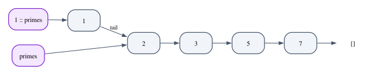

# Chapter 2 · Lean 4 for Rust Programmers

Chapter 1 showed you a few lines of Lean: an `#eval`, a `#check`, a definition
by pattern matching and a proof by induction. From now on, every chapter uses
Lean to state its ideas precisely and to prove them. This chapter is where you
learn the language properly.

The good news is that you already know most of it. Lean is a functional
programming language with structures, enums, pattern matching, generics, traits
and closures, and almost every Rust feature you use daily has a Lean
counterpart with a different spelling. The chapter is organized around those
counterparts. A few ideas, though, have no counterpart in Rust, and they are the
reason Lean can be a proof assistant at all: values never change, every function
must terminate, and a proof is just another program. We will meet each of them
when it first matters.

The chapter then builds the same program, a small order book for a trading
venue, in both languages, proves theorems about the Lean version that hold for
every possible book, and ends with a first tour of Mathlib, the library of
mathematics and tactics that the rest of the book relies on.

**In this chapter you will learn:**

- how Lean's `def`, `fun`, `structure`, `inductive` and `match` correspond to
  Rust's `fn`, closures, `struct`, `enum` and `match`;
- how `Option`, `Except`, `List` and `Array` compare to `Option`, `Result` and
  `Vec`, and what it means for a value to be *persistent*;
- how namespaces and dot notation replace `impl` blocks, and how type classes
  replace traits;
- how `do` notation gives you `?`, `let mut` and `for` loops in programs that are
  still pure;
- why Lean insists that every function terminates, and what `partial` and
  `termination_by` are for;
- how to prove properties of programs with `rfl`, `decide`, `simp`, `omega` and
  `induction`, and how to read goals and error messages;
- what Mathlib is, how the book's project depends on it, and how to find the
  lemma you need.

## Reading and writing Lean files

A Lean file is a sequence of *declarations* (`def`, `theorem`, `structure`,
`inductive`, `instance`...) and *commands* that ask Lean something (`#eval`,
`#check`, `#print`). Imports come first, then usually a `namespace`. The Lean
code of this chapter is in six files under `code/lean/Book/Ch02/`: `Basics.lean`,
`Classes.lean` and `Effects.lean` for the language, `Orders.lean` and
`FirstProofs.lean` for the order book, and `MathlibTour.lean` for Mathlib.

As in Chapter 1, every output in this chapter is checked by Lean: the doc comment
above a `#guard_msgs in` line is the exact text that the command below it must
print. When you open the files in an editor you will see the same text in the
**infoview**, the side panel that shows what Lean knows at the cursor: the output
of commands, the type of the expression under the cursor and, inside a proof, the
current goals. Lean checks the file continuously as you type, so there is no
separate compile step; an error appears under the offending line within a
second or two, like a `cargo check` that never stops running.

Lean uses Unicode freely. In the editor you type a backslash and a short name:
`\to` gives `→`, `\a` gives `α`, `\N` gives `ℕ`, `\le` gives `≤`, `\ne` gives
`≠`, `\<` and `\>` give `⟨` and `⟩`, and `\.` gives `·`. Most symbols also have
an ASCII spelling (`->` for `→`, `<=` for `≤`), but the book uses the Unicode
forms, because that is how Lean prints them.

Comments come in four kinds, and three of them have exact Rust counterparts:
`-- line comment` is `//`, `/- block comment -/` is `/* */`, `/-- doc comment -/`
before a declaration is `///`, and `/-! module doc -/` at the top of a file is
`//!`.

## Functions

Here is a first function, with its Rust version in the doc comment:

```lean
/-- Rust: `fn double(n: u64) -> u64 { 2 * n }` -/
def double (n : Nat) : Nat := 2 * n
```

```lean
/-- info: 42 -/
#guard_msgs in
#eval double 21
```

The shape is the same as in Rust, with different punctuation. Parameters are
written `(name : Type)`, with spaces around the colon by convention. The result
type follows a colon after the parameters, and the body follows `:=`. There are
no braces, no semicolons and no `return`: the body is a single expression, and its
value is the result. `Nat` is the type of natural numbers $0, 1, 2, \dots$, which
we will discuss in a moment.

### Application and currying

A function with two parameters:

```lean
/-- Two parameters. Rust: `fn area(width: u64, height: u64) -> u64`. -/
def area (width height : Nat) : Nat := width * height

/-- info: 12 -/
#guard_msgs in
#eval area 3 4
```

Function application is written by juxtaposition: `area 3 4`, not `area(3, 4)`.
Parentheses only group: `double (area 3 4)` applies `double` to the result of
`area 3 4`, while `double area 3 4` would be an error. This is the most visible
difference from Rust, and the one that takes longest to get used to.

The types tell you what is going on underneath:

```lean
/-- info: Ch02.area (width height : Nat) : Nat -/
#guard_msgs in
#check area

/-- info: area : Nat → Nat → Nat -/
#guard_msgs in
#check (area)

/-- info: area 3 : Nat → Nat -/
#guard_msgs in
#check area 3

/-- info: [30, 40, 50] -/
#guard_msgs in
#eval [3, 4, 5].map (area 10)
```

The first `#check` prints the *signature* of `area`, with parameter names. The
second, with `area` in parentheses, prints its *type*: `Nat → Nat → Nat`. The
arrow associates to the right, so this means `Nat → (Nat → Nat)`: `area` takes a
width and returns a *function* that takes a height. Every multi-argument function
in Lean works this way (it is *curried*, after the logician Haskell Curry), and
`area 3 4` is really `(area 3) 4`. As a consequence you can stop early: `area 3`
is a perfectly good value of type `Nat → Nat`, and the last line passes `area 10`
to `List.map`. In Rust you would write the closure `|h| area(10, h)` by hand.

### Anonymous functions

Closures are written `fun x => body`. For short ones there is a shorthand: a
centered dot `·` inside parentheses stands for the argument, so `(· + 10)` means
`fun x => x + 10`:

```lean
/-- info: [1, 4, 9] -/
#guard_msgs in
#eval [1, 2, 3].map (fun n => n * n)

/-- info: [11, 12, 13] -/
#guard_msgs in
#eval [1, 2, 3].map (· + 10)
```

### Local definitions and conditionals

Inside a body, `let` names an intermediate value, and `if c then a else b` is an
expression, exactly like Rust's `if`. String interpolation uses `s!"..."` with
the expressions in braces:

```lean
/-- `let`, `if` and string interpolation. Everything is an expression, and
there is no `return`: the body's value is the result. -/
def describe (n : Nat) : String :=
  let parity := if n % 2 == 0 then "even" else "odd"
  s!"{n} is {parity}"

/-- info: "7 is odd" -/
#guard_msgs in
#eval describe 7
```

The `let` line has no semicolon and no `in`: the line break ends it, and the rest
of the body is in its scope. The `else` branch is mandatory, for the reason you
saw in Chapter 1: both branches must have the same type, and a missing branch
would have none.

### Numbers

Lean's numeric types differ from Rust's in ways that will matter in proofs:

```lean
/-- info: 0 -/
#guard_msgs in
#eval (3 : Nat) - 5          -- Nat subtraction stops at zero

/-- info: -2 -/
#guard_msgs in
#eval (3 : Int) - 5

/-- info: 0 -/
#guard_msgs in
#eval (255 : UInt8) + 1      -- fixed-width types wrap around

/-- info: 1267650600228229401496703205376 -/
#guard_msgs in
#eval 2 ^ 100                -- Nat has no upper bound
```

`Nat` is the type of *mathematical* natural numbers: there is no largest one, so
`2 ^ 100` is computed exactly. (At run time Lean stores small numbers as machine
words and switches to arbitrary-precision integers when they grow.) Since there
are no negative naturals, subtraction is *truncated*: `3 - 5` is `0`. (A Rust
`u64` subtraction that goes below zero panics in a debug build and wraps around in
a release build.) Truncation keeps subtraction a total function, but it makes
some familiar laws false: `a - b + b = a` holds only when `b ≤ a`. `Int` is the
type of all integers, also unbounded. Fixed-width types (`UInt8`, `UInt64`,
`Int32`...) wrap around, and `Float` is the usual 64-bit floating-point type. The
book uses `Nat` and `Int` almost everywhere, because they are the easiest types
to prove theorems about.

### Generic functions and implicit arguments

In Rust, a generic function lists its type parameters in angle brackets. In Lean,
a type parameter is an ordinary parameter whose type is `Type`, the type of
types:

```lean
/-- A generic function. `{α : Type}` is an *implicit* argument: Lean infers it
from the other arguments, as Rust infers `T` in
`fn first_or<T>(xs: Vec<T>, default: T) -> T`. -/
def firstOr {α : Type} (xs : List α) (default : α) : α :=
  match xs with
  | [] => default
  | x :: _ => x

/-- info: 3 -/
#guard_msgs in
#eval firstOr [3, 4] 0

/-- info: "none" -/
#guard_msgs in
#eval firstOr [] "none"
```

The braces around `{α : Type}` make the parameter **implicit**: callers do not
pass it, and Lean works it out from the other arguments, the way Rust infers `T`.
In `firstOr [3, 4] 0` it sees a list of naturals and sets `α := Nat`; in
`firstOr [] "none"` the empty list says nothing, but the default `"none"` does.
The body uses `match` on the list, with the two cases `[]` (empty) and `x :: _`
(a first element `x` followed by a tail we ignore).

When you want to pass an implicit argument yourself, prefix the function with
`@`. All arguments then become explicit, which is Lean's version of the
turbofish:

```lean
/-- info: @firstOr : {α : Type} → List α → α → α -/
#guard_msgs in
#check @firstOr

/-- info: 7 -/
#guard_msgs in
#eval @firstOr Nat [] 7      -- like Rust's turbofish: first_or::<u64>
```

The type `{α : Type} → List α → α → α` reads "for every type `α`, a function from
lists of `α` and an `α` to an `α`"; Chapter 12 has much more to say about such
types.

One more convenience, with a catch. If a signature mentions a name that is not
defined anywhere, Lean adds it as an implicit argument automatically. This is
called *auto-bound implicits*, and it is switched on in the book's project:

```lean
/-- `α` is not declared anywhere: Lean adds `{α}` as an implicit argument. -/
def identity (x : α) : α := x

/-- info: @identity : {α : Sort u_1} → α → α -/
#guard_msgs in
#check @identity
```

(`Sort u_1` is a slightly more general version of `Type`; Chapter 12 explains
it.) Chapter 3 uses this to keep the typing rules of a language readable. The
catch is that a *misspelled* or un-imported name in a signature is not reported
as unknown: it silently becomes a type variable, and the error, if any, appears
later and looks unrelated:

```lean
/--
error: failed to synthesize instance of type class
  HMul Nat Nta Nat

Hint: Type class instance resolution failures can be inspected with the `set_option trace.Meta.synthInstance true` command.
-/
#guard_msgs in
def triple (n : Nta) : Nat := 3 * n     -- a typo: `Nta` instead of `Nat`
```

Lean took `Nta` to be an arbitrary type and then could not multiply a `Nat` by a
value of that type. When an error message mentions a type you never defined,
look for a typo in the signature.

### Definitions by pattern matching

A function can also be defined directly by cases on its argument, with one
equation per case, as Chapter 1's `sumTo` was:

```lean
/-- A definition by pattern matching: one equation per case. -/
def fib : Nat → Nat
  | 0 => 0
  | 1 => 1
  | n + 2 => fib n + fib (n + 1)

/-- info: [0, 1, 1, 2, 3, 5, 8, 13, 21, 34] -/
#guard_msgs in
#eval (List.range 10).map fib
```

The patterns `0`, `1` and `n + 2` cover every natural number, and Lean checks
that they do. The recursive calls are on `n` and `n + 1`, both smaller than
`n + 2`; Lean checks that too, as the section on totality explains.

## Structures and inductive types

### Structures

A `structure` is a Rust `struct`. Here is a point, and a Rust version from
`code/rust/examples/ch02_rust_counterparts.rs`, a file that collects the Rust
counterparts of this chapter's Lean definitions:

```lean
/-- Rust: `struct Point { x: i64, y: i64 }` with `#[derive(Debug, PartialEq)]`. -/
structure Point where
  x : Int
  y : Int
  deriving Repr, BEq

def origin : Point := { x := 0, y := 0 }

def p : Point := ⟨3, 4⟩
```

```rust
#[derive(Debug, Clone, Copy, PartialEq)]
struct Point {
    x: i64,
    y: i64,
}

impl Point {
    fn add(self, other: Point) -> Point {
        Point {
            x: self.x + other.x,
            y: self.y + other.y,
        }
    }
}
```

A value is built either with field names, `{ x := 0, y := 0 }` (note `:=`, not
`:`), or positionally with the *anonymous constructor* `⟨3, 4⟩`, which works for
any structure when Lean knows the expected type. Every structure also has a named
constructor, `Point.mk`, which is an ordinary function:

```lean
/-- info: 3 -/
#guard_msgs in
#eval p.x

/-- info: { x := 3, y := 10 } -/
#guard_msgs in
#eval { p with y := 10 }      -- Rust: Point { y: 10, ..p }

/-- info: { x := 3, y := 4 } -/
#guard_msgs in
#eval p                       -- p itself is unchanged

/-- info: Ch02.Point.mk (x y : Int) : Point -/
#guard_msgs in
#check Point.mk
```

`{ p with y := 10 }` is Rust's struct update syntax `Point { y: 10, ..p }`. It
builds a *new* point, and `p` is unchanged, as the next line shows. In Lean there
is no way to change `p` at all: values never change, a point we return to below.

### Inductive types

An `inductive` type is a Rust `enum`: a fixed set of alternatives, called
*constructors*, each of which may carry data:

```lean
/-- Rust: `enum Command { Ping, Get(String), Set(String, u64), Delete(String) }`. -/
inductive Command where
  | ping
  | get (key : String)
  | set (key : String) (value : Nat)
  | delete (key : String)
  deriving Repr, BEq

/-- `match` with one arm per constructor. -/
def Command.describe (c : Command) : String :=
  match c with
  | .ping => "ping"
  | .get key => s!"read {key}"
  | .set key value => s!"write {value} to {key}"
  | .delete key => s!"remove {key}"

/-- info: "write 3 to retries" -/
#guard_msgs in
#eval (Command.set "retries" 3).describe
```

```rust
#[derive(Debug, Clone, PartialEq)]
enum Command {
    Ping,
    Get(String),
    Set(String, u64),
    Delete(String),
}

impl Command {
    fn describe(&self) -> String {
        match self {
            Command::Ping => "ping".to_string(),
            Command::Get(key) => format!("read {key}"),
            Command::Set(key, value) => format!("write {value} to {key}"),
            Command::Delete(key) => format!("remove {key}"),
        }
    }
}
```

The function `Command.describe` matches on the command with one arm per
constructor. In the patterns, `.get key` is short for `Command.get key`: when
Lean knows the expected type, a leading dot looks the name up in that type's
namespace, which saves writing `Command::` over and over.

As in Rust, a `match` must be exhaustive, and Lean tells you which cases you
forgot:

```lean
/--
error: Missing cases:
ping
-/
#guard_msgs in
def Command.isWrite : Command → Bool
  | .set _ _ => true
  | .delete _ => true
  | .get _ => false
```

Rust reports the same mistake as error E0004 ("non-exhaustive patterns"). In both
languages, exhaustiveness is what makes `match` trustworthy: a function defined
by cases really does handle every value of the type.

### Recursive types

Inductive types can be recursive. Here is a binary search tree, whose `node`
constructor contains two smaller trees:

```lean
/-- A binary search tree. Rust needs `Box<Tree>` for the recursive fields;
Lean does not, because every value of an inductive type is already a pointer
to an immutable heap object. -/
inductive Tree where
  | leaf
  | node (left : Tree) (key : Nat) (right : Tree)
  deriving Repr

def Tree.insert (t : Tree) (k : Nat) : Tree :=
  match t with
  | .leaf => .node .leaf k .leaf
  | .node l x r =>
    if k < x then .node (l.insert k) x r
    else if x < k then .node l x (r.insert k)
    else t

def Tree.toList : Tree → List Nat
  | .leaf => []
  | .node l x r => l.toList ++ [x] ++ r.toList

/-- info: [1, 3, 4, 5, 9] -/
#guard_msgs in
#eval ([5, 3, 9, 1, 4, 3].foldl Tree.insert .leaf).toList
```

The Rust version needs `Box`, because a Rust `enum` is stored inline and a type
that contains itself directly would have infinite size (Chapter 11 discusses this
in detail):

```rust
/// The recursive fields need a `Box`: without it, `Tree` would contain itself
/// and have infinite size.
#[derive(Debug)]
enum Tree {
    Leaf,
    Node(Box<Tree>, u64, Box<Tree>),
}

impl Tree {
    /// Consumes the tree and returns a new one, like the Lean version.
    fn insert(self, k: u64) -> Tree {
        match self {
            Tree::Leaf => Tree::Node(Box::new(Tree::Leaf), k, Box::new(Tree::Leaf)),
            Tree::Node(l, x, r) => {
                if k < x {
                    Tree::Node(Box::new(l.insert(k)), x, r)
                } else if x < k {
                    Tree::Node(l, x, Box::new(r.insert(k)))
                } else {
                    Tree::Node(l, x, r)
                }
            }
        }
    }

    fn to_vec(&self) -> Vec<u64> {
        match self {
            Tree::Leaf => Vec::new(),
            Tree::Node(l, x, r) => {
                let mut v = l.to_vec();
                v.push(*x);
                v.extend(r.to_vec());
                v
            }
        }
    }
}
```

Lean needs nothing of the kind: a value of an inductive type is always a pointer
to an immutable object on the heap, so a `Tree` field is one pointer wide.
`Tree.insert` returns a new tree, but the subtrees it does not visit are not
copied: the new tree points to them, and so does the old tree, which remains
valid. (The Rust version avoids copies differently, by taking `self` by value and
moving the subtrees into the result.) The `foldl` in the last line inserts the
numbers one by one, starting from `.leaf`.

## Options, errors and collections

### `Option`

`Option α` is Rust's `Option<T>`, with the constructors spelled `none` and
`some`:

```lean
/-- Rust: `fn safe_div(a: u64, b: u64) -> Option<u64>`. -/
def safeDiv (a b : Nat) : Option Nat :=
  if b == 0 then none else some (a / b)

/-- info: some 5 -/
#guard_msgs in
#eval safeDiv 10 2

/-- info: none -/
#guard_msgs in
#eval safeDiv 10 0

/-- info: 0 -/
#guard_msgs in
#eval (safeDiv 10 0).getD 0        -- Rust: .unwrap_or(0)

/-- info: some 6 -/
#guard_msgs in
#eval (safeDiv 10 2).map (· + 1)   -- Rust: .map(|n| n + 1)
```

The library functions have different names but the same meaning: `getD` is
`unwrap_or`, `map` is `map`, `bind` is `and_then`, `isSome` is `is_some`. There
is also `get!`, which panics on `none` like `unwrap`; the book avoids it.

### `Except`

Rust's `Result<T, E>` is called `Except ε α` in Lean, with the constructors
`.ok` and `.error`. Note that the error type comes *first*:

```lean
/-- The errors of a small parser. -/
inductive ParseError where
  | empty
  | notADigit (c : Char)
  deriving Repr

/-- `Except ε α` is Rust's `Result<α, ε>`: note that the error type comes
first. The constructors are `.ok` and `.error`. -/
def parseDigit (c : Char) : Except ParseError Nat :=
  if c.isDigit then .ok (c.toNat - '0'.toNat) else .error (.notADigit c)

/-- info: Except.ok 7 -/
#guard_msgs in
#eval parseDigit '7'

/-- info: Except.error (Ch02.ParseError.notADigit 'x') -/
#guard_msgs in
#eval parseDigit 'x'
```

(`Char.toNat` is the character's code point, so subtracting the code of `'0'`
turns `'7'` into `7`.) Combining two fallible steps by hand is as tedious as in
Rust without `?`:

```lean
/-- Combining two fallible steps with `match`, the long way. (Section "Effects"
shows the short way, with `do` and `←`, Lean's version of Rust's `?`.) -/
def parseTwoDigits (a b : Char) : Except ParseError Nat :=
  match parseDigit a with
  | .error e => .error e
  | .ok d₁ =>
    match parseDigit b with
    | .error e => .error e
    | .ok d₂ => .ok (10 * d₁ + d₂)

/-- info: Except.ok 42 -/
#guard_msgs in
#eval parseTwoDigits '4' '2'
```

The section on `do` notation shows Lean's equivalent of `?`.

### Lists

`List α` is a singly linked list: either empty, `[]`, or an element followed by
a list, `x :: xs` (read "x cons xs"). Lists are the workhorse of functional
programming, and Lean has a large library of functions on them:

```lean
def primes : List Nat := [2, 3, 5, 7]

/-- info: [1, 2, 3, 5, 7] -/
#guard_msgs in
#eval 1 :: primes              -- a new list whose tail *is* primes

/-- info: [2, 3, 5, 7] -/
#guard_msgs in
#eval primes                   -- primes itself is unchanged

/-- info: [6, 10, 14] -/
#guard_msgs in
#eval primes.map (· * 2) |>.filter (· > 5)

/-- info: 17 -/
#guard_msgs in
#eval primes.foldl (· + ·) 0

/-- info: (some 5, some 3, none) -/
#guard_msgs in
#eval (primes.find? (· > 4), primes[1]?, primes[10]?)
```

`xs.map f |>.filter g` is a pipeline: `|>.filter g` applies `filter g` to
whatever is on its left, like a chained iterator adapter in Rust. Unlike Rust's
iterators, Lean's list functions are not lazy: `map` builds a whole new list
before `filter` runs. Indexing with `xs[i]?` returns an `Option`, like Rust's
`get`.

The first two `#eval`s show the property that matters most. `1 :: primes` is a
new list with one more element, and `primes` still exists, unchanged. Building
the new list does not copy `primes`: the new first cell simply points to it.



A data structure with this property is called **persistent**: operations
produce new versions and the old versions remain available. Persistence is what
you get automatically when values cannot change, and sharing is what makes it
cheap.

### Arrays

`Array α` is Lean's `Vec<T>`: a contiguous, growable buffer with constant-time
indexing:

```lean
def readings : Array Nat := #[12, 15, 11]

/-- info: #[12, 15, 11, 14] -/
#guard_msgs in
#eval readings.push 14

/-- info: #[12, 99, 11] -/
#guard_msgs in
#eval readings.set! 1 99

/-- info: (3, 15) -/
#guard_msgs in
#eval (readings.size, readings[1]!)
```

Arrays are written `#[...]`. `push` adds an element at the end, `set!` replaces
one (panicking if the index is out of bounds, hence the `!`), and `a[i]!` reads
one with the same check. Chapter 1 showed the other two forms of indexing,
`a[i]?` and `a[i]'h` with a proof `h`.

Arrays are persistent too: `readings.push 14` returns a new array, and `readings`
is still `#[12, 15, 11]`. Whether that means every `push` copies the array is
answered in the section on values that never change (it does not).

## Namespaces, dot notation and type classes

### Namespaces instead of `impl` blocks

Lean has no `impl` blocks. A "method" is an ordinary function that lives in the
namespace of its type:

```lean
namespace Point

/-- Inside `namespace Point`, this defines `Point.add`. -/
def add (a b : Point) : Point := ⟨a.x + b.x, a.y + b.y⟩

/-- The Manhattan length. `Int.natAbs` is the absolute value, as a `Nat`. -/
def manhattan (a : Point) : Nat := a.x.natAbs + a.y.natAbs

end Point

/-- info: { x := 6, y := 8 } -/
#guard_msgs in
#eval p.add p                  -- dot notation: Point.add p p

/-- info: 7 -/
#guard_msgs in
#eval p.manhattan
```

Inside `namespace Point ... end Point`, the definition `add` gets the full name
`Point.add`. (Writing `def Point.add` outside the namespace is equivalent, and
that is how `Command.describe` was defined.) **Dot notation** then does the rest:
when Lean sees `p.add p` and `p` has type `Point`, it looks for a function
`Point.add` and passes `p` as its first argument of type `Point`. That is why
`p.add p` means `Point.add p p`, why `primes.map f` means `List.map f primes`, and
why `(safeDiv 10 0).getD 0` works.

It looks like method syntax, but it is only a naming convention, resolved by the
type of the value before the dot. So anyone can add "methods" to any type, in any
file, by defining a function in its namespace; Rust needs an extension trait for
that. Namespaces also play the role of Rust's modules, and `open Point` brings the
names of a namespace into scope, like `use`.

### Type classes instead of traits

Rust's traits come from Haskell's **type classes**, and Lean has type classes in
the original form. Chapter 14 studies them in depth; here is the practical
correspondence. A class declares operations, possibly with defaults:

```lean
/-- Rust: `trait Summary { fn summary(&self) -> String; fn tag(&self) -> String
{ ... } }`. A class lists the operations an instance must provide; `tag` has
a default implementation, like a default method. -/
class Summary (α : Type) where
  summary : α → String
  tag : α → String := fun _ => "item"
```

An `instance` implements a class for a type, like an `impl Trait for Type` block.
An instance can depend on another instance, like a blanket impl:

```lean
structure Sensor where
  name : String
  celsius : Int

/-- Rust: `impl Summary for Sensor { ... }`. -/
instance : Summary Sensor where
  summary s := s!"{s.name}: {s.celsius} °C"
  tag _ := "sensor"

/-- An instance that uses the default `tag`. -/
instance : Summary Nat where
  summary n := s!"the number {n}"

/-- Rust: `impl<T: Summary> Summary for Vec<T>`. The instance for `List α`
needs an instance for `α`, written as an instance argument `[Summary α]`. -/
instance {α : Type} [Summary α] : Summary (List α) where
  summary xs := ", ".intercalate (xs.map Summary.summary)
  tag _ := "list"
```

A generic function that needs the operations takes an **instance argument** in
square brackets, which is Lean's trait bound:

```lean
/-- Rust: `fn report<T: Summary>(x: &T) -> String`. The square brackets ask
Lean to find the instance by itself, at every call site. -/
def report {α : Type} [Summary α] (x : α) : String :=
  s!"[{Summary.tag x}] {Summary.summary x}"

/-- info: "[sensor] boiler: 74 °C" -/
#guard_msgs in
#eval report (Sensor.mk "boiler" 74)

/-- info: "[item] the number 7" -/
#guard_msgs in
#eval report 7

/-- info: "[list] the number 1, the number 2" -/
#guard_msgs in
#eval report [1, 2]
```

Side by side with the Rust version, the correspondence is line for line:

```rust
trait Summary {
    fn summary(&self) -> String;
    fn tag(&self) -> String {
        "item".to_string()
    }
}

struct Sensor {
    name: String,
    celsius: i64,
}

impl Summary for Sensor {
    fn summary(&self) -> String {
        format!("{}: {} °C", self.name, self.celsius)
    }
    fn tag(&self) -> String {
        "sensor".to_string()
    }
}

impl<T: Summary> Summary for Vec<T> {
    fn summary(&self) -> String {
        let parts: Vec<String> = self.iter().map(|x| x.summary()).collect();
        parts.join(", ")
    }
    fn tag(&self) -> String {
        "list".to_string()
    }
}

fn report<T: Summary>(x: &T) -> String {
    format!("[{}] {}", x.tag(), x.summary())
}
```

The square brackets in `[Summary α]` tell Lean to *search* for the instance at
each call site. For `report [1, 2]` it needs `Summary (List Nat)`, finds the list
instance, which in turn needs `Summary Nat`, and finds that. When the search
fails, you get Lean's equivalent of Rust's E0277 ("the trait bound is not
satisfied"):

```lean
/--
error: failed to synthesize instance of type class
  Summary String

Hint: Type class instance resolution failures can be inspected with the `set_option trace.Meta.synthInstance true` command.
-/
#guard_msgs in
#eval report "hello"
```

One difference from Rust: the methods of a class are functions in the *class's*
namespace, so we call `Summary.summary x` (or `summary x` after `open Summary`).
Dot notation `x.summary` would look for `Sensor.summary`, which does not exist.

### The standard classes and `deriving`

Lean's core library defines classes for the operations that Rust's standard
traits provide, and many of them can be derived:

| Rust trait | Lean class | What it gives you |
|---|---|---|
| `Debug` | `Repr` | printing by `#eval` |
| `Display` | `ToString` | `toString x`, `s!"{x}"` |
| `PartialEq` | `BEq` | `x == y` |
| `Eq` (roughly) | `DecidableEq` | `x == y`, `if x = y`, and proofs |
| `Hash` | `Hashable` | `hash x`, keys of `HashMap` |
| `Default` | `Inhabited` | `default` |
| `Ord` | `Ord` | `compare x y` |

`deriving` after a type plays the role of `#[derive]`:

```lean
/-- `deriving` asks Lean to write the instances, like `#[derive]`. -/
structure Endpoint where
  host : String
  port : Nat
  deriving Repr, BEq, Hashable, Inhabited

/-- `ToString` is Rust's `Display`: we write it by hand. -/
instance : ToString Endpoint where
  toString e := s!"{e.host}:{e.port}"

def api : Endpoint := { host := "api.example.com", port := 443 }
```

```lean
/-- info: { host := "api.example.com", port := 443 } -/
#guard_msgs in
#eval api                                   -- uses Repr, like {:?}

/-- info: "connecting to api.example.com:443" -/
#guard_msgs in
#eval s!"connecting to {api}"               -- uses ToString, like {}

/-- info: true -/
#guard_msgs in
#eval api == { host := "api.example.com", port := 443 }   -- uses BEq

/-- info: { host := "", port := 0 } -/
#guard_msgs in
#eval (default : Endpoint)                  -- uses Inhabited, like Default
```

`Std.HashMap` (from the `Std` library that ships with Lean) needs `BEq` and
`Hashable` for its keys, as Rust's `HashMap` needs `Eq` and `Hash`:

```lean
open Std in
/-- `Std.HashMap` needs `BEq` and `Hashable` keys, as Rust's `HashMap` needs
`Eq` and `Hash`. -/
def failures : HashMap Endpoint Nat :=
  ({} : HashMap Endpoint Nat) |>.insert api 2 |>.insert { host := "db", port := 5432 } 1

/-- info: (some 2, none) -/
#guard_msgs in
#eval (failures.get? api, failures.get? default)
```

Two of these classes deserve a remark. `DecidableEq` is stronger than `BEq`: it
decides the *proposition* `x = y`, with a guarantee that its answer is right,
whereas a derived `BEq` is just a function returning a `Bool`, about which proofs
know nothing. So when you intend to prove things about a type, derive
`DecidableEq` (and `==` then comes from it), as the order book below does.
`Inhabited` matters because some operations need a fallback value: `xs[i]!` must
return *something* of the right type even while it reports a panic, and that
something is `default`.

## `do` notation, `IO` and loops

### Effects are visible in types

In Rust any function can print, read a file or open a socket. In Lean a function
of type `Nat → Nat` cannot: it can only compute its result. Effects live in
special types, and the most important one is `IO α`, the type of *actions* that
may perform input and output and then produce an `α`:

```lean
/-- An `IO` action: a description of effects, run by `#eval` or by `main`. -/
def greet (name : String) : IO Unit := do
  IO.println s!"hello, {name}"
  if name.length > 3 then
    IO.println "that is a long name"

/--
info: hello, Grace
that is a long name
-/
#guard_msgs in
#eval greet "Grace"
```

`do` starts a block of statements, one per line, executed in order. Calling
`greet "Grace"` does not print anything by itself; it produces an action, and
`#eval` runs it. A compiled Lean program is an action called `main` (usually of
type `IO Unit`), which the runtime runs, just as Rust's runtime calls
`fn main()`. The `if` without `else` is allowed here, because inside `do` a
missing `else` means "do nothing".

### `do` for errors: Lean's `?`

`do` is not tied to `IO`. It works for every type that describes a computation
with some kind of effect (in technical terms, every *monad*, the subject of
Chapter 20), including `Option` and `Except`. In a `do` block for `Except`, the
arrow `←` runs a fallible step and either extracts its result or stops at the
first error, which is exactly what Rust's `?` does:

```lean
/-- Parse a decimal number. In a `do` block for `Except`, `←` runs a fallible
step and stops at the first error, like Rust's `?`; `throw` is `return Err(..)`. -/
def parseNat (s : String) : Except ParseError Nat := do
  if s.isEmpty then throw .empty
  let mut n := 0
  for c in s.toList do
    let d ← parseDigit c
    n := 10 * n + d
  return n

/-- info: Except.ok 2024 -/
#guard_msgs in
#eval parseNat "2024"

/-- info: Except.error (Ch02.ParseError.notADigit 'O') -/
#guard_msgs in
#eval parseNat "2O24"
```

```rust
#[derive(Debug, PartialEq)]
enum ParseError {
    Empty,
    NotADigit(char),
}

fn parse_digit(c: char) -> Result<u64, ParseError> {
    c.to_digit(10)
        .map(u64::from)
        .ok_or(ParseError::NotADigit(c))
}

fn parse_nat(s: &str) -> Result<u64, ParseError> {
    if s.is_empty() {
        return Err(ParseError::Empty);
    }
    let mut n = 0;
    for c in s.chars() {
        let d = parse_digit(c)?;
        n = 10 * n + d;
    }
    Ok(n)
}
```

Compare the two line by line. `throw .empty` is `return Err(ParseError::Empty)`;
`let d ← parseDigit c` is `let d = parse_digit(c)?`; `return n` is `Ok(n)`. Lean
also has `let mut`, reassignment with `:=`, and `for ... in ... do` loops, all
inside `do`.

### Mutable variables in pure code

Here is a loop that accumulates a sum in a mutable variable:

```lean
/-- A loop with a mutable accumulator, inside `Id.run do`: the function is
pure, and its type says so. -/
def sumSquares (xs : List Nat) : Nat := Id.run do
  let mut total := 0
  for x in xs do
    total := total + x * x
  return total

/-- info: 14 -/
#guard_msgs in
#eval sumSquares [1, 2, 3]

/-- The loop is a left fold in disguise, and Lean can prove it. -/
theorem sumSquares_eq_foldl (xs : List Nat) :
    sumSquares xs = xs.foldl (fun total x => total + x * x) 0 := by
  simp [sumSquares]
```

`Id.run do` uses `do` notation for a computation with *no* effects at all (`Id`
is the "identity" monad), so `sumSquares` has the plain type `List Nat → Nat`,
and it is as pure as `double`. How can a pure function have a mutable variable?
Because `let mut` and `for` are notation. Lean translates the block into ordinary
functional code: each assignment introduces a new version of `total`, and the
loop becomes a fold that threads the current version through the iterations. No
memory cell is ever overwritten.

The theorem under the definition makes this concrete: the loop is equal to
`List.foldl` with the function `fun total x => total + x * x`, and the `simp`
tactic (explained later in this chapter) proves it by unfolding the translation.
Inside `do` you can also `return` early, from the middle of a loop:

```lean
/-- Early `return` from inside a loop. -/
def firstNegative (xs : List Int) : Option Int := Id.run do
  for x in xs do
    if x < 0 then return some x
  return none

/-- info: some (-1) -/
#guard_msgs in
#eval firstNegative [3, -1, -5]
```

## Totality: every function terminates

Rust lets you write any recursion you like, and a `loop {}` that never ends, which
is the right choice for a language in which servers are supposed to run forever.
Lean refuses such definitions, because of its proof-assistant side:

```lean
/--
error: fail to show termination for
  Ch02.bogus
with errors
failed to infer structural recursion:
Not considering parameter n of Ch02.bogus:
  it is unchanged in the recursive calls
no parameters suitable for structural recursion

well-founded recursion cannot be used, `Ch02.bogus` does not take any (non-fixed) arguments
-/
#guard_msgs in
def bogus (n : Nat) : Nat := bogus n + 1
```

If Lean accepted `bogus`, its defining equation `bogus 0 = bogus 0 + 1` would be
a fact that proofs could use, and subtracting `bogus 0` from both sides gives
`0 = 1`. From a false statement every statement follows, so a single
non-terminating definition would make every theorem in the system worthless.
Lean therefore accepts a recursive definition only when it can see that the
recursion terminates. Functions that always terminate are called **total**, and
totality is the price of being able to use programs inside proofs. Chapter 10
explains the same point from the logical side: in Rust, `loop {}` has every type,
which is why Rust's types make a poor logic.

Lean has two ways to see termination. The easy one is **structural recursion**:
every recursive call is on a piece of the argument, as in `fib` (calls on `n` and
`n + 1` when the argument was `n + 2`) and `Tree.insert` (calls on the subtrees).
It always terminates, because data is finite.

The other is **well-founded recursion**: Lean finds a quantity, called a
*measure*, that decreases at every call and cannot decrease forever, and *proves*
that it decreases. Often it manages on its own:

```lean
/-- Not structural (`n / 10` is not a sub-term of `n`), but Lean finds and
proves the decreasing measure on its own. -/
def digits (n : Nat) : List Nat :=
  if n < 10 then [n] else digits (n / 10) ++ [n % 10]

/-- Binary search for the first `n` in `[lo, hi)` where `ok` holds (for a
monotone `ok`). Lean guesses the measure `hi - lo` by itself. -/
def search (lo hi : Nat) (ok : Nat → Bool) : Nat :=
  if lo < hi then
    let mid := (lo + hi) / 2
    if ok mid then search lo mid ok else search (mid + 1) hi ok
  else lo

/-- info: ([2, 0, 2, 4], 8) -/
#guard_msgs in
#eval (digits 2024, search 0 100 (fun n => n * n ≥ 50))
```

For `digits`, the argument goes from `n` to `n / 10`, which is not a piece of `n`
but is smaller when `n ≥ 10`, and Lean proves that automatically. For `search`
it discovers that `hi - lo` shrinks at each call. When it fails, it says what it
tried. Here is the famous Collatz function, which halves even numbers and maps an
odd `n` to `3n + 1`:

```lean
/--
error: fail to show termination for
  Ch02.collatz
with errors
failed to infer structural recursion:
Cannot use parameter n:
  failed to eliminate recursive application
    collatz (n / 2)


failed to prove termination, possible solutions:
  - Use `have`-expressions to prove the remaining goals
  - Use `termination_by` to specify a different well-founded relation
  - Use `decreasing_by` to specify your own tactic for discharging this kind of goal
n : Nat
h✝¹ : ¬n ≤ 1
h✝ : ¬(n % 2 == 0) = true
⊢ 3 * n + 1 < n
-/
#guard_msgs in
def collatz (n : Nat) : Nat :=
  if n ≤ 1 then 0
  else if n % 2 == 0 then 1 + collatz (n / 2)
  else 1 + collatz (3 * n + 1)
```

The message has two parts. "Failed to infer structural recursion" says that
`n / 2` is not a piece of `n`. Then Lean tried well-founded recursion with `n`
itself as the measure, and got stuck on the goal printed at the end: in the odd
branch (the hypotheses say `n` is not `≤ 1` and not even), it would have to show
`3 * n + 1 < n`, which is false. In fact nobody knows whether this function
terminates for every `n`: that is the Collatz conjecture, open since 1937.

For such cases there is `partial def`:

```lean
/-- Nobody knows whether this terminates for every `n`, so it must be
`partial`. Lean compiles and runs it, but will not unfold it in proofs. -/
partial def collatzSteps (n : Nat) : Nat :=
  if n ≤ 1 then 0
  else if n % 2 == 0 then 1 + collatzSteps (n / 2)
  else 1 + collatzSteps (3 * n + 1)

/-- info: 111 -/
#guard_msgs in
#eval collatzSteps 27
```

A `partial` function is compiled and runs normally, but for the logic it is an
opaque constant: Lean knows its type and nothing about its values, so no proof
can unfold it, and no contradiction can come from it. Lean also requires the
function's type to be *inhabited*: it must be able to name some value of that
type (here, for instance, the function that always returns `0`). That rules out a
"partial proof" of a false proposition, whose type has no values at all. The
book uses `partial` only when the point is that something may not terminate,
as in the λ-calculus evaluator of Chapter 7.

Finally, when Lean cannot guess the measure, you can name it with
`termination_by` and prove the decrease yourself with `decreasing_by`:

```lean
/-- Euclid's algorithm. Lean cannot guess why it terminates, so we say which
argument decreases (`termination_by`) and prove that it does (`decreasing_by`). -/
def gcd (a b : Nat) : Nat :=
  if b = 0 then a else gcd b (a % b)
termination_by b
decreasing_by
  -- Goal: a % b < b, knowing ¬b = 0.
  apply Nat.mod_lt   -- a % b < b holds whenever b > 0;
  omega              -- and b > 0 follows from ¬b = 0.

/-- info: 6 -/
#guard_msgs in
#eval gcd 12 18
```

Here the measure is `b`. The proof obligation is the goal `a % b < b`, under the
hypothesis that `b` is not zero; `Nat.mod_lt` is the library fact "`a % b < b`
whenever `b > 0`", and `omega`, a tactic you will meet below, proves `b > 0` from
`¬b = 0`. Chapter 31 returns to well-founded recursion with harder examples.

## Values that never change

In Lean no value is ever modified. You have seen the consequences: `{ p with ... }`
builds a new structure, `xs.push x` returns a new array, `let mut` introduces new
versions of a variable. This is what makes reasoning about Lean programs easy: a
name always denotes the same value, so you can replace it by its definition
anywhere, which is what proofs do all the time.

It would be terribly slow if every `push` copied the array, and it does not.
Lean's runtime counts references to every heap object. When `Array.push`
receives an array whose reference count is 1, nobody else can observe the array,
so the runtime updates it *in place*, at the cost of Rust's `Vec::push`. Only
when the array is shared (when some other variable still refers to the old
version, as `readings` did above) does `push` copy it first. This technique is
known as "functional but in place".

You know this situation from Rust: a `Vec` can be mutated through `&mut` because
the ownership rules guarantee that nobody else can observe it meanwhile. Rust
establishes that uniqueness *statically*, with the borrow checker; Lean checks it
*dynamically*, with a reference count, and copies when uniqueness fails.
Chapter 24 comes back to this with a demonstration.

## Putting it together: an order book in two languages

Time for a complete program. An **order book** is the data structure at the heart
of an exchange: traders send *limit orders* ("buy 10 at 100.50 or less", "sell 5
at 101.25 or more"), and the book keeps the orders that are waiting. The highest
buy price is the *best bid*, the lowest sell price the *best ask*, and the gap
between them is the *spread*. Our book is "post-only": an order that would trade
immediately (a buy at or above the best ask, or a sell at or below the best bid)
is rejected instead of matched, so the book is never *crossed*. Prices are in
cents, so that arithmetic is exact.

### The Rust version

The Rust program is `code/rust/examples/ch02_orders.rs`. Its types are what you
would expect:

```rust
/// Which side of the book an order is on.
#[derive(Debug, Clone, Copy, PartialEq, Eq)]
enum Side {
    Buy,
    Sell,
}

/// A resting limit order. Prices are in cents, so that they are exact.
#[derive(Debug, Clone, PartialEq, Eq)]
struct Order {
    id: u64,
    trader: String,
    side: Side,
    price: u64,
    qty: u64,
}

/// Why an order or a cancellation was rejected.
#[derive(Debug, Clone, PartialEq, Eq)]
enum OrderError {
    ZeroQuantity,
    ZeroPrice,
    /// The order would trade against `best`, the best price on the other side.
    WouldCross {
        best: u64,
    },
    UnknownOrder(u64),
}

/// The resting orders, by id, and the id the next order will get.
#[derive(Debug)]
struct Book {
    orders: BTreeMap<u64, Order>,
    next_id: u64,
}
```

The queries use iterators over a `BTreeMap`, and `spread` uses `?` on `Option`:

```rust
impl Book {
    fn new() -> Book {
        Book {
            orders: BTreeMap::new(),
            next_id: 1,
        }
    }

    /// The orders on one side, in id order.
    fn side(&self, side: Side) -> impl Iterator<Item = &Order> {
        self.orders.values().filter(move |o| o.side == side)
    }

    /// The highest price a buyer is offering.
    fn best_bid(&self) -> Option<u64> {
        self.side(Side::Buy).map(|o| o.price).max()
    }

    /// The lowest price a seller is asking.
    fn best_ask(&self) -> Option<u64> {
        self.side(Side::Sell).map(|o| o.price).min()
    }

    /// The gap between the best ask and the best bid. The subtraction cannot
    /// underflow because the book is never crossed: Lean proves it.
    fn spread(&self) -> Option<u64> {
        let bid = self.best_bid()?;
        let ask = self.best_ask()?;
        Some(ask - bid)
    }

    /// The total quantity on one side.
    fn volume(&self, side: Side) -> u64 {
        self.side(side).map(|o| o.qty).sum()
    }

    /// The total quantity at each price on one side, by increasing price.
    fn depth(&self, side: Side) -> BTreeMap<u64, u64> {
        let mut levels = BTreeMap::new();
        for o in self.side(side) {
            *levels.entry(o.price).or_insert(0) += o.qty;
        }
        levels
    }
}
```

Placing an order validates it with early returns, then mutates the book through
`&mut self`; cancelling removes the order from the map:

```rust
impl Book {
    /// The best price on the other side, if an order at `price` would trade
    /// against it.
    fn crossing(&self, side: Side, price: u64) -> Option<u64> {
        match side {
            Side::Buy => self.best_ask().filter(|&ask| ask <= price),
            Side::Sell => self.best_bid().filter(|&bid| price <= bid),
        }
    }

    /// Validate an order and add it to the book; return its id.
    fn place(
        &mut self,
        trader: &str,
        side: Side,
        price: u64,
        qty: u64,
    ) -> Result<u64, OrderError> {
        if qty == 0 {
            return Err(OrderError::ZeroQuantity);
        }
        if price == 0 {
            return Err(OrderError::ZeroPrice);
        }
        if let Some(best) = self.crossing(side, price) {
            return Err(OrderError::WouldCross { best });
        }
        let id = self.next_id;
        let trader = trader.to_string();
        let order = Order {
            id,
            trader,
            side,
            price,
            qty,
        };
        self.orders.insert(id, order);
        self.next_id += 1;
        Ok(id)
    }

    /// Remove an order from the book and return it.
    fn cancel(&mut self, id: u64) -> Result<Order, OrderError> {
        self.orders.remove(&id).ok_or(OrderError::UnknownOrder(id))
    }
}
```

The `main` function sends seven requests and runs a few queries (a small
formatting function and two `Display` impls, in the same file, print prices as
dollars and cents):

```rust
fn main() {
    let mut book = Book::new();
    let requests = [
        ("alice", Side::Buy, 10050, 10),
        ("bob", Side::Sell, 10125, 5),
        ("carol", Side::Buy, 10075, 7),
        ("dave", Side::Sell, 10125, 8),
        ("gina", Side::Sell, 10200, 4),
        ("erin", Side::Buy, 10150, 3),
        ("frank", Side::Sell, 9900, 0),
    ];
    for (trader, side, p, qty) in requests {
        match book.place(trader, side, p, qty) {
            Ok(id) => println!("placed   {}", book.orders[&id]),
            Err(e) => println!("rejected {trader}: {e}"),
        }
    }

    let (bid, ask) = (book.best_bid().unwrap(), book.best_ask().unwrap());
    let spread = book.spread().unwrap();
    println!(
        "best bid {}, best ask {}, spread {}",
        price(bid),
        price(ask),
        price(spread)
    );
    let (buys, sells) = (book.volume(Side::Buy), book.volume(Side::Sell));
    println!("volume: {buys} to buy, {sells} to sell");
    for (p, qty) in book.depth(Side::Sell) {
        println!("sell depth at {}: {qty}", price(p));
    }

    match book.cancel(3) {
        Ok(order) => println!("cancelled {order}"),
        Err(e) => println!("rejected cancel: {e}"),
    }
    match book.cancel(3) {
        Ok(order) => println!("cancelled {order}"),
        Err(e) => println!("rejected cancel: {e}"),
    }
    println!("best bid now {}", price(book.best_bid().unwrap()));
    assert_eq!(book.orders.len(), 4);
}
```

```text
placed   #1 alice buys 10 @ 100.50
placed   #2 bob sells 5 @ 101.25
placed   #3 carol buys 7 @ 100.75
placed   #4 dave sells 8 @ 101.25
placed   #5 gina sells 4 @ 102.00
rejected erin: would cross the best price 101.25
rejected frank: quantity must be positive
best bid 100.75, best ask 101.25, spread 0.50
volume: 17 to buy, 17 to sell
sell depth at 101.25: 13
sell depth at 102.00: 4
cancelled #3 carol buys 7 @ 100.75
rejected cancel: no order #3
best bid now 100.50
```

Erin's buy at 101.50 is rejected because it would trade against the best ask of
101.25; Frank's sell has quantity zero.

### The Lean version

The Lean program is `code/lean/Book/Ch02/Orders.lean`. The types translate one to
one:

```lean
/-- Which side of the book an order is on. -/
inductive Side where
  | buy
  | sell
  deriving Repr, DecidableEq

/-- A resting limit order. Prices are in cents, so that they are exact. -/
structure Order where
  id : Nat
  trader : String
  side : Side
  price : Nat
  qty : Nat
  deriving Repr, BEq

/-- Why an order or a cancellation was rejected. -/
inductive OrderError where
  | zeroQuantity
  | zeroPrice
  | wouldCross (best : Nat)
  | unknownOrder (id : Nat)
  deriving Repr, BEq, DecidableEq

/-- The resting orders, oldest first, and the id the next order will get. -/
structure Book where
  orders : List Order
  nextId : Nat
  deriving Repr
```

The orders are kept in a `List`, oldest first, instead of a `BTreeMap`: lists are
the simplest structure to prove things about, and our book is small. (Lean's
`Std.TreeMap` is the counterpart of `BTreeMap`, and the `depth` query below uses
it.) `Side` derives `DecidableEq` rather than `BEq`, for the reason given in the
section on standard classes: the proofs below need to know that `==` on sides
means equality.

The queries are functions in the `Book` namespace, so that dot notation works
(`book.bestBid`):

```lean
def empty : Book := { orders := [], nextId := 1 }

/-- The orders on one side, oldest first. -/
def onSide (book : Book) (side : Side) : List Order :=
  book.orders.filter (fun o => o.side == side)

/-- The highest price a buyer is offering. -/
def bestBid (book : Book) : Option Nat :=
  (book.onSide .buy |>.map (·.price)).max?

/-- The lowest price a seller is asking. -/
def bestAsk (book : Book) : Option Nat :=
  (book.onSide .sell |>.map (·.price)).min?

/-- The gap between the best ask and the best bid. -/
def spread (book : Book) : Option Nat := do
  let bid ← book.bestBid
  let ask ← book.bestAsk
  return ask - bid

/-- The total quantity of a list of orders. -/
def totalQty : List Order → Nat
  | [] => 0
  | o :: os => o.qty + totalQty os

/-- The total quantity on one side. -/
def volume (book : Book) (side : Side) : Nat :=
  totalQty (book.onSide side)

/-- The total quantity at each price on one side, by increasing price.
`Std.TreeMap` is the counterpart of Rust's `BTreeMap`. -/
def depth (book : Book) (side : Side) : List (Nat × Nat) :=
  let addOrder (levels : Std.TreeMap Nat Nat) (o : Order) :=
    levels.alter o.price (fun q => some (q.getD 0 + o.qty))
  (book.onSide side |>.foldl addOrder ∅).toList

/-- The order with a given id, if it is in the book. -/
def find? (book : Book) (id : Nat) : Option Order :=
  book.orders.find? (fun o => o.id == id)
```

`bestBid` maps the orders to their prices and takes `List.max?`, which returns
`none` for an empty list, like Rust's `Iterator::max`. `spread` uses `do` and `←`
on `Option` where Rust used `?`. `totalQty` is a recursive function rather than
`map(...).sum()`, because we will prove a theorem about it by induction. `depth`
uses `alter` where Rust used the `entry` API.

The commands are where the two versions differ most:

```lean
/-- The best price on the other side, if an order at `price` would trade
against it. -/
def crossing (book : Book) (side : Side) (price : Nat) : Option Nat :=
  match side with
  | .buy => book.bestAsk.filter (fun ask => ask ≤ price)
  | .sell => book.bestBid.filter (fun bid => price ≤ bid)

/-- Validate an order and add it to the book. The result is the new order's
id together with the *new* book; the old book is unchanged. -/
def place (book : Book) (trader : String) (side : Side) (price qty : Nat) :
    Except OrderError (Nat × Book) :=
  if qty = 0 then .error .zeroQuantity
  else if price = 0 then .error .zeroPrice
  else match book.crossing side price with
    | some best => .error (.wouldCross best)
    | none =>
      let order := { id := book.nextId, trader, side, price, qty }
      .ok (book.nextId, { orders := book.orders ++ [order], nextId := book.nextId + 1 })

/-- Remove an order from the book; return it with the new book. -/
def cancel (book : Book) (id : Nat) : Except OrderError (Order × Book) :=
  match book.find? id with
  | none => .error (.unknownOrder id)
  | some order => .ok (order, { book with orders := book.orders.filter (·.id != id) })
```

`place` cannot mutate the book. It returns an `Except` whose success value is a
pair: the new order's id and a *new book*. The old book still exists, and
whoever called `place` decides which one to keep. The early returns of the Rust
version become a chain of `if ... else if ... else match`. We could have written
`place` with `do`, `throw` and `return`, as `parseNat` was; the plain-expression
style is used here because it makes the proofs later in the chapter shorter.

The driver is an `IO` action that keeps the current book in a `let mut` variable,
replacing it after each successful command:

```lean
def requests : List (String × Side × Nat × Nat) :=
  [("alice", .buy, 10050, 10), ("bob", .sell, 10125, 5),
   ("carol", .buy, 10075, 7), ("dave", .sell, 10125, 8),
   ("gina", .sell, 10200, 4), ("erin", .buy, 10150, 3),
   ("frank", .sell, 9900, 0)]

/-- The book after all the requests, ignoring the rejected ones. -/
def demoBook : Book :=
  requests.foldl (init := Book.empty) fun book (trader, side, price, qty) =>
    match book.place trader side price qty with
    | .ok (_, book') => book'
    | .error _ => book

def cancelAndReport (book : Book) (id : Nat) : IO Book := do
  match book.cancel id with
  | .ok (order, book') =>
    IO.println s!"cancelled {order}"
    return book'
  | .error e =>
    IO.println s!"rejected cancel: {e}"
    return book

def demo : IO Unit := do
  let mut book := Book.empty
  for (trader, side, price, qty) in requests do
    match book.place trader side price qty with
    | .ok (id, book') =>
      book := book'
      if let some order := book.find? id then
        IO.println s!"placed   {order}"
    | .error e => IO.println s!"rejected {trader}: {e}"
  if let (some bid, some ask, some spread) := (book.bestBid, book.bestAsk, book.spread) then
    IO.println s!"best bid {showPrice bid}, best ask {showPrice ask}, spread {showPrice spread}"
  IO.println s!"volume: {book.volume .buy} to buy, {book.volume .sell} to sell"
  for (price, qty) in book.depth .sell do
    IO.println s!"sell depth at {showPrice price}: {qty}"
  book ← cancelAndReport book 3
  book ← cancelAndReport book 3
  if let some bid := book.bestBid then
    IO.println s!"best bid now {showPrice bid}"
```

`for (trader, side, price, qty) in requests do` destructures each tuple, as Rust's
`for (trader, side, p, qty) in requests` does. `if let some order := ... then`
is Rust's `if let Some(order) = ...`. The function `cancelAndReport` returns the
book to keep, and `book ← cancelAndReport book 3` runs it and rebinds `book`.
Running the action prints exactly what the Rust program printed:

```lean
/--
info: placed   #1 alice buys 10 @ 100.50
placed   #2 bob sells 5 @ 101.25
placed   #3 carol buys 7 @ 100.75
placed   #4 dave sells 8 @ 101.25
placed   #5 gina sells 4 @ 102.00
rejected erin: would cross the best price 101.25
rejected frank: quantity must be positive
best bid 100.75, best ask 101.25, spread 0.50
volume: 17 to buy, 17 to sell
sell depth at 101.25: 13
sell depth at 102.00: 4
cancelled #3 carol buys 7 @ 100.75
rejected cancel: no order #3
best bid now 100.50
-/
#guard_msgs in
#eval demo
```

The file also defines `demoBook`, the book after all seven requests, computed by a
`foldl` over the requests without any `IO`. We will prove things about it next.

## Proving things about programs

The Rust program can be tested on a few books. The properties of the Lean
program can be *proved*, for every book at once. The proofs are in
`code/lean/Book/Ch02/FirstProofs.lean`.

### Theorems and examples

You saw in Chapter 1 that a theorem looks like a definition whose type is a
proposition, and whose body is a proof of that proposition. An `example` is a
theorem without a name, useful for checks that nothing else will refer to. The
simplest proofs are computations:

```lean
/-- Facts about the demo book, proved by computation. These are unit tests
that Lean runs every time the file is checked. -/
example : demoBook.bestBid = some 10075 := rfl

example : demoBook.spread = some 50 := by rfl

example : demoBook.volume .sell = 17 := by decide

example : demoBook.depth .sell = [(10125, 13), (10200, 4)] := by decide
```

These are unit tests, written as theorems: Lean evaluates both sides and checks
that they agree, every time the file is checked. Two tactics do the work. `rfl`
proves an equation whose two sides *compute* to the same value; here Lean runs
`place` seven times inside the type checker. (The first example uses `rfl` as a
term, without `by`; `by rfl` is the same proof written as a tactic.) `decide` asks
Lean to evaluate a *decidable* proposition, one with an algorithm that answers
yes or no, and succeeds if the answer is yes. Equality of numbers and lists is
decidable, so either tactic works here.

### Proofs for every book

The next theorem is not about one book. It says that an order with quantity
zero is rejected, whatever the book, trader, side and price:

```lean
/-- An order with quantity zero is rejected, whatever the book, trader, side
and price. -/
theorem place_zero_qty (book : Book) (trader : String) (side : Side) (price : Nat) :
    book.place trader side price 0 = .error .zeroQuantity := by
  simp [Book.place]

/-- An order with price zero (and a positive quantity) is rejected. -/
theorem place_zero_price (book : Book) (trader : String) (side : Side) (qty : Nat)
    (h : qty ≠ 0) : book.place trader side 0 qty = .error .zeroPrice := by
  simp [Book.place, h]
```

The parameters before the colon are universally quantified: the theorem holds
for *all* values of them. Rust can only check this property on the cases a test
happens to try; Lean has checked it for all of them.

The proofs use **`simp`**, the simplifier, the tactic you will use most. `simp`
rewrites the goal repeatedly with a large collection of equations from the
library (lemmas tagged as simplification rules, such as `0 = 0 ↔ True` and
"`if True then a else b` is `a`"), plus whatever you list in the brackets. Listing
`Book.place` tells it to unfold the definition of `place`. In the first theorem,
unfolding produces `if 0 = 0 then .error .zeroQuantity else ...`, the condition
simplifies to `True`, the `if` to its first branch, and the goal becomes
`.error .zeroQuantity = .error .zeroQuantity`, which `simp` closes. In the second,
the hypothesis `h : qty ≠ 0` is listed too, so that `simp` can decide the first
`if` the other way.

### Induction on lists, and reading goals

The volume of a book is computed by `totalQty`, and a key fact about it is that
the total of two lists appended is the sum of the totals. It is proved by
induction on the first list, like Gauss's formula in Chapter 1. But let us first
look at an *unfinished* version of the proof, to see what Lean shows you while you
work:

```lean
/--
error: unsolved goals
case cons
ys : List Order
o : Order
os : List Order
ih : totalQty (os ++ ys) = totalQty os + totalQty ys
⊢ o.qty + (totalQty os + totalQty ys) = o.qty + totalQty os + totalQty ys
-/
#guard_msgs in
example (xs ys : List Order) :
    totalQty (xs ++ ys) = totalQty xs + totalQty ys := by
  induction xs with
  | nil => simp [totalQty]
  | cons o os ih => simp [totalQty, ih]
```

The error message is a snapshot of the infoview at the point where the proof
ended, and learning to read it is the most useful skill in this chapter:

- `case cons` names the goal: we are in the `cons` case of the induction, where
  the list is `o :: os`.
- The lines above `⊢` are the **hypotheses**, everything we may use: the
  variables `ys`, `o` and `os`, with their types, and the induction hypothesis
  `ih`, which states the theorem for the shorter list `os`.
- The line after `⊢` (read "turnstile", typed `\vdash`) is the **goal**, what remains
  to be proved. It is the judgment notation of Chapter 1 again: the hypotheses
  play the role of the context $\Gamma$.

So `simp` unfolded `totalQty` on both sides and rewrote with `ih`, and what is left
is an equation between sums that only differs in where the parentheses are.
The finished proof adds one line:

```lean
/-- The total quantity of two lists of orders, one after the other. -/
theorem totalQty_append (xs ys : List Order) :
    totalQty (xs ++ ys) = totalQty xs + totalQty ys := by
  induction xs with
  | nil =>
    -- Goal: totalQty ([] ++ ys) = totalQty [] + totalQty ys
    simp [totalQty]
  | cons o os ih =>
    -- ih   : totalQty (os ++ ys) = totalQty os + totalQty ys
    -- Goal : totalQty (o :: os ++ ys) = totalQty (o :: os) + totalQty ys
    simp [totalQty, ih]
    -- Goal : o.qty + (totalQty os + totalQty ys) = o.qty + totalQty os + totalQty ys
    omega
```

**`omega`** is a decision procedure for linear arithmetic over `Nat` and `Int`:
equations and inequalities built from variables, constants, `+`, `-`, and
multiplication, division and remainder by constants. It treats anything else (here
`o.qty`, `totalQty os` and `totalQty ys`) as an unknown number, and proves the goal
if it follows from the hypotheses for *all* values of the unknowns. When the goal
does not follow, `omega` describes a counterexample:

```lean
/--
error: omega could not prove the goal:
a possible counterexample may satisfy the constraints
  b ≥ 0
  a ≥ 0
  a - b ≥ 1
where
 a := ↑(totalQty ys)
 b := ↑(totalQty xs)
-/
#guard_msgs in
example (xs ys : List Order) : totalQty xs ≥ totalQty ys := by
  omega
```

The claim is false, and `omega` says why: the goal fails whenever `a`, the total
of `ys`, exceeds `b`, the total of `xs`. (The arrows `↑` mean that `omega` moved
the naturals into the integers to do its work.) Reading a failed `omega` this way
often reveals a missing hypothesis or a false statement.

### What a successful `place` did

To prove properties of `place` we need to know what a successful call returns.
This lemma takes the definition apart, branch by branch:

```lean
/-- What a successful `place` did: the order did not cross the book, and it
was appended to the orders with the next id. -/
theorem place_ok {book book' : Book} {trader : String} {side : Side}
    {price qty id : Nat} (h : book.place trader side price qty = .ok (id, book')) :
    book.crossing side price = none ∧
      book'.orders = book.orders ++ [{ id := book.nextId, trader, side, price, qty }] := by
  unfold Book.place at h
  split at h            -- the `if qty = 0` in `place`
  · contradiction       -- that branch returned an error, not `.ok`
  · split at h          -- the `if price = 0`
    · contradiction
    · split at h        -- the `match` on `book.crossing side price`
      · contradiction
      · rename_i hcross -- hcross : book.crossing side price = none
        cases h         -- `.ok (book.nextId, {...}) = .ok (id, book')` fixes id and book'
        exact ⟨hcross, rfl⟩
```

The hypothesis `h` says that `place` returned `.ok (id, book')`. The proof walks
through `place` in the same order as the program does:

- `unfold Book.place at h` replaces `book.place ...` in `h` by the body of
  `place`, a chain of `if`s and a `match`.
- `split at h` splits the proof into two cases, one per branch of the first `if`.
  In the branch `qty = 0`, `h` becomes `.error .zeroQuantity = .ok (id, book')`,
  an equation between different constructors, which is impossible, and
  `contradiction` closes the case. Each bullet `·` (typed `\.`) focuses on one
  goal.
- The other two `split`s do the same for `price = 0` and for the `match` on
  `book.crossing side price`. Only the path on which no validation failed
  survives.
- On that path Lean knows `book.crossing side price = none`, under a name it made
  up, shown as `heq✝` in the infoview (you cannot refer to names with a dagger).
  `rename_i hcross` names it.
- Now `h` says `.ok (book.nextId, {...}) = .ok (id, book')`. Since constructors are
  injective, `cases h` learns that `id` is `book.nextId` and `book'` is the new
  book, and substitutes them everywhere.
- The goal is a conjunction, and `⟨hcross, rfl⟩` proves it from a proof of each
  half, with the angle brackets of Chapter 1's `and_swap`.

With this lemma, the volume theorems are one `simp` each:

```lean
/-- Placing an order adds its quantity to the volume of its side... -/
theorem volume_place {book book' : Book} {trader : String} {side : Side}
    {price qty id : Nat} (h : book.place trader side price qty = .ok (id, book')) :
    book'.volume side = book.volume side + qty := by
  have hord := (place_ok h).2
  simp [Book.volume, Book.onSide, hord, List.filter_append, totalQty_append, totalQty]

/-- ...and leaves the other side alone. -/
theorem volume_place_other {book book' : Book} {trader : String} {side other : Side}
    {price qty id : Nat} (h : book.place trader side price qty = .ok (id, book'))
    (hother : other ≠ side) : book'.volume other = book.volume other := by
  have hord := (place_ok h).2
  simp [Book.volume, Book.onSide, hord, List.filter_append, Ne.symm hother]
```

`have hord := (place_ok h).2` names the second half of the lemma's conclusion,
the equation for `book'.orders`. The `simp` call then rewrites with it, unfolds
`volume` and `onSide`, distributes the `filter` over `++`
(`List.filter_append` is a library lemma), and uses `totalQty_append`. In the
second theorem the hypothesis `other ≠ side` (flipped by `Ne.symm` into
`side ≠ other`) lets `simp` see that the new order is filtered out. Cancellation
gets the same treatment:

```lean
/-- After a successful cancellation, no order with that id is left. -/
theorem cancel_removes {book book' : Book} {id : Nat} {order : Order}
    (h : book.cancel id = .ok (order, book')) : book'.find? id = none := by
  unfold Book.cancel at h
  split at h
  · contradiction
  · cases h
    simp [Book.find?]
```

The proof has the same structure as the one of `place_ok`: unfold, `split` on the
`match` in `cancel`, dismiss the error case with `contradiction`, and let
`cases h` substitute the new book, whose orders are
`book.orders.filter (·.id != id)`. What remains is the claim that searching that
filtered list for `id` finds nothing, and `simp` knows enough about `find?` and
`filter` to prove it.

### `sorry`

While you develop a proof, you can leave a hole with `sorry`, and Lean will accept
the theorem with a warning:

```lean
/-- warning: declaration uses `sorry` -/
#guard_msgs in
theorem unfinished (book : Book) : book.volume .buy ≤ totalQty book.orders := by
  sorry

/-- info: 'Ch02.unfinished' depends on axioms: [sorryAx] -/
#guard_msgs in
#print axioms unfinished
```

`sorry` is useful for working top-down: state the lemmas you need, `sorry` their
proofs, and check that the main argument goes through. But a `sorry` is a lie that
Lean remembers: `#print axioms` (Chapter 1) shows that the theorem depends on
`sorryAx`, an axiom that proves *anything*, and so does every theorem that uses
it. This is the one place where the book writes `sorry`, to show you the warning;
no proof in the book depends on it, as `#print axioms` can confirm.

### An invariant: the book is never crossed

The Rust `spread` subtracts the best bid from the best ask and claims, in a
comment, that the subtraction cannot underflow because the book is never crossed.
Comments like that are where bugs hide. In Lean we can prove it. First, the
invariant, as a proposition about a book:

```lean
/-- A book is *uncrossed* when every bid is strictly below every ask. -/
def Book.Uncrossed (book : Book) : Prop :=
  ∀ b ∈ book.orders, ∀ s ∈ book.orders,
    b.side = .buy → s.side = .sell → b.price < s.price
```

`Book.Uncrossed` is a function from books to propositions; `∀ b ∈ book.orders, ...`
reads "for every order `b` in the book's list". The theorem that `place`
preserves the invariant is the most ambitious proof of this chapter, and uses a
few tactics that Chapter 4 introduces properly, so feel free to come back to it
later:

```lean
/-- `place` preserves the invariant: an uncrossed book stays uncrossed. -/
theorem place_uncrossed {book book' : Book} {trader : String} {side : Side}
    {price qty id : Nat} (hinv : book.Uncrossed)
    (h : book.place trader side price qty = .ok (id, book')) : book'.Uncrossed := by
  obtain ⟨hcross, hord⟩ := place_ok h
  intro b hb s hs hbuy hsell
  rw [hord, List.mem_append, List.mem_singleton] at hb hs
  rcases hb with hb | rfl <;> rcases hs with hs | rfl
  · -- an old bid and an old ask: the invariant of the old book
    exact hinv b hb s hs hbuy hsell
  · -- an old bid and the new ask: the new order is a sell that did not cross
    simp only at hsell
    subst hsell
    exact lt_of_not_crossing_sell hcross hb hbuy
  · -- the new bid and an old ask: the new order is a buy that did not cross
    simp only at hbuy
    subst hbuy
    exact lt_of_not_crossing_buy hcross hs hsell
  · -- the new order would be both a buy and a sell
    simp only at hbuy hsell
    rw [hbuy] at hsell
    contradiction
```

Step by step:

- `obtain ⟨hcross, hord⟩ := place_ok h` destructures the conjunction from the
  lemma into its two halves, like `let (a, b) = pair;` in Rust.
- The goal `book'.Uncrossed` is a "for all" statement. `intro b hb s hs hbuy hsell`
  says "let `b` be any order, assume `hb : b ∈ book'.orders`, let `s` be any
  order, assume `hs`, `hbuy` and `hsell`", and leaves the goal
  `b.price < s.price`.
- `rw [...] at hb hs` rewrites the two membership hypotheses: `book'.orders` is
  `book.orders ++ [new order]` by `hord`, membership in an append is a
  disjunction (`List.mem_append`), and membership in a one-element list is
  equality (`List.mem_singleton`). Now `hb` says "`b` is an old order, or `b` is
  the new one", and likewise `hs`.
- `rcases hb with hb | rfl` splits on that "or": either `b` is old (and `hb`
  says so), or `b` *is* the new order, and the pattern `rfl` substitutes it
  everywhere. The combinator `<;>` runs the second `rcases` on both resulting
  goals, so we get four cases.
- Old bid and old ask: that is exactly what the old invariant `hinv` covers.
- Old bid, new ask: `hsell` says the new order's side is `.sell`; `simp only`
  reduces `{...}.side` to `side`, and `subst` replaces `side` by `.sell`
  everywhere. Now `hcross` says that a *sell* at `price` does not cross, and the
  helper lemma `lt_of_not_crossing_sell` (in the same file) turns that into "every
  bid is below `price`", using the library fact that the maximum of a list is at
  least each of its elements.
- New bid, old ask: the mirror image, with the minimum of the sell prices.
- New bid and new ask: the new order would have side `.buy` and `.sell` at once;
  after rewriting, `hsell` claims `Side.buy = Side.sell`, two different
  constructors, and `contradiction` closes the goal.

With the invariant in hand, the claim in the Rust comment becomes a theorem:

```lean
/-- In an uncrossed book the best bid is below the best ask, so the
subtraction in `spread` (and in Rust's `spread`) never truncates. -/
theorem bestBid_lt_bestAsk {book : Book} (hinv : book.Uncrossed) {bid ask : Nat}
    (hbid : book.bestBid = some bid) (hask : book.bestAsk = some ask) : bid < ask := by
  have hb := List.max?_mem hbid
  have ha := List.min?_mem hask
  simp only [Book.onSide, List.mem_map, List.mem_filter] at hb ha
  obtain ⟨b, ⟨hb, hbuy⟩, rfl⟩ := hb
  obtain ⟨s, ⟨hs, hsell⟩, rfl⟩ := ha
  exact hinv b hb s hs (by simpa using hbuy) (by simpa using hsell)
```

`List.max?_mem` says that the maximum of a list is one of its elements, so `hb`
says that `bid` is among the buy prices, and `ha` that `ask` is among the sell
prices. `simp only` restates that as "there is an order in the book, on the buy
side, whose price is `bid`", and `obtain ⟨b, ⟨hb, hbuy⟩, rfl⟩ := hb` takes it
apart, naming the order `b` and replacing `bid` by `b.price` (the pattern `rfl`).
After the same for the ask, the goal `b.price < s.price` is the invariant applied
to `b` and `s`. The `simpa using hbuy` arguments convert
`(b.side == .buy) = true`, the form in which `filter` states it, into
`b.side = .buy`.

Finally, the empty book is uncrossed (`simp` sees that there are no orders to
compare), and the demo book is too, which `decide` checks by evaluating the
invariant on its five orders after `unfold` has exposed the definition:

```lean
theorem empty_uncrossed : Book.empty.Uncrossed := by
  simp [Book.Uncrossed, Book.empty]

example : demoBook.Uncrossed := by
  unfold Book.Uncrossed
  decide
```

By `place_uncrossed`, every book obtained from the empty one by successful calls
to `place` is uncrossed too (cancelling an order also preserves the invariant, as
Exercise 4 asks you to prove).

The pattern "the initial state satisfies the invariant, and every operation
preserves it" is the same as in the type safety theorems of Chapter 9, where the
invariant is "the program is well typed" and the operation is a step of
evaluation.

## Mathlib

### What it is

**Mathlib** is the library of mathematics written by Lean's community: numbers of
every kind, algebra, order theory, analysis, combinatorics, category theory and
much more, with hundreds of thousands of theorems, all checked by Lean. It is
also a library of **tactics**: many of the proof-automation tools Lean users rely
on are defined in Mathlib rather than in Lean itself.

The division of labor is roughly this. Lean's core library (loaded automatically)
and `Std` (which ships with Lean and is imported on demand, as `Classes.lean`
imported `Std.Data.HashMap`) provide the programming language: `Nat`, `Int`,
`String`, `List`, `Array`, `HashMap`, `IO`, basic lemmas about them, and the
general-purpose tactics `rfl`, `decide`, `simp`, `omega`, `induction` and
`grind`. Mathlib provides mathematics: the rationals and reals, algebraic
structures such as groups and rings with their laws, order theory, sets and
finite sets, categories, and the tactics that know about them. Everything in
this chapter so far used only the core library and `Std`.

### How the project depends on it

The book's Lean project is a **Lake** project. Lake is Lean's build tool and
package manager, the counterpart of Cargo. Its configuration is
`code/lean/lakefile.toml`:

```toml
# The book's Lean project. It depends on Mathlib, pinned to the release that
# matches the toolchain in lean-toolchain. Before the first build, download the
# prebuilt library (under 1 GB to download, about 8 GB on disk) with
#   lake exe cache get
# otherwise Lake would compile Mathlib from source, which takes hours.
name = "book"
version = "0.1.0"
defaultTargets = ["Book"]

[[require]]
name = "mathlib"
git = "https://github.com/leanprover-community/mathlib4"
rev = "v4.34.1"

[[lean_lib]]
name = "Book"
globs = ["Book.+"]
```

The `[[require]]` entry is the counterpart of a line under `[dependencies]` in
`Cargo.toml`. The package is fetched from its Git repository and pinned to the
tag `v4.34.1`, the Mathlib release that matches the Lean version in
`lean-toolchain` (the two must be upgraded together). The exact commits of
Mathlib and of the packages it depends on in turn (Batteries, Aesop and a few
others) are recorded in `lake-manifest.json`, Lake's `Cargo.lock`, and the
sources end up in `code/lean/.lake/packages/`.

Mathlib is big, about eight and a half thousand source files, and compiling it
takes hours. Its maintainers therefore publish the compiled files (`.olean`
files, Lean's counterpart of `.rlib`) for every release, and `lake exe cache get`
downloads them. You run it once, after cloning.

### Importing only what you use

An `import` names a module, which is a file: `import Mathlib.Tactic.Ring` loads
`Mathlib/Tactic/Ring.lean` and everything it imports in turn. You could write
`import Mathlib` and get the whole library, but every import is loaded each time
a file is checked, so the book's files import only the modules they need. This
chapter's Mathlib examples are in `code/lean/Book/Ch02/MathlibTour.lean`, which
begins with:

```lean
import Mathlib.Tactic.Ring
import Mathlib.Tactic.Linarith
import Mathlib.Tactic.NormNum
import Mathlib.Tactic.Positivity
```

To find the module that defines something, search the sources: for example,
`grep -rn "theorem mul_le_mul" .lake/packages/mathlib/Mathlib` run in
`code/lean`.

### Notation

Mathlib adds the familiar mathematical names for the number types: `ℕ` for `Nat`,
`ℤ` for `Int`, `ℚ` for the rationals and `ℝ` for the reals. They are only
notation; `ℕ` and `Nat` are the same type, and once Mathlib is loaded Lean prints
the short form:

```lean
/-- info: 3 : ℕ -/
#guard_msgs in
#check (3 : Nat)

/-- info: -3 : ℤ -/
#guard_msgs in
#check (-3 : Int)

/-- info: 1 / 3 : ℚ -/
#guard_msgs in
#check (1 / 3 : ℚ)

example : ℕ = Nat := rfl
```

This is why Chapter 1's outputs showed `ℕ`: its file imported Mathlib. The files
earlier in this chapter do not, and print `Nat`.

### Four tactics the book uses constantly

**`ring`** proves equations that hold in every commutative ring (or semiring,
like `ℕ`), by normalizing both sides as polynomials. You saw it finish Gauss's
formula in Chapter 1:

```lean
/-- `ring` proves equations that hold in every commutative ring (or semiring,
such as `ℕ`): it normalizes both sides as polynomials and compares them. -/
theorem square_of_sum (a b : ℤ) : (a + b) ^ 2 = a ^ 2 + 2 * a * b + b ^ 2 := by
  ring

/-- Two fills at the same price cost the same as one fill of the total. -/
theorem cost_split (price q₁ q₂ : ℕ) : price * q₁ + price * q₂ = price * (q₁ + q₂) := by
  ring
```

**`linarith`** proves a linear inequality (or equation) from linear hypotheses,
over ordered fields such as `ℚ` and `ℝ` as well as over `ℕ` and `ℤ`. Here it shows
that the mid price lies strictly between the bid and the ask:

```lean
/-- `linarith` proves a linear inequality from linear hypotheses. Here, over
the rationals: the mid price lies strictly between the bid and the ask. -/
theorem mid_between (bid ask : ℚ) (h : bid < ask) :
    bid < (bid + ask) / 2 ∧ (bid + ask) / 2 < ask := by
  constructor   -- split the ∧ into two goals
  · linarith
  · linarith
```

(`constructor` splits the goal `A ∧ B` into the goals `A` and `B`; Chapter 4 has
the details.) `omega` cannot do this: it works only over `ℕ` and `ℤ`, and over the
rationals it finds nothing it understands:

```lean
/--
error: omega could not prove the goal:
No usable constraints found. You may need to unfold definitions so `omega` can see linear arithmetic facts about `Nat` and `Int`, which may also involve multiplication, division, and modular remainder by constants.
-/
#guard_msgs in
example (bid ask : ℚ) (h : bid < ask) : bid < (bid + ask) / 2 := by
  omega
```

**`norm_num`** evaluates numerical expressions, including fractions, powers and
comparisons, and proves the resulting equalities and inequalities:

```lean
/-- `norm_num` evaluates and normalizes numerical expressions: the spread of
the demo book, in dollars. -/
example : (10125 : ℚ) / 100 - 10075 / 100 = 1 / 2 := by
  norm_num

example : (2 : ℤ) ^ 10 - 24 = 1000 := by
  norm_num
```

**`positivity`** proves goals of the form `0 < e` and `0 ≤ e` by following the
structure of `e`:

```lean
/-- `positivity` proves goals of the form `0 < e` or `0 ≤ e` by looking at the
shape of `e`: squares are nonnegative, sums of nonnegatives are, and so on. -/
example (x : ℤ) (n : ℕ) : 0 < x ^ 2 + n + 1 := by
  positivity
```

A good rule of thumb for arithmetic goals: `omega` for linear facts about `ℕ` and
`ℤ`, `linarith` when the numbers are rationals or reals or the facts come from
hypotheses, `ring` for algebraic identities, `norm_num` for concrete numbers,
`positivity` for signs, and `simp` to clean up first.

### Finding lemmas

Sooner or later you need a fact that is surely in the library, and you do not
know its name. The tactic `exact?` searches the library (everything you have
imported) for a lemma that closes the goal, and tells you what it found:

```lean
/--
info: Try this:
  [apply] exact Nat.mul_le_mul_left price h
-/
#guard_msgs in
example (price qty : ℕ) (h : qty ≤ 100) : price * qty ≤ price * 100 := by
  exact?
```

"Try this" is a suggestion: in the editor you click it, and the `exact?` is
replaced by the proof. The finished theorem uses the lemma directly:

```lean
/-- The proof `exact?` found, pasted in. -/
theorem cost_le_cap (price qty : ℕ) (h : qty ≤ 100) : price * qty ≤ price * 100 :=
  Nat.mul_le_mul_left price h
```

Its sibling `apply?` is useful when no single lemma closes the goal: it lists
lemmas whose conclusion *matches* the goal, together with the hypotheses each one
would still require, so that you can pick the most promising and continue from
there.

Searching works much better once you know that lemma names are systematic. A
name describes the statement, starting from the conclusion, with symbols spelled
out: `add` for `+`, `mul` for `*`, `le` for `≤`, `lt` for `<`, `comm` for
commutativity, `assoc` for associativity. Hypotheses come after `_of_`, `_iff`
marks an "if and only if", and a namespace prefix says which type the lemma is
about:

```lean
/-- info: Nat.add_comm (n m : ℕ) : n + m = m + n -/
#guard_msgs in
#check Nat.add_comm

/-- info: add_comm.{u_1} {G : Type u_1} [AddCommMagma G] (a b : G) : a + b = b + a -/
#guard_msgs in
#check add_comm

/-- info: Nat.lt_of_lt_of_le {n m k : ℕ} : n < m → m ≤ k → n < k -/
#guard_msgs in
#check Nat.lt_of_lt_of_le

/-- info: Nat.succ_le_iff {m n : ℕ} : m.succ ≤ n ↔ m < n -/
#guard_msgs in
#check Nat.succ_le_iff
```

`Nat.add_comm` is commutativity of addition on naturals; `add_comm` is the same law
for every type `G` with a commutative addition, which is what the instance
argument `[AddCommMagma G]` says. `Nat.lt_of_lt_of_le` concludes `<` from a `<`
and a `≤`. Many Mathlib lemmas are stated once for a whole family of types, which
makes their signatures look intimidating at first:

```lean
/--
info: mul_le_mul.{u_1} {α : Type u_1} [Mul α] [Zero α] [Preorder α] {a b c d : α} [PosMulMono α] [MulPosMono α] (h₁ : a ≤ b)
  (h₂ : c ≤ d) (c0 : 0 ≤ c) (b0 : 0 ≤ b) : a * c ≤ b * d
-/
#guard_msgs in
#check mul_le_mul
```

Read past the instance arguments to the parameters and the conclusion: if
`a ≤ b` and `c ≤ d`, and `c` and `b` are nonnegative, then `a * c ≤ b * d`. The
instance arguments just say that `α` must have a multiplication, a zero and an
order that interact in the expected way, which they do for `ℕ`, `ℤ`, `ℚ` and `ℝ`.

## A Rust–Lean phrasebook

The tables collect the correspondences of this chapter. Appendix B has a longer
version, arranged for quick lookup.

| Rust | Lean |
|---|---|
| `fn f(x: u64) -> u64 { x + 1 }` | `def f (x : Nat) : Nat := x + 1` |
| `f(a, b)` | `f a b` |
| a closure taking `x` | `fun x => x + 1` or `(· + 1)` |
| `fn id<T>(x: T) -> T` | `def id {α : Type} (x : α) : α` |
| `id::<u64>(5)` | `@id Nat 5` |
| `let y = e;` | `let y := e` |
| `struct P { x: i64 }` | `structure P where x : Int` |
| `P { x: 1 }` | `{ x := 1 }` or `⟨1⟩` |
| `P { x: 2, ..p }` | `{ p with x := 2 }` |
| `enum E { A, B(u64) }` | `inductive E` with constructors `a`, `b (n : Nat)` |
| `E::B(3)` | `E.b 3`, or `.b 3` when the type is known |
| `match e { ... }` | `match e with`, then one arm per case |
| `Box<Tree>` in a recursive enum | just `Tree` |

| Rust | Lean |
|---|---|
| `Option<T>`: `Some(x)`, `None` | `Option α`: `some x`, `none` |
| `Result<T, E>`: `Ok(x)`, `Err(e)` | `Except ε α`: `.ok x`, `.error e` |
| `e?` | `← e` inside `do` |
| `return Err(e)` | `throw e` inside `do` |
| `Vec<T>`, `vec![1, 2]` | `Array α`, `#[1, 2]` |
| (linked list) | `List α`, `[1, 2]`, `x :: xs` |
| `impl P { fn norm(&self) }` | `def P.norm (p : P)`, called as `p.norm` |
| `mod m`, `use m::x` | `namespace m`, `open m` |
| `trait T`, `impl T for P` | `class T`, `instance : T P` |
| `fn g<A: T>(a: A)` | `def g {α : Type} [T α] (a : α)` |
| `#[derive(Debug, PartialEq)]` | `deriving Repr, BEq` |
| `let mut x = 0; x += 1;` | `let mut x := 0` then `x := x + 1`, in `do` |
| `println!("{x}")` | `IO.println s!"{x}"` |
| `loop {}`, unbounded recursion | only with `partial def` |
| `assert_eq!(a, b)` in a test | `example : a = b := by decide` |

## Common confusions

**"`=` and `==` are the same thing."** `a == b` is a `Bool` computed by a `BEq`
instance, for use in programs. `a = b` is a *proposition*, a statement that may
or may not have a proof, for use in theorems. `if a = b then ...` works when
equality is decidable (with a `DecidableEq` instance), and then the two agree.
Chapter 5 explains the difference between `Bool` and `Prop` in depth.

**"`let mut` makes Lean imperative."** `let mut`, reassignment and `for` exist only
inside `do`, and Lean translates them into pure functional code, as
`sumSquares_eq_foldl` showed. The function's type tells you whether it has
effects: `List Nat → Nat` has none, `IO Unit` may have any.

**"A theorem about the Lean model proves the Rust program correct."** It proves
the Lean program correct. The two agree only as far as we translated faithfully;
still, the Lean proof tells us which invariant the Rust code relies on, and
Chapter 31 shows how to test a Rust implementation against a verified Lean model.

**"`simp` failed, so the statement is false."** `simp` is a rewriting engine, not a
decision procedure. When it gets stuck, look at the goal it leaves: often it needs
a definition unfolded (`simp [f]`), a hypothesis (`simp [h]`), or another tactic
(`omega`, `ring`) to finish.

## Summary

- Lean's `def`, `fun`, `structure`, `inductive` and `match` are Rust's `fn`,
  closures, `struct`, `enum` and `match`, with application by juxtaposition and
  curried functions.
- Type parameters are ordinary parameters of type `Type`, usually implicit
  (`{α : Type}`); `@` makes them explicit.
- `Option` and `Except` play the roles of `Option` and `Result`; `List` is a
  persistent linked list, `Array` is the counterpart of `Vec`.
- Namespaces and dot notation replace `impl` blocks; classes and instances are
  traits and impls; instance arguments `[C α]` are trait bounds; `deriving` is
  `#[derive]`, and `DecidableEq` is the one to derive when you want proofs.
- `do` notation provides `←` (Rust's `?`), `let mut`, `for` and early `return`,
  translated into pure code; effects such as printing require `IO`.
- Every Lean function must terminate, because programs are used in proofs:
  structural recursion is accepted automatically, other recursion needs a
  decreasing measure, and `partial def` opts out at the cost of being opaque to
  proofs.
- Values never change; reference counting lets unshared values be updated in
  place.
- `theorem` and `example` state propositions; `rfl` and `decide` prove them by
  computation, `simp` by rewriting, `omega` by linear arithmetic, `induction` by
  induction. Goals show hypotheses above `⊢` and the goal below it.
- Mathlib is a Lake dependency pinned in `lakefile.toml` and
  `lake-manifest.json`, downloaded prebuilt with `lake exe cache get`; import
  only the modules you use. It provides `ℕ`, `ℤ`, `ℚ`, `ℝ`, the tactics `ring`,
  `linarith`, `norm_num` and `positivity`, and lemmas with systematic names that
  `exact?` and `apply?` help you find.

## Exercises

1. Write `def Tree.size : Tree → Nat` and `def Tree.height : Tree → Nat` for the
   binary search tree of this chapter, and check them with `#eval` on the tree
   built from `[5, 3, 9, 1, 4, 3]`. Then write the Rust versions for the `Tree`
   in `ch02_rust_counterparts.rs`.
   *Hint:* both are structural recursions with two equations; for `height`, use
   `max`. Work in a copy of `Basics.lean`, where `Tree` is defined.

2. Give the `Command` type a function `Command.isWrite : Command → Bool` that
   handles every case (unlike the rejected one), and a `ToString` instance that
   uses `Command.describe`. Then prove
   `example : (Command.set "k" 1).isWrite = true := rfl`.
   *Hint:* the case missing from the rejected version was `.ping`. An instance can
   be written `instance : ToString Command := ⟨Command.describe⟩`, since a class
   with one field is a structure with one field.

3. Write `placeDo`, a version of `Book.place` that uses `do`, `throw` and
   `return`, as `parseNat` does. Check that it agrees with `place` on a few inputs
   with examples such as
   `example : placeDo demoBook "a" .buy 20000 1 = demoBook.place "a" .buy 20000 1 := rfl`.
   *Hint:* `if let some best := book.crossing side price then throw (.wouldCross best)`
   is a valid line in a `do` block. `rfl` needs no `BEq` instance: it only asks
   whether both sides compute to the same value.

4. Prove that cancelling an order preserves the invariant:
   `theorem cancel_uncrossed (hinv : book.Uncrossed) (h : book.cancel id = .ok (order, book')) : book'.Uncrossed`.
   *Hint:* start like `cancel_removes` (unfold, `split at h`, `contradiction`,
   `cases h`), then `intro b hb s hs hbuy hsell`. The hypotheses `hb` and `hs`
   are memberships in a filtered list; `simp only [List.mem_filter] at hb hs`
   turns each into a conjunction whose first half (`hb.1`) is membership in the
   old list, so `hinv` applies.

5. Use `exact?` to find the name of the lemma "`a ≤ b` and `b ≤ c` imply `a ≤ c`"
   for natural numbers. Then guess the names of the lemmas "`a < b` and `b < c`
   imply `a < c`" and "`a ≤ b` and `b < c` imply `a < c`", and check your guesses
   with `#check`.
   *Hint:* transitivity lemmas end in `_trans`; lemmas that mix relations name
   the conclusion first and the hypotheses after `_of_`, in order, like
   `Nat.lt_of_lt_of_le`.

6. In Rust, change `Book::place` so that it accepts crossing orders, and find a
   sequence of requests for which `spread` panics in a debug build. Then, in a
   copy of the Lean files, make the same change to `Book.place` and see which
   proof in `FirstProofs.lean` breaks, and where.
   *Hint:* a buy above the best ask makes the best bid larger than the best ask.
   The first proof to break is `place_ok`, whose statement mentions `crossing`;
   once you remove that part, `place_uncrossed` breaks in the two cases that
   compare the new order with an old one.
