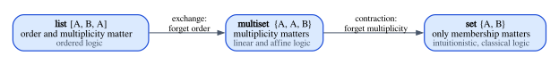

# Chapter 6 · The Structural Rules

Every rule of natural deduction in Chapter 4 was about a connective. Rule ∧I
says how to prove a conjunction, rule →E says how to use an implication, and
so on down the list. There is a second kind of rule, which mentions no
connective at all. It talks only about the *context*, the list of assumptions
to the left of the turnstile. It says that you may reorder the assumptions,
that you may add an assumption you will never use, and that two copies of the
same assumption may be merged into one. These are the **structural rules**:
exchange, weakening and contraction. In ordinary logic they are so harmless
that most textbooks never state them, and Chapter 4 did not state them either.

This chapter is short on new machinery, but it contains the idea that the
second half of the book is built on. Whether a logic has these rules decides
what an assumption *is*. With all three, an assumption is a fact: once you
know it, you know it as many times as you like, and you are free to ignore
it. Without contraction, an assumption is a resource, like a coin that can be
spent once. Every time the Rust compiler reports error E0382, "use of moved
value", it is refusing to apply contraction.

**In this chapter you will learn:**

- what exchange, weakening and contraction say, and how to read them in both
  directions;
- the difference between primitive, derivable and admissible rules, and between
  contexts as lists, multisets and sets;
- why the natural deduction of Chapter 4 has all three structural rules without
  stating them, with a Lean proof by induction on derivations;
- how to count how many times a derivation uses an assumption, and how each
  structural rule changes the count;
- where the three rules show up in Rust: unused values and `drop`, moves and
  E0382, `Clone` and `Copy`, evaluation order and drop order;
- the resource reading of assumptions, and the design decision that generates
  the substructural logics of Part V.

## Rules about contexts

### The context, once more

Chapter 4 wrote natural deduction in sequent notation. A sequent
$\Gamma \vdash A$ says "from the assumptions in $\Gamma$, the formula $A$
follows", and the context $\Gamma$ is a list of formulas. Here are four of the
rules again, to have them in front of us:

$$
\dfrac{A \in \Gamma}{\Gamma \vdash A}\;\textsf{Hyp}
\qquad\qquad
\dfrac{\Gamma \vdash A \qquad \Gamma \vdash B}{\Gamma \vdash A \land B}\;{\land}\textsf{I}
$$

$$
\dfrac{\Gamma, A \vdash B}{\Gamma \vdash A \to B}\;{\to}\textsf{I}
\qquad\qquad
\dfrac{\Gamma \vdash A \to B \qquad \Gamma \vdash A}{\Gamma \vdash B}\;{\to}\textsf{E}
$$

Rule Hyp says that an assumption can be used. Rule →I is the one that changes
the context: to prove $A \to B$, add $A$ to the assumptions and prove $B$. The
comma in $\Gamma, A$ means "the list $\Gamma$ with $A$ added at the end". The
other rules pass the context along unchanged, from the conclusion to every
premise.

### The three structural rules

The structural rules are rules of the same shape, but no connective appears in
them. The only thing that changes between premise and conclusion is the
context:

$$
\dfrac{\Gamma_1, A, B, \Gamma_2 \vdash C}{\Gamma_1, B, A, \Gamma_2 \vdash C}\;\textsf{Exch}
$$

$$
\dfrac{\Gamma \vdash C}{\Gamma, A \vdash C}\;\textsf{Weak}
\qquad\qquad
\dfrac{\Gamma, A, A \vdash C}{\Gamma, A \vdash C}\;\textsf{Contr}
$$

**Exchange** (Exch) says that two neighboring assumptions may swap places.
Applied repeatedly, it puts the context in any order you like. **Weakening**
(Weak, also called *thinning*) says that if $C$ follows from $\Gamma$, it also
follows from $\Gamma$ with one more assumption. **Contraction** (Contr) says that
if $C$ follows from two copies of $A$, it also follows from one copy.

Gerhard Gentzen, who introduced both natural deduction and the sequent
calculus in 1935, stated these rules explicitly as rules of his sequent
calculus, and called them *structural* to set them apart from the *logical*
rules that introduce and eliminate connectives.

Like every rule, these can be read in two directions, and both readings are
useful.

| Rule | Top-down (building a proof) | Bottom-up (searching for one) | An assumption... |
|---|---|---|---|
| Exch | swap two assumptions | swap two assumptions | can be used in any position |
| Weak | add an assumption | throw an assumption away | may go unused |
| Contr | merge two copies into one | duplicate an assumption | may be used more than once |

> [!WARNING]
> The rules are stated in the direction that is convenient for proofs by
> induction, and that direction is the *opposite* of the slogans. Weakening, read
> top-down, makes the context *bigger*; the slogan "you may throw an assumption
> away" is the bottom-up reading: to prove $\Gamma, A \vdash C$ it is enough to
> prove $\Gamma \vdash C$, so $A$ was discarded. Contraction, read top-down,
> *merges* two copies; the slogan "you may duplicate an assumption" is again the
> bottom-up reading. When Part V says "affine means no contraction, so a value is
> used at most once", it is the bottom-up reading that is meant.

### The same rules with terms

Chapter 1 introduced typing judgments $\Gamma \vdash e : \tau$, where the context
gives types to variables. The structural rules have a version for them, and it is
the version that will matter most for Rust:

$$
\dfrac{\Gamma_1, x : \sigma, y : \tau, \Gamma_2 \vdash e : \rho}{\Gamma_1, y : \tau, x : \sigma, \Gamma_2 \vdash e : \rho}\;\textsf{Exch}
$$

$$
\dfrac{\Gamma \vdash e : \rho}{\Gamma, x : \sigma \vdash e : \rho}\;\textsf{Weak}
\qquad\qquad
\dfrac{\Gamma, x : \sigma, y : \sigma \vdash e : \rho}{\Gamma, z : \sigma \vdash e[z/x, z/y] : \rho}\;\textsf{Contr}
$$

Read each rule as a statement about the program $e$:

- **Exchange** leaves the program unchanged. Reordering the variables in scope
  does not change what the program means.
- **Weakening** also leaves the program unchanged, while the context grows. So the
  new variable $x$ does *not occur* in $e$: weakening is the permission to have a
  variable in scope and not use it.
- **Contraction** changes the program: $e[z/x, z/y]$ is $e$ with both $x$ and $y$
  replaced by $z$ (Chapter 7 defines substitution carefully). Where $e$ used two
  different variables, the new program uses the same variable $z$ twice:
  contraction is the permission to use a variable more than once.

This gives the sentence that the rest of the book turns on:

$$
\textbf{weakening} = \text{discarding} \qquad\qquad \textbf{contraction} = \text{duplicating}
$$

You can already see where Rust stands. A function `fn first<A, B>(a: A, b: B) -> A { a }`
never uses `b`; that is weakening, and Rust accepts it. A function
`fn dup<T>(x: T) -> (T, T) { (x, x) }` uses `x` twice; that is contraction, and
Rust rejects it unless `T` is `Copy`. We will look at both in detail below.

## Where the structural rules hide

Look back at the rules of Chapter 4: there is no exchange, no weakening and no
contraction among them. And yet natural deduction can prove $A, B \vdash A$,
which seems to need weakening (the $B$ is never used), and $A \vdash A \land A$,
which seems to need contraction (the $A$ is used twice). The structural rules are
there; they are just hidden in two places.

**The hypothesis rule.** Rule Hyp asks only that $A \in \Gamma$. It does not care
*where* in $\Gamma$ the formula sits (that is exchange), it does not care what
else is in $\Gamma$ (that is weakening), and it does not care how many times $A$
occurs in $\Gamma$ (that is contraction, read the other way). The leaves of every
derivation quietly absorb all three rules.

**Context sharing.** Rules with several premises, such as ∧I, →E and ∨E, hand the
*same* context $\Gamma$ to every premise. Each premise is free to use any
assumption in $\Gamma$, so a single assumption can be used once in each branch.
That is contraction, built into the shape of the rules.

Here is the clearest example, the commutativity of conjunction. (We write the
leaves as Hyp steps with their membership premise left implicit.)

$$
\dfrac{\dfrac{\dfrac{}{A \land B \vdash A \land B}\;\textsf{Hyp}}{A \land B \vdash B}\;{\land}\textsf{E}_2 \qquad \dfrac{\dfrac{}{A \land B \vdash A \land B}\;\textsf{Hyp}}{A \land B \vdash A}\;{\land}\textsf{E}_1}{A \land B \vdash B \land A}\;{\land}\textsf{I}
$$

There is one assumption, $A \land B$, and it is used twice, once by each
projection. Rule ∧I sent the context to both premises, and both premises used it.
This is a surprise the first time you see it: swapping the components of a pair
"needs" contraction in natural deduction. In Rust, `fn swap<A, B>((a, b): (A, B)) -> (B, A)`
does not need `Clone`: the pattern `(a, b)` takes the pair apart *once*, producing
two new variables that are used once each. Chapter 21 explains that Rust's pair
behaves like a different conjunction, written $\otimes$, whose elimination rule is
exactly this pattern match.

The second example shows weakening at a leaf. To prove $\vdash A \to (B \to A)$,
apply →I twice and then Hyp:

$$
\dfrac{\dfrac{\dfrac{A \in A, B}{A, B \vdash A}\;\textsf{Hyp}}{A \vdash B \to A}\;{\to}\textsf{I}}{\vdash A \to (B \to A)}\;{\to}\textsf{I}
$$

The assumption $B$ was added by →I and never used: rule Hyp simply ignored it.

### The same examples in Lean

The Lean code for this chapter is in `code/lean/Book/Ch06/Structural.lean` and
`code/lean/Book/Ch06/Usage.lean`. The first file starts by redefining the formulas
and the derivability relation of Chapter 4 (each chapter's Lean files are
self-contained, so we do not import Chapter 4's):

```lean
/-- Propositional formulas, as in Chapter 4. -/
inductive Formula where
  | atom (name : String)
  | top
  | bot
  | conj (A B : Formula)
  | disj (A B : Formula)
  | imp (A B : Formula)
  deriving DecidableEq, Repr
```

```lean
/-- `Proves Γ A`: the sequent `Γ ⊢ A` is derivable in natural deduction.
Lean lists grow at the front, so the rules write `A :: Γ` for what the
mathematics writes `Γ, A`. -/
inductive Proves : List Formula → Formula → Prop where
  | hyp {Γ A} : A ∈ Γ → Proves Γ A
  | topI {Γ} : Proves Γ top
  | botE {Γ C} : Proves Γ bot → Proves Γ C
  | conjI {Γ A B} : Proves Γ A → Proves Γ B → Proves Γ (conj A B)
  | conjE₁ {Γ A B} : Proves Γ (conj A B) → Proves Γ A
  | conjE₂ {Γ A B} : Proves Γ (conj A B) → Proves Γ B
  | disjI₁ {Γ A B} : Proves Γ A → Proves Γ (disj A B)
  | disjI₂ {Γ A B} : Proves Γ B → Proves Γ (disj A B)
  | disjE {Γ A B C} :
      Proves Γ (disj A B) → Proves (A :: Γ) C → Proves (B :: Γ) C → Proves Γ C
  | impI {Γ A B} : Proves (A :: Γ) B → Proves Γ (imp A B)
  | impE {Γ A B} : Proves Γ (imp A B) → Proves Γ A → Proves Γ B
```

One detail needs attention. Lean lists are built from the front: `A :: Γ` is the
list `Γ` with `A` added *before* its first element. So where the mathematics
writes $\Gamma, A$, the Lean rules write `A :: Γ`, and the list `[A, B]` is the
context with `A` first. The order is different, and as you will see in a moment,
it makes no difference at all: that is precisely what exchange says.

The examples above, checked by Lean:

```lean
/-- `A ∧ B ⊢ B ∧ A`. Both premises of `conjI` receive the whole context, and
each of them uses the hypothesis `A ∧ B`: two uses of one assumption. -/
example : Proves [conj A B] (conj B A) :=
  .conjI (.conjE₂ (.hyp List.mem_cons_self)) (.conjE₁ (.hyp List.mem_cons_self))

/-- `A ⊢ A ∧ A`: one assumption, used twice. -/
example : Proves [A] (conj A A) :=
  .conjI (.hyp (by simp)) (.hyp (by simp))

/-- `A, B ⊢ A`: the assumption `B` is never used. -/
example : Proves [A, B] A :=
  .hyp (by simp)

/-- `⊢ A → B → A`: after two `impI` steps the context is `[B, A]`, and the
hypothesis rule picks `A` out of it, ignoring `B`. -/
example : Proves [] (imp A (imp B A)) :=
  .impI (.impI (.hyp (by simp)))
```

`List.mem_cons_self` is the library fact that the head of a list is a member of
it ($a \in a :: l$). Where Lean can figure out which formula is meant, we let
`by simp` prove the membership instead. Notice that each proof is a tree of
constructors with the same shape as the derivation on paper: `.conjI` has two
children, each `.conjE₂` or `.conjE₁` has one, and the leaves are `.hyp`.

## Primitive, derivable and admissible

We keep saying that natural deduction "has" the structural rules without listing
them. To make that precise we need to distinguish three ways in which a rule can
belong to a system.

- A rule is **primitive** if it is one of the rules that define the system. The
  constructors of `Proves` are the primitive rules of our natural deduction.
- A rule is **derivable** if there is a fixed scheme that builds a derivation of
  its conclusion from derivations of its premises, using primitive rules only. A
  derivable rule is an abbreviation, a macro: wherever you use it, you could
  paste in the same few primitive steps instead.
- A rule is **admissible** if, whenever its premises are derivable, its
  conclusion is derivable too. The derivation of the conclusion may depend on the
  *shape* of the derivations of the premises; typically it is built by induction
  on them.

Every derivable rule is admissible: if the premises have derivations, plug them
into the macro. The converse fails, and the structural rules are the standard
examples. In natural deduction with lists as contexts, exchange, weakening and
contraction are admissible but not derivable: there is no fixed combination of
primitive rules that turns a derivation of $\Gamma \vdash C$ into one of
$\Gamma, A \vdash C$ without looking inside it, because no primitive rule adds an
unused assumption to a context. What we can do is walk through the whole
derivation and add $A$ to every context in it.

A programmer's way to see the difference: a derivable rule is a function that
wraps its argument in a few constructors and never inspects it; an admissible
rule is a recursive function that takes its argument apart and rebuilds it, like a
compiler pass over a syntax tree.

The difference matters when a system changes. If you add new primitive rules to a
system, every derivable rule stays derivable: the macro still works. An admissible
rule may stop being admissible, because its proof by induction now has a new case
to handle, and that case may fail. Exercise 5 adds a single axiom to natural
deduction and breaks weakening. Part V is full of systems designed so that
weakening or contraction is *not* admissible, and the main danger there is a
connective rule that brings a structural rule back without anyone noticing.

### Lists, multisets and sets

There is a third status, which is not about rules at all but about data
structures. If contexts are *sets* rather than lists, then $\Gamma, A, B$ and
$\Gamma, B, A$ are the same set, and so are $\Gamma, A, A$ and $\Gamma, A$.
Exchange and contraction are then **built in**: they do not say anything, because
the two contexts they relate are equal. The choice of data structure decides
which structural rules come for free:

| Contexts are | Exchange | Contraction | Weakening |
|---|---|---|---|
| lists | a statement | a statement | a statement |
| multisets | built in | a statement | a statement |
| sets | built in | built in | a statement |

A **multiset** is a collection in which order does not matter but multiplicity
does: $\{A, A, B\}$ and $\{A, B, A\}$ are the same multiset, while $\{A, A, B\}$
and $\{A, B\}$ are different. Weakening is a statement in all three cases, since
adding an element does change a list, a multiset and a set.



Mathlib has all three data structures, and it is instructive to see Lean confirm
the table:

```lean
-- As lists, order and multiplicity both matter:
example : [atom "A", atom "B"] ≠ [atom "B", atom "A"] := by decide
example : [atom "A", atom "A"] ≠ [atom "A"] := by decide

-- As multisets, order is forgotten (exchange is built in) but
-- multiplicity is not:
example (A B : Formula) (Γ : Multiset Formula) :
    A ::ₘ B ::ₘ Γ = B ::ₘ A ::ₘ Γ :=
  Multiset.cons_swap A B Γ
example : ({atom "A", atom "A"} : Multiset Formula) ≠ {atom "A"} := by decide

-- As sets, both are forgotten (exchange and contraction are built in):
example (A B : Formula) : ({A, B} : Finset Formula) = {B, A} :=
  Finset.pair_comm A B
example (A : Formula) (Γ : Finset Formula) : insert A (insert A Γ) = insert A Γ :=
  Finset.insert_idem A Γ
```

`Multiset Formula` is Mathlib's type of multisets, and `A ::ₘ Γ` adds one copy of
`A` to the multiset `Γ`. `Multiset.cons_swap` is exactly exchange as an
*equation*. `Finset Formula` is the type of finite sets, `insert A Γ` adds `A`,
and `Finset.insert_idem` (idempotence: inserting twice is inserting once) is
contraction as an equation. The two inequalities are checked by `decide`, which
computes both sides and compares them.

Most presentations of ordinary logic use sets of assumptions and never mention
the structural rules. That is a reasonable choice when the rules are all
harmless. Substructural logic begins by refusing it: ordered logic keeps
contexts as lists, linear and affine logic use multisets, and the question "is
contraction admissible?" becomes the central design question.

## Admissibility, proved in Lean

Our Lean contexts are lists, so all three structural rules are statements that
need proofs. Let us prove them.

### A first attempt, and why it fails

The natural first try is to prove weakening directly: if `Proves Γ C`, then
`Proves (A :: Γ) C`, by induction on the derivation of `Γ ⊢ C`. Most cases are
easy. In the case of rule Hyp, we know `C ∈ Γ`, so `C ∈ A :: Γ`. In the case of
∧I, the induction hypotheses give derivations of `A :: Γ ⊢ C₁` and
`A :: Γ ⊢ C₂`, and ∧I combines them.

The case of →I breaks. There, `C` is `B → D` and the premise is
`B :: Γ ⊢ D`. The induction hypothesis, applied to the premise, adds `A` at the
front of *its* context and gives `A :: B :: Γ ⊢ D`. But to apply →I and obtain
`A :: Γ ⊢ B → D`, we need `B :: A :: Γ ⊢ D`, with `B` at the front, where →I
discharges it. The two contexts differ by an exchange. We are trying to prove
weakening and we need exchange; if we tried to prove exchange first, we would
run into the same problem one level down.

This is a very common situation in proofs by induction: the statement is true but
too weak to be its own induction hypothesis. The cure is to prove something
*stronger*, a statement general enough that the induction hypothesis is exactly
what each case needs.

### Monotonicity

The stronger statement is this: if every assumption of `Γ` is also an assumption
of `Δ`, then everything provable from `Γ` is provable from `Δ`. The relation
"every element of `Γ` is an element of `Δ`" is `Γ ⊆ Δ` (`List.Subset`), and the
theorem is called *monotonicity*, because derivability only grows as the context
grows.

```lean
/-- Derivability is monotone in the context: if every hypothesis of `Γ` is
also a hypothesis of `Δ`, everything provable from `Γ` is provable from `Δ`.
The proof transforms the derivation of `Γ ⊢ C`, rule by rule, into a
derivation of `Δ ⊢ C`. -/
theorem Proves.mono {Γ Δ : List Formula} {C : Formula}
    (h : Proves Γ C) (sub : Γ ⊆ Δ) : Proves Δ C := by
  induction h generalizing Δ with
  | hyp mem =>
    -- The only place where the context is inspected: `A ∈ Γ` and `Γ ⊆ Δ`.
    exact .hyp (sub mem)
  | topI => exact .topI
  | botE _ ih => exact .botE (ih sub)
  | conjI _ _ ih₁ ih₂ => exact .conjI (ih₁ sub) (ih₂ sub)
  | conjE₁ _ ih => exact .conjE₁ (ih sub)
  | conjE₂ _ ih => exact .conjE₂ (ih sub)
  | disjI₁ _ ih => exact .disjI₁ (ih sub)
  | disjI₂ _ ih => exact .disjI₂ (ih sub)
  | disjE _ _ _ ih ihA ihB =>
    -- The branches have one more hypothesis on both sides: `A :: Γ ⊆ A :: Δ`.
    exact .disjE (ih sub) (ihA (List.cons_subset_cons _ sub))
      (ihB (List.cons_subset_cons _ sub))
  | impI _ ih =>
    -- Same here: the premise lives in `A :: Γ`, so we extend `sub` by `A`.
    exact .impI (ih (List.cons_subset_cons _ sub))
  | impE _ _ ih₁ ih₂ => exact .impE (ih₁ sub) (ih₂ sub)
```

Let us go through it.

- `induction h generalizing Δ with` starts an induction on the derivation `h`, one
  case per rule, just like the soundness proof of Chapter 4. The words
  `generalizing Δ` matter. Without them, the induction hypothesis would be about
  the *fixed* `Δ` of the statement. With them, the induction hypothesis says
  "for every `Δ` with `Γ' ⊆ Δ`, ...", where `Γ'` is the context of the premise.
  We need that freedom, because in the →I and ∨E cases the premise's context is
  bigger than `Γ` and we must use the hypothesis with a bigger `Δ` too.
- In the `hyp` case, the derivation is a single leaf, `mem : C ∈ Γ`. The subset
  relation is, by definition, a function from membership in `Γ` to membership in
  `Δ`, so `sub mem : C ∈ Δ`, and `.hyp (sub mem)` is the new leaf. This is the
  *only* case where the context is looked at.
- In the cases that keep the context (`botE`, `conjI`, `conjE₁` and the rest), we
  apply the induction hypotheses with the same `sub` and rebuild the node with the
  same rule. This is where the transformation is a "compiler pass": it rebuilds
  the tree node by node.
- In the `impI` case, the premise lives in `A :: Γ`. We need a derivation in
  `A :: Δ`, and `List.cons_subset_cons` turns `sub : Γ ⊆ Δ` into
  `A :: Γ ⊆ A :: Δ`. The induction hypothesis, used with `A :: Δ`, gives what →I
  needs. The `disjE` case does the same for both branches.

The →I case that defeated the first attempt is now trivial: the induction
hypothesis does not care where in `Δ` the new formula goes, so no exchange is
needed.

### The three rules as corollaries

With monotonicity, the structural rules are one-liners, because each of them
relates two contexts with the same elements, or a context to a bigger one:

```lean
/-- Weakening: an extra hypothesis never hurts. -/
theorem weakening (h : Proves Γ C) : Proves (A :: Γ) C :=
  h.mono (List.subset_cons_self A Γ)
```

```lean
/-- Exchange: two neighboring hypotheses may swap places, anywhere in the
context. -/
theorem exchange (h : Proves (Γ₁ ++ A :: B :: Γ₂) C) :
    Proves (Γ₁ ++ B :: A :: Γ₂) C :=
  h.mono (by
    intro X hX
    -- hX : X ∈ Γ₁ ++ A :: B :: Γ₂,   goal : X ∈ Γ₁ ++ B :: A :: Γ₂
    simp only [List.mem_append, List.mem_cons] at hX ⊢
    tauto)
```

```lean
/-- Contraction: two copies of a hypothesis can be merged into one. -/
theorem contraction (h : Proves (A :: A :: Γ) C) : Proves (A :: Γ) C :=
  h.mono (by
    intro X hX
    simp only [List.mem_cons] at hX ⊢
    tauto)
```

For weakening, `List.subset_cons_self A Γ` is the library fact `Γ ⊆ A :: Γ`. For
exchange and contraction, we prove the subset relation by hand. `intro X hX`
takes an arbitrary formula `X` with `hX : X ∈ Γ₁ ++ A :: B :: Γ₂`, and the goal is
`X ∈ Γ₁ ++ B :: A :: Γ₂`. The `simp only` step rewrites both memberships with two
library lemmas, `List.mem_append` ($x \in l_1 ++ l_2 \leftrightarrow x \in l_1 \lor x \in l_2$)
and `List.mem_cons` ($x \in a :: l \leftrightarrow x = a \lor x \in l$). After it,
the hypothesis says `X ∈ Γ₁ ∨ X = A ∨ X = B ∨ X ∈ Γ₂` and the goal says
`X ∈ Γ₁ ∨ X = B ∨ X = A ∨ X ∈ Γ₂`. That is a propositional tautology, and
`tauto`, a Mathlib tactic that proves goals by propositional reasoning (splitting
`∧`, `∨` and `↔` in hypotheses and goals), finishes the proof.

Exchange is stated for an arbitrary position in the context (between `Γ₁` and
`Γ₂`), which is what rule Exch says. Weakening and contraction are stated at the
front, which is enough, since exchange can move any formula there.

In fact the same argument proves more: two contexts with the same elements prove
exactly the same formulas.

```lean
/-- Contexts with the same elements prove the same formulas: for this system,
a context might as well be a *set*. -/
theorem proves_iff_of_same_elements {Γ Δ : List Formula}
    (h₁ : Γ ⊆ Δ) (h₂ : Δ ⊆ Γ) : Proves Γ C ↔ Proves Δ C :=
  ⟨fun h => h.mono h₁, fun h => h.mono h₂⟩
```

The proof builds the two directions of the `↔` with the anonymous constructor
`⟨_, _⟩`, each direction a function that applies `mono`. For this system, a
context might as well be a set. That is the precise sense in which natural
deduction "has" all three structural rules.

### Derivable versus admissible, in Lean

The distinction between derivable and admissible rules is visible in the Lean
proofs. Here is a derivable rule:

```lean
/-- A *derivable* rule: from `Γ ⊢ A ∧ B` conclude `Γ ⊢ B ∧ A`. The proof is a
fixed combination of primitive rules (a macro); it never looks inside `h`. -/
theorem conj_comm_rule (h : Proves Γ (conj A B)) : Proves Γ (conj B A) :=
  .conjI (.conjE₂ h) (.conjE₁ h)
```

The proof of `conj_comm_rule` is a fixed term built from primitive rules, with
`h` plugged in twice. It never inspects `h`. (It also uses `h` twice, which is
contraction by sharing once more.)

And here is a rule whose proof needs an admissible rule:

```lean
/-- Double-negation introduction as a rule: from `Γ ⊢ A` conclude
`Γ ⊢ (A → ⊥) → ⊥`. The derivation of `A` is needed in the bigger context
`(A → ⊥) :: Γ`, and no fixed combination of primitive rules can move it
there: we call the admissible `weakening`, which rebuilds `h` by induction. -/
theorem dni_rule (h : Proves Γ A) : Proves Γ (imp (imp A bot) bot) :=
  .impI (.impE (.hyp List.mem_cons_self) (weakening h))
```

To prove $(A \to \bot) \to \bot$ from $\Gamma$, we assume $A \to \bot$ and apply
it to $A$. But the derivation `h` proves $A$ from $\Gamma$, and we need $A$ in the
bigger context `imp A bot :: Γ`. No primitive rule does that, so we call
`weakening h`, which runs the whole induction of `Proves.mono` over `h`. The rule
`dni_rule` is admissible; whether it is also derivable is a different question,
and it is not answered by this proof.

## Counting uses

"The assumption is used twice", "the assumption is never used": these are
statements about derivations, and so far we have checked them by looking at
pictures. Let us make Lean count.

There is an obstacle. `Proves Γ C` is a proposition: it lives in `Prop`, and Lean
does not let you compute data, such as a number, from a proof of a proposition.
Lean treats any two proofs of the same proposition as interchangeable, so a
function that returned different numbers for different proofs would make no
sense. Chapter 10 explains this *proof irrelevance* in detail. For us it means
that to count we need derivations that are *data*: a type in `Type`, whose values
are trees we can inspect, just like the abstract syntax trees of Chapter 3.

### Positions

When we count uses, we must know *which* assumption a leaf uses. The leaf
`hyp mem` of `Proves` only records that the formula is a member of the context,
and if the context is `[A, A]`, that does not say which copy is meant. So the data
version refers to assumptions by position:

```lean
/-- `Var Γ A`: a position in the context `Γ` at which the formula `A` sits.
`here` is the first position, `there x` is one step further than `x`. -/
inductive Var : List Formula → Formula → Type where
  | here {Γ A} : Var (A :: Γ) A
  | there {Γ A B} : Var Γ A → Var (B :: Γ) A

/-- The position as a number: `here` is `0`, `there here` is `1`, and so on. -/
def Var.idx {Γ A} : Var Γ A → ℕ
  | .here => 0
  | .there x => x.idx + 1
```

`Var Γ A` is an **inductive family**: a type that depends on a context and a
formula. A value `x : Var Γ A` is evidence that `A` sits in `Γ`, and it also says
where. The constructor `here` points at the first element of a context `A :: Γ`
and has type `Var (A :: Γ) A`. The constructor `there` takes a position in `Γ` and
makes it a position in `B :: Γ`, one step further. So in the context `[A, B, C]`,
the value `there here` has type `Var [A, B, C] B` and points at `B`. `Var.idx`
turns a position into a number. (Programmers who have met de Bruijn indices will
recognize them here; Chapter 7 introduces them for the λ-calculus, and Chapter 8
uses the same idea for the variables of typed terms.)

### Derivations as data

The data version of natural deduction has the same rules as `Proves`, with
`Type` instead of `Prop` and a position in the hypothesis rule:

```lean
/-- Derivations as data: the same rules as `Proves`, but a derivation is a
tree that we can inspect, and a hypothesis leaf records *which* position of
the context it uses. -/
inductive Deriv : List Formula → Formula → Type where
  | hyp {Γ A} : Var Γ A → Deriv Γ A
  | topI {Γ} : Deriv Γ top
  | botE {Γ C} : Deriv Γ bot → Deriv Γ C
  | conjI {Γ A B} : Deriv Γ A → Deriv Γ B → Deriv Γ (conj A B)
  | conjE₁ {Γ A B} : Deriv Γ (conj A B) → Deriv Γ A
  | conjE₂ {Γ A B} : Deriv Γ (conj A B) → Deriv Γ B
  | disjI₁ {Γ A B} : Deriv Γ A → Deriv Γ (disj A B)
  | disjI₂ {Γ A B} : Deriv Γ B → Deriv Γ (disj A B)
  | disjE {Γ A B C} :
      Deriv Γ (disj A B) → Deriv (A :: Γ) C → Deriv (B :: Γ) C → Deriv Γ C
  | impI {Γ A B} : Deriv (A :: Γ) B → Deriv Γ (imp A B)
  | impE {Γ A B} : Deriv Γ (imp A B) → Deriv Γ A → Deriv Γ B
```

The two versions agree. Forgetting the tree turns a `Deriv` into a `Proves`:

```lean
/-- A position holds a member of the context. -/
theorem Var.mem {Γ A} : Var Γ A → A ∈ Γ
  | .here => List.mem_cons_self
  | .there x => List.mem_cons_of_mem _ x.mem

/-- Forgetting the tree: every `Deriv` gives a `Proves`. -/
theorem Deriv.toProves {Γ C} : Deriv Γ C → Proves Γ C
  | .hyp x => .hyp x.mem
  | .topI => .topI
  | .botE d => .botE d.toProves
  | .conjI d e => .conjI d.toProves e.toProves
  | .conjE₁ d => .conjE₁ d.toProves
  | .conjE₂ d => .conjE₂ d.toProves
  | .disjI₁ d => .disjI₁ d.toProves
  | .disjI₂ d => .disjI₂ d.toProves
  | .disjE d e f => .disjE d.toProves e.toProves f.toProves
  | .impI d => .impI d.toProves
  | .impE d e => .impE d.toProves e.toProves
```

These two theorems are proved by recursion, written with pattern matching like a
function: each constructor of `Var` or `Deriv` is sent to the corresponding
proof, with recursive calls on the subtrees. (A proof by recursion on a tree and
a proof by induction on it are the same thing; the `induction` tactic writes the
recursion for you.)
The file also proves the converse, in the theorem
`proves_iff_nonempty : Proves Γ C ↔ Nonempty (Deriv Γ C)`, by an induction just
like the ones above. `Nonempty` is the proposition "this type has at least one
value", so the theorem says that `Proves Γ C` holds exactly when some tree of type
`Deriv Γ C` exists.

### The structural rules as renamings

In the data version, the structural rules become *renamings*: functions that send
each position of one context to a position of another context holding the same
formula. Renaming a derivation replaces every leaf `hyp x` by `hyp (ρ x)`:

```lean
/-- A renaming sends each position of `Γ` to a position of `Δ` that holds the
same formula. -/
abbrev Renaming (Γ Δ : List Formula) : Type := ∀ A, Var Γ A → Var Δ A

/-- Under a binder both contexts grow by the same formula `B`, which is sent
to itself. -/
def Renaming.lift {Γ Δ B} (ρ : Renaming Γ Δ) : Renaming (B :: Γ) (B :: Δ)
  | _, .here => .here
  | _, .there x => .there (ρ _ x)

/-- Renaming a derivation: replace every hypothesis leaf `hyp x` by
`hyp (ρ x)`. The shape of the tree does not change. -/
def Deriv.rename {Γ Δ C} (ρ : Renaming Γ Δ) : Deriv Γ C → Deriv Δ C
  | .hyp x => .hyp (ρ _ x)
  | .topI => .topI
  | .botE d => .botE (d.rename ρ)
  | .conjI d e => .conjI (d.rename ρ) (e.rename ρ)
  | .conjE₁ d => .conjE₁ (d.rename ρ)
  | .conjE₂ d => .conjE₂ (d.rename ρ)
  | .disjI₁ d => .disjI₁ (d.rename ρ)
  | .disjI₂ d => .disjI₂ (d.rename ρ)
  | .disjE d e f => .disjE (d.rename ρ) (e.rename ρ.lift) (f.rename ρ.lift)
  | .impI d => .impI (d.rename ρ.lift)
  | .impE d e => .impE (d.rename ρ) (e.rename ρ)
```

`Renaming Γ Δ` is the type of functions that, for every formula `A`, map positions
of `A` in `Γ` to positions of `A` in `Δ` (`abbrev` defines it as an abbreviation
that Lean unfolds freely). The function `Renaming.lift` extends a renaming to
contexts with one more formula in front; `Deriv.rename` uses it when it goes
under →I or into the branches of ∨E, where the context grows. A renaming is the
data version of `Γ ⊆ Δ`, and `Deriv.rename` is the data version of
`Proves.mono`. The three structural rules are three particular renamings:

```lean
/-- Weakening: every old position moves one step to make room for `B`. -/
def Deriv.weaken (d : Deriv Γ C) : Deriv (B :: Γ) C :=
  d.rename (fun _ x => .there x)

/-- Exchange: positions `0` and `1` swap, the others stay. -/
def swapFirstTwo : Renaming (A :: B :: Γ) (B :: A :: Γ)
  | _, .here => .there .here
  | _, .there .here => .here
  | _, .there (.there x) => .there (.there x)

def Deriv.exchange (d : Deriv (A :: B :: Γ) C) : Deriv (B :: A :: Γ) C :=
  d.rename swapFirstTwo

/-- Contraction: positions `0` and `1` both go to `0`, the others move down. -/
def mergeFirstTwo : Renaming (A :: A :: Γ) (A :: Γ)
  | _, .here => .here
  | _, .there .here => .here
  | _, .there (.there x) => .there x

def Deriv.contract (d : Deriv (A :: A :: Γ) C) : Deriv (A :: Γ) C :=
  d.rename mergeFirstTwo
```

Weakening shifts every position by one, to make room for the new assumption at
the front. Exchange swaps positions 0 and 1. Contraction sends *both* positions
0 and 1 to position 0, and shifts the others down. Each definition is by pattern
matching on the position: `.here` is position 0, `.there .here` is position 1,
and `.there (.there x)` is everything else.

### Counting

To count the leaves that use some position, we select positions with a
boolean-valued function and walk the tree:

```lean
/-- A selection of positions of `Γ`: `true` for the positions we count. -/
abbrev Sel (Γ : List Formula) : Type := ∀ A, Var Γ A → Bool

/-- Under a binder the new position `0` is not selected; the old ones keep
their selection, one step further. -/
def Sel.lift {Γ B} (s : Sel Γ) : Sel (B :: Γ)
  | _, .here => false
  | _, .there x => s _ x

/-- The number of hypothesis leaves of `d` that use a selected position. -/
def Deriv.uses {Γ C} : Deriv Γ C → Sel Γ → ℕ
  | .hyp x, s => if s _ x then 1 else 0
  | .topI, _ => 0
  | .botE d, s => d.uses s
  | .conjI d e, s => d.uses s + e.uses s
  | .conjE₁ d, s => d.uses s
  | .conjE₂ d, s => d.uses s
  | .disjI₁ d, s => d.uses s
  | .disjI₂ d, s => d.uses s
  | .disjE d e f, s => d.uses s + e.uses s.lift + f.uses s.lift
  | .impI d, s => d.uses s.lift
  | .impE d e, s => d.uses s + e.uses s

/-- How many times `d` uses the hypothesis at position `i`. -/
def Deriv.count {Γ C} (d : Deriv Γ C) (i : ℕ) : ℕ :=
  d.uses (fun _ x => x.idx == i)

/-- The usage of every hypothesis, in context order. -/
def Deriv.usage {Γ C} (d : Deriv Γ C) : List ℕ :=
  (List.range Γ.length).map d.count
```

`Sel Γ` assigns `true` or `false` to every position of `Γ`. `Deriv.uses` adds 1
for every leaf whose position is selected. When it goes under a binder (the body
of →I, the branches of ∨E), the context has one more formula in front, so the
selection is lifted: the new position 0 is not selected, and the old positions
keep their selection, one step further. `count d i` selects exactly position `i`,
and `usage d` lists the counts of all positions in order. Here are the
derivations from the beginning of the chapter, as data:

```lean
def A : Formula := atom "A"
def B : Formula := atom "B"

/-- `A ∧ B ⊢ B ∧ A`, as in `Structural.lean`, now as data. -/
def swapD : Deriv [conj A B] (conj B A) :=
  .conjI (.conjE₂ (.hyp .here)) (.conjE₁ (.hyp .here))

/-- `A, B ⊢ A`. -/
def firstD : Deriv [A, B] A := .hyp .here

/-- `A → B, A ⊢ B` (modus ponens). -/
def mpD : Deriv [imp A B, A] B := .impE (.hyp .here) (.hyp (.there .here))

/-- `A ⊢ A ∧ A`. -/
def dupD : Deriv [A] (conj A A) := .conjI (.hyp .here) (.hyp .here)

/-- info: [2] -/
#guard_msgs in
#eval swapD.usage

/-- info: [1, 0] -/
#guard_msgs in
#eval firstD.usage

/-- info: [1, 1] -/
#guard_msgs in
#eval mpD.usage

/-- info: [2] -/
#guard_msgs in
#eval dupD.usage
```

The pictures were right. The swap uses its only assumption twice, `A, B ⊢ A`
uses `A` once and `B` never, modus ponens uses each of its two assumptions once,
and `A ⊢ A ∧ A` uses `A` twice.

These counts let us name the disciplines of Part V. Call a derivation *affine*
if every assumption is used at most once, *relevant* if every assumption is used
at least once, and *linear* if every assumption is used exactly once:

```lean
/-- Every hypothesis is used at most once. -/
def Deriv.affine {Γ C} (d : Deriv Γ C) : Bool := d.usage.all (· ≤ 1)
/-- Every hypothesis is used at least once. -/
def Deriv.relevant {Γ C} (d : Deriv Γ C) : Bool := d.usage.all (1 ≤ ·)
/-- Every hypothesis is used exactly once. -/
def Deriv.linear {Γ C} (d : Deriv Γ C) : Bool := d.usage.all (· == 1)

/-- The most specific of the three disciplines that a derivation follows. -/
def Deriv.discipline {Γ C} (d : Deriv Γ C) : String :=
  if d.linear then "linear"
  else if d.affine then "affine"
  else if d.relevant then "relevant"
  else "unrestricted"

/-- info: ["relevant", "affine", "linear", "relevant"] -/
#guard_msgs in
#eval [swapD.discipline, firstD.discipline, mpD.discipline, dupD.discipline]
```

`Deriv.discipline` reports the most specific of the three (a linear derivation is
also affine and relevant). Only modus ponens is linear. The swap and the
duplication are relevant but not affine; `A, B ⊢ A` is affine but not relevant.

### How the structural rules change the counts

Now apply the structural rules to a derivation and watch the counts.
`twoCopiesD` proves `A, A ⊢ A ∧ A` using each copy once:

```lean
/-- `A, A ⊢ A ∧ A`, each copy used once. -/
def twoCopiesD : Deriv [A, A] (conj A A) := .conjI (.hyp .here) (.hyp (.there .here))

/-- info: [1, 1] -/
#guard_msgs in
#eval twoCopiesD.usage

/-- info: [2] -/
#guard_msgs in
#eval twoCopiesD.contract.usage

/-- info: [0, 1, 1] -/
#guard_msgs in
#eval (twoCopiesD.weaken (B := B)).usage

/-- info: [1, 1] -/
#guard_msgs in
#eval mpD.exchange.usage
```

Contraction merges the two copies, and the merged assumption is used twice.
Weakening adds a new assumption at the front, used zero times. Exchange swaps
the counts (here both are 1). These are not coincidences of the examples; they
are theorems. The cleanest statement is about contraction:

```lean
/-- Contraction adds up the uses of the two merged hypotheses. -/
theorem count_contract (d : Deriv (A :: A :: Γ) C) :
    d.contract.count 0 = d.count 0 + d.count 1 := by
  unfold Deriv.contract Deriv.count
  rw [Deriv.uses_rename, ← Deriv.uses_or]
  -- A position goes to 0 exactly when it is 0 or 1 (and it is never both).
  have hor : (fun X (x : Var (A :: A :: Γ) X) => ((mergeFirstTwo X x).idx == 0)) =
      fun _ x => (x.idx == 0 || x.idx == 1) := by
    funext _ x
    rcases x with _ | _ | x <;> simp [mergeFirstTwo, Var.idx]
  have hand : (fun X (x : Var (A :: A :: Γ) X) => (x.idx == 0 && x.idx == 1)) =
      fun _ _ => false := by
    funext _ x
    cases x.idx <;> simp
  rw [hor, hand, Deriv.uses_none, Nat.add_zero]
```

The uses of the merged assumption are the sum of the uses of the two copies. To
prove it we need a lemma about renaming in general:

```lean
/-- The key lemma: counting the selected uses in a renamed derivation is the
same as counting, in the original derivation, the positions whose image is
selected. -/
theorem Deriv.uses_rename (d : Deriv Γ C) (ρ : Renaming Γ Δ) (s : Sel Δ) :
    (d.rename ρ).uses s = d.uses (fun X x => s X (ρ X x)) := by
  induction d generalizing Δ with
  | hyp x => rfl
  | topI => rfl
  | botE d ih => exact ih ρ s
  | conjI d e ihd ihe => simp only [rename, uses, ihd, ihe]
  | conjE₁ d ih => exact ih ρ s
  | conjE₂ d ih => exact ih ρ s
  | disjI₁ d ih => exact ih ρ s
  | disjI₂ d ih => exact ih ρ s
  | disjE d e f ihd ihe ihf =>
    simp only [rename, uses, ihd, ihe, ihf, Sel.lift_rename]
  | impI d ih =>
    simp only [rename, uses, ih, Sel.lift_rename]
  | impE d e ihd ihe => simp only [rename, uses, ihd, ihe]
```

It says: to count the selected leaves of a renamed derivation, count the leaves
of the original derivation whose position is *sent* to a selected position. The
proof is an induction on the derivation, again generalizing over the target
context. In the `hyp` case both sides are the same expression, so `rfl` closes it.
In the cases with one subtree and no new assumption, the induction hypothesis is
exactly the goal (`exact ih ρ s`). In the cases with two subtrees,
`simp only [rename, uses, ihd, ihe]` unfolds one step of `rename` and of `uses`
and rewrites with the induction hypotheses. In the binder cases (`disjE` and
`impI`) we also need the fact that lifting a selection and lifting a renaming fit
together, which is the first of four small lemmas:

```lean
/-- Lifting commutes with renaming, with "nothing" and with `||` and `&&`.
Each proof looks at the two kinds of positions, `here` and `there x`. -/
theorem Sel.lift_rename (ρ : Renaming Γ Δ) (s : Sel Δ) :
    (fun X (x : Var (B :: Γ) X) => s.lift X (ρ.lift X x)) =
      Sel.lift (fun X x => s X (ρ X x)) := by
  funext _ x; cases x <;> rfl

theorem Sel.lift_none :
    Sel.lift (B := B) (fun _ _ => false : Sel Γ) = fun _ _ => false := by
  funext _ x; cases x <;> rfl

theorem Sel.lift_or (s t : Sel Γ) :
    Sel.lift (B := B) (fun X x => s X x || t X x) =
      fun X x => s.lift X x || t.lift X x := by
  funext _ x; cases x <;> rfl

theorem Sel.lift_and (s t : Sel Γ) :
    Sel.lift (B := B) (fun X x => s X x && t X x) =
      fun X x => s.lift X x && t.lift X x := by
  funext _ x; cases x <;> rfl
```

Each of them is an equation between two selections, which are functions, so the
proof starts with `funext _ x`: two functions are equal if they agree on every
argument, here every formula `_` and position `x`. Then `cases x` splits into the
two kinds of position, `here` and `there x`, and the combinator `<;>` runs `rfl`
on both resulting goals. In each case both sides compute to the same boolean.

Two more lemmas, `Deriv.uses_none` (selecting nothing counts nothing) and
`Deriv.uses_or` (the count of a union plus the count of an intersection is the
sum of the counts), are proved by the same kind of induction; their proofs use
`omega`, the decision procedure for linear arithmetic, to add up the counts of
the subtrees.

Now read the proof of `count_contract` again. `unfold` replaces `contract` and
`count` by their definitions, and `rw [Deriv.uses_rename]` turns the left side
into a count over the original derivation `d`, with the selection "positions
that `mergeFirstTwo` sends to 0". The rewrite `← Deriv.uses_or` turns the right
side into a count of a union plus a count of an intersection. The two `have`
steps then prove that the selections are what we want. `hor` says that a position
is sent to 0 exactly when it is 0 or 1; it is proved by `funext` (two functions
are equal if they agree on every argument) and a case analysis with `rcases` on
the position (`here`, `there here`, or `there (there x)`), each case closed by
`simp` computing `Var.idx` and the boolean equalities. `hand` says that no
position is both 0 and 1. The final `rw` replaces the selections, counts nothing
for the empty intersection, and drops the `+ 0`.

The weakening and exchange theorems are proved the same way:

```lean
/-- Weakening adds a hypothesis that is used zero times... -/
theorem count_weaken (d : Deriv Γ C) : (d.weaken (B := B)).count 0 = 0 := by
  unfold Deriv.count Deriv.weaken
  rw [Deriv.uses_rename]
  -- The selection is now `fun X x => (x.idx + 1 == 0)`: always false.
  have hsel : (fun X (x : Var Γ X) => (Var.idx (Var.there (B := B) x) == 0)) =
      fun _ _ => false := by
    funext _ x; simp [Var.idx]
  rw [hsel, Deriv.uses_none]

/-- ...and leaves the uses of the old hypotheses unchanged. -/
theorem count_weaken_succ (d : Deriv Γ C) (i : ℕ) :
    (d.weaken (B := B)).count (i + 1) = d.count i := by
  unfold Deriv.count Deriv.weaken
  rw [Deriv.uses_rename]
  simp [Var.idx]
```

```lean
/-- Exchange swaps the uses of the first two hypotheses. -/
theorem count_exchange (d : Deriv (A :: B :: Γ) C) :
    d.exchange.count 0 = d.count 1 ∧ d.exchange.count 1 = d.count 0 := by
  unfold Deriv.exchange Deriv.count
  rw [Deriv.uses_rename, Deriv.uses_rename]
  constructor
  · congr 1
    funext _ x
    rcases x with _ | _ | x <;> simp [swapFirstTwo, Var.idx]
  · congr 1
    funext _ x
    rcases x with _ | _ | x <;> simp [swapFirstTwo, Var.idx]
```

Put together, these theorems say something worth stating in words. Exchange
moves counts around without changing them. Weakening introduces an assumption
with count 0, and leaves the other counts alone. Contraction is the only one of
the three that can produce a count greater than 1 from counts that were at most
1. So a logic without contraction keeps every assumption at *most once*, and a
logic without weakening keeps every assumption at *least once*. That is the
whole idea of Part V in one paragraph, and Chapter 22 proves the "at most once"
half as a theorem about a programming language.

## A first glance at Rust

The structural rules are about contexts, and in a program the context is the set
of variables in scope. So the question "which structural rules does Rust have?"
becomes "what may a Rust program do with the variables in scope?". The answers
are in this chapter's Rust example, `code/rust/examples/ch06_structural.rs`, and
in two programs that the compiler rejects.

One caveat first, the same one Chapter 1 made about typing rules. Rust has no
official formal semantics, and the part of the compiler that rejects a use of a
moved value is not literally a sequent calculus: it is a dataflow analysis over
the compiler's intermediate representation, which Chapter 29 describes. When we
say "Rust refuses contraction", we are describing the compiler's behavior with
the vocabulary of the rules. The description is accurate for the cases in this
chapter, and Parts V and VI refine it.

The example uses two kinds of values. A `Connection` is a resource: it is not
`Copy`, not `Clone`, and it prints a message when it is dropped. A `Coupon` can be
cloned, but it is not `Copy`.

```rust
/// A connection to a server: a resource. Neither `Copy` nor `Clone`, and it
/// announces when it is closed (dropped).
struct Connection {
    host: String,
}

impl Connection {
    fn open(host: &str) -> Connection {
        println!("  open {host}");
        Connection {
            host: host.to_string(),
        }
    }
}

impl Drop for Connection {
    fn drop(&mut self) {
        println!("  close {}", self.host);
    }
}

/// A discount coupon. It can be cloned (printing a second coupon is a
/// deliberate act), but it is not `Copy`.
#[derive(Clone, Debug, PartialEq)]
struct Coupon {
    code: String,
}
```

### Exchange

Rust keeps exchange. The order in which variables were declared, or in which
parameters are listed, does not restrict how they can be used:

```rust
/// Exchange: from `a: A, b: B` we can build `(B, A)` as easily as `(A, B)`.
/// The order in which assumptions are listed is irrelevant to typing.
fn exchange<A, B>(a: A, b: B) -> (B, A) {
    (b, a)
}
```

But exchange is a statement about *typing*. Evaluation has an order, and Rust
fixes it: the operands of a tuple or the arguments of a call are evaluated left
to right, and local variables are dropped in the reverse order of their
declaration.

```rust
println!("exchange:");
let (b, a) = exchange("order #17", 42_u32);
println!("  exchange(\"order #17\", 42) = ({b}, {a:?})");
// Typing does not care about order; evaluation does: left to right.
let pair = (note("left"), note("right"));
assert_eq!(pair, ("left", "right"));
// Drop order is fixed too: reverse order of declaration.
{
    let _db = Connection::open("db.internal");
    let _cache = Connection::open("cache.internal");
    println!("  end of scope");
}
```

```text
exchange:
  exchange("order #17", 42) = (42, "order #17")
  evaluate left
  evaluate right
  open db.internal
  open cache.internal
  end of scope
  close cache.internal
  close db.internal
```

The connection to the cache was opened second and is closed first. If you swap
the two `let` lines, the program still type checks, as exchange promises, but
the output changes. A logic does not see effects; a programming language must
specify them. Chapter 24 studies drop order in detail.

### Weakening, with an effect

Rust keeps weakening. A function may ignore a parameter:

```rust
/// Weakening: the assumption `_unused` is never used. Rust accepts this, and
/// the value is dropped when the function returns.
fn weaken<A, B>(a: A, _unused: B) -> A {
    a
}
```

The leading underscore in `_unused` tells the compiler that the omission is
deliberate. Without it you would get a warning from the `unused_variables` lint,
and a warning is all you would get: a lint is advice, not a typing rule. A
language that rejected unused variables would be a *relevant* type system, and
Rust is not one.

What Rust adds to weakening is an effect. A value that goes unused is still
owned by someone, and when its owner goes out of scope, the value is dropped,
which runs its destructor:

```rust
println!("weakening:");
let total = weaken(250_u32, Connection::open("audit.internal"));
println!("  weaken returned {total}");
let unused = Connection::open("metrics.internal");
drop(unused); // weakening made explicit: discard the assumption now
println!("  after drop");
```

```text
weakening:
  open audit.internal
  close audit.internal
  weaken returned 250
  open metrics.internal
  close metrics.internal
  after drop
```

The audit connection is closed when `weaken` returns, before its result is
printed: the unused parameter was dropped at the end of the function's body. The
call `drop(unused)` is weakening made explicit. The standard library's
`std::mem::drop` is a function that takes its argument by value and does nothing
with it; its body is empty. Taking ownership and doing nothing is precisely
discarding an assumption, and the destructor runs because the argument goes out
of scope at the end of `drop`. Chapter 24 calls this *weakening with a side
effect* and studies its consequences.

### Contraction, refused

Rust does not have contraction for values that are not `Copy`. Here is a program
that uses a coupon twice:

```rust
pub fn checkout(coupon: Coupon) -> u32 {
    let first = redeem(coupon);
    let second = redeem(coupon);
    first + second
}
```

```text
error[E0382]: use of moved value: `coupon`
  --> compile_fail/ch06_use_after_move.rs:16:25
   |
14 | pub fn checkout(coupon: Coupon) -> u32 {
   |                 ------ move occurs because `coupon` has type `Coupon`, which does not implement the `Copy` trait
15 |     let first = redeem(coupon);
   |                        ------ value moved here
16 |     let second = redeem(coupon);
   |                         ^^^^^^ value used here after move
   |
note: consider changing this parameter type in function `redeem` to borrow instead if owning the value isn't necessary
  --> compile_fail/ch06_use_after_move.rs:9:23
   |
 9 | pub fn redeem(coupon: Coupon) -> u32 {
   |        ------         ^^^^^^ this parameter takes ownership of the value
   |        |
   |        in this function
note: if `Coupon` implemented `Clone`, you could clone the value
  --> compile_fail/ch06_use_after_move.rs:5:1
   |
 5 | pub struct Coupon {
   | ^^^^^^^^^^^^^^^^^ consider implementing `Clone` for this type
...
15 |     let first = redeem(coupon);
   |                        ------ you could clone this value
```

Read the diagnostic with the rules in mind. "Move occurs because `coupon` has
type `Coupon`, which does not implement the `Copy` trait" says that the
assumption `coupon` is a resource, not a fact. "Value moved here" marks the first
use, which consumed it. "Value used here after move" marks the second use, which
would need contraction: the body uses one variable twice, which a typing
derivation could only justify by merging two assumptions `coupon1` and `coupon2`
into one. The compiler then offers two ways out. The first note suggests changing
`redeem` to *borrow* the coupon, so that using it does not consume it; borrowing
is the subject of Part VI. The second suggests implementing `Clone`, so that the
duplication is done explicitly by a function call.

### Contraction in a loop

A loop is a quieter way to ask for contraction. The body of a loop is checked
once but runs many times, so a value moved in the body would be used once per
iteration:

```rust
pub fn send_all(conn: Connection, orders: Vec<u32>) {
    for order in orders {
        send(conn, order);
    }
}
```

```text
error[E0382]: use of moved value: `conn`
  --> compile_fail/ch06_move_in_loop.rs:16:14
   |
14 | pub fn send_all(conn: Connection, orders: Vec<u32>) {
   |                 ---- move occurs because `conn` has type `Connection`, which does not implement the `Copy` trait
15 |     for order in orders {
   |     ------------------- inside of this loop
16 |         send(conn, order);
   |              ^^^^ value moved here, in previous iteration of loop
   |
note: consider changing this parameter type in function `send` to borrow instead if owning the value isn't necessary
  --> compile_fail/ch06_move_in_loop.rs:9:19
   |
 9 | pub fn send(conn: Connection, order: u32) {
   |        ----       ^^^^^^^^^^ this parameter takes ownership of the value
   |        |
   |        in this function
note: if `Connection` implemented `Clone`, you could clone the value
  --> compile_fail/ch06_move_in_loop.rs:5:1
   |
 5 | pub struct Connection {
   | ^^^^^^^^^^^^^^^^^^^^^ consider implementing `Clone` for this type
...
16 |         send(conn, order);
   |              ---- you could clone this value
```

"Value moved here, in previous iteration of loop" is the compiler's way of saying
that the variable `conn` would be used as many times as there are orders. The fix
in the example program is to *borrow* the connection in the loop body, reading
`conn.host` through the variable without moving it out:

```rust
println!("loops:");
let conn = Connection::open("orders.internal");
for order in [101, 102, 103] {
    // Each iteration uses `conn`; borrowing makes that legal.
    println!("  send order {order} via {}", conn.host);
}
println!("  done sending");
```

```text
loops:
  open orders.internal
  send order 101 via orders.internal
  send order 102 via orders.internal
  send order 103 via orders.internal
  done sending
  close orders.internal
```

The connection is used three times and closed once, at the end of `main`.

### Contraction restored: `Clone` and `Copy`

There are two ways to get contraction back, and they are different in an
instructive way:

```rust
/// Contraction, paid for: duplicating a value is an explicit call to `clone`.
fn contract_clone<A: Clone>(a: A) -> (A, A) {
    (a.clone(), a)
}

/// Contraction, for free: a `Copy` value is duplicated bit by bit, silently.
fn contract_copy<A: Copy>(a: A) -> (A, A) {
    (a, a)
}
```

`contract_clone` duplicates explicitly: the program calls `clone`, which may
allocate memory and run arbitrary code. In the vocabulary of this chapter,
`Clone` does not give you the structural rule; it gives you a *function* of type
`A -> (A, A)`, and the program calls it. `contract_copy` duplicates implicitly:
for `Copy` types, using a variable does not move it, the bits are copied, and
using `a` twice needs nothing at all. For the types that implement `Copy`
(integers, `bool`, `char`, shared references `&T`, and tuples and arrays of `Copy`
types), Rust *has* contraction, silently.

```rust
println!("contraction:");
let coupon = Coupon {
    code: "SPRING-10".to_string(),
};
let (first, second) = contract_clone(coupon);
assert_eq!(first, second);
println!("  contract_clone gave {first} and {second}");
let (x, y) = contract_copy(7_u64);
println!("  contract_copy(7) = ({x}, {y})");
// A shared reference is `Copy`: duplicating it duplicates a permission to
// read, not the coupon (Part VI).
let (r1, r2) = contract_copy(&first);
println!(
    "  two references to the same {r1}: {}",
    std::ptr::eq(r1, r2)
);
```

```text
contraction:
  contract_clone gave coupon SPRING-10 and coupon SPRING-10
  contract_copy(7) = (7, 7)
  two references to the same coupon SPRING-10: true
```

The last line deserves a second look. A shared reference `&Coupon` is `Copy`, so
contraction applies to it: two references to the same coupon, as `std::ptr::eq`
confirms. Duplicating a reference does not duplicate the coupon; it duplicates a
*permission to read* it. That observation is the seed of Part VI, which argues
that references are better explained by permissions and regions than by
affinity.

Here is the summary of this first glance:

| Rule | In Rust | Observed as |
|---|---|---|
| Exchange | kept | order of `let`s and parameters is irrelevant to typing |
| Weakening | kept, with an effect | unused values are allowed; `Drop` runs at scope end |
| Contraction | refused for non-`Copy` values | E0382, "use of moved value" |
| Contraction | kept for `Copy` types | `i32`, `bool`, `&T` used any number of times |
| Contraction | explicit via `Clone` | a call to `clone()` |

Weakening without contraction has a name: it is the definition of an **affine**
discipline. This table is the first, rough evidence for the claim that Chapter 1
called the question of the book, and Chapter 33 returns to it with all the
evidence in hand.

## The resource reading of assumptions

Why would anyone want a logic without contraction? Because of what assumptions
stand for.

In mathematics, an assumption is a *fact*. If you know that $n$ is even, you can
use that fact once, twice or not at all, and it does not wear out. Contraction is
the right rule for facts, and so is weakening: an irrelevant fact does no harm.

Now let an assumption stand for a *thing*: a coin, a ticket, an open file, a
network connection, a heap buffer. Using it means spending it, handing it over,
closing it. Contraction is now the wrong rule: from one coin it would conclude
two. Jean-Yves Girard, who introduced *linear logic* in 1987, liked to explain it
with purchases. Suppose a coin buys a coffee. If assumptions may be duplicated,
then from one coin you get a coffee *and* still have the coin, and so you can
buy as many coffees as you like. A logic that talks about resources must not
have contraction.

Weakening is a subtler case. Throwing a thing away is sometimes fine (an unused
coupon can expire) and sometimes not (an opened transaction must be committed or
rolled back, a promise must be kept). A logic that keeps weakening but drops
contraction describes resources that may be discarded but not copied: it is
*affine*. A logic that drops both describes resources that must be used exactly
once: it is *linear*.

In a programming language, a variable of a type that owns something (a `String`
owns a heap buffer, a `File` owns a file descriptor) is exactly such an
assumption. Two uses of it would mean two owners of one buffer, and in a language
without a garbage collector, two owners means two frees: a double free, one of
the classic memory-safety bugs. Refusing contraction is how Rust rules it out
before the program runs.

### The design decision

The move that generates all of Part V is easy to state: take a logic and delete
some of its structural rules. What remains is a **substructural** logic. Which
rules you delete decides what an assumption is: facts (keep all three),
discardable resources (delete contraction), obligations that must be met (delete
weakening), resources that must be used exactly once (delete both), or even
resources that must be used in order (delete exchange as well).

But deleting a rule is not enough when the rule is hidden in other rules, and we
have seen that natural deduction hides contraction in rule ∧I. If the context
$\Gamma = x : A$ is given to *both* premises, both can use $x$, and contraction
is back no matter what we deleted. A substructural logic must replace context
*sharing* by context *splitting*: the conclusion's assumptions are divided
between the premises, each assumption going to exactly one of them. The
conjunction with a splitting rule is written $\otimes$ ("tensor"):

$$
\dfrac{\Gamma \vdash A \qquad \Delta \vdash B}{\Gamma, \Delta \vdash A \otimes B}\;{\otimes}\textsf{I}
$$

To prove $A \otimes B$ from $\Gamma, \Delta$, prove $A$ from $\Gamma$ and $B$ from
$\Delta$. Similarly, weakening hides in rule Hyp, which accepts any context that
contains $A$; a logic without weakening uses the stricter axiom $A \vdash A$, in
which the context is exactly $A$.

Splitting the context is literally what Rust does when it checks a call
`f(a, b)`: the owned variables in scope must be divided between the two
arguments, and if both arguments need the same non-`Copy` variable, no division
exists and the compiler reports E0382.

This is where the seed is planted. Part V grows it:

- Chapter 21 deletes the structural rules one by one and studies the resulting
  family of logics. It finds that, without contraction, conjunction splits into
  two different connectives ($A \otimes B$, which splits the context, and
  $A \mathbin{\&} B$, which shares it), and it builds a proof search for linear and
  affine logic that shows exactly which sequents survive.
- Chapter 22 builds an affine λ-calculus, with the typing rules of a small
  programming language, and proves that every variable is used at most once.
- Chapter 23 explains `Copy` and `Clone` as a controlled way to bring contraction
  back, the *exponential* modality of linear logic.
- Chapter 24 studies weakening with a side effect: `Drop`, leaks and why Rust is
  affine rather than linear.
- Chapter 25 uses affinity to put protocols into types.

## Putting it together: one formula, three views

Let us follow a single formula through the whole chapter: $A \to A \land A$,
"from $A$, conclude $A$ and $A$". Its proof needs one assumption twice, so it is
the purest test of contraction.

**The mathematics.** In natural deduction, →I reduces the goal to
$A \vdash A \land A$, and ∧I splits it into two premises that both receive the
context $A$:

$$
\dfrac{\dfrac{\dfrac{A \in A}{A \vdash A}\;\textsf{Hyp} \qquad \dfrac{A \in A}{A \vdash A}\;\textsf{Hyp}}{A \vdash A \land A}\;{\land}\textsf{I}}{\vdash A \to A \land A}\;{\to}\textsf{I}
$$

With an explicit contraction step, the same proof reads: prove $A, A \vdash A \land A$
using each copy once, then contract. In a logic with ⊗I instead of ∧I and
without contraction, the context $A$ would have to be split between the two
premises, one of them would receive nothing, and the proof would fail. Chapter 21
proves, in Lean, that $A \vdash A \otimes A$ has *no* derivation at all in linear
logic, by an invariant that counts atoms.

**Lean.** The derivation `dupD` has usage `[2]`. The derivation `twoCopiesD` of
`A, A ⊢ A ∧ A` has usage `[1, 1]`: it is linear. Applying `Deriv.contract` to
it produces a derivation with usage `[2]`, and the theorem `count_contract`
guarantees that this is no accident: contraction adds the counts.

**Rust.** The formula becomes a generic function type, `fn dup<T>(x: T) -> (T, T)`.
With the body `(x, x)` and no bound on `T`, the compiler rejects it with E0382,
exactly as it rejected `checkout`. With the bound `T: Clone`, the body
`(x.clone(), x)` is accepted: contraction paid for by a function call. With the
bound `T: Copy`, the body `(x, x)` is accepted as it stands: contraction built
in for a class of types. Three bodies, three different relationships with one
structural rule.

Compare $A \to (B \to A)$, which needs weakening instead. Lean's `firstD` has
usage `[1, 0]`, an affine derivation. Rust's `weaken` compiles without
complaint and drops its second argument. One structural rule is kept, the other
is not: that asymmetry is the shape of Rust's ownership discipline.

## Common confusions

**"Weakening means deleting an assumption."** Read top-down, weakening *adds* an
assumption to the context of a sequent that was already provable. The intuition
"discard an assumption" is the bottom-up reading, from the goal toward the
premises. Both are correct readings of the same rule; mixing them up makes
statements like "affine logic has weakening" sound backwards.

**"Natural deduction has structural rules among its rules."** It does not, in the
presentation of Chapter 4. The structural rules are admissible: they are
theorems *about* the system, proved by induction, not rules *of* the system. Some
presentations (especially of the sequent calculus) include them as primitive
rules; the derivable sequents are the same either way.

**"Rust has no contraction."** Rust has no *implicit* contraction for values that
are not `Copy`. For `Copy` types, including every shared reference `&T`,
contraction is silent and free, and `Clone` provides explicit duplication for
many other types. Saying exactly where contraction is available is a large part
of the answer to the book's question.

**"The unused-variable warning means Rust requires every variable to be used."**
It is a lint, and it can be silenced with a leading underscore or turned off.
A type system that required every variable to be used would be relevant, and
`#[must_use]`, which Chapter 24 discusses, is the closest Rust comes to it.

**"Exchange means that evaluation order does not matter."** Exchange says that
the order of assumptions does not matter for *derivability*, or for typing. Rust
evaluates operands left to right and drops locals in reverse order of
declaration, and programs can observe both.

**"An admissible rule is weaker than a derivable one."** For the system as it is,
they license exactly the same conclusions. The difference is robustness: a
derivable rule survives the addition of new rules, while an admissible rule must
be proved again, and may fail.

## Summary

- The structural rules (exchange, weakening, contraction) mention no connective;
  they say what may be done with the context. Weakening is discarding, contraction
  is duplicating, exchange is freedom of order.
- Read top-down, weakening adds and contraction merges; the slogans "discard" and
  "duplicate" are the bottom-up readings.
- A rule can be primitive, derivable (a fixed macro of primitive rules) or
  admissible (its conclusion is derivable whenever its premises are, usually by
  induction). Derivable rules survive extensions of a system; admissible ones may
  not.
- Contexts can be lists, multisets or sets. Multisets build exchange in; sets also
  build in contraction.
- Natural deduction has all three structural rules, admissibly. They hide in the
  hypothesis rule and in the sharing of contexts between premises. Lean proves it
  through monotonicity: `Proves Γ C` and `Γ ⊆ Δ` give `Proves Δ C`.
- With derivations as data, the structural rules are renamings of positions.
  Weakening adds an assumption used zero times; contraction adds up the uses of
  two assumptions; only contraction can push a count above one.
- Rust keeps exchange (with a fixed evaluation and drop order), keeps weakening
  (with the effect of running destructors), refuses contraction for non-`Copy`
  values (E0382), restores it for `Copy` types, and offers it explicitly via
  `Clone`.
- An assumption can be a fact or a resource. Deleting structural rules, and
  replacing context sharing by context splitting, gives the substructural logics
  of Part V.

## Exercises

1. Write out, on paper, the case for rule ∨E in the proof that weakening is
   admissible: assume derivations of $\Gamma \vdash A \lor B$,
   $\Gamma, A \vdash C$ and $\Gamma, B \vdash C$, and build one of
   $\Gamma, D \vdash C$. Where do you need exchange, if you insist on adding $D$ at
   the end of the context?
   *Hint:* the induction hypothesis applied to the second premise gives
   $\Gamma, A, D \vdash C$, but ∨E needs a premise whose context ends with $A$.

2. In Lean, prove contraction at an arbitrary position:
   `theorem contraction_mid (h : Proves (Γ₁ ++ A :: A :: Γ₂) C) : Proves (Γ₁ ++ A :: Γ₂) C`.
   Then prove `Proves [A, B, A] C → Proves [B, A] C` using only `exchange`,
   `contraction` and `weakening` (not `Proves.mono`).
   *Hint:* for the first, imitate the proof of `exchange`. For the second, bring
   the two copies of `A` next to each other first: `exchange (Γ₁ := [A])` swaps the
   second and third formulas, and `exchange (Γ₁ := [])` swaps the first two. The
   whole proof is one line.

3. Build a `Deriv` of $A \to B, A \to C, A \vdash B \land C$ in Lean and
   `#eval` its usage. Is it affine, relevant, linear? Then build a derivation of
   $(A \to A \to B) \to A \to B$ (an open version is enough:
   $A \to A \to B, A \vdash B$) and check that it uses the assumption $A$ twice.
   *Hint:* the context is `[imp A B, imp A C, A]`, and `A` is at position
   `.there (.there .here)`. The second formula is the logician's combinator W,
   the standard test for contraction.

4. Write three Rust functions with the types of the formulas
   $A \land B \to A$, $(A \to B) \to (A \to C) \to A \to B \land C$ and
   $A \land B \to B \land A$, for generic `A`, `B`, `C` with no trait bounds (use
   `FnOnce` for the function arguments). Which ones compile? For the one that does
   not, say which structural rule it needs and add the smallest trait bound that
   makes it compile.
   *Hint:* in the second, the argument of type `A` is needed by both functions.

5. Add a new primitive rule to `Proves`: the axiom `Proves [] (atom "p")`, which
   is available only in the empty context. Show that weakening is no longer
   admissible: `Proves [] (atom "p")` holds but `Proves [atom "q"] (atom "p")` does
   not. Why does adding the same axiom in every context, `Proves Γ (atom "p")`,
   keep weakening admissible?
   *Hint:* in every rule, the contexts of the premises contain the context of
   the conclusion, so a derivation of $q \vdash p$ never reaches the empty
   context. Without the new axiom, a truth-table argument (Chapter 4's soundness
   theorem) shows that $q \vdash p$ is not derivable.

6. The theorem `count_weaken` is about weakening at the front of the context.
   State and prove in Lean that weakening does not change the *total* number of
   hypothesis leaves: `(d.weaken (B := B)).uses (fun _ _ => true) = d.uses (fun _ _ => true)`.
   *Hint:* rewrite with `Deriv.uses_rename`; the selection on the right-hand side
   is then the constant `true` function, and `rfl` may finish the proof.
