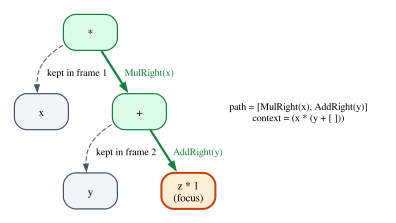

# Chapter 11 · Algebraic Data Types and the Algebra of Types

Look at almost any Rust program and you will find the same few building blocks.
A `struct` or a tuple glues several values together. An `enum` offers a choice
between alternatives. The unit type `()` is the boring answer of a function
called for its effects, and `Infallible` is the error type of an operation that
cannot fail. Functions turn values into values. With these five ingredients,
nested inside each other and made recursive with a `Box`, you can describe
configuration files, network packets, abstract syntax trees, state machines and
almost everything else a program needs.

These building blocks are called **algebraic data types**, and the word
*algebraic* is not decoration. If you count the values of each type, products
multiply, sums add, the unit type is the number 1, the empty type is 0, and
function types are powers. The familiar laws of school algebra (distributivity,
$a^{b+c} = a^b \cdot a^c$, $a \cdot 1 = a$) turn into statements about types,
and each of those statements is witnessed by a pair of programs that convert
back and forth without losing information. The algebra explains why `Option<bool>`
fits in one byte, why a recursive `enum` needs a `Box`, why Lean refuses some
recursive types that Rust happily accepts, and how to tell, by counting, that a
data structure admits states your program should never see.

This chapter studies the type formers one by one, then the algebra, then
recursion. Rust shows the algebra at work, down to the byte layout; Lean proves
every law we state, first with a hand-written structure and then with Mathlib's
library of isomorphisms and cardinalities.

**In this chapter you will learn:**

- the five basic type formers (products, sums, unit, empty, functions), their
  introduction and elimination rules, and why exhaustive `match` *is* the
  elimination rule for sums;
- how counting values turns types into an algebra, and how each law of that
  algebra becomes an isomorphism of types;
- how to prove isomorphisms in Lean with an `Iso` structure of our own, then with
  Mathlib's `Equiv` and `Fintype.card`;
- recursive types as solutions of equations ($\mathrm{List}\,A \cong 1 + A \times \mathrm{List}\,A$),
  why Rust needs a `Box` for them, and the fold as their elimination rule;
- why Lean rejects a type like `inductive Bad | mk : (Bad → Nat) → Bad`, and what
  Rust gains and loses by accepting its equivalent;
- how Rust lays out algebraic data types in memory: zero-sized types, empty
  types and the niche optimization;
- how to use counting to find illegal states in a design, and (as a bonus) how
  the *derivative* of a type gives you a zipper.

## Five ways to build a type

You have met all of the type formers of this chapter before. Chapter 8 gave the
simply typed λ-calculus products and sums with their rules, and Chapter 10 read
them as conjunction and disjunction. This chapter looks at them as *data*: what
their values are, how many there are, and how they are stored. Here is the
cast:

| Type former | Theory | Rust | Lean | Values |
|---|---|---|---|---|
| product | $A \times B$ | `(A, B)`, `struct` | `α × β`, `structure` | one `A` and one `B` |
| sum | $A + B$ | `enum`, `Result<A, B>` | `α ⊕ β`, `inductive` | an `A` or a `B`, tagged |
| unit | $\mathbf{1}$ | `()`, `struct Marker;` | `Unit` | exactly one |
| empty | $\mathbf{0}$ | `enum Void {}`, `Infallible` | `Empty` | none |
| function | $A \to B$, $B^A$ | `fn(A) -> B`, closures | `α → β` | a `B` for every `A` |

Each type former comes with rules that say how to build its values
(*introduction*) and how to use them (*elimination*), as in Chapter 4.

### Products

A value of $A \times B$ is built from a value of each component, and used by
projecting a component out:

$$
\dfrac{\Gamma \vdash a : A \qquad \Gamma \vdash b : B}{\Gamma \vdash (a, b) : A \times B}\;\textsf{T-Pair}
\qquad
\dfrac{\Gamma \vdash p : A \times B}{\Gamma \vdash \mathtt{fst}\ p : A}\;\textsf{T-Fst}
\qquad
\dfrac{\Gamma \vdash p : A \times B}{\Gamma \vdash \mathtt{snd}\ p : B}\;\textsf{T-Snd}
$$

with the computation rules $\mathtt{fst}\,(a, b) \longrightarrow a$ and
$\mathtt{snd}\,(a, b) \longrightarrow b$. In Rust the anonymous product is the
tuple, with projections `.0` and `.1` and destructuring patterns `let (a, b) = p;`.
A `struct` is a product whose components have names. The names matter to the
compiler: `struct Meters(f64)` and `struct Seconds(f64)` are different types with
the same values, because Rust's structs are *nominal* (Chapter 3). The algebra
ignores names; below, "same values, different type" becomes the difference
between isomorphism and equality.

### Sums

A value of $A + B$ is a value of $A$ or a value of $B$, *tagged* with which one
it is. Two introduction rules put a value in, and one elimination rule takes it
apart by cases:

$$
\dfrac{\Gamma \vdash a : A}{\Gamma \vdash \mathtt{inl}\ a : A + B}\;\textsf{T-Inl}
\qquad
\dfrac{\Gamma \vdash b : B}{\Gamma \vdash \mathtt{inr}\ b : A + B}\;\textsf{T-Inr}
$$

$$
\dfrac{\Gamma \vdash s : A + B \qquad \Gamma,\, x : A \vdash e_1 : C \qquad \Gamma,\, y : B \vdash e_2 : C}{\Gamma \vdash \mathtt{case}\ s\ \mathtt{of}\ \mathtt{inl}\,x \Rightarrow e_1 \mid \mathtt{inr}\,y \Rightarrow e_2 : C}\;\textsf{T-Case}
$$

Rule T-Case says: to use a value of a sum, you must say what to do in *each*
case, and both branches must produce the same type $C$. You have seen this shape
twice already. It is the rule ∨E of Chapter 4 (to use "$A$ or $B$", prove the goal
from $A$ and from $B$), and its special case $\mathtt{bool} = \mathbf{1} + \mathbf{1}$
is rule T-If of Chapter 1.

The tag is essential. The sum $\mathtt{u8} + \mathtt{u8}$ has 512 values, not
256: `inl 7` and `inr 7` are different. That is what distinguishes a sum (a
*tagged union*) from a C `union`, which has no tag.

In Rust, every `enum` is a sum, and every variant with fields is a product, so an
`enum` is a *sum of products*. The standard library is full of sums: `Option<T>`
is $\mathbf{1} + T$ (`None` carries nothing, `Some` carries a `T`), and
`Result<T, E>` is $T + E$. The plain two-way sum is not in the standard
library, so this chapter's Rust example, `code/rust/examples/ch11_type_algebra.rs`,
defines it:

```rust
/// The sum type A + B: a value is an `A` or a `B`, tagged with which one.
#[derive(Clone, Copy, Debug, PartialEq)]
enum Either<A, B> {
    Left(A),
    Right(B),
}

/// The empty type 0: no variants, hence no values.
#[derive(Clone, Copy, Debug, PartialEq)]
enum Void {}

/// The elimination rule for 0: a `match` with no arms. It type-checks at any
/// result type `T` because there is no case to handle.
fn absurd<T>(v: Void) -> T {
    match v {}
}
```

### The unit type and the empty type

The unit type $\mathbf{1}$ has one value and an introduction rule with no
premises; there is nothing to eliminate, because a value of type $\mathbf{1}$
carries no information:

$$
\dfrac{}{\Gamma \vdash () : \mathbf{1}}\;\textsf{T-Unit}
\qquad\qquad
\dfrac{\Gamma \vdash e : \mathbf{0}}{\Gamma \vdash \mathtt{absurd}\ e : C}\;\textsf{T-Absurd}
$$

The empty type $\mathbf{0}$ is the opposite: no introduction rule at all, and an
elimination rule that produces a value of *any* type $C$. Rule T-Absurd is the
case rule for a sum with zero summands: to handle every case of a value of
$\mathbf{0}$, you handle no cases, and the conclusion can be anything. In Rust it
is a `match` with no arms, which is exactly the body of `absurd` above. As
Chapter 10 explained, $\mathbf{0}$ is falsity under Curry–Howard, and T-Absurd
is *ex falso quodlibet*.

An empty type is useful precisely because it rules things out. The standard
library's `Infallible` is an empty `enum`, used as the error type of conversions
that cannot fail. A function returning `Result<u64, Infallible>` promises that it
never returns `Err`, and the compiler can check code that relies on the promise.
The chapter's second example, `code/rust/examples/ch11_recursive_types.rs`, shows
two ways to unwrap such a result:

```rust
/// A parser that cannot fail: its error type has no values.
fn parse_trusted(digits: &str) -> Result<u64, Infallible> {
    Ok(digits.bytes().fold(0, |n, d| 10 * n + u64::from(d - b'0')))
}

/// The long way: the `Err` arm is there, and its body is a `match` with no
/// arms, because there is no `Infallible` value to take apart.
fn unwrap_long<T>(r: Result<T, Infallible>) -> T {
    match r {
        Ok(t) => t,
        Err(e) => match e {},
    }
}

/// The short way: the `Err` case would need a value of type `Infallible`, so
/// the pattern `Ok(t)` alone is exhaustive and `let` accepts it.
fn unwrap_short<T>(r: Result<T, Infallible>) -> T {
    let Ok(t) = r;
    t
}
```

In `unwrap_long`, the `Err` arm binds a value `e` of type `Infallible` and
handles it with `match e {}`: no arms, because no value of `Infallible` exists.
In `unwrap_short` the compiler goes one step further. Since Rust 1.82, a pattern
that only an empty type could match may be left out, so `let Ok(t) = r;` is
accepted as exhaustive: the missing case `Err(_)` would need a value of
`Infallible`.

### Functions

The function type $A \to B$ completes the list. Its rules are the λ-abstraction
and application rules of Chapter 8, and its values are the functions themselves.
Algebraically, function types will turn out to be *exponentials*, so we will
often write $B^A$ for $A \to B$.

### Pattern matching is the elimination rule

The rule T-Case demands a branch for each summand. Rust's `match` generalizes it
to sums with any number of variants, nested patterns and guards, and keeps the
demand: a `match` must be **exhaustive**. A `match` that forgets a variant is
like a proof by cases that forgets a case, and the compiler rejects it
(`code/rust/compile_fail/ch11_non_exhaustive.rs`):

```rust
enum Payment {
    Card { last4: u16 },
    Invoice { days: u32 },
    Voucher(u32),
}

fn describe(p: &Payment) -> String {
    match p {
        Payment::Card { last4 } => format!("card ending in {last4}"),
        Payment::Invoice { days } => format!("invoice, due in {days} days"),
    }
}
```

```text
error[E0004]: non-exhaustive patterns: `&Payment::Voucher(_)` not covered
  --> compile_fail/ch11_non_exhaustive.rs:13:11
   |
13 |     match p {
   |           ^ pattern `&Payment::Voucher(_)` not covered
   |
note: `Payment` defined here
  --> compile_fail/ch11_non_exhaustive.rs:6:6
   |
 6 | enum Payment {
   |      ^^^^^^^
...
 9 |     Voucher(u32),
   |     ------- not covered
   = note: the matched value is of type `&Payment`
help: ensure that all possible cases are being handled by adding a match arm with a wildcard pattern or an explicit pattern as shown
   |
15 ~         Payment::Invoice { days } => format!("invoice, due in {days} days"),
16 ~         &Payment::Voucher(_) => todo!(),
   |
```

The error names the missing case, `&Payment::Voucher(_)`, and suggests adding an
arm for it. Exhaustiveness checking is what makes `enum` safer than the
"tag field plus a few optional fields" pattern common in other languages: when
you add a variant to an `enum`, every `match` that does not handle it stops
compiling, and the compiler gives you the list of places to update.

> [!TIP]
> A wildcard arm `_ => ...` satisfies the checker, but it also switches the
> check off for every variant added later. For enums you own, prefer listing the
> variants explicitly. Library authors can do the opposite with
> `#[non_exhaustive]`, which forces code in *other* crates to include a wildcard,
> so that adding a variant is not a breaking change: the sum is declared to be
> open.

### The type formers in Lean

Lean has all five type formers too, and it lets us build the first four from
scratch with `inductive` and `structure` (Chapter 2). The file
`code/lean/Book/Ch11/Formers.lean` does exactly that:

```lean
/-- A + B: a value is built by `inl` from an `α` or by `inr` from a `β`. -/
inductive MySum (α β : Type) where
  | inl : α → MySum α β
  | inr : β → MySum α β

/-- A × B: one constructor with two fields. -/
structure MyProd (α β : Type) where
  fst : α
  snd : β

/-- 1: one constructor with no fields. -/
inductive MyUnit where
  | star : MyUnit

/-- 0: no constructors at all. -/
inductive MyEmpty : Type
```

The definitions read like the table at the start of the section. A sum has two
constructors, each with one field. A product is a structure with two fields. The
unit type has one constructor with no fields, and the empty type has no
constructors at all, so there is no way to build one of its values. The
elimination rules are ordinary functions defined by pattern matching:

```lean
/-- Rule +E: to use a sum, say what to do in each case. -/
def MySum.elim {α β γ : Type} (f : α → γ) (g : β → γ) : MySum α β → γ
  | .inl a => f a
  | .inr b => g b

/-- Rule 0E: from a value of the empty type, anything. There is no case to
write, and `nomatch` says so. -/
def MyEmpty.elim {γ : Type} (e : MyEmpty) : γ := nomatch e

/-- Rule ×E: the projections come with the structure; pattern matching works
too. -/
def MyProd.swap {α β : Type} : MyProd α β → MyProd β α
  | ⟨a, b⟩ => ⟨b, a⟩
```

`MyEmpty.elim` plays the role of Rust's `absurd`. Its body `nomatch e` is a pattern match with no
cases, the Lean spelling of Rust's `match e {}`, and it type-checks at any result
type `γ`. The built-in versions are called `Sum` (written `α ⊕ β`, with
constructors `Sum.inl` and `Sum.inr`), `Prod` (written `α × β`), `Unit` (whose
value is written `()`) and `Empty`:

```lean
/-- info: Sum.inl 3 : ℕ ⊕ String -/
#guard_msgs in
#check (Sum.inl 3 : ℕ ⊕ String)

/-- info: (3, "three") : ℕ × String -/
#guard_msgs in
#check ((3, "three") : ℕ × String)

/-- info: "3" -/
#guard_msgs in
#eval (Sum.elim toString id (Sum.inl 3 : ℕ ⊕ String) : String)
```

`Sum.elim f g` is the case rule packaged as a function: it applies `f` to a left
value and `g` to a right value. Lean checks exhaustiveness as Rust does, with an
error that lists the missing patterns:

```lean
inductive Payment where
  | card (last4 : ℕ)
  | invoice (days : ℕ)
  | voucher (code : ℕ)

/--
error: Missing cases:
(voucher _)
-/
#guard_msgs in
def Payment.describe : Payment → String
  | .card last4 => s!"card ending in {last4}"
  | .invoice days => s!"invoice, due in {days} days"
```

## Counting values

Now the algebra. Write $|A|$ for the number of values of a type $A$, and consider
only types with finitely many values for the moment. Then:

$$
|\mathbf{0}| = 0
\qquad
|\mathbf{1}| = 1
\qquad
|A + B| = |A| + |B|
\qquad
|A \times B| = |A| \cdot |B|
\qquad
|A \to B| = |B|^{|A|}
$$

The first two are definitions. A value of $A + B$ is either one of the $|A|$
left values or one of the $|B|$ right values, and the tags keep the two groups
apart, so the counts add. A value of $A \times B$ chooses an $A$ *and*,
independently, a $B$, so the counts multiply. A function from $A$ to $B$ chooses,
for each of the $|A|$ arguments, one of $|B|$ results, independently: $|B|$ choices
$|A|$ times, which is $|B|^{|A|}$. That is why function types are called
**exponentials**, and why we write $B^A$ for $A \to B$.

Some consequences are worth checking by hand. `bool` is $\mathbf{1} + \mathbf{1}$,
so it has $1 + 1 = 2$ values. `Option<bool>` is $\mathbf{1} + 2$, three values.
There are $2^2 = 4$ functions from `bool` to `bool`: the identity, negation, and
the two constant functions. There is exactly one function from $\mathbf{0}$ to
any type, the empty function that never has to return anything ($B^0 = 1$), and
no function at all from an inhabited type into $\mathbf{0}$ ($0^A = 0$ when
$|A| > 0$). The corner case $|\mathbf{0} \to \mathbf{0}| = 0^0 = 1$ settles a
question that sometimes divides mathematicians: for types, $0^0$ is $1$, and the
single function is `absurd`.

In Rust we can make the counting executable. The example defines a trait for
types with finitely many values, with an associated constant computed from the
structure of the type and a method that lists the values:

```rust
/// Types with finitely many values, listed explicitly. `CARD` is computed
/// from the structure of the type, `all()` enumerates the values; the
/// counting laws say the two must agree.
trait Finite: Sized {
    const CARD: usize;
    fn all() -> Vec<Self>;
}

impl Finite for Void {
    const CARD: usize = 0;
    fn all() -> Vec<Self> {
        vec![]
    }
}

impl Finite for () {
    const CARD: usize = 1;
    fn all() -> Vec<Self> {
        vec![()]
    }
}

impl Finite for bool {
    const CARD: usize = 2;
    fn all() -> Vec<Self> {
        vec![false, true]
    }
}

/// |A × B| = |A| · |B|
impl<A: Finite + Clone, B: Finite + Clone> Finite for (A, B) {
    const CARD: usize = A::CARD * B::CARD;
    fn all() -> Vec<Self> {
        let mut out = Vec::new();
        for a in A::all() {
            for b in B::all() {
                out.push((a.clone(), b));
            }
        }
        out
    }
}

/// |A + B| = |A| + |B|
impl<A: Finite, B: Finite> Finite for Either<A, B> {
    const CARD: usize = A::CARD + B::CARD;
    fn all() -> Vec<Self> {
        let lefts = A::all().into_iter().map(Either::Left);
        let rights = B::all().into_iter().map(Either::Right);
        lefts.chain(rights).collect()
    }
}

/// |Option A| = 1 + |A|
impl<A: Finite> Finite for Option<A> {
    const CARD: usize = 1 + A::CARD;
    fn all() -> Vec<Self> {
        std::iter::once(None)
            .chain(A::all().into_iter().map(Some))
            .collect()
    }
}

/// |Result<T, E>| = |T| + |E|
impl<T: Finite, E: Finite> Finite for Result<T, E> {
    const CARD: usize = T::CARD + E::CARD;
    fn all() -> Vec<Self> {
        let oks = T::all().into_iter().map(Ok);
        let errs = E::all().into_iter().map(Err);
        oks.chain(errs).collect()
    }
}
```

Each `impl` is one line of the counting table. `CARD` is computed at compile time
from the components: the `impl` for pairs says `A::CARD * B::CARD`, the one for
`Either` says `A::CARD + B::CARD`. The method `all` enumerates the values, and the
example asserts that the length of the enumeration agrees with the formula. For
function types we only compute the count:

```rust
/// |A → B| = |B| ^ |A|: one independent choice in B for each value of A.
/// (We only count functions here; enumerating them is an exercise.)
const fn pow(base: usize, exp: usize) -> usize {
    let mut result = 1;
    let mut i = 0;
    while i < exp {
        result *= base;
        i += 1;
    }
    result
}

fn card_fn<A: Finite, B: Finite>() -> usize {
    pow(B::CARD, A::CARD)
}
```

```rust
println!();
println!(
    "|(bool, Option<bool>)|      = {}",
    <(bool, Option<bool>)>::CARD
);
println!("|Either<bool, ()>|          = {}", <Either<bool, ()>>::CARD);
println!(
    "|bool -> Option<bool>|      = {}",
    card_fn::<bool, Option<bool>>()
);
println!(
    "|Option<bool> -> bool|      = {}",
    card_fn::<Option<bool>, bool>()
);
println!("|Void -> bool|              = {}", card_fn::<Void, bool>());
println!("|bool -> Void|              = {}", card_fn::<bool, Void>());
println!("|Void -> Void|              = {}", card_fn::<Void, Void>());
// The formula and the enumeration agree.
assert_eq!(
    <(bool, Option<bool>)>::all().len(),
    <(bool, Option<bool>)>::CARD
);
assert_eq!(<Either<bool, Option<()>>>::all().len(), 4);
```

```text
|(bool, Option<bool>)|      = 6
|Either<bool, ()>|          = 3
|bool -> Option<bool>|      = 9
|Option<bool> -> bool|      = 8
|Void -> bool|              = 1
|bool -> Void|              = 0
|Void -> Void|              = 1
```

The last three lines are the corner cases: one empty function, no function into
`Void`, and $0^0 = 1$.

## Isomorphisms: when two types are the same

Counting suggests that `Option<bool>` and `Either<(), bool>` are "the same type":
both have three values. They are not equal, as far as Rust is concerned, but they
are interchangeable in a precise sense. An **isomorphism** between types $A$ and
$B$, written $A \cong B$, is a pair of functions

$$
f : A \to B \qquad g : B \to A \qquad\text{with}\qquad g(f(a)) = a \;\text{ for all } a, \qquad f(g(b)) = b \;\text{ for all } b.
$$

The two equations are the *round trips*: converting to $B$ and back loses
nothing, and neither does converting to $A$ and back. If $A \cong B$, any program
that works with $A$ can be rewritten to work with $B$ by converting at the
boundaries, and nothing observable changes. For a programmer, an isomorphism is a
lossless, reversible change of representation, the kind of refactoring that is
safe by construction.

For finite types, an isomorphism exists exactly when the two types have the same
number of values. But the interesting isomorphisms are the ones that come from the
*laws* of the algebra, because they work uniformly for all types, finite or not.
Each law of arithmetic becomes one:

| Law of numbers | Isomorphism of types | In words |
|---|---|---|
| $a \cdot 1 = a$ | $A \times \mathbf{1} \cong A$ | pairing with `()` adds nothing |
| $a + 0 = a$ | $A + \mathbf{0} \cong A$ | an impossible alternative adds nothing |
| $a \cdot 0 = 0$ | $A \times \mathbf{0} \cong \mathbf{0}$ | no pair can be built |
| $a \cdot b = b \cdot a$ | $A \times B \cong B \times A$ | swap |
| $a(b + c) = ab + ac$ | $A \times (B + C) \cong A \times B + A \times C$ | distributivity |
| $c^{ab} = (c^b)^a$ | $(A \times B \to C) \cong (A \to B \to C)$ | currying |
| $a^{b+c} = a^b \cdot a^c$ | $(B + C \to A) \cong (B \to A) \times (C \to A)$ | one function per case |
| $a^1 = a$, $1^a = 1$, $a^0 = 1$ | $(\mathbf{1} \to A) \cong A$, ... | small exponents |
| $2 = 1 + 1$ | $\mathtt{bool} \cong \mathbf{1} + \mathbf{1}$ | a tag and nothing else |

The law $a^{b+c} = a^b \cdot a^c$ is one you use without noticing: a function out
of an `enum` with two variants is the same thing as a pair of functions, one for
each variant. That is what a `match` with two arms *is*.

### Isomorphisms in Rust

In Rust, an isomorphism is a pair of functions. The example stores them as
function pointers and checks both round trips on every value of a finite
instance:

```rust
/// An isomorphism: two functions that undo each other.
struct Iso<A, B> {
    name: &'static str,
    forward: fn(A) -> B,
    backward: fn(B) -> A,
}

impl<A, B> Iso<A, B>
where
    A: Finite + Clone + PartialEq + Debug,
    B: Finite + Clone + PartialEq + Debug,
{
    /// Check both round trips on *every* value of both types. For these
    /// particular finite instances this is a complete proof; for all types at
    /// once we need Lean.
    fn check(&self) {
        for a in A::all() {
            assert_eq!((self.backward)((self.forward)(a.clone())), a);
        }
        for b in B::all() {
            assert_eq!((self.forward)((self.backward)(b.clone())), b);
        }
        assert_eq!(A::CARD, B::CARD);
        println!("{:<26} ok: {} values each side", self.name, A::CARD);
    }
}
```

Here are some of the laws as generic functions. Each pair works for all types `A`,
`B`, `C`; the check instantiates them at small finite types:

```rust
/// A × 1 ≅ A
fn drop_unit<A>((a, ()): (A, ())) -> A {
    a
}
fn add_unit<A>(a: A) -> (A, ()) {
    (a, ())
}

/// A + 0 ≅ A: the `Right` case cannot happen, and `absurd` says so.
fn drop_void<A>(e: Either<A, Void>) -> A {
    match e {
        Either::Left(a) => a,
        Either::Right(v) => absurd(v),
    }
}
fn add_void<A>(a: A) -> Either<A, Void> {
    Either::Left(a)
}

/// A × (B + C) ≅ A × B + A × C
fn distribute<A, B, C>((a, bc): (A, Either<B, C>)) -> Either<(A, B), (A, C)> {
    match bc {
        Either::Left(b) => Either::Left((a, b)),
        Either::Right(c) => Either::Right((a, c)),
    }
}
fn factor<A, B, C>(e: Either<(A, B), (A, C)>) -> (A, Either<B, C>) {
    match e {
        Either::Left((a, b)) => (a, Either::Left(b)),
        Either::Right((a, c)) => (a, Either::Right(c)),
    }
}

/// Option A ≅ 1 + A
fn option_to_sum<A>(o: Option<A>) -> Either<(), A> {
    match o {
        None => Either::Left(()),
        Some(a) => Either::Right(a),
    }
}
fn sum_to_option<A>(e: Either<(), A>) -> Option<A> {
    match e {
        Either::Left(()) => None,
        Either::Right(a) => Some(a),
    }
}

/// bool ≅ 1 + 1
fn bool_to_sum(b: bool) -> Either<(), ()> {
    if b {
        Either::Left(())
    } else {
        Either::Right(())
    }
}
fn sum_to_bool(e: Either<(), ()>) -> bool {
    matches!(e, Either::Left(()))
}
```

```rust
Iso {
    name: "A × 1 ≅ A",
    forward: drop_unit::<Option<bool>>,
    backward: add_unit,
}
.check();
Iso {
    name: "A + 0 ≅ A",
    forward: drop_void::<(bool, bool)>,
    backward: add_void,
}
.check();
Iso {
    name: "A × (B + C) ≅ A×B + A×C",
    forward: distribute::<bool, Option<bool>, ()>,
    backward: factor,
}
.check();
Iso {
    name: "Option A ≅ 1 + A",
    forward: option_to_sum::<bool>,
    backward: sum_to_option,
}
.check();
Iso {
    name: "bool ≅ 1 + 1",
    forward: bool_to_sum,
    backward: sum_to_bool,
}
.check();
// The standard library's `transpose` methods: 1 + (A + E) ≅ (1 + A) + E.
Iso {
    name: "1 + (A + E) ≅ (1 + A) + E",
    forward: Option::<Result<bool, ()>>::transpose,
    backward: Result::<Option<bool>, ()>::transpose,
}
.check();
```

```text
A × 1 ≅ A                  ok: 3 values each side
A + 0 ≅ A                  ok: 4 values each side
A × (B + C) ≅ A×B + A×C    ok: 8 values each side
Option A ≅ 1 + A           ok: 3 values each side
bool ≅ 1 + 1               ok: 2 values each side
1 + (A + E) ≅ (1 + A) + E  ok: 4 values each side
```

The last check uses two methods from the standard library. `Option::transpose`
turns an `Option<Result<T, E>>` into a `Result<Option<T>, E>`, and
`Result::transpose` goes back. Both types are $1 + T + E$, grouped differently:
whoever added the methods to the standard library was doing type algebra.

Because the check enumerates every value, it is a complete proof for *these
instances*, but not for every `A`. For that we need Lean.

Function types cannot be enumerated or compared with `==`, so the currying
isomorphism is checked pointwise, on arguments we choose. Its Rust version also
shows a deviation from the clean theory:

```rust
/// (A × B → C) ≅ (A → (B → C)). The inner function must own a copy of `a`
/// and of `f`, which is why Rust asks for `Clone` and a box.
fn curry<A, B, C, F>(f: F) -> impl Fn(A) -> Box<dyn Fn(B) -> C>
where
    A: Clone + 'static,
    B: 'static,
    C: 'static,
    F: Fn((A, B)) -> C + Clone + 'static,
{
    move |a: A| {
        let f = f.clone();
        Box::new(move |b: B| f((a.clone(), b)))
    }
}

fn uncurry<A, B, C, G, H>(g: G) -> impl Fn((A, B)) -> C
where
    G: Fn(A) -> H,
    H: Fn(B) -> C,
{
    move |(a, b)| g(a)(b)
}
```

```rust
// Function types cannot be compared for equality, so we check the round
// trip pointwise: on every argument we try, the functions agree.
let f = |(a, b): (u32, u32)| 10 * a + b;
let back_again = uncurry(curry(f));
for a in 0..10 {
    for b in 0..10 {
        assert_eq!(back_again((a, b)), f((a, b)));
        assert_eq!(curry(f)(a)(b), f((a, b)));
    }
}
println!("{:<26} ok: agree on 100 arguments", "C^(A×B) ≅ (C^B)^A");
```

```text
C^(A×B) ≅ (C^B)^A          ok: agree on 100 arguments
```

On paper, `curry f` is just `fun a => fun b => f (a, b)`. In Rust, the inner
closure outlives the call that created it, so it must *own* a copy of `a` and of
`f`. Hence the `Clone` and `'static` bounds, and the `Box<dyn Fn>` (Rust does not
allow `impl Fn` in the return type of a closure type). Chapter 8 discussed the cost
of currying; here it is the price of an isomorphism, and a first sign of the theme
of Part V: Rust values are resources, and a program that uses a variable twice
needs permission to duplicate it.

## Proving isomorphisms in Lean

Rust can test the laws on examples. Lean can prove them for all types at once.
The file `code/lean/Book/Ch11/Iso.lean` starts by defining what an isomorphism
is:

```lean
/-- An isomorphism between `α` and `β`: a function in each direction, and proofs
that each one undoes the other. -/
structure Iso (α β : Type) where
  /-- The forward function. -/
  toFun : α → β
  /-- The backward function. -/
  invFun : β → α
  /-- Going forward and then back is the identity on `α`. -/
  left_inv : ∀ a, invFun (toFun a) = a
  /-- Going back and then forward is the identity on `β`. -/
  right_inv : ∀ b, toFun (invFun b) = b

/-- `α ≅ β` is the type of isomorphisms between `α` and `β`. -/
scoped infix:25 " ≅ " => Iso
```

Compare this with the Rust `Iso`. Both have two functions. The Lean structure
has two more fields, `left_inv` and `right_inv`, whose types are *propositions*:
"for every `a`, going forward and back gives `a`", and the same in the other
direction. A value of type `α ≅ β` therefore contains the two functions *and
proofs* of both round trips. You cannot build one without proving the laws, in
the same way that you cannot build a Rust struct without supplying every field.
(The notation `≅` is declared `scoped`, so it is only active inside the chapter's
namespace. Mathlib uses the same symbol for isomorphisms in a category, which is
what our `Iso` will become in Chapter 16; here all our types live in `Type`, and
Chapter 12 explains what lies above it.)

The first three constructions show that "isomorphic" behaves like equality: it
is reflexive, symmetric and transitive.

```lean
/-- Every type is isomorphic to itself. -/
def refl (α : Type) : α ≅ α where
  toFun a := a
  invFun a := a
  left_inv _ := rfl
  right_inv _ := rfl

/-- An isomorphism can be run backwards. -/
def symm (i : α ≅ β) : β ≅ α where
  toFun := i.invFun
  invFun := i.toFun
  left_inv := i.right_inv
  right_inv := i.left_inv

/-- Isomorphisms compose. -/
def trans (i : α ≅ β) (j : β ≅ γ) : α ≅ γ where
  toFun a := j.toFun (i.toFun a)
  invFun c := i.invFun (j.invFun c)
  left_inv a := by
    -- Goal: i.invFun (j.invFun (j.toFun (i.toFun a))) = a
    rw [j.left_inv, i.left_inv]
  right_inv c := by
    -- Goal: j.toFun (i.toFun (i.invFun (j.invFun c))) = c
    rw [i.right_inv, j.right_inv]
```

The `where` syntax fills in the fields one by one. In `refl`, both functions are
the identity and both round trips hold by `rfl`, since `(fun a => a) ((fun a => a) x)`
computes to `x`. In `symm`, the fields are swapped, and so are the proofs:
`i.right_inv` is exactly the statement needed for the new `left_inv`. In `trans`,
the round trip `i.invFun (j.invFun (j.toFun (i.toFun a)))` is simplified from the
inside out: `rw [j.left_inv]` rewrites `j.invFun (j.toFun _)` to its argument,
leaving `i.invFun (i.toFun a)`, and `rw [i.left_inv]` finishes.

### Units, commutativity and associativity

The law $A \times \mathbf{1} \cong A$:

```lean
/-- `α × 1 ≅ α`: pairing with the unit value adds no information. -/
def prodUnit (α : Type) : α × Unit ≅ α where
  toFun p := p.1
  invFun a := (a, ())
  left_inv := by
    intro ⟨a, u⟩  -- take the pair apart
    cases u       -- the only value of `Unit` is `()`
    rfl           -- goal: (a, ()) = (a, ()), true by computation
  right_inv _ := rfl
```

The interesting proof is `left_inv`, which must show `(p.1, ()) = p` for every
pair `p`. The tactic `intro ⟨a, u⟩` introduces the pair and takes it apart in one
step, naming its components `a` and `u`. Then `cases u` does case analysis on
`u : Unit`, which has a single constructor, so it replaces `u` by `()`. The goal
becomes `(a, ()) = (a, ())`, which `rfl` closes. The other round trip,
`(a, ()).1 = a`, holds by computation.

Commutativity and associativity of products need no tactics at all:

```lean
/-- `α × β ≅ β × α`. -/
def prodComm (α β : Type) : α × β ≅ β × α where
  toFun p := (p.2, p.1)
  invFun p := (p.2, p.1)
  left_inv _ := rfl
  right_inv _ := rfl

/-- `(α × β) × γ ≅ α × (β × γ)`. -/
def prodAssoc (α β γ : Type) : (α × β) × γ ≅ α × (β × γ) where
  toFun p := (p.1.1, (p.1.2, p.2))
  invFun p := ((p.1, p.2.1), p.2.2)
  left_inv _ := rfl
  right_inv _ := rfl
```

For `prodComm`, `left_inv` must show that swapping twice gives back `p`, which
computes to `(p.1, p.2) = p`. That `rfl` proves it is not obvious, since `p` is a
variable, not a pair written out. Lean accepts it because of **eta for
structures**: a value of a structure type is equal, by definition, to the
structure built from its own projections.

### Sums and the empty type

```lean
/-- `α + β ≅ β + α`. -/
def sumComm (α β : Type) : α ⊕ β ≅ β ⊕ α where
  toFun
    | .inl a => .inr a
    | .inr b => .inl b
  invFun
    | .inl b => .inr b
    | .inr a => .inl a
  left_inv s := by cases s <;> rfl
  right_inv s := by cases s <;> rfl

/-- `α + 0 ≅ α`: a summand with no values contributes nothing. -/
def sumEmpty (α : Type) : α ⊕ Empty ≅ α where
  toFun
    | .inl a => a
    | .inr e => nomatch e
  invFun a := .inl a
  left_inv s := by
    cases s with
    | inl a => rfl
    | inr e => nomatch e  -- no value of `Empty`: nothing to prove
  right_inv _ := rfl

/-- `α × 0 ≅ 0`: a pair needs a component of type `Empty`, which does not exist. -/
def prodEmpty (α : Type) : α × Empty ≅ Empty where
  toFun p := nomatch p.2
  invFun e := nomatch e
  left_inv p := nomatch p.2
  right_inv e := nomatch e
```

Two new pieces of syntax appear. First, `toFun` and `invFun` are defined by
pattern matching directly after the field name, one line per constructor, as a
`match` would. Second, `cases s <;> rfl` means: split `s` into its two cases, and
run `rfl` on *every* resulting goal (the combinator `<;>` applies the tactic on its
right to all goals produced by the tactic on its left).

The empty type appears in three places. In `sumEmpty`, the case `.inr e` cannot
happen, and `nomatch e` disposes of it, both in the function and in the proof.
In `prodEmpty`, *every* case is impossible: a pair of type `α × Empty` would
contain an `Empty`, so all four fields are defined by `nomatch` on that
component. The isomorphism $A \times \mathbf{0} \cong \mathbf{0}$ consists of two
functions that can never be called and two proofs about values that do not exist.

### Distributivity

```lean
/-- `α × (β + γ) ≅ α × β + α × γ`: distributivity. -/
def distrib (α β γ : Type) : α × (β ⊕ γ) ≅ (α × β) ⊕ (α × γ) where
  toFun
    | (a, .inl b) => .inl (a, b)
    | (a, .inr c) => .inr (a, c)
  invFun
    | .inl (a, b) => (a, .inl b)
    | .inr (a, c) => (a, .inr c)
  left_inv := by
    intro ⟨a, s⟩
    cases s <;> rfl
  right_inv := by
    intro s
    cases s <;> rfl
```

This is the Rust pair `distribute`/`factor`, plus proofs. To prove `left_inv`, we
take the pair apart with `intro ⟨a, s⟩` and then split `s` into its two cases;
in each, both sides compute to the same pair and `rfl` closes the goal.

### Exponentials and function extensionality

The laws for function types need one more ingredient:

```lean
/-- `γ ^ (α × β) ≅ (γ ^ β) ^ α`: currying. -/
def curry (α β γ : Type) : (α × β → γ) ≅ (α → β → γ) where
  toFun f a b := f (a, b)
  invFun g p := g p.1 p.2
  left_inv f := by
    funext p  -- two functions are equal if they agree on every argument
    rfl       -- goal: f (p.1, p.2) = f p, true because p = (p.1, p.2)
  right_inv _ := rfl

/-- `α ^ (β + γ) ≅ α ^ β × α ^ γ`: a function out of a sum is a pair of
functions, one per summand. -/
def sumArrow (α β γ : Type) : (β ⊕ γ → α) ≅ (β → α) × (γ → α) where
  toFun f := (fun b => f (.inl b), fun c => f (.inr c))
  invFun p
    | .inl b => p.1 b
    | .inr c => p.2 c
  left_inv f := by
    funext s
    cases s <;> rfl
  right_inv _ := rfl

/-- `α ^ 1 ≅ α`: a function out of `Unit` is just one value. -/
def unitArrow (α : Type) : (Unit → α) ≅ α where
  toFun f := f ()
  invFun a := fun _ => a
  left_inv f := by
    funext u
    cases u
    rfl
  right_inv _ := rfl

/-- `1 ^ α ≅ 1`: there is exactly one function into `Unit`. -/
def arrowUnit (α : Type) : (α → Unit) ≅ Unit where
  toFun _ := ()
  invFun _ := fun _ => ()
  left_inv _ := rfl
  right_inv _ := rfl

/-- `α ^ 0 ≅ 1`: there is exactly one function out of `Empty`. -/
def emptyArrow (α : Type) : (Empty → α) ≅ Unit where
  toFun _ := ()
  invFun _ := fun e => nomatch e
  left_inv f := by
    funext e
    nomatch e
  right_inv _ := rfl
```

In `curry`, the goal of `left_inv` is an equation between *functions*:
`(fun p => f (p.1, p.2)) = f`. The tactic `funext p` applies the principle of
**function extensionality**: two functions are equal if they give equal results
on every argument. It turns the goal into `f (p.1, p.2) = f p` for an arbitrary
`p`, which `rfl` proves using eta for pairs again. (Function extensionality is a
theorem in Lean, derived from the quotient types built into its logic; some other
type theories must assume it as an axiom.) It is exactly what the Rust version
could not check: Rust compared the two functions on 100 arguments, Lean compares
them on all of them.

`sumArrow` is the law $A^{B + C} \cong A^B \times A^C$: the forward direction
splits a function on a sum into its two restrictions, and the backward direction
is a function defined by cases. `unitArrow`, `arrowUnit` and `emptyArrow` are the
small exponents; in the last one, `funext e` followed by `nomatch e` proves that
any two functions out of `Empty` are equal, because there is no argument on which
they could differ.

The remaining laws of the table have the same shape:

```lean
/-- `Option α ≅ 1 + α`. -/
def optionSum (α : Type) : Option α ≅ Unit ⊕ α where
  toFun
    | none => .inl ()
    | some a => .inr a
  invFun
    | .inl () => none
    | .inr a => some a
  left_inv o := by cases o <;> rfl
  right_inv s := by
    cases s with
    | inl u => cases u; rfl
    | inr a => rfl

/-- `Bool ≅ 1 + 1`: a boolean is a choice between two empty messages. -/
def boolSum : Bool ≅ Unit ⊕ Unit where
  toFun b := if b then .inl () else .inr ()
  invFun
    | .inl () => true
    | .inr () => false
  left_inv b := by cases b <;> rfl
  right_inv s := by
    cases s with
    | inl u => cases u; rfl
    | inr u => cases u; rfl
```

### Chaining isomorphisms like equations

On paper you would derive $A^2 \cong A \times A$ by a chain of equalities:
$A^2 = A^{1+1} = A^1 \times A^1 = A \times A$. Each step replaces a part of the
expression by something isomorphic. To do this with isomorphisms we need
*congruence*: if the parts are isomorphic, so are the wholes.

```lean
/-- Isomorphic components give isomorphic products. -/
def prodCongr (i : α ≅ α') (j : β ≅ β') : α × β ≅ α' × β' where
  toFun p := (i.toFun p.1, j.toFun p.2)
  invFun p := (i.invFun p.1, j.invFun p.2)
  left_inv p := by simp only [i.left_inv, j.left_inv]
  right_inv p := by simp only [i.right_inv, j.right_inv]

/-- Isomorphic domains and codomains give isomorphic function types. -/
def arrowCongr (i : α ≅ α') (j : β ≅ β') : (α → β) ≅ (α' → β') where
  toFun f := fun a' => j.toFun (f (i.invFun a'))
  invFun g := fun a => j.invFun (g (i.toFun a))
  left_inv f := by
    funext a
    simp only [i.left_inv, j.left_inv]
  right_inv g := by
    funext a'
    simp only [i.right_inv, j.right_inv]
```

`arrowCongr` is worth reading slowly. To turn `f : α → β` into a function
`α' → β'`, convert the argument back to `α` with `i.invFun`, apply `f`, and
convert the result forward with `j.toFun`. The round-trip proofs use
`simp only [...]`, which rewrites with the listed equations wherever they apply,
as many times as needed: here it cancels each `invFun (toFun x)` pair. With these
two lemmas, the chain of equalities becomes a chain of isomorphisms, glued by
`trans`:

```lean
/-- `(Bool → α) ≅ α × α`, derived step by step like the equation
`α ^ 2 = α ^ (1 + 1) = α ^ 1 × α ^ 1 = α × α`. -/
def boolArrow (α : Type) : (Bool → α) ≅ α × α :=
  (arrowCongr boolSum (refl α))                       -- α ^ 2       ≅ α ^ (1 + 1)
    |>.trans (sumArrow α Unit Unit)                   --             ≅ α ^ 1 × α ^ 1
    |>.trans (prodCongr (unitArrow α) (unitArrow α))  --             ≅ α × α
```

The syntax `x |>.trans y` means `x.trans y`, written so that each step of the
chain sits on its own line, next to the equation it implements. The result is not
just a proof that the two types are isomorphic: it is a pair of functions that we
can run:

```lean
/-- info: (10, 20) -/
#guard_msgs in
#eval (boolArrow ℕ).toFun (fun b => if b then 10 else 20)

/-- info: [7, 8] -/
#guard_msgs in
#eval [true, false].map ((boolArrow ℕ).invFun (7, 8))
```

The function `fun b => if b then 10 else 20` becomes the pair `(10, 20)`, and the
pair `(7, 8)` becomes the function that sends `true` to `7` and `false` to `8`.
We never wrote these conversions directly: they were assembled from the laws.

## In Mathlib: `Equiv` and `Fintype.card`

Mathlib has the same notion under the name `Equiv`, written `α ≃ β`. Its fields
have the same names and the same meaning as ours, so the translation in both
directions is field by field:

```lean
/-- Our `Iso` is Mathlib's `Equiv`, field for field. -/
def toEquiv (i : α ≅ β) : α ≃ β where
  toFun := i.toFun
  invFun := i.invFun
  left_inv := i.left_inv
  right_inv := i.right_inv

/-- And back. -/
def ofEquiv (e : α ≃ β) : α ≅ β where
  toFun := e
  invFun := e.symm
  left_inv := e.left_inv
  right_inv := e.right_inv
```

(In `ofEquiv`, `toFun := e` uses a *coercion*: an `Equiv` can be used wherever a
function is expected, and Lean inserts the conversion. Mathlib's documentation
asks users to write `e x` and `e.symm y` rather than reading the fields
directly.) Mathlib's library contains every isomorphism of this chapter and
hundreds more, with systematic names:

```lean
/-- info: Equiv.prodSumDistrib ℕ Bool String : ℕ × (Bool ⊕ String) ≃ ℕ × Bool ⊕ ℕ × String -/
#guard_msgs in
#check Equiv.prodSumDistrib ℕ Bool String

/-- info: Equiv.curry ℕ Bool String : (ℕ × Bool → String) ≃ (ℕ → Bool → String) -/
#guard_msgs in
#check Equiv.curry ℕ Bool String

/-- info: Sum.inr (3, "hi") -/
#guard_msgs in
#eval Equiv.prodSumDistrib ℕ Bool String (3, .inr "hi")

/-- An `Equiv` is applied like a function; `e.symm` is its inverse. -/
example : (Equiv.prodSumDistrib ℕ Bool String).symm (.inl (3, true)) = (3, .inl true) :=
  rfl

/-- Library isomorphisms combine with `Equiv.prodCongr`, `Equiv.trans` and so on. -/
example (α : Type) : α × (Bool ⊕ Empty) ≃ α × Bool :=
  Equiv.prodCongr (Equiv.refl α) (Equiv.sumEmpty Bool Empty)
```

Other useful entries are `Equiv.prodComm`, `Equiv.prodAssoc`, `Equiv.prodPUnit`,
`Equiv.sumComm`, `Equiv.sumEmpty`, `Equiv.sumArrowEquivProdArrow` and
`Equiv.optionEquivSumPUnit`. (`PUnit` is a version of `Unit` that can live in any
universe; Chapter 12 explains universes.)

### Counting with `Fintype.card`

For counting, Mathlib has the class `Fintype`: an instance of `Fintype α` is a
finite list of all the values of `α`, without repetitions, in the spirit of our
Rust trait `Finite`. `Fintype.card α` is the length of that list. Instances exist
for `Bool`, `Unit`, `Empty`, products, sums, `Option`, and function types whose
domain has decidable equality. The file `code/lean/Book/Ch11/Cardinality.lean`
puts them to work:

```lean
/-- info: 2 -/
#guard_msgs in
#eval Fintype.card Bool

/-- info: 6 -/
#guard_msgs in
#eval Fintype.card (Bool × Option Bool)

/-- info: 9 -/
#guard_msgs in
#eval Fintype.card (Bool → Option Bool)
```

These are computed from the enumeration that each `Fintype` instance provides.
The counting laws are theorems of the library:

```lean
example (α β : Type) [Fintype α] [Fintype β] :
    Fintype.card (α × β) = Fintype.card α * Fintype.card β :=
  Fintype.card_prod α β

example (α β : Type) [Fintype α] [Fintype β] :
    Fintype.card (α ⊕ β) = Fintype.card α + Fintype.card β :=
  Fintype.card_sum

example (α β : Type) [Fintype α] [Fintype β] [DecidableEq α] :
    Fintype.card (α → β) = Fintype.card β ^ Fintype.card α :=
  Fintype.card_fun

example (α : Type) [Fintype α] : Fintype.card (Option α) = Fintype.card α + 1 :=
  Fintype.card_option
```

and with them `simp` can compute the cardinality of any type built from these
formers, as an equation proved for good rather than a number printed once:

```lean
example : Fintype.card (Bool × Option Bool) = 6 := by simp
example : Fintype.card (Bool ⊕ Unit) = 3 := by simp
example : Fintype.card (Bool → Option Bool) = 9 := by simp
example : Fintype.card (Option Bool → Bool) = 8 := by simp
example : Fintype.card (Empty → Bool) = 1 := by simp  -- the empty function
example : Fintype.card (Bool → Empty) = 0 := by simp  -- no function at all
example : Fintype.card (Empty → Empty) = 1 := by simp -- 0 ^ 0 = 1
```

Each `simp` call rewrites `Fintype.card` of a compound type with the laws above,
replaces `Fintype.card Bool` by `2`, `Fintype.card Empty` by `0` and so on, and
finishes the arithmetic. The last three lines are our corner cases again, now
proved.

The connection between the two halves of the chapter is a theorem: isomorphic
types have the same cardinality. Mathlib proves it as `Fintype.card_congr`, and
we can feed it our own isomorphisms through `toEquiv`:

```lean
/-- Isomorphic types have the same number of values. -/
theorem card_eq_of_iso {α β : Type} [Fintype α] [Fintype β] (i : α ≅ β) :
    Fintype.card α = Fintype.card β :=
  Fintype.card_congr i.toEquiv

/-- Distributivity of types implies distributivity of numbers. -/
theorem mul_add_from_types (α β γ : Type) [Fintype α] [Fintype β] [Fintype γ] :
    Fintype.card α * (Fintype.card β + Fintype.card γ) =
      Fintype.card α * Fintype.card β + Fintype.card α * Fintype.card γ := by
  have h := card_eq_of_iso (distrib α β γ)
  -- h : card (α × (β ⊕ γ)) = card ((α × β) ⊕ (α × γ))
  simpa [Fintype.card_prod, Fintype.card_sum] using h
```

The second theorem runs the algebra backwards. The isomorphism `distrib` holds for
all types, so the cardinalities of both sides are equal, and simplifying both
sides with the counting laws gives the distributive law of *numbers*. The tactic
`simpa [...] using h` simplifies both the hypothesis `h` and the goal with the
given lemmas, and closes the goal with the simplified `h`. Distributivity of
multiplication over addition, for all natural numbers that are sizes of finite
types (which is all of them), proved by an isomorphism of types.

For finite types the converse holds too: equal cardinality gives an isomorphism.

```lean
/-- For finite types the converse holds too: the same number of values means
isomorphic. Mathlib's statement: -/
example (α β : Type) [Fintype α] [Fintype β] :
    Fintype.card α = Fintype.card β ↔ Nonempty (α ≃ β) :=
  Fintype.card_eq

/-- So `Bool × Bool` and `Option (Option Bool)` are isomorphic (both have 4
values), even though nobody wrote the isomorphism down. -/
example : Nonempty (Bool × Bool ≃ Option (Option Bool)) :=
  Fintype.card_eq.mp (by simp)
```

`Nonempty (α ≃ β)` is the proposition "there exists an isomorphism", which
asserts existence without handing you one. Any such isomorphism comes from
numbering the values of both types, and is arbitrary: it has nothing to do with
the structure of `Bool × Bool` or `Option (Option Bool)`. The isomorphisms that
come from the laws are better: they are defined by the same program for every
type, a property that Chapter 18 calls *naturality*.

## Recursive types

So far every type has been built from smaller types. A list is built from
*itself*: a list of `A` is either empty, or an `A` followed by a list of `A`.
Written as an equation between types:

$$
\mathrm{List}\,A \;\cong\; \mathbf{1} + A \times \mathrm{List}\,A
$$

A recursive type is a solution of such an equation, $X \cong F(X)$ for some type
expression $F$; the solution that recursive data types denote is the *least*
one, written $\mu X.\, F(X)$ ("mu"), which contains exactly the values that can be
built by applying the constructors finitely many times. So
$\mathrm{List}\,A = \mu X.\, \mathbf{1} + A \times X$. If you unfold the equation
repeatedly and pretend that the algebra of numbers applies, you get

$$
\mathrm{List}\,A = \mathbf{1} + A + A^2 + A^3 + \dots
$$

which says something true: a list is empty, or a single element, or a pair of
elements, or a triple, and so on. The number of lists of length $n$ is $|A|^n$.

### Lists in Rust, and why the `Box`

Rust writes the equation almost literally, with one extra word:

```rust
/// List<T> = 1 + T × List<T>. The `Box` stores the tail behind a pointer, so
/// that a `List<T>` has a size known at compile time.
#[derive(Debug, PartialEq)]
enum List<T> {
    Nil,
    Cons(T, Box<List<T>>),
}
```

Without the `Box`, the compiler refuses (`code/rust/compile_fail/ch11_recursive_without_box.rs`):

```rust
enum List<T> {
    Nil,
    Cons(T, List<T>),
}
```

```text
error[E0072]: recursive type `List` has infinite size
 --> compile_fail/ch11_recursive_without_box.rs:5:1
  |
5 | enum List<T> {
  | ^^^^^^^^^^^^
6 |     Nil,
7 |     Cons(T, List<T>),
  |             ------- recursive without indirection
  |
help: insert some indirection (e.g., a `Box`, `Rc`, or `&`) to break the cycle
  |
7 |     Cons(T, Box<List<T>>),
  |             ++++       +
```

The problem is not with the type theory, which is happy with $\mu X.\,\mathbf{1} + A \times X$,
but with the memory layout. Rust stores the fields of a variant *inline*, so the
size of a `List<T>` would have to be at least the size of a `T` plus the size of
a `List<T>`, which has no finite solution. Rust requires every type stored
inline (every field, local variable and by-value argument) to be `Sized`, with a
size known at compile time, and `List<T>` would not be. A `Box<List<T>>` is a
pointer of fixed size, and the cycle is broken. Languages with a garbage collector store recursive
fields behind pointers automatically; in Rust the indirection is visible because
you decide where values live. (The example below prints
`size_of::<List<u64>>() = 16`: eight bytes for the `u64`, eight for the pointer,
and *nothing* for the tag that distinguishes `Nil` from `Cons`. The section on
layout explains where the tag went.)

The equation $\mathrm{List}\,A \cong \mathbf{1} + A \times \mathrm{List}\,A$ is
an isomorphism, and we can write both directions. Unrolling exposes one layer,
rolling puts it back:

```rust
/// One layer of the list, with the tail left as it is: 1 + T × List<T>.
type Layer<T> = Option<(T, List<T>)>;

impl<T> List<T> {
    /// Unfold one layer.
    fn unroll(self) -> Layer<T> {
        match self {
            List::Nil => None,
            List::Cons(head, tail) => Some((head, *tail)),
        }
    }

    /// Fold one layer back.
    fn roll(layer: Layer<T>) -> List<T> {
        match layer {
            None => List::Nil,
            Some((head, tail)) => List::Cons(head, Box::new(tail)),
        }
    }
}
```

In Lean, the same isomorphism comes with its proofs. The file
`code/lean/Book/Ch11/Recursive.lean` defines lists from scratch:

```lean
/-- Lists, from scratch: a list is empty, or a head followed by a list. -/
inductive MyList (α : Type) where
  | nil : MyList α
  | cons : α → MyList α → MyList α
deriving Repr
```

```lean
/-- Unfold one layer: a list *is* `1 + α × MyList α`. -/
def unroll : MyList α → Unit ⊕ (α × MyList α)
  | nil => .inl ()
  | cons a as => .inr (a, as)

/-- Fold one layer back. -/
def roll : Unit ⊕ (α × MyList α) → MyList α
  | .inl () => nil
  | .inr (a, as) => cons a as

/-- `MyList α` is a solution of the equation `X ≅ 1 + α × X`. -/
def fixedPoint (α : Type) : MyList α ≅ Unit ⊕ (α × MyList α) where
  toFun := unroll
  invFun := roll
  left_inv xs := by cases xs <;> rfl
  right_inv s := by
    rcases s with ⟨⟨⟩⟩ | ⟨a, as⟩  -- `()` on the left, a pair on the right
    · rfl
    · rfl
```

`left_inv` is proved by cases on the list. For `right_inv`, the pattern
`rcases s with ⟨⟨⟩⟩ | ⟨a, as⟩` splits the sum into its two cases and, at the
same time, takes apart the `()` on the left (the empty pattern `⟨⟩` matches the
only value of `Unit`) and the pair on the right. Both cases then hold by `rfl`.

### The fold is the elimination rule

Products have projections and sums have `case`. What is the elimination rule of a
recursive type? To use a list, you must say what to do with the empty list, and
what to do with a head and a tail; but the tail is again a list, and the natural
thing to do with it is to *use it the same way*, recursively. That is the
**fold**: given a result `nil` for the empty list and a function `cons` that
combines a head with the result already computed for the tail, it computes a
result for every list.

```rust
impl<T> List<T> {
    /// The elimination rule for lists: a result for `Nil`, and a way to
    /// combine a head with the result already computed for the tail.
    fn fold<R>(self, nil: R, cons: &impl Fn(T, R) -> R) -> R {
        match self {
            List::Nil => nil,
            List::Cons(head, tail) => {
                let rest = tail.fold(nil, cons);
                cons(head, rest)
            }
        }
    }

    fn from_vec(items: Vec<T>) -> List<T> {
        let mut list = List::Nil;
        for item in items.into_iter().rev() {
            list = List::Cons(item, Box::new(list));
        }
        list
    }
}

fn length<T>(list: List<T>) -> usize {
    list.fold(0, &|_, n| n + 1)
}

fn sum(list: List<u64>) -> u64 {
    list.fold(0, &|x, total| x + total)
}

fn map<T, U>(list: List<T>, f: impl Fn(T) -> U) -> List<U> {
    list.fold(List::Nil, &|x, mapped| List::Cons(f(x), Box::new(mapped)))
}
```

```rust
let list = List::from_vec(vec![3, 4, 5]);
println!("list     = {list:?}");
let layer = list.unroll();
println!("unrolled = {layer:?}");
let list = List::roll(layer);
assert_eq!(list, List::from_vec(vec![3, 4, 5]));

println!("length   = {}", length(List::from_vec(vec!['a', 'b', 'c'])));
println!("sum      = {}", sum(list));
println!(
    "map      = {:?}",
    map(List::from_vec(vec![1, 2]), |x| x * 10)
);
println!("size_of::<List<u64>>() = {}", size_of::<List<u64>>());
```

```text
list     = Cons(3, Cons(4, Cons(5, Nil)))
unrolled = Some((3, Cons(4, Cons(5, Nil))))
length   = 3
sum      = 12
map      = Cons(10, Cons(20, Nil))
size_of::<List<u64>>() = 16
```

`length`, `sum` and `map` contain no recursion of their own: the recursion is
inside `fold`, written once. The Lean version is the same program:

```lean
/-- The fold: give a result for the empty list, and a way to combine a head
with the result for the tail. -/
def fold (n : β) (c : α → β → β) : MyList α → β
  | nil => n
  | cons a as => c a (fold n c as)

def length (xs : MyList α) : ℕ := xs.fold 0 (fun _ k => k + 1)
def sum (xs : MyList ℕ) : ℕ := xs.fold 0 (fun a s => a + s)
def map (f : α → β) (xs : MyList α) : MyList β :=
  xs.fold nil (fun a bs => cons (f a) bs)
```

```lean
/-- info: 3 -/
#guard_msgs in
#eval (cons 4 (cons 5 (cons 6 nil))).length

/-- info: 15 -/
#guard_msgs in
#eval (cons 4 (cons 5 (cons 6 nil))).sum

/-- info: Ch11.MyList.cons 40 (Ch11.MyList.cons 50 (Ch11.MyList.nil)) -/
#guard_msgs in
#eval (cons 4 (cons 5 nil)).map (· * 10)
```

Why call the fold *the* elimination rule rather than one useful function among
many? Because of the following theorem, which says that the two equations
defining `fold` determine it completely:

```lean
/-- Any function `h` that satisfies the two equations of `fold` *is* `fold`.
This is what "the fold is the elimination principle of lists" means. -/
theorem fold_unique (n : β) (c : α → β → β) (h : MyList α → β)
    (h_nil : h nil = n) (h_cons : ∀ a as, h (cons a as) = c a (h as)) :
    ∀ xs, h xs = xs.fold n c := by
  intro xs
  induction xs with
  | nil =>
    -- Goal: h nil = fold n c nil, and the right side computes to n.
    rw [h_nil]
    rfl
  | cons a as ih =>
    -- ih   : h as = fold n c as
    -- Goal : h (cons a as) = fold n c (cons a as)
    rw [h_cons, ih]
    rfl

/-- Folding with the constructors themselves rebuilds the list. -/
theorem fold_nil_cons (xs : MyList α) : xs.fold nil cons = xs := by
  induction xs with
  | nil => rfl
  | cons a as ih =>
    show cons a (as.fold nil cons) = cons a as
    rw [ih]
```

The statement of `fold_unique` reads: if a function `h` sends `nil` to `n`, and
sends `cons a as` to `c a (h as)` for all `a` and `as`, then `h` *is* the fold, on
every list. The proof is an induction on the list (Chapter 2 and Chapter 1 showed
`induction`). In the `nil` case we rewrite `h nil` to `n` with the hypothesis
`h_nil`, and `fold n c nil` computes to `n`. In the `cons` case the hypothesis
`h_cons` turns `h (cons a as)` into `c a (h as)`, the induction hypothesis `ih`
turns `h as` into `fold n c as`, and the right-hand side computes to the same
thing. So any function on lists that is defined by "a value for `nil`, and a way
to extend the result for the tail" is a fold. (Category theorists say that lists
form an *initial algebra*, and the fold is the unique homomorphism out of it.)

`fold_nil_cons` is a pleasant special case: folding with the constructors
themselves rebuilds the list. In the `cons` case, `show` restates the goal in the
form it takes after one step of computation (Lean checks that the restated goal
is the same up to computation), and `rw [ih]` finishes. Two consequences:

```lean
/-- Two consequences of uniqueness, proved by induction: `map` preserves the
length, and mapping the identity does nothing. -/
theorem length_map (f : α → β) (xs : MyList α) : (xs.map f).length = xs.length := by
  induction xs with
  | nil => rfl
  | cons a as ih =>
    show (as.map f).length + 1 = as.length + 1
    rw [ih]

theorem map_id (xs : MyList α) : xs.map (fun a => a) = xs :=
  fold_nil_cons xs
```

The fold does not capture every recursive function on lists directly: a function
that needs the tail itself, not just the result computed from it, does not fit
its shape. Lean's most general elimination principle for a type is its
**recursor**, which Lean generates automatically for every `inductive`
declaration and which also hands you the tail:

```lean
/-- The recursor that Lean generated for `MyList`, used to prove a property `P`
of every list: prove it for `nil`, and prove it for `cons a as` assuming it for
`as`. This is the induction principle that the `induction` tactic applies. -/
example {α : Type} (P : MyList α → Prop)
    (h_nil : P .nil) (h_cons : ∀ a as, P as → P (.cons a as)) : ∀ xs, P xs :=
  fun xs => MyList.rec h_nil h_cons xs

/-- The same recursor, used to compute a value of a fixed type `β`, is the fold. -/
example {α β : Type} (n : β) (c : α → β → β) (xs : MyList α) :
    MyList.rec (motive := fun _ => β) n (fun a _ r => c a r) xs = xs.fold n c := by
  induction xs with
  | nil => rfl
  | cons a as ih => exact congrArg (c a) ih
```

The first `example` uses `MyList.rec` to prove a property `P` of every list: the
argument `h_cons` receives the head `a`, the tail `as` *and* a proof of `P as`.
This is the induction principle, and the `induction` tactic applies it for you.
The second `example` shows that the same recursor, used to compute a value of a
fixed type `β` and ignoring the tail, is our `fold`. The recursor is the
elimination rule; induction and the fold are two ways of using it. (Its argument
`motive`, given explicitly in the second example, says what is computed or proved
for each list. It may be a type or a proposition, which is why the recursor's full
type, shown by `#check @MyList.rec`, mentions the `Sort u` of Chapter 12.)

### Empty and infinite fixed points

Not every equation has the solution you expect. Consider $X \cong X$, or in Rust,
a type whose only variant contains the type itself:

```rust
/// μX. X: the only variant needs a value of the type itself. The type is
/// accepted, but no value of it can ever be built.
#[allow(dead_code)]
enum Loop {
    Next(Box<Loop>),
}

/// Like `Infallible`, a `Loop` can be turned into anything; unlike it, the
/// proof is a recursion that would never end (and is never started). The
/// compiler notices that this function cannot return, and warns: we allow it.
#[allow(dead_code, unconditional_recursion)]
fn absurd_loop<T>(l: Loop) -> T {
    match l {
        Loop::Next(inner) => absurd_loop(*inner),
    }
}
```

The `Box` gives it a size, so Rust accepts the type. But you can never build a
value of it: to build a `Loop` you need a `Loop` first. Its least fixed point is
empty, $\mu X.\, X \cong \mathbf{0}$, and indeed the function `absurd_loop` turns a
`Loop` into anything, like `absurd` for `Void`. The compiler even notices that the
function can never return and warns about unconditional recursion, which we
silence because here it is the point. In Lean the emptiness is a theorem, proved
by induction:

```lean
/-- `μX. X`: a type whose only constructor needs a value of the type itself. -/
inductive Loop where
  | next : Loop → Loop

/-- No value of `Loop` can ever be built: by induction, every `Loop` gives a
proof of `False`. -/
theorem Loop.elim (l : Loop) : False := by
  induction l with
  | next _ ih => exact ih

/-- So `Loop` is isomorphic to the empty type. -/
def loopEmpty : Loop ≅ Empty where
  toFun l := (Loop.elim l).elim
  invFun e := nomatch e
  left_inv l := (Loop.elim l).elim
  right_inv e := nomatch e
```

In the induction, there is a single case, `next l`, and the induction hypothesis
`ih` already proves `False` for the inner `l`. There is no base case, so the
induction never needs to start from anything.

The opposite surprise is a type that solves an equation no number solves:

```lean
/-- `ℕ ≅ 1 + ℕ`: the natural numbers solve `X ≅ 1 + X`. In arithmetic,
`n = 1 + n` has no solution; for infinite types it does, so the algebra of
types cannot be "cancelled" like the algebra of numbers. -/
def natFixedPoint : ℕ ≅ Unit ⊕ ℕ where
  toFun
    | 0 => .inl ()
    | n + 1 => .inr n
  invFun
    | .inl () => 0
    | .inr n => n + 1
  left_inv n := by cases n <;> rfl
  right_inv s := by
    rcases s with ⟨⟨⟩⟩ | n
    · rfl
    · rfl
```

$\mathbb{N} \cong \mathbf{1} + \mathbb{N}$: a natural number is zero or the
successor of a natural number, which is the definition of `Nat`. For numbers,
$n = 1 + n$ has no solution, and you can subtract $n$ from both sides to get
$0 = 1$. For types you cannot: the algebra of types has no subtraction and no
cancellation in general. The counting laws apply to finite types; for infinite
types they become the laws of cardinal arithmetic, where $\infty = 1 + \infty$ is
perfectly fine.

## Positivity: which recursive types are allowed

Rust accepts any recursive type that has a finite size. Lean is pickier. Try to
define a type that contains functions *out of* itself, in
`code/lean/Book/Ch11/Positivity.lean`:

```lean
/--
error: (kernel) arg #1 of 'Ch11.Bad.mk' has a non positive occurrence of the datatypes being declared
-/
#guard_msgs in
inductive Bad where
  | mk : (Bad → ℕ) → Bad
```

The message comes from Lean's *kernel*, the small trusted core that checks every
definition (Chapter 1). An inductive type must be **strictly positive**: the type
being defined may appear in the types of its constructors' arguments only as the
argument itself, or as the *result* of a function type whose domain does not
mention it, or inside another inductive type that is itself positive in that
position. It must never appear to the *left* of an arrow. In `Bad.mk`, the
argument has type `Bad → ℕ`, and `Bad` is on the left.

Positive occurrences are fine, even when they are infinite or nested:

```lean
/-- Infinitely branching trees: `Tree` occurs to the right of the arrow, which is
fine. A node holds one subtree for every natural number. -/
inductive Tree where
  | leaf : Tree
  | node : (ℕ → Tree) → Tree

/-- Rose trees: a node holds a list of subtrees. `Rose` occurs inside `List`,
which Lean checks is itself positive in its parameter. -/
inductive Rose where
  | node : String → List Rose → Rose
```

A `Tree.node` holds a *function* from `ℕ` to subtrees, so a node has infinitely
many children, and that is allowed because `Tree` is on the right of the arrow.
A `Rose.node` holds a `List Rose`; Lean looks inside the definition of `List`,
sees that its parameter appears only positively, and accepts. It also looks
inside other structures, so a negative occurrence cannot be hidden:

```lean
/-- A negative occurrence hidden behind a type constructor is found too. -/
structure Pred (α : Type) where
  test : α → Bool

/--
error: (kernel) arg #1 of '_nested.Ch11.Pred_1.mk' has a non positive occurrence of the datatypes being declared
-/
#guard_msgs in
inductive Sneaky where
  | mk : Pred Sneaky → Sneaky
```

### Why the rule exists

The rule is there because a negative type would make Lean's logic inconsistent.
Suppose a type `B` had a constructor `mk : (B → False) → B`. Every inductive type
also comes with a way to take its values apart, so there would be a function
`unmk : B → (B → False)`. With these two functions alone we can prove `False`:

```lean
/-- Suppose some type `B` had a constructor `mk : (B → False) → B` and, as every
inductive type does, a way `unmk` to take a value apart again. Then we could
prove `False`. -/
theorem no_negative_false (B : Type) (mk : (B → False) → B) (unmk : B → B → False) :
    False :=
  let f : B → False := fun b => unmk b b  -- "b applied to itself"
  f (mk f)                                -- f applied to (a code for) itself
```

Read the proof as a program. `f` takes a value `b` and applies `b`'s own function
to `b` itself. Then `f (mk f)` packages `f` as a value of `B` and feeds it to `f`.
The result has type `False`, so it is a proof of `False`, and the theorem is
proved with no assumptions beyond the existence of `mk` and `unmk`. Under
Curry–Howard (Chapter 10), a type with $B \cong (B \to \mathbf{0})$ is a
proposition equivalent to its own negation: the liar paradox, "this sentence is
false".

With `ℕ` in place of `False`, the same trick gives a function that would have to
satisfy $n = n + 1$. This is Cantor's diagonal argument:

```lean
/-- The same diagonal argument for `Bad`: if `mk` and `unmk` existed, with the
computation rule `unmk (mk f) = f`, then some number would equal its successor. -/
theorem no_bad (B : Type) (mk : (B → ℕ) → B) (unmk : B → B → ℕ)
    (unmk_mk : ∀ f, unmk (mk f) = f) : False := by
  -- the diagonal function: apply a value to itself, and add one
  let f : B → ℕ := fun b => unmk b b + 1
  have h : f (mk f) = f (mk f) + 1 :=
    calc f (mk f) = unmk (mk f) (mk f) + 1 := rfl
      _ = f (mk f) + 1 := by rw [unmk_mk]
  -- n = n + 1 is impossible for natural numbers
  omega
```

The proof uses `calc`, which proves an equation as a chain of steps, each with
its own justification: `f (mk f)` is by definition `unmk (mk f) (mk f) + 1`
(proved by `rfl`), and rewriting `unmk (mk f)` to `f` with the computation rule
gives `f (mk f) + 1`. The hypothesis `h` then says that some natural number equals
its successor, and `omega`, the decision procedure for linear arithmetic, derives
the contradiction.

These theorems do not mention `Bad` (which Lean refused to create): they say that
*no* type, of any kind, can have such a pair of functions (with, in the second
case, the computation rule that every inductive type provides). Positivity is the
syntactic check that guarantees an `inductive` declaration never asks for one.

> [!NOTE]
> Lean has an escape hatch, `unsafe inductive`, which skips the positivity check.
> Unsafe definitions can be used in programs, but not in anything that the logic
> relies on: no theorem may depend on them. This book never uses it.

### Rust accepts negative types

Rust has no positivity check, and the equivalent of `Bad` compiles. The function
inside may even take the type itself as an argument:

```rust
/// A type that occurs to the *left* of an arrow in its own definition: a
/// `SelfApply` contains a function that takes a `SelfApply`. Lean rejects
/// the analogous `inductive`; Rust accepts it.
struct SelfApply(Box<dyn Fn(&SelfApply, u64) -> u64>);

/// Factorial, without any function that calls itself by name: the closure
/// receives *itself* as an argument and uses it for the recursive call.
fn factorial(n: u64) -> u64 {
    let fact = SelfApply(Box::new(
        |me: &SelfApply, k: u64| {
            if k == 0 { 1 } else { k * (me.0)(me, k - 1) }
        },
    ));
    (fact.0)(&fact, n)
}
```

```text
factorial(10) = 3628800
```

There is no recursive *function* in this program: `factorial` does not call
itself, and the closure has no name to call. The recursion comes entirely from the
type: the closure receives a `SelfApply` that contains the closure itself, and
calls it. This is the self-application trick of the Y combinator from Chapter 7,
made typable by a negative recursive type. Replace the body by
`(me.0)(me, k)` and you get a recursion that never ends (until the stack
overflows), written without any recursive function.

For Rust this is harmless. As Chapter 10 showed, Rust is not consistent as a logic
anyway: `loop {}` and `panic!()` inhabit every type. For Lean, a non-terminating
term of type `False` would be a proof of `False`, and every theorem in Mathlib
would become worthless. Positivity, together with the termination checker of
Chapter 2, keeps every definition that proofs can compute with terminating.

## Layout: the algebra in memory

The number of values of a type tells you how much information a value carries:
a type with $n$ values needs about $\log_2 n$ bits. Rust's compiler uses the
algebra to choose layouts, and `std::mem::size_of` lets us watch it. The last part
of `ch11_type_algebra.rs` prints a table (on a 64-bit machine):

```rust
fn layout_table() {
    fn row<T>(name: &str, values: &str) {
        println!("{name:<26} {values:>9} {:>6}", size_of::<T>());
    }
    println!("{:<26} {:>9} {:>6}", "type", "values", "bytes");
    row::<()>("()", "1");
    row::<Void>("Void", "0");
    row::<bool>("bool", "2");
    row::<Option<bool>>("Option<bool>", "3");
    row::<Option<Option<bool>>>("Option<Option<bool>>", "4");
    row::<u32>("u32", "2^32");
    row::<Option<u32>>("Option<u32>", "1+2^32");
    row::<NonZeroU32>("NonZeroU32", "2^32-1");
    row::<Option<NonZeroU32>>("Option<NonZeroU32>", "2^32");
    row::<char>("char", "1112064");
    row::<Option<char>>("Option<char>", "1112065");
    row::<&u8>("&u8", "");
    row::<Option<&u8>>("Option<&u8>", "");
    row::<Box<u64>>("Box<u64>", "");
    row::<Option<Box<u64>>>("Option<Box<u64>>", "");
    row::<Vec<u8>>("Vec<u8>", "");
    row::<Option<Vec<u8>>>("Option<Vec<u8>>", "");
    row::<Result<u32, Infallible>>("Result<u32, Infallible>", "2^32");
    row::<(u8, u32)>("(u8, u32)", "2^40");
    row::<Option<(u8, u32)>>("Option<(u8, u32)>", "1+2^40");
}
```

```text
type                          values  bytes
()                                 1      0
Void                               0      0
bool                               2      1
Option<bool>                       3      1
Option<Option<bool>>               4      1
u32                             2^32      4
Option<u32>                   1+2^32      8
NonZeroU32                    2^32-1      4
Option<NonZeroU32>              2^32      4
char                         1112064      4
Option<char>                 1112065      4
&u8                                       8
Option<&u8>                               8
Box<u64>                                  8
Option<Box<u64>>                          8
Vec<u8>                                  24
Option<Vec<u8>>                          24
Result<u32, Infallible>         2^32      4
(u8, u32)                       2^40      8
Option<(u8, u32)>             1+2^40     12
```

Read it from the top.

- **Zero-sized types.** `()` has one value, so it carries no information and
  takes zero bytes. Unit structs (`struct Marker;`) are zero-sized for the same
  reason, which is what makes the marker types of Chapter 25 free.
- **Empty types.** `Void` takes zero bytes too: there will never be a value to
  store. `Result<u32, Infallible>` has the size of `u32`: the law
  $A + \mathbf{0} \cong A$ holds in memory as well, and no tag is needed.
- **Niches.** A `bool` occupies a byte but uses only 2 of its 256 bit patterns.
  `Option<bool>` stores `None` in an unused pattern, a **niche**, and still fits
  in one byte; `Option<Option<bool>>` uses another one. A `char` has 1,112,064
  values in 32 bits, which leaves many niches. `NonZeroU32` gives up the value `0`,
  and `Option<NonZeroU32>` puts `None` there.
- **No niche.** A `u32` uses all $2^{32}$ patterns, and $1 + 2^{32}$ values do not
  fit in 32 bits, so `Option<u32>` needs a separate tag (8 bytes, with alignment).
- **Pointers.** A reference or a `Box` is never null, so `Option<&u8>` and
  `Option<Box<u64>>` use the null pointer for `None`. The same happens inside
  `Vec` (whose buffer pointer is never null) and inside our `List<u64>`, where
  `Nil` is the null pointer in the `Box` field. That is where its tag went.
- **Padding is not a niche.** `(u8, u32)` is 8 bytes: 5 of data and 3 of padding
  to keep the `u32` aligned. The padding bytes can hold anything (copying a tuple
  does not preserve them), so the compiler cannot store a tag there, and
  `Option<(u8, u32)>` grows to 12 bytes.

The example also states the niche optimization as assertions:

```rust
// The niche optimization, as assertions: when the payload has a bit
// pattern that no valid value uses, `Option` stores `None` there.
assert_eq!(size_of::<Option<&u8>>(), size_of::<&u8>());
assert_eq!(size_of::<Option<Box<u64>>>(), size_of::<Box<u64>>());
assert_eq!(size_of::<Option<NonZeroU32>>(), size_of::<u32>());
assert!(size_of::<Option<u32>>() > size_of::<u32>());
```

> [!IMPORTANT]
> Only some of these layouts are promises. The documentation of `std::option`
> guarantees that `Option<T>` has the same size as `T` when `T` is a reference, a
> `Box`, a function pointer, a `NonZero` integer or `NonNull`, which is what makes
> `Option<&T>` usable as a nullable pointer across a C interface. The others
> (`Option<bool>`, `Option<char>`, `Option<Vec<u8>>`) are what the current
> compiler does, and code should not depend on them.

## Derivatives of types and zippers

This bonus section shows a beautiful piece of type algebra that produces a
useful data structure. Take a data structure and punch a hole in it where one
element used to be. What is the type of "the structure with a hole"?

For a pair $X \times X$, the hole is either in the first component, and then the
second component is still there, or in the second, and then the first is still
there. So the type of pairs with a hole is $X + X = 2X$. Now notice that
$\frac{d}{dX} X^2 = 2X$. This is not a coincidence. Write $\partial F$ for the type
of one-hole contexts of $F(X)$ (positions where an $X$ was removed). Then:

| Type $F(X)$ | One-hole contexts $\partial F$ | Why |
|---|---|---|
| $C$ (no $X$ in it) | $\mathbf{0}$ | there is no $X$ to remove |
| $X$ | $\mathbf{1}$ | the hole is the whole thing |
| $F + G$ | $\partial F + \partial G$ | the hole is in the left or the right alternative |
| $F \times G$ | $\partial F \times G + F \times \partial G$ | the hole is in $F$ (and $G$ is intact), or in $G$ |

These are the rules of differentiation from calculus, including the product rule.
Conor McBride noticed this correspondence in the early 2000s, and it gives a
recipe for a data structure that Gérard Huet had described in 1997: the
**zipper**, a structure with a *focus* that can move around and be edited in
constant time per step.

For lists, $L = \mathbf{1} + X \times L$. Differentiating both sides with the rules
gives $\partial L = L + X \times \partial L$, an equation of the same shape as the
list equation, whose solution is a list of $X$ followed by an $L$:
$\partial L \cong L \times L$. A list with a hole is the list of elements before
the hole and the list of elements after it. Put an element in the hole and you
get a list with a focused position: $L \times X \times L$.

### A list zipper in Lean

The file `code/lean/Book/Ch11/Zipper.lean` turns this into a data structure:

```lean
/-- A list with one position in focus. `before` holds the elements to the left
of the focus, nearest first (so it is stored reversed). -/
structure Zipper (α : Type) where
  before : List α
  focus : α
  after : List α
deriving Repr

namespace Zipper

variable {α : Type}

/-- Forget the focus: the list the zipper represents. -/
def toList (z : Zipper α) : List α := z.before.reverse ++ z.focus :: z.after

/-- Focus on the first element of a nonempty list. -/
def ofList : List α → Option (Zipper α)
  | [] => none
  | a :: as => some ⟨[], a, as⟩

/-- Move the focus one step right, if there is an element there. -/
def right (z : Zipper α) : Option (Zipper α) :=
  match z.after with
  | [] => none
  | b :: bs => some ⟨z.focus :: z.before, b, bs⟩

/-- Move the focus one step left, if there is an element there. -/
def left (z : Zipper α) : Option (Zipper α) :=
  match z.before with
  | [] => none
  | b :: bs => some ⟨bs, b, z.focus :: z.after⟩

/-- Change the focused element: constant time, wherever the focus is. -/
def modify (f : α → α) (z : Zipper α) : Zipper α := { z with focus := f z.focus }
```

`before` holds the elements to the left of the focus with the nearest one first,
so moving the focus is a constant-time operation: `right` pushes the old focus
onto `before` and takes the new focus from `after`. Moves can fail at the ends,
so they return an `Option`, and a `do` block chains them, stopping at the first
`none`:

```lean
/-- info: some [1, 2, 300, 4] -/
#guard_msgs in
#eval do
  let z ← ofList [1, 2, 3, 4]
  let z ← z.right
  let z ← z.right
  pure (z.modify (· * 100)).toList
```

A zipper is only useful if moving does not corrupt the data, and that is something
we can prove:

```lean
/-- Moving right does not change the list. -/
theorem toList_right {z z' : Zipper α} (h : z.right = some z') :
    z'.toList = z.toList := by
  rcases z with ⟨bef, x, aft⟩
  cases aft with
  | nil =>
    -- `right` returned `none`, so `h : none = some z'` is impossible.
    simp [right] at h
  | cons b bs =>
    -- `right` returned the zipper ⟨x :: bef, b, bs⟩, so that is z'.
    simp only [right, Option.some.injEq] at h
    subst h
    -- Goal: (x :: bef).reverse ++ b :: bs = bef.reverse ++ x :: b :: bs
    simp [toList]

/-- A step right followed by a step left comes back to the same zipper. -/
theorem left_of_right {z z' : Zipper α} (h : z.right = some z') :
    z'.left = some z := by
  rcases z with ⟨bef, x, aft⟩
  cases aft with
  | nil => simp [right] at h
  | cons b bs =>
    simp only [right, Option.some.injEq] at h
    subst h
    rfl

/-- Focusing on a list does not change it either. -/
theorem toList_ofList {xs : List α} {z : Zipper α} (h : ofList xs = some z) :
    z.toList = xs := by
  cases xs with
  | nil => simp [ofList] at h
  | cons a as =>
    simp only [ofList, Option.some.injEq] at h
    subst h
    rfl
```

Take `toList_right` step by step. `rcases z with ⟨bef, x, aft⟩` takes the zipper
apart, and we split on `aft`, since `right` looks at it. If `aft` is empty, the
hypothesis `h` says `none = some z'`, and `simp [right] at h` reduces it to
`False`, which closes the goal. If `aft = b :: bs`, then
`simp only [right, Option.some.injEq] at h` unfolds `right` and uses the fact that
`some` is injective, turning `h` into `⟨x :: bef, b, bs⟩ = z'`, and `subst h`
replaces `z'` by that zipper. What remains,
`(x :: bef).reverse ++ b :: bs = bef.reverse ++ x :: b :: bs`, is proved by `simp`
with the library's lemmas about `reverse` and `++`. The other two proofs follow
the same pattern.

### A tree zipper in Rust

The same recipe works for trees, and gives a cursor for an editor or a
refactoring tool: focus on a subexpression of a syntax tree, rewrite it, move on.
The example `code/rust/examples/ch11_zipper.rs` uses arithmetic expressions:

```rust
/// Expressions: E = Num + Var + E × E + E × E.
#[derive(Clone, Debug, PartialEq)]
enum Expr {
    Num(i64),
    Var(char),
    Add(Box<Expr>, Box<Expr>),
    Mul(Box<Expr>, Box<Expr>),
}
```

As a type equation, $E = N + V + E \times E + E \times E$, where $N$ and $V$ are
the constants `i64` and `char`. One layer of context, a hole for a subexpression
directly inside a node, is the derivative with respect to $E$:
$\partial = \mathbf{0} + \mathbf{0} + (E + E) + (E + E)$. Four variants, each
holding the sibling that stays behind:

```rust
/// One step on the way from the root down to the cursor: which operand of
/// which constructor we went into, and the operand we left behind. These four
/// variants are the four terms of the derivative ∂E = E + E + E + E: the
/// constants `Num` and `Var` contribute nothing, and each `E × E` contributes
/// "hole on the left, keep the right" plus "keep the left, hole on the right".
#[derive(Clone, Debug)]
enum Frame {
    AddLeft(Expr),
    AddRight(Expr),
    MulLeft(Expr),
    MulRight(Expr),
}

/// Fill the hole of a frame with an expression.
fn plug(frame: Frame, e: Expr) -> Expr {
    match frame {
        Frame::AddLeft(right) => add(e, right),
        Frame::AddRight(left) => add(left, e),
        Frame::MulLeft(right) => mul(e, right),
        Frame::MulRight(left) => mul(left, e),
    }
}
```

A hole deep inside the tree is described by the path from the root: a list of
frames. The zipper is that path together with the focused subexpression:

```rust
/// The cursor: the subexpression in focus, and the path of frames from the
/// root down to it (innermost frame last).
#[derive(Clone, Debug)]
struct Zipper {
    focus: Expr,
    path: Vec<Frame>,
}

impl Zipper {
    fn new(e: Expr) -> Zipper {
        Zipper {
            focus: e,
            path: Vec::new(),
        }
    }

    /// Move into the left operand. Fails on a leaf.
    fn left(mut self) -> Option<Zipper> {
        let (child, frame) = match self.focus {
            Expr::Add(a, b) => (*a, Frame::AddLeft(*b)),
            Expr::Mul(a, b) => (*a, Frame::MulLeft(*b)),
            Expr::Num(_) | Expr::Var(_) => return None,
        };
        self.path.push(frame);
        Some(Zipper {
            focus: child,
            path: self.path,
        })
    }

    /// Move into the right operand. Fails on a leaf.
    fn right(mut self) -> Option<Zipper> {
        let (child, frame) = match self.focus {
            Expr::Add(a, b) => (*b, Frame::AddRight(*a)),
            Expr::Mul(a, b) => (*b, Frame::MulRight(*a)),
            Expr::Num(_) | Expr::Var(_) => return None,
        };
        self.path.push(frame);
        Some(Zipper {
            focus: child,
            path: self.path,
        })
    }

    /// Move to the parent: plug the focus into the innermost frame.
    fn up(mut self) -> Option<Zipper> {
        let frame = self.path.pop()?;
        Some(Zipper {
            focus: plug(frame, self.focus),
            path: self.path,
        })
    }

    /// Replace the subexpression under the cursor.
    fn replace(self, e: Expr) -> Zipper {
        Zipper {
            focus: e,
            path: self.path,
        }
    }

    /// Close the zipper: plug the focus into every frame, innermost first.
    fn rebuild(self) -> Expr {
        self.path
            .into_iter()
            .rev()
            .fold(self.focus, |e, frame| plug(frame, e))
    }

    /// The whole expression with a hole `[ ]` where the cursor is.
    fn context(&self) -> String {
        let mut text = String::from("[ ]");
        for frame in self.path.iter().rev() {
            text = match frame {
                Frame::AddLeft(r) => format!("({text} + {r})"),
                Frame::AddRight(l) => format!("({l} + {text})"),
                Frame::MulLeft(r) => format!("({text} * {r})"),
                Frame::MulRight(l) => format!("({l} * {text})"),
            };
        }
        text
    }
}
```

Moving down pushes a frame and moving up pops one and plugs the focus into it;
each step costs constant time, however big the tree. `rebuild` plugs the focus
into all frames, innermost first, which is a fold over the path. A small rewriting
step uses the zipper:

```rust
/// Simplify the node under the cursor using x + 0 = x and x * 1 = x.
fn simplify_here(z: Zipper) -> Zipper {
    let simpler = match &z.focus {
        Expr::Add(a, b) if **b == num(0) => Some((**a).clone()),
        Expr::Mul(a, b) if **b == num(1) => Some((**a).clone()),
        _ => None,
    };
    match simpler {
        Some(e) => z.replace(e),
        None => z,
    }
}
```

```rust
let e = mul(add(var('x'), num(0)), add(var('y'), mul(var('z'), num(1))));
println!("start: {e}");

let z = Zipper::new(e);
show("root", &z);
let z = z.left().expect("a product has a left operand");
show("left", &z);
let z = simplify_here(z);
show("simplify", &z);
let z = z.up().expect("not at the root");
let z = z.right().and_then(Zipper::right).expect("two steps right");
show("right, right", &z);
let z = simplify_here(z);
show("simplify", &z);

let result = z.rebuild();
println!("result: {result}");
assert_eq!(result, mul(var('x'), add(var('y'), var('z'))));
```

```text
start: ((x + 0) * (y + (z * 1)))
root           focus = ((x + 0) * (y + (z * 1))) context = [ ]
left           focus = (x + 0)    context = ([ ] * (y + (z * 1)))
simplify       focus = x          context = ([ ] * (y + (z * 1)))
right, right   focus = (z * 1)    context = (x * (y + [ ]))
simplify       focus = z          context = (x * (y + [ ]))
result: (x * (y + z))
```

The `context` column prints the frames as an expression with a hole `[ ]`: it is
the value of the derivative, displayed. After moving right twice, the zipper looks
like this:



## Putting it together: counting illegal states

Here is the algebra used for design. A network client tracks the state of a link:
connected or not, and, when connected, the role the server granted. A first
design uses two independent fields; a second uses an enum
(`code/rust/examples/ch11_illegal_states.rs`):

```rust
#[derive(Clone, Copy, Debug, PartialEq)]
enum Role {
    Reader,
    Writer,
    Admin,
}

/// Design 1: two independent fields, 2 × (1 + 3) = 8 states. The code that
/// uses it must trust an invariant: a link has a role exactly when it is
/// connected.
#[derive(Clone, Copy, Debug, PartialEq)]
struct LinkFlags {
    connected: bool,
    role: Option<Role>,
}

/// Design 2: one enum, 1 + 3 = 4 states, and no invariant to trust.
#[derive(Clone, Copy, Debug, PartialEq)]
enum Link {
    Down,
    Up(Role),
}
```

Count. `LinkFlags` is $\mathtt{bool} \times (\mathbf{1} + \mathrm{Role})$, so it
has $2 \cdot (1 + 3) = 8$ values. `Link` is $\mathbf{1} + \mathrm{Role}$, with
$1 + 3 = 4$ values. The meaningful states are "down" and "up with a role", four of
them. So the flags design has four values that mean nothing: connected without a
role, and disconnected with each of the three roles. Every function that receives
a `LinkFlags` must either check for them or trust that no one ever builds one.
The program lists them, and checks that the legal flags and the enum are
isomorphic:

```rust
impl LinkFlags {
    /// Every value of the type: |bool| × |Option<Role>| of them.
    fn all() -> Vec<LinkFlags> {
        let mut roles = vec![None];
        roles.extend(ROLES.map(Some));
        let mut out = Vec::new();
        for connected in [false, true] {
            for &role in &roles {
                out.push(LinkFlags { connected, role });
            }
        }
        out
    }

    fn is_legal(&self) -> bool {
        self.connected == self.role.is_some()
    }

    /// Partial: illegal combinations have no counterpart.
    fn to_link(self) -> Option<Link> {
        match (self.connected, self.role) {
            (false, None) => Some(Link::Down),
            (true, Some(role)) => Some(Link::Up(role)),
            (false, Some(_)) | (true, None) => None,
        }
    }
}

impl Link {
    /// Every value of the type: 1 + |Role| of them.
    fn all() -> Vec<Link> {
        let mut out = vec![Link::Down];
        out.extend(ROLES.map(Link::Up));
        out
    }

    /// Total: every `Link` is a legal `LinkFlags`.
    fn to_flags(self) -> LinkFlags {
        match self {
            Link::Down => LinkFlags {
                connected: false,
                role: None,
            },
            Link::Up(role) => LinkFlags {
                connected: true,
                role: Some(role),
            },
        }
    }
}
```

```text
connected: false  role: None          legal    -> Down
connected: false  role: Some(Reader)  ILLEGAL
connected: false  role: Some(Writer)  ILLEGAL
connected: false  role: Some(Admin)   ILLEGAL
connected: true   role: None          ILLEGAL
connected: true   role: Some(Reader)  legal    -> Up(Reader)
connected: true   role: Some(Writer)  legal    -> Up(Writer)
connected: true   role: Some(Admin)   legal    -> Up(Admin)
LinkFlags: 8 states, 4 legal, 4 illegal
Link:      4 states
legal LinkFlags ≅ Link: both round trips checked
```

The algebra gives the general rule. With $r$ roles, the flags have $2(1 + r) = 2 + 2r$
states, the enum has $1 + r$, and the difference, $1 + r$ illegal states, grows
with every role you add. The enum makes illegal states *unrepresentable*: there is
no value of `Link` that means nothing, so no code has to handle one.

In Lean we can prove this for every finite type of roles at once
(`code/lean/Book/Ch11/States.lean`). First, the legal states as a type of their
own:

```lean
/-- The invariant of the flags design: a role exactly when connected. -/
def Legal : Bool × Option R → Prop
  | (connected, role) => connected = role.isSome

instance : DecidablePred (Legal (R := R)) :=
  fun s => inferInstanceAs (Decidable (s.1 = s.2.isSome))

/-- The legal flags, as a type: a *subtype*, the values of `Bool × Option R`
that come with a proof of `Legal`. -/
abbrev LegalFlags (R : Type) : Type := {s : Bool × Option R // Legal s}
```

`{s : Bool × Option R // Legal s}` is a **subtype**: its values are pairs `⟨s, h⟩`
of a state `s` and a proof `h` that `s` is legal. Rust has no counterpart, but a
"parse, don't validate" newtype with a private field comes close (Chapter 30). The
`DecidablePred` instance tells Lean how to *decide* legality by computing, which
Mathlib needs in order to count the subtype. The isomorphism with $\mathbf{1} + R$:

```lean
/-- The legal flags are isomorphic to `Option R`, i.e. to `1 + R`. -/
def legalIso (R : Type) : LegalFlags R ≅ Option R where
  toFun s := s.val.2
  invFun role := ⟨(role.isSome, role), rfl⟩
  left_inv := by
    intro ⟨⟨connected, role⟩, h⟩
    -- h : connected = role.isSome, so `connected` is determined by `role`
    simp only [Legal] at h
    subst h
    rfl
  right_inv _ := rfl
```

The interesting direction is `left_inv`. A legal state is `⟨(connected, role), h⟩`
where `h : connected = role.isSome`. The tactic `subst h` replaces `connected`
everywhere by `role.isSome`, which says precisely that the flag carried no
information of its own, and then both sides are the same term. Finally, the
counts:

```lean
/-- The flags design has `2 * (|R| + 1)` states... -/
theorem card_flags [Fintype R] :
    Fintype.card (Bool × Option R) = 2 * (Fintype.card R + 1) := by
  simp

/-- ...of which `|R| + 1` are legal... -/
theorem card_legal [Fintype R] :
    Fintype.card (LegalFlags R) = Fintype.card R + 1 := by
  rw [card_eq_of_iso (legalIso R), Fintype.card_option]

/-- ...so exactly `|R| + 1` of them are illegal. -/
theorem card_illegal [Fintype R] :
    Fintype.card (Bool × Option R) - Fintype.card (LegalFlags R) =
      Fintype.card R + 1 := by
  rw [card_flags, card_legal]
  omega
```

`card_legal` rewrites the cardinality of the subtype with our `card_eq_of_iso` and
the isomorphism just built, then uses `Fintype.card_option`; `card_illegal` lets
`omega` do the subtraction. The lesson is worth keeping: when a type has more
values than your domain has states, the difference is a list of bugs waiting for
a constructor call, and the algebra tells you how long the list is.

## Common confusions

**"Isomorphic types are the same type."** They have the same information, not the
same name. Rust will not pass an `Option<bool>` where an `Either<(), bool>` is
expected, and that is usually what you want. Lean is equally strict: `Iso` and
`Equiv` are data that you apply explicitly, not equations that the type checker
uses silently.

**"`()` and `!` (or `Infallible`) are both 'nothing'."** They are opposites. `()` has
exactly one value, so returning it says "done, nothing to report". An empty type
has no values, so returning it says "this never returns". A function
`fn() -> ()` can be called; a value of type `Infallible` can never exist, and code
that receives one is unreachable.

**"An empty type is a zero-sized type."** Both take zero bytes, but `()` has a
value and `Void` does not. `Vec<()>` can hold a million elements; `Vec<Void>` can
only ever be empty. The algebra distinguishes $\mathbf{1}$ from $\mathbf{0}$ even
where `size_of` does not.

**"`Box` changes the type theory of a recursive type."** It changes the
representation. The type $\mu X.\,\mathbf{1} + A \times X$ is the same whether
the recursive field is stored inline (impossible), behind a `Box`, an `Rc` or a
reference; the choice of pointer is about ownership and memory, which later
parts of the book study.

**"The counting laws prove the isomorphisms."** For finite types, equal counts give
*some* isomorphism, but an arbitrary one. The laws of this chapter give
isomorphisms defined by a single program for all types, including infinite ones,
where counting says nothing useful.

## Summary

- The basic type formers are products ($A \times B$), sums ($A + B$), the unit type
  ($\mathbf{1}$), the empty type ($\mathbf{0}$) and functions ($B^A$). Rust's
  structs and tuples are products, its enums are sums of products, `()` is
  $\mathbf{1}$, and `Infallible` or `enum Void {}` is $\mathbf{0}$.
- Each former has introduction and elimination rules. The elimination rule for
  sums demands a branch for every case: exhaustive `match` in Rust, the
  missing-cases check in Lean. The empty `match` is the elimination rule for
  $\mathbf{0}$.
- Counting values gives $|A + B| = |A| + |B|$, $|A \times B| = |A|\,|B|$ and
  $|A \to B| = |B|^{|A|}$. Each law of arithmetic becomes an isomorphism of types,
  a pair of mutually inverse functions.
- In Lean, an isomorphism is a structure with two functions and two round-trip
  proofs. We proved the laws, chained them with congruence and transitivity, and
  connected our `Iso` to Mathlib's `Equiv`; `Fintype.card` counts values, and
  isomorphic finite types have equal cardinality.
- Recursive types solve type equations: $\mathrm{List}\,A \cong \mathbf{1} + A \times \mathrm{List}\,A$.
  Rust needs a `Box` to give them a finite size. Their elimination rule is the
  fold (in Lean, the generated recursor), which is uniquely determined by its
  equations.
- Lean requires inductive types to be strictly positive; a negative type would
  allow a diagonal argument that proves `False`. Rust allows negative types, and
  with them recursion without recursive functions.
- Rust's layouts follow the algebra: zero-sized types, empty summands that cost
  nothing, and niches that store an `Option`'s `None` in an unused bit pattern.
- Counting the values of a design reveals its illegal states; choosing a type
  with exactly as many values as the domain has states makes them
  unrepresentable.
- The derivative of a type is its type of one-hole contexts, and a zipper is a
  derivative plus a focus.

## Exercises

1. Compute the number of values of `Result<Option<bool>, bool>`, of
   `fn(Option<bool>) -> Option<bool>` and of `(bool, ()) -> Either<(), Void>`.
   Check the first two in Lean with `Fintype.card` and `simp`.
   *Hint:* for the third, simplify first: $(2 \times 1) \to (1 + 0)$ is
   $1^2$.

2. Write, in Rust, the isomorphism $(A \times B)^C \cong A^C \times B^C$ (a
   function returning a pair is a pair of functions) as two generic functions,
   and check the round trips pointwise. Which bounds do you need, and why?
   *Hint:* splitting one function into two needs the function twice, so it must
   be `Clone` (or shared through an `Rc`); joining two functions into one needs
   no bound.

3. In Lean, prove `prodSumDistrib`'s cousin `(α ⊕ β) × γ ≅ (α × γ) ⊕ (β × γ)`
   using our `Iso`, without looking at `distrib`. Then build it a second way, by
   chaining `prodComm`, `distrib` and a congruence lemma for sums that you write
   yourself (`sumCongr`).
   *Hint:* `sumCongr` has the same shape as `prodCongr`, with the functions
   defined by cases.

4. Define `length` and `map` for the Rust `List<T>` without `fold`, by direct
   recursion, and then prove in Lean that `MyList.length` satisfies
   `(xs.map f).length = xs.length` using `fold_unique` instead of induction.
   *Hint:* take `h := fun xs => (xs.map f).length`, `n := 0` and
   `c := fun _ k => k + 1`; both equations hold by `rfl`.

5. The type `enum E { A(Box<E>), B(Box<E>) }` compiles. How many values does it
   have? What about `enum F { Leaf, Node(Box<F>, Box<F>) }`? Write the type
   equation of each and say which fixed point is empty. Prove the emptiness of the
   first in Lean.
   *Hint:* follow `Loop.elim`; the induction has two cases, each with its own
   induction hypothesis.

6. Write a list zipper in Rust with the same operations as the Lean `Zipper`
   (`from_vec`, `left`, `right`, `modify`, `to_vec`), and test that
   `right` followed by `left` gives back the same zipper. Then derive the type of
   one-hole contexts of a binary tree with values in the nodes,
   $T = \mathbf{1} + T \times X \times T$, with respect to $X$.
   *Hint:* a hole for a value sits in one node, and that node sits somewhere in the
   tree; the answer involves a list of "which way did we go, and what did we pass".
