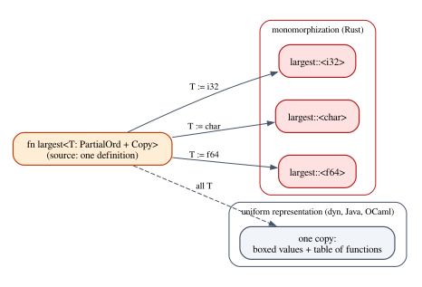
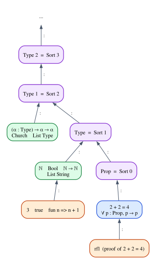

# Chapter 12 · Parametric Polymorphism

In the simply typed λ-calculus of Chapter 8, every function has one type. The
identity function on booleans, $\lambda (x : \mathsf{Bool}).\, x$, and the
identity function on naturals, $\lambda (x : \mathsf{Nat}).\, x$, are two
different terms, and if you need the identity on pairs of lists of booleans you
must write a third. The bodies are identical; only the annotations differ. Every
programmer recognizes the situation, and every modern language has an answer to
it. Rust's answer is generics: `fn id<T>(x: T) -> T` is written once and works
for every type.

The type theory behind this answer is **System F**, the polymorphic λ-calculus,
discovered independently by the logician Jean-Yves Girard (1972) and the computer
scientist John Reynolds (1974). It adds two things to the simply typed calculus:
functions that take a *type* as an argument, and types of the form
$\forall \alpha.\, \tau$ that describe them. The idea is simple, and it is
surprisingly powerful: with nothing but functions and $\forall$, System F can
express booleans, pairs, sums and natural numbers, and its quantifier can range
over types that contain the quantifier itself.

That last feature, *impredicativity*, is where the three languages of this book
part ways. System F has it everywhere. Rust has a deliberately restricted version
of System F, with quantifiers only on the outside of item signatures, and
recovers a little more through traits and lifetimes. Lean has dependent types,
which contain System F's $\forall$ as a special case, but it organizes its types in
a hierarchy of *universes* that keeps impredicativity for propositions only. This
chapter explains all three, and in particular takes the time to explain Lean's
universes from scratch, since they are one of the most confusing parts of Lean
for newcomers.

**In this chapter you will learn:**

- the syntax, typing rules and computation rules of System F, and how to build a
  derivation with type abstraction and type application;
- how Church encodings express booleans, pairs, sums and numbers in System F, and
  what impredicativity means;
- how Rust generics correspond to $\forall$, how the turbofish is type
  application, and how monomorphization compiles them (with its costs and
  benefits, compared with erasure and dictionary passing);
- why Rust's polymorphism is rank-1, and how traits with generic methods and
  higher-ranked trait bounds (`for<'a>`) give you rank-2 types;
- how Lean writes polymorphism with implicit arguments and `@`, and how its
  universes (`Type u`, `Sort u`, `Prop`) work, and why they exist;
- why System F's impredicativity survives in Lean only in `Prop`, and how
  universe polymorphism works around the restriction;
- a type checker for System F, written and proved sound and complete in Lean.

## One function, every type

Here is the polymorphic identity function in Rust, from the chapter's example
`code/rust/examples/ch12_generics.rs`:

```rust
/// Λα. λ(x : α). x — the polymorphic identity. Its type is ∀α. α → α.
fn id<T>(x: T) -> T {
    x
}
```

Its type, written in the notation of this chapter, is $\forall \alpha.\, \alpha \to \alpha$:
"for every type $\alpha$, a function from $\alpha$ to $\alpha$". The type
parameter `T` plays the role of $\alpha$. When you call `id(5)`, the compiler
works out that `T` must be `i32` and uses the function at type `i32 -> i32`. When
you call `id("five")`, it uses it at `&str -> &str`. One definition, every type.

It helps to make the hidden step explicit. Using a polymorphic function happens in
two stages: first you choose the type (`T := i32`), which gives you an ordinary
monomorphic function, and then you apply that function to a value. System F makes
both stages visible in the syntax, and gives each its own typing rule.

## System F

### Syntax

The types of System F are type variables, function types, universally quantified
types, and whatever base types we want to add (we will use $\mathsf{Bool}$):

$$
\tau \;::=\; \alpha \;\mid\; \mathsf{Bool} \;\mid\; \tau \to \tau \;\mid\; \forall \alpha.\, \tau
$$

The terms are those of the simply typed λ-calculus, plus two new forms:

$$
e \;::=\; x \;\mid\; \mathsf{true} \;\mid\; \mathsf{false} \;\mid\; \lambda (x : \tau).\, e \;\mid\; e\; e \;\mid\; \Lambda \alpha.\, e \;\mid\; e\,[\tau]
$$

**Type abstraction** $\Lambda \alpha.\, e$ (a capital lambda) is a function whose
parameter is a type. **Type application** $e\,[\tau]$ passes a type to such a
function. The polymorphic identity is $\mathsf{id} = \Lambda \alpha.\, \lambda (x : \alpha).\, x$,
and $\mathsf{id}\,[\mathsf{Bool}]\ \mathsf{true}$ first instantiates it at
$\mathsf{Bool}$ and then applies it to $\mathsf{true}$.

$\forall \alpha.\, \tau$ binds the type variable $\alpha$ in $\tau$, as $\lambda$
binds a term variable. Everything Chapter 7 said about bound variables carries
over: $\forall \alpha.\, \alpha \to \alpha$ and $\forall \beta.\, \beta \to \beta$
are the same type ($\alpha$-equivalence), and substituting a type for a type
variable, written $\tau[\sigma/\alpha]$, must avoid capturing free variables.

### Typing rules

Contexts now record two kinds of assumptions: term variables with their types, as
before, and type variables that are in scope:
$\Gamma ::= \emptyset \mid \Gamma,\, x : \tau \mid \Gamma,\, \alpha$. The rules for
variables, abstraction and application are those of Chapter 8:

$$
\dfrac{(x : \tau) \in \Gamma}{\Gamma \vdash x : \tau}\;\textsf{T-Var}
\qquad
\dfrac{\Gamma,\, x : \sigma \vdash e : \tau}{\Gamma \vdash \lambda (x : \sigma).\, e : \sigma \to \tau}\;\textsf{T-Abs}
\qquad
\dfrac{\Gamma \vdash f : \sigma \to \tau \qquad \Gamma \vdash a : \sigma}{\Gamma \vdash f\, a : \tau}\;\textsf{T-App}
$$

and two new rules govern the new forms:

$$
\dfrac{\Gamma,\, \alpha \vdash e : \tau}{\Gamma \vdash \Lambda \alpha.\, e : \forall \alpha.\, \tau}\;\textsf{T-TAbs}
\qquad\qquad
\dfrac{\Gamma \vdash e : \forall \alpha.\, \tau}{\Gamma \vdash e\,[\sigma] : \tau[\sigma/\alpha]}\;\textsf{T-TApp}
$$

Rule T-TAbs says: if $e$ has type $\tau$ for an *arbitrary* type $\alpha$, one
about which nothing is assumed, then $\Lambda \alpha.\, e$ has type
$\forall \alpha.\, \tau$. The variable $\alpha$ must be new: it may not already
appear in $\Gamma$. Without that side condition we could type
$\lambda (x : \alpha).\, \Lambda \alpha.\, x$ as $\alpha \to \forall \alpha.\, \alpha$,
a function that turns a value of one particular type into a value of every type.
Rule T-TApp is the elimination rule: a value of type $\forall \alpha.\, \tau$ can
be used at any type $\sigma$, and its type becomes $\tau$ with $\sigma$ in place of
$\alpha$. In logic, T-TAbs and T-TApp are the introduction and elimination rules
for the universal quantifier, $\forall$I and $\forall$E, applied to propositions
instead of individuals: this is *second-order propositional* logic, and System F is its
Curry–Howard twin, as Chapter 10 anticipated.

The computation rules are two $\beta$-rules, one for each kind of abstraction:

$$
(\lambda (x : \sigma).\, e)\; a \;\longrightarrow\; e[a/x]
\qquad\qquad
(\Lambda \alpha.\, e)\,[\sigma] \;\longrightarrow\; e[\sigma/\alpha]
$$

Notice that the second rule does nothing to the *shape* of the computation: it
only changes type annotations. If you erase all types from a System F term, type
abstractions and applications disappear and what remains is an untyped λ-term
that computes the same result. Types in System F are a compile-time affair, and
this observation is the starting point of every implementation strategy we will
see.

### A derivation

Here is the derivation that $\mathsf{id}$ has type $\forall \alpha.\, \alpha \to \alpha$.
The context $\Gamma_1$ is $\alpha,\, x : \alpha$:

$$
\dfrac{\dfrac{\dfrac{(x : \alpha) \in \Gamma_1}{\alpha,\, x : \alpha \vdash x : \alpha}\;\textsf{T-Var}}{\alpha \vdash \lambda (x : \alpha).\, x : \alpha \to \alpha}\;\textsf{T-Abs}}{\vdash \Lambda \alpha.\, \lambda (x : \alpha).\, x : \forall \alpha.\, \alpha \to \alpha}\;\textsf{T-TAbs}
$$

and here is its use at $\mathsf{Bool}$, where the left premise is the derivation
above followed by T-TApp, which computes
$(\alpha \to \alpha)[\mathsf{Bool}/\alpha] = \mathsf{Bool} \to \mathsf{Bool}$
(T-True is the axiom that types the constant $\mathsf{true}$):

$$
\dfrac{\dfrac{\vdash \mathsf{id} : \forall \alpha.\, \alpha \to \alpha}{\vdash \mathsf{id}\,[\mathsf{Bool}] : \mathsf{Bool} \to \mathsf{Bool}}\;\textsf{T-TApp} \qquad \dfrac{}{\vdash \mathsf{true} : \mathsf{Bool}}\;\textsf{T-True}}{\vdash \mathsf{id}\,[\mathsf{Bool}]\ \mathsf{true} : \mathsf{Bool}}\;\textsf{T-App}
$$

### Church encodings

Chapter 7 encoded booleans, pairs and numbers as untyped λ-terms. System F can
give those encodings *types*, and the types say exactly what each encoding is.

A boolean is a choice between two alternatives. The Church boolean takes the two
alternatives, of any type $\alpha$, and returns one of them:

$$
\mathsf{CBool} = \forall \alpha.\, \alpha \to \alpha \to \alpha
\qquad
\mathsf{true} = \Lambda \alpha.\, \lambda (t : \alpha).\, \lambda (f : \alpha).\, t
\qquad
\mathsf{false} = \Lambda \alpha.\, \lambda (t : \alpha).\, \lambda (f : \alpha).\, f
$$

A natural number $n$ is "apply a function $n$ times":

$$
\mathsf{CNat} = \forall \alpha.\, (\alpha \to \alpha) \to \alpha \to \alpha
\qquad
\mathsf{two} = \Lambda \alpha.\, \lambda (f : \alpha \to \alpha).\, \lambda (x : \alpha).\, f\,(f\,x)
$$

and the types of Chapter 11 have encodings too:

$$
A \times B = \forall \gamma.\, (A \to B \to \gamma) \to \gamma
\qquad
A + B = \forall \gamma.\, (A \to \gamma) \to (B \to \gamma) \to \gamma
\qquad
\mathbf{0} = \forall \alpha.\, \alpha
$$

Look at these types with the eyes of Chapter 11. The encoding of a sum is its
case rule: give me what to do with an $A$ and what to do with a $B$, for any result
type $\gamma$, and I will do it. The encoding of a pair is its elimination rule
too: give me a consumer of an $A$ and a $B$, and I will feed it. The encoding of
a natural number is the fold of Chapter 11, for the type
$\mathbb{N} = \mu X.\, \mathbf{1} + X$: a value for zero ($x : \alpha$) and a step
($f : \alpha \to \alpha$). A Church-encoded value *is* its own elimination rule.
And $\mathbf{0} = \forall \alpha.\, \alpha$ is a type that would produce a value of
every type; under Curry–Howard it says "everything is true", and System F has no
closed term of this type.

### Impredicativity

The quantifier $\forall \alpha$ ranges over *all* types, and that includes the
types of the form $\forall \beta.\, \dots$, including the very type being defined.
A $\mathsf{CNat}$ can be instantiated at $\mathsf{CNat}$. This is what makes the
following definition of exponentiation possible:

$$
\mathsf{pow} = \lambda (m : \mathsf{CNat}).\, \lambda (n : \mathsf{CNat}).\; n\,[\mathsf{CNat}]\;(\mathsf{mul}\ m)\;\mathsf{one}
$$

The numeral $n$ iterates "multiply by $m$" over numerals, starting from one. A
quantifier whose range includes the type it is part of is called
**impredicative**. Its most striking use is self-application:

$$
\lambda (x : \forall \alpha.\, \alpha \to \alpha).\; x\,[\forall \alpha.\, \alpha \to \alpha]\; x \;:\; (\forall \alpha.\, \alpha \to \alpha) \to (\forall \alpha.\, \alpha \to \alpha)
$$

The argument $x$ is a polymorphic identity; we instantiate it at its own type and
apply it to itself. Chapter 8 showed that $\lambda x.\, x\,x$ has no type in the
simply typed calculus; in System F a version of it does, because the two
occurrences of $x$ are used at two different types.

System F is remarkably strong. Girard proved that every well-typed term
terminates (strong normalization), so the logic is consistent, and yet the
functions on numerals it can define go far beyond addition and exponentiation.
The price is paid by type inference: J. B. Wells showed in the 1990s that deciding
whether an unannotated term has a System F type is undecidable. That is why
practical languages restrict System F, as Chapter 13 explains for ML and Haskell,
and as we will now see for Rust.

## A type checker for System F in Lean

Before turning to Rust, let us make the rules concrete. With all annotations
present, *checking* a System F term is easy, and the file
`code/lean/Book/Ch12/SystemF.lean` implements a checker and proves it correct.
Type variables are represented by de Bruijn indices, as term variables were in
Chapter 7: `var 0` refers to the nearest enclosing $\forall$, `var 1` to the next
one out, and so on. This makes $\alpha$-equivalent types literally equal, so the
checker can compare types with `=`.

```lean
/-- Types: `Bool`, type variables, functions and `∀`. A type variable is a
number: `var 0` refers to the nearest enclosing `∀`, `var 1` to the one
outside it, and so on (de Bruijn indices, as in Chapter 7). -/
inductive Ty where
  | bool : Ty
  | var : ℕ → Ty
  | arr : Ty → Ty → Ty
  | all : Ty → Ty
deriving DecidableEq, Repr
```

Two operations on types are needed for rule T-TApp. Substituting under a binder
requires *shifting* the indices of the substituted type, exactly as in Chapter 7:

```lean
/-- `τ.lift c` adds one to every type variable of `τ` that points outside the
innermost `c` binders. Needed when a type is moved under one more `∀`. -/
def lift : Ty → ℕ → Ty
  | bool, _ => bool
  | var k, c => if k < c then var k else var (k + 1)
  | arr a b, c => arr (a.lift c) (b.lift c)
  | all t, c => all (t.lift (c + 1))

/-- `τ.subst k σ` replaces variable `k` of `τ` by `σ`; the variables above `k`
move down by one, because the `∀` that bound `k` is gone. -/
def subst : Ty → ℕ → Ty → Ty
  | bool, _, _ => bool
  | var n, k, σ => if n < k then var n else if n = k then σ else var (n - 1)
  | arr a b, k, σ => arr (a.subst k σ) (b.subst k σ)
  | all t, k, σ => all (t.subst (k + 1) (σ.lift 0))
```

`τ.subst 0 σ` is $\tau[\sigma/\alpha]$ for the variable bound by an outer
$\forall$ that has just been removed: variable `0` becomes `σ`, and the other
variables move down by one, since one binder is gone. When `subst` goes under a
`∀`, the index to replace grows by one and `σ` is lifted, so that its own free
variables keep pointing to the same binders. The terms mirror the grammar:

```lean
/-- Terms. Term variables are de Bruijn indices into the context too. -/
inductive Term where
  | var : ℕ → Term              -- x
  | tt : Term                   -- true
  | ff : Term                   -- false
  | lam : Ty → Term → Term      -- λ (x : τ). e
  | app : Term → Term → Term    -- e₁ e₂
  | tlam : Term → Term          -- Λα. e
  | tapp : Term → Ty → Term     -- e [τ]
deriving Repr
```

The typing rules become an inductive relation, one constructor per rule, exactly
as in Chapter 3:

```lean
/-- The typing rules of System F. The context lists the types of the term
variables in scope, nearest first. Going under a `Λ` adds a type variable, so
every type already in the context is lifted past it. -/
inductive HasType : List Ty → Term → Ty → Prop
  | var {Γ i τ} : Γ[i]? = some τ → HasType Γ (.var i) τ
  | tt {Γ} : HasType Γ .tt .bool
  | ff {Γ} : HasType Γ .ff .bool
  | lam {Γ σ e τ} : HasType (σ :: Γ) e τ → HasType Γ (.lam σ e) (.arr σ τ)
  | app {Γ f a σ τ} :
      HasType Γ f (.arr σ τ) → HasType Γ a σ → HasType Γ (.app f a) τ
  | tlam {Γ e τ} : HasType (Γ.map (·.lift 0)) e τ → HasType Γ (.tlam e) (.all τ)
  | tapp {Γ e τ σ} : HasType Γ e (.all τ) → HasType Γ (.tapp e σ) (τ.subst 0 σ)
```

Read the constructors against the rules above. `lam` is T-Abs, with the new
variable's type pushed on the context. `tlam` is T-TAbs: the context does not
record type variables explicitly, because with de Bruijn indices "a new type
variable in scope" means "every existing index now points one binder further",
so all the types in the context are lifted. The side condition of T-TAbs is
automatic in this representation. `tapp` is T-TApp with `subst`. The checker is
the same rules read from the conclusion upwards:

```lean
/-- The type checker: the rules read from the conclusion upwards. -/
def typeOf : List Ty → Term → Option Ty
  | Γ, .var i => Γ[i]?
  | _, .tt => some .bool
  | _, .ff => some .bool
  | Γ, .lam σ e => (typeOf (σ :: Γ) e).map (.arr σ)
  | Γ, .app f a =>
    match typeOf Γ f, typeOf Γ a with
    | some (.arr σ τ), some σ' => if σ = σ' then some τ else none
    | _, _ => none
  | Γ, .tlam e => (typeOf (Γ.map (·.lift 0)) e).map .all
  | Γ, .tapp e σ =>
    match typeOf Γ e with
    | some (.all τ) => some (τ.subst 0 σ)
    | _ => none

/-- Check a closed term and print its type. -/
def check (e : Term) : String :=
  match typeOf [] e with
  | some τ => τ.toStr 0
  | none => "type error"
```

To show types with names instead of numbers, a small printer names the binders
α, β, γ by depth. Under `d` binders, the variable with index `k` refers to the
binder at depth `d - 1 - k`, so that is the name it gets:

```lean
/-- A name for the type variable bound at depth `d`. -/
def name (d : ℕ) : String :=
  (["α", "β", "γ", "δ"][d]?).getD s!"α{d}"

/-- Print a type under `d` binders, with names instead of numbers. -/
def toStr (d : ℕ) : Ty → String
  | bool => "Bool"
  | var k => if k < d then name (d - 1 - k) else s!"#{k}"
  | arr a b =>
    let left := match a with
      | arr .. | all .. => s!"({a.toStr d})"
      | _ => a.toStr d
    s!"{left} → {b.toStr d}"
  | all t => s!"∀{name d}. {t.toStr (d + 1)}"
```

Here are some terms and their types:

```lean
/-- `Λα. λ (x : α). x` -/
def polyId : Term := .tlam (.lam (.var 0) (.var 0))

/-- The type of Church numerals, `∀α. (α → α) → α → α`. -/
def CNat : Ty := .all (.arr (.arr (.var 0) (.var 0)) (.arr (.var 0) (.var 0)))

/-- `Λα. λ (f : α → α). λ (x : α). f (f x)` -/
def two : Term :=
  .tlam (.lam (.arr (.var 0) (.var 0))
    (.lam (.var 0) (.app (.var 1) (.app (.var 1) (.var 0)))))

/-- `λ (n : CNat). Λα. λ (f : α → α). λ (x : α). f (n [α] f x)` -/
def succ : Term :=
  .lam CNat (.tlam (.lam (.arr (.var 0) (.var 0)) (.lam (.var 0)
    (.app (.var 1) (.app (.app (.tapp (.var 2) (.var 0)) (.var 1)) (.var 0))))))

/-- Self-application, typable thanks to impredicativity:
`λ (x : ∀α. α → α). x [∀α. α → α] x` -/
def selfApp : Term :=
  .lam (.all (.arr (.var 0) (.var 0)))
    (.app (.tapp (.var 0) (.all (.arr (.var 0) (.var 0)))) (.var 0))

/-- A rank-2 function: `λ (f : ∀α. α → α). f [Bool] true` -/
def useTwice : Term :=
  .lam (.all (.arr (.var 0) (.var 0))) (.app (.tapp (.var 0) .bool) .tt)
```

```lean
/-- info: "∀α. α → α" -/
#guard_msgs in
#eval check polyId

/-- info: "Bool" -/
#guard_msgs in
#eval check (.app (.tapp polyId .bool) .tt)

/-- info: "∀α. (α → α) → α → α" -/
#guard_msgs in
#eval check two

/-- info: "(∀α. (α → α) → α → α) → ∀α. (α → α) → α → α" -/
#guard_msgs in
#eval check succ

/-- info: "∀α. (α → α) → α → α" -/
#guard_msgs in
#eval check (.app succ two)

/-- info: "(∀α. α → α) → ∀α. α → α" -/
#guard_msgs in
#eval check selfApp

/-- info: "(∀α. α → α) → Bool" -/
#guard_msgs in
#eval check useTwice

/-- info: "type error" -/
#guard_msgs in
#eval check (.lam .bool (.app (.var 0) (.var 0)))  -- λ (x : Bool). x x
```

The checker confirms the polymorphic identity, its use at `Bool`, the Church
numeral two, the successor function on Church numerals and its application to two,
the impredicative self-application, and a rank-2 function (more on rank below).
It rejects $\lambda (x : \mathsf{Bool}).\, x\, x$, since a boolean is not a
function.

A checker is only as good as its agreement with the rules, and in Lean that
agreement is a theorem:

```lean
/-- Soundness: if the checker returns a type, there is a derivation of it. -/
theorem typeOf_sound {Γ : List Ty} {e : Term} {τ : Ty} (h : typeOf Γ e = some τ) :
    HasType Γ e τ := by
  induction e generalizing Γ τ with
  | var i => exact .var h
  | tt =>
    -- h : some bool = some τ
    cases h
    exact .tt
  | ff =>
    cases h
    exact .ff
  | lam σ e ih =>
    -- h : (typeOf (σ :: Γ) e).map (arr σ) = some τ
    simp only [typeOf, Option.map_eq_some_iff] at h
    obtain ⟨τ', h', rfl⟩ := h
    exact .lam (ih h')
  | app f a ihf iha =>
    simp only [typeOf] at h
    -- Look at what the checker found for `f` and `a`.
    split at h
    · rename_i σ τ' σ' hf ha
      -- h : (if σ = σ' then some τ' else none) = some τ
      split at h
      · rename_i hσ
        cases h
        subst hσ
        exact .app (ihf hf) (iha ha)
      · cases h
    · cases h
  | tlam e ih =>
    simp only [typeOf, Option.map_eq_some_iff] at h
    obtain ⟨τ', h', rfl⟩ := h
    exact .tlam (ih h')
  | tapp e σ ih =>
    simp only [typeOf] at h
    split at h
    · rename_i τ' he
      cases h
      exact .tapp (ih he)
    · cases h
```

The proof of `typeOf_sound` is by induction on the term, with `Γ` and `τ`
generalized because the recursive calls of the checker use different contexts and
types. Each case looks at what the checker did. For a variable, the checker's
answer `Γ[i]? = some τ` is literally the premise of the `var` rule. For `tt` and
`ff`, `cases h` turns `h : some bool = some τ` into the fact `τ = bool`. For a
λ-abstraction, `simp only [typeOf, Option.map_eq_some_iff] at h` turns
"mapping `arr σ` over the result gave `some τ`" into "the body had some type
`τ'`, and `τ = arr σ τ'`"; `obtain` takes this apart (the pattern `rfl`
substitutes the equation away), and the induction hypothesis turns the body's
result into a derivation. For an application, the checker made two choices (the
`match` on the results for `f` and `a`, then the `if`), and `split at h` follows
each of them: in the branch where everything succeeded, the hypotheses `hf` and
`ha` record what the checker found, `hσ` records that the argument type matched,
and the derivation is built from the two induction hypotheses. In the failing
branches, `h` says `none = some τ`, and `cases h` closes the goal because those
two constructors can never be equal. Type abstraction and application follow the
same pattern.

Completeness, the converse, is an induction on the *derivation* instead, and
`simp` does the work in each case, using the induction hypotheses to compute the
checker's result. Together the two theorems say that the checker decides the
typing relation, and they give uniqueness of types for free:

```lean
/-- Completeness: every derivable type is the one the checker reports. -/
theorem typeOf_complete {Γ : List Ty} {e : Term} {τ : Ty} (h : HasType Γ e τ) :
    typeOf Γ e = some τ := by
  induction h with
  | var hi => exact hi
  | tt => rfl
  | ff => rfl
  | lam _ ih => simp [typeOf, ih]
  | app _ _ ihf iha => simp [typeOf, ihf, iha]
  | tlam _ ih => simp [typeOf, ih]
  | tapp _ ih => simp [typeOf, ih]

/-- A consequence: a term has at most one type. -/
theorem type_unique {Γ : List Ty} {e : Term} {τ₁ τ₂ : Ty}
    (h₁ : HasType Γ e τ₁) (h₂ : HasType Γ e τ₂) : τ₁ = τ₂ := by
  have := (typeOf_complete h₁).symm.trans (typeOf_complete h₂)
  exact Option.some.inj this
```

(The checker does not verify that the types written in annotations are
well-scoped, for example that `var 5` does not appear where only one type
variable is bound. Adding that check is Exercise 6.)

## Rust generics are ∀

A Rust generic function is a type abstraction. `fn id<T>(x: T) -> T` is
$\Lambda T.\, \lambda (x : T).\, x$, and its type is $\forall T.\, T \to T$.
Calling it with an explicit type is type application, and Rust's syntax for it is
the **turbofish** `::<>`:

```rust
// Type application, explicit (the turbofish) and inferred.
let a = id::<u8>(7); // id [u8] 7
let b = id(String::from("seven")); // id [String] "seven", inferred
let n = "42".parse::<i64>().expect("a number"); // parse [i64]
let squares = (1..=4).map(|x| x * x).collect::<Vec<u32>>();
println!("{a} {b} {n} {squares:?}");

let shout = compose(|s: String| s + "!", |n: u32| n.to_string());
println!("compose: {}", shout(42));
```

```text
7 seven 42 [1, 4, 9, 16]
compose: 42!
```

Most of the time you do not write the turbofish, because the compiler infers the
type argument from the value arguments or from the expected result (Chapter 13 is
about how). You need it when nothing else determines the type: `"42".parse()`
could produce any type that implements `FromStr`, and `collect()` could build any
collection, so `parse::<i64>()` and `collect::<Vec<u32>>()` supply the missing
type application. Functions with several type parameters take several type
arguments, in order:

```rust
/// ∀α β γ. (β → γ) → (α → β) → α → γ
fn compose<A, B, C>(g: impl Fn(B) -> C, f: impl Fn(A) -> B) -> impl Fn(A) -> C {
    move |x| g(f(x))
}
```

Here `compose` has type $\forall A\, B\, C.\, (B \to C) \to (A \to B) \to A \to C$.

### Bounded quantification

Rust generics usually carry *bounds*:

```rust
/// ∀T. (T: PartialOrd + Copy) ⇒ &[T] → T. The first line reports which
/// compiled copy of the function is running.
fn largest<T: PartialOrd + Copy>(items: &[T]) -> T {
    println!("  running {}", type_name_of_val(&largest::<T>));
    let mut best = items[0];
    for &item in items {
        if item > best {
            best = item;
        }
    }
    best
}
```

Read the signature as
$\forall T.\, (T : \mathsf{PartialOrd} \land T : \mathsf{Copy}) \Rightarrow \&[T] \to T$:
for every type $T$ that supports comparison and copying. A bound restricts the
range of the quantifier and, in exchange, gives the body something to work with:
without `PartialOrd`, the body could not compare two `T`s; without `Copy`, it could
not copy one out of the slice. A function with *no* bounds can do almost nothing
with its `T`: it can move values around, store them and return them, but not
inspect them. That observation, made precise, is *parametricity*, and it is the
subject of Chapter 18. Bounds and the trait system behind them are the subject of
Chapter 14; in the rest of this chapter, think of a bound as a constraint attached
to $\forall$.

### Where Rust differs from System F

Rust's generics are System F with four important differences.

1. **Quantifiers only at the outside.** A type parameter is introduced by an
   *item*: a function, a struct, an enum, a trait or an `impl`. There is no type
   `∀T. T -> T` that you can write in a field, a parameter or a variable. In
   particular, a closure cannot be generic, and a function cannot take a
   polymorphic function as an argument. This is the *rank-1* restriction, and the
   next sections are about it.
2. **Bounds.** Quantifiers come with trait bounds, which System F does not have.
3. **An implicit bound.** Every type parameter has the bound `Sized` unless you
   write `T: ?Sized`: generic code must know the size of its values, which is a
   first hint of how Rust compiles generics.
4. **Lifetimes.** Rust also quantifies over lifetimes, and for lifetimes it does
   allow quantifiers in nested positions, as we will see.

## Monomorphization

How does a compiler turn `largest` into machine code? The comparison `item > best`
is an integer comparison for `i32`, a floating-point comparison for `f64`, and a
call to a user-defined function for a struct. The copying of `best` moves 4 bytes
for an `i32` and 8 for an `f64`. There is no single sequence of machine
instructions that works for every `T`.

Rust's answer is **monomorphization**: for every type at which a generic function
is used, the compiler generates a separate copy of the function, with the type
parameter replaced by that type. The polymorphic function exists in the source
code and in the type checker; the binary contains only monomorphic copies. We can
watch the copies run, because inside each copy the expression
`type_name_of_val(&largest::<T>)` names the copy:

```rust
let big_int = largest(&[3, 9, 4]);
let big_char = largest(&['q', 'z', 'a']);
let big_float = largest(&[2.5, 1.5]);
println!("results: {big_int} {big_char} {big_float}");
assert_eq!(big_int, largest_i32(&[3, 9, 4]));
assert_eq!(big_char, largest_char(&['q', 'z', 'a']));
```

```text
  running ch12_generics::largest<i32>
  running ch12_generics::largest<char>
  running ch12_generics::largest<f64>
results: 9 z 2.5
```

Three calls, three different functions. Each copy is what you would get if you
wrote the function by hand for one type:

```rust
/// What monomorphization produces for `largest::<i32>`, written by hand:
/// `T` replaced by `i32` everywhere, and `>` compiled to an integer compare.
fn largest_i32(items: &[i32]) -> i32 {
    let mut best = items[0];
    for &item in items {
        if item > best {
            best = item;
        }
    }
    best
}

/// And for `largest::<char>`: the same text, different machine code.
fn largest_char(items: &[char]) -> char {
    let mut best = items[0];
    for &item in items {
        if item > best {
            best = item;
        }
    }
    best
}
```

If you list the symbols of the compiled example (with `nm`, in a debug build), you
find three local symbols for `largest`, with the type argument encoded in the
mangled name by a single letter (`c` for `char`, `d` for `f64`, `l` for `i32` in
the "v0" mangling scheme that the pinned toolchain uses), next to the two
hand-written copies.

Because each copy is specialized, it knows everything about its type at compile
time, including its size:

```rust
/// Each copy knows the size of its `T` as a compile-time constant. A
/// language that erases types (one copy for every `T`) could not offer this.
fn layout<T>() -> String {
    format!("{:<22} {:>2} bytes", type_name::<T>(), size_of::<T>())
}
```

```text
u8                      1 bytes
(u8, u32)               8 bytes
alloc::string::String  24 bytes
&str                   16 bytes
```

In the theory, $(\Lambda \alpha.\, e)\,[\sigma] \longrightarrow e[\sigma/\alpha]$
is a computation step. Monomorphization performs all those steps at compile time.



### The alternatives

Monomorphization is not the only way to compile polymorphism, and not the most
common one. The alternatives keep a *single* copy of the code and make it work
for all types by making all values look alike:

| Strategy | Used by | Costs | Benefits |
|---|---|---|---|
| monomorphization | Rust generics, C++ templates | one copy per type: binary size, compile time | static calls, inlining, exact layouts |
| uniform representation | Java (erasure), OCaml, Haskell | values boxed behind pointers, indirection | one copy, fast compilation |
| dictionary passing | Haskell type classes, Rust `dyn` | indirect calls through a table of functions | one copy, mixed types in one collection |

Rust offers the second and third strategies too, through `dyn Trait`, at the
programmer's choice:

```rust
/// The other strategy: one compiled function for every element type, working
/// on a uniform representation (a pointer to the data plus a pointer to a
/// table of functions). Chapter 15 studies `dyn` in detail.
fn show_all(items: &[&dyn Display]) -> String {
    let parts: Vec<String> = items.iter().map(|item| item.to_string()).collect();
    parts.join(", ")
}

/// The monomorphized counterpart: one copy per `T`, and all items must have
/// the same type.
fn show_all_generic<T: Display>(items: &[T]) -> String {
    let parts: Vec<String> = items.iter().map(|item| item.to_string()).collect();
    parts.join(", ")
}
```

```text
dyn:     1, two, 3.5
generic: 1, 2, 3
size_of::<&i32>()          = 8
size_of::<&dyn Display>()  = 16
```

`show_all` is compiled once. Its elements are *fat pointers*: a pointer to the
value plus a pointer to a table of the functions that `Display` requires for that
value's type (a vtable), 16 bytes instead of 8. Every call to `to_string` goes
through the table. In exchange, one slice can hold an integer, a string and a
float. `show_all_generic` is compiled once per element type, makes direct calls,
and requires all elements to have the same type. Chapter 14 explains dictionaries
and Chapter 15 explains `dyn` as an existential type.

> [!NOTE]
> Monomorphization has a limit that System F does not. A generic function that
> calls itself at a *bigger* type, for example
> `fn nest<T: Debug>(x: T, n: u32) { if n > 0 { nest((x,), n - 1) } }`, needs
> copies for `T`, `(T,)`, `((T,),)` and so on without end. The type checker
> accepts it (it is a perfectly good System F program), but code generation
> fails with "reached the recursion limit while instantiating". Because the
> failure happens after type checking, this program is not part of the book's
> compile-fail suite, which only runs the type checker. Languages with a uniform
> representation compile such *polymorphic recursion* without trouble.

## Rank-1 and rank-2

The **rank** of a type measures how deeply $\forall$ can be nested to the left of
arrows. A type with no $\forall$ has rank 0. A type of the form
$\forall \alpha_1 \dots \alpha_n.\, \tau$ with $\tau$ of rank 0 has rank 1: all
quantifiers are at the outside, as in every Rust function signature. A function
whose *argument* is polymorphic, such as

$$
(\forall \alpha.\, \mathrm{Vec}\,\alpha \to \mathrm{Vec}\,\alpha) \to \mathrm{Vec}\,\mathsf{u32} \to \mathrm{Vec}\,\mathsf{str} \to \dots
$$

has rank 2: the function receives a polymorphic function, and can use it at any
type it likes. System F allows any rank; Rust's types are rank-1.

The difference is about *who chooses the type*. In a rank-1 type, the caller of
the function chooses every type argument. Try to write a function that applies the
same operation to two vectors of different element types
(`code/rust/compile_fail/ch12_rank2_closure.rs`):

```rust
fn lengths_after<A, B, F>(f: F, a: Vec<A>, b: Vec<B>) -> (usize, usize)
where
    F: Fn(Vec<A>) -> Vec<A>,
{
    (f(a).len(), f(b).len())
}
```

```text
error[E0308]: mismatched types
  --> compile_fail/ch12_rank2_closure.rs:10:20
   |
 6 | fn lengths_after<A, B, F>(f: F, a: Vec<A>, b: Vec<B>) -> (usize, usize)
   |                  -  - found type parameter
   |                  |
   |                  expected type parameter
...
10 |     (f(a).len(), f(b).len())
   |                  - ^ expected `Vec<A>`, found `Vec<B>`
   |                  |
   |                  arguments to this function are incorrect
   |
   = note: expected struct `Vec<A>`
              found struct `Vec<B>`
   = note: a type parameter was expected, but a different one was found; you might be missing a type parameter or trait bound
   = note: for more information, visit https://doc.rust-lang.org/book/ch10-02-traits.html#traits-as-parameters
note: callable defined here
  --> compile_fail/ch12_rank2_closure.rs:8:8
   |
 8 |     F: Fn(Vec<A>) -> Vec<A>,
   |        ^^^^^^^^^^^^^^^^^^^^
```

The signature says: for every `A`, `B` and `F` such that `F` is a function from
`Vec<A>` to `Vec<A>`. The caller picks all three, so inside the body `f` is a
function on `Vec<A>`, for the one `A` the caller chose, and applying it to a
`Vec<B>` is a type error. What we wanted was the rank-2 type: "give me a function
that works for *every* element type". In System F, $\Lambda$ and $[\,]$ make that
expressible, and our Lean checker accepted the rank-2 term
`useTwice`, $\lambda (f : \forall \alpha.\, \alpha \to \alpha).\, f\,[\mathsf{Bool}]\ \mathsf{true}$.

### Rank-2 through a trait with a generic method

Rust has no polymorphic function values, but it has traits whose *methods* are
generic, and that is enough. The chapter's second example,
`code/rust/examples/ch12_rank2.rs`, starts with list operations:

```rust
/// A value of a type implementing `ListOp` is a polymorphic function
/// ∀T. Vec<T> → Vec<T>: the *caller of* `apply` chooses `T`, every time.
trait ListOp {
    fn apply<T>(&self, items: Vec<T>) -> Vec<T>;
}

struct Reverse;
struct TakeFirst(usize);
struct RotateLeft(usize);

impl ListOp for Reverse {
    fn apply<T>(&self, mut items: Vec<T>) -> Vec<T> {
        items.reverse();
        items
    }
}

impl ListOp for TakeFirst {
    fn apply<T>(&self, mut items: Vec<T>) -> Vec<T> {
        items.truncate(self.0);
        items
    }
}

impl ListOp for RotateLeft {
    fn apply<T>(&self, mut items: Vec<T>) -> Vec<T> {
        if !items.is_empty() {
            let k = self.0 % items.len();
            items.rotate_left(k);
        }
        items
    }
}

/// The rank-2 function: (∀T. Vec<T> → Vec<T>) → Vec<u32> → Vec<&str> → ...
/// It uses its argument at two different element types.
fn on_both<'s>(
    op: &impl ListOp,
    numbers: Vec<u32>,
    words: Vec<&'s str>,
) -> (Vec<u32>, Vec<&'s str>) {
    (op.apply(numbers), op.apply(words))
}
```

A value of a type implementing `ListOp` is a polymorphic function: its method
`apply` has its own type parameter `T`, and that parameter is chosen at each call
of `apply`, not when the `ListOp` value is passed around. So `on_both` takes one
operation and uses it at two element types, which is exactly the rank-2 type we
wanted, with the trait standing in for $\forall T.\, \mathrm{Vec}\,T \to \mathrm{Vec}\,T$:

```rust
let numbers = vec![1, 2, 3, 4];
let words = vec!["alpha", "beta", "gamma"];
println!(
    "reverse:  {:?}",
    on_both(&Reverse, numbers.clone(), words.clone())
);
println!(
    "take 2:   {:?}",
    on_both(&TakeFirst(2), numbers.clone(), words.clone())
);
println!("rotate 1: {:?}", on_both(&RotateLeft(1), numbers, words));
```

```text
reverse:  ([4, 3, 2, 1], ["gamma", "beta", "alpha"])
take 2:   ([1, 2], ["alpha", "beta"])
rotate 1: ([2, 3, 4, 1], ["beta", "gamma", "alpha"])
```

This is not a curiosity: it is how a large part of the Rust ecosystem is built.
A serialization library must traverse a data structure whose fields have
different types and hand each field to a *format* (JSON, binary, a debug
printer), and the format must accept fields of any type. The format is therefore
a value of a trait with generic methods:

```rust
/// A visitor must handle a field of *any* type that can be printed.
trait FieldVisitor {
    fn field<T: Debug>(&mut self, name: &str, value: &T);
}

struct ServerConfig {
    host: String,
    port: u16,
    verbose: bool,
    retries: Vec<u32>,
}

impl ServerConfig {
    /// Calls the visitor at four different types: `String`, `u16`, `bool`
    /// and `Vec<u32>`. Serialization libraries are built on this pattern.
    fn visit(&self, v: &mut impl FieldVisitor) {
        v.field("host", &self.host);
        v.field("port", &self.port);
        v.field("verbose", &self.verbose);
        v.field("retries", &self.retries);
    }
}

/// Renders `name = value` lines.
struct Printer(Vec<String>);

impl FieldVisitor for Printer {
    fn field<T: Debug>(&mut self, name: &str, value: &T) {
        self.0.push(format!("{name} = {value:?}"));
    }
}

/// Measures how much memory the field values occupy inline.
struct Sizer(usize);

impl FieldVisitor for Sizer {
    fn field<T: Debug>(&mut self, _name: &str, value: &T) {
        self.0 += size_of_val(value);
    }
}
```

```rust
let config = ServerConfig {
    host: "db.internal".to_string(),
    port: 5432,
    verbose: false,
    retries: vec![100, 200, 400],
};
let mut printer = Printer(Vec::new());
config.visit(&mut printer);
println!("{}", printer.0.join("; "));
let mut sizer = Sizer(0);
config.visit(&mut sizer);
println!("inline bytes of the fields: {}", sizer.0);
```

```text
host = "db.internal"; port = 5432; verbose = false; retries = [100, 200, 400]
inline bytes of the fields: 51
```

`ServerConfig::visit` calls the visitor at four different types. Two very
different visitors, one that prints and one that measures sizes, are passed to the
same `visit`. (The serde library is built on this pattern: for example, its
`SerializeStruct` trait has a generic method `serialize_field` that accepts a
field of any serializable type.)

Church numerals are the classic rank-2 example, and they work the same way:

```rust
/// A Church numeral: for every type A, a way to apply a function n times.
/// This is the System F type ∀A. (A → A) → A → A.
trait Church {
    fn iterate<A>(&self, f: &dyn Fn(A) -> A, x: A) -> A;
}

struct Zero;
struct Succ<N>(N);
struct Add<M, N>(M, N);
struct Mul<M, N>(M, N);

impl Church for Zero {
    fn iterate<A>(&self, _f: &dyn Fn(A) -> A, x: A) -> A {
        x
    }
}

impl<N: Church> Church for Succ<N> {
    fn iterate<A>(&self, f: &dyn Fn(A) -> A, x: A) -> A {
        f(self.0.iterate(f, x))
    }
}

/// m + n: apply f n times, then m more times.
impl<M: Church, N: Church> Church for Add<M, N> {
    fn iterate<A>(&self, f: &dyn Fn(A) -> A, x: A) -> A {
        self.0.iterate(f, self.1.iterate(f, x))
    }
}

/// m * n: apply "apply f n times" m times. The inner numeral is used at the
/// same type A, the outer one with a function built from the inner one.
impl<M: Church, N: Church> Church for Mul<M, N> {
    fn iterate<A>(&self, f: &dyn Fn(A) -> A, x: A) -> A {
        self.0.iterate(&|y| self.1.iterate(f, y), x)
    }
}

fn to_u32(n: &impl Church) -> u32 {
    n.iterate(&|k| k + 1, 0)
}
```

```rust
let two = || Succ(Succ(Zero));
let three = || Succ(Succ(Succ(Zero)));
println!("2 + 3 = {}", to_u32(&Add(two(), three())));
println!("2 * 3 = {}", to_u32(&Mul(two(), three())));
// The same numeral at other types: strings and powers of two.
println!(
    "{}",
    three().iterate(&|s: String| s + "ab", String::from(">"))
);
println!("2^3 = {}", three().iterate(&|k: u64| 2 * k, 1));
```

```text
2 + 3 = 5
2 * 3 = 6
>ababab
2^3 = 8
```

The trait `Church` is the type $\forall A.\, (A \to A) \to A \to A$. The numerals
are used at `u32` (by `to_u32`, to count), at `String` and at `u64` (to compute
$2^3$), and inside `Mul` the outer numeral is used with a function built from the
inner numeral. Two limitations show where the encoding differs from System F. Each
numeral here is a value of a *different Rust type* (`Succ<Succ<Zero>>` is not
`Succ<Zero>`), so a function cannot return "some numeral" computed at run time
without further tricks. And `dyn Church` is not allowed: a trait with a generic
method has infinitely many instantiations of that method, which no finite vtable
can hold. Chapter 15 explains this rule (dyn compatibility, error E0038).

### Higher-ranked trait bounds over lifetimes

For lifetimes, Rust does have nested quantifiers. The problem is the same as with
types: if the caller chooses a lifetime, the function cannot use it for data that
it creates itself (`code/rust/compile_fail/ch12_lifetime_rank1.rs`):

```rust
fn normalized_len<'a, F>(text: &str, pick: F) -> usize
where
    F: Fn(&'a str) -> &'a str,
{
    let lowered = text.to_lowercase();
    pick(&lowered).len()
}
```

```text
error[E0597]: `lowered` does not live long enough
  --> compile_fail/ch12_lifetime_rank1.rs:11:10
   |
 6 | fn normalized_len<'a, F>(text: &str, pick: F) -> usize
   |                   -- lifetime `'a` defined here
...
10 |     let lowered = text.to_lowercase();
   |         ------- binding `lowered` declared here
11 |     pick(&lowered).len()
   |     -----^^^^^^^^-
   |     |    |
   |     |    borrowed value does not live long enough
   |     argument requires that `lowered` is borrowed for `'a`
12 | }
   | - `lowered` dropped here while still borrowed
   |
note: requirement that the value outlives `'a` introduced here
  --> /rustc/b940084d7eb6a299eb4bfeb8e34901bc051e7ac4/library/core/src/ops/function.rs:76:33
```

The lifetime `'a` is a parameter of `normalized_len`, so the caller chooses it,
and any lifetime the caller can name outlives the call. The callback accepts only
`&'a str`, so `&lowered` would have to live for `'a`, longer than the function
body in which `lowered` lives. The error says exactly that: `lowered` would need
to be borrowed for `'a`, but it is dropped at the end of the function.

What the function needs is a callback that works for *every* lifetime, including
the short one of a local variable. That is a **higher-ranked trait bound**
(HRTB), written with `for<'a>`:

```rust
/// The callback is applied to a string that is created inside this function,
/// so no lifetime the caller could name would fit it. The bound says: for
/// every lifetime 'a, `pick` maps a `&'a str` to a `&'a str`.
fn normalized_len<F>(text: &str, pick: F) -> usize
where
    F: for<'a> Fn(&'a str) -> &'a str,
{
    let lowered = text.to_lowercase(); // a local String
    pick(&lowered).len()
}

/// The same bound, written with the usual sugar: an elided lifetime in an
/// `Fn` bound means `for<'a>`.
fn normalized_len_sugar(text: &str, pick: impl Fn(&str) -> &str) -> usize {
    let lowered = text.to_lowercase();
    pick(&lowered).len()
}

fn first_word(s: &str) -> &str {
    s.split_whitespace().next().unwrap_or("")
}
```

```rust
println!(
    "trim:       {}",
    normalized_len("  Hello World ", str::trim)
);
println!("first word: {}", normalized_len("Hello World", first_word));
println!(
    "with sugar: {}",
    normalized_len_sugar("Hello World", first_word)
);
// A function pointer type can be higher-ranked too.
let picker: for<'a> fn(&'a str) -> &'a str = str::trim_start;
println!("fn pointer: {}", normalized_len("   abc", picker));
```

```text
trim:       11
first word: 5
with sugar: 5
fn pointer: 3
```

The bound `F: for<'a> Fn(&'a str) -> &'a str` reads "for every lifetime `'a`,
`F` maps a `&'a str` to a `&'a str`", with the quantifier *inside* the bound: a
rank-2 type over lifetimes. Now the *function* chooses `'a` at each call of
`pick`, and it can choose the lifetime of `lowered`. You rarely see `for<'a>`
written out, because the familiar `impl Fn(&str) -> &str` means exactly the same
thing: when a lifetime is elided
in an `Fn` bound, Rust quantifies over it in the bound, as `normalized_len_sugar`
shows. Function pointer types can be higher-ranked too, as the last line shows:
`for<'a> fn(&'a str) -> &'a str` is the type of `str::trim_start`. So Rust has
first-class $\forall$ over lifetimes and only rank-1 $\forall$ over types; the
lifetime part of Rust's type system is studied in Part VI.

## Polymorphism in Lean

Lean does not need a separate $\Lambda$: a type is a value like any other, so a
function can simply take a type as an argument. The file
`code/lean/Book/Ch12/Universes.lean` starts with a small polymorphic function:

```lean
/-- Apply a function twice. The type `α` is an *implicit* argument: callers do
not pass it, Lean works it out from the other arguments. -/
def twice {α : Type} (f : α → α) (a : α) : α := f (f a)
```

The parameter `{α : Type}` is a type parameter, in curly braces to make it
*implicit*: Lean fills it in by unification, as Rust infers type arguments. The
`@` prefix turns all implicit parameters into explicit ones, which gives System F's
type application; a named argument `(α := String)` supplies one implicit argument
by name, much like a turbofish:

```lean
/-- info: 16 -/
#guard_msgs in
#eval twice (· + 3) 10

-- `@` makes every argument explicit: here we pass the type ourselves.
/-- info: 16 -/
#guard_msgs in
#eval @twice ℕ (· + 3) 10

/-- info: "hi!!" -/
#guard_msgs in
#eval twice (α := String) (· ++ "!") "hi"

/-- info: @twice : {α : Type} → (α → α) → α → α -/
#guard_msgs in
#check @twice
```

The type of `@twice` is `{α : Type} → (α → α) → α → α`. This is a *dependent*
function type: the type of the later arguments mentions the first argument
`α`. System F's $\forall \alpha.\, \tau$ is the special case of a dependent
function type whose argument is a type; Lean also writes it `∀ α, τ`. Chapter 30
studies dependent functions in general.

Rank-2 functions need no tricks in Lean. A polymorphic function is an ordinary
value, and a function can take one as an argument (`code/lean/Book/Ch12/Church.lean`):

```lean
/-- A rank-2 function: its *argument* is polymorphic, and it uses that argument
at two different types. In Lean this is an ordinary dependent function. -/
def onBoth (f : {α : Type} → List α → List α) (xs : List ℕ) (ys : List String) :
    List ℕ × List String :=
  (f xs, f ys)

/-- info: ([3, 2, 1], ["b", "a"]) -/
#guard_msgs in
#eval onBoth List.reverse [1, 2, 3] ["a", "b"]

/-- info: ([1], ["a"]) -/
#guard_msgs in
#eval onBoth (List.take 1) [1, 2, 3] ["a", "b"]
```

`onBoth` uses its argument at `ℕ` and at `String`. Compare it with the trait
`ListOp` and the method `on_both` in Rust: same idea, without the indirection.

## Universes, gently

So far we have written `α : Type` without asking what `Type` is. It is time to
ask, because the answer explains several error messages you will meet sooner or
later, and it is the place where Lean departs from System F. We go in small steps.

### Every type has a type

In Lean every expression has a type, and types are expressions. So types have
types too:

```lean
/-- info: ℕ : Type -/
#guard_msgs in
#check ℕ

/-- info: ℕ → List ℕ : Type -/
#guard_msgs in
#check ℕ → List ℕ

/-- info: Type : Type 1 -/
#guard_msgs in
#check Type

/-- info: Type 1 : Type 2 -/
#guard_msgs in
#check Type 1
```

`ℕ`, `ℕ → List ℕ`, `Bool` and `String` are types of "ordinary data", and their type
is `Type`. `Type` is itself an expression, and its type is `Type 1`. The type of
`Type 1` is `Type 2`, and so on forever. These are the **universes**, and they
form a hierarchy: `Type` (also written `Type 0`) is the universe of small types,
`Type 1` contains `Type` itself and everything built from it, and so on.

Why not stop at one level, with `Type : Type`? Because that makes the logic
inconsistent. Girard showed that a type theory with a type of all types allows a
version of the Burali-Forti paradox (about the set of all ordinals), now called
Girard's paradox, from which a term of the empty type can be constructed. Lean
therefore refuses to put `Type` in `Type`:

```lean
/--
error: Type mismatch
  Type
has type
  Type 1
of sort `Type 2` but is expected to have type
  Type
of sort `Type 1`
-/
#guard_msgs in
example : Type := Type
```

The message says: `Type` has type `Type 1`, not `Type`. (The extra line "of sort
`Type 2`" is the type of the type, one level higher.)

### Polymorphic types live one level up

Now consider the type of the polymorphic identity. It quantifies over all types
in `Type`, and a type that talks about *all of `Type`* cannot itself be one of the
types in `Type`: that would be circular in the same way. So it lives one level up:

```lean
/-- info: (α : Type) → α → α : Type 1 -/
#guard_msgs in
#check (α : Type) → α → α

/--
error: Type mismatch
  (α : Type) → α → α
has type
  Type 1
of sort `Type 2` but is expected to have type
  Type
of sort `Type 1`
-/
#guard_msgs in
def PolyId : Type := (α : Type) → α → α

/-- The type of polymorphic identity functions is fine one level up. -/
def PolyId' : Type 1 := (α : Type) → α → α

/-- Its only (sensible) inhabitant. -/
def polyId : PolyId' := fun _ a => a
```

This is **predicativity**: a type that quantifies over a universe lives in a
higher universe than the one it quantifies over. The general rule for function
types is that `(x : A) → B` lives in the larger of the universes of `A` and `B`.
In `(α : Type) → α → α`, the domain `Type` lives in `Type 1`, so the whole type
lives in `Type 1`.



### Prop is different

Propositions have their own universe, `Prop`, which sits below `Type`:

```lean
/-- info: Prop : Type -/
#guard_msgs in
#check Prop

/-- info: 2 + 2 = 4 : Prop -/
#guard_msgs in
#check 2 + 2 = 4

-- A quantifier over *all* propositions is still a proposition:
-- `Prop` is impredicative.
/-- info: ∀ (p : Prop), p → p : Prop -/
#guard_msgs in
#check ∀ p : Prop, p → p

theorem polyIdProof : ∀ p : Prop, p → p := fun _ hp => hp
```

The last check is the surprise. `∀ p : Prop, p → p` quantifies over *all*
propositions, and yet it is itself a proposition, in `Prop`, not in a higher
universe. `Prop` is **impredicative**, exactly like System F's types: a
proposition may quantify over all propositions, including itself. Chapter 10
explained why this is safe for `Prop` in particular: proofs are irrelevant (any
two proofs of the same proposition are equal), and information cannot flow from
proofs into ordinary data except in restricted ways, which blocks the paradoxes.
So Lean has impredicativity where it is safe, for propositions, and predicativity
for data.

### Sort: one name for all levels

Lean's internal name for universes is `Sort`. `Prop` is `Sort 0`, and `Type u` is
`Sort (u + 1)`:

```lean
/-- info: Prop : Type -/
#guard_msgs in
#check Sort 0

/-- info: Type : Type 1 -/
#guard_msgs in
#check Sort 1

/-- info: Type 1 : Type 2 -/
#guard_msgs in
#check Sort 2
```

With this naming, the rule for function types can be stated once. If `A` lives in
`Sort u` and `B` lives in `Sort v`, then

$$
\dfrac{\Gamma \vdash A : \mathsf{Sort}\ u \qquad \Gamma,\, x : A \vdash B : \mathsf{Sort}\ v}{\Gamma \vdash (x : A) \to B : \mathsf{Sort}\ (\mathrm{imax}\ u\ v)}\;\textsf{T-Pi}
$$

where $\mathrm{imax}\ u\ v$ is $0$ if $v = 0$, and the maximum of $u$ and $v$
otherwise. The first case is impredicativity: whatever you quantify over, if the
body is a proposition, the result is a proposition. The second case is
predicativity. Check the two examples: in `(α : Type) → α → α`, the domain `Type`
has type `Sort 2` and the body `α → α` has type `Sort 1`, so the result is in
`Sort 2`, that is `Type 1`. In `∀ p : Prop, p → p`, the domain `Prop` has type
`Sort 1` and the body `p → p` has type `Sort 0`, so the result is in `Sort 0`,
that is `Prop`.

### Universe polymorphism

If polymorphic types live one level up, do we need a separate identity function
for each level? No: definitions can be polymorphic in the level itself.

```lean
universe u

/-- One identity function for every universe: `u` is a *universe variable*. -/
def myId {α : Sort u} (a : α) : α := a

/-- info: myId 3 : ℕ -/
#guard_msgs in
#check myId 3            -- α := ℕ,       ℕ : Type   = Sort 1

/-- info: myId ℕ : Type -/
#guard_msgs in
#check myId ℕ            -- α := Type,    Type : Type 1 = Sort 2

/-- info: myId polyIdProof : ∀ (p : Prop), p → p -/
#guard_msgs in
#check myId polyIdProof  -- α is a proposition, α : Prop = Sort 0

/-- info: List.{u} (α : Type u) : Type u -/
#guard_msgs in
#check List
```

`universe u` declares a *universe variable*, and `{α : Sort u}` lets `myId` work at
every level: on numbers (`α := ℕ`, in `Sort 1`), on types (`α := Type`, in `Sort 2`)
and on proofs (`α` a proposition, in `Sort 0`). Library definitions are written
this way: `List.{u}` takes a type in any universe `Type u`. When you see
`Type u_1` or `.{u_1, u_2}` in a Mathlib signature, these are universe variables
that Lean introduced automatically (Mathlib often writes `Type*` in its sources to
ask for a fresh one). In everyday code you can mostly ignore them; they matter when a
definition must work for types that are themselves polymorphic.

Finally, `ULift` moves a type up the hierarchy when some API demands a type in a
higher universe:

```lean
/-- `ULift` copies a type into a higher universe, when an API demands one. -/
def liftedThree : ULift.{1} ℕ := ULift.up 3

/-- info: ULift ℕ : Type 1 -/
#guard_msgs in
#check ULift.{1} ℕ

/-- info: 3 -/
#guard_msgs in
#eval liftedThree.down
```

## Church numerals in Lean

With universes understood, we can transcribe System F's Church numerals into Lean
(`code/lean/Book/Ch12/Church.lean`):

```lean
/-- Church numerals: the number `n` is "apply `f` to `x`, `n` times", for every
type `α`. The `∀α` makes it a type of `Type 1`. (`abbrev` is a definition that
Lean unfolds freely, like a `type` alias in Rust.) -/
abbrev Church : Type 1 := (α : Type) → (α → α) → α → α

namespace Church

def zero : Church := fun _ _ x => x
def succ (n : Church) : Church := fun α f x => f (n α f x)
def add (m n : Church) : Church := fun α f x => m α f (n α f x)
def mul (m n : Church) : Church := fun α f => m α (n α f)

/-- Read a numeral back: instantiate `α := ℕ`, `f := (· + 1)`, `x := 0`. -/
def toNat (n : Church) : ℕ := n ℕ (· + 1) 0

def ofNat : ℕ → Church
  | 0 => zero
  | k + 1 => succ (ofNat k)
```

The type `Church` quantifies over `Type`, so it lives in `Type 1`, as the
previous section predicts. `abbrev` declares a definition that Lean unfolds
whenever it needs to, like a `type` alias in Rust, so that Lean sees a `Church` as
the function type it stands for. Addition runs `n` first and `m` after it;
multiplication iterates "apply `f` `n` times", `m` times. `toNat` instantiates a
numeral at `ℕ` with the successor function and zero, which counts the applications:

```lean
/-- info: 7 -/
#guard_msgs in
#eval toNat (add (ofNat 3) (ofNat 4))

/-- info: 12 -/
#guard_msgs in
#eval toNat (mul (ofNat 3) (ofNat 4))

-- The same numeral used at another type: three times "append a bang".
/-- info: "go!!!" -/
#guard_msgs in
#eval ofNat 3 String (· ++ "!") "go"
```

Now we can prove that Church arithmetic is arithmetic. The key lemma says what a
numeral does: `ofNat k` applies `f` exactly `k` times. Mathlib writes the `k`-th
iterate of `f` as `f^[k]`:

```lean
/-- The numeral `ofNat k` applies `f` exactly `k` times: `f^[k]` is Mathlib's
notation for the `k`-th iterate of `f`. -/
theorem ofNat_apply (k : ℕ) (α : Type) (f : α → α) (x : α) :
    ofNat k α f x = f^[k] x := by
  induction k with
  | zero => rfl
  | succ k ih =>
    -- ofNat (k + 1) α f x = f (ofNat k α f x) = f (f^[k] x) = f^[k + 1] x
    show f (ofNat k α f x) = f^[k + 1] x
    rw [ih, Function.iterate_succ_apply']

/-- The same fact about the function itself (by function extensionality). -/
theorem ofNat_eq_iterate (k : ℕ) (α : Type) (f : α → α) : ofNat k α f = f^[k] :=
  funext (ofNat_apply k α f)

/-- Counting up from 0, `k` times, gives `k`. -/
theorem succ_iterate (k : ℕ) : (· + 1)^[k] 0 = k := by
  induction k with
  | zero => rfl
  | succ k ih => rw [Function.iterate_succ_apply', ih]

theorem toNat_ofNat (k : ℕ) : toNat (ofNat k) = k := by
  unfold toNat
  rw [ofNat_apply, succ_iterate]
```

`ofNat_apply` is proved by induction on `k`. In the step case, `show` unfolds one
layer of `ofNat (k + 1)` (Lean checks that the new goal is the old one up to
computation), the induction hypothesis replaces `ofNat k α f x` by `f^[k] x`, and
Mathlib's lemma `Function.iterate_succ_apply'` states that `f^[k + 1] x = f (f^[k] x)`.
`toNat_ofNat` uses it at `ℕ`, plus a lemma `succ_iterate` (adding one, `k` times,
starting from zero, gives `k`). Then:

```lean
/-- Church addition is addition. The two numerals are functions, so we prove
them equal with `funext`: they agree on every type, function and start value. -/
theorem add_ofNat (a b : ℕ) : add (ofNat a) (ofNat b) = ofNat (a + b) := by
  funext α f x
  -- Goal: ofNat a α f (ofNat b α f x) = ofNat (a + b) α f x
  simp only [add, ofNat_apply, Function.iterate_add_apply]

/-- Church multiplication is multiplication: `f^[b]` iterated `a` times is
`f^[b * a]`. -/
theorem mul_ofNat (a b : ℕ) : mul (ofNat a) (ofNat b) = ofNat (a * b) := by
  funext α f x
  simp only [mul, ofNat_apply, ofNat_eq_iterate]
  -- Goal: f^[b]^[a] x = f^[a * b] x
  rw [← Function.iterate_mul, Nat.mul_comm]
```

Church numerals are functions, so to prove two of them equal we use function
extensionality (Chapter 11), here with three arguments at once: `funext α f x`.
For addition, after rewriting both numerals as iterates, the goal is
`f^[a] (f^[b] x) = f^[a + b] x`, which is Mathlib's `Function.iterate_add_apply`
read backwards. For multiplication the goal is `(f^[b])^[a] x = f^[a * b] x`:
iterating `f^[b]` `a` times. `Function.iterate_mul` says
`f^[m * n] = (f^[m])^[n]`, so rewriting with it from right to left turns the
left side into `f^[b * a] x`, and commutativity of multiplication finishes.

### The predicativity wall

System F defined exponentiation by instantiating a numeral at the type of numerals.
In Lean that is exactly what predicativity forbids:

```lean
/--
error: Application type mismatch: The argument
  Church
has type
  Type 1
of sort `Type 2` but is expected to have type
  Type
of sort `Type 1` in the application
  n Church
-/
#guard_msgs in
def Church.pow (m n : Church) : Church := n Church (Church.mul m) (Church.ofNat 1)
```

A `Church` accepts types from `Type`, and `Church` itself lives in `Type 1`. The way
around is universe polymorphism: define numerals at every level, and let a numeral
of level 1 iterate over numerals of level 0:

```lean
universe u

/-- Universe-polymorphic numerals: one type of numerals for each level `u`. -/
abbrev ChurchU : Type (u + 1) := (α : Type u) → (α → α) → α → α

def ChurchU.ofNat : ℕ → ChurchU.{u}
  | 0 => fun _ _ x => x
  | k + 1 => fun α f x => f (ChurchU.ofNat k α f x)

def ChurchU.mul (m n : ChurchU.{u}) : ChurchU.{u} := fun α f => m α (n α f)

/-- Exponentiation `m ^ n`: the exponent `n` is a numeral of the level above,
so it can iterate over the type of numerals of level 0. -/
def ChurchU.pow (m : ChurchU.{0}) (n : ChurchU.{1}) : ChurchU.{0} :=
  n ChurchU.{0} (ChurchU.mul m) (ChurchU.ofNat 1)

/-- info: 81 -/
#guard_msgs in
#eval ChurchU.pow (ChurchU.ofNat 3) (ChurchU.ofNat 4) ℕ (· + 1) 0
```

`ChurchU.{1}` quantifies over `Type 1`, which contains `ChurchU.{0}`, so `n` can be
instantiated at the type of level-0 numerals. Each level can talk about the levels
below it, never about itself, and that is enough for exponentiation: $3^4 = 81$.

### Booleans, pairs and impredicative propositions

The other Church encodings carry over in the same way:

```lean
/-- Booleans: a boolean chooses between two alternatives. -/
abbrev CBool : Type 1 := (α : Type) → α → α → α
def ctrue : CBool := fun _ t _ => t
def cfalse : CBool := fun _ _ f => f
def cnot (b : CBool) : CBool := fun α t f => b α f t
def CBool.toBool (b : CBool) : Bool := b Bool true false

/-- Pairs: a pair is "give me a two-argument consumer, and I will feed it". -/
abbrev CPair (α β : Type) : Type 1 := (γ : Type) → (α → β → γ) → γ
def CPair.mk {α β : Type} (a : α) (b : β) : CPair α β := fun _ k => k a b
def CPair.fst {α β : Type} (p : CPair α β) : α := p α (fun a _ => a)
def CPair.snd {α β : Type} (p : CPair α β) : β := p β (fun _ b => b)

/-- info: false -/
#guard_msgs in
#eval (cnot ctrue).toBool

/-- info: (3, "three") -/
#guard_msgs in
#eval let p := CPair.mk 3 "three"; (p.fst, p.snd)
```

In `Prop`, the encodings need no universe bump, because `Prop` is impredicative.
They define the logical connectives from $\forall$ and $\to$ alone, and Lean can
prove that they agree with the built-in ones:

```lean
/-- "p and q", encoded impredicatively: for every proposition r, if p and q
together give r, then r. This quantifies over all of `Prop`, and is a `Prop`. -/
def CAnd (p q : Prop) : Prop := ∀ r : Prop, (p → q → r) → r

/-- "p or q": for every r, if each of p and q gives r, then r. -/
def COr (p q : Prop) : Prop := ∀ r : Prop, (p → r) → (q → r) → r

/-- "false": every proposition holds. -/
def CFalse : Prop := ∀ r : Prop, r

theorem cand_iff (p q : Prop) : CAnd p q ↔ p ∧ q := by
  constructor
  · intro h
    -- instantiate r := p ∧ q and give the pairing function
    exact h (p ∧ q) (fun hp hq => ⟨hp, hq⟩)
  · intro ⟨hp, hq⟩ r k
    exact k hp hq

theorem cor_iff (p q : Prop) : COr p q ↔ p ∨ q := by
  constructor
  · intro h
    exact h (p ∨ q) Or.inl Or.inr
  · intro h r kp kq
    cases h with
    | inl hp => exact kp hp
    | inr hq => exact kq hq

theorem cfalse_iff : CFalse ↔ False := by
  constructor
  · intro h
    exact h False
  · intro h
    exact h.elim
```

`CAnd p q` says: for every proposition `r`, if `p` and `q` together imply `r`,
then `r`. To get `p ∧ q` from it, instantiate `r` with `p ∧ q` itself and supply
the pairing function, which is an impredicative instantiation: `CAnd p q`
quantifies over all propositions, including `p ∧ q`. The converse direction takes
the pair apart and feeds the consumer `k`. `COr` is the same with the case rule,
and `CFalse`, "every proposition holds", implies `False` by instantiating `r` with
`False`. These are the logical readings of the System F encodings of products,
sums and the empty type, and they show that in an impredicative system the
connectives are definable from $\forall$ and $\to$.

### Not every Church numeral is a numeral

We proved `toNat (ofNat k) = k`. What about the other direction, `ofNat (toNat n) = n`
for every `n : Church`? In System F, every closed term of type $\mathsf{CNat}$ is
equal to a numeral: it has a normal form, and the only normal forms of that type
are numerals. Parametricity (Chapter 18) explains the same fact semantically: a
function that must work uniformly for every type can only apply `f` some fixed
number of times. Lean does not guarantee that. With classical logic, a "numeral" can ask whether its type
argument is `Bool` and behave differently:

```lean
/-- The natural numbers and the booleans are different types. -/
theorem nat_ne_bool : ℕ ≠ Bool := by
  intro h
  -- If they were equal, ℕ would be finite, like Bool.
  have : Finite ℕ := h ▸ inferInstance
  exact not_finite ℕ

open Classical in
/-- With classical logic we can ask "is α the type Bool?" and behave
differently: once on `Bool`, twice everywhere else. -/
noncomputable def weird : Church :=
  fun α f x => if α = Bool then f x else f (f x)

/-- `weird` is not `ofNat k` for any `k`: on `Bool` with `not` it acts like an
odd numeral, on `ℕ` with `(· + 1)` like the numeral 2. -/
theorem weird_ne_ofNat (k : ℕ) : weird ≠ Church.ofNat k := by
  intro h
  have hb := congrFun (congrFun (congrFun h Bool) not) true
  have hn := congrFun (congrFun (congrFun h ℕ) (· + 1)) 0
  -- hb : weird Bool not true = ofNat k Bool not true, and so on
  simp [weird, Church.ofNat_apply, nat_ne_bool] at hb hn
  -- hb : not^[k] true = false        hn : 2 = (fun x => x + 1)^[k] 0
  rw [Church.succ_iterate] at hn
  subst hn
  -- hb : not^[2] true = false, but not (not true) = true
  exact absurd hb (by decide)
```

`weird` applies `f` once on `Bool` and twice on every other type. The theorem
shows that no standard numeral behaves like this. Applying the assumed equality
`h : weird = ofNat k` to `Bool`, `not` and `true`, and to `ℕ`, `(· + 1)` and `0`
(with `congrFun`, which applies both sides of an equality of functions to the same
argument) gives two equations. `simp` evaluates `weird` on both, using
`nat_ne_bool` to decide the `if` on `ℕ`. The equation on `ℕ` says that `k` is 2,
and then the equation on `Bool` says that `not (not true) = false`, which `decide`
refutes. (`nat_ne_bool` itself is proved by noticing that `ℕ` is infinite and
`Bool` is finite.)

So Lean's type `Church` contains more than the numerals. Parametricity is a fact
*about* System F, provable from outside it, and it fails for Lean with classical
logic, which can inspect types through `if α = Bool`. Rust breaks it too, in its
own ways, as Chapter 18 will show.

## Putting it together: self-application in three languages

The impredicative self-application
$\lambda (x : \forall \alpha.\, \alpha \to \alpha).\, x\,[\forall \alpha.\, \alpha \to \alpha]\, x$
is a good test of what each language allows. Let us take it through all three.

**System F.** Write $\mathsf{I} = \forall \alpha.\, \alpha \to \alpha$ and
$\Gamma = x : \mathsf{I}$. The derivation has two branches, one per occurrence of
$x$:

$$
\dfrac{\dfrac{\dfrac{(x : \mathsf{I}) \in \Gamma}{\Gamma \vdash x : \forall \alpha.\, \alpha \to \alpha}\;\textsf{T-Var}}{\Gamma \vdash x\,[\mathsf{I}] : \mathsf{I} \to \mathsf{I}}\;\textsf{T-TApp} \qquad \dfrac{(x : \mathsf{I}) \in \Gamma}{\Gamma \vdash x : \mathsf{I}}\;\textsf{T-Var}}{\Gamma \vdash x\,[\mathsf{I}]\, x : \mathsf{I}}\;\textsf{T-App}
$$

followed by T-Abs, which gives $\vdash \lambda (x : \mathsf{I}).\, x\,[\mathsf{I}]\, x : \mathsf{I} \to \mathsf{I}$.
The step that matters is T-TApp with $\sigma = \mathsf{I}$: substituting
$\mathsf{I}$ for $\alpha$ in $\alpha \to \alpha$ gives $\mathsf{I} \to \mathsf{I}$,
so the first occurrence of $x$ becomes a function that accepts the second. Our
Lean checker reached the same conclusion: `check selfApp` printed
`(∀α. α → α) → ∀α. α → α`.

**Rust.** There is no type $\mathsf{I}$ to write, but a trait with a generic method
plays its role, and the method can be instantiated at the type of the value
itself:

```rust
/// ∀α. α → α as a trait: implementors behave like a polymorphic identity.
trait PolyId {
    fn call<T>(&self, x: T) -> T;
}

struct Identity;

impl PolyId for Identity {
    fn call<T>(&self, x: T) -> T {
        x
    }
}

/// System F's λ(x : ∀α. α → α). x [∀α. α → α] x, in Rust: the method is
/// instantiated at the type of `x` itself (here `&F`), and applied to `x`.
fn self_apply<F: PolyId>(x: &F) -> &F {
    x.call(x)
}
```

```rust
let same = self_apply(&Identity);
println!("self-application: {}", same.call("still the identity"));
```

```text
self-application: still the identity
```

In `x.call(x)`, the method's `T` is chosen to be `&F`, the type of `x`. Rust's
generic methods are quantified over all types, including the implementing type,
so in this narrow sense the trait encoding is impredicative.

**Lean.** In `Type`, predicativity rejects the program; in `Prop`, it is accepted;
and with universe levels, a polymorphic identity of level 1 can take one of
level 0:

```lean
/--
error: Application type mismatch: The argument
  (α : Type) → α → α
has type
  Type 1
of sort `Type 2` but is expected to have type
  Type
of sort `Type 1` in the application
  x ((α : Type) → α → α)
-/
#guard_msgs in
def selfApp (x : (α : Type) → α → α) : (α : Type) → α → α :=
  x ((α : Type) → α → α) x

/-- In `Prop`, the same self-application is accepted: `Prop` is impredicative. -/
theorem selfAppProp (x : ∀ p : Prop, p → p) : ∀ p : Prop, p → p :=
  x (∀ p : Prop, p → p) x

/-- In `Type`, a polymorphic identity of level 1 can take one of level 0. -/
def PolyIdU : Type (u + 1) := (α : Type u) → α → α

def applyUp (x : PolyIdU.{1}) (y : PolyIdU.{0}) : PolyIdU.{0} :=
  x PolyIdU.{0} y
```

The three outcomes summarize the chapter. System F's $\forall$ ranges over
everything, which makes it expressive and makes type inference undecidable. Rust
keeps $\forall$ over types at the outside of item signatures and compiles it by
monomorphization; traits with generic methods and `for<'a>` bounds give back the
higher ranks that real programs need. Lean's dependent functions contain System
F's $\forall$, and its universes keep impredicativity for propositions, where it is
safe, while data climbs the hierarchy one level at a time.

## Common confusions

**"A generic function is a function that takes a type at run time."** In System F
it is, in principle, but types never influence the computation, and every
implementation strategy exploits that. Rust resolves all type arguments at compile
time and generates one copy per instantiation; no type is passed at run time.

**"`impl Fn(&str) -> &str` has a lifetime parameter chosen by the caller."** The
elided lifetime in an `Fn` bound is quantified *inside* the bound: it means
`for<'a> Fn(&'a str) -> &'a str`. That is why such a callback can be applied to
borrows of local variables. A lifetime declared on the function (`fn f<'a>`) is
chosen by the caller.

**"`Type` is the type of all types."** It is the type of small types. `Type` itself,
`(α : Type) → α → α` and `List Type` live in `Type 1`, and the hierarchy goes on.
`Prop` is a separate universe at the bottom.

**"Universes are about size."** They are about *what a type quantifies over*. A
polymorphic function type is in `Type 1` not because its values are large but
because its definition mentions all of `Type`.

**"Impredicative means inconsistent."** System F and Lean's `Prop` are impredicative
and consistent. What is inconsistent is `Type : Type`, and, in Chapter 11, negative
inductive types; impredicativity has to be combined with care, but it is not a
paradox by itself.

**"Monomorphization is the same as C++ templates, so Rust generics are
templates."** Both generate one copy per instantiation, but the body of a C++
template is fully checked only when it is instantiated, while a Rust generic
function is type-checked once, against its bounds, before any copy is made. Rust's
generics are System F with bounds, compiled like templates.

## Summary

- System F adds type abstraction $\Lambda \alpha.\, e$, type application
  $e\,[\tau]$ and the type $\forall \alpha.\, \tau$ to the simply typed λ-calculus,
  with rules T-TAbs and T-TApp, the introduction and elimination rules for
  $\forall$.
- Church encodings express booleans, pairs, sums and numerals with $\forall$ and
  $\to$; each encoding is the type's elimination rule. Impredicativity lets a
  quantifier range over types that contain it, which allows definitions like
  exponentiation and self-application.
- A type checker for System F with de Bruijn indices fits in a page of Lean, and
  is proved sound and complete with respect to the typing rules.
- Rust generics are rank-1 System F with trait bounds. The turbofish is type
  application. Monomorphization compiles one copy per instantiation, trading
  binary size and compile time for speed and exact layouts; `dyn Trait` offers a
  single copy with dictionary passing instead.
- Rust recovers rank-2 polymorphism with traits whose methods are generic (list
  operations, visitors, Church numerals) and has first-class quantification over
  lifetimes through higher-ranked trait bounds `for<'a>`, which is what
  `Fn(&str) -> &str` means.
- In Lean, type parameters are ordinary (often implicit) arguments; `@` and named
  arguments make type application explicit, and rank-n functions are ordinary
  dependent functions.
- Every Lean type has a type: `Type : Type 1 : Type 2 : ...`, with `Prop` below.
  Types that quantify over a universe live one level up (predicativity), except in
  `Prop`, which is impredicative. `Sort u` names all levels, and universe
  polymorphism lets one definition serve every level.

## Exercises

1. Write the full derivation of
   $\vdash \Lambda \alpha.\, \lambda (f : \alpha \to \alpha).\, \lambda (x : \alpha).\, f\,(f\,x) : \mathsf{CNat}$,
   then type-check the same term with the Lean checker (it is `two` in
   `SystemF.lean`).
   *Hint:* the context at the top of the tree is $\alpha,\, f : \alpha \to \alpha,\, x : \alpha$,
   and the body needs T-App twice.

2. Define Church-encoded `and`, `or` and `not` on `CBool` in Lean, and prove that
   `(cand a b).toBool = (a.toBool && b.toBool)` when `a` and `b` are `ctrue` or
   `cfalse` (four cases).
   *Hint:* `cand a b := fun α t f => a α (b α t f) f`; each case holds by `rfl`.

3. In Rust, add a `Pow<M, N>` numeral to the `Church` trait of `ch12_rank2.rs`,
   computing $m^n$. Then explain why it type-checks even though Lean needed two
   universe levels for the same definition.
   *Hint:* $m^n$ applied to `f` is "compose `f` with itself $m$ times", iterated
   $n$ times: instantiate `N`'s `iterate` at `Box<dyn Fn(A) -> A + 'a>`, in a helper
   function that names the lifetime `'a` of the borrowed `f` and `m`. Rust's
   generic methods range over all Rust types, which form a single "universe".

4. Write a function `apply_to_all` that takes a `&impl ListOp` and a
   `Vec<Vec<u32>>` and applies the operation both to the outer vector and to each
   inner vector. Which instantiations of `apply` does it use? How many copies of
   `RotateLeft::apply` does monomorphization generate for your program?
   *Hint:* one at `T = Vec<u32>`, one at `T = u32`; use the `type_name_of_val`
   trick of `ch12_generics.rs` inside `apply` to see them.

5. In Lean, what are the types of `List Type`, `Type → Type`, `(α : Type 1) → α`
   and `∀ (α : Type) (p : α → Prop), ∃ x, p x`? Predict each with rule T-Pi, then
   check with `#check`.
   *Hint:* `Type → Type` is a function type whose domain and codomain are both in
   `Type 1`; the last one is a proposition, whatever it quantifies over.

6. Extend the System F checker with well-formedness: a function
   `Ty.wf : ℕ → Ty → Bool` that checks that every type variable index is smaller
   than the number of type variables in scope, a counter of type variables in
   `typeOf`, and a check of every annotation. Adapt `HasType` and the soundness
   proof.
   *Hint:* add a parameter `n : ℕ` (type variables in scope) to both `typeOf` and
   `HasType`; `tlam` increases it, and `lam` and `tapp` require `wf n` of their
   annotation.
