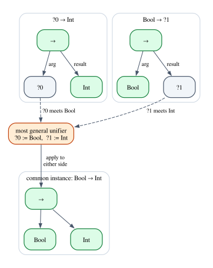
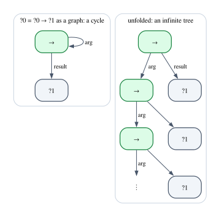
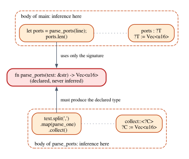

# Chapter 13 · Type Inference

Look at this Rust function body:

```rust
let mut log = Vec::new();
log.push("started");
```

You never wrote the type of `log`, yet the compiler knows it is a `Vec<&str>`.
It found out by noticing that `Vec::new()` produces a vector of *something*,
that `push` adds a `&str` to it, and that the something must therefore be
`&str`. This is **type inference**: reconstructing the types a programmer left
out, by treating them as unknowns and solving the equations the program imposes
on them.

In the 1970s Robin Milner designed type inference into ML, a language in which
a whole program can be written without a single type annotation and still be
statically typed. The algorithm, now called Hindley–Milner inference, is simple,
fast in practice, and comes with a theorem saying that it always finds the
*best* type a program can have. Rust's inference is a deliberately restricted
cousin of it; Lean's elaborator is a far more ambitious relative. This chapter
builds the algorithm, implements it in Rust for a small ML-like language, proves
its core in Lean, and then uses it as a lens on what the Rust and Lean
compilers do when you leave a type out.

**In this chapter you will learn:**

- what it means to infer a type, and what makes one type the *principal* type
  of a program;
- type variables and substitutions, and how substitutions compose;
- unification: how to solve equations between types, by hand and by machine,
  and why the occurs check rejects $\lambda x.\,x\,x$;
- the Hindley–Milner type system: let-polymorphism, generalization,
  instantiation, algorithm W, and the limits of all of it;
- how Rust's own inference works: local to function bodies, bounded by
  signatures, with literal defaulting, closures that are never generalized, and
  error E0282 when an unknown stays unknown;
- how Lean's elaborator uses metavariables and unification, how to read its
  messages, and how to prove that a unification algorithm is sound.

## Why infer types

In Chapter 8 the simply typed λ-calculus came with annotations on its binders:
you wrote $\lambda x{:}\mathtt{Int}.\,x + 1$, and the checker read the type of
`x` off the annotation. Bidirectional checking let you drop some of them, but a
λ that is not checked against a known type still needs its annotation, because
there is nothing else to tell the checker what `x` is.

Now take a function with no annotations at all:

$$
\mathit{twice} = \lambda f.\,\lambda x.\,f\,(f\,x)
$$

What is its type? It has many. If `f` is a function on integers, then
$\mathit{twice} : (\mathtt{Int} \to \mathtt{Int}) \to \mathtt{Int} \to \mathtt{Int}$.
If `f` is a function on booleans, then
$\mathit{twice} : (\mathtt{Bool} \to \mathtt{Bool}) \to \mathtt{Bool} \to \mathtt{Bool}$.
But some types are wrong: $(\mathtt{Int} \to \mathtt{Bool}) \to \mathtt{Int} \to \mathtt{Bool}$
fails, because the outer `f` would receive the `Bool` that the inner `f`
returns. Every correct type has the same shape: $(a \to a) \to a \to a$ for some
type $a$. That shape, with $a$ left as a variable, is the **principal type** of
`twice`: it is a correct type, and every other correct type is obtained from it
by replacing the variable with something.

So type inference is not about guessing one type, but about computing the most
general description of all the types a program can have. Chapter 3
distinguished *checking* a term against a type, *synthesizing* a type from an
annotated term, and *inferring* one for a term without annotations. The first
two follow the rules. The third needs a new idea: types with holes in them, and
a way to fill the holes.

## Type variables and substitutions

The holes are **type variables**. We write them $\alpha, \beta, \gamma$ in
mathematics and `?0`, `?1`, `?2` in code, following the convention that rustc
and Lean use for unknowns. The types of this chapter are:

$$
\tau ::= \alpha \mid \mathtt{Int} \mid \mathtt{Bool} \mid \tau \to \tau \mid \tau \times \tau \mid \mathtt{List}\ \tau
$$

A type with variables stands for all the types you get by filling in the
variables. $\alpha \to \alpha$ stands for $\mathtt{Int} \to \mathtt{Int}$,
$\mathtt{Bool} \to \mathtt{Bool}$, $(\mathtt{Int} \to \mathtt{Bool}) \to (\mathtt{Int} \to \mathtt{Bool})$,
and so on, but not for $\mathtt{Int} \to \mathtt{Bool}$.

A **substitution** says how to fill in variables: it maps finitely many type
variables to types. We write $S = [\alpha \mapsto \mathtt{Int},\ \beta \mapsto \alpha \to \alpha]$
for the substitution that replaces $\alpha$ by `Int` and $\beta$ by
$\alpha \to \alpha$, *simultaneously*, and $S\,\tau$ for the result of applying
it to $\tau$:

$$
S\,(\beta \to \alpha) = (\alpha \to \alpha) \to \mathtt{Int}
$$

The $\alpha$ inside $S(\beta)$ is not replaced again: the substitution looks
at the original type once. Variables that $S$ does not mention are left alone.

If $S_1$ and $S_2$ are substitutions, the **composition** $S_2 \circ S_1$
applies $S_1$ first and then $S_2$:

$$
(S_2 \circ S_1)\,\tau = S_2\,(S_1\,\tau)
$$

For example, with $S_1 = [\alpha \mapsto \beta \to \beta]$ and
$S_2 = [\beta \mapsto \mathtt{Int}]$, the composition maps $\alpha$ to
$\mathtt{Int} \to \mathtt{Int}$ and $\beta$ to `Int`. Composition is how
inference accumulates knowledge: each step discovers a little substitution, and
the answer is all of them composed.

Finally, $\tau'$ is an **instance** of $\tau$ when $\tau' = S\,\tau$ for some
substitution $S$, and $\tau$ is then **more general** than $\tau'$. The
principal type of a program is a type of which every other type of the program
is an instance.

### Substitutions in Lean

The Lean development of this chapter starts in
`code/lean/Book/Ch13/Unify.lean`. Types are an inductive type, with variables
numbered by natural numbers, and a scoped notation `⇒` for the arrow (we leave
pairs out of the Lean version; they would add a case to every proof and teach
nothing new):

```lean
/-- The types of the chapter's examples: variables, two base types, functions
and lists. -/
inductive Ty where
  | var : Nat → Ty
  | int : Ty
  | bool : Ty
  | arrow : Ty → Ty → Ty
  | list : Ty → Ty
  deriving DecidableEq

/-- `a ⇒ b` is the function type `Ty.arrow a b`. -/
scoped infixr:25 " ⇒ " => Ty.arrow
```

A substitution is represented as a *function* from variable numbers to types.
That looks wasteful (a function assigns a type to infinitely many variables),
but a substitution that leaves a variable alone simply maps `n` to `.var n`, and
functions make the algebra easy to state:

```lean
/-- A substitution assigns a type to every variable. (The variables it does
not change are mapped to themselves.) -/
def Subst := Nat → Ty

/-- Applying a substitution: replace every variable by its image. -/
def Ty.subst (σ : Subst) : Ty → Ty
  | .var n => σ n
  | .int => .int
  | .bool => .bool
  | .arrow a b => .arrow (a.subst σ) (b.subst σ)
  | .list a => .list (a.subst σ)

/-- The identity substitution changes nothing. -/
def Subst.id : Subst := Ty.var

/-- `τ.comp σ` is "first `σ`, then `τ`": the image of `n` is `σ n` with `τ`
applied to it. -/
def Subst.comp (τ σ : Subst) : Subst := fun n => (σ n).subst τ

/-- The substitution `[x := t]`, which changes only the variable `x`. -/
def Subst.single (x : Nat) (t : Ty) : Subst :=
  fun n => if n = x then t else .var n
```

`Ty.subst σ` walks a type and replaces each variable by its image; `comp`
composes in the same order as $\circ$; `single x t` is the one-variable
substitution $[x \mapsto t]$. Two theorems pin down how these behave:

```lean
/-- Applying the identity substitution changes nothing. -/
theorem subst_id (t : Ty) : t.subst Subst.id = t := by
  induction t with
  | var n => rfl
  | int => rfl
  | bool => rfl
  | arrow a b iha ihb => simp [Ty.subst, iha, ihb]
  | list a ih => simp [Ty.subst, ih]

/-- Applying a composition is applying one substitution after the other. -/
theorem subst_comp (τ σ : Subst) (t : Ty) :
    t.subst (τ.comp σ) = (t.subst σ).subst τ := by
  induction t with
  | var n => rfl
  | int => rfl
  | bool => rfl
  | arrow a b iha ihb => simp [Ty.subst, iha, ihb]
  | list a ih => simp [Ty.subst, ih]
```

Both are proved by induction on `t`. In the `var` case both sides compute to
the same thing, so `rfl` closes the goal (for `subst_id`,
`(Ty.var n).subst Subst.id` unfolds to `Ty.var n`). In the `arrow` case `simp`
unfolds `Ty.subst` one level and rewrites with the induction hypotheses `iha`
and `ihb`, after which both sides are identical; `list` is the same with one
hypothesis. The second theorem justifies the definition of `comp`: applying the
composition is applying one substitution after the other.

With these two facts, the usual algebraic laws follow in one line each:

```lean
/-- Substitutions under composition form a monoid: `id` is a unit on both
sides and composition is associative. -/
theorem Subst.id_comp (σ : Subst) : Subst.id.comp σ = σ := by
  funext n
  exact subst_id (σ n)

theorem Subst.comp_id (σ : Subst) : σ.comp Subst.id = σ := by
  funext n
  rfl

theorem Subst.comp_assoc (ρ τ σ : Subst) :
    (ρ.comp τ).comp σ = ρ.comp (τ.comp σ) := by
  funext n
  exact subst_comp ρ τ (σ n)
```

`funext` reduces an equation between functions to an equation between their
values at an arbitrary `n` (`comp_id` even holds by definition). Substitutions
under composition form a **monoid**, a structure you will meet again in
Chapter 14 and, as a category with one object, in Chapter 16.

## Unification

Inference turns a program into equations between types: a function of type
$\alpha \to \mathtt{Int}$ applied to a `Bool` needs $\alpha$ to be `Bool`; an
`if` with branches of types $\beta$ and `Int` needs them equal. The question is
always: given $\tau_1$ and $\tau_2$, find a substitution $S$ with
$S\,\tau_1 = S\,\tau_2$. Such an $S$ is a **unifier** of the two types, and
the process of finding one is **unification**. We write the equation to be
solved as $\tau_1 \doteq \tau_2$, to distinguish it from an equation that
already holds.

A pair of types usually has many unifiers. $\alpha \to \beta \doteq \gamma \to \gamma$
is solved by $[\alpha \mapsto \gamma,\ \beta \mapsto \gamma]$, and also by
$[\alpha \mapsto \mathtt{Int},\ \beta \mapsto \mathtt{Int},\ \gamma \mapsto \mathtt{Int}]$.
The first is better: the second is the first followed by
$[\gamma \mapsto \mathtt{Int}]$, so it commits to a choice the equation never
asked for. A **most general unifier** (mgu) $S$ is one through which every other
unifier factors: for every unifier $S'$ there is an $R$ with $S' = R \circ S$.
Inference always wants the mgu, because any extra commitment would make the
inferred type less general than it could be.

### Five problems by hand

The fastest way to understand unification is to do it. Here are five problems;
the code later in the chapter solves the same five.

**(1)** $\alpha \to \mathtt{Int} \doteq \mathtt{Bool} \to \beta$. Both sides are
arrows, and two arrows are equal exactly when their arguments are equal and their
results are equal. So the problem *decomposes* into two smaller ones:
$\alpha \doteq \mathtt{Bool}$ and $\mathtt{Int} \doteq \beta$. Each says that a
variable must be a certain type, so we *solve* them: $\alpha \mapsto \mathtt{Bool}$
and $\beta \mapsto \mathtt{Int}$. Both sides become $\mathtt{Bool} \to \mathtt{Int}$.

**(2)** $\alpha \to \alpha \doteq \mathtt{Int} \to \beta$. Decomposing gives
$\alpha \doteq \mathtt{Int}$ and $\alpha \doteq \beta$. Solving the first,
$\alpha \mapsto \mathtt{Int}$, changes the second: everything we still have to
solve must be read *through* what we already know, and $\alpha \doteq \beta$
becomes $\mathtt{Int} \doteq \beta$. So $\beta \mapsto \mathtt{Int}$ too. This
is the step that is easy to forget by hand and that every implementation must
get right: after solving a variable, substitute its solution into the
remaining equations.

**(3)** $\mathtt{List}\ \alpha \to \beta \doteq \beta \to \mathtt{List}\ \mathtt{Int}$.
Decompose: $\mathtt{List}\ \alpha \doteq \beta$ and $\beta \doteq \mathtt{List}\ \mathtt{Int}$.
The first solves $\beta \mapsto \mathtt{List}\ \alpha$ (an equation can have the
variable on either side). The second becomes
$\mathtt{List}\ \alpha \doteq \mathtt{List}\ \mathtt{Int}$, which decomposes to
$\alpha \doteq \mathtt{Int}$. The unifier is
$[\alpha \mapsto \mathtt{Int},\ \beta \mapsto \mathtt{List}\ \mathtt{Int}]$:
the solution for $\beta$ was found in two stages, first a shape and then its
contents.

**(4)** $\mathtt{Int} \to \alpha \doteq \mathtt{Bool} \to \alpha$. Decomposing gives
$\mathtt{Int} \doteq \mathtt{Bool}$, and two different type constructors can
never be made equal by any substitution, because substitutions only replace
variables. This is a **clash**, and there is no unifier.

**(5)** $\alpha \doteq \alpha \to \beta$. The left side is a variable, so it
looks like problem (1): solve $\alpha \mapsto \alpha \to \beta$. But applying
that "solution" to the left side gives $\alpha \to \beta$, and to the right side
gives $(\alpha \to \beta) \to \beta$. They are not equal, and substituting again
only makes both sides grow. The equation asks for a type that is equal to a
function type *whose argument is itself*. No finite type is like that: its
size would have to equal its own size plus at least two. Unification must refuse
to bind a variable to a type that contains it. This test is called the
**occurs check**.



### The rules

The five examples used five kinds of step. Collected and named, they are the
unification algorithm, in the formulation of Martelli and Montanari as rules
that transform a set $E$ of equations (an earlier formulation is Robinson's,
from 1965, who invented unification for automated theorem proving):

| Rule | When the first equation is | Then |
|---|---|---|
| Delete | $\tau \doteq \tau$ | drop it |
| Decompose | $C(\tau_1, \dots, \tau_n) \doteq C(\tau'_1, \dots, \tau'_n)$ | replace it by $\tau_i \doteq \tau'_i$ |
| Clash | $C(\dots) \doteq D(\dots)$ with $C \neq D$ | fail |
| Occurs | $\alpha \doteq \tau$, $\alpha$ in $\tau$, $\tau \neq \alpha$ | fail |
| Eliminate | $\alpha \doteq \tau$, $\alpha$ not in $\tau$ | record $\alpha \mapsto \tau$, substitute in $E$ |

Here $C$ and $D$ are type constructors (`Int`, `Bool`, $\to$, $\times$, `List`),
each applied to its arguments, and an equation $\tau \doteq \alpha$ with the
variable on the right is first turned around (some presentations call that
step Orient). The algorithm applies rules until it fails or no equation is
left; the recorded bindings, composed in order, form the unifier.

The algorithm **terminates** (every Eliminate removes a variable for good, and
between two Eliminates the other rules make the equations smaller) and is
**correct**: if the equations have a unifier, it returns a most general one, and
if it fails, there is none. Robinson proved this for his version, and the proof
carries over. In Lean we will prove that what the algorithm returns is a
unifier, and that the occurs check never rejects a solvable problem.

### Why $\lambda x.\,x\,x$ has no type

You met $\lambda x.\,x\,x$ in Chapter 7, where it was the building block of the
looping term $\Omega$, and in Chapter 8, where the simply typed λ-calculus could
not give it a type. Unification explains why no annotation could ever help.
Give `x` an unknown type $\alpha$. In `x x`, the first `x` is applied, so its
type must be a function type $\alpha \doteq \alpha \to \beta$, whose argument
type is the type of the second `x`, which is again $\alpha$. That is problem
(5), and the occurs check rejects it. The term would need an infinite type:



Some type systems allow such types (*equi-recursive* types; OCaml accepts them
behind a compiler flag), but then $\Omega$ becomes typable and typed programs
may loop. The occurs check keeps the types of ML finite.

## Unification in Rust

The crate `hm` (in `code/rust/crates/hm`) implements everything in this chapter
for a small ML-like language. Its types, in `src/types.rs`, use a uniform
representation that matches the table of rules: a type is either a variable or
a constructor applied to a list of argument types.

```rust
/// A type variable. While inference runs it is an unknown, printed `?0`,
/// `?1`, ...; in a final answer it is printed with a letter, `a`, `b`, ...
#[derive(Clone, Copy, Debug, PartialEq, Eq, PartialOrd, Ord, Hash)]
pub struct TyVar(pub u32);

/// The type constructors of mini-ML. Each has a fixed number of arguments.
#[derive(Clone, Copy, Debug, PartialEq, Eq)]
pub enum TyCon {
    Int,
    Bool,
    /// `a -> b`, the type of functions from `a` to `b`.
    Fun,
    /// `a * b`, the type of pairs.
    Pair,
    /// `List a`, the type of lists of `a`.
    List,
}

/// A monotype: a type variable, or a constructor applied to argument types.
#[derive(Clone, Debug, PartialEq, Eq)]
pub enum Type {
    Var(TyVar),
    Con(TyCon, Vec<Type>),
}

/// A type scheme `forall vars. ty`. The variables in `vars` are *bound*: each
/// use of a variable with this scheme may choose them afresh.
#[derive(Clone, Debug, PartialEq, Eq)]
pub struct Scheme {
    pub vars: Vec<TyVar>,
    pub ty: Type,
}
```

So `Int` is `Con(TyCon::Int, vec![])` and $\alpha \to \beta$ is
`Con(TyCon::Fun, vec![Var(a), Var(b)])`. A `Scheme` is a type with some
variables marked as bound; it becomes important when we reach polymorphism.

The substitution, in `src/unify.rs`, is stored the way rustc stores its own
inference variables: as a table indexed by variable number, where entry `n` is
`Some(t)` once $?n \mapsto t$ is known.

```rust
/// The substitution built so far, as a table of bindings.
#[derive(Default)]
pub struct Subst {
    bindings: Vec<Option<Type>>,
    /// When `Some`, every unification step is recorded here.
    trace: Option<Vec<String>>,
}

/// Why two types cannot be unified.
#[derive(Clone, Debug, PartialEq)]
pub enum UnifyError {
    /// Two different constructors met: `Int` against `Bool`, say.
    Mismatch(Type, Type),
    /// The variable would have to contain itself: `?0 = ?0 -> ?1`.
    Occurs(TyVar, Type),
}

impl Subst {
    pub fn new() -> Subst {
        Subst::default()
    }

    /// A type variable that is not bound and has never been used.
    pub fn fresh(&mut self) -> TyVar {
        self.bindings.push(None);
        TyVar(self.bindings.len() as u32 - 1)
    }

    /// The binding of `v`, if `v` has been solved.
    pub fn lookup(&self, v: TyVar) -> Option<&Type> {
        self.bindings[v.0 as usize].as_ref()
    }

    /// Applies the substitution to a type: every bound variable is replaced
    /// by its binding, recursively, until only unbound variables remain.
    pub fn apply(&self, ty: &Type) -> Type {
        match ty {
            Type::Var(v) => match self.lookup(*v) {
                Some(bound) => self.apply(bound),
                None => ty.clone(),
            },
            Type::Con(con, args) => {
                Type::Con(*con, args.iter().map(|a| self.apply(a)).collect())
            }
        }
    }
}
```

The table is in *triangular* form: a binding may mention a variable solved
later (in problem (3), $\beta$ is bound to $\mathtt{List}\ \alpha$ before
$\alpha$ is known), so `apply` follows bindings recursively. Composition is
implicit: adding a binding *is* composing a one-variable substitution after
everything found so far, and the table never has to be rewritten.

Unification itself transcribes the rules:

```rust
impl Subst {
    /// Extends the substitution so that `left` and `right` become equal, or
    /// explains why that is impossible.
    pub fn unify(&mut self, left: &Type, right: &Type) -> Result<(), UnifyError> {
        self.unify_at(left, right, 0)
    }

    fn unify_at(
        &mut self,
        left: &Type,
        right: &Type,
        depth: usize,
    ) -> Result<(), UnifyError> {
        // Look through variables that are already solved: we always compare
        // the current knowledge about both sides.
        let left = self.shallow(left);
        let right = self.shallow(right);
        self.log(depth, format!("unify {left}  ~  {right}"));
        match (&left, &right) {
            // Rule Delete: a variable is equal to itself.
            (Type::Var(a), Type::Var(b)) if a == b => Ok(()),
            // Rules Orient and Eliminate: solve the variable, unless the
            // occurs check fails.
            (Type::Var(v), other) | (other, Type::Var(v)) => {
                let other = self.apply(other);
                if other.mentions(*v) {
                    self.log(
                        depth + 1,
                        format!("occurs check: ?{} occurs in {other}", v.0),
                    );
                    return Err(UnifyError::Occurs(*v, other));
                }
                self.log(depth + 1, format!("?{} := {other}", v.0));
                self.bindings[v.0 as usize] = Some(other);
                Ok(())
            }
            // Rule Decompose: same constructor, unify the arguments pairwise.
            (Type::Con(c1, args1), Type::Con(c2, args2)) if c1 == c2 => {
                for (a1, a2) in args1.iter().zip(args2) {
                    self.unify_at(a1, a2, depth + 1)?;
                }
                Ok(())
            }
            // Rule Clash: different constructors can never be made equal.
            _ => {
                self.log(depth + 1, format!("clash: {left} is not {right}"));
                Err(UnifyError::Mismatch(self.apply(&left), self.apply(&right)))
            }
        }
    }
```

Walk through it with the table of rules beside you.

- `shallow` looks through solved variables at the root. This is problem (2)'s
  "read the remaining equations through what we know", done lazily: each
  equation is resolved when we reach it.
- Two equal variables: rule Delete.
- A variable on either side: rule Eliminate (and Orient, since the or-pattern
  `(Var(v), other) | (other, Var(v))` handles both orientations). Before
  binding, the code applies the substitution to `other` and checks whether `v`
  occurs in it: the occurs check. Applying first matters, because `v` may hide
  behind another variable that is already bound to a type mentioning `v`.
- Two constructors that are the same: rule Decompose, unify the arguments
  pairwise. For `Int` against `Int` there are no arguments, so this also covers
  Delete for constants.
- Anything else is a Clash.

The `log` calls record each step when tracing is on. The example
`crates/hm/examples/ch13_unify.rs` runs the five problems of the previous
section with tracing:

```rust
/// Pairs of types to unify. `?n` is a type variable.
const PROBLEMS: [(&str, &str); 5] = [
    ("?0 -> Int", "Bool -> ?1"),
    ("?0 -> ?0", "Int -> ?1"),
    ("List ?0 -> ?1", "?1 -> List Int"),
    ("Int -> ?0", "Bool -> ?0"),
    ("?0", "?0 -> ?1"),
];
```

```text
(1) ?0 -> Int  ~  Bool -> ?1
  unify ?0 -> Int  ~  Bool -> ?1
    unify ?0  ~  Bool
      ?0 := Bool
    unify Int  ~  ?1
      ?1 := Int
  unifier: ?0 = Bool, ?1 = Int
  both sides become Bool -> Int
(2) ?0 -> ?0  ~  Int -> ?1
  unify ?0 -> ?0  ~  Int -> ?1
    unify ?0  ~  Int
      ?0 := Int
    unify Int  ~  ?1
      ?1 := Int
  unifier: ?0 = Int, ?1 = Int
  both sides become Int -> Int
(3) List ?0 -> ?1  ~  ?1 -> List Int
  unify List ?0 -> ?1  ~  ?1 -> List Int
    unify List ?0  ~  ?1
      ?1 := List ?0
    unify List ?0  ~  List Int
      unify ?0  ~  Int
        ?0 := Int
  unifier: ?0 = Int, ?1 = List Int
  both sides become List Int -> List Int
(4) Int -> ?0  ~  Bool -> ?0
  unify Int -> ?0  ~  Bool -> ?0
    unify Int  ~  Bool
      clash: Int is not Bool
  fails: Int and Bool clash
(5) ?0  ~  ?0 -> ?1
  unify ?0  ~  ?0 -> ?1
    occurs check: ?0 occurs in ?0 -> ?1
  fails: ?0 occurs in ?0 -> ?1
```

The trace follows the hand computations. In problem (2) the second equation
is printed as `unify Int ~ ?1`, because `shallow` read it through the table; in
problem (3) the second equation becomes `List ?0 ~ List Int`; (4) and (5) fail
with a clash and with the occurs check.

## Unification in Lean, proved sound

The Lean version of the algorithm works on a list of equations, the way the
table of rules does, and returns either a unifier or the reason it failed:

```lean
/-- A substitution in triangular form: a list of bindings, applied from left
to right. Later bindings never mention earlier variables. -/
abbrev Bindings := List (Nat × Ty)

def Bindings.toSubst : Bindings → Subst
  | [] => Subst.id
  | (x, t) :: rest => (Bindings.toSubst rest).comp (Subst.single x t)

/-- What unification can answer. -/
inductive Outcome where
  | unifier : Bindings → Outcome
  | clash : Ty → Ty → Outcome
  | occurs : Nat → Ty → Outcome
  | outOfFuel : Outcome

/-- Applies `[x := t]` to both sides of every remaining equation. -/
def substEqs (x : Nat) (t : Ty) (eqs : List (Ty × Ty)) : List (Ty × Ty) :=
  eqs.map fun (a, b) => (a.subst (.single x t), b.subst (.single x t))

/-- The variable case: solve the equation `?x = t`, then unify the remaining
equations with `k`, and add the binding `x := t` in front of their unifier. -/
def solveVar (k : List (Ty × Ty) → Outcome) (x : Nat) (t : Ty)
    (rest : List (Ty × Ty)) : Outcome :=
  if t = .var x then k rest                          -- Delete
  else if t.occurs x then .occurs x t                -- Occurs check
  else match k (substEqs x t rest) with              -- Eliminate
    | .unifier σ => .unifier ((x, t) :: σ)
    | failure => failure

/-- Unification of a list of equations, with `fuel` bounding the number of
steps (each equation processed costs one unit). -/
def unify : (fuel : Nat) → List (Ty × Ty) → Outcome
  | 0, _ => .outOfFuel
  | _ + 1, [] => .unifier []
  | fuel + 1, (a, b) :: rest =>
    match a, b with
    | .var x, t | t, .var x => solveVar (unify fuel) x t rest
    | .int, .int | .bool, .bool => unify fuel rest     -- Delete
    | .arrow a₁ b₁, .arrow a₂ b₂ =>                    -- Decompose
      unify fuel ((a₁, a₂) :: (b₁, b₂) :: rest)
    | .list a₁, .list a₂ => unify fuel ((a₁, a₂) :: rest)
    | a, b => .clash a b                               -- Clash
```

A unifier is a list of bindings in triangular form: `(x, t) :: rest` means
"first $[x \mapsto t]$, then `rest`", and `Bindings.toSubst` composes them in
that order. Lists are easy to print, functions easy to reason about, and
`toSubst` connects the two. The or-pattern `| .var x, t | t, .var x =>` sends
equations with a variable on either side to `solveVar`, which implements Delete,
the occurs check and Eliminate; it receives the recursive call as an argument
`k`, so that we can reason about the variable case once.

Each equation processed costs one unit of `fuel`, the device you saw in
Chapter 7. Unification always terminates, but not for a reason Lean sees by
itself: Decompose makes the list longer and Eliminate can make types bigger.
The real argument uses a lexicographic measure (number of variables, then total
size) and would double the length of the file; fuel lets us concentrate on what
the algorithm computes.

Here it is on the five problems:

```lean
/-- Unifies two types, with plenty of fuel for small examples. -/
def unify₁ (a b : Ty) : Outcome := unify 100 [(a, b)]

section Examples
open Ty

/-- info: unifier: ?0 := Bool, ?1 := Int -/
#guard_msgs in
#eval unify₁ (var 0 ⇒ int) (bool ⇒ var 1)

/-- info: unifier: ?0 := Int, ?1 := Int -/
#guard_msgs in
#eval unify₁ (var 0 ⇒ var 0) (int ⇒ var 1)

/-- info: unifier: ?1 := List Int, ?0 := Int -/
#guard_msgs in
#eval unify₁ (list (var 0) ⇒ var 1) (var 1 ⇒ list int)

/-- info: clash: Int is not Bool -/
#guard_msgs in
#eval unify₁ (int ⇒ var 0) (bool ⇒ var 0)

/-- info: occurs check: ?0 occurs in ?0 → ?1 -/
#guard_msgs in
#eval unify₁ (var 0) (var 0 ⇒ var 1)

end Examples
```

The answers agree with the Rust trace (problem (3) lists its bindings in the
order they were made, each with its final value). Fuel is a real limit:
problem (1) needs four steps, so three are not enough:

```lean
/-- info: out of fuel -/
#guard_msgs in
#eval unify 3 [(.var 0 ⇒ .int, .bool ⇒ .var 1)]

/-- info: unifier: ?0 := Bool, ?1 := Int -/
#guard_msgs in
#eval unify 4 [(.var 0 ⇒ .int, .bool ⇒ .var 1)]
```

### The occurs check is necessary

Is the occurs check a limitation of the algorithm, or a fact about types? A
fact, and Lean can prove it: a solution would have to be bigger than itself.
First, sizes:

```lean
/-- Whether the variable `x` occurs in a type. -/
def Ty.occurs (x : Nat) : Ty → Bool
  | .var n => n == x
  | .int | .bool => false
  | .arrow a b => a.occurs x || b.occurs x
  | .list a => a.occurs x

/-- The size of a type: the number of constructors in it. -/
def Ty.size : Ty → Nat
  | .arrow a b => a.size + b.size + 1
  | .list a => a.size + 1
  | _ => 1
```

The key lemma says that if `x` occurs in `t`, then whatever a substitution puts
in place of `x` ends up somewhere inside the substituted `t`, so it cannot be
bigger:

```lean
/-- If `x` occurs in `t`, then whatever `σ` puts in place of `x` ends up inside
`t.subst σ`, so it is no bigger. -/
theorem size_le_of_occurs (σ : Subst) (x : Nat) (t : Ty) (h : t.occurs x = true) :
    (σ x).size ≤ (t.subst σ).size := by
  induction t with
  | var n =>
    -- `n == x` is true, so `n = x` and both sides are `(σ x).size`.
    simp [Ty.occurs] at h
    simp [Ty.subst, h]
  | int => simp [Ty.occurs] at h
  | bool => simp [Ty.occurs] at h
  | arrow a b iha ihb =>
    -- `x` occurs in `a` or in `b`; either way `σ x` is inside the image.
    simp only [Ty.occurs, Bool.or_eq_true] at h
    simp only [Ty.subst, Ty.size]
    rcases h with ha | hb
    · have := iha ha; omega
    · have := ihb hb; omega
  | list a ih =>
    simp only [Ty.occurs] at h
    simp only [Ty.subst, Ty.size]
    have := ih h; omega

/-- The occurs check is not a limitation of the algorithm: if `x` occurs in `t`
and `t` is not `x` itself, then *no* substitution makes them equal, because
the right-hand side is always strictly bigger. -/
theorem no_unifier_of_occurs (x : Nat) (t : Ty) (h : t.occurs x = true)
    (hne : t ≠ .var x) (σ : Subst) : (Ty.var x).subst σ ≠ t.subst σ := by
  intro heq
  have hsize := congrArg Ty.size heq
  simp only [Ty.subst] at hsize
  cases t with
  | var n =>
    simp [Ty.occurs] at h
    exact hne (by rw [h])
  | int => simp [Ty.occurs] at h
  | bool => simp [Ty.occurs] at h
  | arrow a b =>
    simp only [Ty.occurs, Bool.or_eq_true] at h
    simp only [Ty.subst, Ty.size] at hsize
    rcases h with ha | hb
    · have := size_le_of_occurs σ x a ha; omega
    · have := size_le_of_occurs σ x b hb; omega
  | list a =>
    simp only [Ty.occurs] at h
    simp only [Ty.subst, Ty.size] at hsize
    have := size_le_of_occurs σ x a h; omega
```

In `size_le_of_occurs`, the `var n` case turns `h` into `n = x`, and both
sides are the size of `σ x`. In the `int` and `bool` cases `x` cannot occur, and
`simp` turns `h` into `False`. In the `arrow` case `h` says that `x` occurs in
`a` *or* in `b` (`Bool.or_eq_true` turns `||` into `∨`), `rcases` splits the
two possibilities, and in each the induction hypothesis plus "an arrow is bigger
than its parts" is linear arithmetic, which `omega` decides.

`no_unifier_of_occurs` argues by contradiction: taking sizes of both sides of
`heq` (`congrArg Ty.size heq`) gives an equation between numbers. `t` cannot be
a variable (the only one containing `x` is `x`, excluded by `hne`), nor `Int` or
`Bool`. So it is an arrow or a list, whose substituted size is *strictly*
bigger than `σ x`, and `omega` finds the contradiction.

Instantiated at the equation of $\lambda x.\,x\,x$, this is a two-line theorem:

```lean
/-- Typing `fun x -> x x` needs a solution of `?0 = ?0 → ?1`. There is none. -/
theorem self_application_untypable (σ : Subst) :
    (Ty.var 0).subst σ ≠ (.var 0 ⇒ .var 1).subst σ :=
  no_unifier_of_occurs 0 (.var 0 ⇒ .var 1) rfl (by simp) σ
```

(`rfl` proves that `?0` occurs in `?0 ⇒ ?1` by computation, and `by simp` that
`?0 ⇒ ?1` is not the variable `?0`.)

### The returned unifier unifies

Now the main theorem of the file: whatever `unify` returns as a unifier really
is one. First, what "unifies" means for a list of equations:

```lean
/-- `σ` unifies a list of equations when it makes the two sides of each one
equal. -/
def Unifies (σ : Subst) (eqs : List (Ty × Ty)) : Prop :=
  ∀ e ∈ eqs, e.1.subst σ = e.2.subst σ

theorem unifies_nil (σ : Subst) : Unifies σ [] := by
  intro e he
  cases he

theorem unifies_cons {σ : Subst} {a b : Ty} {eqs : List (Ty × Ty)} :
    Unifies σ ((a, b) :: eqs) ↔ a.subst σ = b.subst σ ∧ Unifies σ eqs := by
  simp [Unifies]
```

`unifies_cons` says that a substitution unifies a list whose first equation is
$a \doteq b$ exactly when it equates $a$ and $b$ and unifies the rest; `simp`
proves it from the definition of membership in a list. Two more lemmas
correspond to two sentences of the informal argument:

```lean
/-- A substitution that does not mention `x` leaves `t` alone. -/
theorem subst_single_of_not_occurs (x : Nat) (s t : Ty) (h : t.occurs x = false) :
    t.subst (.single x s) = t := by
  induction t with
  | var n =>
    simp [Ty.occurs] at h
    simp [Ty.subst, Subst.single, h]
  | int => rfl
  | bool => rfl
  | arrow a b iha ihb =>
    simp only [Ty.occurs, Bool.or_eq_false_iff] at h
    simp [Ty.subst, iha h.1, ihb h.2]
  | list a ih =>
    simp only [Ty.occurs] at h
    simp [Ty.subst, ih h]

/-- Applying the bindings `(x, s) :: σ` is applying `[x := s]`, then `σ`. -/
theorem toSubst_cons (x : Nat) (s : Ty) (σ : Bindings) (t : Ty) :
    t.subst (Bindings.toSubst ((x, s) :: σ)) =
      (t.subst (.single x s)).subst σ.toSubst := by
  rw [Bindings.toSubst, subst_comp]
```

The first says that $[x \mapsto s]$ does not change a type in which $x$ does not
occur: this is where the occurs check pays off (in the `arrow` case,
`Bool.or_eq_false_iff` splits "`a.occurs x || b.occurs x` is false" into two
halves, `h.1` and `h.2`). The second says that the bindings `(x, s) :: σ` apply
$[x \mapsto s]$ and then `σ`; it is `subst_comp`, which is why we proved that
first.

The heart of the proof is the variable case. Its hypothesis `hk` says that the
recursive call `k` is sound, and the conclusion is that `solveVar` is:

```lean
/-- The variable case is sound, provided the recursive call `k` is. -/
theorem solveVar_sound {k : List (Ty × Ty) → Outcome}
    (hk : ∀ eqs σ, k eqs = .unifier σ → Unifies σ.toSubst eqs)
    {x : Nat} {t : Ty} {rest : List (Ty × Ty)} {σ : Bindings}
    (h : solveVar k x t rest = .unifier σ) :
    Unifies σ.toSubst ((.var x, t) :: rest) := by
  unfold solveVar at h
  split at h
  · -- Delete: `t` is the variable `x` itself.
    rename_i ht
    subst ht
    exact unifies_cons.mpr ⟨rfl, hk rest σ h⟩
  · split at h
    · -- The occurs check failed: `h` says `.occurs x t = .unifier σ`.
      cases h
    · -- Eliminate: `x` does not occur in `t`, and `k` solved the rest.
      rename_i hne hocc
      split at h
      · rename_i σ' hσ'
        -- `h` says that `σ` is `(x, t) :: σ'`.
        cases h
        have hrest := hk _ _ hσ'
        have hfix : t.subst (.single x t) = t :=
          subst_single_of_not_occurs x t t (by simpa using hocc)
        refine unifies_cons.mpr ⟨?_, ?_⟩
        · -- The equation `?x = t` itself: both sides become `t.subst σ'`.
          rw [toSubst_cons, toSubst_cons, hfix]
          simp [Ty.subst, Subst.single]
        · -- The other equations: this is what `k` solved.
          intro e he
          rw [toSubst_cons, toSubst_cons]
          exact hrest _ (List.mem_map_of_mem he)
      · -- `k` failed, so `h` contradicts the hypothesis of this branch.
        rename_i hfail
        exact absurd h (hfail σ)
```

`unfold solveVar at h` exposes the `if`s inside `h`, and `split at h` makes one
case per branch of the first `if` or `match` in `h`, adding the branch condition
as an anonymous hypothesis (`rename_i` names it).

- If `t` is `x` itself, `subst ht` replaces `t` by `.var x`; the first equation
  holds by `rfl` and the rest by `k`.
- If the occurs check fails, `h` claims that `.occurs x t` equals
  `.unifier σ`; different constructors are never equal, and `cases h` closes the
  goal.
- In the Eliminate case, `k` returned some `σ'` and `cases h` replaces `σ` by
  `(x, t) :: σ'`. After `toSubst_cons`, the equation $x \doteq t$ has `t` on
  both sides before `σ'` is applied: on the left by definition of `single`, on
  the right by `hfix`, an instance of the first lemma. Each remaining equation
  is exactly a substituted equation that `k` solved (`List.mem_map_of_mem`
  finds it in the substituted list).
- If `k` failed, `h` contradicts the branch hypothesis `hfail`, and `absurd`
  concludes.

The main theorem is an induction on the fuel:

```lean
/-- Swapping the two sides of the first equation does not change what unifies. -/
theorem unifies_swap {σ : Subst} {a b : Ty} {eqs : List (Ty × Ty)}
    (h : Unifies σ ((a, b) :: eqs)) : Unifies σ ((b, a) :: eqs) := by
  rw [unifies_cons] at h ⊢
  exact ⟨h.1.symm, h.2⟩

/-- **Soundness of unification**: when `unify` returns a unifier, it really
unifies every equation it was given. -/
theorem unify_sound : ∀ (fuel : Nat) (eqs : List (Ty × Ty)) (σ : Bindings),
    unify fuel eqs = .unifier σ → Unifies σ.toSubst eqs := by
  intro fuel
  induction fuel with
  | zero =>
    intro eqs σ h
    simp [unify] at h
  | succ fuel ih =>
    intro eqs σ h
    match eqs with
    | [] => exact unifies_nil _
    | (a, b) :: rest =>
      -- One case for each pair of constructors: 25 cases. Unfolding one
      -- step of `unify` leaves `h` in one of four shapes.
      cases a <;> cases b <;> simp only [unify] at h
      -- (1) A clash: `h : .clash _ _ = .unifier σ` is impossible.
      all_goals try (cases h; done)
      -- (2) An equation `?x = t` or `t = ?x`: the variable case.
      all_goals try exact solveVar_sound ih h
      all_goals try exact unifies_swap (solveVar_sound ih h)
      -- (3) `Int = Int` and `Bool = Bool`: deleted; `ih` covers the rest.
      all_goals try exact unifies_cons.mpr ⟨rfl, ih _ _ h⟩
      -- (4) Decompose: two arrows, or two lists.
      case arrow.arrow a₁ b₁ a₂ b₂ =>
        have hs := ih _ _ h
        rw [unifies_cons, unifies_cons] at hs
        obtain ⟨ha, hb, hrest⟩ := hs
        exact unifies_cons.mpr ⟨by simp [Ty.subst, ha, hb], hrest⟩
      case list.list a₁ a₂ =>
        have hs := ih _ _ h
        rw [unifies_cons] at hs
        obtain ⟨ha, hrest⟩ := hs
        exact unifies_cons.mpr ⟨by simp [Ty.subst, ha], hrest⟩
```

With no fuel, `h` is impossible. With fuel, the empty list is unified by
anything, and a non-empty list is split by the constructors of its first
equation: `cases a <;> cases b` produces all $5 \times 5 = 25$ combinations
(`<;>` runs the second tactic on every goal the first produces), and
`simp only [unify] at h` unfolds one step of `unify` in each. Then `h` has one
of four shapes, and `all_goals try t` applies a tactic wherever it succeeds:
a clash (impossible); a variable on either side (`solveVar_sound`, with
`unifies_swap` for the right side); `Int ≐ Int` or `Bool ≐ Bool` (`rfl` and
`ih`); and two arrows or two lists, selected by name with `case`, where the
induction hypothesis unifies the parts and `simp` rebuilds the whole.

This is *soundness*: the algorithm never lies. *Completeness* (if a unifier
exists, enough fuel finds a most general one) is the harder half, needing the
termination measure we avoided. With `no_unifier_of_occurs`, we can already
trust both a returned unifier and an occurs-check failure.

## Hindley–Milner: polymorphism without annotations

A function is useful because it is used many times, and different uses may need
different types. Chapter 12's System F gives such a function a type like
$\forall \alpha.\,\alpha \to \alpha$, but type inference for System F is
undecidable (Joe Wells proved it in the 1990s). Hindley and Milner found a
restriction that makes polymorphism inferable, and it is surprisingly mild.

### Monotypes and type schemes

The types $\tau$ of the previous sections, possibly containing variables, are
called **monotypes**. A **type scheme** puts quantifiers in front of a monotype,
and only there:

$$
\sigma ::= \tau \mid \forall \alpha.\,\sigma
$$

So $\forall \alpha.\,\alpha \to \alpha$ is a scheme, but
$(\forall \alpha.\,\alpha \to \alpha) \to \mathtt{Int}$ is not anything at all:
a quantifier may not appear inside an arrow. In the vocabulary of Chapter 12,
Hindley–Milner is **rank-1** polymorphism, the same restriction that Rust
imposes on the types of values. A context $\Gamma$ now binds variables to
schemes; a monotype counts as a scheme with no quantifiers.

Two operations connect monotypes and schemes. A monotype $\tau$ is an
**instance** of a scheme, written $\tau \sqsubseteq \forall \alpha_1 \dots \alpha_n.\,\tau'$,
when $\tau = [\alpha_1 \mapsto \tau_1, \dots, \alpha_n \mapsto \tau_n]\,\tau'$ for
some monotypes $\tau_i$: you get an instance by choosing a type for each
quantified variable. In the other direction, **generalization** quantifies every
variable of a type that the context does not constrain:

$$
\mathrm{Gen}(\Gamma, \tau) = \forall \alpha_1 \dots \alpha_n.\,\tau
\quad\text{where}\quad
\{\alpha_1, \dots, \alpha_n\} = \mathrm{ftv}(\tau) \setminus \mathrm{ftv}(\Gamma)
$$

Here $\mathrm{ftv}$ means "free type variables": in $\Gamma$, those that occur
in its schemes without being quantified.

### The rules

The typing rules of Hindley–Milner (often abbreviated HM) for the core of
mini-ML are those of the simply typed λ-calculus, with two changes. Variables
are instantiated, and `let` generalizes:

$$
\dfrac{(x : \sigma) \in \Gamma \qquad \tau \sqsubseteq \sigma}{\Gamma \vdash x : \tau}\;\textsf{T-Var}
\qquad\qquad
\dfrac{\Gamma,\, x : \tau_1 \vdash e : \tau_2}{\Gamma \vdash \lambda x.\,e : \tau_1 \to \tau_2}\;\textsf{T-Abs}
$$

$$
\dfrac{\Gamma \vdash e_1 : \tau_1 \to \tau_2 \qquad \Gamma \vdash e_2 : \tau_1}{\Gamma \vdash e_1\,e_2 : \tau_2}\;\textsf{T-App}
$$

$$
\dfrac{\Gamma \vdash e_1 : \tau_1 \qquad \Gamma,\, x : \mathrm{Gen}(\Gamma, \tau_1) \vdash e_2 : \tau_2}{\Gamma \vdash \mathtt{let}\ x = e_1\ \mathtt{in}\ e_2 : \tau_2}\;\textsf{T-Let}
$$

The rules for literals (T-Int, T-Bool), `if` (T-If, as in Chapter 1) and pairs
are the expected ones.

Read T-Var and T-Let together. A `let`-bound variable receives a scheme, the
most general one its definition allows, and each *use* of the variable picks
its own instance. A λ-bound variable, in T-Abs, receives a plain monotype
$\tau_1$, whose only instance is itself: every use of it has the same type.
That asymmetry is the whole of let-polymorphism.

### Same computation, different typing

Here is the asymmetry on a concrete program. With `let`:

$$
\mathtt{let}\ \mathit{id} = \lambda x.\,x\ \mathtt{in}\ (\mathit{id}\ 1,\ \mathit{id}\ \mathtt{true})
$$

The definition $\lambda x.\,x$ has type $\alpha \to \alpha$ in the empty context,
so T-Let binds $\mathit{id} : \forall \alpha.\,\alpha \to \alpha$, and each use
instantiates the scheme differently. With $\Gamma' = \mathit{id} : \forall\alpha.\,\alpha \to \alpha$,
the derivation for the first component is

$$
\dfrac{\dfrac{(\mathit{id} : \forall\alpha.\,\alpha \to \alpha) \in \Gamma' \qquad \mathtt{Int} \to \mathtt{Int} \sqsubseteq \forall\alpha.\,\alpha \to \alpha}{\Gamma' \vdash \mathit{id} : \mathtt{Int} \to \mathtt{Int}}\;\textsf{T-Var} \qquad \dfrac{}{\Gamma' \vdash 1 : \mathtt{Int}}\;\textsf{T-Int}}{\Gamma' \vdash \mathit{id}\ 1 : \mathtt{Int}}\;\textsf{T-App}
$$

and the second is the same with `Bool` and `true`, so the program has type
$\mathtt{Int} \times \mathtt{Bool}$. Now write the same computation with a λ:

$$
(\lambda \mathit{id}.\,(\mathit{id}\ 1,\ \mathit{id}\ \mathtt{true}))\ (\lambda x.\,x)
$$

One β-step turns it into the same pair as the `let` version. But by T-Abs,
$\mathit{id}$ has a single monotype $\tau_1$; the first use requires
$\tau_1 = \mathtt{Int} \to \tau$, the second $\tau_1 = \mathtt{Bool} \to \tau'$,
and `Int` is not `Bool`. There is no derivation: `let x = e1 in e2` and
`(fun x -> e2) e1` are equal as computations and different as typing problems.

Why not give λ-bound variables schemes too? Because a polymorphic argument is
rank-2 polymorphism, and inference would become undecidable again. A `let` is
special because the definition is right there: the checker can compute its most
general type. A λ-bound variable stands for an argument that comes from
elsewhere, and nothing says how polymorphic it will be.

### Why Gen looks at the context

The side condition in $\mathrm{Gen}$, "variables not free in $\Gamma$", is easy
to read past, and essential. Consider

$$
\lambda x.\,\mathtt{let}\ y = x\ \mathtt{in}\ (y\ 1,\ y\ \mathtt{true})
$$

Inside the λ, $x : \alpha$, so the definition of $y$ has type $\alpha$. If we
generalized it to $y : \forall\alpha.\,\alpha$, both uses would type-check. But
$y$ *is* $x$, one value supplied by the caller: pass `fun n -> n + 1` and the
program evaluates `true + 1`, a stuck term. Because $\alpha$ is free in the
context, Gen leaves it alone and the program is rejected. Free in $\Gamma$
means "someone else still gets to decide what this type is".

### The asymmetry, proved in Lean

The file `code/lean/Book/Ch13/Polymorphism.lean` writes the rules as an
inductive relation over the types of `Unify.lean`, which it imports. Our Lean
types have no pairs, so `id` serves two types in an `if`:
`if id true then id 1 else 2`. An instance may change the bound variables of a
scheme and nothing else:

```lean
/-- A fragment of mini-ML: enough for the chapter's example. -/
inductive Expr where
  | var : String → Expr
  | lit : Nat → Expr
  | tt : Expr
  | lam : String → Expr → Expr
  | app : Expr → Expr → Expr
  | let_ : String → Expr → Expr → Expr
  | ite : Expr → Expr → Expr → Expr

/-- A type scheme `∀ vars. ty`. -/
structure Scheme where
  vars : List Nat
  ty : Ty

/-- A context binds names to schemes; the most recent binding comes first. -/
abbrev Ctx := List (String × Scheme)

def Ctx.lookup : Ctx → String → Option Scheme
  | [], _ => none
  | (y, σ) :: Γ, x => if x = y then some σ else Ctx.lookup Γ x

/-- The type variable `v` is free in the context: some scheme mentions it
without binding it. -/
def Ctx.Free (Γ : Ctx) (v : Nat) : Prop :=
  ∃ x σ, (x, σ) ∈ Γ ∧ σ.ty.occurs v = true ∧ v ∉ σ.vars

/-- `τ` is an instance of `∀ vars. ty`: substitute for the bound variables
(and only for them). -/
def Scheme.Inst (σ : Scheme) (τ : Ty) : Prop :=
  ∃ s : Subst, (∀ n, n ∉ σ.vars → s n = .var n) ∧ τ = σ.ty.subst s
```

The side condition of Gen is a premise of `let_`: the quantified variables `vs`
must not be free in the context (a derivation may quantify fewer than Gen
would; nothing is lost).

```lean
/-- The Hindley–Milner typing rules. -/
inductive HasType : Ctx → Expr → Ty → Prop
  /-- Var: instantiate the scheme of `x`. -/
  | var {Γ x σ τ} :
      Γ.lookup x = some σ → σ.Inst τ → HasType Γ (.var x) τ
  | lit {Γ n} : HasType Γ (.lit n) .int
  | tt {Γ} : HasType Γ .tt .bool
  /-- Abs: the parameter gets a monotype (a scheme with no bound variables). -/
  | lam {Γ x e τ₁ τ₂} :
      HasType ((x, ⟨[], τ₁⟩) :: Γ) e τ₂ → HasType Γ (.lam x e) (τ₁ ⇒ τ₂)
  | app {Γ f a τ₁ τ₂} :
      HasType Γ f (τ₁ ⇒ τ₂) → HasType Γ a τ₁ → HasType Γ (.app f a) τ₂
  /-- Let: generalize over variables that are not free in the context. -/
  | let_ {Γ x e₁ e₂ vs τ₁ τ₂} :
      HasType Γ e₁ τ₁ → (∀ v ∈ vs, ¬ Γ.Free v) →
      HasType ((x, ⟨vs, τ₁⟩) :: Γ) e₂ τ₂ → HasType Γ (.let_ x e₁ e₂) τ₂
  | ite {Γ c a b τ} :
      HasType Γ c .bool → HasType Γ a τ → HasType Γ b τ →
      HasType Γ (.ite c a b) τ
```

```lean
/-- `let id = fun x -> x in if id true then id 1 else 2` -/
def withLet : Expr :=
  .let_ "id" (.lam "x" (.var "x"))
    (.ite (.app (.var "id") .tt) (.app (.var "id") (.lit 1)) (.lit 2))

/-- `(fun id -> if id true then id 1 else 2)`, the same body under `fun`. -/
def withFun : Expr :=
  .lam "id" (.ite (.app (.var "id") .tt) (.app (.var "id") (.lit 1)) (.lit 2))
```

The `let` version has a derivation, which we build with tactics:

```lean
/-- The scheme `∀ ?0. ?0 → ?0` has `τ → τ` as an instance, for every `τ`. -/
theorem id_inst (τ : Ty) : (Scheme.mk [0] (.var 0 ⇒ .var 0)).Inst (τ ⇒ τ) := by
  refine ⟨Subst.single 0 τ, ?_, rfl⟩
  -- Every variable other than `?0` is left alone by `[?0 := τ]`.
  intro n hn
  simp only [List.mem_singleton] at hn
  simp [Subst.single, hn]

/-- With `let`, the program has type `Int`: `id` is used at `Bool → Bool`
and at `Int → Int`. -/
theorem withLet_typed : HasType [] withLet .int := by
  apply HasType.let_ (vs := [0]) (τ₁ := .var 0 ⇒ .var 0)
  · -- `fun x -> x : ?0 → ?0`
    apply HasType.lam
    apply HasType.var rfl
    exact ⟨Subst.id, fun _ _ => rfl, (subst_id _).symm⟩
  · -- The empty context has no free variables, so `?0` may be generalized.
    intro v _ ⟨x, σ, hmem, _⟩
    cases hmem
  · -- The body, with `id : ∀ ?0. ?0 → ?0`.
    apply HasType.ite
    · exact HasType.app (HasType.var rfl (id_inst .bool)) HasType.tt
    · exact HasType.app (HasType.var rfl (id_inst .int)) HasType.lit
    · exact HasType.lit
```

`id_inst` instantiates $\forall ?0.\,?0 \to ?0$ with $[?0 \mapsto \tau]$:
`refine` supplies the substitution and the equation (`rfl`) and leaves the goal
that other variables are untouched. In `withLet_typed`, `apply HasType.let_`
fixes the scheme and leaves one goal per premise: the definition (T-Abs, then
T-Var with the identity substitution), the side condition (nothing is a member
of the empty context, which `cases hmem` observes), and the body, with `id`
instantiated at `Bool` and at `Int`.

The `fun` version has no derivation, and this time the proof shows that *no*
derivation of *any* type can exist:

```lean
/-- A scheme with no bound variables has exactly one instance: itself. -/
theorem mono_inst {τ₁ τ : Ty} (h : (Scheme.mk [] τ₁).Inst τ) : τ = τ₁ := by
  obtain ⟨s, hs, rfl⟩ := h
  -- `s` changes no variable, so it is the identity substitution.
  have : s = Subst.id := funext fun n => hs n (List.not_mem_nil)
  rw [this, subst_id]

/-- With `fun`, the program has no type at all. -/
theorem withFun_untypable (τ : Ty) : ¬ HasType [] withFun τ := by
  intro h
  -- Invert the derivation, rule by rule, from the bottom up.
  cases h with
  | lam hbody =>
    -- `id : τ₁`, a monotype, and the body is an `if`.
    cases hbody with
    | ite hcond hthen _ =>
      -- `id true : Bool` forces `id : Bool → Bool`...
      cases hcond with
      | app hid htrue =>
        cases htrue
        cases hid with
        | var hlook hinst =>
          simp [Ctx.lookup] at hlook
          subst hlook
          have h1 := mono_inst hinst
          -- ...and `id 1` forces `id : Int → τ`.
          cases hthen with
          | app hid' hone =>
            cases hone
            cases hid' with
            | var hlook' hinst' =>
              simp [Ctx.lookup] at hlook'
              subst hlook'
              have h2 := mono_inst hinst'
              -- `Bool → Bool = Int → τ` is impossible: `Bool ≠ Int`.
              rw [← h1] at h2
              cases h2
```

The proof is by **inversion**, as in Chapter 9: the last rule of a derivation
must be the one whose conclusion matches the term, and `cases` on the derivation
finds it and exposes its premises. The term is a λ, so the rule is `lam`, which
binds `id` to a monotype `⟨[], τ₁⟩`; the body is an `if`, so next comes `ite`.
In the condition `id true`, `cases htrue` finds that `true : Bool`, so `id` is
used at `Bool ⇒ Bool`, an instance of its scheme (`simp [Ctx.lookup]` looks it
up). `mono_inst` says that a scheme with no bound variables has only itself as
an instance (the substitution changes no variable, so `funext` shows it is
`Subst.id`), so `h1 : Bool ⇒ Bool = τ₁`. The `then` branch gives
`h2 : Int ⇒ τ = τ₁`. Rewriting with `h1` turns `h2` into
`Int ⇒ τ = Bool ⇒ Bool`, and `cases h2` observes that `Int` and `Bool` are
different constructors. No derivation; no type.

## Algorithm W

The rules do not say how to find the types: T-Abs needs a $\tau_1$ for the
parameter and T-Var an instance, and nothing says which. **Algorithm W**, from
Milner's 1978 paper, invents a fresh type variable whenever a rule needs an
unknown type, and lets unification decide later. It returns a substitution and
a type, $W(\Gamma, e) = (S, \tau)$:

- **Variable.** If $(x : \forall\alpha_1 \dots \alpha_n.\,\tau) \in \Gamma$,
  return the identity substitution and $[\alpha_i \mapsto \beta_i]\,\tau$, with
  fresh variables $\beta_i$. Instantiation with fresh variables is the most
  general instance.
- **Abstraction** $\lambda x.\,e$. Pick a fresh $\beta$ for the parameter. Let
  $(S, \tau) = W((\Gamma, x : \beta), e)$. Return $(S,\ S\beta \to \tau)$: the
  body's inference may have learned something about $\beta$.
- **Application** $e_1\,e_2$. Let $(S_1, \tau_1) = W(\Gamma, e_1)$ and
  $(S_2, \tau_2) = W(S_1\Gamma, e_2)$. Pick a fresh $\beta$ for the result and
  unify: $S_3 = \mathrm{mgu}(S_2\tau_1,\ \tau_2 \to \beta)$. Return
  $(S_3 \circ S_2 \circ S_1,\ S_3\beta)$.
- **Let** $\mathtt{let}\ x = e_1\ \mathtt{in}\ e_2$. Let
  $(S_1, \tau_1) = W(\Gamma, e_1)$, then
  $(S_2, \tau_2) = W((S_1\Gamma,\ x : \mathrm{Gen}(S_1\Gamma, \tau_1)), e_2)$.
  Return $(S_2 \circ S_1,\ \tau_2)$.

The composed substitutions are the knowledge accumulated so far, applied to the
context before each recursive call. If any $\mathrm{mgu}$ fails, so does W. The
theorem that makes W worth having is due to Damas and Milner (1982), building
on Hindley's result for combinatory logic (1969):

- **Soundness.** If $W(\Gamma, e) = (S, \tau)$, then $S\Gamma \vdash e : \tau$.
- **Completeness.** If $e$ has any type in any instance of $\Gamma$, then W
  succeeds, and that type is an instance of the generalized type that W
  returns.

For a closed program, W computes its **principal type**, or proves that it has
none.

### W by hand: `twice`

Let us run W on $\lambda f.\,\lambda x.\,f\,(f\,x)$, keeping a single growing
substitution as the code will.

1. $\lambda f$: $f : \alpha_0$. $\lambda x$: $x : \alpha_1$.
2. The inner application $f\,x$: $f$ has type $\alpha_0$, $x$ has type
   $\alpha_1$, pick $\alpha_2$ for the result. Unify
   $\alpha_0 \doteq \alpha_1 \to \alpha_2$: solved by
   $\alpha_0 \mapsto \alpha_1 \to \alpha_2$. So $f\,x : \alpha_2$.
3. The outer application $f\,(f\,x)$: $f$ now has type
   $\alpha_1 \to \alpha_2$ (read through the substitution), the argument has type
   $\alpha_2$, pick $\alpha_3$. Unify $\alpha_1 \to \alpha_2 \doteq \alpha_2 \to \alpha_3$:
   decompose, $\alpha_1 \mapsto \alpha_2$, then $\alpha_2 \mapsto \alpha_3$.
4. The whole term has type $\alpha_0 \to \alpha_1 \to \alpha_3$, which the
   substitution turns into
   $(\alpha_3 \to \alpha_3) \to \alpha_3 \to \alpha_3$. Nothing is in the
   context, so everything generalizes:
   $\forall a.\,(a \to a) \to a \to a$.

The end of the output of `ch13_unify.rs` traces the crate's own run on `twice`,
and on the `let` example, where you can see generalization and two
instantiations with fresh variables:

```text
algorithm W on: fun f x -> f (f x)
  fun f -> ..      f : ?0
  fun x -> ..      x : ?1
  (f x)            unify ?0 ~ ?1 -> ?2  =>  ?0 := ?1 -> ?2
  f (f x)          unify ?1 -> ?2 ~ ?2 -> ?3  =>  ?1 := ?2, ?2 := ?3
  (program)        result forall a. (a -> a) -> a -> a
principal type: forall a. (a -> a) -> a -> a

algorithm W on: let id = fun x -> x in (id 1, id true)
  fun x -> ..      x : ?0
  let id = ..      generalize id : forall a. a -> a
  id               instantiate forall a. a -> a as ?1 -> ?1
  id 1             unify ?1 -> ?1 ~ Int -> ?2  =>  ?1 := Int, ?2 := Int
  id               instantiate forall a. a -> a as ?3 -> ?3
  id true          unify ?3 -> ?3 ~ Bool -> ?4  =>  ?3 := Bool, ?4 := Bool
  (program)        result Int * Bool
principal type: Int * Bool
```

## Algorithm W in Rust

The `hm` crate's inference engine is in `src/infer.rs`. Instead of returning and
composing substitutions, it keeps one `Subst` table that only grows: "compose a
new substitution" becomes "add bindings to the table". Milner's paper describes
this variant too, as algorithm J; it computes the same types with less copying,
and production compilers, rustc included, work this way.

### The language and its prelude

The language is a small ML, with a parser (`src/parser.rs`) that reduces a
friendlier surface syntax to these forms:

```rust
/// A region of the source text, as byte offsets `start..end`.
#[derive(Clone, Copy, Debug, PartialEq, Eq)]
pub struct Span {
    pub start: usize,
    pub end: usize,
}

/// An expression together with the part of the source it came from, so that
/// error messages can point at it.
#[derive(Clone, Debug, PartialEq)]
pub struct Expr {
    pub kind: ExprKind,
    pub span: Span,
}

#[derive(Clone, Debug, PartialEq)]
pub enum ExprKind {
    Int(i64),
    Bool(bool),
    Var(String),
    Lam(String, Box<Expr>),
    App(Box<Expr>, Box<Expr>),
    Let(String, Box<Expr>, Box<Expr>),
    LetRec(String, Box<Expr>, Box<Expr>),
    If(Box<Expr>, Box<Expr>, Box<Expr>),
    Pair(Box<Expr>, Box<Expr>),
}
```

Every expression carries a `Span` of source text, for error messages.
Operators and lists are not built into the checker: `a + b` is parsed as
`(+) a b` and `[1, 2]` as `cons 1 (cons 2 nil)`, and the names get their types
from a **prelude**, the initial environment:

```rust
impl<'src> Infer<'src> {
    /// A fresh inference run, with the prelude in the environment.
    pub fn new(source: &'src str) -> Infer<'src> {
        let mut infer = Infer {
            source,
            subst: Subst::new(),
            env: Vec::new(),
            trace: None,
        };
        let (int, bool) = (Type::int, Type::bool);
        let arith = || Type::fun(int(), Type::fun(int(), int()));
        let compare = || Type::fun(int(), Type::fun(int(), bool()));
        for op in ["+", "-", "*"] {
            infer.builtin(op, 0, |_| arith());
        }
        for op in ["==", "<"] {
            infer.builtin(op, 0, |_| compare());
        }
        infer.builtin("not", 0, |_| Type::fun(bool(), bool()));
        infer.builtin("fst", 2, |v| {
            Type::fun(Type::pair(v[0].clone(), v[1].clone()), v[0].clone())
        });
        infer.builtin("snd", 2, |v| {
            Type::fun(Type::pair(v[0].clone(), v[1].clone()), v[1].clone())
        });
        infer.builtin("nil", 1, |v| Type::list(v[0].clone()));
        infer.builtin("cons", 1, |v| {
            let list = Type::list(v[0].clone());
            Type::fun(v[0].clone(), Type::fun(list.clone(), list))
        });
        infer.builtin("head", 1, |v| {
            Type::fun(Type::list(v[0].clone()), v[0].clone())
        });
        infer.builtin("tail", 1, |v| {
            Type::fun(Type::list(v[0].clone()), Type::list(v[0].clone()))
        });
        infer.builtin("null", 1, |v| Type::fun(Type::list(v[0].clone()), bool()));
        infer
    }

    /// Adds a prelude function whose scheme quantifies over `n` variables.
    fn builtin(&mut self, name: &str, n: usize, ty: impl Fn(&[Type]) -> Type) {
        let vars: Vec<TyVar> = (0..n).map(|_| self.subst.fresh()).collect();
        let args: Vec<Type> = vars.iter().map(|v| Type::Var(*v)).collect();
        let scheme = Scheme {
            vars,
            ty: ty(&args),
        };
        self.env.push(Binding {
            name: name.to_string(),
            scheme,
            origin: Origin::Prelude,
        });
    }
}
```

`nil` gets $\forall a.\,\mathtt{List}\ a$ and `cons`
$\forall a.\,a \to \mathtt{List}\ a \to \mathtt{List}\ a$, so lists are
polymorphic by rule T-Var. The operators are monomorphic: `==` compares
integers only, because "for every $a$ *that supports equality*" is not an HM
type; type classes (Chapter 14) add exactly that.

### Generalization and instantiation

```rust
impl Infer<'_> {
    /// The type variables free in the environment: those of every binding's
    /// type (after applying the substitution), minus the binding's own
    /// quantified variables.
    fn env_vars(&self) -> BTreeSet<TyVar> {
        let mut vars = BTreeSet::new();
        for binding in &self.env {
            for v in self.subst.apply(&binding.scheme.ty).vars() {
                if !binding.scheme.vars.contains(&v) {
                    vars.insert(v);
                }
            }
        }
        vars
    }

    /// Gen(Γ, τ) = forall (ftv(τ) \ ftv(Γ)). τ
    /// Also reports whether some variable was kept monomorphic because the
    /// environment mentions it.
    fn generalize(&self, ty: &Type) -> (Scheme, bool) {
        let ty = self.subst.apply(ty);
        let in_env = self.env_vars();
        let (vars, blocked): (Vec<TyVar>, Vec<TyVar>) =
            ty.vars().into_iter().partition(|v| !in_env.contains(v));
        (Scheme { vars, ty }, !blocked.is_empty())
    }

    /// Inst(forall a1 ... an. τ) = τ[a1 := ?1, ..., an := ?n], with fresh ?i.
    fn instantiate(&mut self, scheme: &Scheme) -> Type {
        let fresh: Vec<(TyVar, Type)> = scheme
            .vars
            .iter()
            .map(|v| (*v, Type::Var(self.subst.fresh())))
            .collect();
        rename(&scheme.ty, &fresh)
    }
}

fn rename(ty: &Type, map: &[(TyVar, Type)]) -> Type {
    match ty {
        Type::Var(v) => match map.iter().find(|(w, _)| w == v) {
            Some((_, replacement)) => replacement.clone(),
            None => ty.clone(),
        },
        Type::Con(con, args) => {
            Type::Con(*con, args.iter().map(|a| rename(a, map)).collect())
        }
    }
}
```

`generalize` is $\mathrm{Gen}$ transcribed, and also reports whether a variable
was *blocked* by the environment, for the error messages. Scanning the whole
environment at every `let` is fine for teaching; production checkers such as
OCaml's avoid it by recording the `let` depth (*level*) at which each variable
was created.

### The cases of W

The main function has one arm per rule. Variables are instantiated:

```rust
// Rule Var: look the name up and instantiate its scheme.
ExprKind::Var(name) => {
    let Some(binding) = self.env.iter().rev().find(|b| &b.name == name)
    else {
        return Err(Diagnostic::error(format!(
            "unbound variable `{name}`"
        ))
        .primary(expr.span, "not found in this scope"));
    };
    let scheme = binding.scheme.clone();
    let ty = self.instantiate(&scheme);
    if !scheme.vars.is_empty() {
        self.log(
            expr,
            format!("instantiate {} as {ty}", scheme_raw(&scheme)),
        );
    }
    Ok(ty)
}
```

Abstractions bind the parameter to a fresh variable, as a scheme with no
quantifiers (a monotype):

```rust
// Rule Abs: the parameter gets a fresh, monomorphic type.
ExprKind::Lam(param, body) => {
    let alpha = Type::Var(self.subst.fresh());
    self.log(expr, format!("{param} : {alpha}"));
    self.bind(param, Scheme::mono(alpha.clone()), Origin::Lambda);
    let body_ty = self.infer(body);
    self.env.pop();
    Ok(Type::fun(alpha, body_ty?))
}
```

The environment is a stack (`bind` pushes, `pop` ends the scope). Applications
follow W exactly:

```rust
// Rule App: the function's type must unify with arg -> result.
ExprKind::App(func, arg) => {
    let func_ty = self.infer(func)?;
    let arg_ty = self.infer(arg)?;
    let result = Type::Var(self.subst.fresh());
    let wanted = Type::fun(arg_ty.clone(), result.clone());
    let before = (self.subst.apply(&func_ty), self.subst.apply(&arg_ty));
    let wanted_now = self.subst.apply(&wanted);
    let outcome = self.subst.unify(&func_ty, &wanted);
    self.log_unify(expr, &before.0, &wanted_now);
    match outcome {
        Ok(()) => Ok(result),
        Err(err) => {
            Err(self.application_error(expr, func, arg, before, err))
        }
    }
}
```

`before` saves the two types as currently known, so that an error message is
built from them rather than from a half-updated table. `let` infers,
generalizes, and checks the body:

```rust
// Rule Let: infer, generalize, then check the body.
ExprKind::Let(name, bound, body) => {
    let bound_ty = self.infer(bound)?;
    let (scheme, blocked) = self.generalize(&bound_ty);
    self.log(expr, format!("generalize {name} : {}", scheme_raw(&scheme)));
    self.bind(name, scheme, Origin::Let { blocked });
    let body_ty = self.infer(body);
    self.env.pop();
    body_ty
}
```

`let rec` goes beyond the rules above: inside its own definition the function
is a fresh *monotype*, generalized only afterwards, for the body:

```rust
// Recursion: inside its definition the function is monomorphic.
ExprKind::LetRec(name, bound, body) => {
    let alpha = Type::Var(self.subst.fresh());
    self.bind(name, Scheme::mono(alpha.clone()), Origin::Recursive);
    let bound_ty = self.infer(bound);
    self.env.pop();
    let bound_ty = bound_ty?;
    self.unify_or(expr, &alpha, &bound_ty, || {
        Diagnostic::error("recursive function used at an inconsistent type")
            .primary(bound.span, "in this definition")
    })?;
    let (scheme, blocked) = self.generalize(&bound_ty);
    self.log(expr, format!("generalize {name} : {}", scheme_raw(&scheme)));
    self.bind(name, scheme, Origin::Let { blocked });
    let body_ty = self.infer(body);
    self.env.pop();
    body_ty
}
```

### Running it

The example `crates/hm/examples/ch13_infer.rs` infers the principal types of a
list of programs:

```rust
/// Sample programs, from the identity function to `map`.
const PROGRAMS: [&str; 9] = [
    "fun x -> x",
    "fun x y -> x",
    "fun f x -> f (f x)",
    "fun f g x -> f (g x)",
    "fun p -> (snd p, fst p)",
    "fun x -> x + 1",
    "let rec length xs =
       if null xs then 0 else 1 + length (tail xs)
     in length",
    "let rec map f xs =
       if null xs then [] else f (head xs) :: map f (tail xs)
     in map",
    "let rec map f xs =
       if null xs then [] else f (head xs) :: map f (tail xs)
     in map (fun n -> n < 3) [1, 2, 3]",
];
```

```text
== principal types ==
fun x -> x
  : forall a. a -> a
fun x y -> x
  : forall a b. a -> b -> a
fun f x -> f (f x)
  : forall a. (a -> a) -> a -> a
fun f g x -> f (g x)
  : forall a b c. (a -> b) -> (c -> a) -> c -> b
fun p -> (snd p, fst p)
  : forall a b. a * b -> b * a
fun x -> x + 1
  : Int -> Int
let rec length xs =
  if null xs then 0 else 1 + length (tail xs)
in length
  : forall a. List a -> Int
let rec map f xs =
  if null xs then [] else f (head xs) :: map f (tail xs)
in map
  : forall a b. (a -> b) -> List a -> List b
let rec map f xs =
  if null xs then [] else f (head xs) :: map f (tail xs)
in map (fun n -> n < 3) [1, 2, 3]
  : List Bool
```

Each answer is a principal type. In composition, the arrows record which types
must match (the result of `g` feeds `f`); `fun x -> x + 1` has no variables,
because `+` forced `Int`; `length` works on lists of anything; and applying
`map` instantiates its scheme at `Int` and `Bool`. The second half of the output
runs this chapter's `let`-versus-`fun` programs:

```rust
/// The same computation written with `let` and with `fun`, and a `let` whose
/// variable cannot be generalized.
const POLYMORPHISM: [&str; 3] = [
    "let id = fun x -> x in (id 1, id true)",
    "(fun id -> (id 1, id true)) (fun x -> x)",
    "fun x -> let y = x in (y 1, y true)",
];
```

```text
== let versus fun ==
let id = fun x -> x in (id 1, id true)
  : Int * Bool
(fun id -> (id 1, id true)) (fun x -> x)
  error: mismatched types
fun x -> let y = x in (y 1, y true)
  error: mismatched types
```

### Error messages

When W fails, the user wrote no types, so the message cannot say "you declared
`Int` but wrote `Bool`"; it must explain which uses conflicted. The crate's
messages imitate rustc's: a headline, the culprit underlined, and notes. The
example `crates/hm/examples/ch13_errors.rs` renders five:

```rust
/// Each program is ill-typed; the name says why.
const PROGRAMS: [(&str, &str); 5] = [
    ("self-application", "fun x -> x x"),
    ("fun-bound", "(fun id -> (id 1, id true)) (fun x -> x)"),
    ("not-generalized", "fun x -> let y = x in (y 1, y true)"),
    ("branches", "fun b -> if b then 1 else false"),
    (
        "polymorphic-recursion",
        "let rec f x = if true then 0 else f 1 + f true in f",
    ),
];
```

```text
error: infinite type: `a` would have to equal `a -> b`
 --> self-application:1:10
  |
1 | fun x -> x x
  |          ^^^ in this application
  |
  = note: the function `x` has type `a`
  = note: its argument `x` has type `a`
  = note: no finite type satisfies `a = a -> b` (the occurs check)

error: mismatched types
 --> fun-bound:1:22
  |
1 | (fun id -> (id 1, id true)) (fun x -> x)
  |                   -- ^^^^ expected `Int`, found `Bool`
  |                   |
  |                   this function has type `Int -> a`
  |
  = note: `id` is a parameter of `fun`, so all its uses share one type
  = help: bind `id` with `let` to make it polymorphic

error: mismatched types
 --> not-generalized:1:31
  |
1 | fun x -> let y = x in (y 1, y true)
  |                             - ^^^^ expected `Int`, found `Bool`
  |                             |
  |                             this function has type `Int -> a`
  |
  = note: `y` was not generalized: its type variables occur in the environment

error: `if` and `else` have incompatible types
 --> branches:1:27
  |
1 | fun b -> if b then 1 else false
  |                    -      ^^^^^ expected `Int`, found `Bool`
  |                    |
  |                    expected because of this

error: mismatched types
 --> polymorphic-recursion:1:43
  |
1 | let rec f x = if true then 0 else f 1 + f true in f
  |                                         - ^^^^ expected `Int`, found `Bool`
  |                                         |
  |                                         this function has type `Int -> Int`
  |
  = note: `f` is used in its own definition, where it is not yet polymorphic
```

The first is the occurs check on $\lambda x.\,x\,x$, in this chapter's terms.
The second is the λ-bound `id`, with the reason and the fix. The third is the
side condition of Gen at work. The fourth is rule T-If, phrased as rustc phrases
E0308 (compare Chapter 1). The fifth is the monomorphic recursion of `let rec`,
discussed below. The notes come from the origin recorded with each binding and
from the `blocked` flag of `generalize`:

```rust
/// When the function is a variable, says how it was bound: this is what
/// decides whether it may be used at several types.
fn explain_binding(&self, diag: Diagnostic, func: &Expr) -> Diagnostic {
    let ExprKind::Var(name) = &func.kind else {
        return diag;
    };
    let Some(binding) = self.env.iter().rev().find(|b| &b.name == name) else {
        return diag;
    };
    match binding.origin {
        Origin::Lambda => diag
            .note(format!(
                "`{name}` is a parameter of `fun`, so all its uses share one type"
            ))
            .help(format!("bind `{name}` with `let` to make it polymorphic")),
        Origin::Let { blocked: true } => diag.note(format!(
            "`{name}` was not generalized: its type variables occur in the \
             environment"
        )),
        Origin::Recursive => diag.note(format!(
            "`{name}` is used in its own definition, where it is not yet \
             polymorphic"
        )),
        Origin::Prelude | Origin::Let { blocked: false } => diag,
    }
}
```

One more detail makes the messages readable: a single `Namer` per message shows
unknown types as `a`, `b`, ... in order of appearance, instead of the raw `?17`
of the table.

## The limits of Hindley–Milner

HM sits at a sweet spot; just outside it lie the following.

**Polymorphic arguments.** `(fun id -> (id 1, id true))` is rejected although
System F gives it the rank-2 type
$(\forall\alpha.\,\alpha \to \alpha) \to \mathtt{Int} \times \mathtt{Bool}$.
Inferring such types is undecidable; languages that support them (Haskell with
extensions, Lean) require an annotation on the polymorphic parameter.

**Polymorphic recursion.** A `let rec` function is monomorphic in its own
body, so the fifth error program is rejected. Given the annotation
$f : \forall a.\,a \to \mathtt{Int}$ it could be checked, but inferring such
*polymorphic recursion* is known to be undecidable.

**Overloading.** HM cannot say "for all types $a$ that support `+`". Type
classes (Chapter 14) extend HM with exactly this constrained quantifier, and
Rust's traits are the same idea.

**Effects.** With mutable references, let-polymorphism is unsound: a reference
of type $\forall\alpha.\,\mathtt{Ref}\ (\mathtt{List}\ \alpha)$ could be
written at `Int` and read at `Bool`. ML languages add the *value restriction*:
only syntactic values (such as a `fun`) are generalized.

**Subtyping.** With subtyping (Chapter 27), equations become inequations, and
principal types become large sets of constraints.

**Cost.** A chain of `let`s that each duplicate the previous type makes types
double in size at every step, so the worst case is exponential, and it was shown
around 1990 that this is unavoidable. Real programs never do this, and inference
is close to linear in practice.

## Rust's type inference

Rust's compiler infers types by the method of this chapter: unknown types
become inference variables, solved by unification in a table much like the
crate's `Subst`. The differences from HM are deliberate, and each shows up as
an error message you have probably met.



### Signatures are boundaries

ML infers the types of whole programs. Rust infers types only *inside*
function bodies: every `fn` item states its full signature, and a placeholder
there is an error even when the compiler could work out the answer
(`code/rust/compile_fail/ch13_signature_placeholder.rs`):

```rust
fn double(x: i32) -> _ {
    x * 2
}
```

```text
error[E0121]: the placeholder `_` is not allowed within types on item signatures for return types
 --> compile_fail/ch13_signature_placeholder.rs:6:22
  |
6 | fn double(x: i32) -> _ {
  |                      ^ not allowed in type signatures
  |
help: replace with the correct return type
  |
6 - fn double(x: i32) -> _ {
6 + fn double(x: i32) -> i32 {
  |
```

The compiler suggests `i32` and refuses anyway, by design. A signature is a
contract that callers rely on, and should not change because someone edited a
body; errors stay local to the function that contains them; and Rust's types
carry trait bounds and lifetimes, which would make whole-program inference slow
and its errors hard to explain. (The controlled exception is `impl Trait` in
return position, Chapter 15.)

### Generic items are schemes; closures are not generalized

A generic function *is* a type scheme: `fn identity<T>(x: T) -> T` declares
$\forall T.\,T \to T$, and every call instantiates it with fresh inference
variables, like rule T-Var (`code/rust/examples/ch13_rust_inference.rs`; the
turbofish of Chapter 12 instantiates explicitly):

```rust
/// A generic item: its type is a scheme, `forall T. T -> T`, instantiated
/// afresh at every call.
fn identity<T>(x: T) -> T {
    x
}
```

```rust
let n = identity(5);
let s = identity("five");
let v = identity::<Vec<u8>>(vec![]); // turbofish: explicit instantiation
```

A closure bound with `let` looks like a `let`-bound function, but it gets a
single parameter type, fixed by its first use, like the λ-bound `id`. The
compiler's message says so:

```rust
fn use_twice() {
    let identity = |x| x;
    let n = identity(5);
    let s = identity("five");
}
```

```text
error[E0308]: mismatched types
 --> compile_fail/ch13_closure_not_generic.rs:9:22
  |
9 |     let s = identity("five");
  |             -------- ^^^^^^ expected integer, found `&str`
  |             |
  |             arguments to this function are incorrect
  |
note: expected because the closure was earlier called with an argument of type `{integer}`
 --> compile_fail/ch13_closure_not_generic.rs:8:22
  |
8 |     let n = identity(5);
  |             -------- ^ expected because this argument is of type `{integer}`
  |             |
  |             in this closure call
note: closure parameter defined here
 --> compile_fail/ch13_closure_not_generic.rs:7:21
  |
7 |     let identity = |x| x;
  |                     ^
```

This is not an oversight. A closure is a value of one anonymous type with one
`Fn` signature, and Rust has no polymorphic values: there is no syntax for a
closure generic over types. Rust's equivalent of `let` generalization is the
generic item, with its signature written out.

### Unknowns must be solved

In HM, a variable that nothing constrains is generalized: in mini-ML,
`let entries = [] in null entries` has type `Bool`. Rust never generalizes
inside a body, so by the end of type checking every inference variable must be
solved (every local needs a known type, possibly mentioning the function's own
type parameters). When one is not, you get E0282:

```rust
fn count_entries() -> usize {
    let entries = Vec::new();
    entries.len()
}
```

```text
error[E0282]: type annotations needed for `Vec<_>`
 --> compile_fail/ch13_annotations_needed.rs:7:9
  |
7 |     let entries = Vec::new();
  |         ^^^^^^^   ---------- type must be known at this point
  |
help: consider giving `entries` an explicit type, where the type for type parameter `T` is specified
  |
7 |     let entries: Vec<T> = Vec::new();
  |                ++++++++
```

The program could run (an empty vector has length 0 whatever its element
type), but nothing ever says what `?T` in `Vec<?T>` is.

### Literals and information that flows backward

Integer literals get a special inference variable, printed `{integer}`, that
only an integer type can solve. If nothing decides, it falls back to `i32`
(`{float}` to `f64`). But anything later in the body may decide first:

```rust
let a = 42; // nothing constrains it: {integer} falls back to i32
let b = 2.5; // {float} falls back to f64
let c = 42; // an {integer} variable for now...
let small: u8 = c; // ...that this later use unifies with u8
let mut total = 0; // likewise, 0 is {integer}...
total += 3_u64; // ...until it meets a u64
```

```rust
let mut log = Vec::new(); // Vec<?T>: the element type is unknown here
log.push("started"); // ...and solved here: ?T = &str
log.push("stopped");

let add_one = |x| x + 1; // the parameter type is unknown here
let port = add_one(8079_u16); // ...and fixed by the first call: u16
```

```text
let a = 42               : i32 = 42
let b = 2.5              : f64 = 2.5
let c = 42 (later u8)    : u8 = 42
small                    : u8 = 42
total (+= 3_u64)         : u64 = 3
log                      : Vec<&str> = ["started", "stopped"]
add_one(8079_u16)        : u16 = 8080
identity(5)              : i32 = 5
identity("five")         : &str = "five"
identity::<Vec<u8>>(..)  : Vec<u8> = []
```

`c` is a `u8` because of the *next* line, `log` learns its element type from
`push`, and `add_one` its parameter type from its first call: unification does
not care in which order it learns things.

### Where order matters

Pure unification is order-independent, but rustc is not purely unification.
To resolve a method call `x.m()` it must know, *at that point*, the type of `x`,
because `i32::pow` and `u64::pow` are different functions and method lookup
starts from the receiver's type:

```rust
fn area() -> u64 {
    let side = 12;
    let squared = side.pow(2);
    squared
}
```

```text
error[E0689]: can't call method `pow` on ambiguous numeric type `{integer}`
 --> compile_fail/ch13_ambiguous_numeric.rs:8:24
  |
8 |     let squared = side.pow(2);
  |                        ^^^
  |
help: you must specify a type for this binding, like `i32`
  |
7 |     let side: i32 = 12;
  |             +++++
```

In HM, the return type `u64` would eventually flow back to `side`; rustc
checks the body in order and gets stuck at `pow` first. (The suggestion is a
heuristic: with `i32` the return would fail; `12_u64` is the right fix.) The
same order dependence is why the closure `|x| x(x)` of Chapter 7 fails with
E0282, "type annotations needed", before any occurs check could happen.

### `collect` and `_` as a hole

`Iterator::collect` is polymorphic in its *result*: the requested type decides
whether it builds a `Vec`, a `String` or a `Result<Vec<_>, _>`. If nothing
asks, the compiler reports E0283, the cousin of E0282 for an unknown that must
implement a trait:

```rust
fn parse_ports(text: &str) {
    let ports = text
        .split(',')
        .map(|p| p.trim().parse::<u16>().unwrap())
        .collect();
    println!("{ports:?}");
}
```

```text
error[E0283]: type annotations needed
    --> compile_fail/ch13_collect_needs_type.rs:6:9
     |
   6 |     let ports = text
     |         ^^^^^
...
   9 |         .collect();
     |          ------- type must be known at this point
     |
     = note: the type must implement `FromIterator<u16>`
note: required by a bound in `collect`
    --> /rustc/b940084d7eb6a299eb4bfeb8e34901bc051e7ac4/library/core/src/iter/traits/iterator.rs:2073:19
     |
2073 |     fn collect<B: FromIterator<Self::Item>>(self) -> B
     |                   ^^^^^^^^^^^^^^^^^^^^^^^^ required by this bound in `Iterator::collect`
help: consider giving `ports` an explicit type
     |
   6 |     let ports: Vec<_> = text
     |              ++++++++
```

The fix is to say which collection, and only that:

```rust
let words = text.split(' ').collect::<Vec<_>>(); // Vec<&str>
let distinct: BTreeSet<_> = text.split(' ').collect(); // BTreeSet<&str>
let joined: String = text.split(' ').collect(); // String
let lengths: Vec<_> = words.iter().map(|w| w.len()).collect(); // Vec<usize>
let ports: Result<Vec<u16>, _> = "80,443".split(',').map(str::parse).collect();
let bad: Result<Vec<u16>, ParseIntError> =
    "80,x".split(',').map(str::parse).collect();
```

```text
words                    : Vec<&str> = ["to", "be", "or", "not", "to", "be"]
distinct                 : BTreeSet<&str> = {"be", "not", "or", "to"}
joined                   : String = "tobeornottobe"
lengths                  : Vec<usize> = [2, 2, 2, 3, 2, 2]
ports                    : Result<Vec<u16>, ParseIntError> = Ok([80, 443])
bad                      : Result<Vec<u16>, ParseIntError>
                         = Err(ParseIntError { kind: InvalidDigit })
```

The `_` in `collect::<Vec<_>>()` is a hole: "a `Vec` of something; you work out
what". It becomes a fresh inference variable, solved by unification with the
item type. In the last two lines, one annotation decides both what `collect`
builds and which type `str::parse` parses into. Choosing an implementation from
a type is trait resolution, not HM: the subject of Chapter 14.

## Lean's elaborator

Lean's kernel checks fully explicit terms, with every implicit argument,
instance and coercion written out. The **elaborator** fills them in the way W
does: every unknown becomes a **metavariable**, written `?m.5`, solved by
unification. The examples are in `code/lean/Book/Ch13/Elaboration.lean`.

### Metavariables at work

```lean
/-- info: fun x => x + 1 : Nat → Nat -/
#guard_msgs in
#check fun x => x + 1

/-- info: fun x => x + 1 : Int → Int -/
#guard_msgs in
#check fun (x : Int) => x + 1
```

In the first command `x`'s type is a metavariable, and `+` and `1` leave
pending problems. When nothing decides, a **default instance** makes numerals
natural numbers: the analogue of `{integer}` falling back to `i32`. The option
`pp.explicit` shows what the elaborator built:

```lean
set_option pp.explicit true in
/-- info: @id Bool true : Bool -/
#guard_msgs in
#check id true
```

The implicit type argument of `id` (Chapter 12) was a metavariable, solved as
`Bool` by unification. A metavariable still unsolved at the end is an error, as
in Rust's E0282:

```lean
/--
error: Failed to infer type of binder `x`
---
error: Failed to infer type of definition `idFun`
-/
#guard_msgs in
def idFun := fun x => x
```

```lean
/--
error: don't know how to synthesize implicit argument `α`
  @List.nil ?m.3
context:
⊢ Type u_1
---
error: Failed to infer type of definition `emptyList`
-/
#guard_msgs in
def emptyList := []

def emptyNats : List Nat := []
```

The second is `Vec::new()` again: nothing determines the element type of `[]`
(`⊢ Type u_1` says that the missing argument is a type). Lean also does not
generalize local definitions: a `let`-bound function behaves like Rust's closure
and like HM's λ-bound variable:

```lean
/--
error: Application type mismatch: The argument
  true
has type
  Bool
but is expected to have type
  Nat
in the application
  f true
-/
#guard_msgs in
example : Nat × Bool :=
  let f := fun x => x
  (f 1, f true)

/-- With an explicit polymorphic type, the local function is fine. -/
example : Nat × Bool :=
  let f : {α : Type} → α → α := fun x => x
  (f 1, f true)
```

With a polymorphic annotation the `let` works: Lean can *check* a polymorphic
local function, but will not *infer* one. Top-level definitions are polymorphic
by declaration, like Rust items, except that Lean binds unknown type names
automatically as implicit arguments:

```lean
/-- A polymorphic definition: `α` is bound automatically, as an implicit
argument. -/
def myId (x : α) : α := x

/-- info: @myId : {α : Sort u_1} → α → α -/
#guard_msgs in
#check @myId

example : Nat × Bool := (myId 1, myId true)
```

### Order, holes and ascriptions

Lean, like rustc, elaborates mostly from left to right, and field notation needs
the receiver's type *now*, like Rust's methods:

```lean
/--
error: Invalid field notation: Type of
  x
is not known; cannot resolve field `succ`

Hint: Consider replacing the field projection with a call to one of the following:
  • `Fin.succ`
  • `Nat.succ`
  • `Std.PRange.succ`
-/
#guard_msgs in
def succAll := fun x => x.succ

/-- info: fun x => x.succ : Nat → Nat -/
#guard_msgs in
#check (fun x => x.succ : Nat → Nat)
```

The fix is a **type ascription** `(e : τ)`, which elaborates `e` *against* `τ`,
so `x : Nat` is known before `x.succ` is looked at. Ascriptions also decide how
literals and operators are elaborated:

```lean
/-- info: -1 -/
#guard_msgs in
#eval (1 - 2 : Int)

/-- info: 0 -/
#guard_msgs in
#eval ((1 - 2 : Nat) : Int)

/-- info: ↑(1 - 2) : Int -/
#guard_msgs in
#check ((1 - 2 : Nat) : Int)
```

The second subtracts in `Nat`, where the result is truncated to 0, and then
inserts a coercion `↑` to `Int`. Finally, a `_` is a hole for the elaborator to
fill by unification, and a `?_` a hole for *you* to fill, as a new goal:

```lean
/--
error: don't know how to synthesize placeholder for argument `a`
context:
⊢ Nat
-/
#guard_msgs in
def sevens : List Nat := List.replicate 3 _

/-- `?_` is a hole too, but a *named goal*: tactics fill it in later. -/
def sevens' : List Nat := by
  refine List.replicate 3 ?_
  exact 7

/-- info: [7, 7, 7] -/
#guard_msgs in
#eval sevens'
```

### Unification up to computation

Lean's types contain terms, so its unifier must sometimes *compute*: `?n + 0`
and `5` unify, because addition recurses on its second argument and `?n + 0`
reduces to `?n`. But `0 + ?n` is stuck on the unknown `?n`, and the unifier gives
up:

```lean
/-- Unification computes: `?n + 0` reduces to `?n`, so `?n := 5`. -/
example : ∃ n : Nat, n + 0 = 5 := ⟨_, rfl⟩

/--
error: Application type mismatch: The argument
  rfl
has type
  ?m.15 = ?m.15
but is expected to have type
  0 + ?m.13 = 5
in the application
  Exists.intro ?m.13 rfl
-/
#guard_msgs in
example : ∃ n : Nat, 0 + n = 5 := ⟨_, rfl⟩
```

The `show` tactic replaces the goal by a type that unifies with it up to
computation (*definitional equality*, Chapter 30), so it accepts `n = n` for
`n + 0 = n` but not for `0 + n = n`:

```lean
example (n : Nat) : n + 0 = n := by
  show n = n      -- accepted: `n + 0` computes to `n`
  rfl

/--
error: 'show' tactic failed, pattern
  n = n
is not definitionally equal to target
  0 + n = n
-/
#guard_msgs in
example (n : Nat) : 0 + n = n := by
  show n = n
  rfl
```

Metavariables can also stand for *functions*, making unification
**higher-order**, which is undecidable in general (results due to Huet and, for
the second-order case, Goldfarb). Problems can have many incomparable
solutions: `?f 3 ≐ 6` is solved by `fun x => x + 3`, `fun x => 2 * x`,
`fun _ => 6` and more. Lean solves the fragment that Dale Miller identified,
*patterns* (a metavariable applied to distinct bound variables), where the
solution is unique, and otherwise prefers to fail rather than guess:

```lean
/-- A higher-order *pattern*: `?f x = x + 1` with `x` a bound variable has
exactly one solution, `?f := fun x => x + 1`. -/
example : ∃ f : Nat → Nat, ∀ x, f x = x + 1 := ⟨_, fun _ => rfl⟩

/--
error: Application type mismatch: The argument
  rfl
has type
  ?m.11 = ?m.11
but is expected to have type
  ?m.9 3 = 6
in the application
  Exists.intro ?m.9 rfl
-/
#guard_msgs in
example : ∃ f : Nat → Nat, f 3 = 6 := ⟨_, rfl⟩
```

The first example meets `?f x ≐ x + 1` with `x` bound, a pattern, solved by
abstracting `x`; the second meets `?f 3 ≐ 6` and refuses.

## Putting it together: `map` in three languages

Let us follow one function through the chapter. In mini-ML, nothing is
annotated:

```text
let rec map f xs =
  if null xs then [] else f (head xs) :: map f (tail xs)
in map
```

W proceeds as follows.

1. `let rec` binds `map : α` (a monotype, for now), and the definition binds
   `f : β` and `xs : γ`.
2. `null xs`: `null` is instantiated to $\mathtt{List}\ \delta \to \mathtt{Bool}$,
   and unification solves $\gamma \mapsto \mathtt{List}\ \delta$. The condition
   is a `Bool`, as T-If requires.
3. `[]` is `nil`, instantiated to $\mathtt{List}\ \epsilon$: the `then`
   branch.
4. `head xs` has type $\delta$, so `f (head xs)` solves
   $\beta \mapsto \delta \to \zeta$ and has type $\zeta$.
5. `map f (tail xs)`: `map` is still the monotype $\alpha$, so applying it twice
   solves $\alpha \mapsto (\delta \to \zeta) \to \mathtt{List}\ \delta \to \eta$.
   Then `::` (`cons`, instantiated) needs $\eta = \mathtt{List}\ \zeta$, and the
   `else` branch has type $\mathtt{List}\ \zeta$.
6. T-If unifies the branches: $\epsilon \mapsto \zeta$.
7. The definition has type $(\delta \to \zeta) \to \mathtt{List}\ \delta \to \mathtt{List}\ \zeta$,
   which also unifies with $\alpha$. Nothing is in the context, so it
   generalizes to
   $\forall a\,b.\,(a \to b) \to \mathtt{List}\ a \to \mathtt{List}\ b$,
   which is what the crate printed.

In Rust the signature is written and inference works inside the body; in Lean
the signature is written too, with type variables bound automatically:

```rust
fn map<A, B>(f: impl Fn(A) -> B, xs: Vec<A>) -> Vec<B> {
    xs.into_iter().map(f).collect() // collect::<Vec<B>>, from the signature
}
```

```lean
def map (f : α → β) : List α → List β
  | [] => []
  | x :: xs => f x :: map f xs
```

(Both fragments are shown for comparison and are not compiled as part of the
book.) The three languages put the line between "written" and "inferred" in
different places:

| | mini-ML (HM) | Rust | Lean |
|---|---|---|---|
| function signatures | inferred | written | written, type variables auto-bound |
| local `let` of a function | generalized | closure: one type | not generalized |
| unknown left at the end | generalized | error E0282 | error |
| numeric literals | `Int` only | `{integer}`, defaults to `i32` | default instance `Nat` |
| unification | first-order | first-order, plus traits | up to computation, higher-order patterns |

## Common confusions

**"Inferred types are dynamic types."** No. An HM program is as statically
typed as a fully annotated one; inference only spares you from writing the
types. Every expression still has a type before the program runs.

**"The principal type is the most specific type."** It is the most *general*
one: every other type of the program is an instance of it.

**"The occurs check is a limitation of the algorithm."** It is a fact about
types: `no_unifier_of_occurs` proves that no substitution solves
$\alpha \doteq \tau$ when $\alpha$ occurs inside $\tau$. Removing the check
does not make more programs typable; it makes the inference engine loop or
build cyclic types.

**"`let x = e1 in e2` is just `(fun x -> e2) e1`."** As computations, yes; as
typing problems, no. That is the point of let-polymorphism, and it is proved in
`withLet_typed` and `withFun_untypable`.

**"Rust has Hindley–Milner type inference."** Rust has unification-based
inference, with a table of variables as in algorithm J. But it is local to
function bodies, never generalizes, defaults literals, needs some types at
specific points (method calls), and interleaves trait resolution with
unification. "HM-flavored local inference" is more accurate.

**"`_` means any type."** In both Rust and Lean, `_` means *one specific* type
that the compiler must work out. If it cannot, that is an error, not a
wildcard.

## Summary

- Type inference turns missing types into type variables and the program into
  equations, solved by unification. The answer is a principal type, of which
  every other valid type is an instance.
- Substitutions compose and form a monoid; a most general unifier commits to
  nothing the equations do not demand.
- Unification decomposes equal constructors, fails on a clash, and solves a
  variable unless it occurs in its would-be solution. The occurs check is why
  $\lambda x.\,x\,x$ has no type, and Lean proves no substitution could help.
- Hindley–Milner allows quantifiers only at the outside of a type, gives
  `let`-bound variables schemes and λ-bound variables monotypes, and never
  generalizes variables free in the context.
- Algorithm W (fresh variables plus unification) computes principal types; the
  `hm` crate implements it as algorithm J, with rustc-style error messages.
- HM cannot infer rank-2 types, polymorphic recursion or overloading, and needs
  the value restriction in the presence of effects.
- Rust infers inside function bodies only: signatures are boundaries (E0121),
  closures are not generalized (E0308), unknowns must be solved (E0282, E0283),
  `{integer}` defaults to `i32`, method calls need their receiver's type
  (E0689), and `_` is a hole.
- Lean's elaborator solves metavariables by unification up to computation and
  for higher-order patterns, defaults numerals to `Nat`, and does not
  generalize `let`. In Lean we proved unification sound, the occurs check
  necessary, and let-polymorphism strictly stronger than λ-binding.

## Exercises

1. By hand, find a most general unifier of
   $(\alpha \to \beta) \to \mathtt{List}\ \alpha$ and
   $(\mathtt{Int} \to \gamma) \to \gamma$, or show there is none. Then do the
   same for $\alpha \to \beta$ and $\beta \to \alpha$. Check your answers with
   `unify₁` in Lean or with the `hm` crate's `Subst::unify`.
   *Hint:* in the first problem, solve $\gamma$ twice and look at what the
   second equation for $\gamma$ says about $\beta$ and $\alpha$.

2. Run algorithm W by hand on `fun f g x -> f x (g x)` and give its principal
   type. Then add it to `PROGRAMS` in `ch13_infer.rs` and compare.
   *Hint:* you need fresh variables for `f`, `g`, `x` and for the result of each
   of the three applications. The answer has three type variables.

3. In the `hm` crate, remove the occurs check from `unify` (the `if` that
   returns `UnifyError::Occurs`) and run `fun x -> x x`. What happens, and why?
   Restore the check afterwards.
   *Hint:* look at what `Subst::apply` does with the binding
   `?0 := ?0 -> ?1`.

4. In Lean, prove that a one-variable substitution is idempotent when the
   variable does not occur in its solution:
   `(Subst.single x t).comp (Subst.single x t) = Subst.single x t` whenever
   `t.occurs x = false`.
   *Hint:* `funext n`, unfold `Subst.comp` and `Subst.single`, split on
   whether `n = x` with `by_cases`, and use `subst_single_of_not_occurs` in the
   case `n = x`.

5. In a copy of `Polymorphism.lean`, delete the side condition
   `(∀ v ∈ vs, ¬ Γ.Free v)` from the `let_` rule, and prove that the program
   `fun x -> let y = x in if y true then y 1 else 2` now has a type. Explain
   why that is a disaster, using the program from the section on Gen.
   *Hint:* give `x` the monotype `?0` and `y` the scheme `∀ ?0. ?0`; then `y`
   has every type, including `Bool → Bool` and `Int → Int`.

6. Fix the two Rust programs `ch13_ambiguous_numeric.rs` and
   `ch13_closure_not_generic.rs` in as many different ways as you can (an
   annotation, a literal suffix, a generic `fn`, a fully qualified call such as
   `u64::pow(side, 2)`). For each fix, say which inference variable it solves,
   and when.
   *Hint:* for the closure, ask whether the fix gives one closure two types, or
   gives you two closures, or replaces the closure by a scheme.
