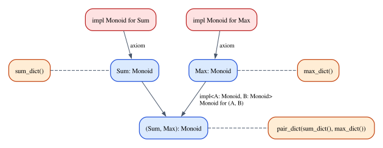

# Chapter 14 · Traits, Type Classes and Dictionary Passing

A generic function in Rust promises to work for every type, and Chapter 12
showed what that promise costs: a function `fn f<T>(x: T) -> T` cannot look
inside its argument, so it can do almost nothing with it. Most useful generic
code needs to do *something* with its values: compare them to sort a list, add
them up to compute a total, format them to write a log line. Rust's answer is
the trait bound. `fn largest<T: PartialOrd>(items: &[T])` still works for many
types, but no longer for all of them: only for those that come with a
comparison.

That small `: PartialOrd` is the subject of this chapter. In type theory a trait
is a **type class**, an idea that Haskell introduced at the end of the 1980s to
make *ad-hoc polymorphism*, functions that behave differently at different
types, as principled as the parametric kind. We will see how a type checker
reasons about type classes (instance resolution turns out to be proof search,
with a familiar Curry–Howard twist), how a compiler implements them (by passing
*dictionaries* of functions, which Rust then optimizes away), why Rust insists
that every instance be unique, and what a trait cannot say at all: that its
methods obey laws. Lean, whose classes can carry proofs, will say it for us.

**In this chapter you will learn:**

- the difference between parametric and ad-hoc polymorphism, and how type
  classes make the second one principled;
- the typing rules for constrained types, and why instance resolution is proof
  search whose proofs are dictionaries;
- how a trait bound is elaborated into an extra argument, with the same Rust
  program written both ways;
- what coherence is, why Rust enforces it with the orphan rule and the ban on
  overlapping impls, and how Lean does without it;
- associated types versus type parameters, supertraits and default methods, in
  Rust and in Lean (`outParam`, `extends`);
- why laws matter, how Rust can only test them on samples, and how a Lean class
  makes every instance prove them;
- how Lean's classes work: structures, instance arguments, `inferInstance`,
  local instances and priorities, `Decidable`, `Inhabited`, and Mathlib's
  `Monoid`.

## Two kinds of polymorphism

The word *polymorphism* means "many shapes": one piece of code that works at
many types. Christopher Strachey, in lecture notes from 1967, distinguished two
kinds, and his terms are still the standard ones.

**Parametric polymorphism** is the kind you studied in Chapter 12. A parametric
function works *uniformly* at every type: the same code runs whatever the type
is, and it cannot tell which type it got. `fn swap<A, B>((a, b): (A, B)) -> (B, A)`
and `Vec::len` are parametric. In System F their types begin with $\forall$.

**Ad-hoc polymorphism** is one name with *different* code at different types.
The `+` in `2 + 3` and the `+` in `2.5 + 0.5` are different machine
instructions, and `+` on `String` allocates memory. `==`, `to_string` and
`clone` are the same kind of thing: an operation that exists at many types, but
that each type implements in its own way.

Ad-hoc polymorphism is older than its theory. Many languages resolve
overloading at each call site: the compiler sees `x + y` with `x: f64` and picks
the floating-point addition. That works for a single call but does not compose:
you cannot write a function `sum_all` that works "for every type with a `+`",
because inside `sum_all` the type is not known, and there is nothing to resolve
the `+` against.

In 1989, Philip Wadler and Stephen Blott proposed a principled solution, in a
paper with the memorable title "How to make ad-hoc polymorphism less ad hoc",
and Haskell adopted it. The idea has three parts:

1. A **class** names a set of operations with their types: "a type $\alpha$ is a
   `Monoid` if it has an `empty` of type $\alpha$ and a `combine` of type
   $\alpha \to \alpha \to \alpha$".
2. An **instance** declares that a particular type belongs to the class, and
   gives the operations.
3. A polymorphic type may **quantify over the types in a class**:
   $\forall\alpha.\ \mathsf{Monoid}\ \alpha \Rightarrow \mathrm{Vec}\ \alpha \to \alpha$,
   "for every type $\alpha$ that is a monoid, a function from vectors of
   $\alpha$ to $\alpha$".

A Rust trait is a class, an `impl` is an instance, and a bound `M: Monoid` is
the constraint $\mathsf{Monoid}\ M \Rightarrow$. Chapter 12 described bounds as
*bounded quantification*; this chapter looks at what a bound means and how it
is implemented.

### A monoid trait

Our running example is the **monoid**, the simplest algebraic structure that
earns its keep in programs. A monoid is a type with a neutral element and an
associative operation: numbers with `+` and `0`, numbers with `*` and `1`,
strings with concatenation and `""`, vectors with `extend` and `vec![]`, and, as
we will see at the end of the chapter, summary statistics with "merge". The
full program is in `code/rust/examples/ch14_dictionary_passing.rs`.

```rust
/// A monoid: a type with a neutral element and an associative operation.
///
/// Laws (stated here in prose, because Rust has no way to state them in code):
/// - associativity: `a.combine(b).combine(c) == a.combine(b.combine(c))`
/// - identity: `M::empty().combine(a) == a == a.combine(M::empty())`
trait Monoid {
    fn empty() -> Self;
    fn combine(self, other: Self) -> Self;
}
```

Two details deserve attention. `empty` has no `self` parameter: it is not
called *on* a value but *at* a type, as `M::empty()`. Interfaces in
object-oriented languages cannot express this, since a method there is always
dispatched on the object it is called on; type classes can, because the
instance is chosen by a type, wherever that type comes from. And the doc
comment states laws that the trait itself does not mention. We will come back
to them.

Integers form a monoid in more than one way, and a type can implement a trait
only once (the section on coherence explains why). So each monoid structure on
`i64` gets its own *newtype*, a one-field struct whose only job is to select an
instance:

```rust
/// `i64` has (at least) two monoid structures, addition and multiplication.
/// A type can implement a trait only once, so each structure gets a newtype.
#[derive(Clone, Copy, Debug, PartialEq)]
struct Sum(i64);

#[derive(Clone, Copy, Debug, PartialEq)]
struct Product(i64);

#[derive(Clone, Copy, Debug, PartialEq)]
struct Max(i64);
```

```rust
impl Monoid for Sum {
    fn empty() -> Self {
        Sum(0)
    }
    fn combine(self, other: Self) -> Self {
        Sum(self.0 + other.0)
    }
}

impl Monoid for Product {
    fn empty() -> Self {
        Product(1)
    }
    fn combine(self, other: Self) -> Self {
        Product(self.0 * other.0)
    }
}

impl Monoid for Max {
    fn empty() -> Self {
        Max(i64::MIN)
    }
    fn combine(self, other: Self) -> Self {
        Max(self.0.max(other.0))
    }
}

impl Monoid for String {
    fn empty() -> Self {
        String::new()
    }
    fn combine(mut self, other: Self) -> Self {
        self.push_str(&other);
        self
    }
}

impl<T> Monoid for Vec<T> {
    fn empty() -> Self {
        Vec::new()
    }
    fn combine(mut self, other: Self) -> Self {
        self.extend(other);
        self
    }
}
```

The instance for pairs is different from the others: it has a *context*. A pair
is a monoid if both components are, and its operations are built from theirs:

```rust
/// An instance with a context: a pair is a monoid *if* both components are.
impl<A: Monoid, B: Monoid> Monoid for (A, B) {
    fn empty() -> Self {
        (A::empty(), B::empty())
    }
    fn combine(self, other: Self) -> Self {
        (self.0.combine(other.0), self.1.combine(other.1))
    }
}
```

Read its first line as a rule: "for all `A` and `B`, if `A: Monoid` and
`B: Monoid`, then `(A, B): Monoid`". Inside the body, `A::empty()` and
`self.0.combine(other.0)` use the instances for `A` and `B`, whatever they turn
out to be.

Now the generic code:

```rust
/// Combine all the items, left to right. Works for every monoid `M`.
fn mconcat<M: Monoid>(items: Vec<M>) -> M {
    let mut acc = M::empty();
    for item in items {
        acc = acc.combine(item);
    }
    acc
}

/// Combine each batch, then combine the batch results. A generic function
/// that calls another generic function at the same type.
fn mconcat_batches<M: Monoid>(batches: Vec<Vec<M>>) -> M {
    let partials: Vec<M> = batches.into_iter().map(mconcat).collect();
    mconcat(partials)
}
```

Inside `mconcat`, `M` is as abstract as any type parameter in Chapter 12, with
one difference: the bound gives the body two operations on `M`, `M::empty()`
and `combine`. Nothing else is known about `M`. The function cannot print an
`M` or compare two of them.

## Typing rules for type classes

Let us write down rules for this, as we have for every other feature so far. As
always, the rules are a *model* of what rustc does: rustc's trait solver
handles much more (lifetimes, associated types, auto traits, negative
reasoning), but the core is the following system, which follows Mark Jones's
theory of *qualified types*.

### Constraints and entailment

A **constraint** $\pi$ is a statement about types, such as
$\mathsf{Monoid}\ \mathtt{Sum}$ or $\mathsf{Monoid}\ \alpha$. A type may be
**qualified** by a constraint, $\pi \Rightarrow \tau$, and a polymorphic type may
quantify over a qualified one. The type of `mconcat` is

$$
\mathit{mconcat} : \forall\alpha.\ \mathsf{Monoid}\ \alpha \Rightarrow \mathrm{Vec}\ \alpha \to \alpha
$$

and the class declaration gives each method a qualified type too:

$$
\mathit{empty} : \forall\alpha.\ \mathsf{Monoid}\ \alpha \Rightarrow \alpha
\qquad\qquad
\mathit{combine} : \forall\alpha.\ \mathsf{Monoid}\ \alpha \Rightarrow \alpha \to \alpha \to \alpha
$$

Whether a constraint holds is decided by a second judgment, **entailment**,
written $P \Vdash \pi$: "from the constraints $P$ that we assume, the
constraint $\pi$ follows". Each instance declaration becomes a rule of
entailment. An instance without a context is an axiom; an instance with a
context is a rule with premises:

$$
\dfrac{}{P \Vdash \mathsf{Monoid}\ \mathtt{Sum}}\;\textsf{E-Sum}
\qquad\qquad
\dfrac{}{P \Vdash \mathsf{Monoid}\ \mathtt{Max}}\;\textsf{E-Max}
$$

$$
\dfrac{P \Vdash \mathsf{Monoid}\ \alpha \qquad P \Vdash \mathsf{Monoid}\ \beta}{P \Vdash \mathsf{Monoid}\ (\alpha \times \beta)}\;\textsf{E-Pair}
\qquad\qquad
\dfrac{\pi \in P}{P \Vdash \pi}\;\textsf{E-Assume}
$$

The last rule says that an assumed constraint holds. It is what a generic
function's body relies on: inside `mconcat`, $P$ contains
$\mathsf{Monoid}\ M$, and that is why the body may call `M::empty()`.

### Typing with constraints

The typing judgment now carries the assumed constraints as well:
$P \mid \Gamma \vdash e : \tau$. Two rules connect it with entailment. The
first *uses* a qualified type, by choosing the type and discharging the
constraint:

$$
\dfrac{P \mid \Gamma \vdash e : \forall\alpha.\ \pi \Rightarrow \tau \qquad P \Vdash \pi[\alpha := \sigma]}{P \mid \Gamma \vdash e : \tau[\alpha := \sigma]}\;\textsf{T-Inst}
$$

The second *introduces* one, when a generic function is defined:

$$
\dfrac{P, \pi \mid \Gamma \vdash e : \tau \qquad \alpha \text{ not free in } P \text{ or } \Gamma}{P \mid \Gamma \vdash e : \forall\alpha.\ \pi \Rightarrow \tau}\;\textsf{T-Gen}
$$

Rule T-Gen is the type-class version of the type abstraction rule of Chapter 12:
to show that the body of `mconcat` has type $\mathrm{Vec}\ \alpha \to \alpha$ for
every monoid $\alpha$, check it with $\mathsf{Monoid}\ \alpha$ added to the
assumptions. Rule T-Inst is what happens at a call. When `main` calls
`mconcat(stats)` with `stats: Vec<(Sum, Max)>`, the checker instantiates
$\alpha := \mathtt{Sum} \times \mathtt{Max}$ and must establish the premise
$\Vdash \mathsf{Monoid}\ (\mathtt{Sum} \times \mathtt{Max})$, by a derivation:

$$
\dfrac{\dfrac{}{\Vdash \mathsf{Monoid}\ \mathtt{Sum}}\;\textsf{E-Sum} \qquad \dfrac{}{\Vdash \mathsf{Monoid}\ \mathtt{Max}}\;\textsf{E-Max}}{\Vdash \mathsf{Monoid}\ (\mathtt{Sum} \times \mathtt{Max})}\;\textsf{E-Pair}
$$

### Instance resolution is proof search

Look at the entailment rules again. Each has a conclusion and some premises, all
of them simple statements about types. Logicians call rules of this shape
**Horn clauses**, and they are exactly what a Prolog program is made of. Finding
a derivation for a goal such as $\mathsf{Monoid}\ (\mathtt{Sum} \times \mathtt{Max})$
works the way Prolog works: find a rule whose conclusion matches the goal (here
E-Pair, with $\alpha := \mathtt{Sum}$ and $\beta := \mathtt{Max}$), then solve
its premises as new goals, recursively. This process is called **instance
resolution**. rustc's trait solver, the constraint solver of Haskell's main
compiler GHC, and Lean's instance synthesizer are all, at heart, proof-search
engines of this kind.

When the search fails, there is no derivation, and the program is rejected.
Here is a call at a type with no instance
(`code/rust/compile_fail/ch14_no_instance.rs`):

```rust
fn all_ready(flags: Vec<bool>) -> bool {
    mconcat(flags)
}
```

```text
error[E0277]: the trait bound `bool: Monoid` is not satisfied
  --> compile_fail/ch14_no_instance.rs:16:13
   |
16 |     mconcat(flags)
   |     ------- ^^^^^ the trait `Monoid` is not implemented for `bool`
   |     |
   |     required by a bound introduced by this call
   |
help: this trait has no implementations, consider adding one
  --> compile_fail/ch14_no_instance.rs:5:1
   |
 5 | trait Monoid {
   | ^^^^^^^^^^^^
note: required by a bound in `mconcat`
  --> compile_fail/ch14_no_instance.rs:10:15
   |
10 | fn mconcat<M: Monoid>(items: Vec<M>) -> M {
   |               ^^^^^^ required by this bound in `mconcat`
```

Every part of the message has a place in the rules. "The trait bound
`bool: Monoid` is not satisfied" says that $\Vdash \mathsf{Monoid}\ \mathtt{bool}$
has no derivation. "Required by a bound introduced by this call" points at the
use of rule T-Inst whose second premise failed. And "this trait has no
implementations" tells you that there are no rules at all whose conclusion has
the form $\mathsf{Monoid}\ \ldots$, so the search had nothing to try.

## Dictionary passing

The rules tell us *whether* a program is well typed. A compiler also needs to
know what the program *does*. Inside `mconcat` the type `M` is unknown, so what
code should `M::empty()` run? Wadler and Blott's answer, which is still how
type classes are explained (and, in Haskell and Lean, implemented), is a
translation called **dictionary passing**. It turns a program with classes into
an ordinary program without them:

| With classes | After the translation |
|---|---|
| a class (`trait Monoid`) | a record type, one field per method |
| an instance (`impl Monoid for Sum`) | a record value |
| an instance with a context | a function from records to a record |
| a constraint in a signature (`M: Monoid`) | an extra parameter |
| a method call (`M::empty()`) | a field access |
| a call of a constrained function | a call that passes the record found by resolution |

The record is called a **dictionary** because it is a lookup table: given the
name of a method, it returns that method's implementation for one particular
type. Let us carry out the translation by hand, in the second half of
`ch14_dictionary_passing.rs`. No trait appears in that half of the file.

### The class becomes a struct

```rust
/// The class `Monoid`, as a record type: one field per method.
struct MonoidDict<M> {
    empty: Box<dyn Fn() -> M>,
    combine: Box<dyn Fn(M, M) -> M>,
}
```

One field per method. The fields hold closures behind `Box<dyn Fn>`
(Chapter 8), for a reason we will see in a moment.

### Instances become values

```rust
/// The instance `impl Monoid for Sum`, as a value.
fn sum_dict() -> MonoidDict<Sum> {
    MonoidDict {
        empty: Box::new(|| Sum(0)),
        combine: Box::new(|a, b| Sum(a.0 + b.0)),
    }
}

fn product_dict() -> MonoidDict<Product> {
    MonoidDict {
        empty: Box::new(|| Product(1)),
        combine: Box::new(|a, b| Product(a.0 * b.0)),
    }
}

fn max_dict() -> MonoidDict<Max> {
    MonoidDict {
        empty: Box::new(|| Max(i64::MIN)),
        combine: Box::new(|a, b| Max(a.0.max(b.0))),
    }
}

fn string_dict() -> MonoidDict<String> {
    MonoidDict {
        empty: Box::new(String::new),
        combine: Box::new(|mut a, b| {
            a.push_str(&b);
            a
        }),
    }
}

/// `impl<T> Monoid for Vec<T>` is generic, so its dictionary is built by a
/// generic function: one dictionary per element type.
fn vec_dict<T: 'static>() -> MonoidDict<Vec<T>> {
    MonoidDict {
        empty: Box::new(Vec::new),
        combine: Box::new(|mut a, b| {
            a.extend(b);
            a
        }),
    }
}
```

Each instance is now a function that builds its dictionary, and the closures
are the bodies of the methods in the `impl` blocks, nearly character for
character. The generic instance `impl<T> Monoid for Vec<T>` became a generic
function `vec_dict<T>`, which builds one dictionary for each element type. The
bound `T: 'static` says that `T` contains no short-lived references, which a
`Box<dyn Fn>` requires by default (Chapter 15 explains the `+ 'static` hidden in
`Box<dyn Trait>`).

### An instance with a context becomes a function on dictionaries

```rust
/// The instance with a context, `impl<A: Monoid, B: Monoid> Monoid for (A, B)`,
/// becomes a function from dictionaries to a dictionary.
fn pair_dict<A: 'static, B: 'static>(
    da: MonoidDict<A>,
    db: MonoidDict<B>,
) -> MonoidDict<(A, B)> {
    // Move each field of the two dictionaries into the closure that needs it.
    let (empty_a, combine_a) = (da.empty, da.combine);
    let (empty_b, combine_b) = (db.empty, db.combine);
    MonoidDict {
        empty: Box::new(move || (empty_a(), empty_b())),
        combine: Box::new(move |(a1, b1), (a2, b2)| {
            (combine_a(a1, a2), combine_b(b1, b2))
        }),
    }
}
```

This is the most instructive part of the translation. The instance for pairs
had a context, `A: Monoid, B: Monoid`. After the translation the context is two
parameters, the dictionaries for `A` and `B`, and the result is the dictionary
for `(A, B)`. Its closures *capture* the functions of the component
dictionaries, which is why the fields of `MonoidDict` must be able to hold
capturing closures and not only plain `fn` pointers. In logical terms, rule
E-Pair is an implication ("if $\alpha$ and $\beta$ are monoids, so is
$\alpha \times \beta$"), and its translation is a function from evidence to
evidence: Curry–Howard again.

### Constraints become parameters

```rust
/// `mconcat`, translated: the bound `M: Monoid` became the parameter `dict`.
fn mconcat_dict<M>(dict: &MonoidDict<M>, items: Vec<M>) -> M {
    let mut acc = (dict.empty)();
    for item in items {
        acc = (dict.combine)(acc, item);
    }
    acc
}

/// `mconcat_batches`, translated: the dictionary it received is passed on to
/// the functions it calls.
fn mconcat_batches_dict<M>(dict: &MonoidDict<M>, batches: Vec<Vec<M>>) -> M {
    let partials: Vec<M> = batches
        .into_iter()
        .map(|batch| mconcat_dict(dict, batch))
        .collect();
    mconcat_dict(dict, partials)
}
```

Compare `mconcat_dict` with `mconcat` line by line: `M::empty()` became
`(dict.empty)()`, `acc.combine(item)` became `(dict.combine)(acc, item)`, and
the bound `M: Monoid` became the parameter `dict`. (The parentheses in
`(dict.empty)()` tell Rust to call the function stored in the field, rather
than look for a method named `empty`.) The second function shows what happens
when one constrained function calls another: `mconcat_batches_dict` has a
dictionary for `M`, its own parameter, and passes it on. In the rules, that is
E-Assume: the constraint is in $P$ because it was assumed, and the evidence for
it is the variable `dict`.

### The two programs agree

The `main` function runs every computation both ways, with the trait and with
explicit dictionaries, and asserts that the results are equal:

```rust
let readings = [3, 1, 4, 1, 5];

let sums: Vec<Sum> = readings.iter().map(|&n| Sum(n)).collect();
report(
    "Sum",
    mconcat(sums.clone()),
    mconcat_dict(&sum_dict(), sums),
);

let products: Vec<Product> = readings.iter().map(|&n| Product(n)).collect();
report(
    "Product",
    mconcat(products.clone()),
    mconcat_dict(&product_dict(), products),
);

let words = vec!["dictionary".to_string(), "-".into(), "passing".into()];
report(
    "String",
    mconcat(words.clone()),
    mconcat_dict(&string_dict(), words),
);

let lists = vec![vec![1, 2], vec![], vec![3]];
report(
    "Vec<i32>",
    mconcat(lists.clone()),
    mconcat_dict(&vec_dict(), lists),
);

// The pair instance: total and maximum in one pass.
let stats: Vec<(Sum, Max)> = readings.iter().map(|&n| (Sum(n), Max(n))).collect();
report(
    "(Sum, Max)",
    mconcat(stats.clone()),
    mconcat_dict(&pair_dict(sum_dict(), max_dict()), stats),
);

// A generic function that calls another generic function.
let batches = vec![vec![Sum(3), Sum(1)], vec![Sum(4)], vec![Sum(1), Sum(5)]];
report(
    "batches of Sum",
    mconcat_batches(batches.clone()),
    mconcat_batches_dict(&sum_dict(), batches),
);
```

```text
Sum                trait: Sum(14)                dict: Sum(14)
Product            trait: Product(60)            dict: Product(60)
String             trait: "dictionary-passing"   dict: "dictionary-passing"
Vec<i32>           trait: [1, 2, 3]              dict: [1, 2, 3]
(Sum, Max)         trait: (Sum(14), Max(5))      dict: (Sum(14), Max(5))
batches of Sum     trait: Sum(14)                dict: Sum(14)
empty (Sum, Prod)  trait: (Sum(0), Product(1))   dict: (Sum(0), Product(1))
```

The last line comes from a call on an empty vector, where both versions return
the neutral element. Look at the `(Sum, Max)` call: where the trait version says
`mconcat(stats.clone())`, the dictionary version says
`mconcat_dict(&pair_dict(sum_dict(), max_dict()), stats)`. The expression
`pair_dict(sum_dict(), max_dict())` is the derivation of
$\mathsf{Monoid}\ (\mathtt{Sum} \times \mathtt{Max})$ that we wrote above, with
each rule replaced by the function that implements it: E-Pair by `pair_dict`,
E-Sum by `sum_dict`, E-Max by `max_dict`.



This is the central idea of the chapter, so let us state it plainly.
**Constraints are propositions, instances are axioms and implications,
resolution is proof search, and the dictionary is the proof.** The elaborated
program passes proofs around at run time, and these proofs are useful: they
contain the code.

We can make the evidence part of the rules. Write $P \Vdash d : \pi$ for "$d$ is
evidence for $\pi$", where $P$ now gives a name to each assumed constraint
($\mathit{dict} : \mathsf{Monoid}\ \alpha$). Rule E-Pair becomes:

$$
\dfrac{P \Vdash d_1 : \mathsf{Monoid}\ \alpha \qquad P \Vdash d_2 : \mathsf{Monoid}\ \beta}{P \Vdash \mathtt{pair\_dict}(d_1, d_2) : \mathsf{Monoid}\ (\alpha \times \beta)}\;\textsf{E-Pair}
$$

Rule T-Inst then translates a use of a constrained function into an
application of it to the evidence, and rule T-Gen translates a generic
definition into a function that takes the evidence as a parameter. That
translation, from a derivation in the system with classes to a program in a
language without them, is called **elaboration**, and producing it is the job
of a type checker for type classes.

### What rustc actually does

If you compiled `mconcat` exactly as `mconcat_dict`, every `combine` would be an
indirect call through a pointer, and every dictionary would be a heap
allocation. Rust does not do that. It **monomorphizes** generic functions
(Chapter 12): for each type at which `mconcat` is used, it compiles a separate
copy, `mconcat::<Sum>`, `mconcat::<String>`, and so on. In each copy the
dictionary is a constant known at compile time, so `(dict.combine)(acc, item)`
becomes a direct call to `<Sum as Monoid>::combine`, which can then be inlined
down to a single machine addition. You can think of monomorphization as
dictionary passing followed by specialization: the dictionary argument is
evaluated at compile time, and disappears.

Haskell and Lean take the other route: their compiled code passes dictionaries
at run time, as `mconcat_dict` does, and their optimizers specialize calls when
it pays off. Chapter 12 described the trade-off.

There is one place where Rust keeps a dictionary at run time: the **trait
object**. A `Box<dyn Trait>` is a pointer to a value together with a pointer to
the dictionary for that value's type, which Rust calls a *vtable*. The
difference from our `MonoidDict` is where the dictionary travels. In dictionary
passing it is an argument of the *function*; in a trait object it is attached
to the *value*, so that values of different types, each with its own
dictionary, can sit in the same `Vec`. That is the subject of Chapter 15, which
also explains why `dyn Monoid` is impossible (hint: `empty` has no value to
carry a vtable).

## Coherence

Dictionary passing defines the meaning of a program through the derivations of
its constraints. What if a constraint has two derivations, with different
dictionaries? Then the meaning of the program depends on which derivation the
compiler happened to find. A type-class system is **coherent** when this cannot
happen: all the derivations of a judgment elaborate to programs with the same
behavior. The simplest way to guarantee it, and the one Rust chooses, is to
make sure that two instance rules never apply to the same constraint. Rust
enforces this with two restrictions.

### No overlapping impls

The first restriction is that two impls of a trait may not apply to the same
type. The instance for `(A, B)` and a separate instance for `(Sum, Max)` would
overlap, since the first also covers `(Sum, Max)`. The most common way to run
into this is a **blanket impl**, an impl for every type that satisfies some
bound. The file `code/rust/examples/ch14_trait_features.rs` has one:

```rust
/// A blanket impl: *every* type that implements `Display` gets `Log`.
/// As an instance declaration: for all T, Display T implies Log T.
trait Log {
    fn log_line(&self) -> String;
}

impl<T: Display> Log for T {
    fn log_line(&self) -> String {
        format!("[log] {self}")
    }
}
```

As a rule, it reads $\mathsf{Display}\ \alpha \Rightarrow \mathsf{Log}\ \alpha$
for *every* $\alpha$, so it gives `Log` to every type that can be displayed,
including types defined later and in other crates:

```rust
// `Log` was never implemented for these types by name: the blanket impl
// covers every `Display` type, from the standard library's or ours.
println!("{}", 42.log_line());
println!("{}", "door opened".log_line());
println!("{}", Celsius(-18.0).log_line());
```

```text
[log] 42
[log] door opened
[log] -18.0 °C
```

The standard library uses the same pattern: it has an
`impl<T: Display + ?Sized> ToString for T`, which is why every type you can
format with `{}` has a `to_string` method. But a blanket impl claims a lot of
territory. Adding a special case for `i32` (`code/rust/compile_fail/ch14_overlap.rs`)
is rejected:

```rust
trait Log {
    fn log_line(&self) -> String;
}

impl<T: Display> Log for T {
    fn log_line(&self) -> String {
        format!("[log] {self}")
    }
}

impl Log for i32 {
    fn log_line(&self) -> String {
        format!("[log] the number {self}")
    }
}
```

```text
error[E0119]: conflicting implementations of trait `Log` for type `i32`
  --> compile_fail/ch14_overlap.rs:18:1
   |
12 | impl<T: Display> Log for T {
   | -------------------------- first implementation here
...
18 | impl Log for i32 {
   | ^^^^^^^^^^^^^^^^ conflicting implementation for `i32`
```

Both rules conclude $\mathsf{Log}\ \mathtt{i32}$ (the first because
`i32: Display`), with different code, so a call `42.log_line()` would have two
meanings.

Some languages allow overlapping instances and resolve them by choosing the
most specific one. Rust has such a feature, called **specialization**, but it is
unstable: it has been available only on nightly compilers for years, because
in its general form it interacts unsoundly with lifetimes, which the compiler
erases before it generates code. It is worth knowing that it exists, and that
the standard library uses a restricted form internally; it is not part of the
language you can use, and if it matters to you, check its current status.

### The orphan rule

Forbidding overlap within one crate is not enough. Suppose two independent
crates each implement `Display` for `Vec<u8>`. Each compiles on its own, since
each sees only one impl; but a program that depends on both would have two
instances, and no single crate would be at fault. Rust prevents this situation
from arising with the **orphan rule**: an impl must be written in the crate
that defines the trait or in a crate that defines the type. (More precisely, a
local type must appear in the right position among the impl's types; the Rust
Reference has the full rule.) An impl in neither is an *orphan*:

```rust
impl fmt::Display for Vec<u8> {
    fn fmt(&self, f: &mut fmt::Formatter) -> fmt::Result {
        write!(f, "{} bytes", self.len())
    }
}
```

```text
error[E0117]: only traits defined in the current crate can be implemented for types defined outside of the crate
 --> compile_fail/ch14_orphan.rs:8:1
  |
8 | impl fmt::Display for Vec<u8> {
  | ^^^^^^^^^^^^^^^^^^^^^^-------
  |                       |
  |                       `Vec` is not defined in the current crate
  |
  = note: impl doesn't have any local type before any uncovered type parameters
  = note: for more information see https://doc.rust-lang.org/reference/items/implementations.html#orphan-rules
  = note: define and implement a trait or new type instead
```

The orphan rule makes coherence a *local* property: for any trait and type,
only the crates that own one of them can provide an impl, and those crates can
see each other, so the compiler can check for overlap where the impl is written.
The price is the one the last note of the diagnostic suggests. To give a
foreign type a foreign trait, you wrap the type in a newtype of your own. That
is the same move as `Sum` and `Product`: in a coherent system, a newtype is how
you say "this type, but with a different instance".

### Lean chooses differently

Lean does not enforce coherence. You may declare as many instances of a class
for a type as you like; resolution tries them in order of priority and, among
instances of equal priority, the most recent first. The file
`code/lean/Book/Ch14/Dictionaries.lean` builds on `Monoid.lean`, which (as we
will see in the section on laws) defines a `Monoid` class and an instance for
`Nat` with addition:

```lean
section Multiplication

/-- A second `Monoid Nat` instance, visible only until the end of this
section. Lean accepts it; Rust would reject it (E0119). -/
local instance natMul : Monoid Nat where
  empty := 1
  combine a b := a * b

-- The most recently declared instance wins: the same expression as above
-- now means a product.
/-- info: 24 -/
#guard_msgs in
#eval mconcat [2, 3, 4]

end Multiplication

-- After the section, the local instance is gone.
/-- info: 9 -/
#guard_msgs in
#eval mconcat [2, 3, 4]

section Priorities

/-- A low-priority instance is tried only after the default-priority ones. -/
local instance (priority := low) natMax : Monoid Nat where
  empty := 0
  combine a b := max a b

/-- info: 9 -/
#guard_msgs in
#eval mconcat [2, 3, 4]

end Priorities

-- `letI` adds an instance for a single expression.
/-- info: 4 -/
#guard_msgs in
#eval
  letI : Monoid Nat := ⟨0, max⟩
  mconcat [2, 3, 4]
```

The same expression, `mconcat [2, 3, 4]`, evaluates to `9` with the addition
instance and to `24` inside the section that declares the multiplication
instance `natMul`; the keyword `local` makes that instance disappear at the end
of the section. An instance with lower priority (`natMax`) does not displace
the default one, and `letI` installs an instance for a single expression. Rust
would have rejected `natMul` with E0119.

Lean leaves coherence to convention: Mathlib keeps one canonical instance per
structure and type, and when two chains of instances lead to the same class (a
"diamond"), it makes them equal by definition, so that it does not matter which
one resolution finds. In your own Lean code, that is your job. Rust, which must
make guarantees about programs written by many people who never coordinate,
made coherence a rule of the language.

## Associated types, supertraits and default methods

Three more features complete the toolbox. Each has a reading in terms of
dictionaries, and a counterpart in Lean.

### Type parameters and associated types

A trait can have type parameters of its own. Then it describes a *relation*
between types, and a type can implement it several times, once for each value
of the parameter:

```rust
/// A trait with a type parameter: a *relation* between two types. One type
/// may implement it many times, once for each target.
trait ConvertTo<Target> {
    fn convert(&self) -> Target;
}

impl ConvertTo<Fahrenheit> for Celsius {
    fn convert(&self) -> Fahrenheit {
        Fahrenheit(self.0 * 9.0 / 5.0 + 32.0)
    }
}

impl ConvertTo<Kelvin> for Celsius {
    fn convert(&self) -> Kelvin {
        Kelvin(self.0 + 273.15)
    }
}
```

Because `Celsius` implements `ConvertTo` twice, a call `c.convert()` is
ambiguous unless something says which target is meant. The program says it
with type annotations:

```rust
let c = Celsius(21.5);
// With a type parameter, the caller must say which instance it means:
// the *target* type selects the impl.
let f: Fahrenheit = c.convert();
let k: Kelvin = c.convert();
println!("{c} = {f:?} = {k:?}");
```

```text
21.5 °C = Fahrenheit(70.7) = Kelvin(294.65)
```

Without an annotation (`code/rust/compile_fail/ch14_ambiguous_target.rs`),
resolution finds two candidates and cannot choose:

```rust
fn show(c: &Celsius) {
    let t = c.convert();
}
```

```text
error[E0283]: type annotations needed
  --> compile_fail/ch14_ambiguous_target.rs:27:9
   |
27 |     let t = c.convert();
   |         ^     ------- type must be known at this point
   |
note: multiple `impl`s satisfying `Celsius: ConvertTo<_>` found
  --> compile_fail/ch14_ambiguous_target.rs:13:1
   |
13 | impl ConvertTo<Fahrenheit> for Celsius {
   | ^^^^^^^^^^^^^^^^^^^^^^^^^^^^^^^^^^^^^^
...
19 | impl ConvertTo<Kelvin> for Celsius {
   | ^^^^^^^^^^^^^^^^^^^^^^^^^^^^^^^^^^
help: consider giving `t` an explicit type
   |
27 |     let t: /* Type */ = c.convert();
   |          ++++++++++++
```

Notice how different this is from E0277. There, the search found no
derivation; here it found two possible ones, `Celsius: ConvertTo<Fahrenheit>`
and `Celsius: ConvertTo<Kelvin>`, and nothing in the program decides between
them.

An **associated type** is a type that each instance must define, and that the
implementing type therefore *determines*. Our sensors have one:

```rust
/// Every instrument has a name.
trait Device {
    fn name(&self) -> String;
}

/// A sensor is a device that produces readings. `Device` is a supertrait:
/// a type can implement `Sensor` only if it also implements `Device`.
trait Sensor: Device {
    /// An associated type: a *function* from sensor types to reading types.
    type Reading: Debug;

    fn read(&mut self) -> Self::Reading;

    /// A default method, written once in terms of the other methods (including
    /// the supertrait's `name`). Instances may use it or override it.
    fn report(&mut self) -> String {
        let reading = self.read();
        format!("{}: {reading:?}", self.name())
    }
}
```

```rust
/// Replays recorded temperatures.
struct Thermometer {
    label: String,
    recorded: Vec<Celsius>,
    next: usize,
}

impl Device for Thermometer {
    fn name(&self) -> String {
        self.label.clone()
    }
}

impl Sensor for Thermometer {
    type Reading = Celsius;
    fn read(&mut self) -> Celsius {
        let reading = self.recorded[self.next % self.recorded.len()];
        self.next += 1;
        reading
    }
    // `report` is not written here: the default is used.
}

/// A door switch that reads `true` when the door is open.
struct DoorSwitch {
    open: bool,
}

impl Device for DoorSwitch {
    fn name(&self) -> String {
        "lab door".to_string()
    }
}

impl Sensor for DoorSwitch {
    type Reading = bool;
    fn read(&mut self) -> bool {
        self.open
    }
    // This instance overrides the default method.
    fn report(&mut self) -> String {
        let state = if self.read() { "open" } else { "closed" };
        format!("{} is {state}", self.name())
    }
}
```

A `Thermometer` has readings of type `Celsius`, a `DoorSwitch` has readings of
type `bool`, and no type can have two reading types, because a type can
implement `Sensor` only once. Mathematically, `Reading` is a **function from
types to types**: $\mathsf{Reading}(\mathtt{Thermometer}) = \mathtt{Celsius}$.
Generic code can apply it, and can put bounds on its result:

```rust
/// Read `n` values. The return type mentions `S::Reading`, the value of the
/// type-level function `Reading` at `S`.
fn sample<S: Sensor>(sensor: &mut S, n: usize) -> Vec<S::Reading> {
    (0..n).map(|_| sensor.read()).collect()
}

/// A bound on the *result* of the type-level function: the readings must be
/// comparable (`PartialOrd`) and copyable.
fn peak<S>(sensor: &mut S, n: usize) -> Option<S::Reading>
where
    S: Sensor,
    S::Reading: PartialOrd + Copy,
{
    let readings = sample(sensor, n);
    let mut best = *readings.first()?;
    for &r in &readings {
        if r > best {
            best = r;
        }
    }
    Some(best)
}
```

The return type of `sample` is `Vec<S::Reading>`, the value of the type-level
function at `S`. The function `peak` additionally requires the readings to be
comparable and copyable. A trait with a type parameter could not do this:
`S::Reading` makes sense only because there is a single impl to read it from.

Haskell reached the same idea from the other side. Its classes may have several
parameters, and Mark Jones proposed **functional dependencies** to declare that
some parameters determine others: a class `Sensor s r | s -> r` says that `s`
determines `r`, which is exactly what an associated type says. Rust's `Add`
trait shows both kinds of parameter at once: in
`trait Add<Rhs = Self> { type Output; ... }`, the right operand `Rhs` is an
input (an `i32` can be added to an `i32` and to an `&i32`, two impls) and the
result `Output` is an output (once both operands are known, the result type is
fixed).

Lean expresses the same distinction with **`outParam`**, a marker on a class
parameter that says "resolution computes this one". Lean's own addition is
declared this way, with the result type `γ` as the output:

```lean
/--
info: @HAdd.hAdd : {α : Type u_1} → {β : Type u_2} → {γ : outParam (Type u_3)} → [self : HAdd α β γ] → α → β → γ
-/
#guard_msgs in
#check @HAdd.hAdd
```

The file `code/lean/Book/Ch14/Features.lean` defines a `Sensor` class both
ways:

```lean
/-- Sensors and their readings. `reading` is an *output* parameter: once the
sensor type is known, resolution determines the reading type, as an
associated type does in Rust. -/
class Sensor (σ : Type) (reading : outParam Type) where
  read : σ → reading

/-- The same class with an ordinary (input) parameter. -/
class Sensor' (σ : Type) (reading : Type) where
  read : σ → reading

structure Thermometer where
  tenths : Int

instance : Sensor Thermometer Int := ⟨fun t => t.tenths⟩
instance : Sensor' Thermometer Int := ⟨fun t => t.tenths⟩

def readTwice {σ r : Type} [Sensor σ r] (s : σ) : r × r :=
  (Sensor.read s, Sensor.read s)

def readTwice' {σ r : Type} [Sensor' σ r] (s : σ) : r × r :=
  (Sensor'.read s, Sensor'.read s)

/-- info: (215, 215) -/
#guard_msgs in
#eval readTwice (Thermometer.mk 215)
```

With `outParam`, `readTwice (Thermometer.mk 215)` works: resolution starts from
the known sensor type and finds the instance, and with it the reading type.
Without `outParam`, Lean refuses to start the search while one of the class's
arguments is still unknown:

```lean
/--
error: typeclass instance problem is stuck
  Sensor' Thermometer ?m.3

Note: Lean will not try to resolve this typeclass instance problem because the second type argument to `Sensor'` is a metavariable. This argument must be fully determined before Lean will try to resolve the typeclass.

Hint: Adding type annotations and supplying implicit arguments to functions can give Lean more information for typeclass resolution. For example, if you have a variable `x` that you intend to be a `Nat`, but Lean reports it as having an unresolved type like `?m`, replacing `x` with `(x : Nat)` can get typeclass resolution un-stuck.
-/
#guard_msgs in
#eval readTwice' (Thermometer.mk 215)

/-- info: (215, 215) -/
#guard_msgs in
#eval (readTwice' (Thermometer.mk 215) : Int × Int)
```

This is Lean's version of E0283, and the fix is the same: an annotation that
fixes the unknown type.

### Supertraits

The declaration `trait Sensor: Device` makes `Device` a **supertrait** of
`Sensor`: a type can implement `Sensor` only if it also implements `Device`, and
code that knows `S: Sensor` may call `name`. In the rules, a supertrait adds an
entailment rule that goes from the subclass to the superclass:

$$
\dfrac{P \Vdash \mathsf{Sensor}\ \alpha}{P \Vdash \mathsf{Device}\ \alpha}\;\textsf{E-Super}
$$

In the dictionary translation, the `Sensor` dictionary *contains* the `Device`
dictionary, so that the evidence for rule E-Super is a field access. The default
method `report` relies on this: it calls `self.name()`.

### Default methods

A **default method** is written once, in the trait, in terms of the other
methods. `Thermometer` uses the default `report`; `DoorSwitch` overrides it:

```rust
let mut fridge = thermometer();
let mut door = DoorSwitch { open: true };
println!("sample:  {:?}", sample(&mut fridge, 4));
println!("peak:    {:?}", peak(&mut fridge, 3));
println!("default: {:?}", report_twice(&mut fridge));
println!("custom:  {:?}", report_twice(&mut door));
```

```text
sample:  [Celsius(4.5), Celsius(5.0), Celsius(3.5), Celsius(4.5)]
peak:    Some(Celsius(5.0))
default: ["fridge: Celsius(5.0)", "fridge: Celsius(3.5)"]
custom:  ["lab door is open", "lab door is open"]
```

(The thermometer replays its three recorded temperatures in a cycle, so
successive reads differ.) The standard library's `Iterator` is the extreme
case: it has one required method, `next`, and dozens of default ones (`map`,
`filter`, `sum`, `collect` and many more) written in terms of `next`.

Here is the translation of all three features into dictionaries, from the same
file:

```rust
/// The dictionary of `Device`.
struct DeviceDict<T> {
    name: fn(&T) -> String,
}

/// The dictionary of `Sensor`. The supertrait's dictionary is a field, the
/// associated type is a type parameter fixed by the instance, and the default
/// method is a field like any other.
struct SensorDict<T, R> {
    device: DeviceDict<T>,
    read: fn(&mut T) -> R,
    report: fn(&SensorDict<T, R>, &mut T) -> String,
}

/// The default method, translated: a function that receives the dictionary
/// it belongs to, so that it can call the other methods.
fn default_report<T, R: Debug>(dict: &SensorDict<T, R>, sensor: &mut T) -> String {
    let reading = (dict.read)(sensor);
    format!("{}: {reading:?}", (dict.device.name)(sensor))
}

/// `impl Sensor for Thermometer` uses the default `report`...
fn thermometer_dict() -> SensorDict<Thermometer, Celsius> {
    SensorDict {
        device: DeviceDict {
            name: <Thermometer as Device>::name,
        },
        read: <Thermometer as Sensor>::read,
        report: default_report,
    }
}

/// ...while `impl Sensor for DoorSwitch` overrides it. The override does not
/// need the dictionary, so this field wraps it in a closure that ignores it.
fn door_dict() -> SensorDict<DoorSwitch, bool> {
    SensorDict {
        device: DeviceDict {
            name: <DoorSwitch as Device>::name,
        },
        read: <DoorSwitch as Sensor>::read,
        report: |_dict, door| <DoorSwitch as Sensor>::report(door),
    }
}

/// A generic function with a `Sensor` bound, translated.
fn report_twice_dict<T, R>(dict: &SensorDict<T, R>, sensor: &mut T) -> [String; 2] {
    [(dict.report)(dict, sensor), (dict.report)(dict, sensor)]
}
```

The supertrait's dictionary is the field `device`. The associated type became a
type parameter `R` of the dictionary, fixed by each instance
(`SensorDict<Thermometer, Celsius>`): the instance determines it, as a
functional dependency says. And a default method is a function that receives
*the dictionary it belongs to*, so that it can call the instance's other
methods: `default_report` reads `dict.read` and `dict.device.name`. An instance
that keeps the default stores `default_report` in its `report` field; an
instance that overrides it stores its own function. No closure here captures
anything, so plain `fn` pointers suffice. The two versions agree:

```rust
let (mut fridge_a, mut fridge_b) = (thermometer(), thermometer());
let with_trait = report_twice(&mut fridge_a);
let with_dict = report_twice_dict(&thermometer_dict(), &mut fridge_b);
assert_eq!(with_trait, with_dict);
let with_trait = report_twice(&mut DoorSwitch { open: false });
let with_dict = report_twice_dict(&door_dict(), &mut DoorSwitch { open: false });
assert_eq!(with_trait, with_dict);
println!("dictionary versions agree: {with_dict:?}");
```

```text
dictionary versions agree: ["lab door is closed", "lab door is closed"]
```

In Lean, a default method is a default value of a class field:

```lean
/-- A class with a default method: `describe` has a default implementation,
written in terms of `name`. -/
class Describe (α : Type) where
  name : α → String
  describe : α → String := fun x => s!"<{name x}>"

/-- This instance uses the default `describe`. -/
instance : Describe Nat where
  name n := s!"nat {n}"

/-- This instance overrides it. -/
instance : Describe Bool where
  name b := toString b
  describe b := if b then "yes" else "no"

/-- info: "<nat 5>" -/
#guard_msgs in
#eval Describe.describe (5 : Nat)

/-- info: "yes" -/
#guard_msgs in
#eval Describe.describe true
```

and a supertrait is written with `extends`, which we use for laws in a moment.

## Laws

The `Monoid` trait's documentation says that `combine` is associative and that
`empty` is neutral. Nothing in the trait enforces it. The compiler checks that
an instance supplies two functions of the right types and nothing more, so it
happily accepts these two instances (`code/rust/examples/ch14_laws.rs`):

```rust
/// Subtraction with 0 as the "neutral" element. The compiler accepts this
/// instance: the trait only asks for two functions of the right types.
#[derive(Clone, Copy, Debug, PartialEq)]
struct Diff(i64);

impl Monoid for Diff {
    fn empty() -> Self {
        Diff(0)
    }
    fn combine(self, other: Self) -> Self {
        Diff(self.0 - other.0)
    }
}

/// Floating-point addition: associative for real numbers, but not for `f64`,
/// because every addition rounds its result.
#[derive(Clone, Copy, Debug, PartialEq)]
struct FloatSum(f64);

impl Monoid for FloatSum {
    fn empty() -> Self {
        FloatSum(0.0)
    }
    fn combine(self, other: Self) -> Self {
        FloatSum(self.0 + other.0)
    }
}
```

Subtraction is not associative, and $0$ is neutral for it only on the right
($a - 0 = a$, but $0 - a \neq a$). Floating-point addition is more insidious:
every addition rounds its result, and the rounding errors depend on the order
of the additions.

### Why laws matter

Generic code relies on laws, usually without saying so. Here are two ways to
combine a list:

```rust
/// Left to right: ((e ⋄ x1) ⋄ x2) ⋄ ... ⋄ xn.
fn mconcat<M: Monoid>(items: Vec<M>) -> M {
    let mut acc = M::empty();
    for item in items {
        acc = acc.combine(item);
    }
    acc
}

/// Divide and conquer: split in halves, combine each half, combine the two
/// results. This is how a parallel reduction splits its work. It computes the
/// same value as `mconcat` exactly when the monoid laws hold.
fn mconcat_tree<M: Monoid>(mut items: Vec<M>) -> M {
    match items.len() {
        0 => M::empty(),
        1 => items.pop().unwrap(),
        n => {
            let right = items.split_off(n / 2);
            mconcat_tree(items).combine(mconcat_tree(right))
        }
    }
}
```

The tree-shaped fold splits the list in two halves, combines each half (in
parallel, in a real program) and combines the two results. That is how parallel
reductions and map-reduce systems divide their work, and it computes the same
value as the left-to-right fold *exactly when the monoid laws hold*:
associativity lets you move the parentheses, and the neutral element lets you
start each half from scratch. With an unlawful instance, the two folds
disagree:

```text
left fold vs tree fold:
  Sum       left: Sum(21)                       tree: Sum(21)
  Diff      left: Diff(-21)                     tree: Diff(-3)
  FloatSum  left: FloatSum(0.6000000000000001)  tree: FloatSum(0.6)
```

`Diff` computes $0 - 1 - 2 - \dots - 6 = -21$ one way and $-3$ the other.
`FloatSum` gives `0.6000000000000001` one way and `0.6` the other, a small
difference of the kind that makes a numerical result change with the number of
threads that computed it.

The standard library has the same problem, and handles it the same way, with
documentation. `Eq` promises that `==` is an equivalence relation (reflexive,
symmetric, transitive), `Ord` that `cmp` is a total order consistent with
`PartialOrd`, `Hash` that equal values have equal hashes. None of it is
checked. If you implement `Ord` inconsistently, `sort` and `BTreeMap` will
misbehave; the documentation of `BTreeMap` calls this a logic error whose
behavior is unspecified, but not undefined behavior. Safe code cannot break
memory safety this way, and `unsafe` code must not trust these laws, as
Chapter 32 discusses. The split between `PartialEq` and `Eq`, and between
`PartialOrd` and `Ord`, is itself a law written into the trait hierarchy: `Eq`
adds no new operations to `PartialEq`, only the promise that `==` is reflexive.
`f64` cannot make that promise (`NaN != NaN`), so it implements `PartialEq` but
not `Eq`.

### Testing laws in Rust

What Rust *can* do is test the laws, like any other property. This function
checks both identity laws on every sample and associativity on every triple of
samples:

```rust
/// Check the three monoid laws on every sample (identity) and on every
/// triple of samples (associativity). Returns the number of checks performed,
/// or a description of the first counterexample.
fn check_laws<M>(samples: &[M]) -> Result<usize, String>
where
    M: Monoid + Clone + PartialEq + Debug,
{
    let mut checks = 0;
    for a in samples {
        let left = M::empty().combine(a.clone());
        if left != *a {
            return Err(format!("left identity fails: empty ⋄ {a:?} = {left:?}"));
        }
        let right = a.clone().combine(M::empty());
        if right != *a {
            return Err(format!("right identity fails: {a:?} ⋄ empty = {right:?}"));
        }
        checks += 2;
    }
    for a in samples {
        for b in samples {
            for c in samples {
                let ab_c = a.clone().combine(b.clone()).combine(c.clone());
                let a_bc = a.clone().combine(b.clone().combine(c.clone()));
                if ab_c != a_bc {
                    return Err(format!(
                        "associativity fails for {a:?}, {b:?}, {c:?}\n\
                         (a ⋄ b) ⋄ c = {ab_c:?}, a ⋄ (b ⋄ c) = {a_bc:?}"
                    ));
                }
                checks += 1;
            }
        }
    }
    Ok(checks)
}
```

```rust
println!("law checks on samples:");
let ints = [-7, -1, 0, 1, 2, 3, 10];
print_check("Sum", &ints.map(Sum));
print_check("String", &["", "a", "bc", "def"].map(String::from));
print_check("Stats", &ints.map(Stats::of));
print_check("Diff", &ints.map(Diff));
print_check("FloatSum", &[0.1, 0.2, 0.3, 1.0e16].map(FloatSum));
```

```text
law checks on samples:
  Sum       ok (357 checks)
  String    ok (72 checks)
  Stats     ok (357 checks)
  Diff      FAILED: left identity fails: empty ⋄ Diff(-7) = Diff(7)
  FloatSum  FAILED: associativity fails for FloatSum(0.1), FloatSum(0.2), FloatSum(0.3)
            (a ⋄ b) ⋄ c = FloatSum(0.6000000000000001), a ⋄ (b ⋄ c) = FloatSum(0.6)
```

For seven integer samples the check performs $2 \cdot 7 + 7^3 = 357$
comparisons. It catches both broken instances: `Diff` fails left identity on
the first sample, since $0 - (-7) = 7$, and `FloatSum` fails associativity on
the first triple that exposes a rounding error. (`Stats` is the monoid of this
chapter's walkthrough.) This is the Rust way, and a good one, especially with a
property-testing library generating the samples. But it is evidence about 357
cases, not a proof about all of them.

### Laws as proof fields in Lean

In Lean a class is a structure (the next section looks at this closely), and a
structure may have fields whose types are propositions. The values of such
fields are proofs. That is all it takes to put laws into a class. The file
`code/lean/Book/Ch14/Monoid.lean` starts with the operations alone, the
counterpart of the Rust trait:

```lean
/-- A monoid, operations only: the counterpart of the Rust trait `Monoid`. -/
class Monoid (α : Type) where
  /-- The neutral element. -/
  empty : α
  /-- The operation. -/
  combine : α → α → α

/-- `a ⋄ b` is `Monoid.combine a b`. -/
scoped infixl:70 " ⋄ " => Monoid.combine
```

The `scoped infixl` line defines the notation `a ⋄ b` for `combine a b`,
available wherever the namespace `Ch14` is open; `infixl:70` makes it
left-associative, with the same precedence as `*`. This `Monoid` is our own
class, `Ch14.Monoid`. Mathlib has a different class with the same name, which
this file does not import, and which we will meet at the end of the chapter.
Next come instances, including one with a context, and the generic function,
which in Lean is most natural as a fold from the right:

```lean
instance instMonoidNat : Monoid Nat where
  empty := 0
  combine a b := a + b

instance instMonoidString : Monoid String where
  empty := ""
  combine a b := a ++ b

instance instMonoidList {α : Type} : Monoid (List α) where
  empty := []
  combine xs ys := xs ++ ys

/-- An instance with a context: a pair is a monoid if both components are. -/
instance instMonoidProd {α β : Type} [Monoid α] [Monoid β] : Monoid (α × β) where
  empty := (empty, empty)
  combine p q := (p.1 ⋄ q.1, p.2 ⋄ q.2)
```

```lean
/-- Combine all the elements of a list: `x₁ ⋄ (x₂ ⋄ (... ⋄ empty))`. -/
def mconcat {α : Type} [Monoid α] : List α → α
  | [] => empty
  | x :: xs => x ⋄ mconcat xs
```

```lean
/-- info: 14 -/
#guard_msgs in
#eval mconcat [3, 1, 4, 1, 5]

/-- info: "dictionary-passing" -/
#guard_msgs in
#eval mconcat ["dictionary", "-", "passing"]

/-- info: (14, "abc") -/
#guard_msgs in
#eval mconcat [(3, "a"), (1, "b"), (10, "c")]
```

The binder `[Monoid α]` in `mconcat` is the constraint: square brackets mark an
*instance-implicit* argument, which Lean fills in by resolution. Now the class
with laws:

```lean
/-- A lawful monoid: the operations, plus proofs of the three laws. Every
instance must supply the proofs; Lean checks them like any other field. -/
class LawfulMonoid (α : Type) extends Monoid α where
  combine_assoc : ∀ a b c : α, (a ⋄ b) ⋄ c = a ⋄ (b ⋄ c)
  empty_combine : ∀ a : α, empty ⋄ a = a
  combine_empty : ∀ a : α, a ⋄ empty = a
```

`extends Monoid α` makes `Monoid` a superclass, exactly like
`trait LawfulMonoid: Monoid` in Rust, and the three new fields are the laws.
`#print` shows what Lean made of the declaration:

```lean
/--
info: class Ch14.LawfulMonoid (α : Type) : Type
number of parameters: 1
parents:
  Ch14.LawfulMonoid.toMonoid : Monoid α
fields:
  Ch14.Monoid.empty : α
  Ch14.Monoid.combine : α → α → α
  Ch14.LawfulMonoid.combine_assoc : ∀ (a b c : α), a ⋄ b ⋄ c = a ⋄ (b ⋄ c)
  Ch14.LawfulMonoid.empty_combine : ∀ (a : α), empty ⋄ a = a
  Ch14.LawfulMonoid.combine_empty : ∀ (a : α), a ⋄ empty = a
constructor:
  Ch14.LawfulMonoid.mk {α : Type} [toMonoid : Monoid α] (combine_assoc : ∀ (a b c : α), a ⋄ b ⋄ c = a ⋄ (b ⋄ c))
    (empty_combine : ∀ (a : α), empty ⋄ a = a) (combine_empty : ∀ (a : α), a ⋄ empty = a) : LawfulMonoid α
field notation resolution order:
  Ch14.LawfulMonoid, Ch14.Monoid
-/
#guard_msgs in
#print LawfulMonoid
```

Here is the dictionary translation of a supertrait, made by Lean itself: the
parent is a field `toMonoid`, and the constructor takes it as an instance
argument `[toMonoid : Monoid α]`. (The printed laws write `a ⋄ b ⋄ c` for
`(a ⋄ b) ⋄ c`, since `⋄` associates to the left.)

An instance of `LawfulMonoid` must fill in every field, proofs included. For
natural numbers, strings and lists, the laws are theorems of Lean's library:

```lean
/-- Addition on `Nat`: the three laws are library theorems. -/
instance instLawfulNat : LawfulMonoid Nat where
  toMonoid := instMonoidNat
  combine_assoc := Nat.add_assoc
  empty_combine := Nat.zero_add
  combine_empty := Nat.add_zero

instance instLawfulString : LawfulMonoid String where
  toMonoid := instMonoidString
  combine_assoc _ _ _ := String.append_assoc
  empty_combine _ := String.empty_append
  combine_empty _ := String.append_empty

instance instLawfulList {α : Type} : LawfulMonoid (List α) where
  toMonoid := instMonoidList
  combine_assoc := List.append_assoc
  empty_combine := List.nil_append
  combine_empty := List.append_nil
```

`Nat.add_assoc` is a proof that `n + m + k = n + (m + k)` for all `n`, `m` and
`k`, and that is what the field `combine_assoc` requires once `⋄` is unfolded
to `+`. Lean checks this: the type of the field, with `instMonoidNat` as the
monoid, *computes* to the type of `Nat.add_assoc`. The string lemmas take their
arguments implicitly, hence the pattern `_ _ _ :=`, which accepts the three
arguments of the law and ignores them.

The instance for pairs must prove the laws itself, from the laws of the
components:

```lean
/-- Pairs of lawful monoids are lawful: each law holds componentwise. -/
instance instLawfulProd {α β : Type} [LawfulMonoid α] [LawfulMonoid β] :
    LawfulMonoid (α × β) where
  toMonoid := instMonoidProd
  combine_assoc p q r := by
    -- Unfold the pair operation: the goal becomes an equation between pairs.
    show ((p.1 ⋄ q.1) ⋄ r.1, (p.2 ⋄ q.2) ⋄ r.2) = (p.1 ⋄ (q.1 ⋄ r.1), p.2 ⋄ (q.2 ⋄ r.2))
    -- Rewrite each component with the associativity law of its own monoid.
    rw [LawfulMonoid.combine_assoc p.1, LawfulMonoid.combine_assoc p.2]
  empty_combine p := by
    show (empty ⋄ p.1, empty ⋄ p.2) = p
    rw [LawfulMonoid.empty_combine, LawfulMonoid.empty_combine]
  combine_empty p := by
    show (p.1 ⋄ empty, p.2 ⋄ empty) = p
    rw [LawfulMonoid.combine_empty, LawfulMonoid.combine_empty]
```

Let us go through `combine_assoc`. The goal is `(p ⋄ q) ⋄ r = p ⋄ (q ⋄ r)` for
pairs `p`, `q`, `r`. The `show` tactic replaces it with a goal that is equal by
definition, in which the pair operation is unfolded: an equation between two
pairs, component by component. (`show` succeeds only if the new goal is
definitionally equal to the old one, so it doubles as a check that we unfolded
correctly.) Then `rw [LawfulMonoid.combine_assoc p.1, ...]` rewrites the first
component with the associativity law of `α`, turning `(p.1 ⋄ q.1) ⋄ r.1` into
`p.1 ⋄ (q.1 ⋄ r.1)`, and does the same for the second component with the law of
`β`. The two sides are now identical, and `rw` closes the goal by itself, as it
always tries `rfl` after rewriting. The two identity laws follow the same
pattern; after their rewrites the goal is `(p.1, p.2) = p`, which holds by
definition for pairs.

What we gain is that the laws can now be *used*. Here is the theorem that
justifies the tree-shaped fold, proved once for every lawful monoid:

```lean
/-- `mconcat` can be computed in two batches and the results combined.
This is the law that makes splitting work across threads correct. -/
theorem mconcat_append (xs ys : List α) :
    mconcat (xs ++ ys) = mconcat xs ⋄ mconcat ys := by
  induction xs with
  | nil =>
    -- Goal: mconcat ([] ++ ys) = mconcat [] ⋄ mconcat ys,
    -- that is, mconcat ys = empty ⋄ mconcat ys.
    show mconcat ys = empty ⋄ mconcat ys
    rw [LawfulMonoid.empty_combine]
  | cons x xs ih =>
    -- ih   : mconcat (xs ++ ys) = mconcat xs ⋄ mconcat ys
    -- Goal : x ⋄ mconcat (xs ++ ys) = (x ⋄ mconcat xs) ⋄ mconcat ys
    show x ⋄ mconcat (xs ++ ys) = (x ⋄ mconcat xs) ⋄ mconcat ys
    rw [ih, LawfulMonoid.combine_assoc]
```

The proof is by induction on `xs`. When `xs` is empty, `[] ++ ys` is `ys` and
`mconcat []` is `empty`, so the goal says `mconcat ys = empty ⋄ mconcat ys`;
the `show` makes this explicit, and rewriting with the left identity law turns
the right side into the left side. When `xs` is `x :: xs`, both `mconcat` and
`++` unfold one step, and the goal becomes
`x ⋄ mconcat (xs ++ ys) = (x ⋄ mconcat xs) ⋄ mconcat ys`. The induction
hypothesis `ih` rewrites `mconcat (xs ++ ys)` on the left, giving
`x ⋄ (mconcat xs ⋄ mconcat ys)`, and associativity rewrites the right side into
the same expression. The proof uses two of the three laws, which is why the
theorem is stated for a `LawfulMonoid`: for a bare `Monoid` it would be false.

Two consequences follow. Combining the results of batches gives the same value
as combining everything at once, the Lean version of `mconcat_batches`:

```lean
/-- Combining the batch results gives the same value as combining everything
at once: the Lean version of `mconcat_batches` in the Rust example. -/
theorem mconcat_batches (batches : List (List α)) :
    mconcat (batches.map mconcat) = mconcat batches.flatten := by
  induction batches with
  | nil => rfl
  | cons b bs ih =>
    -- Goal: mconcat b ⋄ mconcat (bs.map mconcat) = mconcat (b ++ bs.flatten)
    show mconcat b ⋄ mconcat (bs.map mconcat) = mconcat (b ++ bs.flatten)
    rw [ih, mconcat_append]
```

And the left fold, which our Rust `mconcat` computes, agrees with the right
fold, which our Lean `mconcat` computes:

```lean
/-- A left fold started at `a` equals `a` combined with the right fold. -/
theorem foldl_combine (xs : List α) (a : α) :
    xs.foldl (· ⋄ ·) a = a ⋄ mconcat xs := by
  induction xs generalizing a with
  | nil =>
    -- Goal: a = a ⋄ empty
    show a = a ⋄ empty
    rw [LawfulMonoid.combine_empty]
  | cons x xs ih =>
    -- Goal: xs.foldl (· ⋄ ·) (a ⋄ x) = a ⋄ (x ⋄ mconcat xs)
    show xs.foldl (· ⋄ ·) (a ⋄ x) = a ⋄ (x ⋄ mconcat xs)
    rw [ih (a ⋄ x), LawfulMonoid.combine_assoc]

/-- For a lawful monoid, folding from the left and from the right agree. -/
theorem foldl_eq_mconcat (xs : List α) :
    xs.foldl (· ⋄ ·) empty = mconcat xs := by
  rw [foldl_combine, LawfulMonoid.empty_combine]
```

The lemma needs `induction xs generalizing a`. A left fold changes its
accumulator at every step, so the induction hypothesis must hold for every
starting value `a`, not only for the one in the goal (Chapter 31 uses this
pattern often). The step case rewrites with the hypothesis at the new
accumulator `a ⋄ x` and then with associativity. The theorem sets
`a := empty` and finishes with left identity.

Finally, subtraction. Lean's `Monoid` class accepts it, as Rust's trait did
(the file shows the instance as an `example`), since only the types of the
operations are checked. A `LawfulMonoid` instance is another matter: the proofs
must go through, and they do not:

```lean
/--
error: omega could not prove the goal:
a possible counterexample may satisfy the constraints
  d ≥ 1
where
 d := c
---
error: omega could not prove the goal:
a possible counterexample may satisfy the constraints
  b ≥ 1
where
 b := a
-/
#guard_msgs in
example : LawfulMonoid Int where
  empty := 0
  combine a b := a - b
  combine_assoc a b c := by
    show a - b - c = a - (b - c)
    omega
  empty_combine a := by
    show 0 - a = a
    omega
  combine_empty a := by
    show a - 0 = a
    omega
```

The `omega` tactic, a decision procedure for linear arithmetic over integers
and natural numbers, fails twice. For associativity, `a - b - c = a - (b - c)`
is false whenever `c ≠ 0`; for left identity, `0 - a = a` is false whenever
`a ≠ 0`. In both cases `omega` reports the condition under which it found a
counterexample, naming the relevant variable (`c` and `a`) with an internal
alias. The third law, `a - 0 = a`, is true, and its proof goes through. We can
do better than a failed attempt, and *prove* that no lawful instance can use
subtraction:

```lean
/-- Subtraction with `0`: the types are right, so `Monoid` accepts it. -/
example : Monoid Int where
  empty := 0
  combine a b := a - b

/-- But no lawful monoid on `Int` can have subtraction as its operation.
A class is a structure, so we can quantify over all its instances. -/
theorem sub_not_lawful (m : LawfulMonoid Int)
    (h : ∀ a b : Int, m.combine a b = a - b) : False := by
  -- Instantiate associativity at a = 0, b = 0, c = 1.
  have assoc := m.combine_assoc 0 0 1
  -- It says (0 - 0) - 1 = 0 - (0 - 1), that is, -1 = 1.
  rw [h, h, h, h] at assoc
  omega
```

Since a class is a structure, an instance is an ordinary value, and we can
quantify over all of them. The theorem takes an arbitrary
`m : LawfulMonoid Int` whose operation is subtraction (hypothesis `h`) and
derives `False`. The proof instantiates `m`'s associativity law at `0`, `0` and
`1`, rewrites every `⋄` into `-` with `h`, and is left with the hypothesis
`0 - 0 - 1 = 0 - (0 - 1)`, that is, `-1 = 1`, which `omega` refutes.

So the laws cost nothing at run time (proofs live in `Prop`, and Lean erases
them when it compiles), but they move a burden from the users of a class to its
implementers: an instance that cannot prove its laws cannot exist. Lean's core
library uses lawful classes too, in a slightly different style, as separate
classes that sit next to the operations: `LawfulBEq` says that a `BEq`
instance agrees with equality, `LawfulFunctor` and `LawfulMonad` appear in
Chapters 17 and 20, and `Std.Associative op` states a single law.

## Type classes in Lean

Lean's classes are the same idea as Rust's traits, but Lean is more open about
how they work: the elaborated program is ordinary Lean that you can inspect.
The code is in `code/lean/Book/Ch14/Dictionaries.lean` and `Features.lean`.

### A class is a structure, an instance argument is a parameter

```lean
/--
info: class Ch14.Monoid (α : Type) : Type
number of parameters: 1
fields:
  Ch14.Monoid.empty : α
  Ch14.Monoid.combine : α → α → α
constructor:
  Ch14.Monoid.mk {α : Type} (empty : α) (combine : α → α → α) : Monoid α
-/
#guard_msgs in
#print Monoid

/-- info: @combine : {α : Type} → [self : Monoid α] → α → α → α -/
#guard_msgs in
#check @Monoid.combine

/-- info: @mconcat : {α : Type} → [Monoid α] → List α → α -/
#guard_msgs in
#check @mconcat
```

The `#print` output is that of a structure: two fields and a constructor
`Monoid.mk`. The method `combine` is the structure's projection, with one
special feature: its `self` argument, the dictionary, is in square brackets,
which tells Lean to find it by resolution. And `mconcat` takes the dictionary
as its second argument, `[Monoid α]`. The dictionary-passing translation is not
something we have to imagine: it is the type of the elaborated function.

We can also write the translation out by hand, with the dictionary as an
explicit parameter, and prove that nothing changed:

```lean
/-- `mconcat` after the dictionary-passing translation: the dictionary `d` is
an explicit argument, and every method call reads a field of it. -/
def mconcatExplicit {α : Type} (d : Monoid α) : List α → α
  | [] => d.empty
  | x :: xs => d.combine x (mconcatExplicit d xs)

/-- The translation is faithful: given the instance that resolution would
find, the explicit version computes exactly what `mconcat` computes. -/
theorem mconcatExplicit_eq {α : Type} [inst : Monoid α] (xs : List α) :
    mconcatExplicit inst xs = mconcat xs := by
  induction xs with
  | nil => rfl
  | cons x xs ih =>
    -- Goal: inst.combine x (mconcatExplicit inst xs) = x ⋄ mconcat xs
    show inst.combine x (mconcatExplicit inst xs) = x ⋄ mconcat xs
    -- Rewrite with the induction hypothesis; both sides are then identical.
    rw [ih]
```

`mconcatExplicit` takes a value `d : Monoid α`, using the class as an ordinary
type, and reads its fields `d.empty` and `d.combine`, exactly like
`mconcat_dict` in Rust. The theorem says that when `d` is the instance that
resolution finds, the two functions agree on every list. The proof is by
induction: in the base case both sides compute to `empty`, and in the step
case, after `show` displays the unfolded goal, rewriting with the induction
hypothesis leaves two sides that are the same by definition
(`inst.combine x y` is what `x ⋄ y` means). Notice the binder
`[inst : Monoid α]`: an instance argument can be given a name, so that the
statement can refer to it.

Because the dictionary is just an argument, we can also pass it by hand, either
to the explicit version or to `mconcat` itself, using `@` to make all its
implicit arguments explicit (Chapter 12):

```lean
/-- info: 9 -/
#guard_msgs in
#eval mconcat [2, 3, 4]

/-- info: 24 -/
#guard_msgs in
#eval mconcatExplicit ⟨1, (· * ·)⟩ [2, 3, 4]

/-- info: 24 -/
#guard_msgs in
#eval @mconcat Nat ⟨1, (· * ·)⟩ [2, 3, 4]
```

With the dictionary `⟨1, (· * ·)⟩`, a `Monoid Nat` built with the anonymous
constructor, the same list combines to $2 \cdot 3 \cdot 4 = 24$.

### Instance resolution

The command `#synth` runs resolution and prints the dictionary it finds. By
default it hides implicit arguments, which leaves only the name of the
outermost instance; with the option `pp.explicit` it prints the whole term:

```lean
/-- info: instMonoidProd -/
#guard_msgs in
#synth Monoid (Nat × List String)

/-- info: @instMonoidProd Nat (List String) instMonoidNat (@instMonoidList String) -/
#guard_msgs in
set_option pp.explicit true in
#synth Monoid (Nat × List String)

-- `inferInstance` asks resolution for a dictionary, as an ordinary term.
/-- info: (5, ["a", "b"]) -/
#guard_msgs in
#eval mconcatExplicit (inferInstance : Monoid (Nat × List String)) [(2, ["a"]), (3, ["b"])]
```

Read the second output as the derivation it is: `instMonoidProd`, applied to the
types `Nat` and `List String` and to the evidence for its two premises,
`instMonoidNat` and `instMonoidList` (itself applied to `String`). It has the
same shape as the Rust expression `pair_dict(sum_dict(), vec_dict())`.
`inferInstance` asks for the same thing inside a term: it is a function that
returns its instance argument, so elaborating it triggers resolution, and the
result is the dictionary as a value. (If you are curious about the search
itself, `set_option trace.Meta.synthInstance true` makes Lean print every goal
it tries.)

When the search fails, Lean says so, just as rustc did with E0277:

```lean
/--
error: failed to synthesize
  Monoid Bool

Hint: Additional diagnostic information may be available using the `set_option diagnostics true` command.
-/
#guard_msgs in
#synth Monoid Bool

/--
error: failed to synthesize instance of type class
  Monoid Bool

Hint: Type class instance resolution failures can be inspected with the `set_option trace.Meta.synthInstance true` command.
-/
#guard_msgs in
def allReady (flags : List Bool) : Bool := mconcat flags
```

Local instances and priorities appeared in the section on coherence: they are
where Lean's design departs most from Rust's.

### `Decidable` and `Inhabited`

Two classes from Lean's core library have appeared in earlier chapters, and
they look different now. **`Decidable`** is the class behind `if` on
propositions (Chapter 5) and behind the `decide` tactic:

```lean
/--
info: inductive Decidable : Prop → Type
number of parameters: 1
constructors:
Decidable.isFalse : {p : Prop} → ¬p → Decidable p
Decidable.isTrue : {p : Prop} → p → Decidable p
-/
#guard_msgs in
#print Decidable

/-- A batch of readings is *paired* when it has an even number of entries
(every measurement is taken twice). This is a proposition, not a `Bool`. -/
def Paired (xs : List Int) : Prop := xs.length % 2 = 0

/-- The instance is a decision procedure: it decides `Paired xs` for every
`xs`, producing a proof either way. Here we reuse the instance for equality
of natural numbers. -/
instance (xs : List Int) : Decidable (Paired xs) :=
  inferInstanceAs (Decidable (xs.length % 2 = 0))

/-- info: "paired" -/
#guard_msgs in
#eval if Paired [215, 218, 221, 219] then "paired" else "unpaired"

example : Paired [215, 218] := by decide
example : ¬ Paired [215] := by decide
```

`Decidable` is declared with `class inductive`: a class whose instances are
values of an inductive type with two constructors. An instance of
`Decidable p` is *either* a proof of `¬p` or a proof of `p`. Since an instance
may depend on the arguments of the class, an instance such as
`Decidable (Paired xs)`, given for every `xs`, is a **decision procedure**: an
algorithm that returns one of the two proofs for each `xs`. That is why
`if Paired xs then ... else ...` can run (it evaluates the instance and looks
at the constructor), and why `by decide` can prove `Paired [215, 218]` (it
evaluates the instance and checks that the result is `isTrue`). Our instance
reuses the one for equality of natural numbers, through `inferInstanceAs`, which
runs resolution at a type that is equal by definition to the one we need. A
proposition without an instance cannot be used in an `if`:

```lean
/-- A proposition about all natural numbers has no `Decidable` instance. -/
def AllEven (f : Nat → Nat) : Prop := ∀ n, f n % 2 = 0

/--
error: failed to synthesize instance of type class
  Decidable (AllEven fun n => 2 * n)

Hint: Type class instance resolution failures can be inspected with the `set_option trace.Meta.synthInstance true` command.
-/
#guard_msgs in
#eval if AllEven (fun n => 2 * n) then "yes" else "no"
```

No algorithm can check `f n % 2 = 0` for infinitely many `n` by looking at
them, and Lean does not pretend otherwise. Rust has no counterpart to this
class: its `if` takes a `bool`, a value already computed.

**`Inhabited`** says that a type has a default value. It is Rust's `Default`,
and `deriving Inhabited` is `#[derive(Default)]`:

```lean
/--
info: class Inhabited.{u} (α : Sort u) : Sort (max 1 u)
number of parameters: 1
fields:
  Inhabited.default : α
constructor:
  Inhabited.mk.{u} {α : Sort u} (default : α) : Inhabited α
-/
#guard_msgs in
#print Inhabited

structure Reading where
  sensor : String
  value : Int
  deriving Repr, Inhabited

/-- info: { sensor := "", value := 0 } -/
#guard_msgs in
#eval (default : Reading)

/-- info: (0, "", []) -/
#guard_msgs in
#eval (default : Nat × String × List Bool)
```

Chapter 10 met it as the reason why `partial def` requires its result type to
be inhabited: Lean needs some value of the type to keep a possibly
non-terminating definition logically harmless.

### In Mathlib: `Monoid`

Mathlib defines `Monoid` too, with the same mathematics and a richer design.
The file `code/lean/Book/Ch14/MathlibMonoid.lean` does not import our files, so
`Monoid` there is Mathlib's:

```lean
/--
info: class Monoid.{u_2} (M : Type u_2) : Type u_2
number of parameters: 1
parents:
  Monoid.toOne : One M
  Monoid.toMul : Mul M
  Monoid.toSemigroup : Semigroup M
  Monoid.toMulOneClass : MulOneClass M
  Monoid.toNPow : NPow M
fields:
  One.one : M
  Mul.mul : M → M → M
  Semigroup.mul_assoc : ∀ (a b c : M), a * b * c = a * (b * c)
  MulOneClass.one_mul : ∀ (a : M), 1 * a = a
  MulOneClass.mul_one : ∀ (a : M), a * 1 = a
  NPow.npow : ℕ → M → M :=
    npowRecAuto
  Monoid.npow_zero : ∀ (x : M), x ^ 0 = 1 := by
    intros; rfl
  Monoid.npow_succ : ∀ (n : ℕ) (x : M), x ^ (n + 1) = x ^ n * x := by
    intros; rfl
constructor:
  Monoid.mk.{u_2} {M : Type u_2} [toOne : One M] [toMul : Mul M] (mul_assoc : ∀ (a b c : M), a * b * c = a * (b * c))
    (one_mul : ∀ (a : M), 1 * a = a) (mul_one : ∀ (a : M), a * 1 = a) [toNPow : NPow M]
    (npow_zero : ∀ (x : M), x ^ 0 = 1 := by intros; rfl)
    (npow_succ : ∀ (n : ℕ) (x : M), x ^ (n + 1) = x ^ n * x := by intros; rfl) : Monoid M
field notation resolution order:
  Monoid, One, Mul, Semigroup, MulOneClass, NPow, MulOne
-/
#guard_msgs in
#print Monoid
```

Four things are worth noticing. Mathlib writes monoids *multiplicatively*, with
`*` and `1`; the additive version, `AddMonoid` with `+` and `0`, is generated
from the multiplicative one by an attribute called `to_additive`. The class is
assembled from smaller ones with `extends`: `Semigroup` contributes
associativity, `MulOneClass` the two identity laws, `NPow` the power operation,
so that a theorem that needs only associativity can be stated for every
semigroup. The field `npow` (the power `x ^ n`) has a **default
implementation**, `npowRecAuto`, which multiplies `n` copies; an instance may
override it with something faster. And the fields `npow_zero` and `npow_succ`,
the laws of `npow`, have **default proofs**, `by intros; rfl`, which work
whenever `npow` is the default. Default methods and default proofs are one and
the same mechanism.

Here is an instance for a type of our own, giving only `one`, `mul` and the
three laws:

```lean
/-- Elapsed times, combined by adding them up. -/
structure Stopwatch where
  ms : ℕ
  deriving Repr

/-- The instance gives `one`, `mul` and the three laws. `npow` and its two
laws are not given: the defaults are used. -/
instance : Monoid Stopwatch where
  one := ⟨0⟩
  mul a b := ⟨a.ms + b.ms⟩
  mul_assoc a b c := by
    show Stopwatch.mk (a.ms + b.ms + c.ms) = Stopwatch.mk (a.ms + (b.ms + c.ms))
    rw [Nat.add_assoc]
  one_mul a := by
    show Stopwatch.mk (0 + a.ms) = a
    rw [Nat.zero_add]
  mul_one _ := rfl
```

In return, the whole library applies. `List.prod` (defined in Lean's core
library for any type with `*` and `1`) is `mconcat` under another name; powers
come from the default `npow`; and every theorem proved for monoids in general
holds for `Stopwatch`, including `List.prod_append`, the counterpart of our
`mconcat_append`, whose assumptions are core lawful classes that Mathlib
provides for every monoid:

```lean
/-- info: { ms := 6 } -/
#guard_msgs in
#eval [Stopwatch.mk 1, ⟨2⟩, ⟨3⟩].prod

/-- info: { ms := 15 } -/
#guard_msgs in
#eval (⟨5⟩ : Stopwatch) ^ 3

/-- Library theorems about every monoid now apply to `Stopwatch`. -/
example (a b c : Stopwatch) : a * b * c = a * (b * c) := mul_assoc a b c

example (x : Stopwatch) (m n : ℕ) : x ^ (m + n) = x ^ m * x ^ n := pow_add x m n

example (xs ys : List Stopwatch) : (xs ++ ys).prod = xs.prod * ys.prod :=
  List.prod_append
```

Finally, Mathlib's answer to "two monoids on ℕ" is the same as Rust's: types
that act as newtypes. `ℕ` has a multiplicative instance (with `*`) and an
additive one (with `+`), and `Multiplicative ℕ` is a copy of `ℕ` whose `*` is
the addition of `ℕ`:

```lean
/-- info: Nat.instMonoid -/
#guard_msgs in
#synth Monoid ℕ

/-- info: Nat.instAddMonoid -/
#guard_msgs in
#synth AddMonoid ℕ

/-- info: 24 -/
#guard_msgs in
#eval ([2, 3, 4] : List ℕ).prod

/-- info: 9 -/
#guard_msgs in
#eval ([2, 3, 4] : List ℕ).sum

-- `Multiplicative ℕ` is a copy of `ℕ` whose `*` is the addition of `ℕ`:
-- a newtype, as `Sum` was in the Rust example.
/-- info: 9 -/
#guard_msgs in
#eval ([.ofAdd 2, .ofAdd 3, .ofAdd 4] : List (Multiplicative ℕ)).prod
```

## Putting it together: statistics by batch

Our walkthrough is a small data pipeline. Three instruments in a lab each
produce a batch of temperature readings, in tenths of a degree. We want the
count, total, minimum and maximum of all the readings; to save work, each
instrument summarizes its own batch, and the summaries are merged. The
question is whether merging summaries gives the same answer as summarizing
everything in one pass. Monoids are exactly the tool for this question.

In Rust, the summary is a struct whose four fields are combined by four lawful
monoids (sum, sum, minimum, maximum):

```rust
/// Summary statistics of a batch of measurements. Every field is combined by
/// a lawful monoid (sum, sum, min, max), so `Stats` is lawful too.
#[derive(Clone, Copy, Debug, PartialEq)]
struct Stats {
    count: u64,
    total: i64,
    min: i64,
    max: i64,
}

impl Stats {
    /// The statistics of a single measurement.
    fn of(x: i64) -> Stats {
        Stats {
            count: 1,
            total: x,
            min: x,
            max: x,
        }
    }
}

impl Monoid for Stats {
    fn empty() -> Self {
        Stats {
            count: 0,
            total: 0,
            min: i64::MAX,
            max: i64::MIN,
        }
    }
    fn combine(self, other: Self) -> Self {
        Stats {
            count: self.count + other.count,
            total: self.total + other.total,
            min: self.min.min(other.min),
            max: self.max.max(other.max),
        }
    }
}
```

The neutral element uses `i64::MAX` for the minimum and `i64::MIN` for the
maximum, so that combining with it changes nothing. The pipeline computes the
statistics both ways:

```rust
// Three instruments, three batches of measurements (in tenths of a degree).
let batches: Vec<Vec<i64>> = vec![
    vec![215, 218, 221, 219],
    vec![202, 199],
    vec![230, 228, 233],
];

// Each instrument summarizes its own batch...
let per_batch: Vec<Stats> = batches
    .iter()
    .map(|batch| mconcat(batch.iter().map(|&x| Stats::of(x)).collect()))
    .collect();
// ...and the summaries are merged.
let merged = mconcat(per_batch.clone());

// The same statistics, computed in one pass over all the measurements.
let all: Vec<Stats> = batches.concat().into_iter().map(Stats::of).collect();
let one_pass = mconcat(all);

println!("walkthrough:");
for (i, s) in per_batch.iter().enumerate() {
    println!("  batch {i}: {s:?}");
}
println!("  merged : {merged:?}");
println!("  one pass agrees: {}", merged == one_pass);
assert_eq!(merged, one_pass);
```

```text
walkthrough:
  batch 0: Stats { count: 4, total: 873, min: 215, max: 221 }
  batch 1: Stats { count: 2, total: 401, min: 199, max: 202 }
  batch 2: Stats { count: 3, total: 691, min: 228, max: 233 }
  merged : Stats { count: 9, total: 1965, min: 199, max: 233 }
  one pass agrees: true
```

The two results agree, and the law checks reported `Stats ok (357 checks)`.
That is good evidence that merging is correct for *these* batches and for the
343 triples of samples. It also has a gap that shows up only when you look for
it: `total` is an `i64`, and addition of `i64` is associative only as long as
it does not overflow (in a debug build an overflow panics; in a release build it
wraps around).

In Lean (`code/lean/Book/Ch14/Stats.lean`), we build the same summary out of
parts. Integers with addition form a lawful monoid, with the proofs taken from
the library:

```lean
instance instMonoidInt : Monoid Int where
  empty := 0
  combine a b := a + b

instance instLawfulInt : LawfulMonoid Int where
  toMonoid := instMonoidInt
  combine_assoc := Int.add_assoc
  empty_combine := Int.zero_add
  combine_empty := Int.add_zero
```

Lean's `Int` has no largest value to serve as the neutral element of the
minimum, so the minimum and the maximum are optional values, with `none` for
"no readings yet":

```lean
/-- Combine two optional values with `f`; `none` means "no value yet" and is
the neutral element. -/
def merge (f : Int → Int → Int) : Option Int → Option Int → Option Int
  | none, y => y
  | x, none => x
  | some x, some y => some (f x y)

/-- The smallest value seen so far. -/
structure Low where
  val : Option Int

/-- The largest value seen so far. -/
structure High where
  val : Option Int

instance : Monoid Low where
  empty := ⟨none⟩
  combine a b := ⟨merge min a.val b.val⟩

instance : Monoid High where
  empty := ⟨none⟩
  combine a b := ⟨merge max a.val b.val⟩
```

The laws need a proof by cases, since each value may be `none` or `some _`:

```lean
-- The parent field `toMonoid` is omitted: resolution finds the instance above.
instance : LawfulMonoid Low where
  combine_assoc := by
    -- Eight cases: each of the three values is `none` or `some _`.
    rintro ⟨_ | x⟩ ⟨_ | y⟩ ⟨_ | z⟩ <;> simp [Monoid.combine, merge] <;> omega
  empty_combine := by rintro ⟨_ | x⟩ <;> rfl
  combine_empty := by rintro ⟨_ | x⟩ <;> rfl

instance : LawfulMonoid High where
  combine_assoc := by
    rintro ⟨_ | x⟩ ⟨_ | y⟩ ⟨_ | z⟩ <;> simp [Monoid.combine, merge] <;> omega
  empty_combine := by rintro ⟨_ | x⟩ <;> rfl
  combine_empty := by rintro ⟨_ | x⟩ <;> rfl
```

`rintro ⟨_ | x⟩ ⟨_ | y⟩ ⟨_ | z⟩` introduces three values of type `Low`, takes
each one apart (a `Low` is a structure with one field, an `Option Int`) and
splits on whether that option is `none` or `some`: eight goals in all. The
combinator `<;>` runs the tactic after it on *every* goal produced by the tactic
before it. `simp [Monoid.combine, merge]` unfolds the operation and simplifies;
in the cases with a `none` that finishes the goal, and in the case with three
values it leaves an equation about `min`, which `omega` proves (it understands
`min` and `max` on integers). The identity laws hold by computation in both
cases, so `rfl` proves them. The `toMonoid` field is not given: since the
constructor takes it as an instance argument, resolution fills it in.

The summary is then a product of four lawful monoids, and resolution builds its
lawful instance from the pair instance `instLawfulProd`, which we proved once
and for all:

```lean
/-- Count, total, minimum and maximum: a product of four monoids. -/
abbrev Stats := Nat × Int × Low × High

/-- The statistics of a single measurement. -/
def Stats.of (x : Int) : Stats := (1, x, ⟨some x⟩, ⟨some x⟩)

/-- info: instLawfulProd -/
#guard_msgs in
#synth LawfulMonoid Stats
```

On the walkthrough's data, Lean computes the same numbers as Rust (a small
`Repr` instance, defined in the file, prints the minimum and maximum
compactly):

```lean
/-- The measurements of the Rust walkthrough, in tenths of a degree. -/
def batches : List (List Int) :=
  [[215, 218, 221, 219], [202, 199], [230, 228, 233]]

/--
info: [(4, 873, min 215, max 221), (2, 401, min 199, max 202), (3, 691, min 228, max 233)]
-/
#guard_msgs in
#eval batches.map (fun b => mconcat (b.map Stats.of))

/-- info: (9, 1965, min 199, max 233) -/
#guard_msgs in
#eval mconcat (batches.map (fun b => mconcat (b.map Stats.of)))
```

And now the statement that the Rust program could only sample: for *every* list
of batches, merging the per-batch summaries equals the summary of all the
readings.

```lean
/-- Merging per-batch statistics gives the statistics of all the data,
for every list of batches. -/
theorem stats_by_batch (bs : List (List Int)) :
    mconcat (bs.map (fun b => mconcat (b.map Stats.of)))
      = mconcat (bs.flatten.map Stats.of) := by
  -- Mapping over a flattened list = flattening the mapped batches.
  rw [List.map_flatten]
  -- mconcat of a flattened list = mconcat of the batch results.
  rw [← mconcat_batches]
  -- Two consecutive maps are one map of the composite function.
  rw [List.map_map]
  -- Both sides now apply the same function to every batch.
  rfl
```

The proof is three rewrites with general facts, and no induction.
`List.map_flatten` moves the map inside the flattening: summarizing each
reading of the flattened list is the same as flattening the lists of
summarized readings. `← mconcat_batches` (the arrow means "use the equation
from right to left") replaces the `mconcat` of a flattened list with the
`mconcat` of the per-batch results. `List.map_map` fuses two consecutive maps
into one. The two sides then differ only in how the function applied to each
batch is written, and `rfl` confirms that they are the same function. All the
real work was done by `mconcat_batches`, which holds for every lawful monoid,
and by the instances, which proved the laws. This is the pattern that type
classes with laws make possible: prove a theorem once, for the class, and every
instance inherits it.

Note also what the Lean version does *not* model: overflow. Lean's `Int` is
unbounded, so the theorem is about mathematical integers. If the Rust code must
handle totals beyond the range of `i64`, it needs a different type or checked
arithmetic, and the proof tells you precisely which assumption is at stake.

## Common confusions

**"Traits are interfaces."** They are related, but a trait can do several
things an interface in Java or C# cannot. An impl can be added to an existing
type after the fact, by the crate that owns the trait. A method may have no
receiver at all, like `M::empty()`, because the instance is selected by a
*type*, which can come from a parameter, a return type or an annotation, rather
than by the object a method is called on. And dispatch is static by default:
there is no object carrying its methods around unless you ask for one with
`dyn`.

**"A trait bound costs an indirect call."** Not in Rust. Generic code is
monomorphized, the dictionary is resolved at compile time, and calls are direct
and can be inlined. Only `dyn Trait` keeps the dictionary until run time.

**"An associated type is a type parameter with a different syntax."** An
associated type is an *output*: the implementing type determines it, so there
is exactly one. A type parameter is an *input*: a type may implement the trait
once for each parameter. That is why `Iterator::Item` is associated (an
iterator type yields one kind of item) and `From<T>` has a parameter (a type can
be built from many other types).

**"`T: Monoid` guarantees that `combine` is associative."** It guarantees that
`combine` exists and has the right type. In Rust the laws are documentation and
tests; only a class with proof fields, as in Lean, guarantees them.

## Summary

- Parametric polymorphism runs the same code at every type; ad-hoc polymorphism
  runs different code at different types. Type classes (Wadler and Blott, 1989)
  make ad-hoc polymorphism principled: a class names operations, instances
  provide them, and types quantify over the members of a class,
  $\forall\alpha.\ \mathsf{Monoid}\ \alpha \Rightarrow \tau$. Rust's traits are
  type classes.
- Instances are the rules of an entailment judgment $P \Vdash \pi$: axioms, or
  rules with premises when the instance has a context. Instance resolution is
  proof search with these Horn clauses. E0277 means that no derivation exists;
  E0283 that the program does not determine which candidate to use.
- Elaboration by dictionary passing turns a class into a record of functions,
  an instance into a record (or a function on records), a constraint into a
  parameter and a method call into a field access. The dictionary is the proof
  of the constraint. Rust monomorphizes the dictionaries away; `dyn Trait` keeps
  one at run time, attached to the value.
- Coherence (one meaning per program) requires that every constraint have
  essentially one derivation. Rust enforces it by forbidding overlapping impls
  (E0119) and orphan impls (E0117); newtypes select alternative instances. Lean
  allows several instances, chosen by priority and recency.
- Associated types are type-level functions determined by the implementing type
  (functional dependencies; Lean's `outParam`). Supertraits put the parent's
  dictionary inside the child's. Default methods are functions that receive
  their own dictionary.
- Laws are part of what a class means but not part of what Rust checks. Rust
  can test them on samples. A Lean class can carry them as proof fields, so that
  every instance must prove them and every theorem about the class applies to
  every instance, at no run-time cost.
- In Lean a class is a structure, and an instance argument `[C α]` is an
  ordinary parameter filled in by resolution; `#synth`, `inferInstance`, `@` and
  local instances expose the machinery. `Decidable` instances are decision
  procedures; `Inhabited` is Rust's `Default`. Mathlib's `Monoid` is built from
  smaller classes, with default methods and default proofs.

## Exercises

1. Translate `fn show_all<T: Show>(xs: &[T]) -> String`, which joins the shown
   elements with `"; "`, into dictionary-passing style, given
   `trait Show { fn show(&self) -> String; }`. Then translate the instance
   `impl<T: Show> Show for Vec<T>` and use it to show a `Vec<Vec<i32>>`.
   *Hint:* the dictionary is `struct ShowDict<T> { show: Box<dyn Fn(&T) -> String> }`;
   the instance for vectors is a function
   `fn vec_show<T: 'static>(d: ShowDict<T>) -> ShowDict<Vec<T>>`, and for
   `Vec<Vec<i32>>` you apply it twice.

2. Write the entailment derivation, with evidence, for
   $\mathsf{Monoid}\ (\mathrm{Vec}\ \mathtt{Sum} \times (\mathtt{String} \times \mathtt{Max}))$,
   using the instances of `ch14_dictionary_passing.rs`. Which Rust expression is
   the evidence?
   *Hint:* the derivation has three leaves and two uses of E-Pair; the evidence
   starts with `pair_dict(vec_dict(), ...)`.

3. In Rust, give `Option<M>` a monoid instance for every monoid `M`, in which
   `None` is neutral and `Some(a) ⋄ Some(b) = Some(a ⋄ b)`. Check the laws with
   `check_laws` on samples that include `None`. Is the instance lawful when `M`
   is `Diff`?
   *Hint:* match on the pair `(self, other)`. For the last question, think about
   what `None` is neutral for, and look for a failing triple without `None`.

4. In Lean, give `Option α` the monoid of exercise 3, and prove
   `instance [LawfulMonoid α] : LawfulMonoid (Option α)`.
   *Hint:* follow the instance for `Low` in `Stats.lean`. After
   `rintro (_ | a) (_ | b) (_ | c)`, the call
   `simp [Monoid.combine, LawfulMonoid.combine_assoc]` handles all eight cases
   of associativity; the identity laws are `rfl` in both cases.

5. In Lean, define `pow (a : α) : Nat → α` by `pow a 0 = empty` and
   `pow a (n + 1) = a ⋄ pow a n`, and prove `pow a (m + n) = pow a m ⋄ pow a n`
   for every lawful monoid. This is the law that makes exponentiation by
   repeated squaring correct.
   *Hint:* induction on `m`. In the step case, first rewrite `m + 1 + n` as
   `(m + n) + 1` (prove that equation with `omega` in a `have`), then `show` the
   unfolded goal and use the induction hypothesis and `combine_assoc`.

6. Pen and paper. Suppose Rust allowed both `impl<T: Display> Log for T` and
   `impl Log for i32`. Write the two derivations of $\mathsf{Log}\ \mathtt{i32}$
   and the two dictionaries they elaborate to. What does `42.log_line()` print in
   each case? Which property of the type-class system fails, and which rule of
   Rust protects it?
   *Hint:* one derivation uses the blanket impl and the instance
   `Display for i32`; the other is an axiom. The property's name starts with
   "co".
