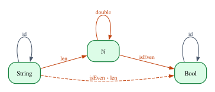
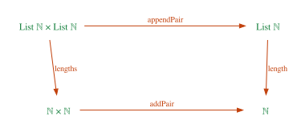
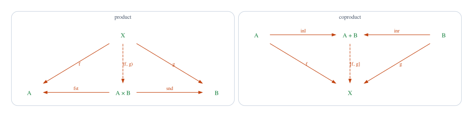

# Chapter 16 · Categories for Programmers

Look at the last program you wrote and count how often you composed two things.
An iterator chain such as `lines.iter().map(parse).filter(valid).collect()` is
four steps glued end to end. A web server passes a request through a stack of
middleware. A compiler is a pipeline: lexer, parser, type checker, code
generator. Even the humblest refactoring, extracting three lines into a helper
function, relies on a fact so obvious that nobody states it: gluing `f` to `g`
and then to `h` gives the same program however you group the steps. Composition
is what programmers do all day.

**Category theory** is the mathematics of composition. It studies things that
can be glued end to end, and deliberately forgets what they are made of. The
effect is the opposite of vagueness: by looking only at how arrows compose,
category theory finds definitions that work in many settings at once. One definition of "product" gives you pairs of values,
the minimum of two numbers and the conjunction of two propositions. One
definition of "terminal object" gives you `()`, `True` and the largest element of
an order. Part IV uses this language to explain `map` (Chapter 17), generic
functions (Chapter 18), closures and the λ-calculus (Chapter 19), and `?` with
`and_then` (Chapter 20). This chapter lays the foundation.

**In this chapter you will learn:**

- what a category is: objects, morphisms, identities, composition and the three
  laws, and how the book's `Category` class states them in Lean;
- many small examples: types and functions, preorders, monoids, discrete
  categories and the free category of paths in a graph, in Lean and in Rust;
- how to read commutative diagrams, and why a commuting square is a property
  test with a proof;
- isomorphisms, monomorphisms and epimorphisms, and what they are in the
  category of types;
- initial and terminal objects, products and coproducts, defined by universal
  properties and proved in Lean for `Empty`, `Unit`, pairs and sums, together
  with their uniqueness up to unique isomorphism;
- duality: the opposite category, and how it turns every theorem into two;
- how Mathlib's category theory library writes all of this (`⟶`, `≫`, `𝟙`,
  `Type u` as a category, products through `Limits`).

## Composition is what programmers do

Here is composition in Rust, written once for all types. The full program is in
`code/rust/examples/ch16_categories.rs`.

```rust
/// `compose(g, f)` is "first `f`, then `g`": the mathematician's `g ∘ f`.
fn compose<A, B, C>(g: impl Fn(B) -> C, f: impl Fn(A) -> B) -> impl Fn(A) -> C {
    move |a| g(f(a))
}

/// The identity morphism on every type `A`.
fn identity<A>(a: A) -> A {
    a
}
```

`compose(g, f)` turns a function from `A` to `B` and a function from `B` to `C`
into a function from `A` to `C`. The argument order follows the mathematical
notation $g \circ f$, read "$g$ after $f$": the function on the right runs first
(Mathlib uses the opposite convention, as we will see at the end of the chapter).
The types must *meet*: the output type of `f` must be the input type of `g`.
`identity` does nothing, for every type. Two facts about these functions are so
familiar that they are easy to overlook:

- composing with `identity`, on either side, changes nothing;
- when you compose three functions, it does not matter which two you glue first.

The example checks both facts on a few inputs:

```rust
let len = |s: &str| s.len();
let double = |n: usize| 2 * n;
let is_even = |n: usize| n % 2 == 0;
let samples = ["", "a", "hello", "category"];
for s in samples {
    // The unit laws: composing with the identity changes nothing.
    assert_eq!(compose(identity, len)(s), len(s));
    assert_eq!(compose(len, identity)(s), len(s));
    // Associativity: the bracketing does not matter.
    let left = compose(compose(is_even, double), len);
    let right = compose(is_even, compose(double, len));
    assert_eq!(left(s), right(s));
}
println!("functions: laws hold on {} samples", samples.len());
println!(
    "functions: (double ∘ len)(\"hello\") = {}",
    compose(double, len)("hello")
);
```

```text
functions: laws hold on 4 samples
functions: (double ∘ len)("hello") = 10
```

The second fact is the one your refactorings rely on. If a pipeline does
`len`, then `double`, then `is_even`, you may extract the first two steps into a
helper (`compose(is_even, compose(double, len))`) or the last two
(`compose(compose(is_even, double), len)`), and the program means the same
thing. That is **associativity**. The first fact says that `identity` is a
neutral element for composition, like `0` for addition: the **unit laws**.

The checks never looked at what `len` or `double` compute, only at their source
and target types, at how they compose, and at the identity. Category theory keeps
exactly this and throws away the rest.

## The definition of a category

A **category** $\mathcal{C}$ consists of:

- a collection of **objects** $a, b, c, \dots$;
- for every two objects $a$ and $b$, a collection $\mathrm{Hom}(a, b)$ of
  **morphisms** (also called **arrows**) from $a$ to $b$; we write
  $f : a \to b$ for $f \in \mathrm{Hom}(a, b)$, and call $a$ the *source* and $b$
  the *target* of $f$;
- for every object $a$, an **identity** morphism $\mathrm{id}_a : a \to a$;
- for every $f : a \to b$ and $g : b \to c$, a **composite** $g \circ f : a \to c$.

These must satisfy three laws, for all $f : a \to b$, $g : b \to c$ and
$h : c \to d$:

$$
\mathrm{id}_b \circ f = f
\qquad\qquad
f \circ \mathrm{id}_a = f
\qquad\qquad
h \circ (g \circ f) = (h \circ g) \circ f
$$

That is the whole definition. Three remarks will save you confusion later.

First, composition is only defined when the arrows meet: $g \circ f$ exists only
if the target of $f$ is the source of $g$. This is exactly the type-checking rule
of `compose`.

Second, **objects need not be sets, and morphisms need not be functions.** In the
examples below you will meet categories whose morphisms are proofs of
inequalities, elements of a monoid, and paths in a graph. Morphisms are whatever
the category says they are, as long as they compose and obey the laws.

Third, category theory never looks *inside* an object. Everything it says about
an object, it says through the arrows that go in and out of it. This will turn
out to be a strength: it is why the same definitions work in so many places.

A small picture helps. The diagram shows three objects of the category of types
and some of the arrows between them: the identities (drawn as loops), `len`,
`isEven`, their composite, and `double`, an arrow from `ℕ` to itself that is not
the identity.



### The book's `Category` class

Here is the definition in Lean. It lives in `code/lean/Book/Ch16/Category.lean`,
the module that all the chapters of Part IV share:

```lean
/-- A category: objects, morphisms between them, an identity morphism on every
object and an associative composition for which the identities are units. -/
class Category (Obj : Type u) where
  /-- The morphisms from `a` to `b`. -/
  Hom : Obj → Obj → Type
  /-- The identity morphism of `a`. -/
  id : (a : Obj) → Hom a a
  /-- Composition in the order of function composition: `comp g f` is
  "first `f`, then `g`". -/
  comp : {a b c : Obj} → Hom b c → Hom a b → Hom a c
  /-- The identity is a left unit for composition. -/
  id_comp : ∀ {a b : Obj} (f : Hom a b), comp (id b) f = f
  /-- The identity is a right unit for composition. -/
  comp_id : ∀ {a b : Obj} (f : Hom a b), comp f (id a) = f
  /-- Composition is associative. -/
  assoc : ∀ {a b c d : Obj} (h : Hom c d) (g : Hom b c) (f : Hom a b),
    comp h (comp g f) = comp (comp h g) f
```

Let us read it field by field.

- `class Category (Obj : Type u)` declares a type class (Chapter 14) indexed by
  the type of objects. An *instance* `Category Obj` says how the elements of
  `Obj` form a category. The universe variable `u` (Chapter 12) allows `Obj` to
  be big: the type of all types, `Type`, itself lives in `Type 1`, and we want
  `Type` to be a category.
- `Hom : Obj → Obj → Type` is the heart of the definition: for every two
  objects, a *type* of morphisms, which depends on the *values* `a` and `b` (a
  dependent type, in the sense of Chapter 1). This is why "composition only when
  the arrows meet" is checked by Lean's type checker for free.
- `id` and `comp` are the data: an identity for every object, and a composition
  for every two arrows that meet. The objects of `comp` are implicit
  arguments (in braces), because Lean can read them off the arrows. As the
  comment says, `comp g f` means "first `f`, then `g`", like $g \circ f$.
- `id_comp`, `comp_id` and `assoc` are the three laws, as **fields**: an instance
  is rejected until it supplies proofs of them. This is the difference between a
  Lean class and a Rust trait that Chapter 14 pointed out: a trait can list
  operations but not demand laws.

Why does `Hom` land in `Type`, rather than in an arbitrary universe as in
Mathlib? For simplicity: every category in this book has morphisms that fit in
`Type`, and a fixed universe keeps universe annotations out of every statement.
The price is that a category whose arrows between two objects are too many to
form a `Type` cannot be an instance; we will not need one. The choice also has a
pleasant consequence that Chapter 17 uses: since `Hom a b` is a type, it is an
object of the category of types.

Two notations make statements readable:

```lean
/-- `a ⟶ b` is the type of morphisms from `a` to `b`. -/
scoped infixr:10 " ⟶ " => Category.Hom
/-- `g ⊚ f` is the composite "`f`, then `g`". -/
scoped infixr:80 " ⊚ " => Category.comp
```

`a ⟶ b` (a long arrow, typed `\hom` in the editor) is the type of morphisms from
`a` to `b`, and `g ⊚ f` (typed `\oo`) is their composite. Both are `scoped`: they
are active inside `namespace Ch16` and in files that `open Ch16`, and nowhere
else, so that they do not leak into the rest of the book. `infixr` makes them
right-associative, and the numbers are precedences: `⟶` binds more loosely than
almost everything, like `→`.

### The category of types

The first instance is the one we started with:

```lean
/-- The category whose objects are Lean types and whose morphisms are functions. -/
instance typeCategory : Category Type where
  Hom α β := α → β
  id _ := fun x => x
  comp g f := fun x => g (f x)
  id_comp _ := rfl
  comp_id _ := rfl
  assoc _ _ _ := rfl
```

The objects are the Lean types in `Type`, the morphisms from `α` to `β` are the
functions `α → β`, the identity is `fun x => x`, and composition is function
composition. All three laws are proved by `rfl`. Why does that work? Take
`id_comp`: the left side, `comp (id b) f`, unfolds to `fun x => (fun y => y) (f x)`,
which computes (by β-reduction) to `fun x => f x`. Lean's definitional equality
includes η for functions, so `fun x => f x` *is* `f`. Associativity is similar:
both sides compute to `fun x => h (g (f x))`. The laws of the category of types
hold "by computation", which is why programmers never notice them.

With the instance in place, functions can be written and composed as morphisms.
The file `code/lean/Book/Ch16/Examples.lean` starts with:

```lean
/-- In `typeCategory`, a morphism `String ⟶ ℕ` is just a function. -/
def len : String ⟶ ℕ := String.length

def double : ℕ ⟶ ℕ := fun n => 2 * n

def isEven : ℕ ⟶ Bool := fun n => n % 2 == 0

/-- info: 10 -/
#guard_msgs in
#eval (double ⊚ len) "hello"

/-- info: true -/
#guard_msgs in
#eval (isEven ⊚ double ⊚ len) "abc"
```

The declared type `String ⟶ ℕ` unfolds to `String → ℕ`, so an ordinary function
can be its value. The composite `isEven ⊚ double ⊚ len` parses as
`isEven ⊚ (double ⊚ len)` and runs from right to left: the length of `"abc"` is
3, doubled is 6, which is even. Because the laws hold by computation, specific
instances of them are `rfl` too:

```lean
/-- The laws hold by `rfl`: both sides are the same function, up to unfolding. -/
example : (isEven ⊚ double) ⊚ len = isEven ⊚ (double ⊚ len) := rfl
example : double ⊚ Category.id ℕ = double := rfl
```

### Rust types and functions, with caveats

Do Rust's types and functions (or closures) form a category in the same way,
with `identity` and `compose`? Approximately, and the approximation is
instructive, because a Rust function is more than a mapping from inputs to
outputs:

- **Side effects.** A function can print or mutate shared state. Composition
  stays associative, but "two morphisms are equal" now has to mean "the same
  outputs *and* the same effects", and we will see that this breaks one of the
  nicest facts about `()`.
- **Panics and non-termination.** `|_| panic!()` and `|_| loop {}` have type
  `A -> B` for every `B`, but never return a `B`.
- **Equality of functions is not checkable.** Lean proves `f = g` with `funext`
  (functions that agree on every input are equal); a Rust test compares outputs
  on samples.
- **Ownership.** A function `fn(A) -> B` consumes its argument. Composition is
  unaffected, but products will show where it matters.

The usual way out is to reason about the *pure, total* fragment: functions that
always return and have no observable effects. Within it, Rust types and functions
form a category as honestly as Lean's do, and we will point out each place where
stepping outside changes the answer.

## A gallery of categories

The category of types is only one example, and if it were the only one, category
theory would be pointless. This section collects small categories that look
nothing like it. Each comes in Lean (as an instance of the book's class, with its
laws proved) and most come in Rust too.

### Categories as data, in Rust

In Rust we cannot write `Hom(a, b)` as a *type* that depends on the *values*
`a` and `b`: that needs dependent types, the subject of Chapter 30. What we can
do is represent a category whose objects and morphisms are runtime values, and
check at run time that two morphisms meet before composing them:

```rust
/// A category whose objects and morphisms are runtime values. Rust cannot make
/// the *type* of a morphism depend on the *values* of its source and target
/// (that needs dependent types, Chapter 30), so `compose` checks at run time
/// that the morphisms meet, and returns `None` if they do not.
trait Category {
    type Obj: Copy + PartialEq + Debug;
    type Mor: Clone + PartialEq + Debug;

    fn source(&self, f: &Self::Mor) -> Self::Obj;
    fn target(&self, f: &Self::Mor) -> Self::Obj;
    fn id(&self, a: Self::Obj) -> Self::Mor;
    /// `compose(g, f)`: first `f`, then `g`.
    fn compose(&self, g: &Self::Mor, f: &Self::Mor) -> Option<Self::Mor>;
}
```

With the trait, a single generic function can test the laws of every instance on
sample morphisms. It checks the two unit laws for every sample, and
associativity for every triple of samples that can be composed:

```rust
/// Checks the unit laws for every sample, and associativity for every
/// composable triple of samples. Returns the number of equations checked.
fn check_laws<C: Category>(cat: &C, samples: &[C::Mor]) -> usize {
    let mut checked = 0;
    for f in samples {
        let (a, b) = (cat.source(f), cat.target(f));
        assert_eq!(cat.compose(&cat.id(b), f).as_ref(), Some(f), "id ∘ f = f");
        assert_eq!(cat.compose(f, &cat.id(a)).as_ref(), Some(f), "f ∘ id = f");
        checked += 2;
        for g in samples.iter().filter(|g| cat.source(g) == b) {
            for h in samples.iter().filter(|h| cat.source(h) == cat.target(g)) {
                let g_f = cat.compose(g, f).expect("g and f meet");
                let h_g = cat.compose(h, g).expect("h and g meet");
                let left = cat.compose(h, &g_f);
                let right = cat.compose(&h_g, f);
                assert_eq!(left, right, "h ∘ (g ∘ f) = (h ∘ g) ∘ f");
                checked += 1;
            }
        }
    }
    checked
}
```

The contrast with Lean is worth stating once. In Lean, composing two arrows that
do not meet is a *type error*, caught before the program runs. In Rust it is a
`None` at run time. In Lean the laws are proved for all morphisms; in Rust they
are tested on the samples we thought of.

### Preorders

A **preorder** is a relation $\le$ that is reflexive ($a \le a$) and transitive
($a \le b$ and $b \le c$ give $a \le c$). Every preorder is a category:

- the objects are the elements;
- there is exactly one morphism $a \to b$ when $a \le b$, and none otherwise;
- the identity on $a$ is reflexivity, $a \le a$;
- composition is transitivity.

The laws hold automatically, because between two objects there is at most one
morphism, so any two parallel morphisms are equal. A category with this property
is called **thin**. Examples are everywhere: numbers with $\le$; positive integers
ordered by divisibility; propositions ordered by implication ($p \le q$ when $p$
implies $q$); and, in Chapter 27, Rust's lifetimes ordered by "outlives", where
`'a: 'b` says that `'a` lasts at least as long as `'b`.

In Lean, a morphism $a \to b$ is a *proof* of `a ≤ b`:

```lean
/-- Every preorder is a category with at most one morphism between two objects:
a morphism `a ⟶ b` is a proof of `a ≤ b`, wrapped by `PLift` so that it lives
in `Type`. -/
instance preorderCategory (α : Type) [Preorder α] : Category α where
  Hom a b := PLift (a ≤ b)
  id a := ⟨le_refl a⟩
  comp g f := ⟨le_trans f.down g.down⟩
  id_comp _ := rfl
  comp_id _ := rfl
  assoc _ _ _ := rfl
```

`Preorder α` is Mathlib's class of preorders: a relation `≤` with the lemmas
`le_refl` and `le_trans`. A proof of `a ≤ b` lives in `Prop`, but `Hom` must
return a `Type`, so we wrap it with `PLift`, a structure with a single field
`down` that turns anything (including a proof) into a value of a type in `Type`:
`⟨h⟩` builds one, and `f.down` takes it apart. The laws are `rfl` because of **proof irrelevance** (Chapter 10):
any two proofs of the same proposition are definitionally equal, so
`⟨le_trans f.down (id b).down⟩` and `f` are the same morphism as far as Lean is
concerned.

```lean
/-- The morphism `3 ⟶ 5` in the category `ℕ`: a proof that `3 ≤ 5`. -/
def threeToFive : (3 : ℕ) ⟶ 5 := ⟨by decide⟩

/-- Any two parallel morphisms of a preorder are equal: proofs are irrelevant. -/
theorem preorder_thin {α : Type} [Preorder α] {a b : α} (f g : a ⟶ b) : f = g := by
  cases f   -- `f` is `⟨h₁⟩` for some proof `h₁ : a ≤ b`
  cases g   -- `g` is `⟨h₂⟩` for some proof `h₂ : a ≤ b`
  rfl       -- `h₁` and `h₂` are proofs of the same proposition, hence equal

/-- In `Prop`, ordered by implication, a morphism `p ⟶ q` is a proof of `p → q`. -/
def andElim (p q : Prop) : (p ∧ q) ⟶ p := ⟨fun h => h.1⟩
```

`threeToFive` is the morphism $3 \to 5$ in the category `ℕ`; its "content" is
a proof that `3 ≤ 5`, found by `decide`. `preorder_thin` states thinness. Its
proof needs one step more than `rfl`: `cases f` and `cases g` take the two
morphisms apart into `⟨h₁⟩` and `⟨h₂⟩` (Lean's `rfl` does not see through two
unknown structures at once), and then `rfl` succeeds because `h₁` and `h₂` are
proofs of the same proposition. Finally, `andElim` is a morphism in `Prop`,
where Mathlib defines `p ≤ q` as `p → q`: its content is the proof
`fun h => h.1` of $p \land q \to p$.

The Rust version uses divisibility. A morphism carries its source and target,
and the only way to build one is through `divides`, which checks the relation:

```rust
/// The preorder of positive integers ordered by divisibility: there is one
/// morphism `a ⟶ b` exactly when `a` divides `b`.
struct Divisibility;

#[derive(Clone, PartialEq, Debug)]
struct Divides {
    from: u32,
    to: u32,
}

/// The only way to build a morphism: check that `a` divides `b`.
fn divides(a: u32, b: u32) -> Option<Divides> {
    (a > 0 && b % a == 0).then_some(Divides { from: a, to: b })
}

impl Category for Divisibility {
    type Obj = u32;
    type Mor = Divides;
    fn source(&self, f: &Divides) -> u32 {
        f.from
    }
    fn target(&self, f: &Divides) -> u32 {
        f.to
    }
    fn id(&self, a: u32) -> Divides {
        Divides { from: a, to: a }
    }
    fn compose(&self, g: &Divides, f: &Divides) -> Option<Divides> {
        // Transitivity: a | b and b | c give a | c.
        (f.to == g.from).then(|| Divides {
            from: f.from,
            to: g.to,
        })
    }
}
```

```rust
let div = Divisibility;
let (a, b) = (divides(3, 12).unwrap(), divides(12, 36).unwrap());
println!(
    "divisibility: (12 ⟶ 36) ∘ (3 ⟶ 12) = {:?}",
    div.compose(&b, &a)
);
let samples: Vec<Divides> = (1..=12)
    .flat_map(|a| (1..=12).filter_map(move |b| divides(a, b)))
    .collect();
println!(
    "divisibility: {} equations checked",
    check_laws(&div, &samples)
);
```

```text
divisibility: (12 ⟶ 36) ∘ (3 ⟶ 12) = Some(Divides { from: 3, to: 36 })
divisibility: 203 equations checked
```

The samples are all the divisibility facts among the numbers 1 to 12, and the
checker verified 203 equations: two unit laws for each sample morphism, and
associativity for every composable triple.

### Monoids are categories with one object

A **monoid** is a set $M$ with an associative operation $\cdot$ and a unit
element $e$: $e \cdot x = x = x \cdot e$ and $x \cdot (y \cdot z) = (x \cdot y) \cdot z$.
Examples: numbers with $+$ and $0$ or with $\times$ and $1$, strings with
concatenation and `""`, and functions from a type to itself with composition and
the identity.

Compare the monoid laws with the category laws: they are the same equations.
That is not a coincidence. A monoid *is* a category with exactly one object
$\star$: the morphisms $\star \to \star$ are the elements of $M$, composition is
the operation, and the identity is the unit. Since there is only one object,
every two morphisms meet, and the "type-checking" part of composition
disappears.

```lean
/-- The single object of the category built from a monoid `M`. -/
structure OneObject (M : Type) where
  /-- The unique value: the type has exactly one element, `⟨⟩`. -/
  mk ::

/-- A monoid is a category with one object: the morphisms are the elements of
the monoid, composition is multiplication, the identity is `1`. -/
instance monoidCategory (M : Type) [Monoid M] : Category (OneObject M) where
  Hom _ _ := M
  id _ := 1
  comp g f := g * f
  id_comp f := one_mul f
  comp_id f := mul_one f
  assoc h g f := (mul_assoc h g f).symm
```

`OneObject M` is a structure with no fields, so it has exactly one value,
written `⟨⟩`: the single object. `Monoid M` is Mathlib's class of monoids, which
provides `*`, `1` and the three laws `one_mul`, `mul_one` and `mul_assoc`
(Chapter 14 built its own version of this class). Each category law is
discharged by the corresponding monoid law; associativity is stated the other way
around in Mathlib, hence the `.symm`, which turns a proof of $x = y$ into a proof
of $y = x$.

```lean
/-- An element of the monoid, seen as a morphism of its one-object category. -/
def OneObject.arrow {M : Type} [Monoid M] (m : M) : (⟨⟩ : OneObject M) ⟶ ⟨⟩ := m

/-- In the one-object category of `(ℕ, *, 1)`, composing is multiplying. -/
def six : (⟨⟩ : OneObject ℕ) ⟶ ⟨⟩ := OneObject.arrow 2 ⊚ OneObject.arrow 3

/-- info: 6 -/
#guard_msgs in
#eval (six : ℕ)
```

`OneObject.arrow` only tells Lean the type of the (single) object. Composing the
arrows `2` and `3` in the one-object category of $(\mathbb{N}, \times, 1)$
multiplies them.

The connection runs the other way too. In *any* category, the morphisms from an
object to itself (its **endomorphisms**) form a monoid under composition, and the
monoid laws are instances of the category laws:

```lean
/-- Conversely, in any category the morphisms from an object to itself form a
monoid under composition: the monoid laws are instances of the category laws. -/
theorem endo_monoid {Obj : Type u} [Category Obj] (a : Obj) (f g h : a ⟶ a) :
    Category.id a ⊚ f = f ∧ f ⊚ Category.id a = f ∧ h ⊚ (g ⊚ f) = (h ⊚ g) ⊚ f :=
  ⟨Category.id_comp f, Category.comp_id f, Category.assoc h g f⟩
```

The proof is the three laws, glued with the anonymous constructor `⟨_, _, _⟩`
that builds a conjunction. So the functions `ℕ → ℕ`, such as `double` in the
picture above, form a monoid.

In Rust, strings under concatenation give a one-object category whose single
object is `()`:

```rust
/// The monoid of strings under concatenation, as a category with one object
/// `()`: every string is a morphism `() ⟶ ()`.
struct Strings;

impl Category for Strings {
    type Obj = ();
    type Mor = String;
    fn source(&self, _: &String) {}
    fn target(&self, _: &String) {}
    fn id(&self, _: ()) -> String {
        String::new()
    }
    fn compose(&self, g: &String, f: &String) -> Option<String> {
        Some(format!("{f}{g}")) // first f's text, then g's
    }
}
```

```rust
let words: Vec<String> = ["", "con", "cat", "egory"].map(String::from).to_vec();
let concat = Strings.compose(&words[2], &words[1]).unwrap();
println!("strings: \"cat\" ∘ \"con\" = {concat:?}");
println!(
    "strings: {} equations checked",
    check_laws(&Strings, &words)
);
```

```text
strings: "cat" ∘ "con" = "concat"
strings: 72 equations checked
```

`compose(g, f)` puts `f`'s text first, to match "first `f`, then `g`"; the other
choice would give a perfectly good category too, as duality will explain.

### Discrete categories

At the other extreme from a monoid is a category with many objects and no
interesting arrows: the only morphisms are the identities. Any set gives such a
**discrete category**. In Lean a morphism $a \to b$ is a proof that $a = b$:

```lean
/-- A copy of `α` whose only morphisms are identities. -/
structure Discrete (α : Type) where
  /-- The underlying element. -/
  val : α

/-- A morphism `a ⟶ b` is a proof that `a = b`. -/
instance discreteCategory (α : Type) : Category (Discrete α) where
  Hom a b := PLift (a = b)
  id _ := ⟨rfl⟩
  comp g f := ⟨f.down.trans g.down⟩
  id_comp _ := rfl
  comp_id _ := rfl
  assoc _ _ _ := rfl

/-- Between two different objects there is no morphism at all. -/
theorem discrete_no_arrow (f : (⟨1⟩ : Discrete ℕ) ⟶ ⟨2⟩) : False := by
  have h : (⟨1⟩ : Discrete ℕ) = ⟨2⟩ := f.down
  simp at h
```

`Discrete α` is a copy of `α` (a structure with one field), so that the instance
does not compete with other instances on `α`, such as the preorder on `ℕ`.
Composition is transitivity of equality. The theorem `discrete_no_arrow` shows that there is no
morphism between two different objects: from `f` we extract a proof `h` of
`⟨1⟩ = ⟨2⟩`, and `simp at h` simplifies it. `simp` knows that two values built
with the same constructor are equal only if their fields are, turns `h` into
`1 = 2`, evaluates that to `False`, and a hypothesis `False` closes any goal.

Discrete categories look trivial, and they are; they serve as building blocks. A
pair of objects of a category is the same thing as a way of sending the two
objects of a two-element discrete category into it, a remark that Mathlib's
`Limits` library turns into its definition of products.

### Free categories: paths in a graph

Take a directed graph: vertices, and edges between them. Its **paths** form a
category. The objects are the vertices; a morphism from $a$ to $b$ is a path
that starts at $a$ and ends at $b$ (a sequence of edges, each starting where the
previous one ended); composition is concatenation; the identity on $a$ is the
empty path at $a$. This is the **free category** on the graph: "free" because
it satisfies no equations beyond the laws, so two paths are equal only if they
consist of the same edges.

```lean
/-- A path in a graph whose edges from `a` to `b` form the type `E a b`:
either empty, or an edge followed by a path. -/
inductive Path {V : Type} (E : V → V → Type) : V → V → Type where
  | nil (a : V) : Path E a a
  | cons {a b c : V} (e : E a b) (p : Path E b c) : Path E a c

namespace Path

variable {V : Type} {E : V → V → Type}

/-- Concatenation: first `p`, then `q`. -/
def append : {a b c : V} → Path E a b → Path E b c → Path E a c
  | _, _, _, nil _, q => q
  | _, _, _, cons e p, q => cons e (append p q)

/-- The number of edges in a path. -/
def length : {a b : V} → Path E a b → ℕ
  | _, _, nil _ => 0
  | _, _, cons _ p => length p + 1
```

`Path E` is an *inductive family*: one type `Path E a b` for every pair of
vertices, defined all at once, like the typing relations of Chapter 3 but in
`Type` rather than `Prop`. A path is either `nil a`, the empty path at `a`, or
`cons e p`, an edge from `a` to `b` followed by a path from `b` to `c`; the type
of `cons` makes it impossible to build a path whose edges do not meet. `append`
concatenates by recursion on the first path (the leading `_` in its patterns
stand for the implicit vertices).

The laws are theorems about `append`:

```lean
/-- The empty path is a left unit: true by the first equation of `append`. -/
theorem nil_append {a b : V} (p : Path E a b) : append (nil a) p = p := rfl

/-- The empty path is a right unit: needs induction on the path. -/
theorem append_nil {a b : V} (p : Path E a b) : append p (nil b) = p := by
  induction p with
  | nil a => rfl
  | cons e p ih =>
    -- Goal: append (cons e p) (nil _) = cons e p
    simp only [append]  -- unfold one step: cons e (append p (nil _)) = cons e p
    rw [ih]             -- the induction hypothesis closes it

/-- Concatenation is associative, again by induction on the first path. -/
theorem append_assoc {a b c d : V} (p : Path E a b) (q : Path E b c) (r : Path E c d) :
    append (append p q) r = append p (append q r) := by
  induction p with
  | nil a => rfl
  | cons e p ih => simp only [append, ih]
```

`nil_append` is `rfl`: it is literally the first equation of `append`. The other
unit law is not: `append p (nil b)` is stuck until we know whether `p` is `nil`
or `cons`, so we prove it by induction on `p`. In the `nil` case both sides are
`nil a`. In the `cons e p` case, `simp only [append]` unfolds one step of the
definition, leaving `cons e (append p (nil _)) = cons e p`, and the induction
hypothesis `ih : append p (nil _) = p` rewrites the left side into the right.
Associativity is the same pattern; there `simp only [append, ih]` unfolds and
rewrites with the hypothesis in one go.

Now the instance:

```lean
/-- The objects of the free category on a graph `E` are its vertices. -/
structure Free {V : Type} (E : V → V → Type) where
  /-- The vertex. -/
  vertex : V

/-- The free category: morphisms are paths, composition is concatenation. -/
instance freeCategory {V : Type} (E : V → V → Type) : Category (Free E) where
  Hom a b := Path E a.vertex b.vertex
  id a := Path.nil a.vertex
  comp g f := Path.append f g
  id_comp f := Path.append_nil f
  comp_id f := Path.nil_append f
  assoc h g f := Path.append_assoc f g h
```

The wrapper `Free E` attaches the instance to the graph, since the vertex type `V`
alone does not say which edges we mean. Note the order in
`comp g f := Path.append f g`: the path walks `f` first. Because of that order,
the category's left unit law (`id ⊚ f = f`) is `append_nil` and its right unit
law is `nil_append`.

Here is a graph that every network programmer knows: the states of a connection
and the operations that move between them.

```lean
/-- The states of a network connection. -/
inductive Conn where
  | closed | connected | authenticated

/-- The protocol: which operation leads from which state to which. -/
inductive Step : Conn → Conn → Type where
  | connect : Step .closed .connected
  | login : Step .connected .authenticated
  | logout : Step .authenticated .connected
  | close : Step .connected .closed

/-- The name of an operation, for printing. -/
def Step.name : {a b : Conn} → Step a b → String
  | _, _, .connect => "connect"
  | _, _, .login => "login"
  | _, _, .logout => "logout"
  | _, _, .close => "close"

/-- The operations along a path, in order. -/
def Path.names : {a b : Conn} → Path Step a b → List String
  | _, _, .nil _ => []
  | _, _, .cons e p => e.name :: p.names

/-- Morphisms of the free category on the protocol graph are valid traces. -/
abbrev Trace (a b : Conn) : Type := (⟨a⟩ : Free Step) ⟶ ⟨b⟩

def signIn : Trace .closed .authenticated :=
  .cons .connect (.cons .login (.nil _))

def signOut : Trace .authenticated .closed :=
  .cons .logout (.cons .close (.nil _))

/-- info: ["connect", "login", "logout", "close"] -/
#guard_msgs in
#eval (signOut ⊚ signIn).names
```

`Step` is an inductive family again: `Step a b` is the type of operations that
go from state `a` to state `b`, so `Step.login` exists only from `.connected`
to `.authenticated`. A morphism of the free category, a `Trace`, is a sequence of
operations that the protocol allows. Composing `signIn` with `signOut` gives the
whole session. Composing `signIn` with itself is not "an error at run time": it
does not type-check, because `signIn` ends at `.authenticated` and starts at
`.closed`. Chapter 25 builds whole APIs on this idea, under the name typestate.

The Rust version represents the same graph as a transition function, and traces
as vectors of operations validated when they are built:

```rust
/// The states of a connection, and the operations of its protocol.
#[derive(Clone, Copy, PartialEq, Debug)]
enum State {
    Closed,
    Connected,
    Authenticated,
}

#[derive(Clone, Copy, PartialEq, Debug)]
enum Op {
    Connect,
    Login,
    Logout,
    Close,
}

/// The edges of the protocol graph: where each operation may start and end.
fn step(state: State, op: Op) -> Option<State> {
    use State::*;
    match (state, op) {
        (Closed, Op::Connect) => Some(Connected),
        (Connected, Op::Login) => Some(Authenticated),
        (Authenticated, Op::Logout) => Some(Connected),
        (Connected, Op::Close) => Some(Closed),
        _ => None,
    }
}
```

```rust
/// A morphism of the free category: a path in the graph, that is, a sequence
/// of operations that the protocol allows, starting from `from`.
#[derive(Clone, PartialEq, Debug)]
struct Trace {
    from: State,
    to: State,
    ops: Vec<Op>,
}

impl Trace {
    fn new(from: State, ops: &[Op]) -> Option<Trace> {
        let mut to = from;
        for &op in ops {
            to = step(to, op)?;
        }
        Some(Trace {
            from,
            to,
            ops: ops.to_vec(),
        })
    }
}
```

```rust
/// The free category on the protocol graph.
struct Protocol;

impl Category for Protocol {
    type Obj = State;
    type Mor = Trace;
    fn source(&self, f: &Trace) -> State {
        f.from
    }
    fn target(&self, f: &Trace) -> State {
        f.to
    }
    fn id(&self, a: State) -> Trace {
        Trace {
            from: a,
            to: a,
            ops: Vec::new(),
        }
    }
    fn compose(&self, g: &Trace, f: &Trace) -> Option<Trace> {
        if f.to != g.from {
            return None; // the paths do not meet
        }
        let ops = f.ops.iter().chain(&g.ops).copied().collect();
        Some(Trace {
            from: f.from,
            to: g.to,
            ops,
        })
    }
}
```

```rust
use {Op::*, State::*};
let sign_in = Trace::new(Closed, &[Connect, Login]).unwrap();
let sign_out = Trace::new(Authenticated, &[Logout, Close]).unwrap();
let session = Protocol.compose(&sign_out, &sign_in).unwrap();
println!("protocol: sign_out ∘ sign_in = {:?}", session.ops);
println!(
    "protocol: sign_in ∘ sign_in = {:?}",
    Protocol.compose(&sign_in, &sign_in)
);
let traces: Vec<Trace> = [
    (Closed, vec![Connect]),
    (Connected, vec![Login, Logout]),
    (Connected, vec![Close, Connect]),
    (Authenticated, vec![Logout, Close]),
    (Closed, vec![Connect, Login]),
]
.iter()
.filter_map(|(from, ops)| Trace::new(*from, ops))
.collect();
println!(
    "protocol: {} equations checked",
    check_laws(&Protocol, &traces)
);
```

```text
protocol: sign_out ∘ sign_in = [Connect, Login, Logout, Close]
protocol: sign_in ∘ sign_in = None
protocol: 27 equations checked
```

The composite session is the four operations in order; composing `sign_in` with
itself gives `None`, the run-time counterpart of Lean's type error.

## Commutative diagrams

Equations between composites quickly become hard to read, so category theorists
draw them. A **diagram** is a picture of some objects and some arrows between
them. A diagram **commutes** if any two paths of arrows with the same start and
the same end compose to the same morphism.

Here is a commutative square from everyday programming. Start with a pair of
lists. You can append them and take the length of the result, or take the two
lengths and add them:



The square commutes: both paths from the top-left corner to the bottom-right
corner are the same function. In Lean, that is one equation between composites:

```lean
/-- Concatenate the two lists of a pair. -/
def appendPair : List ℕ × List ℕ ⟶ List ℕ := fun p => p.1 ++ p.2
/-- Measure both lists of a pair. -/
def lengths : List ℕ × List ℕ ⟶ ℕ × ℕ := fun p => (p.1.length, p.2.length)
/-- Add the two numbers of a pair. -/
def addPair : ℕ × ℕ ⟶ ℕ := fun p => p.1 + p.2

/-- The square commutes: "append, then measure" equals "measure both, then add". -/
theorem length_square :
    (List.length : List ℕ ⟶ ℕ) ⊚ appendPair = addPair ⊚ lengths := by
  funext p                  -- two functions are equal if they agree on every `p`
  exact List.length_append  -- (p.1 ++ p.2).length = p.1.length + p.2.length
```

The proof uses `funext p`, which reduces an equation between functions to an
equation between their values at an arbitrary argument `p`, and then Lean's
library lemma `List.length_append`, which says exactly
`(p.1 ++ p.2).length = p.1.length + p.2.length`.

If you have written property-based tests, you have written commutative diagrams
without the pictures: "for all pairs of lists, `len(a ++ b) == len(a) + len(b)`"
is this square, tested on random samples, while the Lean version is proved for
all inputs. Chapter 18 is full of such squares, under the name naturality
squares.

## Isomorphisms

When are two objects "the same"? Category theory must answer with arrows. A
morphism $f : a \to b$ is an
**isomorphism** if it has an **inverse** $g : b \to a$:

$$
g \circ f = \mathrm{id}_a
\qquad\qquad
f \circ g = \mathrm{id}_b
$$

Then $a$ and $b$ are **isomorphic**, written $a \cong b$, and nothing category
theory can say distinguishes them. You have seen this idea in Chapter 11, where
`Iso` structures recorded that types such as `A × ()` and `A` carry the same
information: isomorphisms in the category of types. The shared module
generalizes the definition to every category:

```lean
/-- An isomorphism between `a` and `b`: morphisms in both directions whose
composites are the identities. -/
structure Iso {Obj : Type u} [Category Obj] (a b : Obj) where
  hom : a ⟶ b
  inv : b ⟶ a
  inv_hom : inv ⊚ hom = Category.id a
  hom_inv : hom ⊚ inv = Category.id b
```

An `Iso a b` packages the two arrows and the two equations; the module also
defines the notation `a ≅ b` for it. Isomorphism behaves like an equality: every
object is isomorphic to itself, and isomorphisms can be reversed and composed.
In `Iso.refl` both equations say `id a ⊚ id a = id a`, an instance of the unit
law; `Iso.symm` swaps the two arrows and the two proofs.

```lean
/-- Every object is isomorphic to itself. -/
def Iso.refl {Obj : Type u} [Category Obj] (a : Obj) : a ≅ a where
  hom := Category.id a
  inv := Category.id a
  inv_hom := Category.id_comp _
  hom_inv := Category.id_comp _

/-- Isomorphisms can be reversed. -/
def Iso.symm {Obj : Type u} [Category Obj] {a b : Obj} (i : a ≅ b) : b ≅ a where
  hom := i.inv
  inv := i.hom
  inv_hom := i.hom_inv
  hom_inv := i.inv_hom
```

```lean
/-- Isomorphisms compose. -/
def Iso.trans {Obj : Type u} [Category Obj] {a b c : Obj} (i : a ≅ b) (j : b ≅ c) :
    a ≅ c where
  hom := j.hom ⊚ i.hom
  inv := i.inv ⊚ j.inv
  inv_hom := by
    rw [Category.assoc, ← Category.assoc i.inv, j.inv_hom, Category.comp_id, i.inv_hom]
  hom_inv := by
    rw [Category.assoc, ← Category.assoc j.hom, i.hom_inv, Category.comp_id, j.hom_inv]
```

The proof of `inv_hom` in `Iso.trans` is a good exercise in reading `rw`. The
goal is `(i.inv ⊚ j.inv) ⊚ (j.hom ⊚ i.hom) = id a`: undo `j`, undo `i`, after
doing `i` and then `j`. The rewrites move the brackets until the inner pair meets:

1. `Category.assoc` rewrites the left side, of the shape `h ⊚ (g ⊚ f)`, into
   `((i.inv ⊚ j.inv) ⊚ j.hom) ⊚ i.hom`.
2. `← Category.assoc i.inv` uses the same law from right to left, on the
   subterm that starts with `i.inv`: `(i.inv ⊚ j.inv) ⊚ j.hom` becomes
   `i.inv ⊚ (j.inv ⊚ j.hom)`.
3. `j.inv_hom` replaces `j.inv ⊚ j.hom` with `id b`.
4. `Category.comp_id` removes it: `i.inv ⊚ id b` becomes `i.inv`.
5. `i.inv_hom` turns `i.inv ⊚ i.hom` into `id a`, and the goal `id a = id a`
   is closed by `rfl`, which `rw` tries automatically.

The proof of `hom_inv` is the mirror image. Neither mentions what the objects or
the morphisms are: they hold in every category at once.

Two isomorphisms in the category of types:

```lean
/-- `Bool` and `Option Unit` are isomorphic in the category of types. -/
def boolIso : Bool ≅ Option Unit where
  hom := fun b => if b then some () else none
  inv := fun o => o.isSome
  inv_hom := by
    funext b      -- compare the two functions on every `b : Bool`
    cases b <;> rfl
  hom_inv := by
    funext o
    cases o <;> rfl

/-- Swapping the components of a pair is an isomorphism `α × β ≅ β × α`. -/
def swapIso (α β : Type) : α × β ≅ β × α where
  hom := fun p => (p.2, p.1)
  inv := fun p => (p.2, p.1)
  inv_hom := rfl
  hom_inv := rfl
```

For `boolIso`, the equations compare two functions, so `funext b` reduces them
to a statement about an arbitrary `b : Bool`, `cases b` splits into the cases
`false` and `true`, and `<;> rfl` runs `rfl` on both. For `swapIso` the equations
hold by computation (swapping twice gives back the pair, by η for pairs).

A morphism can have at most one inverse. The proof is a classic of
equational reasoning, written here with `calc`, which chains equations step by
step, each with its own justification:

```lean
/-- A morphism has at most one inverse: if `g` is a left inverse and `g'` a
right inverse of `f`, then `g = g'`. -/
theorem inverse_unique {Obj : Type u} [Category Obj] {a b : Obj}
    (f : a ⟶ b) (g g' : b ⟶ a)
    (hg : g ⊚ f = Category.id a) (hg' : f ⊚ g' = Category.id b) : g = g' :=
  calc g = g ⊚ Category.id b := (Category.comp_id g).symm
    _ = g ⊚ (f ⊚ g') := by rw [hg']
    _ = (g ⊚ f) ⊚ g' := Category.assoc g f g'
    _ = Category.id a ⊚ g' := by rw [hg]
    _ = g' := Category.id_comp g'
```

Read the chain from top to bottom: insert an identity, replace it by $f \circ g'$,
regroup, replace $g \circ f$ by an identity, remove it. Each `_ = ...` line
continues from the right-hand side of the previous one. So "the inverse" of an
isomorphism is well defined, which is why `Iso` can store it as a field.

In a preorder, $a \cong b$ means $a \le b$ and $b \le a$. In an order where
that forces $a = b$ (a partial order, such as `ℕ`), the only isomorphisms are
identities.

## Monomorphisms and epimorphisms

Injective and surjective functions have categorical versions stated with arrows
only. A morphism
$f : a \to b$ is a **monomorphism** (mono) if it can be cancelled on the left,
and an **epimorphism** (epi) if it can be cancelled on the right:

$$
f \circ g = f \circ h \;\Rightarrow\; g = h
\qquad\qquad
g \circ f = h \circ f \;\Rightarrow\; g = h
$$

```lean
/-- `f` is a monomorphism if it can be cancelled on the left. -/
def Mono {Obj : Type u} [Category Obj] {a b : Obj} (f : a ⟶ b) : Prop :=
  ∀ {x : Obj} (g h : x ⟶ a), f ⊚ g = f ⊚ h → g = h

/-- `f` is an epimorphism if it can be cancelled on the right. -/
def Epi {Obj : Type u} [Category Obj] {a b : Obj} (f : a ⟶ b) : Prop :=
  ∀ {y : Obj} (g h : b ⟶ y), g ⊚ f = h ⊚ f → g = h
```

In the category of types these are exactly the injective and the surjective
functions. Here is the first half:

```lean
/-- In the category of types, the monomorphisms are the injective functions. -/
theorem mono_iff_injective {α β : Type} (f : α ⟶ β) :
    Mono f ↔ Function.Injective f := by
  constructor
  · -- A mono is injective: test it with two functions out of `Unit`.
    intro hf x y hxy
    have h := hf (fun _ : Unit => x) (fun _ : Unit => y) (funext fun _ => hxy)
    exact congrFun h ()
  · -- An injective function can be cancelled: compare `g` and `h` pointwise.
    intro hf x g h hgh
    funext t
    exact hf (congrFun hgh t)
```

`constructor` splits the `↔` into two implications.

- *Mono implies injective.* We have `hf : Mono f` and `x y` with `f x = f y`,
  and must show `x = y`. The trick is to test cancellation with two functions
  out of `Unit`: the constant functions `fun _ => x` and `fun _ => y`. Composing
  them with `f` gives `fun _ => f x` and `fun _ => f y`, which are equal by
  `funext` and the hypothesis. Mono cancels `f`, so the two constant functions
  are equal, and `congrFun h ()` applies both sides to `()` to get `x = y`.
  (Functions out of `Unit` are the categorical stand-in for elements, a trick you
  will see again.)
- *Injective implies mono.* Given `f ∘ g = f ∘ h`, compare `g` and `h` at any
  `t`: `congrFun hgh t` gives `f (g t) = f (h t)`, and injectivity removes `f`.

And the second half:

```lean
/-- In the category of types, the epimorphisms are the surjective functions. -/
theorem epi_iff_surjective {α β : Type} (f : α ⟶ β) :
    Epi f ↔ Function.Surjective f := by
  constructor
  · -- An epi is surjective: test it with two predicates on `β`.
    intro hf b
    let g : β ⟶ Prop := fun y => ∃ a, f a = y
    let h : β ⟶ Prop := fun _ => True
    have hgf : g ⊚ f = h ⊚ f := by
      funext a
      exact eq_true ⟨a, rfl⟩  -- `∃ a', f a' = f a` holds, so it equals `True`
    have hgh : g = h := hf g h hgf
    exact of_eq_true (congrFun hgh b)
  · -- A surjective function can be cancelled: every `b` is some `f a`.
    intro hf y g h hgh
    funext b
    obtain ⟨a, rfl⟩ := hf b
    exact congrFun hgh a
```

- *Epi implies surjective.* Given `b`, we want some `a` with `f a = b`. We test
  cancellation with two functions from `β` into `Prop` (which is itself a type,
  so it is an object of our category): `g y` is the proposition "`y` is hit by
  `f`", and `h y` is `True`. Composed with `f` they agree, since every `f a` is
  hit by `f`: `eq_true` turns the proof `⟨a, rfl⟩` of `∃ a', f a' = f a` into the
  equation `(∃ a', f a' = f a) = True`. Epi cancels `f`, so `g = h`; at `b` this
  says `(∃ a, f a = b) = True`, and `of_eq_true` turns that back into a proof.
- *Surjective implies epi.* To compare `g` and `h` at `b`, write `b` as `f a`
  (`obtain ⟨a, rfl⟩ := hf b` both extracts `a` and replaces `b` by `f a`
  everywhere), and use the hypothesis at `a`.

Do not conclude that "mono and epi" means "isomorphism", as "injective and
surjective" means "bijective" for functions. In a preorder, any two parallel
morphisms are equal, so *every* morphism is both mono and epi; but $0 \le 1$ in
`ℕ` is not an isomorphism, because there is no morphism back:

```lean
/-- In a preorder every morphism is both mono and epi (parallel morphisms are
equal), but `0 ⟶ 1` in `ℕ` is not an isomorphism: that would need `1 ≤ 0`. -/
def zeroToOne : (0 : ℕ) ⟶ 1 := ⟨by decide⟩

theorem zeroToOne_mono : Mono zeroToOne :=
  fun g h _ => preorder_thin g h

theorem zeroToOne_epi : Epi zeroToOne :=
  fun g h _ => preorder_thin g h

theorem zero_one_not_iso (i : (0 : ℕ) ≅ 1) : False := by
  have h : 1 ≤ 0 := i.inv.down
  omega
```

The last proof extracts from the inverse a proof of `1 ≤ 0`, and `omega` (the
decision procedure for linear arithmetic of Chapter 2) finds the contradiction.
Categorical definitions agree with the familiar ones in the category of types and
can behave very differently elsewhere.

## Initial and terminal objects

Some objects are characterized by the arrows around them alone. An object $t$ is
**terminal** if from every object $a$ there is *exactly one* morphism $a \to t$.
Dually, an object $i$ is **initial** if to every object $a$ there is exactly one
morphism $i \to a$.

```lean
/-- `t` is terminal: from every object there is exactly one morphism to `t`. -/
structure IsTerminal {Obj : Type u} [Category Obj] (t : Obj) where
  /-- The morphism from `a` to `t`. -/
  arrow : (a : Obj) → a ⟶ t
  /-- It is the only one. -/
  unique : ∀ {a : Obj} (f : a ⟶ t), f = arrow a

/-- `i` is initial: to every object there is exactly one morphism from `i`. -/
structure IsInitial {Obj : Type u} [Category Obj] (i : Obj) where
  /-- The morphism from `i` to `a`. -/
  arrow : (a : Obj) → i ⟶ a
  /-- It is the only one. -/
  unique : ∀ {a : Obj} (f : i ⟶ a), f = arrow a
```

The definitions live in `code/lean/Book/Ch16/Universal.lean`. Each is a
structure with the morphism (`arrow`) and a proof that it is the only one
(`unique`). In the category of types, `Unit` is terminal and `Empty` is initial:

```lean
/-- `Unit` is terminal in the category of types. -/
def unitTerminal : IsTerminal Unit where
  arrow _ := fun _ => ()
  unique _ := by
    funext x           -- compare `f` and `fun _ => ()` on every input `x`
    rfl                -- both give `()`: `Unit` has only one value

/-- `Empty` is initial in the category of types. -/
def emptyInitial : IsInitial Empty where
  arrow _ := fun e => nomatch e
  unique f := by
    funext e           -- compare the two functions on every `e : Empty`...
    nomatch e          -- ...of which there are none
```

For `Unit` there is only one function from any type: the one that returns `()`.
Any other function `f` agrees with it everywhere, because `Unit` has only one
value, so after `funext x` the goal `f x = ()` is closed by `rfl` (Lean has η
for `Unit`: every value of `Unit` is definitionally `()`). For `Empty` there is
exactly one function *to* any type, the empty function: `nomatch e` is a match
with no cases, accepted because `Empty` has no constructors. Uniqueness is
vacuous: two functions out of `Empty` agree on all of the (zero) inputs.

Rust has both, and Chapter 1's table already named them:

```rust
/// The unique function from any type into the terminal object `()`.
fn to_unit<A>(_: A) {}

/// A type with no values, and the unique function out of it: the initial object.
enum Void {}

fn absurd<A>(v: Void) -> A {
    match v {}
}
```

`match v {}` is Rust's `nomatch`: a `match` with no arms on a type with no
variants, which has every type. The logician reads these as `True` (provable from
anything) and `False` (from which anything follows): in the category `Prop`,
`True` is terminal and `False` is initial.

Not every category has these objects. In `ℕ` with `≤`, `0` is initial, since
`0 ≤ n` for every `n`; but there is no terminal object, since no number is above
every number:

```lean
/-- In `ℕ` ordered by `≤`, `0` is initial... -/
def zeroInitial : IsInitial (0 : ℕ) where
  arrow n := ⟨Nat.zero_le n⟩
  unique _ := preorder_thin _ _

/-- ...but there is no terminal object: no number is above every number. -/
theorem nat_no_terminal (n : ℕ) (h : IsTerminal n) : False := by
  have hle : n + 1 ≤ n := (h.arrow (n + 1)).down
  omega
```

Uniqueness for `0` is `preorder_thin` again. For the negative result, a terminal
`n` would have an arrow from `n + 1`, that is, a proof of `n + 1 ≤ n`, which
`omega` refutes.

Now the side effects come back, as promised. In pure code, a function into `()`
carries no information, which is what "exactly one morphism into `()`" says. In
Rust, two functions into `()` can differ:

```rust
// Two functions `i32 -> ()` that return the same thing on every input...
let calls = Cell::new(0);
let quiet = |_: i32| ();
let noisy = |_: i32| calls.set(calls.get() + 1);
for n in 0..3 {
    assert_eq!(quiet(n), noisy(n));
}
// ...but they are different programs: `()` is terminal only for pure code.
println!("effects: same outputs, but noisy ran {} times", calls.get());
```

```text
effects: same outputs, but noisy ran 3 times
```

`quiet` and `noisy` return the same value on every input, yet they are different
programs. Once effects count, `()` is no longer terminal. This is the first sign
of a theme of Chapter 20: effects need a category of their own.

### Unique up to unique isomorphism

How many terminal objects can a category have? Possibly many (any one-element
type is terminal in the category of types), but they are all isomorphic, and in
exactly one way:

```lean
/-- Two morphisms into a terminal object are always equal. -/
theorem IsTerminal.hom_ext {Obj : Type u} [Category Obj] {t a : Obj}
    (ht : IsTerminal t) (f g : a ⟶ t) : f = g := by
  rw [ht.unique f, ht.unique g]

/-- Terminal objects are unique up to isomorphism... -/
def IsTerminal.iso {Obj : Type u} [Category Obj] {t₁ t₂ : Obj}
    (h₁ : IsTerminal t₁) (h₂ : IsTerminal t₂) : t₁ ≅ t₂ where
  hom := h₂.arrow t₁
  inv := h₁.arrow t₂
  inv_hom := h₁.hom_ext _ _   -- both sides are morphisms `t₁ ⟶ t₁`
  hom_inv := h₂.hom_ext _ _   -- both sides are morphisms `t₂ ⟶ t₂`

/-- ...and the isomorphism is unique: there is only one morphism `t₁ ⟶ t₂`. -/
theorem IsTerminal.iso_unique {Obj : Type u} [Category Obj] {t₁ t₂ : Obj}
    (h₁ : IsTerminal t₁) (h₂ : IsTerminal t₂) (i : t₁ ≅ t₂) :
    i.hom = (h₁.iso h₂).hom :=
  h₂.hom_ext _ _
```

The whole argument rests on `hom_ext`: two morphisms into a terminal object are
equal, because both are equal to the `arrow`. To build the isomorphism between
terminal objects $t_1$ and $t_2$, take the unique arrows in both directions.
Their composite $t_1 \to t_2 \to t_1$ is a morphism into the terminal object
$t_1$, and so is $\mathrm{id}_{t_1}$; by `hom_ext` they are equal. The same
argument works at $t_2$. And the isomorphism is unique because there is only one
morphism $t_1 \to t_2$ at all.

This pattern, "unique up to unique isomorphism", is the precise sense in which we
may speak of *the* terminal object.

## Products

Now the main event. What is a pair? In Rust, `(A, B)` is a type whose values
hold an `A` and a `B`. Category theory cannot look at values, so it describes
the pair type by what you can *do* with it: you can project out of it, and you can
build it from anything that gives you both components.

A **product** of objects $a$ and $b$ is an object $p$ with two morphisms
$\mathrm{fst} : p \to a$ and $\mathrm{snd} : p \to b$ such that for every object
$x$ and every pair of morphisms $f : x \to a$, $g : x \to b$, there is **exactly
one** morphism $\langle f, g \rangle : x \to p$ with

$$
\mathrm{fst} \circ \langle f, g \rangle = f
\qquad\qquad
\mathrm{snd} \circ \langle f, g \rangle = g
$$

In pictures, the left half of the next figure: whatever $x$, $f$ and $g$ are, the
dashed arrow exists, makes both triangles commute, and is the only arrow that
does. The right half is the coproduct, which we will meet next.



A definition of this shape is called a **universal property**. Think of it as an
interface specification: it does not say how a product is built, only what any
product must offer (two projections and a way to pair) and the laws these
operations satisfy. Any construction meeting the specification is a product, and
by the uniqueness theorem below, any two are interchangeable, with a canonical
translation between them. In Lean the specification is a structure:

```lean
/-- `p`, with projections `fst` and `snd`, is a product of `a` and `b`: every
pair of morphisms `f : x ⟶ a`, `g : x ⟶ b` factors through `p` in exactly one
way. -/
structure IsProduct {Obj : Type u} [Category Obj] {a b p : Obj}
    (fst : p ⟶ a) (snd : p ⟶ b) where
  /-- The morphism into the product built from `f` and `g`. -/
  lift : {x : Obj} → (x ⟶ a) → (x ⟶ b) → (x ⟶ p)
  /-- Projecting the lift on the first component gives back `f`. -/
  fst_lift : ∀ {x : Obj} (f : x ⟶ a) (g : x ⟶ b), fst ⊚ lift f g = f
  /-- Projecting the lift on the second component gives back `g`. -/
  snd_lift : ∀ {x : Obj} (f : x ⟶ a) (g : x ⟶ b), snd ⊚ lift f g = g
  /-- Any morphism with these two properties is the lift. -/
  uniq : ∀ {x : Obj} (f : x ⟶ a) (g : x ⟶ b) (h : x ⟶ p),
    fst ⊚ h = f → snd ⊚ h = g → h = lift f g
```

The four fields mirror the definition: `lift f g` is $\langle f, g \rangle$, the
next two fields are the two triangles, and `uniq` says that any `h` making both
triangles commute is the lift. Note that `IsProduct` is *data* (a structure in
`Type`, because `lift` is a function), not just a proposition: a proof that
something is a product comes with the recipe for pairing.

### Pairs are products

Now the theorem: Lean's pair type, with its projections, is a product in the
category of types.

```lean
/-- The pair type `α × β`, with `Prod.fst` and `Prod.snd`, is a product in the
category of types. -/
def pairIsProduct (α β : Type) :
    IsProduct (Obj := Type) (Prod.fst : α × β → α) Prod.snd where
  lift f g := fun x => (f x, g x)
  fst_lift _ _ := rfl
  snd_lift _ _ := rfl
  uniq f g h hf hg := by
    -- hf : Prod.fst ⊚ h = f      hg : Prod.snd ⊚ h = g
    funext x
    -- Goal: h x = (f x, g x). Two pairs are equal if their components are.
    apply Prod.ext
    · exact congrFun hf x      -- (h x).1 = f x
    · exact congrFun hg x      -- (h x).2 = g x
```

The named argument `(Obj := Type)` tells Lean in which category we work. Without
it Lean would have to guess the category from `Prod.fst`, whose type is a plain
function type. Then the fields:

- `lift f g` is the function that runs both `f` and `g` on the same input and
  pairs the results.
- `fst_lift` and `snd_lift` hold by computation: `(f x, g x).1` is `f x`.
- `uniq` is the real content. We have `h : x → α × β` with
  `hf : Prod.fst ⊚ h = f` and `hg : Prod.snd ⊚ h = g`, and must show
  `h = lift f g`. `funext x` reduces this to `h x = (f x, g x)`. `apply Prod.ext`
  says that two pairs are equal when their first components are equal and their
  second components are equal, leaving two goals. The first is
  `(h x).1 = f x`, which is `hf` evaluated at `x`: `congrFun hf x`. The second is
  the same with `hg`.

Uniqueness deserves a moment's thought: it says that *a function into a pair
type is determined by its two components*. There is no hidden third piece of
information that a pair could carry. The lift computes:

```lean
/-- The lift of two functions runs both on the same input. -/
def squareAndLabel : ℕ ⟶ ℕ × String :=
  (pairIsProduct ℕ String).lift (fun n => n * n) (fun n => s!"#{n}")

/-- info: (49, "#7") -/
#guard_msgs in
#eval squareAndLabel 7
```

### Products in Rust, and the price of a copy

In Rust the pairing function looks like this:

```rust
/// The pairing of the universal property of products: from `f: X -> A` and
/// `g: X -> B`, the unique `X -> (A, B)` whose projections are `f` and `g`.
/// Rust needs `X: Clone` to feed the same input to both functions.
fn pair<X: Clone, A, B>(
    f: impl Fn(X) -> A,
    g: impl Fn(X) -> B,
) -> impl Fn(X) -> (A, B) {
    move |x| (f(x.clone()), g(x))
}
```

Look at the bound `X: Clone`. The lift must give *the same input* to both `f` and
`g`, and a function `Fn(X) -> A` consumes its argument, so `x` must be
duplicated. In Lean using a variable twice is free; in Rust it is an operation
that not every type supports. (Taking `Fn(&X)` would share a reference instead,
a different trick with its own theory, the subject of Part VI.) The example
checks the two triangles and the uniqueness condition on samples:

```rust
let square = |n: u32| n * n;
let label = |n: u32| format!("#{n}");
let both = pair(square, label);
for n in [0, 1, 7, 12] {
    // The two triangles of the product diagram commute.
    assert_eq!(both(n).0, square(n));
    assert_eq!(both(n).1, label(n));
    // Any other `h` with the same projections agrees with `pair`.
    let h = |n: u32| (n.pow(2), format!("#{}", n));
    assert_eq!(h(n), both(n));
}
println!("product: pair(square, label)(7) = {:?}", both(7));

let describe = either(
    |n: u32| format!("number {n}"),
    |s: &str| format!("word {s}"),
);
println!("coproduct: {}", describe(Either::Left(42)));
println!("coproduct: {}", describe(Either::Right("hello")));

let units: Vec<()> = ["a", "b"].into_iter().map(to_unit).collect();
println!(
    "terminal: to_unit maps {} strings to {:?}",
    units.len(),
    units
);
let nothing: Vec<Void> = Vec::new();
let numbers: Vec<u32> = nothing.into_iter().map(absurd).collect();
println!("initial: absurd maps no values to {numbers:?}");
```

```text
product: pair(square, label)(7) = (49, "#7")
coproduct: number 42
coproduct: word hello
terminal: to_unit maps 2 strings to [(), ()]
initial: absurd maps no values to []
```

The candidate `h` was written differently (`n.pow(2)` and a different `format!`),
and it agrees with `pair` on every sample, as uniqueness predicts.

The need for `Clone` is not a detail. The morphism $a \to a \times a$ that pairs
the identity with itself, $\langle \mathrm{id}, \mathrm{id} \rangle$, is called the
**diagonal**, and it is the categorical name for *using a value twice*. Logic
calls the same thing *contraction*. Rust's ownership system is, among other
things, a refusal to provide the diagonal for free. Chapter 19 makes this
precise, and Part V builds the whole affine story on it.

### Products are unique

Like terminal objects, products are unique up to a unique isomorphism, and the
proof has the same shape: everything follows from the uniqueness clause.

```lean
/-- Products are unique up to isomorphism: if `p` and `q` are both products of
`a` and `b`, the lifts of each other's projections are inverse to each other. -/
def IsProduct.iso {Obj : Type u} [Category Obj] {a b p q : Obj}
    {fst : p ⟶ a} {snd : p ⟶ b} {fst' : q ⟶ a} {snd' : q ⟶ b}
    (P : IsProduct fst snd) (Q : IsProduct fst' snd') : p ≅ q where
  hom := Q.lift fst snd
  inv := P.lift fst' snd'
  inv_hom := by
    -- Both `P.lift fst' snd' ⊚ Q.lift fst snd` and `id p` are lifts of
    -- `fst` and `snd` through `p`, so both are equal to `P.lift fst snd`.
    have h₁ : P.lift fst' snd' ⊚ Q.lift fst snd = P.lift fst snd :=
      P.uniq _ _ _
        (by rw [Category.assoc, P.fst_lift, Q.fst_lift])
        (by rw [Category.assoc, P.snd_lift, Q.snd_lift])
    have h₂ : Category.id p = P.lift fst snd :=
      P.uniq _ _ _ (Category.comp_id fst) (Category.comp_id snd)
    rw [h₁, h₂]
  hom_inv := by
    -- The same argument with the roles of `p` and `q` exchanged.
    have h₁ : Q.lift fst snd ⊚ P.lift fst' snd' = Q.lift fst' snd' :=
      Q.uniq _ _ _
        (by rw [Category.assoc, Q.fst_lift, P.fst_lift])
        (by rw [Category.assoc, Q.snd_lift, P.snd_lift])
    have h₂ : Category.id q = Q.lift fst' snd' :=
      Q.uniq _ _ _ (Category.comp_id fst') (Category.comp_id snd')
    rw [h₁, h₂]

/-- The isomorphism commutes with the projections. -/
theorem IsProduct.iso_fst {Obj : Type u} [Category Obj] {a b p q : Obj}
    {fst : p ⟶ a} {snd : p ⟶ b} {fst' : q ⟶ a} {snd' : q ⟶ b}
    (P : IsProduct fst snd) (Q : IsProduct fst' snd') :
    fst' ⊚ (P.iso Q).hom = fst :=
  Q.fst_lift fst snd
```

Suppose $p$ (with `fst`, `snd`) and $q$ (with `fst'`, `snd'`) are both products of
$a$ and $b$. Each product can lift the other's projections, which gives arrows
$q \to p$ and $p \to q$. For `inv_hom` we must show that the round trip
$p \to q \to p$ is the identity. The trick is to show that *both* the round trip
and `id p` are lifts of `fst` and `snd` through $p$, so that `P.uniq` makes both
equal to `P.lift fst snd`:

- `h₁`: the round trip followed by `fst` is `fst`. The `rw` chain regroups with
  `Category.assoc`, then uses `P.fst_lift` (the projection of the lift into $p$
  is `fst'`) and `Q.fst_lift` (the projection of the lift into $q$ is `fst`).
  The same for `snd`. So by `P.uniq`, the round trip equals `P.lift fst snd`.
- `h₂`: `id p` followed by `fst` is `fst`, by `Category.comp_id`, and the same
  for `snd`. So `id p` also equals `P.lift fst snd`.
- `rw [h₁, h₂]` rewrites both sides of the goal into the same thing.

`iso_fst` adds that the isomorphism respects the projections; its proof is one
of the triangles of `Q`, `Q.fst_lift`. So the pair type is
not just *a* product of `α` and `β`; it is *the* product, in the only sense in
which category theory can say "the".

## Coproducts

Turn every arrow in the definition of a product around, and you get a
**coproduct**: an object $s$ with **injections** $\mathrm{inl} : a \to s$ and
$\mathrm{inr} : b \to s$, such that for every $f : a \to x$ and $g : b \to x$ there
is exactly one $[f, g] : s \to x$ with

$$
[f, g] \circ \mathrm{inl} = f
\qquad\qquad
[f, g] \circ \mathrm{inr} = g
$$

```lean
/-- `s`, with injections `inl` and `inr`, is a coproduct of `a` and `b`: every
pair of morphisms `f : a ⟶ x`, `g : b ⟶ x` factors through `s` in exactly one
way. The same definition as `IsProduct`, with every arrow reversed. -/
structure IsCoproduct {Obj : Type u} [Category Obj] {a b s : Obj}
    (inl : a ⟶ s) (inr : b ⟶ s) where
  /-- The morphism out of the coproduct built from `f` and `g`. -/
  desc : {x : Obj} → (a ⟶ x) → (b ⟶ x) → (s ⟶ x)
  /-- On the left injection, the desc behaves like `f`. -/
  desc_inl : ∀ {x : Obj} (f : a ⟶ x) (g : b ⟶ x), desc f g ⊚ inl = f
  /-- On the right injection, the desc behaves like `g`. -/
  desc_inr : ∀ {x : Obj} (f : a ⟶ x) (g : b ⟶ x), desc f g ⊚ inr = g
  /-- Any morphism with these two properties is the desc. -/
  uniq : ∀ {x : Obj} (f : a ⟶ x) (g : b ⟶ x) (h : s ⟶ x),
    h ⊚ inl = f → h ⊚ inr = g → h = desc f g
```

In the category of types, the coproduct is the sum type: Rust's `enum` with two
variants, Lean's `α ⊕ β` with constructors `Sum.inl` and `Sum.inr`. The
morphism out of the sum (`desc`, for "descend") handles each case with the
corresponding function: it is a `match`.

```lean
/-- The sum type `α ⊕ β`, with `Sum.inl` and `Sum.inr`, is a coproduct in the
category of types. -/
def sumIsCoproduct (α β : Type) :
    IsCoproduct (Obj := Type) (Sum.inl : α → α ⊕ β) Sum.inr where
  desc f g := fun s => match s with
    | .inl a => f a
    | .inr b => g b
  desc_inl _ _ := rfl
  desc_inr _ _ := rfl
  uniq f g h hf hg := by
    -- hf : h ⊚ Sum.inl = f      hg : h ⊚ Sum.inr = g
    funext s
    cases s with                        -- a value of `α ⊕ β` is `inl a` or `inr b`
    | inl a => exact congrFun hf a      -- h (inl a) = f a
    | inr b => exact congrFun hg b      -- h (inr b) = g b
```

Uniqueness is proved by cases: after `funext s`, a value of `α ⊕ β` is either
`inl a` or `inr b`, and in each case the hypothesis about the corresponding
triangle, evaluated at that value, is exactly the goal. The proof says that *a
function out of a sum is determined by what it does on each variant*, which is
why exhaustive `match` is a complete way to consume an `enum`.

In Rust:

```rust
/// A sum type with two cases: the coproduct of `A` and `B`.
#[derive(Debug)]
enum Either<A, B> {
    Left(A),
    Right(B),
}

/// The copairing: from `f: A -> X` and `g: B -> X`, the unique
/// `Either<A, B> -> X` that behaves like `f` on `Left` and like `g` on `Right`.
/// No `Clone` is needed: each input is used once.
fn either<A, B, X>(
    f: impl Fn(A) -> X,
    g: impl Fn(B) -> X,
) -> impl Fn(Either<A, B>) -> X {
    move |e| match e {
        Either::Left(a) => f(a),
        Either::Right(b) => g(b),
    }
}
```

No `Clone` this time: the input goes to exactly one of the two functions.
Products and coproducts are perfectly dual in the category of types, but not in
Rust: pairing needs a copy, case analysis does not. This asymmetry, the shadow of
the diagonal, reappears in Part V as the difference between the two conjunctions
of linear logic.

## Duality and the opposite category

You have now seen several pairs of definitions that are mirror images: terminal
and initial, product and coproduct, mono and epi. Category theory makes the mirror
into a construction. The **opposite** of a category $\mathcal{C}$, written
$\mathcal{C}^{\mathrm{op}}$, has the same objects and every arrow reversed: a
morphism $a \to b$ in $\mathcal{C}^{\mathrm{op}}$ is a morphism $b \to a$ in
$\mathcal{C}$, and composition is done in the other order.

```lean
/-- The opposite of a category has the same objects and every arrow reversed.
`Op C` is a copy of `C`, so that the two category structures do not clash. -/
structure Op (Obj : Type u) where
  /-- The object of the original category. -/
  unop : Obj

instance opCategory {Obj : Type u} [Category Obj] : Category (Op Obj) where
  Hom a b := b.unop ⟶ a.unop
  id a := Category.id a.unop
  comp g f := f ⊚ g
  id_comp f := Category.comp_id f
  comp_id f := Category.id_comp f
  assoc h g f := (Category.assoc f g h).symm
```

`Op Obj` is a copy of `Obj` (one field, `unop`), so that the opposite category is
a different instance on a different type and the two structures never clash.
`Hom a b` is `b.unop ⟶ a.unop`, reversed. The identity is the old identity;
`comp g f` is `f ⊚ g`. The laws come from the original ones: the left unit law of
the opposite is the right unit law of the original (and vice versa), and
associativity is the original associativity read backwards (`.symm`).

The **duality principle** follows: a terminal object of $\mathcal{C}^{\mathrm{op}}$
is an initial object of $\mathcal{C}$, a product in $\mathcal{C}^{\mathrm{op}}$ is a
coproduct in $\mathcal{C}$, a mono in $\mathcal{C}^{\mathrm{op}}$ is an epi in
$\mathcal{C}$. So every theorem about terminal objects, applied to the opposite
category, *is* a theorem about initial objects. In Lean we can watch this
happen:

```lean
/-- An initial object of `C` is a terminal object of the opposite category. -/
def IsInitial.op {Obj : Type u} [Category Obj] {i : Obj} (h : IsInitial i) :
    IsTerminal (⟨i⟩ : Op Obj) where
  arrow a := h.arrow a.unop       -- a morphism `a ⟶ ⟨i⟩` in `Op` is `i ⟶ a.unop`
  unique f := h.unique f

/-- An isomorphism in the opposite category is an isomorphism in `C`, reversed. -/
def Iso.unop {Obj : Type u} [Category Obj] {a b : Obj}
    (i : (⟨a⟩ : Op Obj) ≅ ⟨b⟩) : b ≅ a where
  hom := i.hom
  inv := i.inv
  inv_hom := i.hom_inv
  hom_inv := i.inv_hom

/-- Initial objects are unique up to isomorphism: the dual of `IsTerminal.iso`,
obtained by applying it in the opposite category. No new proof is needed. -/
def IsInitial.iso {Obj : Type u} [Category Obj] {i₁ i₂ : Obj}
    (h₁ : IsInitial i₁) (h₂ : IsInitial i₂) : i₁ ≅ i₂ :=
  (IsTerminal.iso h₂.op h₁.op).unop
```

`IsInitial.op` repackages an initial object of `C` as a terminal object of
`Op C`; the fields are the same terms, because the types agree once `Op` is
unfolded. `Iso.unop` turns an isomorphism in the opposite category back into one
in `C`, swapping `inv_hom` and `hom_inv`. And `IsInitial.iso`, the uniqueness of
initial objects, has **no proof of its own**: it is `IsTerminal.iso`, applied in
the opposite category. As an example of its use:

```lean
/-- For example, any type that is initial is isomorphic to `Empty`. -/
def initialIsoEmpty {α : Type} (h : IsInitial α) : α ≅ Empty :=
  h.iso emptyInitial
```

Duality halves the work of category theory. (It also explains the remark about
the string monoid: reversing the order of concatenation gives the opposite
category.)

## Putting it together: one definition, many products

A universal property is a single definition with many implementations. Let us
run this chapter's definitions on two more categories.

In `ℕ` ordered by `≤`, what is a product of `a` and `b`? It is an object $p$ with
morphisms $p \to a$ and $p \to b$ (so $p \le a$ and $p \le b$), such that any $x$
with $x \le a$ and $x \le b$ has a morphism to $p$ (so $x \le p$). That is the
*greatest lower bound*: `min a b`. Dually, the coproduct is `max a b`.

```lean
/-- In `ℕ` ordered by `≤`, the candidate projections out of `min a b`... -/
def minFst (a b : ℕ) : min a b ⟶ a := ⟨Nat.min_le_left a b⟩
def minSnd (a b : ℕ) : min a b ⟶ b := ⟨Nat.min_le_right a b⟩

/-- ...make `min a b` a product of `a` and `b`. -/
def minIsProduct (a b : ℕ) : IsProduct (minFst a b) (minSnd a b) where
  lift f g := ⟨Nat.le_min.mpr ⟨f.down, g.down⟩⟩   -- x ≤ a and x ≤ b give x ≤ min a b
  fst_lift _ _ := preorder_thin _ _
  snd_lift _ _ := preorder_thin _ _
  uniq _ _ _ _ _ := preorder_thin _ _

/-- Dually, `max a b` is a coproduct. -/
def maxInl (a b : ℕ) : a ⟶ max a b := ⟨Nat.le_max_left a b⟩
def maxInr (a b : ℕ) : b ⟶ max a b := ⟨Nat.le_max_right a b⟩

def maxIsCoproduct (a b : ℕ) : IsCoproduct (maxInl a b) (maxInr a b) where
  desc f g := ⟨Nat.max_le.mpr ⟨f.down, g.down⟩⟩   -- a ≤ x and b ≤ x give max a b ≤ x
  desc_inl _ _ := preorder_thin _ _
  desc_inr _ _ := preorder_thin _ _
  uniq _ _ _ _ _ := preorder_thin _ _
```

All the equations (`fst_lift`, `uniq` and so on) are discharged by
`preorder_thin`: in a thin category, parallel arrows are always equal, so the
triangles commute and uniqueness holds automatically. The entire content of the
universal property is in `lift`, which needs the lemma `Nat.le_min`
("$x \le \min(a, b)$ if and only if $x \le a$ and $x \le b$"); `.mpr` takes
the right-to-left direction of the `↔`.

In `Prop` ordered by implication, the product is conjunction and the coproduct
is disjunction:

```lean
/-- In `Prop` ordered by implication, `p ∧ q` is a product of `p` and `q`... -/
def andFst (p q : Prop) : (p ∧ q) ⟶ p := ⟨fun h => h.1⟩
def andSnd (p q : Prop) : (p ∧ q) ⟶ q := ⟨fun h => h.2⟩

def andIsProduct (p q : Prop) : IsProduct (andFst p q) (andSnd p q) where
  lift f g := ⟨fun hx => ⟨f.down hx, g.down hx⟩⟩
  fst_lift _ _ := preorder_thin _ _
  snd_lift _ _ := preorder_thin _ _
  uniq _ _ _ _ _ := preorder_thin _ _

/-- ...and `p ∨ q` is a coproduct. -/
def orInl (p q : Prop) : p ⟶ (p ∨ q) := ⟨Or.inl⟩
def orInr (p q : Prop) : q ⟶ (p ∨ q) := ⟨Or.inr⟩

def orIsCoproduct (p q : Prop) : IsCoproduct (orInl p q) (orInr p q) where
  desc f g := ⟨fun h => h.elim f.down g.down⟩
  desc_inl _ _ := preorder_thin _ _
  desc_inr _ _ := preorder_thin _ _
  uniq _ _ _ _ _ := preorder_thin _ _
```

The lift of `andIsProduct` is the familiar introduction rule for $\land$ from
Chapter 4: from proofs of $x \to p$ and $x \to q$, a proof of $x \to p \land q$.
The projections are the elimination rules, and the coproduct's `desc` is the
elimination rule for $\lor$ (proof by cases). Natural deduction's rules for
conjunction and disjunction *are* the universal properties of products and
coproducts in the thin category of propositions.

Here is the comparison, with Rust's approximate answers in the last row:

| Category | Product | Coproduct | Terminal | Initial |
|---|---|---|---|---|
| Lean types | `α × β` | `α ⊕ β` | `Unit` | `Empty` |
| `ℕ` with `≤` | `min a b` | `max a b` | none | `0` |
| `Prop` with `→` | `p ∧ q` | `p ∨ q` | `True` | `False` |
| Rust types (pure code) | `(A, B)`, with `Clone` | `enum` | `()` | `Void`, `!` |

This is Chapter 1's table of three readings, now with a precise meaning for the
third column: each entry is defined by the *same* universal property, in a
different category. The rows also explain why the same algebra keeps showing up: $\min$ distributes
over $\max$, $\land$ over $\lor$, and `A × (B ⊕ C)` is isomorphic to
`(A × B) ⊕ (A × C)` (Chapter 11); all three are one statement, "products
distribute over coproducts", in three categories. Chapter 19 adds the missing
column, the exponential (function types, implication), and shows that Chapter 5's
Heyting algebras are exactly the thin categories that have all of these.

## In Mathlib

Everything in this chapter has a counterpart in Mathlib's category theory
library. The differences are generality (morphisms in any universe), automation,
and one notational choice that you must get used to.

### `CategoryTheory.Category`

Mathlib's class is `CategoryTheory.Category C`, for a type of objects `C`. Its
morphisms come from a more primitive class, `Quiver` (a type of arrows between
any two objects, without composition), and live in a universe `v` that you can
specify as `Category.{v} C`. Its notation:

- `X ⟶ Y` is the type of morphisms, as in the book;
- `𝟙 X` (typed `\b1`) is the identity on `X`;
- `f ≫ g` (typed `\gg`) is composition **in diagrammatic order**: first `f`,
  then `g`. It is the book's `g ⊚ f`.

The diagrammatic order matches how arrows are drawn and how pipelines are
written (`f ≫ g` reads like `x.f().g()`). The laws `id_comp`, `comp_id` and
`assoc` have *default proofs*: an instance that omits them makes Mathlib try a
tactic, `cat_disch`, that proves simple ones automatically. They are also `simp`
lemmas, so `simp` normalizes identities and brackets:

```lean
/-- A statement about every Mathlib category. `f ≫ g` is "first `f`, then `g`":
the diagrammatic order, the reverse of `g ∘ f`. -/
example {C : Type*} [Category C] {X Y Z : C} (f : X ⟶ Y) (g : Y ⟶ Z) :
    𝟙 X ≫ (f ≫ g) ≫ 𝟙 Z = f ≫ g := by
  rw [Category.id_comp, Category.comp_id]

/-- The same goal, closed by `simp`: the unit and associativity laws are
`simp` lemmas in Mathlib. -/
example {C : Type*} [Category C] {W X Y Z : C}
    (f : W ⟶ X) (g : X ⟶ Y) (h : Y ⟶ Z) :
    (𝟙 W ≫ f) ≫ (g ≫ h) = f ≫ g ≫ h := by
  simp
```

These examples, and the ones below, are in `code/lean/Book/Ch16/InMathlib.lean`,
under `open CategoryTheory` (`𝟙` and `≫` are scoped to that namespace, like the
book's notations are to `Ch16`).

The two definitions describe the same notion, and every category of the book's
class can be translated into Mathlib's. The translation, in
`code/lean/Book/Ch16/Bridge.lean`, shows exactly what the change of order does:

```lean
/-- The book's category class, translated into Mathlib's. Mathlib's `f ≫ g`
("first `f`, then `g`") is the book's `g ⊚ f`. -/
abbrev toMathlib (C : Type u) [Category C] : CategoryTheory.Category.{0} C where
  Hom a b := Category.Hom a b
  id a := Category.id a
  comp f g := Category.comp g f
  -- Mathlib's `𝟙 a ≫ f = f` is the book's `f ⊚ id a = f`: our `comp_id`.
  id_comp f := Category.comp_id f
  -- Mathlib's `f ≫ 𝟙 b = f` is the book's `id b ⊚ f = f`: our `id_comp`.
  comp_id f := Category.id_comp f
  -- Mathlib's `(f ≫ g) ≫ h = f ≫ (g ≫ h)` is the book's
  -- `h ⊚ (g ⊚ f) = (h ⊚ g) ⊚ f`: our `assoc`, unchanged.
  assoc f g h := Category.assoc h g f
```

```lean
/-- Mathlib's composition in the translated category is the book's composition
with the arguments swapped, by definition. -/
example (C : Type u) [Category C] {a b c : C}
    (f : Category.Hom a b) (g : Category.Hom b c) :
    (toMathlib C).comp f g = Category.comp g f :=
  rfl
```

Because the order of composition is reversed, Mathlib's left unit law is the
book's right unit law and vice versa, while associativity survives unchanged.
`.{0}` fixes Mathlib's morphism universe to `Type`, which is where the book's
`Hom` lives, and `abbrev` marks the definition as reducible, as Lean recommends
for definitions whose type is a class.

> [!WARNING]
> Mathlib's `⟶` is *global* notation, while the book's is scoped to `Ch16`.
> Inside `namespace Ch16` (or after `open Ch16`) in a file that imports Mathlib's
> category theory, `X ⟶ Y` is therefore ambiguous and Lean reports an error.
> That is why `InMathlib.lean` does not import the book's class, and why
> `Bridge.lean` never writes the arrow. In your own files, keep the two worlds
> apart, or write the book's arrow as `Ch16.Category.Hom X Y`.

### `Type u` as a category

Mathlib makes `Type u` a category for every universe `u`, and here it made a
choice that differs from ours: **a morphism `X ⟶ Y` in `Type u` is not literally
a function**, but a one-field structure (`TypeCat.Hom`) that wraps one. The
wrapper keeps Lean from confusing morphisms with functions during automation,
which matters in a library of this size. You build a morphism from a function
with `↾f`, and you apply a morphism to an element as if it were a
function, through a coercion:

```lean
/-- In Mathlib, a morphism of `Type` is not literally a function: it is a
one-field structure wrapping one. `↾f` turns a function into a morphism. -/
def lenM : String ⟶ ℕ := ↾String.length
def doubleM : ℕ ⟶ ℕ := ↾(fun n => 2 * n)

/-- A morphism can still be applied to an argument, through a coercion. -/
example : (lenM ≫ doubleM) "hello" = 10 := rfl

/-- info: 10 -/
#guard_msgs in
#eval (lenM ≫ doubleM) "hello"

/-- Applying a composite applies the two functions in diagrammatic order. -/
example {X Y Z : Type} (f : X ⟶ Y) (g : Y ⟶ Z) (x : X) : (f ≫ g) x = g (f x) := by
  simp
```

The last example is the simp lemma that makes this convenient:
`(f ≫ g) x = g (f x)`, the diagrammatic order turned into ordinary application.

### Preorders, monos and epis

Every preorder is a category in Mathlib too, with `homOfLE` turning a proof of
`x ≤ y` into a morphism and `leOfHom` going back. Thinness is the statement that
the type of morphisms is a `Subsingleton` (it has at most one element):

```lean
/-- Every preorder is a category in Mathlib too; `homOfLE` and `leOfHom`
convert between proofs of `≤` and morphisms. -/
def threeToFive : (3 : ℕ) ⟶ 5 := homOfLE (by decide)
def fiveToEight : (5 : ℕ) ⟶ 8 := homOfLE (by decide)

example : (3 : ℕ) ≤ 8 := leOfHom (threeToFive ≫ fiveToEight)

/-- Parallel morphisms of a preorder are equal (`Subsingleton.elim`). -/
example (f g : (3 : ℕ) ⟶ 8) : f = g := Subsingleton.elim f g
```

Mono and epi are classes (`Mono f`, `Epi f`) and the theorems we proved by hand
are in the library:

```lean
/-- Mathlib's versions of the two theorems we proved by hand. -/
example {X Y : Type} (f : X ⟶ Y) : Mono f ↔ Function.Injective f :=
  mono_iff_injective f

example {X Y : Type} (f : X ⟶ Y) : Epi f ↔ Function.Surjective f :=
  epi_iff_surjective f
```

### Products through `Limits`

Mathlib does not define products on their own. Terminal objects, products,
equalizers, pullbacks and many other universal constructions are all special
cases of one notion, a **limit**, whose definition needs functors and natural
transformations (Chapters 17 and 18). Products are limits of a diagram with two
objects and no arrows: a discrete category with two objects, which is why we
said those trivial-looking categories are building blocks. You can use the
library without knowing the general definition:

```lean
/-- In any category with binary products, `prod.lift f g : X ⟶ A ⨯ B` is the
morphism of the universal property, and these are its two equations. -/
example {C : Type*} [Category C] [HasBinaryProducts C] {X A B : C}
    (f : X ⟶ A) (g : X ⟶ B) :
    prod.lift f g ≫ prod.fst = f ∧ prod.lift f g ≫ prod.snd = g :=
  ⟨prod.lift_fst f g, prod.lift_snd f g⟩

/-- Uniqueness: a morphism into a product is determined by its projections. -/
example {C : Type*} [Category C] [HasBinaryProducts C] {X A B : C}
    (f : X ⟶ A) (g : X ⟶ B) (h : X ⟶ A ⨯ B)
    (h₁ : h ≫ prod.fst = f) (h₂ : h ≫ prod.snd = g) : h = prod.lift f g := by
  apply prod.hom_ext   -- it suffices to compare the two projections
  · simp [h₁]          -- h ≫ fst = f = prod.lift f g ≫ fst
  · simp [h₂]          -- h ≫ snd = g = prod.lift f g ≫ snd

/-- In `Type`, the pair type is a limit (a product) in Mathlib's sense... -/
example (X Y : Type) : IsLimit (Types.binaryProductCone X Y) :=
  Types.binaryProductLimit X Y

/-- ...so the abstract product `X ⨯ Y` is isomorphic to `X × Y`... -/
noncomputable example (X Y : Type) : X ⨯ Y ≅ X × Y :=
  Types.binaryProductIso X Y

/-- ...and `PUnit` is terminal. -/
example : IsTerminal PUnit := Types.isTerminalPUnit
```

- `HasBinaryProducts C` says that every two objects of `C` have a chosen
  product, written `A ⨯ B` (a special symbol, typed `\X`, not the `×` of pair
  types). `prod.lift`, `prod.fst` and `prod.snd` are our `lift`, `fst` and
  `snd`, and `prod.lift_fst` and `prod.lift_snd` are the two triangles.
- Uniqueness takes the form `prod.hom_ext`: two morphisms into a product are
  equal if their projections are. Our `uniq` follows, as the second example
  shows: `apply prod.hom_ext` leaves the two projection equations, and `simp`
  closes each with the hypothesis and `prod.lift_fst` (or `prod.lift_snd`).
- In `Type`, `Types.binaryProductLimit` is our `pairIsProduct`, so the
  library's `X ⨯ Y` is isomorphic to `X × Y`. That isomorphism is
  `noncomputable`: the library's product is chosen by a non-constructive
  principle, so Lean has no program to run.
- `Types.isTerminalPUnit` says that `PUnit` (a `Unit` that exists in every
  universe) is terminal.

## Common confusions

**"The objects are sets and the morphisms are functions."** Only in categories
like the category of types. In a preorder the morphisms are proofs, in a monoid
they are elements, in a free category they are paths.

**"$g \circ f$ means first $g$."** It means first $f$: $(g \circ f)(x) = g(f(x))$.
The book's `g ⊚ f` and `comp g f` follow this convention. Mathlib's `f ≫ g` uses
the opposite, diagrammatic order. When you move between the two, the unit laws
swap names.

**"A product is the pair type."** A product is *anything* with the universal
property: `min`, `∧`, pairs. Within one category all products of the same two
objects are isomorphic, in a unique way that respects the projections, so it
does not matter which one you pick.

**"Rust's `(A, B)` is a categorical product."** Only if you can duplicate the
input of the pairing: the diagonal $A \to A \times A$ needs `Clone`. For types
that cannot be copied, `(A, B)` is a weaker structure that Chapter 19 calls a
*monoidal* product. The coproduct, `enum`, has no such problem.

**"Mono means injective, and mono plus epi means isomorphism."** True in the
category of types, false in general: in `ℕ` with `≤`, every arrow is mono and
epi, and only the identities are isomorphisms.


## Summary

- A category has objects, morphisms, identities and an associative composition
  with the identities as units; composition is only defined when arrows meet.
- The book's `Ch16.Category` class states the laws as fields, so every instance
  carries proofs; its `Hom` lives in `Type`, a simplification of Mathlib's
  universe-polymorphic version.
- Types and functions, preorders (thin categories), monoids (one object),
  discrete categories (only identities) and free categories (paths, such as the
  traces of a protocol) are all categories. Rust can represent them as runtime
  data and test the laws; Lean checks composability by types and proves the laws.
- A commutative diagram is an equation between composites: a property test with
  a proof.
- Inverses are unique. In the category of types, monos are the injective and
  epis the surjective functions, but mono and epi together do not make an
  isomorphism in general.
- Terminal and initial objects, products and coproducts are defined by universal
  properties, like interface specifications, and are unique up to unique
  isomorphism. In Lean's types they are `Unit`, `Empty`, pairs and sums; in `ℕ`,
  `0`, `min` and `max`; in `Prop`, `True`, `False`, `∧` and `∨`.
- The opposite category reverses all arrows, and duality turns every definition
  and theorem into its mirror image for free.
- Rust's pairing of functions needs `Clone` (the diagonal is contraction), and
  side effects break the uniqueness of maps into `()`.
- Mathlib writes `X ⟶ Y`, `𝟙 X` and `f ≫ g` (diagrammatic order), wraps the
  morphisms of `Type u` in a structure, and defines products as limits.

## Exercises

1. Prove in Lean that every isomorphism is a monomorphism,
   `theorem iso_mono (i : a ≅ b) : Mono i.hom`, and then that it is an
   epimorphism.
   *Hint:* given `i.hom ⊚ g = i.hom ⊚ h`, compose both sides with `i.inv` on the
   left: a `calc` chain from `g` to `Category.id a ⊚ g` to
   `(i.inv ⊚ i.hom) ⊚ g`, regrouped with `Category.assoc`.

2. Prove that coproducts are unique up to isomorphism, once directly (copying
   `IsProduct.iso`) and once by duality, through a definition
   `IsCoproduct.op : IsCoproduct inl inr → IsProduct ...` in the opposite
   category.
   *Hint:* the fields of the product in `Op Obj` are those of the coproduct,
   unchanged (`lift f g := h.desc f g`, and so on); named arguments such as
   `(a := (⟨a⟩ : Op Obj))` tell Lean which objects you mean.

3. Define in Lean the category `FinObj` whose objects are natural numbers
   (wrapped in a structure) and whose morphisms from `m` to `n` are the functions
   `Fin m → Fin n` (where `Fin n` is the type of numbers below `n`). Then show
   that `⟨0⟩` is initial and `⟨1⟩` is terminal.
   *Hint:* the instance is a copy of `typeCategory`, with every law `rfl`. For
   the universal properties, `Fin 0` has no elements (`nomatch` or
   `Fin.elim0`) and every element of `Fin 1` is `0` (`Fin.ext` and `omega`, or
   `Subsingleton.elim`).

4. In Rust, implement the `Category` trait for **matrices**: objects are
   dimensions (`usize`), a morphism $n \to m$ is an $m \times n$ matrix of `i64`,
   composition is matrix multiplication, identities are identity matrices. Check
   the laws with `check_laws` on a few small matrices.
   *Hint:* store each matrix with its dimensions. For $f : n \to m$ and
   $g : m \to k$, $g \circ f$ is the product $G F$, a $k \times n$ matrix; return
   `None` when the inner dimensions differ.

5. In the preorder of natural numbers ordered by divisibility (now including
   0), what are the product and the coproduct of $a$ and $b$? Which number is
   initial, and which is terminal? Compare with the table in "Putting it
   together".
   *Hint:* translate "a morphism $x \to a$" into "$x$ divides $a$" and read the
   universal property aloud. Every number divides 0.

6. The Rust function `pair` requires `X: Clone`. Write a version `pair_ref`
   whose functions take `&X`, so that no bound is needed, and explain why it
   does not contradict the claim that the diagonal needs a copy.
   *Hint:* what is duplicated now? A shared reference `&X` is `Copy`, whatever
   `X` is (Chapters 23 and 26 explain why).
