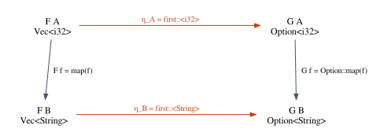

# Chapter 18 · Natural Transformations and Free Theorems

Here is a refactoring you have probably done without a second thought. A
function builds a vector of formatted strings from a vector of numbers and then
takes the first one:

```rust
let label = numbers.iter().map(format_number).collect::<Vec<_>>().first().cloned();
```

and you rewrite it to take the first number and format only that one:

```rust
let label = numbers.first().map(format_number);
```

You did not write a test to check that the two versions agree. You did not need
to: "take the first element" does not care what the elements are, so it cannot
matter whether you format them before or after. The same intuition tells you that
reversing a list commutes with mapping over it, that mapping does not change a
length, and that a function with the signature `fn<T>(x: T) -> T` can only hand
back its argument.

This chapter turns that intuition into mathematics, from two directions. From
category theory comes the **natural transformation**: a family of functions, one
for each type, that commutes with `map`. From type theory comes
**parametricity**: a generic function that cannot inspect its type parameter
satisfies equations that can be read off its type, the **free theorems**. The two
meet in the slogan *polymorphic functions are natural transformations*. The
chapter ends with the most famous result of elementary category theory, the
**Yoneda lemma**, which turns out to be continuation-passing style seen through a
categorical lens.

**In this chapter you will learn:**

- what a natural transformation is, how to read a naturality square, and why
  `first`, `Option::into_iter`, `reverse` and `len` are natural;
- how to check naturality squares in Rust on samples, and how to prove them in
  Lean for concrete transformations;
- how natural transformations compose, and why functors and natural
  transformations form a category of their own;
- Reynolds' parametricity and Wadler's free theorems: how a type alone yields an
  equation, and why the general statement is a meta-theorem that Lean cannot
  prove (and, with classical logic, can even refute);
- where Rust leaks parametricity: trait bounds, `size_of`, `Any`, panics and side
  effects, specialization;
- the Yoneda lemma, as continuation-passing style in Rust and as a proved
  isomorphism in Lean, and Mathlib's `NatTrans` and `yoneda`.

## From functors to maps between functors

Chapter 17 introduced functors. On the category of types, a functor is a type
constructor `F` together with a function

$$
\mathrm{map} : (\alpha \to \beta) \to F\,\alpha \to F\,\beta
$$

that satisfies two laws: mapping the identity does nothing, and mapping a
composite is the same as mapping twice.

$$
\mathrm{map}\ \mathrm{id} = \mathrm{id}
\qquad\qquad
\mathrm{map}\,(g \circ f) = \mathrm{map}\,g \circ \mathrm{map}\,f
$$

`Option`, `Vec`, `Result<_, E>` and the pair `(E, _)` are functors in this sense;
in Rust each comes with its own `map` method, and Chapter 17 explained why Rust
has no `Functor` trait to collect them (no higher-kinded types).

Once you have functors, a natural next question is: what is a function *from one
functor to another*? A functor is not a type, so the question needs care. Look at
this Rust function:

```rust
/// Vec ⇒ Option: the first element, if any.
fn first<T>(v: Vec<T>) -> Option<T> {
    v.into_iter().next()
}

/// Option ⇒ Vec: zero or one element (this is `Option::into_iter`, collected).
fn option_to_vec<T>(o: Option<T>) -> Vec<T> {
    o.into_iter().collect()
}

/// Vec ⇒ Vec: the same elements in the opposite order.
fn reverse<T>(mut v: Vec<T>) -> Vec<T> {
    v.reverse();
    v
}

/// Vec ⇒ Const<usize>: the length. Mapping never changes it.
fn len<T>(v: Vec<T>) -> usize {
    v.len()
}
```

The full program is in `code/rust/examples/ch18_naturality.rs`. `first` is not one
function but a family of them: `first::<i32>` takes a `Vec<i32>` to an
`Option<i32>`, `first::<String>` takes a `Vec<String>` to an `Option<String>`, and
so on for every type. Monomorphization (Chapter 12) makes this literal: the
compiler emits one machine-code function per type at which `first` is used. So
`first` is a family of functions $F\,\alpha \to G\,\alpha$, one for each type
$\alpha$, where the functor $F$ is `Vec` and the functor $G$ is `Option`. The same is
true of `option_to_vec` (from `Option` to `Vec`), of `reverse` (from `Vec` to
itself) and, with a little imagination, of `len`: its result type `usize` does not
mention `T`, but we can see it as the **constant functor** $\mathrm{Const}_{\mathtt{usize}}$, which
sends every type to `usize` and every function to the identity.

A family of functions of this shape is the raw material. A natural transformation
is such a family that, in addition, behaves *uniformly*.

## Naturality

### The definition

Let $\mathcal{C}$ and $\mathcal{D}$ be categories and $F, G$ two functors from
$\mathcal{C}$ to $\mathcal{D}$. A **natural transformation** $\eta : F \Rightarrow G$
consists of

- for every object $a$ of $\mathcal{C}$, a morphism $\eta_a : F\,a \to G\,a$ of
  $\mathcal{D}$, called the **component** of $\eta$ at $a$;

such that

- for every morphism $f : a \to b$ of $\mathcal{C}$, the **naturality equation**
  holds:

$$
G\,f \circ \eta_a \;=\; \eta_b \circ F\,f
$$

Here $F\,f : F\,a \to F\,b$ and $G\,f : G\,a \to G\,b$ are what the functors do to
the morphism $f$; for functors on types, they are `map f` for `F` and for `G`. Both
sides of the equation are morphisms from $F\,a$ to $G\,b$, and the equation says
that the two ways of getting there agree. It is usually drawn as a square, the
**naturality square**, and "naturality" means "this square commutes" (Chapter 16
introduced commutative diagrams):



Read the square as two programs. The path along the top and down the right side
transforms first and maps afterwards: `first(v).map(f)`. The path down the left
side and along the bottom maps first and transforms afterwards:
`first(v.into_iter().map(f).collect())`. Naturality says that for every `f` and
every `v`, the two programs return the same value. In words: *a natural
transformation changes the shape of the container without looking at, or
depending on, the elements*. Mapping changes the elements without touching the
shape; the two operations do not interfere.

### Examples on types

For functors on types the naturality equation is an equation between functions,
which we can state pointwise. Here are the transformations of the Rust listing,
with their equations ($x$ is any input, $f$ any function):

| Transformation | From ⇒ To | Naturality equation |
|---|---|---|
| `first` | `Vec` ⇒ `Option` | $\mathrm{first}(\mathrm{map}\,f\,v) = \mathrm{map}\,f\,(\mathrm{first}\,v)$ |
| `option_to_vec` | `Option` ⇒ `Vec` | $\mathrm{toVec}(\mathrm{map}\,f\,o) = \mathrm{map}\,f\,(\mathrm{toVec}\,o)$ |
| `reverse` | `Vec` ⇒ `Vec` | $\mathrm{rev}(\mathrm{map}\,f\,v) = \mathrm{map}\,f\,(\mathrm{rev}\,v)$ |
| `len` | `Vec` ⇒ $\mathrm{Const}_{\mathtt{usize}}$ | $\mathrm{len}(\mathrm{map}\,f\,v) = \mathrm{len}\,v$ |
| `Some` | $\mathrm{Id}$ ⇒ `Option` | $\mathrm{Some}(f\,x) = \mathrm{map}\,f\,(\mathrm{Some}\,x)$ |

The last two rows deserve a comment. For `len`, the target functor is constant, so
its `map f` is the identity and the equation says "mapping does not change the
length". For `Some`, the source is the **identity functor** $\mathrm{Id}$, which
sends every type to itself and every function to itself; the equation says that
wrapping and then mapping is the same as applying and then wrapping.

Not every family of functions is natural. Imagine a trait `Pick` with a method
`fn pick(v: Vec<Self>) -> Option<Self>`, implemented for `i32` by returning the
*last* element and for `String` by returning the *first*. That is a perfectly good
family of functions `Vec<α> → Option<α>` (for the two types that implement the
trait), but with `f = |n: i32| n.to_string()` and `v = vec![1, 2]` the two paths
around the square give `Some("2")` and `Some("1")`. Ad-hoc polymorphism (Chapter 14)
lets each type have its own unrelated code, and naturality is exactly the property
that such independent choices destroy.

## Checking naturality in Rust

Since Rust has no higher-kinded types, we cannot write a function that takes "a
functor `F`" as a parameter. We can still check a naturality square, by passing
the pieces of the square as ordinary closures: the two components and the two
lifted maps.

```rust
/// Checks one naturality square on one input `x : F<A>`.
///
/// Without higher-kinded types we cannot write "for every functor F", so the
/// caller passes the two components (`eta_a`, `eta_b`) and the two lifted
/// maps (`map_f` is F(f), `map_g` is G(f)) as ordinary closures.
fn square<FA, FB, GA, GB>(
    x: FA,
    eta_a: impl Fn(FA) -> GA,
    eta_b: impl Fn(FB) -> GB,
    map_f: impl Fn(FA) -> FB,
    map_g: impl Fn(GA) -> GB,
) -> (GB, GB)
where
    FA: Clone,
{
    let right_then_down = eta_b(map_f(x.clone())); // map first, then transform
    let down_then_right = map_g(eta_a(x)); // transform first, then map
    (right_then_down, down_then_right)
}

/// `map` for vectors, written out so that the squares below read clearly.
fn vmap<A, B>(f: impl Fn(A) -> B) -> impl Fn(Vec<A>) -> Vec<B> {
    move |v| v.into_iter().map(&f).collect()
}

fn report<T: PartialEq + Debug>(name: &str, input: &str, (lhs, rhs): (T, T)) {
    let verdict = if lhs == rhs { "commutes" } else { "FAILS" };
    println!("{name:<14} {input:<11} {lhs:?} vs {rhs:?}: {verdict}");
}
```

`square` takes an input `x : F<A>` and returns the two corners it reaches in
$G\,B$, one along each path. `eta_a` and `eta_b` are the components at $A$ and $B$
(for `first`, the instantiations `first::<i32>` and `first::<String>`, which Rust
infers from the closure types), `map_f` is $F\,f$ and `map_g` is $G\,f$. The helper
`vmap` builds $\mathrm{map}\,f$ for vectors. Then `main` checks a few squares:

```rust
let tens = |n: i32| n * 10;
let show = |n: i32| format!("<{n}>");
report(
    "first",
    "[3, 1, 2]",
    square(vec![3, 1, 2], first, first, vmap(show), |o| o.map(show)),
);
report(
    "first",
    "[]",
    square(vec![], first, first, vmap(show), |o| o.map(show)),
);
report(
    "option_to_vec",
    "Some(7)",
    square(
        Some(7),
        option_to_vec,
        option_to_vec,
        |o| o.map(tens),
        vmap(tens),
    ),
);
report(
    "reverse",
    "[3, 1, 2]",
    square(vec![3, 1, 2], reverse, reverse, vmap(show), vmap(show)),
);
report(
    "len",
    "[3, 1, 2]",
    square(vec![3, 1, 2], len, len, vmap(show), |n| n),
);
```

```text
first          [3, 1, 2]   Some("<3>") vs Some("<3>"): commutes
first          []          None vs None: commutes
option_to_vec  Some(7)     [70] vs [70]: commutes
reverse        [3, 1, 2]   ["<2>", "<1>", "<3>"] vs ["<2>", "<1>", "<3>"]: commutes
len            [3, 1, 2]   3 vs 3: commutes
```

Every square commutes, including the one for the empty vector. Each line is a
test of one input. The rest of the chapter shows that for these functions the
tests are, in a precise sense, unnecessary: the equation holds for *every* input
and *every* `f`, and the reason is visible in the type.

## Naturality in Lean

### A functor class, and natural transformations

The Lean code for this section is in `code/lean/Book/Ch18/Natural.lean`. Chapter 17
built a functor class with laws; to keep this chapter independent of Chapter 17's
files, we redefine a small one here. We call it `TypeFunctor`, because core Lean
already has a class called `Functor` (the one behind `<$>`), and we want no
confusion between the two:

```lean
/-- A functor from the category of Lean types to itself: a type constructor `F`
with a `map` that preserves identities and composition. -/
class TypeFunctor (F : Type → Type) where
  map : {α β : Type} → (α → β) → F α → F β
  map_id : ∀ {α : Type} (x : F α), map id x = x
  map_comp : ∀ {α β γ : Type} (g : β → γ) (f : α → β) (x : F α),
    map (g ∘ f) x = map g (map f x)
```

A `TypeFunctor` is a type constructor `F : Type → Type` with a `map` and proofs of
the two functor laws. Here are the instances we need: `Option` and `List` (whose
laws are library lemmas or short case analyses), the identity functor `Ident` and
the constant functor `Const C`.

```lean
instance : TypeFunctor Option where
  map := Option.map
  map_id x := by cases x <;> rfl
  map_comp _ _ x := by cases x <;> rfl

instance : TypeFunctor List where
  map := List.map
  map_id x := List.map_id x
  map_comp _ _ _ := List.map_map.symm

/-- The identity functor: `Ident α` is just `α`. -/
def Ident (α : Type) : Type := α

instance : TypeFunctor Ident where
  map f x := f x
  map_id _ := rfl
  map_comp _ _ _ := rfl

/-- The constant functor: `Const C α` is `C`, whatever `α` is, and `map f`
does nothing. -/
def Const (C : Type) (_ : Type) : Type := C

instance (C : Type) : TypeFunctor (Const C) where
  map _ x := x
  map_id _ := rfl
  map_comp _ _ _ := rfl
```

`Ident α` *is* `α` and `Const C α` *is* `C`; giving them names lets instances
attach to them. For both, the laws hold by `rfl`: `Ident`'s `map f` is `f` itself,
and `Const`'s `map f` returns its argument unchanged.

A natural transformation is now a structure with two fields, the components and
the proof of naturality:

```lean
/-- A natural transformation from `F` to `G`: one function `F α → G α` for
every type `α` (the *components*), such that every naturality square
commutes. -/
structure NatTrans (F G : Type → Type) [TypeFunctor F] [TypeFunctor G] where
  app : (α : Type) → F α → G α
  naturality : ∀ {α β : Type} (f : α → β) (x : F α),
    app β (map f x) = map f (app α x)
```

`app α` is the component $\eta_\alpha$ (the name `app` is Mathlib's).
`naturality` is the equation, stated pointwise: for every `f : α → β` and every
`x : F α`, transforming the mapped input equals mapping the transformed input.
Instance resolution picks `F`'s `map` on the left and `G`'s on the right. A value
of type `NatTrans F G` is the family *together with* a proof that it is natural;
Lean will not accept the family alone.

### Proving the squares

Here is `List.head?`, Lean's version of `first`, as a natural transformation:

```lean
/-- `List.head?` is natural: taking the head and then mapping is the same as
mapping and then taking the head. -/
def headNat : NatTrans List Option where
  app _ := List.head?
  naturality f xs := by
    -- Goal: (List.map f xs).head? = Option.map f xs.head?
    cases xs with
    | nil => rfl            -- both sides are `none`
    | cons a rest => rfl    -- both sides are `some (f a)`
```

The component at every type is `List.head?`. The proof of naturality starts from
the goal written in the comment: `List.head?` of the mapped list equals
`Option.map f` of the head. The tactic `cases xs with` splits on the two ways a
list can be built. If `xs` is `[]`, both sides compute to `none`, and `rfl` closes
the goal. If `xs` is `a :: rest`, the left side computes to
`(f a :: List.map f rest).head?`, which is `some (f a)`, and the right side to
`Option.map f (some a)`, which is also `some (f a)`; again `rfl`. The proof
mirrors the reason the square commutes: the head of a list depends only on whether
the list is empty, which mapping does not change, and on its first element, which
mapping changes in exactly the way `Option.map` does.

`Option.toList` (Rust's `Option::into_iter` followed by `collect`) is the same
kind of proof:

```lean
/-- `Option.toList` is natural (Rust's `Option::into_iter`, collected). -/
def toListNat : NatTrans Option List where
  app _ := Option.toList
  naturality f o := by
    cases o <;> rfl
```

The combinator `<;>` runs the tactic on its right in every goal produced by the
tactic on its left: `cases o` produces the `none` and `some` cases, and `rfl`
closes both.

`List.reverse` needs an induction, because the reverse of `a :: rest` is defined
in terms of the reverse of `rest`:

```lean
/-- `List.reverse` is natural. This time the two paths agree only after an
induction on the list. -/
theorem map_reverse' {α β : Type} (f : α → β) (xs : List α) :
    List.map f xs.reverse = (List.map f xs).reverse := by
  induction xs with
  | nil => rfl
  | cons a rest ih =>
    -- Goal: map f (reverse (a :: rest)) = reverse (map f (a :: rest))
    simp only [List.reverse_cons, List.map_append, List.map_cons, List.map_nil, ih]

def reverseNat : NatTrans List List where
  app _ := List.reverse
  naturality f xs := (map_reverse' f xs).symm
```

The base case is `rfl`: both sides are `[]`. In the inductive case the goal is
`map f (reverse (a :: rest)) = reverse (map f (a :: rest))`, and the induction
hypothesis `ih` says the same thing for `rest`. The `simp only [...]` call
rewrites with exactly the listed lemmas and nothing else: `List.reverse_cons`
turns `reverse (a :: rest)` into `reverse rest ++ [a]` (on both sides, since
`map f (a :: rest)` becomes `f a :: map f rest` by `List.map_cons`),
`List.map_append` distributes `map` over `++`, `List.map_nil` handles the
singleton's tail, and `ih` replaces `map f (reverse rest)` by
`reverse (map f rest)`. After these rewrites both sides read
`reverse (map f rest) ++ [f a]`, and `simp` closes the goal. (Lean's library
already has this lemma as `List.map_reverse`; proving it once by hand shows what is
inside.) The natural transformation `reverseNat` then just packages the lemma,
with `.symm` flipping the equation into the orientation `NatTrans` expects.

The remaining two rows of the table are one-liners:

```lean
/-- `List.length` is a natural transformation into a constant functor:
mapping does not change the length. -/
def lengthNat : NatTrans List (Const ℕ) where
  app _ := List.length
  naturality f xs := List.length_map (as := xs) f

/-- `some` is a natural transformation from the identity functor to `Option`. -/
def someNat : NatTrans Ident Option where
  app _ x := some x
  naturality _ _ := rfl
```

For `lengthNat`, the goal is `(List.map f xs).length = xs.length` (the constant
functor's `map` disappears), which is the library lemma `List.length_map`. For
`someNat`, both sides are `some (f x)` by definition. And the components really
are the functions we started from:

```lean
/-- info: some 3 -/
#guard_msgs in
#eval headNat.app ℕ [3, 1, 2]

/-- info: [2, 1, 3] -/
#guard_msgs in
#eval reverseNat.app ℕ [3, 1, 2]
```

Compare this with Rust. The Rust program checked five squares on five inputs. The
Lean file proves the same five squares for all inputs, all types and all
functions `f`, once each.

## Composing natural transformations

### Vertical composition

If $\eta : F \Rightarrow G$ and $\theta : G \Rightarrow H$, you can follow one by
the other: the components $\theta_a \circ \eta_a : F\,a \to H\,a$ form a family
from $F$ to $H$. This is called **vertical composition** (picture the three
functors stacked vertically, with the transformations as arrows between them), and
the composite is again natural. On paper: for $f : a \to b$,

$$
H f \circ \theta_a \circ \eta_a
\;=\; \theta_b \circ G f \circ \eta_a
\;=\; \theta_b \circ \eta_b \circ F f
$$

using the naturality of $\theta$ for the first step and of $\eta$ for the second.
In other words, you can paste two commuting squares side by side and the outer
rectangle commutes. In Lean:

```lean
/-- Vertical composition: first `η : F ⇒ G`, then `θ : G ⇒ H`. -/
def NatTrans.vcomp {F G H : Type → Type} [TypeFunctor F] [TypeFunctor G]
    [TypeFunctor H] (θ : NatTrans G H) (η : NatTrans F G) : NatTrans F H where
  app α x := θ.app α (η.app α x)
  naturality f x := by
    -- Goal: θ.app β (η.app β (map f x)) = map f (θ.app α (η.app α x))
    rw [η.naturality, θ.naturality]

/-- The identity natural transformation. -/
def NatTrans.id (F : Type → Type) [TypeFunctor F] : NatTrans F F where
  app _ x := x
  naturality _ _ := rfl
```

The proof is the paper proof, read from the left: `rw [η.naturality]` rewrites
`η.app β (map f x)` into `map f (η.app α x)`, so the left side becomes
`θ.app β (map f (η.app α x))`; then `rw [θ.naturality]` rewrites that into
`map f (θ.app α (η.app α x))`, which is the right side, and `rw` closes the goal by
reflexivity. The identity transformation, whose components are identity
functions, is natural for the trivial reason that both sides are `map f x`.

Composition gives naturality for free. "The first element, as a list of length at
most one" is the composite of `headNat` and `toListNat`, and its naturality needs
no new proof:

```lean
/-- "The first element, as a list of length at most one": natural with no new
proof, because it is a composite of natural transformations. -/
def firstAsList : NatTrans List List := toListNat.vcomp headNat

/-- info: [3] -/
#guard_msgs in
#eval firstAsList.app ℕ [3, 1, 2]

example (f : ℕ → String) (xs : List ℕ) :
    firstAsList.app String (xs.map f) = (firstAsList.app ℕ xs).map f :=
  firstAsList.naturality f xs
```

The `example` uses the composite's `naturality` field, which `vcomp` built from
the naturality of the two pieces.

Vertical composition is associative and has the identity as a unit. To prove
equations between natural transformations, we first need to know when two of them
are equal:

```lean
/-- Two natural transformations are equal when their components are. The
naturality fields are proofs, and any two proofs of the same proposition are
equal, so they take care of themselves. -/
theorem NatTrans.ext' {F G : Type → Type} [TypeFunctor F] [TypeFunctor G]
    {η θ : NatTrans F G} (h : ∀ α x, η.app α x = θ.app α x) : η = θ := by
  cases η with
  | mk app₁ nat₁ =>
    cases θ with
    | mk app₂ nat₂ =>
      -- Turn the pointwise equality into an equality of functions.
      have : app₁ = app₂ := funext fun α => funext fun x => h α x
      subst this
      rfl
```

`cases` takes both structures apart into their fields. `funext` (function
extensionality, Chapter 16) turns the pointwise hypothesis `h` into an equality
`app₁ = app₂`, and `subst` replaces `app₂` by `app₁` everywhere. What remains is
`⟨app₁, nat₁⟩ = ⟨app₁, nat₂⟩`, where `nat₁` and `nat₂` are proofs of the same
proposition; any two such proofs are equal by definition (proof irrelevance,
Chapter 10), so `rfl` closes the goal. With this lemma the category laws are
immediate:

```lean
variable {F G H K : Type → Type} [TypeFunctor F] [TypeFunctor G] [TypeFunctor H]
  [TypeFunctor K]

theorem NatTrans.id_vcomp (η : NatTrans F G) : (NatTrans.id G).vcomp η = η :=
  NatTrans.ext' fun _ _ => rfl

theorem NatTrans.vcomp_id (η : NatTrans F G) : η.vcomp (NatTrans.id F) = η :=
  NatTrans.ext' fun _ _ => rfl

theorem NatTrans.vcomp_assoc (ι : NatTrans H K) (θ : NatTrans G H)
    (η : NatTrans F G) : ι.vcomp (θ.vcomp η) = (ι.vcomp θ).vcomp η :=
  NatTrans.ext' fun _ _ => rfl
```

Each law holds componentwise by `rfl`, because composing and identity functions
satisfy these laws by computation.

### The functor category

Everything so far was about functors on types, but the definitions make sense for
any two categories, and Lean can say so with the book's own `Category` class from
Chapter 16. The file `code/lean/Book/Ch18/FunctorCategory.lean` imports
`Book.Ch16.Category` and redefines Chapter 17's notion of a functor between
categories (again, to keep the chapters independent):

```lean
/-- A functor between two categories: a map on objects and a map on morphisms
that preserves identities and composition. -/
structure CatFunctor (C D : Type) [Category C] [Category D] where
  obj : C → D
  map : {a b : C} → (a ⟶ b) → (obj a ⟶ obj b)
  map_id : ∀ a : C, map (Category.id a) = Category.id (obj a)
  map_comp : ∀ {a b c : C} (g : b ⟶ c) (f : a ⟶ b), map (g ⊚ f) = map g ⊚ map f
```

```lean
/-- A natural transformation `F ⇒ G`: a morphism `F a ⟶ G a` in `D` for every
object `a` of `C`, such that every naturality square commutes. -/
structure CatNatTrans (F G : CatFunctor C D) where
  app : (a : C) → (F.obj a ⟶ G.obj a)
  naturality : ∀ {a b : C} (f : a ⟶ b), app b ⊚ F.map f = G.map f ⊚ app a
```

The notation is Chapter 16's: `a ⟶ b` is the type of morphisms, and `g ⊚ f` is
"first `f`, then `g`". The naturality field is the square, now as an equation
between morphisms of `D` with no points in sight: `app b ⊚ F.map f` (map, then
transform) equals `G.map f ⊚ app a` (transform, then map). Vertical composition
is proved by moving parentheses:

```lean
namespace CatNatTrans

/-- The identity natural transformation. -/
def id (F : CatFunctor C D) : CatNatTrans F F where
  app a := Category.id (F.obj a)
  naturality f := by
    -- id ⊚ F.map f = F.map f ⊚ id
    rw [Category.id_comp, Category.comp_id]

/-- Vertical composition: first `η : F ⇒ G`, then `θ : G ⇒ H`. -/
def vcomp {F G H : CatFunctor C D} (θ : CatNatTrans G H) (η : CatNatTrans F G) :
    CatNatTrans F H where
  app a := θ.app a ⊚ η.app a
  naturality f := by
    -- Goal: (θ_b ⊚ η_b) ⊚ F f = H f ⊚ (θ_a ⊚ η_a)
    rw [← Category.assoc, η.naturality, Category.assoc, θ.naturality,
      ← Category.assoc]
```

Read the rewrite chain as the paper proof. The goal is
`(θ_b ⊚ η_b) ⊚ F f = H f ⊚ (θ_a ⊚ η_a)`. `← Category.assoc` regroups the left
side as `θ_b ⊚ (η_b ⊚ F f)`; `η.naturality` replaces the inner part by
`G f ⊚ η_a`; `Category.assoc` regroups to `(θ_b ⊚ G f) ⊚ η_a`; `θ.naturality`
replaces `θ_b ⊚ G f` by `H f ⊚ θ_a`; and a final `← Category.assoc` produces
`H f ⊚ (θ_a ⊚ η_a)`, the right side. With an extensionality lemma like the one
above (`CatNatTrans.ext`, in the file), we can state the punchline: functors from
`C` to `D` are the objects of a category whose morphisms are natural
transformations.

```lean
/-- The functor category: objects are functors `C ⥤ D`, morphisms are natural
transformations, composition is vertical composition. The laws are inherited,
component by component, from the laws of `D`. -/
instance functorCategory : Category (CatFunctor C D) where
  Hom F G := CatNatTrans F G
  id F := CatNatTrans.id F
  comp θ η := CatNatTrans.vcomp θ η
  id_comp _ := CatNatTrans.ext fun _ => Category.id_comp _
  comp_id _ := CatNatTrans.ext fun _ => Category.comp_id _
  assoc _ _ _ := CatNatTrans.ext fun _ => Category.assoc _ _ _
```

This is the **functor category**, often written $[\mathcal{C}, \mathcal{D}]$ or
$\mathcal{D}^{\mathcal{C}}$. Each of its laws is `CatNatTrans.ext` followed by
the corresponding law of `D` at every object. Historically, natural transformations
came first: Samuel Eilenberg and Saunders Mac Lane invented category theory in the
1940s largely to say precisely what "natural" means in mathematics, and introduced
categories and functors because they were needed to define it.

A small example shows how much the general definition can mean. In a preorder
viewed as a category (Chapter 16), there is a morphism $a \to b$ exactly when
$a \le b$, and a functor between preorders is a monotone function.

```lean
/-- The natural numbers ordered by `≤`, as a category: there is one morphism
`a ⟶ b` exactly when `a ≤ b` (`PLift` turns the proof into data). The instance
is local to this file. -/
local instance leCategory : Category ℕ where
  Hom a b := PLift (a ≤ b)
  id a := ⟨Nat.le_refl a⟩
  comp g f := ⟨Nat.le_trans f.down g.down⟩
  id_comp _ := rfl
  comp_id _ := rfl
  assoc _ _ _ := rfl

/-- A monotone function is a functor on `(ℕ, ≤)`. The functor laws hold by
`rfl`: any two proofs of the same inequality are equal. -/
def monotone (f : ℕ → ℕ) (mono : ∀ {a b : ℕ}, a ≤ b → f a ≤ f b) :
    CatFunctor ℕ ℕ where
  obj := f
  map h := ⟨mono h.down⟩
  map_id _ := rfl
  map_comp _ _ := rfl
```

A morphism `a ⟶ b` is a proof of `a ≤ b`, wrapped with `PLift` to turn a proof
into data (the `Category` class wants morphisms in `Type`, and proofs live in
`Prop`). The instance is `local`, so that it does not attach itself to `ℕ` in any
other file. Since any two proofs of `a ≤ b` are equal, every diagram in this
category commutes, and in particular every naturality square. A natural
transformation between monotone maps is therefore nothing more than a family of
inequalities:

```lean
/-- Between monotone maps, a natural transformation is exactly a pointwise
inequality: naturality squares commute automatically in a preorder. -/
theorem natTrans_iff_le (F G : CatFunctor ℕ ℕ) :
    Nonempty (CatNatTrans F G) ↔ ∀ n, F.obj n ≤ G.obj n := by
  constructor
  · -- A natural transformation gives a morphism `F n ⟶ G n`, a proof of `≤`.
    rintro ⟨η⟩ n
    exact (η.app n).down
  · -- Conversely, the inequalities are the components, and every naturality
    -- square commutes because both paths are proofs of the same `≤`.
    intro h
    exact ⟨{ app := fun n => ⟨h n⟩, naturality := fun _ => rfl }⟩

def double : CatFunctor ℕ ℕ := monotone (fun n => 2 * n) (by omega)
def succ : CatFunctor ℕ ℕ := monotone (fun n => n + 1) (by omega)

/-- There is a natural transformation from the identity to `double`... -/
example : Nonempty (CatNatTrans (monotone id fun h => h) double) :=
  (natTrans_iff_le _ _).mpr fun n => show n ≤ 2 * n by omega

/-- ...but none from `succ` to `double`: the component at `0` would be a proof
of `1 ≤ 0`. -/
example : ¬ Nonempty (CatNatTrans succ double) := by
  rw [natTrans_iff_le]
  intro h
  have : 0 + 1 ≤ 2 * 0 := h 0
  omega
```

`natTrans_iff_le` says that a natural transformation from `F` to `G` exists if and
only if `F n ≤ G n` for every `n`. In one direction, the component at `n` *is* a
proof of `F n ≤ G n`. In the other, the inequalities serve as components, and the
naturality obligation `fun _ => rfl` holds because both sides of each square are
proofs of the same inequality. (`rintro ⟨η⟩ n` introduces the hypothesis and
takes the `Nonempty` apart in one step.) There is a natural transformation from the
identity to doubling, since $n \le 2n$, but none from successor to doubling: its
component at `0` would prove $1 \le 0$, which `omega` refutes. Natural
transformations between monotone maps are the pointwise order on them. Chapter 27
will view lifetimes as a preorder of this kind, and variance as functoriality on
it.

## Parametricity: theorems for free

### One function at a time, or all at once?

We proved naturality one function at a time. But the intuition from the start of
the chapter says more: *any* function with the signature
`fn<T>(Vec<T>) -> Option<T>` should commute with `map`. It can drop elements,
rearrange them, and choose which one to return based on positions or on the
length, but not based on values, because it knows nothing about their type.

That claim is a theorem, due to John Reynolds (*Types, Abstraction and Parametric
Polymorphism*, 1983), and Philip Wadler made it famous as a recipe for deriving
equations from types (*Theorems for free!*, 1989). The property is called
**parametricity**, and the equations it produces are **free theorems**: free
because you get them from the type alone, without looking at the code.

### Relations instead of functions

Reynolds' insight was to interpret every type not as a set of values but as a
*relation* between values. Fix two types $A$ and $B$ and a relation
$R \subseteq A \times B$ (any relation: think of it as "a pairs with b"). For a
type expression $\tau$ that mentions the type variable $\alpha$, define a relation
$\llbracket \tau \rrbracket_R$ between $\tau[A/\alpha]$ and $\tau[B/\alpha]$ by
recursion on $\tau$:

- $\llbracket \alpha \rrbracket_R = R$: at the type variable, use the given
  relation.
- $\llbracket \mathtt{bool} \rrbracket_R$ is equality, and the same for every
  other type that does not mention $\alpha$: a boolean on the left is related only
  to the same boolean on the right.
- $\llbracket \tau \times \sigma \rrbracket_R$ relates $(x_1, x_2)$ to
  $(y_1, y_2)$ when $x_1$ is related to $y_1$ at $\tau$ and $x_2$ to $y_2$ at
  $\sigma$.
- $\llbracket \mathrm{List}\,\tau \rrbracket_R$ relates two lists when they have
  the same length and their elements are related position by position.
- $\llbracket \tau \to \sigma \rrbracket_R$ relates two functions $g$ and $h$
  when they send related arguments to related results: whenever $x$ is related to
  $y$ at $\tau$, $g\,x$ is related to $h\,y$ at $\sigma$.

The last clause is the heart of it. A related pair of functions is one that
"respects" the relation: it cannot tell related inputs apart in a way that would
make the outputs unrelated.

**The abstraction theorem** (Reynolds). If $t$ is a closed term of type
$\forall\alpha.\,\tau$ in a language like System F (Chapter 12) with no way to
inspect types, no effects and no non-termination, then for all types $A$, $B$ and
every relation $R \subseteq A \times B$, the two instances $t_A$ and $t_B$ are
related by $\llbracket \tau \rrbracket_R$.

In words: every polymorphic term respects every relation. The proof is by
induction on the typing derivation of $t$, one case per typing rule, and it is a
*meta-theorem*: a theorem about all the terms of a language, proved from outside
the language. We will return to this point, because it is exactly what Lean cannot
do internally.

### The free theorem for the identity

Let $t : \forall\alpha.\,\alpha \to \alpha$. Pick any type $A$ and any value
$a : A$, and choose the relation that relates $a$ to itself and nothing else:

$$
R = \{(a, a)\} \subseteq A \times A
$$

By the abstraction theorem, $t_A$ is related to $t_A$ at $\llbracket \alpha \to
\alpha \rrbracket_R$. By the function clause, since $(a, a) \in R$, we get
$(t_A\,a, t_A\,a) \in R$. The only pair in $R$ is $(a, a)$, so $t_A\,a = a$. Since
$A$ and $a$ were arbitrary, $t$ is the identity: **a total, pure function of type
$\forall\alpha.\,\alpha \to \alpha$ can only return its argument**. You knew this
informally (what else could `fn id<T>(x: T) -> T` return?); now you have a proof,
and its assumptions are spelled out: no type inspection, no effects, termination.

### The free theorem for lists

Let $r : \forall\alpha.\,\mathrm{List}\,\alpha \to \mathrm{List}\,\alpha$ and take
any function $f : A \to B$. This time choose the **graph** of $f$ as the relation:

$$
R = \{(a, f\,a) \mid a \in A\}
$$

Two lists are related at $\llbracket \mathrm{List}\,\alpha \rrbracket_R$ exactly
when the second is the first with $f$ applied to every element, that is,
$ys = \mathrm{map}\,f\,xs$. The abstraction theorem says that $r_A$ and $r_B$ send
related lists to related lists. Feed them the related pair
$(xs, \mathrm{map}\,f\,xs)$: the outputs $r_A\,xs$ and $r_B\,(\mathrm{map}\,f\,xs)$
are related, which means

$$
r_B\,(\mathrm{map}\,f\,xs) \;=\; \mathrm{map}\,f\,(r_A\,xs)
$$

This is precisely the naturality square. The same argument works for any
functorial types built from $\alpha$ with products, sums, lists and similar
constructors, and gives the slogan of the chapter: **every parametric polymorphic
function $\forall\alpha.\,F\,\alpha \to G\,\alpha$ is a natural transformation**.
`first`, `reverse` and `len` are natural not because of how they are implemented
but because of their types.

Other types give other free theorems. A few, all obtained the same way (choose
graphs of functions as the relations and unfold the clauses):

| Type | Free theorem |
|---|---|
| $\forall\alpha.\,\alpha \to \alpha$ | the function is the identity |
| $\forall\alpha\,\beta.\,\alpha \to \beta \to \alpha$ | the function returns its first argument |
| $\forall\alpha.\,\alpha \to \mathtt{usize}$ | the function is constant |
| $\forall\alpha.\,\mathrm{List}\,\alpha \to \mathtt{usize}$ | the result depends only on the length |
| $\forall\alpha.\,\mathrm{List}\,\alpha \to \mathrm{List}\,\alpha$ | it commutes with $\mathrm{map}\,f$ for every $f$ |
| $\forall\alpha\,\beta.\,\alpha \to \beta$ | there is no such total function |

The last row is the logical reading from Chapter 10: $\forall\alpha\,\beta.\,
\alpha \to \beta$ would prove every proposition from every other, and the free
theorem confirms that no total, parametric program has this type. Rust can write
`fn coerce<A, B>(a: A) -> B` only with `panic!`, `loop {}` or `unsafe`.

### Parametricity for `reverse`, in Lean

Lean cannot prove the abstraction theorem for itself (the next section explains
why), but it can prove the relational property for one specific function, and
that shows exactly how the free theorem falls out. The file is
`code/lean/Book/Ch18/Parametricity.lean`. First, the relational lifting of a
relation to lists, as an inductive predicate: two lists are related when both are
empty, or when their heads are related and their tails are related.

```lean
/-- The relational lifting of `R` to lists: two lists are related when they
have the same length and related elements in every position. -/
inductive ListRel {α β : Type} (R : α → β → Prop) : List α → List β → Prop
  | nil : ListRel R [] []
  | cons {a b xs ys} : R a b → ListRel R xs ys → ListRel R (a :: xs) (b :: ys)
```

This is the clause for $\llbracket \mathrm{List}\,\tau \rrbracket_R$. Related
lists can be concatenated, by induction on the first relatedness proof:

```lean
/-- Related lists concatenate to related lists. -/
theorem ListRel.append {α β : Type} {R : α → β → Prop} {xs ys xs' ys'}
    (h : ListRel R xs ys) (h' : ListRel R xs' ys') :
    ListRel R (xs ++ xs') (ys ++ ys') := by
  induction h with
  | nil => exact h'
  | cons hab _ ih => exact ListRel.cons hab ih
```

`induction h with` does induction on the *derivation* of `ListRel R xs ys`, the
way Chapter 4 did induction on derivations: in the `nil` case `xs` and `ys` are
both empty and the goal is `h'` itself; in the `cons` case we rebuild the `cons`
with the induction hypothesis for the tails. Now the relational property of
`reverse`, for every relation between any two types:

```lean
/-- **Parametricity of `reverse`.** For every relation `R` between any two
types, `reverse` sends related lists to related lists. -/
theorem reverse_param {α β : Type} (R : α → β → Prop) {xs : List α} {ys : List β}
    (h : ListRel R xs ys) : ListRel R xs.reverse ys.reverse := by
  induction h with
  | nil => exact ListRel.nil
  | cons hab _ ih =>
    -- reverse (a :: xs) = reverse xs ++ [a], and the same on the right.
    simp only [List.reverse_cons]
    exact ih.append (ListRel.cons hab ListRel.nil)
```

Again by induction on the relatedness derivation. In the `cons` case,
`simp only [List.reverse_cons]` rewrites `reverse (a :: xs)` into
`reverse xs ++ [a]` on both sides, and the related reversed tails (`ih`) are
appended to the related singletons `[a]` and `[b]`.

This theorem says nothing about functions yet. To get the free theorem, we choose
the graph of a function as the relation, and check that relatedness then means
"is the image under `map f`":

```lean
/-- When `R` is the graph of a function `f`, related lists are exactly a list
and its image under `map f`. -/
theorem listRel_graph {α β : Type} (f : α → β) (xs : List α) (ys : List β) :
    ListRel (fun a b => f a = b) xs ys ↔ xs.map f = ys := by
  constructor
  · intro h
    induction h with
    | nil => rfl
    | cons hab _ ih => simp [hab, ih]
  · intro h
    subst h
    induction xs with
    | nil => exact ListRel.nil
    | cons a rest ih => exact ListRel.cons rfl ih
```

Each direction is an induction (the left-to-right one on the relatedness proof,
the right-to-left one on the list, after `subst h` replaces `ys` by
`xs.map f`). And now naturality comes out exactly as in the paper argument:

```lean
/-- The free theorem for `reverse`, obtained from parametricity by choosing the
graph of `f` as the relation: naturality. -/
theorem reverse_natural {α β : Type} (f : α → β) (xs : List α) :
    xs.reverse.map f = (xs.map f).reverse := by
  have related : ListRel (fun a b => f a = b) xs (xs.map f) :=
    (listRel_graph f xs (xs.map f)).mpr rfl
  exact (listRel_graph f _ _).mp (reverse_param _ related)
```

`related` says that `xs` and `xs.map f` are related by the graph of `f`;
`reverse_param` turns that into a relation between the reversed lists, and
`listRel_graph` reads it back as an equation. We proved the same equation by
direct induction in `Natural.lean`; the point of this detour is to see the
general recipe, abstraction theorem plus graph relation, work on one instance.

## Why Lean cannot prove the free theorem

### A meta-theorem

Why not prove the abstraction theorem in Lean once and for all, for every function
of type `(α : Type) → List α → List α`? Here is the statement for the simplest
case, the identity:

```lean
/-- The free theorem for `∀ α, α → α`, stated *inside* Lean as a proposition
about every function of that type. -/
def FreeTheoremId : Prop :=
  ∀ (f : (α : Type) → α → α) (α : Type) (a : α), f α a = a
```

`FreeTheoremId` is a perfectly good Lean proposition: for every function `f` of
type `(α : Type) → α → α` (Lean's way of writing $\forall\alpha.\,\alpha \to
\alpha$, Chapter 12), `f α a = a`. But Reynolds' theorem is not about "every
function of that type". It is about every *term*, every piece of syntax that can
be written in a particular language, and its proof goes by induction on how the
term was built. Inside Lean, a variable `f : (α : Type) → α → α` does not come
with a construction we could do induction on; it ranges over every function of
that type that Lean's logic admits. Nothing in the logic says that those functions
were all written uniformly, without looking at `α`.

And in fact, Lean's logic admits a function of that type that is not the
identity. With classical logic, Lean can ask a question about types that no
program could answer:

```lean
open Classical in
/-- A "polymorphic identity" that inspects its type argument. Classical logic
lets it ask whether `α` is `Bool` (a question no program could decide), and on
`Bool` it negates. -/
noncomputable def notId (α : Type) (a : α) : α :=
  if h : α = Bool then cast h.symm (!(cast h a)) else a

theorem notId_true : notId Bool true = false := by
  simp [notId]

/-- So the internal free theorem is not just unprovable: in Lean (with its
standard axioms) it is false. -/
theorem not_freeTheoremId : ¬ FreeTheoremId := by
  intro h
  have : notId Bool true = true := h notId Bool true
  rw [notId_true] at this
  exact Bool.false_ne_true this
```

`open Classical in` makes every proposition decidable for the next declaration
(Chapter 5 explained `Decidable` and why `if` on a `Prop` needs it). So
`if h : α = Bool then ... else ...` is allowed: if the type argument happens to be
`Bool`, `notId` uses the proof `h` to `cast` the argument to a `Bool`, negates it,
and casts back; otherwise it returns the argument. The definition is marked
`noncomputable` because there is no algorithm behind the decision "is `α` equal to
`Bool`?": Lean accepts it as a mathematical function but will not compile it to
code. `notId_true` checks, by `simp` (which unfolds `notId`, decides the `if` using
`h : Bool = Bool` and simplifies the casts), that `notId Bool true = false`. Then
`not_freeTheoremId` applies the supposed free theorem to `notId` and derives
`false = true`, a contradiction.

So inside Lean, with its standard axioms, the internal free theorem is not merely
unprovable: it is *false*. The axioms show up where they should:

```lean
/-- info: 'Ch18.Param.not_freeTheoremId' depends on axioms: [propext, Classical.choice, Quot.sound] -/
#guard_msgs in
#print axioms not_freeTheoremId

/-- info: 'Ch18.Param.reverse_natural' depends on axioms: [propext] -/
#guard_msgs in
#print axioms reverse_natural
```

The refutation uses `Classical.choice`. The free theorem for `reverse`, proved
directly, uses only `propext` (through `simp`), and no choice. What about Lean
without classical axioms? Then `notId` cannot be written, but the free theorem
cannot be proved either: if it could be proved without axioms, it would remain
provable after adding `Classical.choice`, and we have just refuted it there. (This
argument assumes Lean with choice is consistent, which is the standard belief and
the basis of all of Mathlib.)

> [!NOTE]
> Parametricity is a property of a *language*, proved about its terms from the
> outside. Researchers have designed type theories in which parametricity is an
> internal principle that you can invoke in proofs; Lean is not one of them, and
> its classical axioms are incompatible with that design. In Lean, free theorems
> are proved function by function, as we did for `reverse`.

In practice, a free theorem is a reasoning principle about the code you *write*,
in a language whose rules keep generic code from looking at types. In Lean, you
prove the equation for the function in front of you, usually in a few lines; in
Rust, you rely on it as long as the function stays inside the parametric fragment
of the language. How big is that fragment?

## Where Rust leaks parametricity

Rust's generics are designed to be parametric by default. Inside
`fn f<T>(x: T) -> T`, the body cannot compare `x` with anything, print it or copy
it. The compiler enforces this, as this rejected program
(`code/rust/compile_fail/ch18_no_peeking.rs`) shows:

```rust
fn keep_if_same<T>(a: T, b: T) -> Option<T> {
    if a == b { Some(a) } else { None }
}
```

```text
error[E0369]: binary operation `==` cannot be applied to type `T`
 --> compile_fail/ch18_no_peeking.rs:7:10
  |
7 |     if a == b { Some(a) } else { None }
  |        - ^^ - T
  |        |
  |        T
  |
help: consider restricting type parameter `T` with trait `PartialEq`
  |
6 | fn keep_if_same<T: std::cmp::PartialEq>(a: T, b: T) -> Option<T> {
  |                  +++++++++++++++++++++
```

The error E0369 says that `==` is not available for an arbitrary `T`, and the
help suggests the fix: add a bound `T: PartialEq`. That fix changes the signature,
and with it the free theorem. This is the first and most honest way Rust leaks
parametricity: **trait bounds**. There are several others.

### Trait bounds

A bound gives the function an operation on `T`, and the function may use it to
make decisions based on values. The free theorem then holds only for functions `f`
that respect the operation:

```rust
/// Needs `Ord`: it compares elements, so it is natural only for maps that
/// preserve the order.
fn largest<T: Ord>(v: Vec<T>) -> Option<T> {
    v.into_iter().max()
}

/// Needs `PartialEq`: it compares neighbors, so it is natural only for maps
/// that never make two different elements equal.
fn dedup<T: PartialEq>(mut v: Vec<T>) -> Vec<T> {
    v.dedup();
    v
}
```

```rust
println!();
let negate = |n: i32| -n;
let parity = |n: i32| n % 2;
let input = vec![3, 1, 2];
report(
    "largest, *10",
    "[3, 1, 2]",
    square(input.clone(), largest, largest, vmap(tens), |o| o.map(tens)),
);
report(
    "largest, neg",
    "[3, 1, 2]",
    square(input.clone(), largest, largest, vmap(negate), |o| {
        o.map(negate)
    }),
);
report(
    "dedup, *10",
    "[3, 1, 2]",
    square(input.clone(), dedup, dedup, vmap(tens), vmap(tens)),
);
report(
    "dedup, %2",
    "[3, 1, 2]",
    square(input, dedup, dedup, vmap(parity), vmap(parity)),
);
```

```text
largest, *10   [3, 1, 2]   Some(30) vs Some(30): commutes
largest, neg   [3, 1, 2]   Some(-1) vs Some(-3): FAILS
dedup, *10     [3, 1, 2]   [30, 10, 20] vs [30, 10, 20]: commutes
dedup, %2      [3, 1, 2]   [1, 0] vs [1, 1, 0]: FAILS
```

`largest` commutes with multiplying by 10, which preserves the order, and fails for
negation, which reverses it: the largest of the negated numbers is $-1$, while
the negation of the largest is $-3$. `dedup` commutes with an injective map and
fails for `n % 2`, which makes `3` and `1` equal and so creates a duplicate that
was not there before. These are still free theorems, just weaker ones:
parametricity with a bound `T: Ord` yields naturality for monotone maps, and with
`T: PartialEq` for injective ones. Mathlib proves the second as a library lemma,
and Lean refutes the general version with `decide`:

```lean
/-- `dedup` needs `DecidableEq`: it compares elements. It commutes with `map f`
for injective `f` (Mathlib proves this as `List.dedup_map_of_injective`)... -/
example (f : ℕ → ℕ) (hf : Function.Injective f) (xs : List ℕ) :
    (xs.map f).dedup = xs.dedup.map f :=
  List.dedup_map_of_injective hf xs

/-- ...but not for a map that identifies two elements. -/
example : ([1, 2].map fun _ => (0 : ℕ)).dedup ≠ ([1, 2] : List ℕ).dedup.map fun _ => 0 := by
  decide
```

The pleasant thing about bounds is that they are visible: `largest<T: Ord>`
announces in its signature that it looks at the elements, and a reader knows that
the free theorem has a side condition.

### `size_of`, `type_name` and `TypeId`

Some leaks need no visible bound at all:

```rust
/// Type `fn<T>(&T) -> usize`, no bound at all, yet not constant.
fn weigh<T>(_: &T) -> usize {
    size_of::<T>()
}

/// Type `fn<T: Any>(T) -> T`, but not the identity: it negates booleans.
fn sneaky_id<T: Any>(x: T) -> T {
    let mut boxed: Box<dyn Any> = Box::new(x);
    if let Some(b) = boxed.downcast_mut::<bool>() {
        *b = !*b;
    }
    *boxed.downcast::<T>().expect("the box still holds a T")
}

/// Type `fn<T>(T) -> T`, and never returns: `panic!` has type `!`.
fn stubborn<T>(_: T) -> T {
    panic!("no value of type T to return")
}
```

```text
weigh(&1u8) = 1, weigh(&1u64) = 8
weigh(&String::new()) = 24
sneaky_id(5) = 5, sneaky_id(true) = false
stubborn(7) returned normally: false
```

`weigh` has the type $\forall\alpha.\,\&\alpha \to \mathtt{usize}$, whose free
theorem says it is constant, and yet it returns 1 for `u8`, 8 for `u64` and 24
for `String` (on a 64-bit platform). The function `std::mem::size_of::<T>()`
reads a property of the type argument at compile time, and the same is true of
`align_of` and `std::any::type_name`. Strictly speaking there *is* a bound: every
type parameter in Rust has an implicit `T: Sized` bound unless you opt out with
`T: ?Sized`, and `size_of` requires it. But nobody reads `Sized` as "this function
may behave differently for different types", and the signature looks fully
parametric.

`sneaky_id` is the Rust version of Lean's `notId`. Its type is
`fn<T: Any>(T) -> T`, the type of the identity with a bound, and it negates
booleans. `Any` (Chapter 15) gives every `'static` type a runtime type identifier,
`TypeId`, and `downcast_mut::<bool>()` succeeds exactly when the boxed value is a
`bool`. Here the bound is visible, and that is the right way to read `T: Any`: it
grants the function permission to ask what `T` is, which voids the free theorem.

### Panics, non-termination and effects

`stubborn` has the type `fn<T>(T) -> T` with no bound at all, and it is not the
identity: it never returns. The free theorems assume total functions, and Rust (like
every general-purpose language, Chapter 10) lets every type be "inhabited" by
`panic!()` and `loop {}`. The honest free theorem for `fn<T>(T) -> T` in Rust is
"the identity, or it diverges". Similarly, a generic function may print, write
to a file, read the clock or update a global counter; the free theorem is about
the value it returns and says nothing about those effects. The walkthrough at the
end of the chapter uses this on purpose.

### Specialization and `unsafe`

Two more holes, for completeness. **Specialization** is an unstable feature
(nightly only, with soundness problems still being worked out; check its current
status) that would let a generic `impl<T> Trait for T` be overridden by a more
specific `impl Trait for i32`, so that generic code calling the trait method
behaves differently at `i32`. And `unsafe` code can do anything, including
reinterpreting the bytes of a `T` with `std::mem::transmute`. Both are outside the
parametric fragment.

| Leak | Visible in the signature? | Free theorem becomes |
|---|---|---|
| trait bound (`Ord`, `PartialEq`, ...) | yes | natural for maps that respect the operation |
| `T: Any` (`TypeId`, downcasting) | yes | none |
| `size_of`, `align_of`, `type_name` | no (implicit `Sized`) | none |
| `panic!`, `loop {}` | no | "... or diverges" |
| side effects | no | holds for the returned values only |
| specialization (unstable), `unsafe` | no | none |

The table is less alarming than it looks: most generic Rust code never calls
`size_of` or `Any`, and for pure, bound-free code the free theorems are as
reliable as the type checker.

## The Yoneda lemma, gently

### Continuation-passing style

Here is a puzzle. What is the difference between a value of type $\alpha$ and a
value of type

$$
\forall\beta.\,(\alpha \to \beta) \to \beta \;?
$$

The second is a function that, for any result type $\beta$, accepts a
**continuation** $k : \alpha \to \beta$ ("what to do with the value") and returns a
$\beta$. If you have a value $a$, you can build such a function: $\lambda k.\,k\,a$,
"pass $a$ to whatever continuation comes". Conversely, if you have such a function,
you can get a value out of it by choosing $\beta = \alpha$ and the identity
continuation. This is **continuation-passing style** (CPS), a program
transformation that some compilers for functional languages use to make control
flow explicit. The two types are isomorphic, and the reason is a free theorem.

In Rust, the type $\forall\beta.\,(\alpha \to \beta) \to \beta$ is rank 2 (the
$\forall\beta$ sits inside), and Chapter 12 showed how to write such types: a trait
with a generic method. The program is `code/rust/examples/ch18_yoneda.rs`.

```rust
/// `∀B. (A → B) → B`: a value of type `A` in continuation-passing style.
trait Cps<A> {
    fn run<B>(self, k: impl FnOnce(A) -> B) -> B;
}

/// The obvious implementation: hold the value, hand it to the continuation.
struct Value<A>(A);

impl<A> Cps<A> for Value<A> {
    fn run<B>(self, k: impl FnOnce(A) -> B) -> B {
        k(self.0)
    }
}

/// A less obvious one: compute the value only when a continuation arrives.
struct Deferred<F>(F);

impl<A, F: FnOnce() -> A> Cps<A> for Deferred<F> {
    fn run<B>(self, k: impl FnOnce(A) -> B) -> B {
        k((self.0)())
    }
}

/// Lowering: run with the identity continuation.
fn lower_cps<A>(c: impl Cps<A>) -> A {
    c.run(|a| a)
}
```

```rust
let show = |n: u32| format!("<{n}>");
println!("Value(42).run(show) = {}", Value(42).run(show));
println!("lower_cps(Value(42)) = {}", lower_cps(Value(42)));
let deferred = Deferred(|| 6 * 7);
println!("lower_cps(Deferred(|| 6 * 7)) = {}", lower_cps(deferred));
```

```text
Value(42).run(show) = <42>
lower_cps(Value(42)) = 42
lower_cps(Deferred(|| 6 * 7)) = 42
```

`Value` holds a value and passes it on. `Deferred` holds only a recipe and computes
the value when a continuation arrives. Both lower to `42`. In Lean the CPS type is
an ordinary dependent function type (living in `Type 1`, because it quantifies over
`Type`, Chapter 12), and one direction of the round trip holds by `rfl`:

```lean
/-- A value of type `α` in continuation-passing style: give me any
continuation `k : α → β` and I will produce a `β`. -/
def Cps (α : Type) : Type 1 := (β : Type) → (α → β) → β

/-- Pass the value to the continuation. -/
def toCps {α : Type} (a : α) : Cps α := fun _ k => k a

/-- Run with the identity continuation to get the value back. -/
def fromCps {α : Type} (c : Cps α) : α := c α id

theorem fromCps_toCps {α : Type} (a : α) : fromCps (toCps a) = a := rfl

/-- info: 42 -/
#guard_msgs in
#eval fromCps (toCps 42)

/-- info: "42!" -/
#guard_msgs in
#eval toCps 42 String (fun n => toString n ++ "!")
```

The other direction, "if I lower `c` and then lift the result, I get `c` back", is
the interesting one. It says that `c β k = k (c α id)` for every `β` and `k`: the
function `c` must compute its answer by applying `k` to one fixed value. That is
the free theorem for the type $\forall\beta.\,(\alpha \to \beta) \to \beta$, and
as we just saw, Lean cannot prove it for every `c`. We will need to assume it, in
the form of naturality.

### The lemma

Now replace the final $\beta$ by $F\,\beta$ for a functor $F$. The **Yoneda lemma**
(for functors on types) says that for every functor $F$ and every type $\alpha$,

$$
\big(\forall\beta.\,(\alpha \to \beta) \to F\,\beta\big) \;\cong\; F\,\alpha
$$

where the left side contains only the *natural* families. In categorical language,
the left side is the set of natural transformations from the functor
$\mathrm{Hom}(\alpha, -)$ (which sends $\beta$ to the type of functions
$\alpha \to \beta$, and maps by post-composition) to $F$, and the lemma reads

$$
\mathrm{Nat}\big(\mathrm{Hom}(\alpha, -),\, F\big) \;\cong\; F\,\alpha
$$

The two directions are the CPS ones, generalized:

- **lower**: given a natural family $\eta$, apply it to the identity:
  $\eta_\alpha(\mathrm{id}) : F\,\alpha$.
- **lift**: given $x : F\,\alpha$, define $\eta_\beta(k) = \mathrm{map}\,k\,x$.

Lowering a lifted $x$ gives $\mathrm{map}\ \mathrm{id}\ x = x$, by the identity
law of $F$. Lifting a lowered $\eta$ gives the family
$k \mapsto \mathrm{map}\,k\,(\eta_\alpha(\mathrm{id}))$, and naturality of $\eta$
at the morphism $k$, applied to the element $\mathrm{id}$, says exactly that this
is $\eta_\beta(k \circ \mathrm{id}) = \eta_\beta(k)$. So a natural family is
completely determined by one value, its component at $\alpha$ applied to the
identity. CPS is the special case $F = \mathrm{Id}$.

### In Lean

The file is `code/lean/Book/Ch18/Yoneda.lean`, which imports `Natural.lean` for the
`TypeFunctor` class. The left side of the lemma is a structure that carries the
family and its naturality:

```lean
/-- The left-hand side of the Yoneda lemma: a family of functions
`(α → β) → F β`, one for each type `β`, that is natural in `β`. -/
structure Yoneda (F : Type → Type) [TypeFunctor F] (α : Type) : Type 1 where
  run : (β : Type) → (α → β) → F β
  natural : ∀ {β γ : Type} (k : α → β) (g : β → γ),
    run γ (g ∘ k) = map g (run β k)
```

The `natural` field says: running with the continuation `g ∘ k` is the same as
running with `k` and then mapping `g` over the result. (It is the naturality square
of a transformation from $\mathrm{Hom}(\alpha, -)$ to $F$, written pointwise.) The
two maps of the lemma:

```lean
/-- From `F α` to the natural family: map the continuation over `x`. The
family is natural because `map` preserves composition. -/
def Yoneda.lift (x : F α) : Yoneda F α where
  run _ k := map k x
  natural k g := map_comp g k x

/-- From the natural family back to `F α`: use the identity continuation. -/
def Yoneda.lower (y : Yoneda F α) : F α := y.run α id
```

`lift` must prove that its family is natural, and the proof is the composition law
of `F`: `map (g ∘ k) x = map g (map k x)`. The round trips:

```lean
/-- Lowering a lifted value gives it back: this is the identity law of `F`. -/
theorem Yoneda.lower_lift (x : F α) : (Yoneda.lift x).lower = x :=
  map_id x

/-- Lifting a lowered family gives it back: this is naturality. Every
component `run β k` is determined by the single value `run α id`. -/
theorem Yoneda.lift_lower (y : Yoneda F α) : Yoneda.lift y.lower = y := by
  cases y with
  | mk run natural =>
    -- Goal: ⟨fun β k => map k (run α id), _⟩ = ⟨run, natural⟩
    have h : (fun β (k : α → β) => map k (run α id)) = run := by
      funext β k
      -- `k ∘ id` is `k` by definition, so naturality at `id` and `k` gives
      -- run β k = map k (run α id).
      exact (natural id k).symm
    simp only [Yoneda.lift, Yoneda.lower, h]
```

`lower_lift` is the identity law `map id x = x`, verbatim. `lift_lower` takes the
structure `y` apart into `run` and `natural`. The heart of the proof is the
`have`: the family `fun β k => map k (run α id)` is equal to `run`. After `funext`
fixes `β` and `k`, the goal is `map k (run α id) = run β k`, and `natural id k`
states `run β (k ∘ id) = map k (run α id)`; since `k ∘ id` is `k` by definition,
its symmetric form is exactly the goal. The final `simp only` unfolds `lift` and
`lower` and rewrites with `h`, leaving `⟨run, _⟩ = ⟨run, natural⟩`, which holds by
proof irrelevance. Packaged as an `Equiv` (Mathlib's type of isomorphisms between
types, from Chapter 11):

```lean
/-- **The Yoneda lemma** (for lawful functors on types). -/
def yonedaEquiv : Yoneda F α ≃ F α where
  toFun := Yoneda.lower
  invFun := Yoneda.lift
  left_inv := Yoneda.lift_lower
  right_inv := Yoneda.lower_lift
```

A few uses. A list lifted into the Yoneda form is "whatever you map over me"; the
CPS isomorphism is the case of the identity functor; and with the functor
$\gamma \to (\cdot)$, often called `Reader`, the lemma says that natural families
$\forall\beta.\,(\alpha \to \beta) \to (\gamma \to \beta)$ are the same thing as
plain functions $\gamma \to \alpha$:

```lean
/-- A list, seen as "whatever you map over me". -/
def digits : Yoneda List ℕ := Yoneda.lift [3, 1, 2]

/-- info: ["3", "1", "2"] -/
#guard_msgs in
#eval digits.run String toString

/-- info: [3, 1, 2] -/
#guard_msgs in
#eval yonedaEquiv digits

/-- CPS is the case `F = Ident`: natural CPS values are plain values. -/
def cpsEquiv : Yoneda Ident α ≃ α := yonedaEquiv
```

```lean
/-- The functor `γ → ·` (often called `Reader γ`): `map` is post-composition. -/
def Reader (γ β : Type) : Type := γ → β

instance (γ : Type) : TypeFunctor (Reader γ) where
  map g r := fun c => g (r c)
  map_id _ := rfl
  map_comp _ _ _ := rfl

/-- The Yoneda embedding, for types: natural transformations from `α → ·` to
`γ → ·` are the same as plain functions `γ → α`. -/
def yonedaEmbedding (γ : Type) : Yoneda (Reader γ) α ≃ (γ → α) := yonedaEquiv
```

The last statement is called the **Yoneda embedding**, and it carries a
philosophy: a type (more generally, an object of any category) is completely
determined, up to isomorphism, by the functions out of it, that is, by how it
relates to everything else. If two types $\alpha$ and $\gamma$ have naturally
isomorphic hom-functors, then $\alpha \cong \gamma$.

### In Rust

The Rust version uses a trait with a generic method for the rank-2 type
$\forall\beta.\,(\alpha \to \beta) \to \mathtt{Vec}\langle\beta\rangle$:

```rust
/// `∀B. (A → B) → Vec<B>`: "whatever you map over me".
trait YonedaVec<A> {
    fn run<B>(self, k: impl FnMut(A) -> B) -> Vec<B>;
}

/// Lifting a vector: map the continuation over it.
struct Lift<A>(Vec<A>);

impl<A> YonedaVec<A> for Lift<A> {
    fn run<B>(self, k: impl FnMut(A) -> B) -> Vec<B> {
        self.0.into_iter().map(k).collect()
    }
}

/// Lowering: run with the identity continuation.
fn lower<A>(y: impl YonedaVec<A>) -> Vec<A> {
    y.run(|a| a)
}

/// An implementation that never stores a `Vec<u32>`: it generates the
/// numbers n, n-1, ..., 1 on demand and feeds them to the continuation.
struct Countdown(u32);

impl YonedaVec<u32> for Countdown {
    fn run<B>(self, k: impl FnMut(u32) -> B) -> Vec<B> {
        (1..=self.0).rev().map(k).collect()
    }
}
```

`Lift` is the lifting map of the lemma; `lower` runs with the identity
continuation. `Countdown` is an implementation that never stores a vector at all:
it generates its elements when a continuation arrives. Yoneda says it is
nevertheless equivalent to the vector `[3, 2, 1]`, and the round trip agrees:

```rust
// Round trip 1: lower(lift(v)) == v.
let v = vec![3, 1, 2];
assert_eq!(lower(Lift(v.clone())), v);
println!("lower(Lift([3, 1, 2])) = {:?}", lower(Lift(v)));

// Round trip 2: lift(lower(y)) behaves like y, for every continuation.
let direct = Countdown(3).run(show);
let round_trip = Lift(lower(Countdown(3))).run(show);
assert_eq!(direct, round_trip);
println!("Countdown(3).run(show)        = {direct:?}");
println!("Lift(lower(Countdown(3))).run = {round_trip:?}");

// A non-parametric implementation breaks round trip 2.
let direct = Picky(vec![3, 1, 2]).run(show);
let round_trip = Lift(lower(Picky(vec![3, 1, 2]))).run(show);
assert_ne!(direct, round_trip);
println!("Picky([3, 1, 2]).run(show)        = {direct:?}");
println!("Lift(lower(Picky([3, 1, 2]))).run = {round_trip:?}");
```

```text
lower(Lift([3, 1, 2])) = [3, 1, 2]
Countdown(3).run(show)        = ["<3>", "<2>", "<1>"]
Lift(lower(Countdown(3))).run = ["<3>", "<2>", "<1>"]
Picky([3, 1, 2]).run(show)        = []
Lift(lower(Picky([3, 1, 2]))).run = ["<3>", "<1>", "<2>"]
```

The last two lines are the interesting ones. `Picky` is an implementation that is
not natural:

```rust
/// Not parametric in `B`: it returns nothing when `B` is larger than 4 bytes.
/// The trait's signature cannot prevent this, because `size_of` needs no bound.
struct Picky(Vec<u32>);

impl YonedaVec<u32> for Picky {
    fn run<B>(self, k: impl FnMut(u32) -> B) -> Vec<B> {
        if size_of::<B>() > 4 {
            Vec::new()
        } else {
            self.0.into_iter().map(k).collect()
        }
    }
}
```

The trait promises "for every `B`", and the implementation keeps the promise as
far as the type checker can tell, but it consults `size_of::<B>()` and returns
nothing when `B` is larger than four bytes. Lowering uses `B = u32` (four bytes)
and gets the full vector; a continuation producing `String`s (24 bytes) gets
nothing. The round trip breaks exactly where Lean's version needed the `natural`
field. (Since `run<B>` has no `'static` bound, an implementation cannot call
`TypeId::of::<B>()`: only the bound-free leaks are available.)

> [!TIP]
> The Yoneda form of a functor is also a well-known optimization. Mapping over a
> lifted value only composes continuations, and the real `map` happens once, when
> you lower. Rust's iterator adapters are lazy in a similar spirit:
> `v.iter().map(f).map(g)` stores both functions and traverses the vector once,
> when the iterator is consumed.

## In Mathlib

Mathlib's category theory library has natural transformations as the structure
`CategoryTheory.NatTrans`, with the same two fields as ours. The file
`code/lean/Book/Ch18/InMathlib.lean` shows its naturality field:

```lean
/--
info: @NatTrans.naturality : ∀ {C : Type u_3} [inst : Category.{u_1, u_3} C] {D : Type u_4} [inst_1 : Category.{u_2, u_4} D]
  {F G : C ⥤ D} (self : NatTrans F G) ⦃X Y : C⦄ (f : X ⟶ Y), F.map f ≫ self.app Y = self.app X ≫ G.map f
-/
#guard_msgs in
#check @NatTrans.naturality
```

Composition is written `≫` in *diagrammatic* order (`f ≫ g` is "first `f`, then
`g`", Chapter 16), so the square reads left to right as "map, then transform
equals transform, then map". The universe annotations make it work for categories
of any size, and when the proof is routine the field is filled in automatically
(by the `cat_disch` tactic). Mathlib also builds a functor `Type ⥤ Type` from any lawful
Lean functor (`ofTypeFunctor`), so `List.head?` can be stated as a morphism in the
functor category:

```lean
/-- `List.head?` as a morphism in Mathlib's functor category `Type ⥤ Type`.
`ofTypeFunctor` turns a lawful Lean functor into a Mathlib functor, and `↾f`
turns a function into a morphism of Mathlib's category of types. -/
def headNT : ofTypeFunctor List ⟶ ofTypeFunctor Option where
  app α := ↾(List.head? : List α → Option α)
  naturality := by
    intro α β f
    ext xs
    cases xs <;> rfl

/-- info: some 3 -/
#guard_msgs in
#eval headNT.app ℕ [3, 1, 2]
```

In this version of Mathlib, morphisms in the category of types are not bare
functions but a thin wrapper around them; `↾f` wraps a function as a morphism, and
the `ext` tactic reduces an equation between morphisms to an equation between
their values at an arbitrary point `xs`. After that, the proof is our `cases xs <;>
rfl`. Finally, the Yoneda lemma:

```lean
/--
info: @yonedaEquiv : {C : Type u_2} →
  [inst : Category.{u_1, u_2} C] → {X : C} → {F : Cᵒᵖ ⥤ Type u_1} → (yoneda.obj X ⟶ F) ≃ F.obj (Opposite.op X)
-/
#guard_msgs in
#check @yonedaEquiv

/--
info: @coyonedaEquiv : {C : Type u_2} →
  [inst : Category.{u_1, u_2} C] → {X : C} → {F : C ⥤ Type u_1} → (coyoneda.obj (Opposite.op X) ⟶ F) ≃ F.obj X
-/
#guard_msgs in
#check @coyonedaEquiv
```

`yonedaEquiv` is the version for contravariant functors $\mathcal{C}^{op} \to
\mathbf{Type}$ (natural transformations out of $\mathrm{Hom}(-, X)$), and
`coyonedaEquiv` is the covariant one we proved: natural transformations from
$\mathrm{Hom}(X, -)$ to $F$ correspond to elements of $F\,X$. Both work for every
category, not just types. The opposite category $\mathcal{C}^{op}$ is the one from
Chapter 16, and `Opposite.op X` is `X` seen as an object of it.

## Putting it together: moving work past a transformation

Back to the refactoring that opened the chapter, now in a realistic setting and
with a payoff. A log viewer keeps the last few entries of an event log and shows
them formatted. The program is `code/rust/examples/ch18_log_tail.rs`:

```rust
#[derive(Clone, Debug, PartialEq)]
enum Level {
    Info,
    Warn,
    Error,
}

impl Level {
    fn label(&self) -> &'static str {
        match self {
            Level::Info => "INFO",
            Level::Warn => "WARN",
            Level::Error => "ERROR",
        }
    }
}

#[derive(Clone, Debug, PartialEq)]
struct Event {
    seq: u32,
    level: Level,
    message: String,
}

/// A synthetic log: every seventh event is a warning, every 50th an error.
fn sample_log(len: u32) -> Vec<Event> {
    (1..=len)
        .map(|seq| Event {
            seq,
            level: if seq % 50 == 0 {
                Level::Error
            } else if seq % 7 == 0 {
                Level::Warn
            } else {
                Level::Info
            },
            message: format!("request {seq} handled"),
        })
        .collect()
}
```

The function that keeps the tail of the log is generic:

```rust
/// The last `n` entries. The signature says it all: for every `T`, a
/// `Vec<T>` in, a `Vec<T>` out, and no bound on `T`. It can drop, keep and
/// reorder entries, but it cannot look at them.
fn latest<T>(mut log: Vec<T>, n: usize) -> Vec<T> {
    let start = log.len().saturating_sub(n);
    log.split_off(start)
}
```

Its type is $\forall\alpha.\,\mathrm{Vec}\,\alpha \times \mathtt{usize} \to
\mathrm{Vec}\,\alpha$, with no bound on `T`. The parametricity argument for this
type, with the graph of `f` as the relation for $\alpha$ and equality for
`usize`, gives the free theorem

$$
\mathrm{latest}(\mathrm{map}\,f\,v,\; n) \;=\; \mathrm{map}\,f\,(\mathrm{latest}(v, n))
$$

for every `f`, `v` and `n`: `latest(_, n)` is a natural transformation from `Vec`
to `Vec` for each `n`. So formatting every entry and then keeping three gives the
same lines as keeping three entries and formatting them. The second is much
cheaper, and the program measures how much, with a counter inside `render`:

```rust
let log = sample_log(1000);
let calls = Cell::new(0u32);
let render = |e: Event| {
    calls.set(calls.get() + 1);
    format!("#{:04} {:<5} {}", e.seq, e.level.label(), e.message)
};

// Format everything, then keep the last three lines.
calls.set(0);
let eager: Vec<String> = latest(log.clone().into_iter().map(render).collect(), 3);
let eager_calls = calls.get();

// Keep the last three events, then format them.
calls.set(0);
let lazy: Vec<String> = latest(log, 3).into_iter().map(render).collect();
let lazy_calls = calls.get();

assert_eq!(eager, lazy);
for line in &lazy {
    println!("{line}");
}
println!("render called {eager_calls} times (map, then latest)");
println!("render called {lazy_calls} times (latest, then map)");
```

```text
#0998 INFO  request 998 handled
#0999 INFO  request 999 handled
#1000 ERROR request 1000 handled
render called 1000 times (map, then latest)
render called 3 times (latest, then map)
```

The `assert_eq!` passes, and the lazy pipeline formats 3 entries instead of 1000.
Three observations make this more than a micro-optimization.

First, the justification does not depend on the body of `latest`. If someone
reimplements it with a ring buffer, the optimization stays valid as long as the
signature stays `fn<T>(Vec<T>, usize) -> Vec<T>` with no bounds (and no `size_of`
or `Any` inside). If someone adds `T: Ord` to sort the log by severity, the free
theorem weakens and the reordering must be re-examined. The signature is the
contract.

Second, `render` has a side effect: it increments a counter. The free theorem is
about values and says nothing about effects, which here differ by 997 calls. That
is the point of the optimization; but if `render` wrote each line to a file, the
two pipelines would no longer be interchangeable. Free theorems license
reordering *pure* computations.

Third, Lean can state and prove the naturality of the same function for all
inputs:

```lean
/-- The last `n` elements of a list (Rust's `latest` in `ch18_log_tail.rs`). -/
def latest {α : Type} (n : ℕ) (xs : List α) : List α := xs.drop (xs.length - n)

/-- `latest n` is natural, so `map f` can be moved after it. -/
def latestNat (n : ℕ) : NatTrans List List where
  app _ := latest n
  naturality f xs := by
    -- Unfold `latest` and the list functor's `map`:
    show (xs.map f).drop ((xs.map f).length - n) = (xs.drop (xs.length - n)).map f
    -- `map` does not change the length, and it commutes with `drop`.
    rw [List.length_map, List.map_drop]

/-- info: ["#8", "#9", "#10"] -/
#guard_msgs in
#eval (latestNat 3).app String ((List.range' 1 10).map fun i => s!"#{i}")
```

`latest n xs` drops all but the last `n` elements. The proof first uses `show` to
restate the goal with the definitions unfolded (Lean checks that the new statement
is the same as the old one up to computation): the mapped list, minus its first
`(xs.map f).length - n` elements, equals the map of the dropped list. Then
`List.length_map` replaces `(xs.map f).length` by `xs.length`, and `List.map_drop`
(`map f (drop i l) = drop i (map f l)`) turns the right side into the left. The
Rust program checked the square on one log; the Lean theorem holds for every log,
every `n` and every `f`.

## Common confusions

**"Every generic function is a natural transformation."** Only a function of
type $\forall\alpha.\,F\,\alpha \to G\,\alpha$ for functors $F$ and $G$, and
only if it is parametric: no bounds that let it inspect values, no `size_of` or
`Any`, and total. `fn<T: Display>(Vec<T>) -> String` has the right shape (its
target is a constant functor, like `len`), but `Display` lets its result depend
on the values, so it is not natural.

**"A natural transformation is a kind of functor."** A functor maps types to types
and functions to functions. A natural transformation maps *one functor to
another*: it is a family of functions, one per type, from $F\,\alpha$ to
$G\,\alpha$. In the functor category, functors are the objects and natural
transformations are the morphisms.

**"Naturality is a law I have to test, like the functor laws."** For a parametric
function, naturality is guaranteed by its type, and tests can only confirm it. The
functor laws are different: `map` itself is not determined by its type in a way
that rules out every bug (a `map` for `Vec` could drop the last element and still
have the right type, while `map id` would then not be `id`). Test the laws; trust
the free theorems, unless a bound or a leak is involved.

**"The Yoneda lemma is deep magic."** For functors on types it is two short
proofs: lowering a lifted value is the identity law, and lifting a lowered family
is naturality. Its depth lies in how often it applies (to every functor, in every
category), not in its proof.

## Summary

- A natural transformation $\eta : F \Rightarrow G$ is a family of morphisms
  $\eta_a : F\,a \to G\,a$ such that every naturality square commutes:
  $G\,f \circ \eta_a = \eta_b \circ F\,f$. For functors on types: transforming
  commutes with `map`.
- `first`, `Option::into_iter`, `reverse`, `len` and `Some` are natural. In Rust we
  checked the squares on samples; in Lean we proved them for all inputs, by case
  analysis or induction.
- Natural transformations compose vertically, with identities, associatively;
  functors $\mathcal{C} \to \mathcal{D}$ and natural transformations form the
  functor category. Between monotone maps on a preorder, a natural transformation
  is a pointwise inequality.
- Parametricity (Reynolds): every polymorphic term maps related inputs to related
  outputs, for every relation. Choosing graphs of functions as relations yields
  Wadler's free theorems: $\forall\alpha.\,\alpha \to \alpha$ is the identity, and
  every parametric $\forall\alpha.\,F\,\alpha \to G\,\alpha$ is natural.
- Parametricity is a meta-theorem about the terms of a language. Lean cannot prove
  it internally, and with `Classical.choice` it can define a non-identity
  `(α : Type) → α → α`; free theorems are proved per function.
- Rust leaks parametricity through trait bounds (visible; the free theorem gets a
  side condition), `size_of`/`type_name` (invisible), `Any`, panics and effects,
  and unstable specialization.
- The Yoneda lemma: natural families $\forall\beta.\,(\alpha \to \beta) \to
  F\,\beta$ correspond to values of $F\,\alpha$. The special case $F = \mathrm{Id}$
  is continuation-passing style. Mathlib has it as `yonedaEquiv` and
  `coyonedaEquiv`.

## Exercises

1. Write `fn last<T>(v: Vec<T>) -> Option<T>` in Rust and check its naturality
   square with `square` on three inputs. Then answer with the free theorem: which
   functions of type `fn<T>(Vec<T>) -> Option<T>` exist, and what can determine
   *which* element is returned?
   *Hint:* the graph-relation argument shows that the result is either `None` or
   the element at some position, and that both the choice between them and the
   position may depend only on the length of the vector.

2. In Lean, define `takeNat (n : ℕ) : NatTrans List List` with components
   `List.take n`, and prove its naturality.
   *Hint:* follow `latestNat`. The library lemma you need is `List.map_take`;
   check its exact statement with `#check @List.map_take` and use `.symm` if the
   orientation is reversed.

3. On paper, derive the free theorems for
   $\mathrm{swap} : \forall\alpha\,\beta.\,\alpha \times \beta \to \beta \times \alpha$
   and for
   $\mathrm{filter} : \forall\alpha.\,(\alpha \to \mathtt{bool}) \to \mathrm{List}\,\alpha \to \mathrm{List}\,\alpha$.
   *Hint:* for `swap`, use one graph relation for each type variable. For
   `filter`, the predicate argument is a function, so its relation is given by the
   function clause: $p$ on $A$ and $q$ on $B$ are related when $p = q \circ f$. The
   result is $\mathrm{map}\,f\,(\mathrm{filter}\,(q \circ f)\,xs) =
   \mathrm{filter}\,q\,(\mathrm{map}\,f\,xs)$.

4. Write a Rust function `fn<T: Any>(v: Vec<T>) -> Vec<T>` that reverses the vector
   when `T` is `String` and leaves it alone otherwise, and find a function `f` and
   an input for which its naturality square fails.
   *Hint:* take `f: i32 -> String`. One path applies the function at `i32`, the
   other at `String`.

5. In Lean, use `yonedaEquiv` to show that natural families
   `(β : Type) → (Bool → β) → List β` correspond to lists of booleans. Write the
   family that corresponds to `[true, false, true]` explicitly, and check with
   `#eval` that running it with the continuation `fun b => if b then 1 else 0`
   gives `[1, 0, 1]`.
   *Hint:* `Yoneda.lift [true, false, true]` is the family; its `run` field takes
   the type `ℕ` and the continuation.

6. Define the composite functor
   `abbrev Comp (F G : Type → Type) (α : Type) : Type := F (G α)` with a
   `TypeFunctor` instance (when `F` and `G` have one), and prove that the family
   `fun α => List.map (List.head? (α := α))` is a natural transformation from
   `Comp List List` to `Comp List Option`. This is called *whiskering* `headNat`
   with `List`.
   *Hint:* use `abbrev` rather than `def`, so that Lean unfolds `Comp` while
   rewriting. The instance's `map f` is `map (map f)`; for its laws, first prove
   `map (F := G) id = id` and `map (F := G) (g ∘ f) = map g ∘ map f` with
   `funext`. For naturality, `show` the goal in terms of `List.map`, rewrite both
   sides with `List.map_map`, and finish with `List.map_congr_left` and
   `headNat.naturality`.
