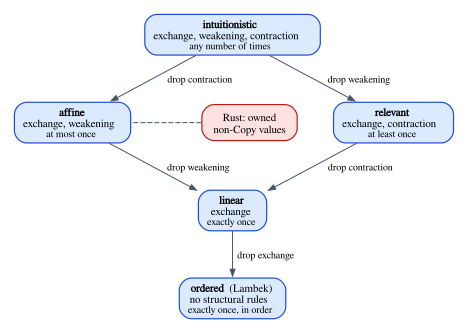

# Chapter 21 · Substructural Logics

Chapter 6 ended with a design decision. Ordinary logic treats an assumption as a
fact, which may be used any number of times or not at all; the rules that permit
this are the structural rules, exchange, weakening and contraction. If an
assumption stands for a *resource* instead (a coin, a file handle, a heap
buffer), some of those rules are wrong, and the way to build a logic of resources
is to delete them. We now have the tools to carry that decision out.

This chapter opens Part V. It deletes the structural rules one by one and maps
out the family of logics that results. It finds that, without contraction, the
familiar connectives come apart: there are two conjunctions and two
disjunctions, which ordinary logic had merged into one each. It reads the new
connectives as Rust types, builds a proof search that decides which sequents
survive in linear and affine logic, and proves in Lean that the most important
one does not: from one $A$ you cannot get two.

**In this chapter you will learn:**

- how deleting structural rules produces a family of logics: intuitionistic,
  affine, relevant, linear and ordered;
- why, without contraction, conjunction splits into a multiplicative $A \otimes B$
  and an additive $A \mathbin{\&} B$, and what each one means for resources;
- the sequent calculus of intuitionistic linear logic: context splitting versus
  context sharing, linear implication $\multimap$, the units, and the exponentials
  for orientation;
- to read Rust types as linear formulas: a tuple as $\otimes$, an offer with
  consuming methods as $A \mathbin{\&} B$, an `enum` as $\oplus$, a `FnOnce` closure
  as $\multimap$;
- how a proof search for linear and affine logic works, and what it says about
  $A \vdash A \otimes A$, $A \otimes B \vdash A$ and $A \mathbin{\&} B \vdash A$;
- a complete Lean proof that $A \vdash A \otimes A$ has no derivation, by an
  invariant that counts atoms.

## The structural rules, again

Here are the three rules as Chapter 6 stated them:

$$
\dfrac{\Gamma_1, A, B, \Gamma_2 \vdash C}{\Gamma_1, B, A, \Gamma_2 \vdash C}\;\textsf{Exch}
\qquad
\dfrac{\Gamma \vdash C}{\Gamma, A \vdash C}\;\textsf{Weak}
\qquad
\dfrac{\Gamma, A, A \vdash C}{\Gamma, A \vdash C}\;\textsf{Contr}
$$

Exchange says the order of assumptions does not matter. Weakening, read from the
conclusion up, discards an assumption; contraction duplicates one. Chapter 6
drew four lessons from them.

1. **Natural deduction has all three, admissibly.** None of them is a rule of
   Chapter 4's system, yet all three hold: Chapter 6 proved in Lean that
   derivability is monotone in the context.
2. **They hide in two places.** The hypothesis rule accepts any context that
   contains the formula, and rules with several premises hand the same context to
   all of them (contraction by sharing).
3. **They control usage.** Weakening introduces an assumption used zero times;
   contraction adds up the uses of two assumptions, and is the only rule that can
   push a count above one.
4. **Rust keeps some and refuses one.** Rust keeps exchange and weakening (an
   unused value is dropped) and refuses contraction for values that are not
   `Copy` (error E0382).

The second lesson is the warning label for this chapter. Deleting the rule Contr
from a list does not delete contraction if a connective rule smuggles it back
through context sharing. To build a logic without contraction, we must also
redesign the connectives.

## The family of logics

Deleting subsets of $\{\textsf{Exch}, \textsf{Weak}, \textsf{Contr}\}$ gives a
family of logics. Five of them have names worth knowing:

| Logic | Exchange | Weakening | Contraction | Each assumption is used |
|---|---|---|---|---|
| intuitionistic | yes | yes | yes | any number of times |
| affine | yes | yes | no | at most once |
| relevant | yes | no | yes | at least once |
| linear | yes | no | no | exactly once |
| ordered | no | no | no | exactly once, in order |

The last column is the bottom-up reading of the rules. Without contraction an
assumption cannot be duplicated, so it is used at most once; without weakening it
cannot be discarded, so it is used at least once; without both, exactly once.
Without exchange, the assumptions must even be used in the order in which they
appear.



A few remarks on the members of the family.

**Ordered logic** is the oldest. Joachim Lambek designed a calculus without any
structural rules in 1958, for the grammar of natural languages: the words of a
sentence are resources that must be used exactly once *and in order*, and a
sentence is grammatical when the types of its words combine into the type of a
sentence. Rust does not drop exchange: the order in which you declare independent
bindings never makes a program ill typed. We keep exchange for the rest of the
book.

**Relevant logic** comes from philosophy: its authors objected that
$A \to (B \to A)$ is a theorem although $B$ is irrelevant to $A$, and wanted
every premise to be used. In programming terms it is a "must use" discipline, of
which Rust has a weak echo in `#[must_use]` and the unused-variable lint, both
warnings rather than type errors (Chapter 24).

**Linear logic** was introduced by Jean-Yves Girard in 1987. Every assumption is
used exactly once, and the logic is a precise language for resources that must be
consumed: a payment that must be settled, a channel that must be closed.

**Affine logic** keeps weakening and drops contraction: resources may be thrown
away but not copied. That is Rust's discipline for owned values that are not
`Copy`, and the affine λ-calculus of Chapter 22 makes it a type system.

Each structural rule has a classic *test formula*, a formula provable in
intuitionistic logic whose every proof uses that rule. In the notation of the
λ-calculus they are combinators, named K, W and C:

| Test formula | Combinator | Needs |
|---|---|---|
| $A \to (B \to A)$ | K, $\lambda x.\,\lambda y.\,x$ | weakening ($y$ unused) |
| $(A \to A \to B) \to (A \to B)$ | W, $\lambda f.\,\lambda x.\,f\,x\,x$ | contraction ($x$ used twice) |
| $(A \to B \to C) \to (B \to A \to C)$ | C, $\lambda f.\,\lambda y.\,\lambda x.\,f\,x\,y$ | exchange (arguments swapped) |

Affine logic proves the linear version of K but not of W; relevant logic proves
W but not K; linear logic proves neither; and all of them except ordered logic
prove C. The prover we build below confirms the claims about affine and linear
logic.

## Conjunction splits in two

Here is the rule ∧I of natural deduction again, together with the two
projections:

$$
\dfrac{\Gamma \vdash A \qquad \Gamma \vdash B}{\Gamma \vdash A \land B}\;{\land}\textsf{I}
\qquad
\dfrac{\Gamma \vdash A \land B}{\Gamma \vdash A}\;{\land}\textsf{E}_1
\qquad
\dfrac{\Gamma \vdash A \land B}{\Gamma \vdash B}\;{\land}\textsf{E}_2
$$

Rule ∧I shares $\Gamma$ between its premises. As Chapter 6 showed, this is
contraction in disguise: the context $\Gamma = A$ proves $A \land A$ by using $A$
in both premises. In a logic without contraction we must decide what to do with
the context of ∧I, and there are two honest options.

- **Split it.** The conclusion's assumptions are divided between the premises,
  each going to exactly one of them. The result is the **multiplicative**
  conjunction, written $A \otimes B$ and read "$A$ tensor $B$" or "$A$ times $B$".
- **Share it, and pay for the sharing at the other end.** Both premises receive
  the whole context, but then a proof of the conjunction can only be *used* for
  one of its components, never both. The result is the **additive** conjunction,
  written $A \mathbin{\&} B$ and read "$A$ with $B$".

### The sequent calculus

From now on we work in the **sequent calculus**, which Chapter 4 previewed.
Instead of introduction and elimination rules, it has *right rules*, which say
how to prove a formula (the formula is on the right of $\vdash$), and *left
rules*, which say how to use an assumption (the formula is on the left). The
sequent calculus is better suited to the study of structural rules, because
every rule shows exactly what happens to the context, and to proof search,
because it is easy to run backward.

In linear logic the identity axiom has an *exact* context, with nothing else in
it:

$$
\dfrac{}{A \vdash A}\;\textsf{Ax}
$$

Compare it with rule Hyp of natural deduction, $A \in \Gamma$ implies
$\Gamma \vdash A$, which ignores the rest of $\Gamma$: that tolerance was
weakening. The exact axiom is half of what makes the logic linear. The other half
is the shape of the connective rules.

There is also the **cut** rule, which lets you prove a lemma $A$ and then use it:

$$
\dfrac{\Gamma \vdash A \qquad \Delta, A \vdash C}{\Gamma, \Delta \vdash C}\;\textsf{Cut}
$$

Gentzen proved for ordinary logic, and Girard for linear logic, that cut can be
eliminated: every sequent provable with cut is provable without it. Cut-free
proofs have the *subformula property* (every formula in the proof is a
subformula of the conclusion), which makes proof search finite. The systems in
this chapter, in Rust and in Lean, are cut-free.

### Tensor

The rules for $\otimes$:

$$
\dfrac{\Gamma \vdash A \qquad \Delta \vdash B}{\Gamma, \Delta \vdash A \otimes B}\;{\otimes}\textsf{R}
\qquad\qquad
\dfrac{\Gamma, A, B \vdash C}{\Gamma, A \otimes B \vdash C}\;{\otimes}\textsf{L}
$$

To *prove* $A \otimes B$ from the resources $\Gamma, \Delta$, divide them: prove
$A$ from $\Gamma$ and $B$ from $\Delta$. To *use* an assumption $A \otimes B$,
replace it by its two components, both available at once. Read as resources,
$A \otimes B$ means "an $A$ and a $B$, side by side": producing it costs the
resources of both, and consuming it gives you both.

Now try to prove $A \vdash A \otimes A$. The only rule that applies is ⊗R (the
assumption $A$ is atomic, so no left rule applies), and ⊗R must divide the
context $A$ between two premises. One premise gets $A$ and the other gets
nothing, and $\vdash A$ is not provable: there is no rule that produces an $A$
from nothing. So there is no proof. From one $A$ you cannot make two.

### With

The rules for $A \mathbin{\&} B$:

$$
\dfrac{\Gamma \vdash A \qquad \Gamma \vdash B}{\Gamma \vdash A \mathbin{\&} B}\;{\&}\textsf{R}
\qquad
\dfrac{\Gamma, A \vdash C}{\Gamma, A \mathbin{\&} B \vdash C}\;{\&}\textsf{L}_1
\qquad
\dfrac{\Gamma, B \vdash C}{\Gamma, A \mathbin{\&} B \vdash C}\;{\&}\textsf{L}_2
$$

To prove $A \mathbin{\&} B$, show that the *same* resources $\Gamma$ could produce
an $A$, and could also produce a $B$. To use $A \mathbin{\&} B$, pick one of the
two and carry on with it; the other is gone. Read as resources, $A \mathbin{\&} B$
is an *offer*: "an $A$ or a $B$, your choice", where the choice belongs to whoever
consumes the formula.

The sharing in rule &R is now harmless. Both premises see $\Gamma$, but the left
rules ensure that only one of them is ever cashed in, so the resources are spent
once.

Girard's own explanations of linear logic used purchases, and a vending machine
makes the point well. Write $\mathit{coin}$ for a coin. A machine that, for one
coin, lets you have a coffee or a tea is the formula

$$
\mathit{coin} \multimap (\mathit{coffee} \mathbin{\&} \mathit{tea})
$$

(where $\multimap$, explained below, means "consume the left side to produce the
right side"). You choose which drink you get. You do not get
$\mathit{coffee} \otimes \mathit{tea}$, both drinks at once: that would take two
coins.

### Two conjunctions, and how ordinary logic merges them

The two conjunctions are genuinely different. In linear logic:

- $A \mathbin{\&} B \vdash A$ is provable (rule &L₁, then Ax), but
  $A \otimes B \vdash A$ is not: the $B$ would have to be thrown away.
- $A \vdash A \mathbin{\&} A$ is provable (rule &R, with Ax in both premises), but
  $A \vdash A \otimes A$ is not, as we just saw.
- Neither $A \otimes B \vdash A \mathbin{\&} B$ nor
  $A \mathbin{\&} B \vdash A \otimes B$ is provable.

The structural rules are exactly what collapses them. With weakening, $A \otimes B$
implies $A \mathbin{\&} B$:

$$
\dfrac{\dfrac{\dfrac{\dfrac{}{A \vdash A}\;\textsf{Ax}}{A, B \vdash A}\;\textsf{Weak} \qquad \dfrac{\dfrac{}{B \vdash B}\;\textsf{Ax}}{A, B \vdash B}\;\textsf{Weak}}{A, B \vdash A \mathbin{\&} B}\;{\&}\textsf{R}}{A \otimes B \vdash A \mathbin{\&} B}\;{\otimes}\textsf{L}
$$

(the second weakening adds $A$ in front, which exchange allows). With contraction,
$A \mathbin{\&} B$ implies $A \otimes B$:

$$
\dfrac{\dfrac{\dfrac{\dfrac{}{A \vdash A}\;\textsf{Ax}}{A \mathbin{\&} B \vdash A}\;{\&}\textsf{L}_1 \qquad \dfrac{\dfrac{}{B \vdash B}\;\textsf{Ax}}{A \mathbin{\&} B \vdash B}\;{\&}\textsf{L}_2}{A \mathbin{\&} B, A \mathbin{\&} B \vdash A \otimes B}\;{\otimes}\textsf{R}}{A \mathbin{\&} B \vdash A \otimes B}\;\textsf{Contr}
$$

In a logic with both rules, the two conjunctions prove the same things, and it
needs only one, which it calls $\land$. That is why you never met two
conjunctions in Chapter 4. In affine logic, which has weakening but not
contraction, only the first derivation exists: $A \otimes B$ is *stronger* than
$A \mathbin{\&} B$. Having both is worth more than being offered a choice, when
you are allowed to throw away the one you do not want.

## Disjunction, implication and the units

### Plus

The additive disjunction $A \oplus B$ ("$A$ plus $B$") is the dual of
$A \mathbin{\&} B$: the choice belongs to the *producer*.

$$
\dfrac{\Gamma \vdash A}{\Gamma \vdash A \oplus B}\;{\oplus}\textsf{R}_1
\qquad
\dfrac{\Gamma \vdash B}{\Gamma \vdash A \oplus B}\;{\oplus}\textsf{R}_2
\qquad
\dfrac{\Gamma, A \vdash C \qquad \Gamma, B \vdash C}{\Gamma, A \oplus B \vdash C}\;{\oplus}\textsf{L}
$$

To prove $A \oplus B$, prove one of them, and you decide which. To use an
assumption $A \oplus B$, you must be ready for both cases, because you do not
know which one you will get. A machine $\mathit{coin} \multimap (\mathit{coffee} \oplus \mathit{tea})$
takes your coin and gives you a drink of *its* choosing.

Rule ⊕L shares the context $\Gamma$ between its two premises, like &R, and for the
same reason this is not contraction: the two premises are alternatives, and only
one of them will happen. Rules that share their context between alternatives are
called **additive**; rules that split their context between parts that coexist
are called **multiplicative**. The names, like the symbols $\otimes$ and
$\oplus$, come from an analogy with linear algebra, where tensor products
multiply dimensions and direct sums add them.

There is also a multiplicative disjunction, written $A ⅋ B$ ("par"). It needs
sequents with several formulas on the right of $\vdash$, which is the setting of
classical linear logic; in the intuitionistic setting of this book, with one
formula on the right, it has no rules, and it has no convincing reading as a
Rust type. We mention it for orientation only.

### Linear implication

Linear implication $A \multimap B$ ("$A$ lollipop $B$") consumes an $A$ to
produce a $B$:

$$
\dfrac{\Gamma, A \vdash B}{\Gamma \vdash A \multimap B}\;{\multimap}\textsf{R}
\qquad\qquad
\dfrac{\Gamma \vdash A \qquad \Delta, B \vdash C}{\Gamma, \Delta, A \multimap B \vdash C}\;{\multimap}\textsf{L}
$$

Rule ⊸R is →I: to build a consumer of $A$ from the resources $\Gamma$, assume
the $A$ and produce the $B$. Rule ⊸L says how to use one: split the remaining
resources, pay for the argument $A$ with $\Gamma$, receive the $B$, and continue
with $B$ and $\Delta$. It is a multiplicative rule, with splitting, and it is
what makes $\multimap$ consume its argument: modus ponens becomes
$A \multimap B, A \vdash B$, and the $A$ is gone afterward.

The two conjunction-like connectives relate to implication differently.
Currying works for $\otimes$: $(A \otimes B) \multimap C$ and
$A \multimap (B \multimap C)$ prove each other, because each of $A$ and $B$ is
used exactly once on both sides. It does not work for $A \mathbin{\&} B$.

### The units

Each binary connective has a unit, a formula that changes nothing when combined
with another:

$$
\dfrac{}{\vdash 1}\;\textsf{1R}
\qquad
\dfrac{\Gamma \vdash C}{\Gamma, 1 \vdash C}\;\textsf{1L}
\qquad
\dfrac{}{\Gamma \vdash \top}\;{\top}\textsf{R}
\qquad
\dfrac{}{\Gamma, 0 \vdash C}\;\textsf{0L}
$$

- $1$ is the unit of $\otimes$ ($A \otimes 1$ is equivalent to $A$). It stands
  for "no resources at all": it can be produced from an empty context, and an
  assumption $1$ can be dropped.
- $\top$ is the unit of with ($A \mathbin{\&} \top$ is equivalent to $A$). It can be produced from *any* context,
  consuming everything in it, and it has no left rule: it offers nothing.
- $0$ is the unit of $\oplus$. It has no right rule, so it cannot be produced, and
  an assumption $0$ proves anything: it describes a situation that cannot happen.
  It is the linear version of $\bot$, and in Rust it is an empty `enum`.

Ordinary logic has one truth constant $\top$; linear logic splits it into $1$ and
$\top$, just as it split $A \land B$ into $A \otimes B$ and $A \mathbin{\&} B$. In affine logic
the split closes again: weakening lets you produce $1$ from anything, so $1$ and
$\top$ become equivalent.

Here is the whole vocabulary, with the Rust readings that the next sections
develop:

| Formula | Name | Kind | Unit | Rust $\approx$ |
|---|---|---|---|---|
| $A \otimes B$ | tensor | multiplicative conjunction | $1$ | `(A, B)`, a struct |
| $A \mathbin{\&} B$ | with | additive conjunction | $\top$ | an offer with consuming methods |
| $A \oplus B$ | plus | additive disjunction | $0$ | `enum` |
| $A ⅋ B$ | par | multiplicative disjunction | $\bot$ | (classical only) |
| $A \multimap B$ | lollipop | linear implication | | `FnOnce(A) -> B` |
| $!A$ | of course | exponential | | `A: Copy` (Chapter 23) |

### Full linear logic, for orientation

Girard's linear logic is classical: it has a linear negation $A^{\bot}$ with
$A^{\bot\bot} = A$, De Morgan laws that exchange the multiplicatives
($(A \otimes B)^{\bot} = A^{\bot} ⅋ B^{\bot}$) and the additives
($(A \mathbin{\&} B)^{\bot} = A^{\bot} \oplus B^{\bot}$), and the definition
$A \multimap B = A^{\bot} ⅋ B$. This book uses only the intuitionistic
fragment, and you can safely ignore the classical one.

What you cannot ignore are the **exponentials**. The modality $!A$ ("of course
$A$") marks a formula that may be used any number of times. Its rules give back
the structural rules, but only for formulas marked with $!$:

$$
\dfrac{\Gamma, A \vdash C}{\Gamma, !A \vdash C}\;\textsf{Der}
\qquad
\dfrac{\Gamma \vdash C}{\Gamma, !A \vdash C}\;\textsf{!W}
\qquad
\dfrac{\Gamma, !A, !A \vdash C}{\Gamma, !A \vdash C}\;\textsf{!C}
\qquad
\dfrac{!\Gamma \vdash A}{!\Gamma \vdash !A}\;\textsf{Prom}
$$

Dereliction (Der) uses a $!A$ once, as an $A$. Weakening and contraction are back,
for $!A$ only. Promotion (Prom) says that $A$ may be marked as reusable if it was
proved from reusable assumptions only ($!\Gamma$ means that every formula of the
context starts with $!$). With $!$, ordinary logic fits inside linear logic: the
intuitionistic implication $A \to B$ becomes $!A \multimap B$, a function that
may use its argument as often as it likes. The dual modality $?A$ plays the same
role on the right of $\vdash$ in the classical system. Chapter 23 reads Rust's
`Copy` as $!$: a class of types for which contraction and weakening are back.

The exponentials come at a price: provability in propositional linear logic with
exponentials is known to be undecidable, whereas the fragment without them (the
*multiplicative-additive* fragment, MALL) is decidable, by exactly the kind of
finite proof search we build below.

## Splitting versus sharing

Write $\Gamma_1 \uplus \Gamma_2$ for a context *split* into two parts, every
assumption going to exactly one part. (Contexts in linear logic are multisets:
order does not matter, the number of copies does.) The multiplicative rules split,
and the additive rules share:

| Rule | Context | Why it is safe |
|---|---|---|
| ⊗R, ⊸L | split, $\Gamma_1 \uplus \Gamma_2$ | the two premises coexist, so each resource goes to one |
| &R, ⊕L | shared, $\Gamma$ in both | the two premises are alternatives, only one will happen |
| Ax | exactly $A$ | nothing may be left over |

The affine version of the calculus differs only at the leaves. Its axiom and its
rule for $1$ tolerate extra assumptions, which are discarded:

$$
\dfrac{}{\Gamma, A \vdash A}\;\textsf{Ax}_{\mathsf{aff}}
\qquad\qquad
\dfrac{}{\Gamma \vdash 1}\;\textsf{1R}_{\mathsf{aff}}
$$

With these leaves, weakening is admissible, by an induction like Chapter 6's: an
extra assumption is passed up the derivation until a leaf absorbs it.

This table is also a description of Rust. A call `f(a, b)` or a tuple
`(a, b)` *splits* the owned variables in scope between its parts: if both parts
need the same non-`Copy` variable, no split exists, and the compiler reports
E0382. The arms of a `match` *share* them: each arm may move the same variable,
because only one arm runs. Here is a function from this chapter's Rust example
that relies on sharing:

```rust
/// `Coffee ⊕ Tea`: the machine decides, and the customer must handle both.
#[derive(Debug)]
enum Drink {
    Coffee(Coffee),
    Tea(Tea),
}

/// ⊕R: the machine picks a drink (here, by the coin's serial number).
fn surprise(coin: Coin) -> Drink {
    if coin.serial % 2 == 0 {
        Drink::Coffee(brew_coffee(coin))
    } else {
        Drink::Tea(brew_tea(coin))
    }
}

/// A receipt: another resource, consumed by whoever files it.
struct Receipt {
    number: u32,
}

/// Filing a receipt consumes it.
fn file(receipt: Receipt) -> u32 {
    receipt.number
}

/// ⊕L: both arms consume the same `receipt`, because only one arm runs.
fn serve(drink: Drink, receipt: Receipt) -> String {
    match drink {
        Drink::Coffee(c) => {
            format!("coffee (coin {}), filed {}", c.paid_with, file(receipt))
        }
        Drink::Tea(t) => format!("tea (coin {}), filed {}", t.paid_with, file(receipt)),
    }
}
```

Both arms of the `match` in `serve` consume `receipt` (by passing it to `file`,
which takes it by value), and the compiler accepts this, exactly as rule ⊕L
shares $\Gamma$ between its premises.
The tuple `(consume(s), consume(s))` would be rejected, exactly as ⊗R refuses to
give $s$ to both premises.

## Linear logic in Rust

The full program is in `code/rust/examples/ch21_resources.rs`. As always, reading
Rust types as formulas is a model, and Rust's discipline is affine, not linear:
any value may be dropped. The comparisons below hold with that caveat. The
resources are coins, which are neither `Copy` nor `Clone`, and drinks:

```rust
/// A coin: the resource. Neither `Copy` nor `Clone`: it can be spent once.
#[derive(Debug)]
struct Coin {
    serial: u32,
}

#[derive(Debug)]
struct Coffee {
    paid_with: u32,
}

#[derive(Debug)]
struct Tea {
    paid_with: u32,
}

/// `Coin ⊸ Coffee`: spending a coin produces a coffee.
fn brew_coffee(coin: Coin) -> Coffee {
    Coffee {
        paid_with: coin.serial,
    }
}

/// `Coin ⊸ Tea`.
fn brew_tea(coin: Coin) -> Tea {
    Tea {
        paid_with: coin.serial,
    }
}
```

The functions `brew_coffee` and `brew_tea` have the types $\mathit{coin} \multimap \mathit{coffee}$
and $\mathit{coin} \multimap \mathit{tea}$: each takes a coin by value and
consumes it.

### Tensor: tuples and structs

A tuple `(A, B)` holds an `A` and a `B` at the same time, each owned
independently. It is $A \otimes B$:

```rust
/// ⊗R: two coins, split between the two drinks, give a coffee *and* a tea.
fn coffee_and_tea(c1: Coin, c2: Coin) -> (Coffee, Tea) {
    (brew_coffee(c1), brew_tea(c2))
}
```

```rust
let (coffee, tea) = coffee_and_tea(Coin { serial: 1 }, Coin { serial: 2 });
println!("⊗: {coffee:?} and {tea:?}");
```

Building the tuple is rule ⊗R: the two coins are split between the two
components. Taking it apart with the pattern `let (coffee, tea) = ...` is rule
⊗L: one step, and both components become available as separate variables. This
is why `fn swap<A, B>((a, b): (A, B)) -> (B, A)` needs no `Clone`, while the
natural-deduction proof of $A \land B \to B \land A$ in Chapter 6 used its
assumption twice: Rust's pair is $\otimes$, eliminated by pattern matching, not
$\land$ with two projections. (Rust also lets you move the fields out one at a
time, `pair.0` and later `pair.1`, tracking each field separately. Chapter 22
explains this refinement.) Structs are tensors with named components.

### With: an offer

The additive conjunction is an offer: the consumer chooses one alternative, and
both alternatives are paid for by the same resources. In Rust, that is a value
holding the resources, with one *consuming* method per alternative:

```rust
/// `Coffee & Tea`: the machine after one coin was inserted. Both choices are
/// paid for by the *same* coin (&R shares its context); the customer picks
/// one by calling one of the consuming methods (&L1 or &L2).
struct Offer {
    coin: Coin,
}

impl Offer {
    fn insert(coin: Coin) -> Offer {
        Offer { coin }
    }

    fn coffee(self) -> Coffee {
        brew_coffee(self.coin)
    }

    fn tea(self) -> Tea {
        brew_tea(self.coin)
    }
}
```

`Offer::insert` is rule &R: from one coin it builds something that could become a
coffee and could also become a tea, and both methods use the same coin. Calling a
method is rule &L₁ or &L₂: `coffee(self)` takes the offer by value, so after the
call the offer no longer exists and the other method cannot be called. The
compiler enforces this:

```rust
pub fn both(offer: Offer) -> (Coffee, Tea) {
    (offer.coffee(), offer.tea())
}
```

```text
error[E0382]: use of moved value: `offer`
  --> compile_fail/ch21_offer_twice.rs:31:22
   |
30 | pub fn both(offer: Offer) -> (Coffee, Tea) {
   |             ----- move occurs because `offer` has type `Offer`, which does not implement the `Copy` trait
31 |     (offer.coffee(), offer.tea())
   |            --------  ^^^^^ value used here after move
   |            |
   |            `offer` moved due to this method call
   |
note: `Offer::coffee` takes ownership of the receiver `self`, which moves `offer`
  --> compile_fail/ch21_offer_twice.rs:18:19
   |
18 |     pub fn coffee(self) -> Coffee {
   |                   ^^^^
```

The note says it exactly: the method takes ownership of the receiver `self`, which
moves `offer`. Taking both alternatives would require contraction on `offer`.

A generic version of $A \mathbin{\&} B$ stores the shared resources and two ways of
consuming them:

```rust
/// `A & B` in general: shared resources `S` and two ways to consume them.
struct With<S, F, G> {
    resources: S,
    left: F,
    right: G,
}

impl<S, A, B, F: FnOnce(S) -> A, G: FnOnce(S) -> B> With<S, F, G> {
    fn left(self) -> A {
        (self.left)(self.resources)
    }

    fn right(self) -> B {
        (self.right)(self.resources)
    }
}
```

```rust
let first = Offer::insert(Coin { serial: 3 });
let choice = first.tea(); // `first` is consumed: no coffee from it now
println!("&: chose {choice:?}");
let second = Offer::insert(Coin { serial: 4 });
println!("&: chose {:?}", second.coffee());
let make = |serial| With {
    resources: Coin { serial },
    left: brew_coffee,
    right: brew_tea,
};
println!("&: chose {:?} and {:?}", make(5).left(), make(6).right());
```

A second encoding is a closure that takes the choice as an argument,
`impl FnOnce(Choice) -> Drink`. It loses information: the result type cannot
depend on the *value* of the choice, so the closure returns the sum type `Drink`,
and the customer must still `match` on both cases. A dependent type can say more:
in Lean, `(b : Bool) → if b then A else B` gives an `A` when asked for `true`.
Chapter 30 is about such types.

### Plus: enums

An `enum` with two variants holds one of two things, and the producer decides
which. It is $A \oplus B$. In the `plus` listing above, `surprise` is rule ⊕R:
the machine picks a drink (here by the coin's serial number), and its return type
`Drink` hides which. `serve` is rule ⊕L: the consumer must handle both variants,
and both arms share the same `receipt`. The output shows the two cases:

```text
⊕: served tea (coin 7), filed 107
⊕: served coffee (coin 8), filed 108
```

Exhaustiveness checking, which makes you handle every variant, is the
requirement that ⊕L has a premise for each disjunct.

### Lollipop: `FnOnce`

A closure that consumes what it captured can be called once. Its type,
`impl FnOnce(A) -> B`, is $A \multimap B$:

```rust
/// A paper cup: a resource that a coffee machine needs once.
struct Cup;

/// `Coin ⊸ Coffee` as a value: a closure that has captured the cup. It can be
/// called once, because calling it moves the cup out.
fn machine_with_cup(cup: Cup) -> impl FnOnce(Coin) -> Coffee {
    move |coin| {
        let Cup = cup; // the cup is used up by this call
        brew_coffee(coin)
    }
}
```

```rust
let machine = machine_with_cup(Cup);
let coffee = machine(Coin { serial: 9 });
println!("⊸: {coffee:?}");
```

Creating the closure is rule ⊸R: from the resources $\Gamma$ (the captured cup)
and an assumed argument $A$ (the coin), produce a $B$ (the coffee). Calling it
is rule ⊸L: the argument is paid for with one part of the context, and the result
joins the rest. Calling it a second time is a use of a moved value, as Chapter 8
showed. Closures that implement `Fn` can be called any number of times, which
makes them resemble $!(A \multimap B)$; the resemblance is only suggestive,
since `Fn` and `FnMut` are about *how* the closure accesses its captures (shared
or unique borrows), the subject of Part VI.

### The units

```rust
/// `0`, the empty type: from a value of it, anything follows (0L).
enum Void {}

fn absurd<T>(v: Void) -> T {
    match v {}
}

/// `1` is `()`. In an affine language, any value can be turned into `()` by
/// discarding it, so `⊤` and `1` collapse into one type.
fn discard<T>(_value: T) {}
```

The unit type `()` is $1$. An empty `enum` is $0$: no value of it can be built,
and `match v {}` with no arms turns one into anything, which is rule 0L. There is
no separate $\top$ in Rust, and there does not need to be: Rust is affine, any
value can be discarded, and in affine logic $\top$ and $1$ are equivalent. The
function `discard` is rule ⊤R and 1R at once: it consumes anything and returns
`()`.

Here is the complete output of the example:

```text
⊗: Coffee { paid_with: 1 } and Tea { paid_with: 2 }
&: chose Tea { paid_with: 3 }
&: chose Coffee { paid_with: 4 }
&: chose Coffee { paid_with: 5 } and Tea { paid_with: 6 }
⊕: served tea (coin 7), filed 107
⊕: served coffee (coin 8), filed 108
⊸: Coffee { paid_with: 9 }
1: a coin discarded, () returned
```

## Proof search: the `linlogic` crate

Which sequents are provable in linear logic, and which in affine logic? For the
multiplicative-additive fragment the question is decidable, and the crate
`linlogic` (in `code/rust/crates/linlogic`) decides it by searching for a
cut-free derivation, backward from the goal. It prints the derivations it finds,
checks them with an independent checker, and explains its failures.

### Formulas and sequents

The formulas are an enum with one variant per connective and unit:

```rust
/// A formula of intuitionistic multiplicative-additive linear logic.
#[derive(Clone, Debug, PartialEq, Eq, PartialOrd, Ord, Hash)]
pub enum Formula {
    /// An atomic proposition: a kind of resource, such as `coin` or `A`.
    Atom(String),
    /// `1`, the unit of ⊗: no resources at all.
    One,
    /// `⊤`, the unit of &: accepts any resources and offers nothing.
    Top,
    /// `0`, the unit of ⊕: an impossible situation.
    Zero,
    /// `A ⊗ B` (tensor): both A and B, at the same time.
    Tensor(Box<Formula>, Box<Formula>),
    /// `A & B` (with): A or B, and the consumer chooses which.
    With(Box<Formula>, Box<Formula>),
    /// `A ⊕ B` (plus): A or B, and the producer chooses which.
    Plus(Box<Formula>, Box<Formula>),
    /// `A ⊸ B` (lollipop): consume an A to produce a B.
    Lolli(Box<Formula>, Box<Formula>),
}
```

A parser reads an ASCII syntax (`A * B` for $A \otimes B$, `A & B`, `A + B` for
$A \oplus B$, `A -o B` for $A \multimap B$, and `1`, `0`, `top`), and the printer
uses the Unicode symbols. A sequent is a context and a goal:

```rust
/// A sequent `Γ ⊢ C` of intuitionistic linear logic: a multiset of resources
/// `Γ` (the context) and one goal `C`. The order of the context is irrelevant
/// (exchange is built in); its multiplicities are not.
#[derive(Clone, Debug, PartialEq, Eq, PartialOrd, Ord, Hash)]
pub struct Sequent {
    pub context: Vec<Formula>,
    pub goal: Formula,
}
```

The context is a `Vec`, but the prover treats it as a multiset by sorting it
before it looks a sequent up or stores it, so exchange is built in, as in the
table of Chapter 6. Weakening and contraction are not. The logic is a parameter:

```rust
/// Which structural rules the logic has. Both have exchange (contexts are
/// multisets) and neither has contraction. Affine logic also has weakening.
#[derive(Clone, Copy, Debug, PartialEq, Eq)]
pub enum Logic {
    Linear,
    Affine,
}
```

### The rules, backward

The heart of the crate is a function that takes a sequent and returns every way
of applying a rule *backward*: every rule whose conclusion matches the sequent,
with the premises that remain to be proved. Here are the leaves, where the two
logics differ:

```rust
// Leaves. In linear logic the identity axiom needs the context to be
// exactly the goal; affine logic may first discard everything else.
if context.len() == 1 && context[0] == *goal {
    steps.push(step(Rule::Axiom, vec![]));
} else if logic == Logic::Affine && context.contains(goal) {
    let axiom = Sequent::new(vec![goal.clone()], goal.clone());
    steps.push(step(Rule::Weaken, vec![axiom]));
}
match goal {
    Formula::One if context.is_empty() => steps.push(step(Rule::OneR, vec![])),
    Formula::One if logic == Logic::Affine => {
        let unit = Sequent::new(vec![], Formula::One);
        steps.push(step(Rule::Weaken, vec![unit]));
    }
    Formula::Top => steps.push(step(Rule::TopR, vec![])),
    _ => {}
}
if context.contains(&Formula::Zero) {
    steps.push(step(Rule::ZeroL, vec![]));
}
```

In linear logic the identity axiom applies only when the context is exactly the
goal. In affine logic, if the goal is somewhere in the context, a `Weaken` step
discards everything else and leaves the exact axiom to prove. The same happens for
the unit $1$. Because the affine prover discards resources only at the leaves,
every weakening in a derivation is visible, as a line marked `W`, right where the
resource is thrown away.

The rules that split their context must try every split. A context with $n$
assumptions has $2^n$ ways of dividing it into a left part and a right part
(fewer when some assumptions are equal):

```rust
/// Every way to divide a multiset of resources between two premises. A
/// context of n formulas has 2^n splits (fewer when formulas repeat).
pub fn splits(context: &[Formula]) -> Vec<(Vec<Formula>, Vec<Formula>)> {
    let mut seen = BTreeSet::new();
    let mut result = Vec::new();
    for mask in 0..(1_u32 << context.len()) {
        let (mut left, mut right) = (Vec::new(), Vec::new());
        for (i, formula) in context.iter().enumerate() {
            if mask & (1 << i) != 0 {
                left.push(formula.clone());
            } else {
                right.push(formula.clone());
            }
        }
        left.sort();
        right.sort();
        if seen.insert(left.clone()) {
            result.push((left, right));
        }
    }
    result
}
```

Rule ⊗R, backward, produces one candidate step per split:

```rust
Formula::Tensor(a, b) => {
    for (left, right) in splits(context) {
        let p1 = Sequent::new(left, (**a).clone());
        let p2 = Sequent::new(right, (**b).clone());
        steps.push(step(Rule::TensorR, vec![p1, p2]));
    }
}
```

and rule &L produces two candidate steps, one per side:

```rust
Formula::With(a, b) => {
    let p1 = Sequent::new(with_added(&rest, &[a]), goal.clone());
    let p2 = Sequent::new(with_added(&rest, &[b]), goal.clone());
    steps.push(step(Rule::WithL1, vec![p1]));
    steps.push(step(Rule::WithL2, vec![p2]));
}
```

The function `steps` lists the candidates in a fixed order: first the rules that
close a branch (Ax, 1R, ⊤R, 0L), then the rules that never lose provability
(⊸R, &R, ⊗L, 1L, ⊕L: if the conclusion is provable, so are their premises, so
they never lead the search into a dead end), and last the rules that make a
choice (which split, which side of $A \oplus B$ or $A \mathbin{\&} B$). The order
affects only which proof is found first and how fast; correctness does not depend
on it.

### The search

```rust
/// A proof search for one logic. It remembers every sequent it has
/// examined, with the proof it found or `None`, so no sequent is searched
/// twice.
pub struct Prover {
    logic: Logic,
    memo: BTreeMap<Sequent, Option<Proof>>,
}

impl Prover {
    pub fn new(logic: Logic) -> Prover {
        Prover {
            logic,
            memo: BTreeMap::new(),
        }
    }

    /// Searches for a derivation of `seq`. The search is complete: if it
    /// returns `None`, the sequent has no cut-free derivation at all.
    pub fn prove(&mut self, seq: &Sequent) -> Option<Proof> {
        let mut proof = self.search(&seq.normalized())?;
        // Show the root with the context in the order the user wrote it.
        proof.conclusion = seq.clone();
        Some(proof)
    }

    fn search(&mut self, seq: &Sequent) -> Option<Proof> {
        if let Some(known) = self.memo.get(seq) {
            return known.clone();
        }
        let mut found = None;
        'steps: for step in steps(self.logic, seq) {
            let mut premises = Vec::new();
            for premise in &step.premises {
                match self.search(&premise.normalized()) {
                    Some(proof) => premises.push(proof),
                    None => continue 'steps,
                }
            }
            found = Some(Proof {
                rule: step.rule,
                conclusion: seq.clone(),
                premises,
            });
            break;
        }
        self.memo.insert(seq.clone(), found.clone());
        found
    }
}
```

`search` tries the candidate steps in order, and the first step whose premises
are all provable gives the proof; the labeled `continue 'steps` abandons a
candidate as soon as one premise fails. Every result is stored in a `BTreeMap`
keyed by the sorted sequent (deterministic, unlike a `HashMap`), so no sequent is
searched twice.

Three properties make this a decision procedure.

- **Termination.** Every premise of every rule is strictly smaller than its
  conclusion, counting the total size of the formulas in the sequent. A unit
  test (`every_premise_is_smaller`) checks it on a sequent that exercises every
  rule. So the recursion cannot go on forever.
- **Completeness.** The search tries every rule application, so if a cut-free
  derivation exists, it finds one. By cut elimination, every provable sequent has
  a cut-free derivation. In the affine logic, discarding only at the leaves loses
  nothing, because weakening is admissible in a calculus with those leaves.
- **Soundness.** Every derivation the prover returns is checked by
  `Proof::check`, which knows nothing about the search: it looks at each node and
  verifies, by comparing multisets, that the node is a correct instance of the
  rule it claims.

```rust
/// Checks every step of the derivation against the rules of `logic`.
/// This does not trust the prover: it only compares sequents.
pub fn check(&self, logic: Logic) -> Result<(), String> {
    for premise in &self.premises {
        premise.check(logic)?;
    }
    let premises: Vec<&Sequent> =
        self.premises.iter().map(|p| &p.conclusion).collect();
    if check_step(logic, self.rule, &self.conclusion, &premises) {
        Ok(())
    } else {
        Err(format!(
            "{} is not a correct use of {}",
            self.conclusion, self.rule
        ))
    }
}
```

Do not trust the prover, check its output: it is the same principle that makes
Lean trustworthy, where tactics may be as clever as they like because the kernel
checks the proof terms they produce.

### Running it

The example `crates/linlogic/examples/ch21_prover.rs` runs the prover on a list
of sequents, in both logics:

```rust
const TABLE: [(&str, &str); 12] = [
    ("A |- A * A", "contraction"),
    ("A * B |- A", "weakening"),
    ("A & B |- A", "a choice"),
    ("A |- A & A", "sharing"),
    ("A * B |- B * A", "exchange"),
    ("A * B |- A & B", "& from ⊗ needs weakening"),
    ("A & B |- A * B", "⊗ from & needs contraction"),
    ("A |- B -o A", "the K combinator"),
    ("A -o A -o B |- A -o B", "the W combinator"),
    ("A -o B -o C |- A * B -o C", "currying"),
    ("top |- 1", "1 from ⊤ needs weakening"),
    ("A * (B + C) |- (A * B) + (A * C)", "distributivity"),
];
```

```sh
cargo run -p linlogic --example ch21_prover
```

```text
sequent                            linear  affine  shows
A ⊢ A ⊗ A                          no      no      contraction
A ⊗ B ⊢ A                          no      yes     weakening
A & B ⊢ A                          yes     yes     a choice
A ⊢ A & A                          yes     yes     sharing
A ⊗ B ⊢ B ⊗ A                      yes     yes     exchange
A ⊗ B ⊢ A & B                      no      yes     & from ⊗ needs weakening
A & B ⊢ A ⊗ B                      no      no      ⊗ from & needs contraction
A ⊢ B ⊸ A                          no      yes     the K combinator
A ⊸ A ⊸ B ⊢ A ⊸ B                  no      no      the W combinator
A ⊸ B ⊸ C ⊢ (A ⊗ B) ⊸ C            yes     yes     currying
⊤ ⊢ 1                              no      yes     1 from ⊤ needs weakening
A ⊗ (B ⊕ C) ⊢ (A ⊗ B) ⊕ (A ⊗ C)    yes     yes     distributivity
```

Every row is a fact of this chapter, now checked by a machine. Neither logic has
contraction, so $A \vdash A \otimes A$ fails in both; $A \otimes B \vdash A$
needs weakening, so only affine logic proves it; choosing and sharing
($A \mathbin{\&} B \vdash A$, $A \vdash A \mathbin{\&} A$) are not structural
rules, so both logics prove them. The two conjunctions are related only through
the structural rules, K is affine but not linear, W is neither, and $\top \vdash 1$
needs weakening, which is why the two units merge in affine logic.

Here are the derivations for three of the provable sequents, as the prover prints
them. Each line shows the rule applied, then the sequent it proves; the lines
indented below it are the derivations of its premises.

```text
linear proof of A ⊗ B ⊢ B ⊗ A:
⊗L   A ⊗ B ⊢ B ⊗ A
⊗R     A, B ⊢ B ⊗ A
Ax       B ⊢ B
Ax       A ⊢ A

affine proof of A ⊗ B ⊢ A:
⊗L   A ⊗ B ⊢ A
W      A, B ⊢ A
Ax       A ⊢ A
```

The first derivation takes the pair apart (⊗L) and rebuilds it in the other
order (⊗R). The second takes the pair apart and then discards $B$ at the leaf:
the `W` line is the weakening, at the exact place where a resource is thrown
away, which in Rust is where the destructor of the unused component runs.

When a sequent is not provable, the prover can list every rule that applies and
the verdict on each premise:

```text
no linear proof of A ⊢ A ⊗ A; the rules that apply:
  ⊗R   ⊢ A (fails);  A ⊢ A (provable)
  ⊗R   A ⊢ A (provable);  ⊢ A (fails)
  (3 sequents examined)
```

This is the argument we made by hand for $A \vdash A \otimes A$, produced
mechanically: there are two ways to split the single $A$, and each of them
leaves one side with nothing.

## A linear sequent calculus in Lean

The prover decides each sequent we give it. It cannot tell us that
$A \vdash A \otimes A$ fails for *every* formula $A$, or explain why. For that we
turn to Lean. The file is `code/lean/Book/Ch21/Linear.lean`.

### Formulas and rules

```lean
/-- Formulas of intuitionistic linear logic (multiplicative-additive). -/
inductive Formula where
  /-- An atomic resource. -/
  | atom (name : String)
  /-- `1`, the unit of `⊗`: nothing at all. -/
  | one
  /-- `⊤`, the unit of `&`: accepts anything, offers nothing. -/
  | top
  /-- `0`, the unit of `⊕`: an impossible situation. -/
  | zero
  /-- `A ⊗ B`: both, at the same time. -/
  | tensor (A B : Formula)
  /-- `A & B`: either, and the consumer chooses. -/
  | «with» (A B : Formula)
  /-- `A ⊕ B`: either, and the producer chooses. -/
  | plus (A B : Formula)
  /-- `A ⊸ B`: consume an `A`, produce a `B`. -/
  | lolli (A B : Formula)
  deriving DecidableEq, Repr

@[inherit_doc] scoped infixr:40 " ⊗ " => Formula.tensor
@[inherit_doc] scoped infixr:35 " & " => Formula.with
@[inherit_doc] scoped infixr:30 " ⊕ " => Formula.plus
@[inherit_doc] scoped infixr:25 " ⊸ " => Formula.lolli
```

The constructor for $A \mathbin{\&} B$ is named `«with»`: `with` is a keyword of Lean,
and the French quotes make it usable as a name. The `scoped infixr` lines define
notations active inside the namespace `Ch21`, with $\otimes$ binding tightest and
$\multimap$ loosest. Core Lean already uses $\oplus$ for its sum type `Sum`; Lean
tells the two apart in ordinary terms, by their types, but not in patterns, so in
pattern matching we write `plus A B` instead.

The rules are an inductive relation, exactly like `Proves` in Chapter 6, with the
sequent calculus in place of natural deduction:

```lean
/-- `LProves Γ C`: the sequent `Γ ⊢ C` is derivable in linear logic. Left
rules act on the first formula of the context; `exch` moves formulas. -/
inductive LProves : List Formula → Formula → Prop where
  | ax (A : Formula) : LProves [A] A
  | exch {Γ Δ C} : Γ.Perm Δ → LProves Γ C → LProves Δ C
  | oneR : LProves [] one
  | oneL {Γ C} : LProves Γ C → LProves (one :: Γ) C
  | topR {Γ} : LProves Γ top
  | zeroL {Γ C} : LProves (zero :: Γ) C
  | tensorR {Γ Δ A B} : LProves Γ A → LProves Δ B → LProves (Γ ++ Δ) (A ⊗ B)
  | tensorL {Γ A B C} : LProves (A :: B :: Γ) C → LProves ((A ⊗ B) :: Γ) C
  | withR {Γ A B} : LProves Γ A → LProves Γ B → LProves Γ (A & B)
  | withL₁ {Γ A B C} : LProves (A :: Γ) C → LProves ((A & B) :: Γ) C
  | withL₂ {Γ A B C} : LProves (B :: Γ) C → LProves ((A & B) :: Γ) C
  | plusR₁ {Γ A B} : LProves Γ A → LProves Γ (A ⊕ B)
  | plusR₂ {Γ A B} : LProves Γ B → LProves Γ (A ⊕ B)
  | plusL {Γ A B C} :
      LProves (A :: Γ) C → LProves (B :: Γ) C → LProves ((A ⊕ B) :: Γ) C
  | lolliR {Γ A B} : LProves (A :: Γ) B → LProves Γ (A ⊸ B)
  | lolliL {Γ Δ A B C} :
      LProves Γ A → LProves (B :: Δ) C → LProves ((A ⊸ B) :: (Γ ++ Δ)) C

@[inherit_doc] scoped notation:20 Γ " ⊢ " C:21 => LProves Γ C
```

Lean's contexts are lists, so exchange is an explicit rule, `exch`, which
reorders a context by any permutation. `Γ.Perm Δ` ("`Δ` is a permutation of
`Γ`") is defined inductively in Lean's core library, with constructors for the
empty list, for adding the same element in front, for swapping the first two
elements, and for transitivity. The left rules act on the first formula of the
context, and `exch` brings the formula you want to the front. Rule ⊗R produces
the context `Γ ++ Δ`: the split, read top-down. There is no weakening, no
contraction and no cut, and the axiom has the exact context `[A]`. The last line
gives the relation the notation `Γ ⊢ C`.

A few derivations:

```lean
/-- A choice: from `A & B` take `A`. -/
example : [A & B] ⊢ A := .withL₁ (.ax A)

/-- Sharing: both sides of `A & A` are built from the same `A`. -/
example : [A] ⊢ A & A := .withR (.ax A) (.ax A)

/-- Exchange: `⊗R` produces the context `[B] ++ [A]`, and `exch` reorders it. -/
example : [A ⊗ B] ⊢ B ⊗ A :=
  .tensorL (.exch (List.Perm.swap A B []) (.tensorR (.ax B) (.ax A)))

/-- Modus ponens: `⊸L` splits `[A]` off for the argument. -/
example : [A ⊸ B, A] ⊢ B := .lolliL (Γ := [A]) (Δ := []) (.ax A) (.ax B)

/-- Currying: `A ⊸ B ⊸ C ⊢ A ⊗ B ⊸ C`. -/
example : [A ⊸ B ⊸ C] ⊢ A ⊗ B ⊸ C := by
  apply LProves.lolliR
  -- [A ⊗ B, A ⊸ B ⊸ C] ⊢ C
  apply LProves.tensorL
  -- [A, B, A ⊸ B ⊸ C] ⊢ C: bring the implication to the front
  apply LProves.exch (List.perm_middle (l₁ := [A, B]) (l₂ := [])).symm
  -- [A ⊸ B ⊸ C, A, B] ⊢ C: the argument A, then B ⊸ C with B
  exact .lolliL (Γ := [A]) (Δ := [B]) (.ax A)
    (.lolliL (Γ := [B]) (Δ := []) (.ax B) (.ax C))
```

The first two are the choice and the sharing of $A \mathbin{\&} B$. In the third,
`.tensorR (.ax B) (.ax A)` proves `[B] ++ [A] ⊢ B ⊗ A`, which Lean computes to
`[B, A] ⊢ B ⊗ A`. `List.Perm.swap A B []` is the permutation from `[B, A]` to
`[A, B]`, so `exch` turns the derivation into one of `[A, B] ⊢ B ⊗ A`, which
`tensorL` turns into `[A ⊗ B] ⊢ B ⊗ A`. In the modus ponens example, the named
arguments `(Γ := [A]) (Δ := [])` tell Lean how to split the context, which it
cannot guess. The currying proof is a tactic proof whose comments show the goal
at each step; `List.perm_middle` says that moving an element from the middle of
a list to the front is a permutation.

### How to prove that something is not provable

Now the main question. To show that a sequent *is* derivable, we build a
derivation. To show that it is *not*, we would have to rule out every possible
derivation. The standard technique is the one Chapter 4 used for soundness: find
a property that every derivable sequent has, prove it by induction on
derivations, and check that the sequent we care about lacks it. Such a property
is called an **invariant**.

For linear logic the natural invariant is about counting: if every resource is
used exactly once, every atom that goes in must come out. In
$A \vdash A \otimes A$, the left side has one $A$ and the right side two, so the
sequent should not be derivable.

Two complications must be handled. First, $A \multimap B$ produces a $B$ but
*uses up* an $A$, so it counts $+1$ for $B$ and $-1$ for $A$: a negative count is
a debt. Second, $A \mathbin{\&} B$ might end up providing an $A$ or a $B$,
depending on a choice made later, so a formula has a *set* of possible counts.
And $\top$ and $0$ absorb any count at all: $\top$ consumes whatever is left,
and from $0$ anything follows.

So we define, for each formula, the **bags** of atoms it can provide:

```lean
/-- A bag of resources: how many copies of each atom. Counts may be negative,
which records a debt: `A ⊸ B` provides one `B` and owes one `A`. -/
abbrev Bag : Type := String → ℤ

/-- The bag that holds exactly one copy of the atom `a`. -/
def single (a : String) : Bag := fun x => if x = a then 1 else 0
```

```lean
/-- `Provides F n`: one way of resolving the choices inside `F` yields the
bag `n`. The additives offer several ways; `⊤` and `0` fit any bag. -/
def Provides : Formula → Bag → Prop
  | atom a, n => n = single a
  | one, n => n = 0
  | top, _ => True
  | zero, _ => True
  | A ⊗ B, n => ∃ a b, Provides A a ∧ Provides B b ∧ n = a + b
  | A & B, n => Provides A n ∨ Provides B n
  | plus A B, n => Provides A n ∨ Provides B n
  | A ⊸ B, n => ∃ a b, Provides A a ∧ Provides B b ∧ n = b - a

/-- A whole context provides the sum of what its formulas provide. -/
def ProvidesAll : List Formula → Bag → Prop
  | [], n => n = 0
  | A :: Γ, n => ∃ a g, Provides A a ∧ ProvidesAll Γ g ∧ n = a + g

/-- A sequent is balanced when the context and the goal can provide the same
bag of atoms. -/
def Balanced (Γ : List Formula) (C : Formula) : Prop :=
  ∃ n, ProvidesAll Γ n ∧ Provides C n
```

A `Bag` is a function from atom names to integers: how many copies of each atom,
possibly negative. `single a` is the bag with one copy of `a`. Bags can be added
and subtracted pointwise, because Mathlib makes functions into an additive group
pointwise (`(f + g) x = f x + g x`).

`Provides F n` says that, for some way of resolving the choices inside `F`, the
formula provides exactly the bag `n`. Read the clauses one at a time. An atom
provides one copy of itself; $1$ provides nothing; $\top$ and $0$ fit any bag.
$A \otimes B$ provides the sum of a bag of $A$ and a bag of $B$: both are there.
$A \mathbin{\&} B$ and $A \oplus B$ provide whatever one of their components
provides. $A \multimap B$ provides a bag of $B$ minus a bag of $A$. A context
provides the sum of what its formulas provide, and a sequent is **balanced** if
its context and its goal can provide the same bag.

### The invariant

The theorem is that every derivable sequent is balanced. Its proof uses three
small lemmas: every formula and every context provides *some* bag (needed for
the rules ⊤R, 0L and Ax), a concatenation of contexts provides the sum of the
bags (needed for the splitting rules), and a permutation of a context provides
the same bags (needed for `exch`):

```lean
/-- Every formula provides some bag. -/
theorem provides_exists : ∀ F : Formula, ∃ n, Provides F n
  | atom a => ⟨single a, rfl⟩
  | one => ⟨0, rfl⟩
  | top => ⟨0, trivial⟩
  | zero => ⟨0, trivial⟩
  | A ⊗ B =>
    let ⟨a, ha⟩ := provides_exists A
    let ⟨b, hb⟩ := provides_exists B
    ⟨a + b, a, b, ha, hb, rfl⟩
  | A & _ =>
    let ⟨a, ha⟩ := provides_exists A
    ⟨a, .inl ha⟩
  | plus A _ =>
    let ⟨a, ha⟩ := provides_exists A
    ⟨a, .inl ha⟩
  | A ⊸ B =>
    let ⟨a, ha⟩ := provides_exists A
    let ⟨b, hb⟩ := provides_exists B
    ⟨b - a, a, b, ha, hb, rfl⟩

/-- Every context provides some bag. -/
theorem providesAll_exists : ∀ Γ : List Formula, ∃ n, ProvidesAll Γ n
  | [] => ⟨0, rfl⟩
  | A :: Γ =>
    let ⟨a, ha⟩ := provides_exists A
    let ⟨g, hg⟩ := providesAll_exists Γ
    ⟨a + g, a, g, ha, hg, rfl⟩

/-- Concatenated contexts provide the sum of the bags. -/
theorem providesAll_append {Γ Δ : List Formula} {g d : Bag}
    (hΓ : ProvidesAll Γ g) (hΔ : ProvidesAll Δ d) : ProvidesAll (Γ ++ Δ) (g + d) := by
  induction Γ generalizing g with
  | nil =>
    -- hΓ : g = 0
    simp only [ProvidesAll] at hΓ
    simpa [hΓ] using hΔ
  | cons A Γ ih =>
    obtain ⟨a, g', ha, hg', rfl⟩ := hΓ
    exact ⟨a, g' + d, ha, ih hg', by abel⟩

/-- Reordering a context does not change what it provides. -/
theorem providesAll_perm {Γ Δ : List Formula} (p : Γ.Perm Δ) :
    ∀ {n : Bag}, ProvidesAll Γ n → ProvidesAll Δ n := by
  induction p with
  | nil => exact id
  | cons A _ ih =>
    rintro n ⟨a, g, ha, hg, rfl⟩
    exact ⟨a, g, ha, ih hg, rfl⟩
  | swap A B Γ =>
    rintro n ⟨b, r, hb, ⟨a, g, ha, hg, rfl⟩, rfl⟩
    exact ⟨a, b + g, ha, ⟨b, g, hb, hg, rfl⟩, by abel⟩
  | trans _ _ ih₁ ih₂ => exact fun h => ih₂ (ih₁ h)
```

The two existence lemmas are proved by recursion on the formula or the list,
written as pattern matching, like `Deriv.toProves` in Chapter 6. In
`providesAll_append`, the `nil` case has `hΓ : g = 0`, and `simpa [hΓ] using hΔ`
rewrites `g + d` into `d` and closes the goal with `hΔ`. Two tools appear here for
the first time. `abel` is a Mathlib tactic that proves
equations in commutative additive groups, such as
`a + (b + g) = b + (a + g)`, by normalizing both sides; our bags form such a
group, so `abel` does all the bookkeeping of sums and differences. And the
patterns of `obtain` and `rintro` can end in `rfl`, as in `⟨a, g', ha, hg', rfl⟩`:
that takes apart an existential statement and, for the final equation
`n = a + g'`, substitutes it everywhere, so that `n` disappears. The proof of
`providesAll_perm` is an induction on the permutation, with one case for each of
its four constructors.

Now the invariant itself:

```lean
/-- **The invariant.** Every derivable sequent is balanced. -/
theorem balanced_of_proves {Γ : List Formula} {C : Formula}
    (h : Γ ⊢ C) : Balanced Γ C := by
  induction h with
  | ax A =>
    -- [A] ⊢ A: both sides provide whatever A provides.
    obtain ⟨a, ha⟩ := provides_exists A
    exact ⟨a, ⟨a, 0, ha, rfl, by abel⟩, ha⟩
  | exch p _ ih =>
    obtain ⟨n, hΓ, hC⟩ := ih
    exact ⟨n, providesAll_perm p hΓ, hC⟩
  | oneR => exact ⟨0, rfl, rfl⟩
  | oneL _ ih =>
    obtain ⟨n, hΓ, hC⟩ := ih
    exact ⟨n, ⟨0, n, rfl, hΓ, by abel⟩, hC⟩
  | @topR Γ =>
    -- ⊤ accepts whatever the context provides.
    obtain ⟨g, hg⟩ := providesAll_exists Γ
    exact ⟨g, hg, trivial⟩
  | @zeroL Γ C =>
    -- 0 makes up the difference between the goal and the rest.
    obtain ⟨c, hc⟩ := provides_exists C
    obtain ⟨g, hg⟩ := providesAll_exists Γ
    exact ⟨c, ⟨c - g, g, trivial, hg, by abel⟩, hc⟩
  | tensorR _ _ ih₁ ih₂ =>
    -- The two halves of the context pay for the two halves of A ⊗ B.
    obtain ⟨n₁, hΓ, hA⟩ := ih₁
    obtain ⟨n₂, hΔ, hB⟩ := ih₂
    exact ⟨n₁ + n₂, providesAll_append hΓ hΔ, n₁, n₂, hA, hB, rfl⟩
  | tensorL _ ih =>
    obtain ⟨n, ⟨a, r, ha, ⟨b, g, hb, hg, rfl⟩, rfl⟩, hC⟩ := ih
    exact ⟨a + (b + g), ⟨a + b, g, ⟨a, b, ha, hb, rfl⟩, hg, by abel⟩, hC⟩
  | withR _ _ ih₁ _ =>
    -- One premise is enough: A & B can provide what A provides.
    obtain ⟨n, hΓ, hA⟩ := ih₁
    exact ⟨n, hΓ, .inl hA⟩
  | withL₁ _ ih =>
    obtain ⟨n, ⟨a, g, ha, hg, rfl⟩, hC⟩ := ih
    exact ⟨a + g, ⟨a, g, .inl ha, hg, rfl⟩, hC⟩
  | withL₂ _ ih =>
    obtain ⟨n, ⟨b, g, hb, hg, rfl⟩, hC⟩ := ih
    exact ⟨b + g, ⟨b, g, .inr hb, hg, rfl⟩, hC⟩
  | plusR₁ _ ih =>
    obtain ⟨n, hΓ, hA⟩ := ih
    exact ⟨n, hΓ, .inl hA⟩
  | plusR₂ _ ih =>
    obtain ⟨n, hΓ, hB⟩ := ih
    exact ⟨n, hΓ, .inr hB⟩
  | plusL _ _ ih₁ _ =>
    obtain ⟨n, ⟨a, g, ha, hg, rfl⟩, hC⟩ := ih₁
    exact ⟨a + g, ⟨a, g, .inl ha, hg, rfl⟩, hC⟩
  | lolliR _ ih =>
    -- From A, Γ ⊢ B: Γ provides g and B provides a + g, so A ⊸ B provides g.
    obtain ⟨n, ⟨a, g, ha, hg, rfl⟩, hB⟩ := ih
    exact ⟨g, hg, a, a + g, ha, hB, by abel⟩
  | lolliL _ _ ih₁ ih₂ =>
    -- Γ pays for the argument A; the result B joins Δ.
    obtain ⟨m, hΓ, hA⟩ := ih₁
    obtain ⟨n, ⟨b, d, hb, hd, rfl⟩, hC⟩ := ih₂
    exact ⟨b + d, ⟨b - m, m + d, ⟨m, b, hA, hb, rfl⟩,
      providesAll_append hΓ hd, by abel⟩, hC⟩
```

Each case takes the balance of the premises (the induction hypotheses `ih`) and
builds the balance of the conclusion. Let us go through the interesting ones.

- **ax.** Pick any bag `a` that `A` provides. The context `[A]` provides `a + 0`,
  and `A` provides `a`; `abel` proves `a = a + 0`.
- **exch.** The bag is the same, and `providesAll_perm` moves it to the permuted
  context.
- **tensorR.** The left premise gives a bag `n₁` provided by both `Γ` and `A`,
  the right premise a bag `n₂` provided by both `Δ` and `B`. Then `Γ ++ Δ`
  provides `n₁ + n₂` (by `providesAll_append`), and so does `A ⊗ B`, by
  definition. This is the case that makes contraction impossible: the bag of the
  conclusion's context is the *sum* of the premises' bags, so each resource is
  counted once on each side.
- **tensorL.** The premise's context `A :: B :: Γ` provides `a + (b + g)`. In the
  conclusion, `A ⊗ B` provides `a + b`, and the context provides
  `(a + b) + g`, which `abel` identifies with `a + (b + g)`.
- **withR.** Only the first premise is needed: if `Γ` and `A` provide the same
  bag, then so do `Γ` and `A & B`, by choosing `A`. The invariant does not care
  that `B` is also available, because `&` provides one of its components, not
  both.
- **lolliR.** The premise says that `A :: Γ` and `B` both provide `a + g`, where
  `a` is a bag of `A` and `g` a bag of `Γ`. Then `A ⊸ B` provides
  `(a + g) - a`, which is `g`, what `Γ` provides.
- **lolliL.** The left premise gives a bag `m` provided by both `Γ` and `A`; the
  right premise says that `B :: Δ` provides `b + d`, which `C` also provides. In
  the conclusion, `A ⊸ B` provides `b - m`, the context `Γ ++ Δ` provides
  `m + d`, and the sum `(b - m) + (m + d)` is `b + d` again: the debt of `A` is
  paid by `Γ`.
- **topR and zeroL.** These are the absorbing units. For ⊤R, take any bag of the
  context; `top` provides it. For 0L, take a bag `c` of the goal and a bag `g` of
  the rest of the context, and let `zero` provide the difference `c - g`.

The remaining cases (`oneR`, `oneL`, `withL₁`, `withL₂`, `plusR₁`, `plusR₂`,
`plusL`) follow the same pattern: the bag stays the same, and the additive
formula provides it by the side that the rule chose (`.inl` or `.inr`). Like
`withR`, rule `plusL` needs only one of its premises.

The case for weakening is missing, because there is no weakening rule, and so is
the case for contraction. If either rule were added, the theorem would be false:
weakening would let the left side have more than the right, and contraction would
let it have less. The invariant captures exactly the absence of the two rules.

### From one A you cannot get two

The main theorem is now a short calculation:

```lean
/-- **No contraction.** `A ⊢ A ⊗ A` has no derivation in linear logic. -/
theorem not_proves_dup (a : String) : ¬ ([atom a] ⊢ atom a ⊗ atom a) := by
  intro h
  obtain ⟨n, ⟨x, g, hx, hg, hn⟩, ⟨y, z, hy, hz, hyz⟩⟩ := balanced_of_proves h
  -- hx : x = single a,  hg : g = 0,  hy : y = single a,  hz : z = single a
  subst hx hg hy hz
  -- hn : n = single a + 0,  hyz : n = single a + single a
  -- Count the copies of `a` on both sides: 1 + 0 = 1 + 1 is false.
  have count := congrFun (hn.symm.trans hyz) a
  simp [single] at count
```

Step by step:

- `intro h` assumes a derivation `h` of `[atom a] ⊢ atom a ⊗ atom a`; the goal
  becomes `False`.
- `balanced_of_proves h` says that the sequent is balanced, and `obtain` takes the
  statement apart. The context `[atom a]` provides `n = x + g`, where `x` is
  provided by `atom a` and `g` by the empty context. The goal `atom a ⊗ atom a`
  provides `n = y + z`, where both `y` and `z` are provided by `atom a`.
- By the definition of `Provides`, the hypotheses `hx`, `hg`, `hy`, `hz` are the
  equations `x = single a`, `g = 0`, `y = single a` and `z = single a`, and
  `subst` replaces the variables by their values everywhere.
- `hn.symm.trans hyz` chains the equations `single a + 0 = n` and
  `n = single a + single a` into `single a + 0 = single a + single a`, an equation
  between functions. `congrFun _ a` evaluates both sides at the atom `a`.
- `simp [single]` computes: the left side is `1 + 0`, the right side `1 + 1`, and
  `1 = 2` is false, which closes the goal.

The same invariant shows that linear logic has no weakening, using the atom that
would have to be thrown away:

```lean
/-- **No weakening.** `A ⊗ B ⊢ A` has no derivation when `A` and `B` are
different atoms: the `B` on the left has nowhere to go. -/
theorem not_proves_fst {a b : String} (hab : a ≠ b) :
    ¬ ([atom a ⊗ atom b] ⊢ atom a) := by
  intro h
  obtain ⟨n, ⟨t, g, ⟨x, y, hx, hy, ht⟩, hg, hn⟩, hC⟩ := balanced_of_proves h
  subst hx hy ht hg hC
  -- hn : single a = single a + single b + 0. Count the copies of `b`.
  have count := congrFun hn b
  simp [single, hab.symm] at count
```

Here the context provides one `a` and one `b`, the goal only one `a`, and counting
the copies of `b` gives `1 = 0`. The hypothesis `hab.symm : b ≠ a` lets `simp`
decide that `single a b = 0`.

The invariant is necessary for provability, not sufficient. The sequent
$(A \otimes B) \mathbin{\&} (A \otimes C) \vdash A \otimes (B \mathbin{\&} C)$ is
balanced (both sides can provide $A + B$, and both can provide $A + C$), yet the
prover above reports that it has no derivation in linear logic. The invariant
answers the questions it was designed for, contraction and weakening; for the
rest, there is the prover.

### Forgetting resources

One more theorem connects this chapter to Chapter 6. If you forget the resources,
reading both $A \otimes B$ and $A \mathbin{\&} B$ as $A \land B$, $\oplus$ as $\lor$,
$\multimap$ as $\to$, $1$ and $\top$ as $\top$ and $0$ as $\bot$, every linear
derivation becomes a derivation in natural deduction. The file
`code/lean/Book/Ch21/Forget.lean` imports Chapter 6's `Structural.lean` (both
chapters are part of the same development) and proves it:

```lean
/-- Forget resources: translate a linear formula into Chapter 6's formulas. -/
def Formula.forget : Formula → Ch06.Formula
  | atom a => .atom a
  | one => .top
  | top => .top
  | zero => .bot
  | A ⊗ B => .conj A.forget B.forget
  | .with A B => .conj A.forget B.forget
  | plus A B => .disj A.forget B.forget
  | A ⊸ B => .imp A.forget B.forget
```

```lean
/-- Every linear derivation, with resources forgotten, is an intuitionistic
derivation. -/
theorem LProves.forget {Γ : List Formula} {C : Formula} (h : Γ ⊢ C) :
    Ch06.Proves (Γ.map Formula.forget) C.forget := by
  induction h with
  | ax A => exact .hyp List.mem_cons_self
  | exch p _ ih =>
    -- Exchange: the translated contexts have the same elements.
    exact ih.mono (p.map _).subset
  | oneR => exact .topI
  | oneL _ ih => exact Ch06.weakening ih
  | topR => exact .topI
  | zeroL => exact .botE (.hyp List.mem_cons_self)
  | tensorR _ _ ih₁ ih₂ =>
    -- Splitting becomes sharing: each half is weakened to the whole context.
    rw [List.map_append]
    exact .conjI (ih₁.mono (List.subset_append_left _ _))
      (ih₂.mono (List.subset_append_right _ _))
  | tensorL _ ih => exact conj_left ih
  | withR _ _ ih₁ ih₂ => exact .conjI ih₁ ih₂
  | withL₁ _ ih => exact conj_left₁ ih
  | withL₂ _ ih => exact conj_left₂ ih
  | plusR₁ _ ih => exact .disjI₁ ih
  | plusR₂ _ ih => exact .disjI₂ ih
  | plusL _ _ ih₁ ih₂ =>
    exact .disjE (.hyp List.mem_cons_self)
      (ih₁.mono (List.cons_subset_cons _ (List.subset_cons_self _ _)))
      (ih₂.mono (List.cons_subset_cons _ (List.subset_cons_self _ _)))
  | lolliR _ ih => exact .impI ih
  | lolliL _ _ ih₁ ih₂ =>
    -- Apply the implication (first in the context) to a proof of its
    -- argument, then use the result as the hypothesis of the second premise.
    rw [List.map_cons, List.map_append]
    refine .impE (Ch06.weakening (.impI (ih₂.mono ?_)))
      (.impE (.hyp List.mem_cons_self) ?_)
    · exact List.cons_subset_cons _ (List.subset_append_right _ _)
    · exact ih₁.mono (List.subset_cons_of_subset _ (List.subset_append_left _ _))
```

The proof is an induction on the linear derivation, and each case uses a tool
from Chapter 6. Exchange becomes `Proves.mono`, since a permutation has the same
elements. Rule ⊗R splits its context while natural deduction shares it, so each
half is *weakened* to the whole context, again with `Proves.mono`. Rule 1L
becomes `weakening`. The left rules for $A \otimes B$ and $A \mathbin{\&} B$ are handled
by three small lemmas in the same file (`conj_left`, `conj_left₁`,
`conj_left₂`), which use an assumption $A \land B$ through its projections and
also rely on `weakening`. Linear logic proves fewer things than intuitionistic
logic, never different things, and the admissible structural rules of Chapter 6
are the glue that turns a linear proof into an ordinary one. The converse fails:

```lean
/-- The converse fails: intuitionistic logic duplicates what linear logic
cannot. -/
example (a : String) :
    Ch06.Proves [(atom a).forget] ((atom a ⊗ atom a).forget) ∧
      ¬ ([atom a] ⊢ atom a ⊗ atom a) :=
  ⟨.conjI (.hyp List.mem_cons_self) (.hyp List.mem_cons_self), not_proves_dup a⟩
```

## Putting it together: the vending machine

Let us follow Girard's vending machine through every tool of the chapter. The
machine is the formula $\mathit{coin} \multimap (\mathit{coffee} \mathbin{\&} \mathit{tea})$:
for a coin, it offers a coffee or a tea, at your choice.

**The prover** settles the questions, with variations: one coin buys a coffee
but not a coffee and a tea; two coins and two machines buy both; and a machine
that chooses the drink itself, with $\oplus$, cannot promise you a coffee, only
a coffee or a tea.

```text
lin  aff  sequent
yes  yes  coin, coin ⊸ (coffee & tea) ⊢ coffee
no   no   coin, coin ⊸ (coffee & tea) ⊢ coffee ⊗ tea
yes  yes  coin, coin, coin ⊸ (coffee & tea), coin ⊸ (coffee & tea) ⊢ coffee ⊗ tea
no   no   coin, coin ⊸ (coffee ⊕ tea) ⊢ coffee
yes  yes  coin, coin ⊸ (coffee ⊕ tea) ⊢ coffee ⊕ tea
```

Here is the derivation for one coin and one coffee. Rule ⊸L splits the context:
the coin pays for the machine's argument, and the offer joins the (empty) rest;
rule &L₁ chooses the coffee:

```text
linear proof of coin, coin ⊸ (coffee & tea) ⊢ coffee:
⊸L   coin, coin ⊸ (coffee & tea) ⊢ coffee
Ax     coin ⊢ coin
&L1    coffee & tea ⊢ coffee
Ax       coffee ⊢ coffee
```

and here is why one coin does not buy two drinks. Every possible first step is
listed, and every one of them has a failing premise:

```text
no linear proof of coin, coin ⊸ (coffee & tea) ⊢ coffee ⊗ tea; the rules that apply:
  ⊗R   ⊢ coffee (fails);  coin, coin ⊸ (coffee & tea) ⊢ tea (provable)
  ⊗R   coin ⊢ coffee (fails);  coin ⊸ (coffee & tea) ⊢ tea (fails)
  ⊗R   coin ⊸ (coffee & tea) ⊢ coffee (fails);  coin ⊢ tea (fails)
  ⊗R   coin, coin ⊸ (coffee & tea) ⊢ coffee (provable);  ⊢ tea (fails)
  ⊸L   ⊢ coin (fails);  coin, coffee & tea ⊢ coffee ⊗ tea (fails)
  ⊸L   coin ⊢ coin (provable);  coffee & tea ⊢ coffee ⊗ tea (fails)
  (26 sequents examined)
```

Look at the four ⊗R lines: they are the four ways to divide the coin and the
machine between the coffee and the tea. The two ⊸L lines are the two ways to use
the machine first, which either leave no coin to pay with or produce an offer
that cannot become both drinks.

**Lean** proves the same two facts for good, independently of any search:

```lean
/-- The vending machine: a coin buys a coffee... -/
example : [atom "coin", atom "coin" ⊸ (atom "coffee" & atom "tea")] ⊢ atom "coffee" :=
  .exch (List.Perm.swap _ _ [])
    (.lolliL (Γ := [atom "coin"]) (Δ := []) (.ax _) (.withL₁ (.ax _)))

/-- ...or a tea, but not both. -/
theorem one_coin_one_drink :
    ¬ ([atom "coin", atom "coin" ⊸ (atom "coffee" & atom "tea")] ⊢
        atom "coffee" ⊗ atom "tea") := by
  intro h
  obtain ⟨n, ⟨c, r, hc, ⟨m, g, ⟨k, d, hk, hd, hm⟩, hg, hr⟩, hn⟩,
    ⟨x, y, hx, hy, hxy⟩⟩ := balanced_of_proves h
  subst hc hk hm hg hr hx hy
  -- The machine's offer was resolved one way or the other.
  rcases hd with rfl | rfl
  · -- Chose coffee: there is no tea on the left. Count teas.
    have count := congrFun (hn.symm.trans hxy) "tea"
    simp [single] at count
  · -- Chose tea: count coffees.
    have count := congrFun (hn.symm.trans hxy) "coffee"
    simp [single] at count
```

The negative theorem uses the invariant with all atoms counted at once. The
offer inside the machine was resolved one way or the other (`rcases hd`), and in
each case one of the two drinks is missing from the left side: if the machine
provided a coffee, counting teas gives `0 = 1`; if it provided a tea, counting
coffees does. Notice that this proof needs bags of *all* the atoms at once, not
one count per atom: counted separately, coffees and teas could each balance under
different choices.

**Rust** has the same structure in its types. The machine with a coin inserted is
the `Offer` value; choosing is calling a consuming method; and asking for both
drinks is the rejected program `ch21_offer_twice.rs`, with error E0382. Buying
both drinks with two coins is `coffee_and_tea`, which splits two coins between
two brews and returns a tuple: a $\otimes$, honestly paid for.

## Common confusions

**"Linear logic is about linear functions, or linear time."** The name comes from
the mathematics Girard used to give the logic a meaning, where proofs become
*linear* maps. In practice, "linear" means that every assumption is used exactly
once; it has nothing to do with running time or with straight-line code.

**"$A \mathbin{\&} B$ is just a pair."** A value of $A \mathbin{\&} B$ contains the
*means* to produce either an $A$ or a $B$, from one set of resources, and only one
of them can ever be produced. A pair, $A \otimes B$, contains both. In Rust the
difference is between an offer whose methods take `self` and a tuple.

**"Sharing the context in &R and ⊕L is contraction."** Contraction lets one
resource serve two uses that both happen. In the additive rules, the two premises
are alternatives, and only one of them is ever carried out, so every resource is
still spent once. Rust's `match` arms, each moving the same variable, are the
everyday example.

**"Rust is linear."** Rust is affine: any value may be dropped, and dropping is
weakening (with an effect: Chapter 24). A linear discipline would force every
value to be consumed explicitly. The difference shows up in the prover's table as
the column of sequents that are affine but not linear.

**"If a sequent is balanced, it is provable."** Balance is a necessary condition,
which is enough to prove that $A \vdash A \otimes A$ and $A \otimes B \vdash A$ fail.
It is not sufficient; the example in the text is
$(A \otimes B) \mathbin{\&} (A \otimes C) \vdash A \otimes (B \mathbin{\&} C)$.

## Summary

- Deleting structural rules gives a family of logics: intuitionistic, affine (at
  most once), relevant (at least once), linear (exactly once) and ordered (in
  order).
- Connective rules must not smuggle the rules back: multiplicative rules (⊗R, ⊸L)
  split the context, additive rules (&R, ⊕L) share it between alternatives, and
  the linear axiom has an exact context.
- Conjunction splits into $A \otimes B$ (both) and $A \mathbin{\&} B$ (one,
  chosen by the consumer); $A \oplus B$ is one, chosen by the producer.
  Weakening and contraction together merge the conjunctions back into $\land$.
- The units are $1$, $\top$ and $0$; the exponential $!A$ brings the structural
  rules back for marked formulas (Chapter 23 reads it as `Copy`).
- In Rust, `(A, B)` is $\otimes$, an offer with consuming methods is
  $A \mathbin{\&} B$, an `enum` is $\oplus$, `FnOnce(A) -> B` is $A \multimap B$, `()`
  is $1$ and an empty `enum` is $0$.
- The `linlogic` crate decides linear and affine provability by a terminating,
  complete, memoizing backward search, and checks every proof it finds.
- In Lean, every derivable linear sequent is balanced, so $A \vdash A \otimes A$
  and $A \otimes B \vdash A$ have no derivation; forgetting resources turns every
  linear derivation into an intuitionistic one.

## Exercises

1. Derive, on paper, the sequent
   $A \otimes (B \oplus C) \vdash (A \otimes B) \oplus (A \otimes C)$ in the linear
   sequent calculus, and then the converse. Check your answers with the prover.
   *Hint:* start with ⊗L, then use ⊕L on $B \oplus C$; in each branch choose the
   matching side with ⊕R₁ or ⊕R₂ before splitting with ⊗R.

2. Construct the derivation of Exercise 1 in Lean, as a value of type
   `[A ⊗ (B ⊕ C)] ⊢ (A ⊗ B) ⊕ (A ⊗ C)`.
   *Hint:* after `.tensorL`, the context is `[A, B ⊕ C]`, and `plusL` needs the
   disjunction at the front: use `.exch (List.Perm.swap _ _ [])` first. In each
   branch, the context `[B, A]` must be reordered again before `tensorR` with
   `(.ax A) (.ax B)`.

3. Prove in Lean that the combinator K is not linear: for different atoms `a` and
   `b`, `¬ ([atom a] ⊢ atom b ⊸ atom a)`.
   *Hint:* follow `not_proves_fst`. The goal `atom b ⊸ atom a` provides
   `single a - single b`; count the copies of `b`.

4. Run the prover (write a small `main`, or add rows to the example) on
   $(A \otimes B) \mathbin{\&} (A \otimes C) \vdash A \otimes (B \mathbin{\&} C)$ and on
   its converse. Which one is provable? For the unprovable one, compute by hand two
   different bags that both sides can provide, confirming that the invariant
   cannot refute it.
   *Hint:* `prover.explain(&seq)` shows the first steps of the failed search. The
   bags are $A + B$ and $A + C$.

5. In Rust, model a network connection that, once opened, must end in exactly
   one of two ways: `close(self) -> Report` or `abort(self, reason: String) -> Report`.
   Which connective is it? Write the type, show that calling both methods is
   rejected, and then encode the same choice as a closure that takes an enum
   `Ending` as its argument. What does the closure version lose?
   *Hint:* the two methods share the connection, and the caller chooses. In the
   closure version, think about what the return type can say about the choice.

6. Find an invariant for *affine* logic restricted to formulas without
   $\multimap$: show that every derivable sequent has, for some resolution of its
   choices, a left bag that is greater than or equal to the right bag at every
   atom. Use it to show that $A \vdash A \otimes A$ is not derivable in affine
   logic either. Why does the invariant break as soon as $\multimap$ is allowed?
   *Hint:* weakening adds a formula to the left, which can only increase a bag if
   all bags are non-negative. With $\multimap$, the formula $A \multimap 1$ provides
   the bag $-A$: weaken $A \vdash A$ by it and see what happens to the left bag.
