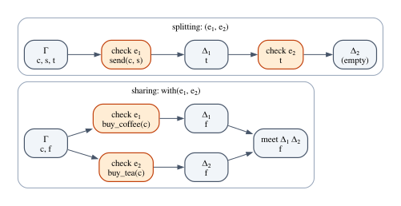

# Chapter 22 · The Affine Lambda Calculus

Chapter 21 took the structural rules away from logic one at a time and looked at
what was left. Without contraction, an assumption stops being a fact that can be
quoted as often as you like and becomes a *resource* that is spent when it is
used. The logic that keeps weakening but drops contraction is **affine logic**:
every assumption is used at most once.

This chapter does for affine logic what Chapter 8 did for intuitionistic logic.
It builds the programming language whose type system *is* the logic: the
**affine λ-calculus**, $\lambda^{\mathsf{aff}}$. Its typing rules fit on one page,
and they are the formal content of the first half of the claim that "Rust's
ownership is based on affine types": moves, the error "use of moved value"
(E0382), partial moves, closures that can be called only once. There are no
references and no lifetimes here; those are Part VI. This chapter is pure move
semantics.

We will write every rule down, build derivations by hand and in Lean, and prove
the theorem that makes the calculus affine: in a well-typed term, every variable
is used at most once. Then we turn the rules into an algorithm, prove it sound
and complete in Lean, implement it in Rust as the `affine` crate, and put the
crate's error messages side by side with rustc's.

**In this chapter you will learn:**

- the syntax and typing rules of $\lambda^{\mathsf{aff}}$, and how *splitting* the
  context replaces *sharing* it in rules with two subterms;
- how to build derivations, and why swapping a pair has one while duplicating a
  value has none;
- why a pair of type $\tau \otimes \sigma$ is taken apart with `let` and not with
  projections, and how Rust's partial moves refine this one place at a time;
- the usage theorem and its complete proof in Lean;
- the metatheory around it: weakening is admissible, contraction is not, and
  substitution and preservation hold;
- how to check the rules with input and output contexts ("leftovers"), with a
  Lean proof that this algorithm is sound and complete;
- how the `affine` crate reports errors modeled on E0382, and where it agrees and
  disagrees with rustc.

## From affine logic to a programming language

Here is what we need from earlier chapters. Chapter 6 introduced the three
structural rules: exchange (the order of assumptions does not matter), weakening
(an assumption may go unused) and contraction (an assumption may be used twice).
Chapter 21 arranged the logics that drop some of them in a lattice: **linear**
logic drops weakening and contraction (every assumption used exactly once),
**affine** logic drops only contraction (at most once).

Chapter 21 also found that, once contraction is gone, the familiar connectives
split in two. Conjunction becomes $A \otimes B$ ("tensor", I have both, and they
were paid for with *disjoint* resources) and $A \mathbin{\&} B$ ("with", I can
give you either one, your choice, both built from the *same* resources).
Disjunction becomes $A \oplus B$, and implication becomes $A \multimap B$
("lollipop", a function that uses its argument at most once). Girard's coin is
the standard illustration: with one coin you can have a coffee *or* a tea
($\mathsf{Coffee} \mathbin{\&} \mathsf{Tea}$), but not a coffee *and* a tea
($\mathsf{Coffee} \otimes \mathsf{Tea}$).

The difference between the two conjunctions lives in one operation on contexts,
**context splitting**. The introduction rule of $\otimes$ divides the
assumptions between its two premises, $\Gamma = \Gamma_1 \uplus \Gamma_2$, so that
each assumption goes to one premise only. The introduction rule of
$\mathbin{\&}$ gives the *whole* context to both premises, which is safe because
only one of the two will ever be used.

Chapter 10 showed how to read a natural-deduction system as a programming
language: propositions become types, proofs become terms, assumptions become
variables, and each rule becomes a typing rule that says how to build a term.
Applied to the intuitionistic logic of Chapter 4, the recipe gives the simply
typed λ-calculus of Chapter 8. Applied to affine logic, it gives
$\lambda^{\mathsf{aff}}$.

> [!NOTE]
> $\lambda^{\mathsf{aff}}$ is a model of a fragment of Rust: values that are
> moved, never borrowed. When we say "this rule is the move checker", we mean
> that the rule rejects the same programs that rustc rejects with E0382, for the
> same reason, on the programs that both of them understand. How rustc actually
> implements the check (a dataflow analysis on a control-flow graph) is the
> subject of Chapter 29.

## Syntax

### Types

$$
\tau, \sigma, \rho \;::=\; b \;\mid\; \mathbf{1} \;\mid\; \tau \multimap \sigma \;\mid\; \tau \otimes \sigma \;\mid\; \tau \mathbin{\&} \sigma \;\mid\; \tau \oplus \sigma
$$

| Type | Read as | Rust $\approx$ | Logic |
|---|---|---|---|
| $b$ | base type | `String`, `File`, `Conn` | atom |
| $\mathbf{1}$ | unit | `()` | unit of $\otimes$ |
| $\tau \multimap \sigma$ | affine function | `FnOnce(τ) -> σ` | linear implication |
| $\tau \otimes \sigma$ | pair | `(τ, σ)` | multiplicative "and" |
| $\tau \mathbin{\&} \sigma$ | offer of either | one value, two consuming methods | additive "and" |
| $\tau \oplus \sigma$ | sum | an `enum` with two variants | additive "or" |

A base type $b$ is an opaque resource: the calculus has no operations on it and
no constants of that type. Values of base type enter a program through its
context, as the parameters of a Rust function do, and the calculus only describes
how they are passed around.

### Terms

$$
e \;::=\; x \;\mid\; \lambda x{:}\tau.\,e \;\mid\; e_1\,e_2 \;\mid\; () \;\mid\; (e_1, e_2) \;\mid\; \mathtt{let}\ (x, y) = e_1\ \mathtt{in}\ e_2 \;\mid\; \mathtt{let}\ x = e_1\ \mathtt{in}\ e_2
$$

$$
\;\mid\; \langle e_1, e_2 \rangle \;\mid\; \mathsf{fst}\,e \;\mid\; \mathsf{snd}\,e \;\mid\; \mathsf{inl}\,e \;\mid\; \mathsf{inr}\,e \;\mid\; \mathtt{case}\ e\ \{x.\,e_1 \mid y.\,e_2\}
$$

Most of these are familiar from Chapter 8; the differences are in what the typing
rules will allow.

- $\lambda x{:}\tau.\,e$ is a function that may use its argument at most once. It
  also *takes* every variable of the context that its body uses, the way a Rust
  closure takes ownership of what its body consumes. A function is itself a
  resource: a value of type $\tau \multimap \sigma$ can be called once, like an
  `FnOnce`.
- $(e_1, e_2)$ builds a pair of type $\tau \otimes \sigma$, and
  $\mathtt{let}\ (x, y) = e_1\ \mathtt{in}\ e_2$ takes one apart, binding *both*
  components at once. There are no projections $\mathsf{fst}$ and $\mathsf{snd}$
  for $\otimes$; a section below explains why.
- $\langle e_1, e_2 \rangle$ is an offer of type $\tau \mathbin{\&} \sigma$:
  two computations, of which the consumer will run exactly one, chosen with
  $\mathsf{fst}$ or $\mathsf{snd}$. The components are not evaluated when the
  offer is built.
- $\mathsf{inl}\,e$ and $\mathsf{inr}\,e$ inject into a sum, and
  $\mathtt{case}\ e\ \{x.\,e_1 \mid y.\,e_2\}$ inspects one: if $e$ is
  $\mathsf{inl}\,v$ it runs $e_1$ with $x$ bound to $v$, otherwise $e_2$ with $y$
  bound to $v$. It is Rust's `match` on a two-variant `enum`.
- $\mathtt{let}\ x = e_1\ \mathtt{in}\ e_2$ is Rust's `let x = e1; e2`. It could be
  defined as $(\lambda x{:}\tau.\,e_2)\,e_1$, but it is more convenient as a
  construct of its own.

Two things are missing on purpose. There is no construct for throwing a value
away: discarding is built into the typing rules, as we will see, and Chapter 24
adds an explicit $\mathtt{drop}\ x;\ e$ when it needs to talk about the moment of
discarding. And there is no recursion, so every program terminates; general
recursion would not change anything in this chapter's theorems (Exercise 6
asks you to check one of them).

### In Lean

The Lean development of this chapter lives in four files in
`code/lean/Book/Ch22/`: `Syntax.lean`, `Typing.lean`, `Usage.lean` and
`Checker.lean`, each importing the previous one. The types are an ordinary
inductive type:

```lean
/-- The types of `λ^aff`. -/
inductive Ty where
  /-- An opaque base type, named like a Rust type: `String`, `File`, ... -/
  | base : String → Ty
  /-- The unit type `𝟏`, Rust's `()`. -/
  | unit : Ty
  /-- Linear (affine) functions `τ ⊸ σ`, Rust's `FnOnce(τ) -> σ`. -/
  | lolli : Ty → Ty → Ty
  /-- The multiplicative pair `τ ⊗ σ`, Rust's `(τ, σ)`. -/
  | tensor : Ty → Ty → Ty
  /-- The additive pair `τ & σ` ("with"): a choice of one of the two. -/
  | amp : Ty → Ty → Ty
  /-- The sum `τ ⊕ σ`, a Rust `enum` with two variants. -/
  | plus : Ty → Ty → Ty
  deriving DecidableEq
```

The additive pair is called `amp` (for the ampersand) because `with` is a
keyword in Lean. A few notations make the types readable:

```lean
@[inherit_doc] scoped infixr:25 " ⊸ " => Ty.lolli
@[inherit_doc] scoped infixl:35 " ⊗ " => Ty.tensor
@[inherit_doc] scoped infixl:35 " & " => Ty.amp
@[inherit_doc] scoped infixl:30 " ⊕ " => Ty.plus
```

The numbers are precedences, and `infixr` makes $\multimap$ associate to the right
as $\to$ does. The keyword `scoped` makes each notation active only inside the
namespace `Ch22` (or where that namespace is opened), so that it does not leak
into other chapters, where $\otimes$ means something else. The symbol `⊕` is
also Lean's notation for the sum of two *Lean* types; Lean chooses between the
two meanings by the types of the arguments, and here they are always `Ty`s.

For the terms, we use de Bruijn indices, as Chapter 7 introduced them and
Chapter 9 used them for its proof of type safety: a variable is the number of
binders between it and its binder. Every binding construct says how many
variables it binds:

```lean
/-- The terms of `λ^aff`. Variables are de Bruijn indices: `var 0` is the
nearest enclosing binder. The comments give the named notation of the text. -/
inductive Term where
  | var : Nat → Term                    -- x
  | lam : Ty → Term → Term              -- λx:τ. e          (binds x)
  | app : Term → Term → Term            -- e₁ e₂
  | unit : Term                         -- ()
  | pair : Term → Term → Term           -- (e₁, e₂)          ⊗ introduction
  | letPair : Term → Term → Term        -- let (x, y) = e₁ in e₂  (binds x, y)
  | wpair : Term → Term → Term          -- ⟨e₁, e₂⟩          & introduction
  | fst : Term → Term                   -- fst e
  | snd : Term → Term                   -- snd e
  | inl : Ty → Term → Term              -- inl e  (the Ty is the right summand)
  | inr : Ty → Term → Term              -- inr e  (the Ty is the left summand)
  | case : Term → Term → Term → Term    -- case e of inl x ⇒ e₁ | inr y ⇒ e₂
  | letIn : Term → Term → Term          -- let x = e₁ in e₂  (binds x)
  deriving DecidableEq, Repr
```

Inside the body of a `letPair`, the second component $y$ is `var 0` and the
first component $x$ is `var 1`: the innermost binder gets index 0, and we treat
$y$ as bound after $x$. The injections carry the *other* summand as an
annotation, so that every term has at most one type, which keeps the checker
later in the chapter simple. Here are three of the chapter's examples, written
with this convention:

```lean
/-- Two base types for the examples. -/
def Str : Ty := .base "String"
def File : Ty := .base "File"

/-- `λp. let (x, y) = p in (y, x)`. Inside the `let`, `y` is `var 0`, `x` is
`var 1` and `p` would be `var 2`. -/
def swap (τ σ : Ty) : Term :=
  .lam (τ ⊗ σ) (.letPair (.var 0) (.pair (.var 0) (.var 1)))

/-- `λx. λy. x`: the second argument is discarded. -/
def discard (τ σ : Ty) : Term :=
  .lam τ (.lam σ (.var 1))

/-- `λx. (x, x)`: the argument is used twice. -/
def dup (τ : Ty) : Term :=
  .lam τ (.pair (.var 0) (.var 0))
```

The function at the heart of the chapter counts how many times a term uses a
variable:

```lean
/-- `uses i e` counts the occurrences of the free variable with index `i` in
`e`. Under a binder the index of the same variable goes up by one (by two under
`letPair`, which binds two variables). The two alternatives of an additive pair
and the two branches of a `case` are counted with `max`, not `+`: only one of
them will ever run. -/
def uses (i : Nat) : Term → Nat
  | .var j => if i = j then 1 else 0
  | .lam _ e => uses (i + 1) e
  | .app e₁ e₂ => uses i e₁ + uses i e₂
  | .unit => 0
  | .pair e₁ e₂ => uses i e₁ + uses i e₂
  | .letPair e₁ e₂ => uses i e₁ + uses (i + 2) e₂
  | .wpair e₁ e₂ => max (uses i e₁) (uses i e₂)
  | .fst e => uses i e
  | .snd e => uses i e
  | .inl _ e => uses i e
  | .inr _ e => uses i e
  | .case e e₁ e₂ => uses i e + max (uses (i + 1) e₁) (uses (i + 1) e₂)
  | .letIn e₁ e₂ => uses i e₁ + uses (i + 1) e₂
```

Under one binder the same free variable has a larger index, so the count goes
from `i` to `i + 1` (to `i + 2` under `letPair`). Where two subterms both run,
as in an application or a pair, the counts add up. Where only one of two
alternatives will ever run, in an offer and in the branches of a `case`, the
count is the *maximum* of the two. That is the counting convention that the
usage theorem needs, and we will come back to it.

```lean
-- The body of `swap` uses `p` once: the `let` consumes it.
/-- info: 1 -/
#guard_msgs in
#eval uses 0 (.letPair (.var 0) (.pair (.var 0) (.var 1)))

-- Under one binder, the free variable 0 is written `var 1`.
/-- info: 1 -/
#guard_msgs in
#eval uses 0 (.lam Str (.var 1))

-- The body of `dup` uses its variable twice.
/-- info: 2 -/
#guard_msgs in
#eval uses 0 (.pair (.var 0) (.var 0))

-- An additive pair counts the larger of its two components.
/-- info: 1 -/
#guard_msgs in
#eval uses 0 (.wpair (.var 0) (.var 0))
```

Finally, `Syntax.lean` gives `Ty` a printer, so that Lean shows types the way
this chapter writes them:

```lean
/-- info: (String ⊗ File) ⊸ (File ⊗ String) -/
#guard_msgs in
#eval (Str ⊗ File) ⊸ (File ⊗ Str)
```

## Contexts and splitting

A context is a list of distinct variables with their types,
$\Gamma = x_1 : \tau_1, \dots, x_n : \tau_n$. We keep the exchange rule, as
every substructural logic of interest to Rust does, so the order of a context
does not matter.

The splitting judgment $\Gamma = \Gamma_1 \uplus \Gamma_2$ says that $\Gamma$ is
divided between $\Gamma_1$ and $\Gamma_2$. It is defined by three rules that
walk through the context and send each variable left or right:

$$
\dfrac{}{\cdot = \cdot \uplus \cdot}\;\textsf{S-Empty}
\qquad
\dfrac{\Gamma = \Gamma_1 \uplus \Gamma_2}{\Gamma, x : \tau = (\Gamma_1, x : \tau) \uplus \Gamma_2}\;\textsf{S-Left}
\qquad
\dfrac{\Gamma = \Gamma_1 \uplus \Gamma_2}{\Gamma, x : \tau = \Gamma_1 \uplus (\Gamma_2, x : \tau)}\;\textsf{S-Right}
$$

The dot $\cdot$ is the empty context. Every variable goes to exactly one side, so
a context with $n$ variables has $2^n$ splits. For $x : A, y : B$ there are four:
both left, $x$ left and $y$ right, $x$ right and $y$ left, both right. Chapter 23
will add a fourth rule, S-Both, that sends a variable to both sides when its type
is `Copy`; Chapter 28 uses all four.

### Contexts with holes

In Lean a context cannot simply be a list of types, because de Bruijn indices are
positions: if a split removed a variable from the list, every variable after it
would be renumbered, and a term would mean something else in each half of the
split. So a Lean context keeps every position and marks the variables that are
not available with a **hole**:

```lean
/-- A context: one entry per de Bruijn index. `some τ` is a variable of type
`τ` that the term may use; `none` is a hole, a variable that exists but is not
available to this part of the term (it was given to another part). -/
abbrev Ctx := List (Option Ty)
```

```lean
/-- `Split Γ Γ₁ Γ₂`: the context `Γ` is divided between `Γ₁` and `Γ₂`. Every
available variable of `Γ` goes to exactly one side and leaves a hole in the
other. Positions never move, so de Bruijn indices mean the same thing in all
three contexts. -/
inductive Split : Ctx → Ctx → Ctx → Prop where
  | nil : Split [] [] []
  | left {Γ Γ₁ Γ₂ : Ctx} {τ : Ty} :
      Split Γ Γ₁ Γ₂ → Split (some τ :: Γ) (some τ :: Γ₁) (none :: Γ₂)
  | right {Γ Γ₁ Γ₂ : Ctx} {τ : Ty} :
      Split Γ Γ₁ Γ₂ → Split (some τ :: Γ) (none :: Γ₁) (some τ :: Γ₂)
  | hole {Γ Γ₁ Γ₂ : Ctx} :
      Split Γ Γ₁ Γ₂ → Split (none :: Γ) (none :: Γ₁) (none :: Γ₂)
```

Rules `left` and `right` are S-Left and S-Right: an available variable goes to
one side and leaves a hole on the other. Rule `hole` says that a position that is
already a hole stays a hole on both sides. With holes, the three contexts of a
split always have the same length, and `var 3` means the same variable in all of
them. For example, `Split [some A, some B] [some A, none] [none, some B]` gives
variable 0 to the left and variable 1 to the right. The same idea will return in
the checker, where "a hole" will mean "already moved".

## The typing rules

The judgment $\Gamma \vdash e : \tau$ reads as before: in context $\Gamma$, the
term $e$ has type $\tau$. What is new is that the context is a supply of
resources, and the rules decide who gets them. Here are all the rules. A bound
variable is always assumed to be fresh (not already in the context), as in
Chapter 7.

$$
\dfrac{}{\Gamma, x : \tau \vdash x : \tau}\;\textsf{A-Var}
\qquad
\dfrac{}{\Gamma \vdash () : \mathbf{1}}\;\textsf{A-Unit}
$$

$$
\dfrac{\Gamma, x : \tau \vdash e : \sigma}{\Gamma \vdash \lambda x{:}\tau.\,e : \tau \multimap \sigma}\;\textsf{A-Abs}
\qquad
\dfrac{\Gamma = \Gamma_1 \uplus \Gamma_2 \qquad \Gamma_1 \vdash e_1 : \tau \multimap \sigma \qquad \Gamma_2 \vdash e_2 : \tau}{\Gamma \vdash e_1\,e_2 : \sigma}\;\textsf{A-App}
$$

$$
\dfrac{\Gamma = \Gamma_1 \uplus \Gamma_2 \qquad \Gamma_1 \vdash e_1 : \tau \qquad \Gamma_2 \vdash e_2 : \sigma}{\Gamma \vdash (e_1, e_2) : \tau \otimes \sigma}\;\textsf{A-Pair}
$$

$$
\dfrac{\Gamma = \Gamma_1 \uplus \Gamma_2 \qquad \Gamma_1 \vdash e_1 : \tau \otimes \sigma \qquad \Gamma_2, x : \tau, y : \sigma \vdash e_2 : \rho}{\Gamma \vdash \mathtt{let}\ (x, y) = e_1\ \mathtt{in}\ e_2 : \rho}\;\textsf{A-LetPair}
$$

$$
\dfrac{\Gamma \vdash e_1 : \tau \qquad \Gamma \vdash e_2 : \sigma}{\Gamma \vdash \langle e_1, e_2 \rangle : \tau \mathbin{\&} \sigma}\;\textsf{A-With}
\qquad
\dfrac{\Gamma \vdash e : \tau \mathbin{\&} \sigma}{\Gamma \vdash \mathsf{fst}\,e : \tau}\;\textsf{A-Fst}
\qquad
\dfrac{\Gamma \vdash e : \tau \mathbin{\&} \sigma}{\Gamma \vdash \mathsf{snd}\,e : \sigma}\;\textsf{A-Snd}
$$

$$
\dfrac{\Gamma \vdash e : \tau}{\Gamma \vdash \mathsf{inl}\,e : \tau \oplus \sigma}\;\textsf{A-Inl}
\qquad
\dfrac{\Gamma \vdash e : \sigma}{\Gamma \vdash \mathsf{inr}\,e : \tau \oplus \sigma}\;\textsf{A-Inr}
$$

$$
\dfrac{\Gamma = \Gamma_1 \uplus \Gamma_2 \qquad \Gamma_1 \vdash e : \tau \oplus \sigma \qquad \Gamma_2, x : \tau \vdash e_1 : \rho \qquad \Gamma_2, y : \sigma \vdash e_2 : \rho}{\Gamma \vdash \mathtt{case}\ e\ \{x.\,e_1 \mid y.\,e_2\} : \rho}\;\textsf{A-Case}
$$

$$
\dfrac{\Gamma = \Gamma_1 \uplus \Gamma_2 \qquad \Gamma_1 \vdash e_1 : \tau \qquad \Gamma_2, x : \tau \vdash e_2 : \sigma}{\Gamma \vdash \mathtt{let}\ x = e_1\ \mathtt{in}\ e_2 : \sigma}\;\textsf{A-Let}
$$

Read aloud, with the Rust construct each rule models:

| Rule | In words | Rust $\approx$ |
|---|---|---|
| A-Var | a variable has its type; others may idle | using a variable by value moves it |
| A-Abs | the body may use the argument and anything else | a closure takes what its body uses |
| A-App | function and argument use disjoint variables | a call partitions what it moves |
| A-Pair | the components use disjoint variables | `(a, b)` moves `a` and `b` |
| A-LetPair | take a pair apart, getting both parts | `let (x, y) = p;` |
| A-With | both alternatives may use everything | a value with two `self` methods |
| A-Case | scrutinee and branches split; branches share | `match` arms |
| A-Let | the value and the rest split | `let x = e1; e2` |

### Three rules to stare at

**A-Var: where weakening lives.** The axiom allows an arbitrary $\Gamma$ next to
the variable, and A-Unit allows an arbitrary context too. Those extra variables
are not used. In a *linear* calculus the axiom would be

$$
\dfrac{}{x : \tau \vdash x : \tau}\;\textsf{L-Var}
$$

with nothing else in the context, and A-Unit would demand an empty context. That
one difference is the whole difference between an affine language and a language
in which every value must be consumed. Rust is on the affine side: a function
may ignore a parameter, and the value is then simply dropped at the end of the
function (Chapter 24 is about what "dropped" costs).

**A-App and A-Pair: splitting is the move checker.** To type $(e_1, e_2)$ you
must divide the variables in scope between the two components, and no variable
can go to both. When you write `f(a, b)` in Rust, the compiler must be able to
partition the owned values in scope between the argument positions; if both
arguments mention the same non-`Copy` variable, no partition exists, and you get
E0382. Every rule whose premises *both run* splits the context: A-App, A-Pair,
A-LetPair, A-Let, and A-Case between the scrutinee and the branches.

**A-With and A-Case: sharing because only one alternative runs.** In A-With both
premises have the same $\Gamma$, and in A-Case the two branches have the same
$\Gamma_2$. This is *not* contraction. An offer $\langle e_1, e_2 \rangle$ runs
only the alternative the consumer chooses, and a `case` runs only one branch, so
each resource is still consumed at most once *when the program runs*. Rust does
the same: the borrow checker checks each arm of a `match` against the same
starting state, so a value moved in one arm is not thereby moved in the other.

### In Lean

Each rule becomes a constructor of an inductive predicate, with the premises as
arguments and the conclusion as the result type:

```lean
/-- The typing judgment `Γ ⊢ e : τ` of `λ^aff`. Every rule with two
subterms that both run splits the context; the additive rules (`wpair`, and the
two branches of `case`) share it. -/
inductive HasType : Ctx → Term → Ty → Prop where
  | var {Γ : Ctx} {x : Nat} {τ : Ty} :
      Γ[x]? = some (some τ) →
      HasType Γ (.var x) τ
  | lam {Γ : Ctx} {e : Term} {τ σ : Ty} :
      HasType (some τ :: Γ) e σ →
      HasType Γ (.lam τ e) (τ ⊸ σ)
  | app {Γ Γ₁ Γ₂ : Ctx} {e₁ e₂ : Term} {τ σ : Ty} :
      Split Γ Γ₁ Γ₂ →
      HasType Γ₁ e₁ (τ ⊸ σ) → HasType Γ₂ e₂ τ →
      HasType Γ (.app e₁ e₂) σ
  | unit {Γ : Ctx} :
      HasType Γ .unit .unit
  | pair {Γ Γ₁ Γ₂ : Ctx} {e₁ e₂ : Term} {τ σ : Ty} :
      Split Γ Γ₁ Γ₂ →
      HasType Γ₁ e₁ τ → HasType Γ₂ e₂ σ →
      HasType Γ (.pair e₁ e₂) (τ ⊗ σ)
  | letPair {Γ Γ₁ Γ₂ : Ctx} {e₁ e₂ : Term} {τ σ ρ : Ty} :
      Split Γ Γ₁ Γ₂ →
      HasType Γ₁ e₁ (τ ⊗ σ) → HasType (some σ :: some τ :: Γ₂) e₂ ρ →
      HasType Γ (.letPair e₁ e₂) ρ
  | wpair {Γ : Ctx} {e₁ e₂ : Term} {τ σ : Ty} :
      HasType Γ e₁ τ → HasType Γ e₂ σ →
      HasType Γ (.wpair e₁ e₂) (τ & σ)
  | fst {Γ : Ctx} {e : Term} {τ σ : Ty} :
      HasType Γ e (τ & σ) → HasType Γ (.fst e) τ
  | snd {Γ : Ctx} {e : Term} {τ σ : Ty} :
      HasType Γ e (τ & σ) → HasType Γ (.snd e) σ
  | inl {Γ : Ctx} {e : Term} {τ σ : Ty} :
      HasType Γ e τ → HasType Γ (.inl σ e) (τ ⊕ σ)
  | inr {Γ : Ctx} {e : Term} {τ σ : Ty} :
      HasType Γ e σ → HasType Γ (.inr τ e) (τ ⊕ σ)
  | case {Γ Γ₁ Γ₂ : Ctx} {e e₁ e₂ : Term} {τ σ ρ : Ty} :
      Split Γ Γ₁ Γ₂ →
      HasType Γ₁ e (τ ⊕ σ) →
      HasType (some τ :: Γ₂) e₁ ρ → HasType (some σ :: Γ₂) e₂ ρ →
      HasType Γ (.case e e₁ e₂) ρ
  | letIn {Γ Γ₁ Γ₂ : Ctx} {e₁ e₂ : Term} {τ σ : Ty} :
      Split Γ Γ₁ Γ₂ →
      HasType Γ₁ e₁ τ → HasType (some τ :: Γ₂) e₂ σ →
      HasType Γ (.letIn e₁ e₂) σ
```

Rule `var` says that variable `x` has type `τ` when position `x` of the context
holds `some τ`. The notation `Γ[x]?` is Lean's indexing that returns an `Option`
(`none` when `x` is out of range), like Rust's `slice.get(x)`; we write
`some (some τ)` because the context entries are themselves options. Nothing is
said about the other positions: that is A-Var's weakening. The binding rules
extend the context at the front, with `some τ :: Γ`, because the innermost
variable has index 0. The implicit arguments in braces are the metavariables of
the rule, which Lean will infer whenever we use a constructor.

## Worked derivations

### Swap is typable

The function that swaps a pair uses each of its variables exactly once:

$$
\vdash \lambda p.\,\mathtt{let}\ (x, y) = p\ \mathtt{in}\ (y, x) : (\tau \otimes \sigma) \multimap (\sigma \otimes \tau)
$$

Read the derivation from the bottom. A-Abs puts $p$ in the context. A-LetPair
must split $p : \tau \otimes \sigma$ between the scrutinee and the body; the
scrutinee is $p$ itself, so $p$ goes left and the body gets the empty context,
extended with $x$ and $y$. Finally A-Pair splits $x : \tau, y : \sigma$ so that
$y$ goes to the first component and $x$ to the second. Writing the pair's
sub-derivation separately, and leaving the splits out of the trees:

$$
\mathcal{D} \;=\; \dfrac{\dfrac{}{y : \sigma \vdash y : \sigma}\;\textsf{A-Var} \qquad \dfrac{}{x : \tau \vdash x : \tau}\;\textsf{A-Var}}{x : \tau,\, y : \sigma \vdash (y, x) : \sigma \otimes \tau}\;\textsf{A-Pair}
$$

$$
\dfrac{\dfrac{\dfrac{}{p : \tau \otimes \sigma \vdash p : \tau \otimes \sigma}\;\textsf{A-Var} \qquad \mathcal{D}}{p : \tau \otimes \sigma \vdash \mathtt{let}\ (x, y) = p\ \mathtt{in}\ (y, x) : \sigma \otimes \tau}\;\textsf{A-LetPair}}{\vdash \lambda p.\,\mathtt{let}\ (x, y) = p\ \mathtt{in}\ (y, x) : (\tau \otimes \sigma) \multimap (\sigma \otimes \tau)}\;\textsf{A-Abs}
$$

with the splits $p : \tau \otimes \sigma = (p : \tau \otimes \sigma) \uplus \cdot$
and $x : \tau, y : \sigma = (y : \sigma) \uplus (x : \tau)$. In Lean the same
derivation is a term, one constructor per rule, and the splits appear as
arguments:

```lean
/-- Swap is typable: `⊢ λp. let (x, y) = p in (y, x) : (τ ⊗ σ) ⊸ (σ ⊗ τ)`. -/
theorem swap_typed (τ σ : Ty) : HasType [] (swap τ σ) ((τ ⊗ σ) ⊸ (σ ⊗ τ)) :=
  .lam                                  -- context: p
    (.letPair (.left .nil)              -- p goes to the `let`, nothing else
      (.var rfl)                        -- p : τ ⊗ σ
      (.pair (.left (.right (.hole .nil)))  -- y left, x right, p is a hole
        (.var rfl)                      -- y : σ
        (.var rfl)))                    -- x : τ
```

The split for the `letPair` is `.left .nil`: the context has one entry, $p$, and
it goes left. The body's context is then `[some σ, some τ, none]`: $y$, $x$, and
the hole where $p$ was. The pair's split `.left (.right (.hole .nil))` reads
position by position: $y$ left, $x$ right, the hole stays a hole. Each leaf is
`.var rfl`: the premise `Γ[x]? = some (some τ)` is about a concrete list, so
Lean computes the lookup and `rfl` confirms it.

The `affine` crate, which we meet properly later in the chapter, prints the
derivation it finds for the same function written in Rust syntax. Each line is a
judgment with the context that the subterm actually used:

```text
ok: fn swap(p: (String, File)) -> (File, String)
[A-LetPair] p: (String, File) ⊢ let (s, f) = p; (f, s) : (File, String)
  [A-Var] p: (String, File) ⊢ p : (String, File)
  [A-Pair] s: String, f: File ⊢ (f, s) : (File, String)
    [A-Var] f: File ⊢ f : File
    [A-Var] s: String ⊢ s : String
```

And Rust, of course, accepts the function. This chapter's Rust example,
`code/rust/examples/ch22_affine_in_rust.rs`, writes the terms of the calculus as
Rust functions:

```rust
/// `λp. let (x, y) = p in (y, x)`: each variable is used exactly once.
fn swap<A, B>(p: (A, B)) -> (B, A) {
    let (x, y) = p;
    (y, x)
}

/// The same function with Rust's projections. Rust tracks moves per place,
/// and `p.0` and `p.1` are different places.
fn swap_fields<A, B>(p: (A, B)) -> (B, A) {
    (p.1, p.0)
}
```

### Discarding is typable

The function $\lambda x.\,\lambda y.\,x$ ignores its second argument:

$$
\dfrac{\dfrac{\dfrac{}{x : \tau,\, y : \sigma \vdash x : \tau}\;\textsf{A-Var}}{x : \tau \vdash \lambda y.\,x : \sigma \multimap \tau}\;\textsf{A-Abs}}{\vdash \lambda x.\,\lambda y.\,x : \tau \multimap \sigma \multimap \tau}\;\textsf{A-Abs}
$$

The only interesting step is the top one: A-Var accepts the unused $y$ in the
context. In Lean the derivation is three constructors:

```lean
/-- Discarding is typable: `⊢ λx. λy. x : τ ⊸ σ ⊸ τ`. Rule `var` accepts the
unused `y` in the context: that is weakening. -/
theorem discard_typed (τ σ : Ty) : HasType [] (discard τ σ) (τ ⊸ σ ⊸ τ) :=
  .lam (.lam (.var rfl))
```

In Rust, discarding is legal too, but it is not invisible. Here is the Rust
version, called with a `File` whose destructor writes to a log:

```rust
/// `λx. λy. x`: `y` is discarded. In the calculus that is weakening and
/// nothing happens; in Rust the discarded value is dropped.
fn first<A, B>(x: A, _y: B) -> A {
    x
}
```

```text
log: first: start
log: close c.txt
log: first: returned "kept"
```

The file is closed *inside* `first`, before it returns: the discarded value was
dropped at the end of the function. The typing rule is the calculus's weakening;
the closing is what Chapter 24 calls weakening with a side effect.

### Duplication is not

Now try $\lambda x.\,(x, x)$ at type $\tau \multimap \tau \otimes \tau$. A-Abs
leaves us with $x : \tau \vdash (x, x) : \tau \otimes \tau$, and the only rule
for a pair is A-Pair, which needs a split $x : \tau = \Gamma_1 \uplus \Gamma_2$
with $\Gamma_1 \vdash x : \tau$ and $\Gamma_2 \vdash x : \tau$. The only rule
that concludes a variable is A-Var, which needs $x$ in the context. So $x$ would
have to be in both $\Gamma_1$ and $\Gamma_2$, and no split does that. There is no
derivation.

This argument proves more than it seems. The rule of contraction,

$$
\dfrac{\Gamma, x : \tau, y : \tau \vdash e : \rho}{\Gamma, z : \tau \vdash e[z/x, z/y] : \rho}\;\textsf{Contr}
$$

is **not admissible** in $\lambda^{\mathsf{aff}}$ (in the sense of Chapter 6: we
cannot add it without changing what is derivable). Its premise is derivable with
$e = (x, y)$, and its conclusion would be $z : \tau \vdash (z, z)$, which we just
showed is not. In Lean, the argument becomes a proof by inversion:

```lean
/-- `(z, z)` has no type in a context where `z` is the variable 0, whatever the
rest of the context and whatever the type: rule `pair` must split the context,
and only one side receives `z`. -/
theorem no_pair_twice (Γ : Ctx) (τ ρ : Ty) :
    ¬ HasType (some τ :: Γ) (.pair (.var 0) (.var 0)) ρ := by
  intro h
  -- The only rule that concludes a pair is `pair`: it gives a split and two
  -- derivations, one for each component.
  cases h with
  | pair hs h₁ h₂ =>
    -- The only rule that concludes a variable is `var`: each side must have
    -- `some _` at position 0.
    cases h₁ with
    | var g₁ =>
      cases h₂ with
      | var g₂ =>
        -- The split puts position 0 on one side only; the other side has a
        -- hole there, which contradicts `g₁` or `g₂`.
        cases hs <;> simp at g₁ g₂
```

`cases h` asks which constructor could have produced a derivation of a pair; the
only candidate is `pair`, and Lean names its premises: the split `hs` and the two
derivations `h₁` and `h₂`. `cases h₁` and `cases h₂` do the same for the
variables: only `var` fits, which gives `g₁ : Γ₁[0]? = some (some _)` and the
same for `Γ₂`. Finally `cases hs` tries the constructors of `Split` for a
context whose first entry is `some τ`: `left` puts a hole at position 0 of
`Γ₂`, `right` puts one in `Γ₁`, and `hole` and `nil` do not fit at all. The
combinator `<;>` runs `simp at g₁ g₂` on every remaining case, and in each one
`simp` evaluates the lookup of the hole to `none`, turns the hypothesis into
`none = some _`, recognizes it as false and closes the goal.

Rust rejects the same function, and its message describes the failed split:

```rust
fn dup(s: String) -> (String, String) {
    (s, s)
}
```

```text
error[E0382]: use of moved value: `s`
 --> compile_fail/ch22_dup.rs:6:9
  |
5 | fn dup(s: String) -> (String, String) {
  |        - move occurs because `s` has type `String`, which does not implement the `Copy` trait
6 |     (s, s)
  |      -  ^ value used here after move
  |      |
  |      value moved here
  |
help: consider cloning the value if the performance cost is acceptable
  |
6 |     (s.clone(), s)
  |       ++++++++
```

"Value moved here" is the first component taking $s$; "value used here after
move" is the second component finding nothing left. The help at the end is a
glimpse of Chapter 23: `clone` is an *explicit* duplication, a term rather than a
structural rule.

## Sharing: offers and branches

The additive rules are where Girard's coin becomes a program. Suppose the
environment provides two functions, $\mathsf{coffee} : \mathsf{Coin} \multimap \mathsf{Coffee}$
and $\mathsf{tea} : \mathsf{Coin} \multimap \mathsf{Tea}$. (In the calculus a
function in the context would be a resource too, usable once; we treat these two
as constants, available in every context, the way a Rust program can call a
declared function as often as it likes. Chapter 23 explains why Rust may do
that.) Then

$$
c : \mathsf{Coin} \vdash \langle \mathsf{coffee}\,c,\ \mathsf{tea}\,c \rangle : \mathsf{Coffee} \mathbin{\&} \mathsf{Tea}
$$

is derivable by A-With, both alternatives using $c$, while

$$
c : \mathsf{Coin} \vdash (\mathsf{coffee}\,c,\ \mathsf{tea}\,c) : \mathsf{Coffee} \otimes \mathsf{Tea}
$$

is not, for the same reason as $(x, x)$. The crate's derivation of the offer
shows the coin in both premises:

```text
ok: fn offer(c: Coin) -> With<Coffee, Tea>
[A-With] c: Coin ⊢ with(buy_coffee(c), buy_tea(c)) : With<Coffee, Tea>
  [Call] c: Coin ⊢ buy_coffee(c) : Coffee
    [A-Var] c: Coin ⊢ c : Coin
  [Call] c: Coin ⊢ buy_tea(c) : Tea
    [A-Var] c: Coin ⊢ c : Coin
```

Rust has no built-in $\mathbin{\&}$, but the idea is common in Rust APIs: a value
with several methods that take `self`. You may call any one of them, and calling
it uses the value up. The chapter's Rust example has a voucher, and a generic
version that stores the shared resources together with the two alternatives:

```rust
struct Coin;
#[derive(Debug)]
struct Coffee;
#[derive(Debug)]
struct Tea;

fn buy_coffee(_c: Coin) -> Coffee {
    Coffee
}

fn buy_tea(_c: Coin) -> Tea {
    Tea
}

/// `Coffee & Tea`: one coin, two ways to spend it. Both methods take `self`,
/// so whichever you call consumes the voucher, and the other is gone.
struct Voucher {
    coin: Coin,
}

impl Voucher {
    fn coffee(self) -> Coffee {
        buy_coffee(self.coin)
    }
    fn tea(self) -> Tea {
        buy_tea(self.coin)
    }
}

/// The general form: the shared resources `R` and the two alternatives.
struct With<R, A, B> {
    resources: R,
    fst: fn(R) -> A,
    snd: fn(R) -> B,
}

impl<R, A, B> With<R, A, B> {
    fn fst(self) -> A {
        (self.fst)(self.resources)
    }
    fn snd(self) -> B {
        (self.snd)(self.resources)
    }
}
```

```rust
// Each voucher (each offer) is spent once, on the alternative we choose.
let coffee = Voucher { coin: Coin }.coffee();
let tea = Voucher { coin: Coin }.tea();
println!("vouchers: {coffee:?}, {tea:?}");
let offer = || With {
    resources: Coin,
    fst: buy_coffee,
    snd: buy_tea,
};
let (coffee, tea) = (offer().fst(), offer().snd());
println!("offers:   {coffee:?}, {tea:?}");
```

Each voucher, each offer, is spent once. Spending one voucher twice is exactly
the $\otimes$ derivation that does not exist:

```rust
impl Voucher {
    pub fn coffee(self) -> Coffee {
        drop(self.coin);
        Coffee
    }
    pub fn tea(self) -> Tea {
        drop(self.coin);
        Tea
    }
}

pub fn both(v: Voucher) -> (Coffee, Tea) {
    (v.coffee(), v.tea())
}
```

```text
error[E0382]: use of moved value: `v`
  --> compile_fail/ch22_voucher_both.rs:26:18
   |
25 | pub fn both(v: Voucher) -> (Coffee, Tea) {
   |             - move occurs because `v` has type `Voucher`, which does not implement the `Copy` trait
26 |     (v.coffee(), v.tea())
   |        --------  ^ value used here after move
   |        |
   |        `v` moved due to this method call
   |
note: `Voucher::coffee` takes ownership of the receiver `self`, which moves `v`
  --> compile_fail/ch22_voucher_both.rs:15:19
   |
15 |     pub fn coffee(self) -> Coffee {
   |                   ^^^^
```

The note names the mechanism: `coffee` takes its receiver `self` by value, so
calling it is a move of `v`, like passing `v` to a function.

The two branches of a `case` share their context in the same way. Here is a
settlement that ships an order or refunds it, using the connection `c` in both
branches, in the crate's syntax and with the crate's derivation:

```text
ok: fn settle(m: Either<Order, Refund>, c: Conn) -> Conn
[A-Case] m: Either<Order, Refund>, c: Conn ⊢ match m { Left(o) => …, Right(r) => … } : Conn
  [A-Var] m: Either<Order, Refund> ⊢ m : Either<Order, Refund>
  [Call] c: Conn, o: Order ⊢ ship(c, o) : Conn
    [A-Var] c: Conn ⊢ c : Conn
    [A-Var] o: Order ⊢ o : Order
  [Call] c: Conn, r: Refund ⊢ refund(c, r) : Conn
    [A-Var] c: Conn ⊢ c : Conn
    [A-Var] r: Refund ⊢ r : Refund
```

Each branch premise has `c` in its context. In Rust:

```rust
enum Either<A, B> {
    Left(A),
    Right(B),
}

/// Both arms use `c`: only one of them runs.
fn settle(m: Either<String, String>, c: Conn) -> Conn {
    match m {
        Either::Left(order) => send(c, format!("ship {order}")),
        Either::Right(refund) => send(c, format!("refund {refund}")),
    }
}
```

This sharing is also why `uses` takes the maximum over branches. A variable that
appears once in each branch is used once on every run, so its count is
$\max(1, 1) = 1$, not $2$. The other side of the coin is that a variable moved
in *one* branch must be considered moved after the `case`, because the type
checker does not know which branch will run. The crate reports this case with
the move in the left arm:

```text
error[E0382]: use of moved value: `log`
 --> ch22_route.aff:8:9
  |
3 | fn route(m: Either<String, String>, c: Conn, log: String) -> (Conn, String) {
  |                                              --- move occurs because `log` has type `String`, which does not implement the `Copy` trait
4 |     let c = match m {
5 |         Left(order) => send(c, log),
  |                                --- value moved here
...
8 |     (c, log)
  |         ^^^ value used here after move
```

## Why `⊗` has no projections

In the simply typed λ-calculus a pair has two projections, and
$\lambda p.\,(\mathsf{snd}\,p, \mathsf{fst}\,p)$ swaps it. In
$\lambda^{\mathsf{aff}}$ that term is not typable: it uses $p$ twice. Projections
are the wrong eliminator for $\otimes$. A projection keeps one component and
silently abandons the other, the *orphaned* component; and two projections need
two uses of the pair.

In an affine calculus a projection can still be *defined*, because abandoning a
value is weakening, which we have:

```lean
/-- A first projection for `⊗`, defined with the `let`: `let (x, y) = e in x`.
The second component `y` is discarded. -/
def tfst (e : Term) : Term := .letPair e (.var 1)

/-- The second projection, `let (x, y) = e in y`. -/
def tsnd (e : Term) : Term := .letPair e (.var 0)

theorem tfst_typed {Γ : Ctx} {e : Term} {τ σ : Ty} (h : HasType Γ e (τ ⊗ σ)) :
    HasType Γ (tfst e) τ :=
  .letPair (Split.all_left Γ) h (.var rfl)

/-- But the two projections cannot both be applied to the same pair. -/
theorem no_both_projections (Γ : Ctx) (τ σ ρ : Ty) :
    ¬ HasType (some (τ ⊗ σ) :: Γ) (.pair (tfst (.var 0)) (tsnd (.var 0))) ρ := by
  intro h
  have := usage h 0
  simp [tfst, tsnd, uses, avail] at this
```

`tfst e` is $\mathtt{let}\ (x, y) = e\ \mathtt{in}\ x$, with $y$ discarded, and
`tfst_typed` derives it for any well-typed pair (`Split.all_left` sends the whole
context to the scrutinee). But `no_both_projections` shows that the two
projections cannot both be applied to the same variable: the proof is one
application of the usage theorem of the next section, which finds variable 0
used twice. So the `let` that binds both components at once is not a
convenience. It is the only way to get both halves of a pair while using the pair
once.

Rust refines this. It tracks moves not per variable but per **place**: `p`,
`p.0` and `p.1` are different places, and moving out of `p.0` leaves `p.1` where
it was. That is why `swap_fields` above, written `(p.1, p.0)`, compiles. What
Rust does not allow is using `p` as a whole after one of its parts has been
moved:

```rust
fn split(p: (String, File)) -> (String, (String, File)) {
    let s = p.0;
    (s, p)
}
```

```text
error[E0382]: use of partially moved value: `p`
  --> compile_fail/ch22_partial_move.rs:10:9
   |
 9 |     let s = p.0;
   |             --- value partially moved here
10 |     (s, p)
   |         ^ value used here after partial move
   |
   = note: partial move occurs because `p.0` has type `String`, which does not implement the `Copy` trait
```

After `let s = p.0;` the variable `p` is *partially moved*: a pair with a hole
in it. Its remaining part is still owned, and if nothing moves it, it is dropped
at the end of the scope (Chapter 24 describes how the compiler drops only the
fields that are still there). In the language of this chapter, rustc applies the
splitting discipline to places instead of variables, and the calculus's `let`
elimination is the special case in which every field of the pair is moved at the
same time.

## The usage theorem

We can now state and prove the theorem that the whole chapter has been preparing.

> **Theorem (usage).** If $\Gamma \vdash e : \tau$, then every variable of
> $\Gamma$ occurs free in $e$ at most once, counting occurrences in subterms that
> both run with $+$ and occurrences in the two alternatives of an offer or a
> `case` with $\max$. A variable that is not in $\Gamma$ does not occur free in
> $e$ at all.

The proof on paper is a short induction on the derivation. A-Var: the variable
of the axiom occurs once, every other variable zero times. A-Abs and the one-premise
rules: the induction hypothesis, for the same variable. The splitting rules: a
variable of $\Gamma$ goes to exactly one premise, where by induction it occurs at
most once, and it is absent from the other premise's context, where by induction
it does not occur; one plus zero is at most one. The sharing rules: by induction
the variable occurs at most once in each alternative, and the maximum of two
numbers at most one is at most one.

The Lean proof follows the paper proof, but it needs one idea to make "goes to
exactly one premise" precise. We count how many times each position of a context
*may* be used:

```lean
/-- How many times the term may use the variable `i` of `Γ`: once if it is
available, never if it is a hole or does not exist. -/
def avail (Γ : Ctx) (i : Nat) : Nat :=
  match Γ[i]? with
  | some (some _) => 1
  | _ => 0
```

The key lemma says that a split hands out exactly what the context had:

```lean
/-- Splitting divides resources and creates none: what `Γ` offers for the
variable `i` is the sum of what the two parts offer. -/
theorem Split.avail_add {Γ Γ₁ Γ₂ : Ctx} (hs : Split Γ Γ₁ Γ₂) (i : Nat) :
    avail Γ i = avail Γ₁ i + avail Γ₂ i := by
  induction hs generalizing i with
  | nil => simp [avail]
  | left _ ih | right _ ih | hole _ ih =>
    cases i with
    | zero => simp [avail]            -- position 0: 1 = 1 + 0, 1 = 0 + 1, 0 = 0 + 0
    | succ i => simpa using ih i      -- other positions: the induction hypothesis
```

It is proved by induction on the split, for every position `i`. At position 0,
each of the three constructors gives a different equation, $1 = 1 + 0$,
$1 = 0 + 1$ or $0 = 0 + 0$, and `simp` checks each by computing `avail`. At a
position `i + 1`, all three constructors behave the same: the head entries are
irrelevant, and the equation is the induction hypothesis at `i`. (`simpa using
ih i` simplifies both the goal and `ih i` with the same lemmas, among them
`avail_cons_succ`, which drops a head entry, and then closes the goal with the
simplified hypothesis.) The three cases share one proof thanks to the
`| left _ ih | right _ ih | hole _ ih =>` pattern, which handles several cases
with the same script.

Now the theorem itself. It is stated for every variable at once, with
`avail` playing the role of "is in $\Gamma$":

```lean
/-- **The usage theorem.** In a term typed in `Γ`, each variable is used at
most as often as `Γ` makes it available. -/
theorem usage {Γ : Ctx} {e : Term} {τ : Ty} (h : HasType Γ e τ) :
    ∀ i, uses i e ≤ avail Γ i := by
  induction h with
  | @var Γ x τ hx =>
    intro i
    by_cases hi : i = x
    · subst hi; simp [uses, avail, hx]   -- the variable itself: 1 ≤ 1
    · simp [uses, hi]                    -- any other variable: 0 ≤ ...
  | unit => intro i; simp [uses]
  | lam _ ih =>
    -- Under the binder, our variable has index i + 1.
    intro i; simpa [uses] using ih (i + 1)
  | app hs _ _ ih₁ ih₂ | pair hs _ _ ih₁ ih₂ =>
    -- The two subterms are typed in the two parts of a split.
    intro i
    have h₁ := ih₁ i
    have h₂ := ih₂ i
    have hs' := hs.avail_add i
    simp only [uses]; omega
  | letPair hs _ _ ih₁ ih₂ =>
    intro i
    have h₁ := ih₁ i
    have h₂ := ih₂ (i + 2)
    have hs' := hs.avail_add i
    simp only [uses]; simp at h₂; omega
  | letIn hs _ _ ih₁ ih₂ =>
    intro i
    have h₁ := ih₁ i
    have h₂ := ih₂ (i + 1)
    have hs' := hs.avail_add i
    simp only [uses]; simp at h₂; omega
  | case hs _ _ _ ih ih₁ ih₂ =>
    -- The scrutinee and the branches split; the two branches share.
    intro i
    have h := ih i
    have h₁ := ih₁ (i + 1)
    have h₂ := ih₂ (i + 1)
    have hs' := hs.avail_add i
    simp only [uses]; simp at h₁ h₂; omega
  | wpair _ _ ih₁ ih₂ =>
    -- The two components share the context: count the larger of the two.
    intro i
    have h₁ := ih₁ i
    have h₂ := ih₂ i
    simp only [uses]; omega
  | fst _ ih | snd _ ih | inl _ ih | inr _ ih =>
    intro i; simpa [uses] using ih i
```

Each case is one line of the paper proof.

- **`var`**. The pattern `@var Γ x τ hx` names the implicit arguments of the
  constructor, so that we can talk about `x`. `by_cases hi : i = x` splits the
  proof in two. If `i = x`, then `subst` replaces `i` with `x` everywhere, and
  `simp` computes `uses x (.var x) = 1` and, with `hx`, `avail Γ x = 1`. If not,
  `uses i (.var x)` is 0, and $0 \le$ anything.
- **`unit`**. `uses i .unit = 0`.
- **`lam`**. Under the binder our variable has index `i + 1`, so we apply the
  induction hypothesis there; `simpa [uses]` turns `uses i (.lam τ e)` into
  `uses (i + 1) e` and `avail (some τ :: Γ) (i + 1)` into `avail Γ i`.
- **`app` and `pair`**. The heart of the proof. We collect three facts with
  `have`: the two induction hypotheses, one for each part of the split, and the
  splitting lemma $\mathit{avail}\ \Gamma\ i = \mathit{avail}\ \Gamma_1\ i + \mathit{avail}\ \Gamma_2\ i$. After
  `simp only [uses]` the goal is `uses i e₁ + uses i e₂ ≤ avail Γ i`, and
  `omega`, the decision procedure for linear arithmetic over the naturals, puts the
  three facts together.
- **`letPair`, `letIn` and `case`**. The same, except that the body's induction
  hypothesis is at index `i + 2` or `i + 1`, and `simp at h₂` first rewrites the
  extended context back to `Γ₂`.
- **`wpair`**. No split: both components have the whole context, and the goal
  is `max (uses i e₁) (uses i e₂) ≤ avail Γ i`. `omega` understands `max`, so the
  two induction hypotheses are enough. Had `uses` added the two counts instead,
  this case, and the corresponding part of `case`, would be false.
- **`fst`, `snd`, `inl`, `inr`**. The induction hypothesis, unchanged.

Two corollaries put the theorem in its familiar form:

```lean
/-- Every variable is used at most once. -/
theorem at_most_once {Γ : Ctx} {e : Term} {τ : Ty} (h : HasType Γ e τ) (i : Nat) :
    uses i e ≤ 1 :=
  Nat.le_trans (usage h i) (avail_le_one Γ i)

/-- A hole is never used. -/
theorem hole_unused {Γ : Ctx} {e : Term} {τ : Ty} (h : HasType Γ e τ) {i : Nat}
    (hi : Γ[i]? = some none) : uses i e = 0 := by
  have := usage h i
  simp [avail, hi] at this
  exact this
```

The first is "every variable is used at most once", since `avail` is never more
than 1. The second says that a hole, a variable that this part of the program
did not receive, is not used at all. And the impossibility proofs of the previous
section become one-liners. `dup` has no type in *any* context, and contraction
fails:

```lean
/-- `λx. (x, x)` has no type, in any context. -/
theorem dup_untypable (Γ : Ctx) (τ ρ : Ty) : ¬ HasType Γ (dup τ) ρ := by
  intro h
  cases h with
  | lam h =>
    -- The body uses variable 0 twice, but the context offers it once.
    have := usage h 0
    simp [uses, avail] at this
```

```lean
/-- Contraction is not admissible: `x : String, y : String ⊢ (x, y)` is
derivable, but identifying `x` and `y` gives `z : String ⊢ (z, z)`, which is not.
(In the de Bruijn notation, `y` is variable 0 and `x` is variable 1.) -/
theorem contraction_fails :
    HasType [some Str, some Str] (.pair (.var 1) (.var 0)) (Str ⊗ Str) ∧
    ¬ HasType [some Str] (.pair (.var 0) (.var 0)) (Str ⊗ Str) := by
  constructor
  · exact .pair (.right (.left .nil)) (.var rfl) (.var rfl)
  · intro h
    have := usage h 0
    simp [uses, avail] at this
```

In `contraction_fails`, the first part is the premise of the contraction rule
(a derivation, with the split `.right (.left .nil)`: variable 0 goes right,
variable 1 left), and the second part shows that its conclusion has none.

The theorem is a statement about the program *text*. Its meaning for the program's
*runs* is that a resource bound to a variable reaches at most one place that will
be executed: the job of the next section is to say why that survives evaluation.
It is also a statement about *variables*. Rust counts uses of places, which is
finer, as we saw; and Rust's `Copy` types are exempt, which is Chapter 23.

## More metatheory

### Weakening is admissible

A-Var and A-Unit accept unused variables, but that alone does not show that
*every* derivation survives the addition of a variable to its context: the
splitting rules must decide where the new variable goes. The statement and
proof are about contexts in which some holes have been filled:

```lean
/-- `Wk Γ Γ'`: the context `Γ'` is `Γ` with some holes filled in by
variables. -/
inductive Wk : Ctx → Ctx → Prop where
  | nil : Wk [] []
  | keep {Γ Γ' : Ctx} {o : Option Ty} : Wk Γ Γ' → Wk (o :: Γ) (o :: Γ')
  | fill {Γ Γ' : Ctx} {τ : Ty} : Wk Γ Γ' → Wk (none :: Γ) (some τ :: Γ')
```

```lean
/-- If `Γ` splits into `Γ₁` and `Γ₂`, and `Γ'` has more variables than `Γ`, then
`Γ'` splits into `Γ₂` and a weakening of `Γ₁`: the new variables go left. -/
theorem Split.wk {Γ Γ₁ Γ₂ Γ' : Ctx} (hs : Split Γ Γ₁ Γ₂) (hw : Wk Γ Γ') :
    ∃ Γ₁', Split Γ' Γ₁' Γ₂ ∧ Wk Γ₁ Γ₁' := by
  induction hs generalizing Γ' with
  | nil => cases hw; exact ⟨[], .nil, .nil⟩
  | left _ ih =>
    cases hw with
    | keep hw =>
      obtain ⟨Γ₁', hs', hw'⟩ := ih hw
      exact ⟨_, .left hs', .keep hw'⟩
  | right _ ih =>
    cases hw with
    | keep hw =>
      obtain ⟨Γ₁', hs', hw'⟩ := ih hw
      exact ⟨_, .right hs', .keep hw'⟩
  | hole _ ih =>
    cases hw with
    | keep hw =>
      obtain ⟨Γ₁', hs', hw'⟩ := ih hw
      exact ⟨_, .hole hs', .keep hw'⟩
    | fill hw =>
      obtain ⟨Γ₁', hs', hw'⟩ := ih hw
      exact ⟨_, .left hs', .fill hw'⟩
```

`Split.wk` makes the choice: the new variables go left. The proof walks along
the split; at a position where the old context had a hole and the new one has a
variable (`fill`), it uses `left` instead of `hole`. The `obtain` tactic takes
apart the existential of the induction hypothesis (as `let (a, b) = ...` does in
Rust), giving names to the witness and to the two facts about it. Weakening
itself is then an induction on the derivation:

```lean
/-- **Weakening is admissible**: a term that is well typed in `Γ` is well
typed in any context with more variables. -/
theorem weaken {Γ : Ctx} {e : Term} {τ : Ty} (h : HasType Γ e τ) :
    ∀ {Γ'}, Wk Γ Γ' → HasType Γ' e τ := by
  induction h with
  | var hx => intro _ hw; exact .var (hw.get hx)
  | lam _ ih => intro _ hw; exact .lam (ih (.keep hw))
  | unit => intro _ _; exact .unit
  | app hs _ h₂ ih₁ _ =>
    -- Split the bigger context so that the new variables go to e₁.
    intro _ hw
    obtain ⟨_, hs', hw'⟩ := hs.wk hw
    exact .app hs' (ih₁ hw') h₂
  | pair hs _ h₂ ih₁ _ =>
    intro _ hw
    obtain ⟨_, hs', hw'⟩ := hs.wk hw
    exact .pair hs' (ih₁ hw') h₂
  | letPair hs _ h₂ ih₁ _ =>
    intro _ hw
    obtain ⟨_, hs', hw'⟩ := hs.wk hw
    exact .letPair hs' (ih₁ hw') h₂
  | case hs _ h₁ h₂ ih _ _ =>
    intro _ hw
    obtain ⟨_, hs', hw'⟩ := hs.wk hw
    exact .case hs' (ih hw') h₁ h₂
  | letIn hs _ h₂ ih₁ _ =>
    intro _ hw
    obtain ⟨_, hs', hw'⟩ := hs.wk hw
    exact .letIn hs' (ih₁ hw') h₂
  | wpair _ _ ih₁ ih₂ => intro _ hw; exact .wpair (ih₁ hw) (ih₂ hw)
  | fst _ ih => intro _ hw; exact .fst (ih hw)
  | snd _ ih => intro _ hw; exact .snd (ih hw)
  | inl _ ih => intro _ hw; exact .inl (ih hw)
  | inr _ ih => intro _ hw; exact .inr (ih hw)
```

In each splitting rule, the bigger context is split with `hs.wk` and the
induction hypothesis is applied to the left premise. Putting the variables on
the right would work as well and give a different derivation: weakening is
admissible, but the derivation it produces is not unique. Weakening is not a
curiosity here; the checker's soundness proof below uses it in several places.

### Substitution and preservation

To say how programs *run*, we give $\lambda^{\mathsf{aff}}$ a call-by-value
semantics. The values are

$$
v \;::=\; \lambda x{:}\tau.\,e \;\mid\; () \;\mid\; (v_1, v_2) \;\mid\; \langle e_1, e_2 \rangle \;\mid\; \mathsf{inl}\,v \;\mid\; \mathsf{inr}\,v
$$

(an offer is a value with *unevaluated* components: nothing runs until the
consumer chooses), and the computation rules are

$$
(\lambda x{:}\tau.\,e)\,v \longrightarrow e[v/x]
\qquad
\mathtt{let}\ (x, y) = (v_1, v_2)\ \mathtt{in}\ e \longrightarrow e[v_1/x][v_2/y]
\qquad
\mathtt{let}\ x = v\ \mathtt{in}\ e \longrightarrow e[v/x]
$$

$$
\mathsf{fst}\,\langle e_1, e_2 \rangle \longrightarrow e_1
\qquad
\mathsf{snd}\,\langle e_1, e_2 \rangle \longrightarrow e_2
\qquad
\mathtt{case}\ \mathsf{inl}\,v\ \{x.\,e_1 \mid y.\,e_2\} \longrightarrow e_1[v/x]
\qquad
\mathtt{case}\ \mathsf{inr}\,v\ \{x.\,e_1 \mid y.\,e_2\} \longrightarrow e_2[v/y]
$$

together with rules that evaluate subterms from left to right, as in Chapter 9.
Notice the two rules for offers: the alternative that is not chosen is thrown
away without running. That is weakening at run time.

> **Lemma (substitution).** If $\Gamma, x : \sigma \vdash e : \tau$ and
> $\Delta \vdash v : \sigma$, where $\Gamma$ and $\Delta$ have no variable in
> common, then $\Gamma \uplus \Delta \vdash e[v/x] : \tau$.

The proof is by induction on the derivation of $e$, and its interesting cases are
exactly the two kinds of rules. In a **splitting** rule, $x$ went to exactly one
premise. Substitute there, using the induction hypothesis, and leave the other
premise alone: by the usage theorem, $x$ does not occur in it, so substitution
does not change it. The resources $\Delta$ of $v$ join the side that received
$x$. In a **sharing** rule ($\langle e_1, e_2 \rangle$ or the branches of a
`case`), $x$ may occur in both alternatives, and we substitute in both. The value
$v$ is then copied *syntactically*, but only one copy will ever run, and the
same derivation $\Delta \vdash v : \sigma$ serves in each alternative. This is
the precise sense in which sharing is not contraction.

> **Theorem (preservation).** If $\Gamma \vdash e : \tau$ and
> $e \longrightarrow e'$, then $\Gamma \vdash e' : \tau$.

Each computation rule replaces a destructor applied to a constructor by a
substitution, and the substitution lemma retypes the result, in the part of the
context that the redex used; weakening gives back the rest. The rules for
offers need only weakening. Progress (a closed well-typed term is a value or
steps) holds as in Chapter 9. Neither proof is mechanized in this chapter: they
have exactly the shape of Chapter 9's mechanized proofs, with the extra
bookkeeping of holes in the substitution lemma, and the usage theorem is the
part that is new.

Together, preservation and the usage theorem say what affinity means at run
time: at every step of a run, the program is well typed, so every resource
variable occurs in at most one place that can still execute.

## Checking with leftovers

The declarative rules say *what* a derivation looks like, but not how to find
one. Each splitting rule asks us to choose one of $2^n$ splits of the context, and
a type checker that tried them all would be hopeless. The way out is to stop
guessing. Give the *whole* context to the first subterm, and let it report what
it did not use: its **leftovers**. Give the leftovers to the second subterm, and
so on. A variable that the first subterm consumed is simply not there when the
second one looks for it.

This is an algorithmic judgment with an input and an output context,
$\Gamma \vdash e : \tau \dashv \Delta$, read "with $\Gamma$ available, $e$ has
type $\tau$ and leaves $\Delta$". Writing $\Gamma - x$ for $\Gamma$ with $x$
marked as used, here are four of its rules:

$$
\dfrac{(x : \tau) \in \Gamma}{\Gamma \vdash x : \tau \dashv \Gamma - x}
\qquad
\dfrac{\Gamma \vdash e_1 : \tau \dashv \Delta_1 \qquad \Delta_1 \vdash e_2 : \sigma \dashv \Delta_2}{\Gamma \vdash (e_1, e_2) : \tau \otimes \sigma \dashv \Delta_2}
$$

$$
\dfrac{\Gamma \vdash e_1 : \tau \dashv \Delta_1 \qquad \Gamma \vdash e_2 : \sigma \dashv \Delta_2}{\Gamma \vdash \langle e_1, e_2 \rangle : \tau \mathbin{\&} \sigma \dashv \Delta_1 \sqcap \Delta_2}
\qquad
\dfrac{\Gamma, x : \tau \vdash e : \sigma \dashv \Delta}{\Gamma \vdash \lambda x{:}\tau.\,e : \tau \multimap \sigma \dashv \Delta - x}
$$

The variable rule consumes. The pair *threads* the context: the output of $e_1$
is the input of $e_2$. The offer *forks* it: both alternatives start from
$\Gamma$, and what remains afterwards is the **meet** $\Delta_1 \sqcap \Delta_2$,
the variables that neither alternative used. The abstraction removes its
parameter from the leftovers, whether the body used it or not. The other rules
follow the same two patterns, threading for the splitting rules and forking for
the sharing ones.



### The checker in Lean

With contexts with holes, "marked as used" is "turned into a hole":

```lean
/-- Consume the variable `x`: return its type and the context with a hole at
`x`. Fails if `x` is a hole (already consumed) or does not exist. -/
def take : Ctx → Nat → Option (Ty × Ctx)
  | some τ :: Γ, 0 => some (τ, none :: Γ)
  | none :: _, 0 => none
  | o :: Γ, x + 1 =>
    match take Γ x with
    | some (τ, Δ) => some (τ, o :: Δ)
    | none => none
  | [], _ => none
```

```lean
/-- What is left after two alternatives: a variable survives only if neither
alternative consumed it. -/
def meet : Ctx → Ctx → Ctx
  | some τ :: Γ, some _ :: Δ => some τ :: meet Γ Δ
  | _ :: Γ, _ :: Δ => none :: meet Γ Δ
  | _, _ => []
```

```lean
/-- The checker. `infer Γ e = some (τ, Δ)` means: `e` has type `τ`, and `Δ` is
what remains of `Γ` after `e` has consumed the variables it uses. -/
def infer : Ctx → Term → Option (Ty × Ctx)
  | Γ, .var x => take Γ x
  | Γ, .unit => some (.unit, Γ)
  | Γ, .lam τ e =>
    match infer (some τ :: Γ) e with
    | some (σ, _ :: Δ) => some (τ ⊸ σ, Δ)        -- the parameter leaves scope
    | _ => none
  | Γ, .app e₁ e₂ =>
    match infer Γ e₁ with
    | some (.lolli τ σ, Δ₁) =>
      match infer Δ₁ e₂ with                    -- e₂ gets the leftovers of e₁
      | some (τ', Δ₂) => if τ = τ' then some (σ, Δ₂) else none
      | none => none
    | _ => none
  | Γ, .pair e₁ e₂ =>
    match infer Γ e₁ with
    | some (τ, Δ₁) =>
      match infer Δ₁ e₂ with
      | some (σ, Δ₂) => some (τ ⊗ σ, Δ₂)
      | none => none
    | none => none
  | Γ, .letPair e₁ e₂ =>
    match infer Γ e₁ with
    | some (.tensor τ σ, Δ₁) =>
      match infer (some σ :: some τ :: Δ₁) e₂ with
      | some (ρ, _ :: _ :: Δ₂) => some (ρ, Δ₂)
      | _ => none
    | _ => none
  | Γ, .wpair e₁ e₂ =>
    match infer Γ e₁, infer Γ e₂ with           -- both start from Γ
    | some (τ, Δ₁), some (σ, Δ₂) => some (τ & σ, meet Δ₁ Δ₂)
    | _, _ => none
  | Γ, .fst e =>
    match infer Γ e with
    | some (.amp τ _, Δ) => some (τ, Δ)
    | _ => none
  | Γ, .snd e =>
    match infer Γ e with
    | some (.amp _ σ, Δ) => some (σ, Δ)
    | _ => none
  | Γ, .inl σ e =>
    match infer Γ e with
    | some (τ, Δ) => some (τ ⊕ σ, Δ)
    | none => none
  | Γ, .inr τ e =>
    match infer Γ e with
    | some (σ, Δ) => some (τ ⊕ σ, Δ)
    | none => none
  | Γ, .case e e₁ e₂ =>
    match infer Γ e with
    | some (.plus τ σ, Δ) =>
      match infer (some τ :: Δ) e₁, infer (some σ :: Δ) e₂ with
      | some (ρ₁, _ :: Δ₁), some (ρ₂, _ :: Δ₂) =>
        if ρ₁ = ρ₂ then some (ρ₁, meet Δ₁ Δ₂) else none
      | _, _ => none
    | _ => none
  | Γ, .letIn e₁ e₂ =>
    match infer Γ e₁ with
    | some (τ, Δ₁) =>
      match infer (some τ :: Δ₁) e₂ with
      | some (σ, _ :: Δ₂) => some (σ, Δ₂)
      | _ => none
    | none => none
```

`infer` is a direct transcription of the algorithmic rules, in the `Option`
monad written out by hand: every `match` on a recursive call either continues
with the leftovers or gives up with `none`. A rule that needs a particular kind
of type, such as `app` needing a function, matches on the type's constructor.
The pattern `_ :: Δ` in `lam` drops the parameter's entry from the leftovers,
consumed or not. And we can run it:

```lean
-- swap is accepted, in the empty context:
/-- info: some ((String ⊗ File) ⊸ (File ⊗ String), []) -/
#guard_msgs in
#eval infer [] (swap Str File)

-- dup is rejected:
/-- info: none -/
#guard_msgs in
#eval infer [] (dup Str)

-- Leftovers: with s : String (variable 1) and f : File (variable 0), the term
-- `s` consumes s and leaves f.
/-- info: some (String, [some File, none]) -/
#guard_msgs in
#eval infer [some File, some Str] (.var 1)

-- An additive pair whose components use different variables consumes both.
/-- info: some (File & String, [none, none]) -/
#guard_msgs in
#eval infer [some File, some Str] (.wpair (.var 0) (.var 1))
```

### Soundness

An algorithm is only as good as its relation to the rules. The first half is
**soundness**: whatever the checker accepts has a derivation, and the part of the
context that the checker consumed is exactly the part the derivation uses.

```lean
/-- **Soundness of the checker.** If `infer Γ e = some (τ, Δ)`, then `Γ` splits
into a used part `U` and the leftovers `Δ`, and `U ⊢ e : τ`. -/
theorem infer_sound (e : Term) :
    ∀ {Γ Δ : Ctx} {τ : Ty}, infer Γ e = some (τ, Δ) →
      ∃ U, Split Γ U Δ ∧ HasType U e τ := by
  induction e with
  | var x =>
    intro Γ Δ τ h
    obtain ⟨U, hs, hx⟩ := take_sound h
    exact ⟨U, hs, .var hx⟩
  | unit =>
    intro Γ Δ τ h
    simp only [infer, Option.some.injEq, Prod.mk.injEq] at h
    obtain ⟨rfl, rfl⟩ := h
    exact ⟨Γ.holes, Split.all_right Γ, .unit⟩
  | lam τ e ih =>
    intro Γ Δ ρ h
    simp only [infer] at h
    split at h
    · rename_i σ o Δ' he
      simp only [Option.some.injEq, Prod.mk.injEq] at h
      obtain ⟨rfl, rfl⟩ := h
      -- The body was checked with the parameter in front of Γ.
      obtain ⟨V, hs, hv⟩ := ih he
      obtain ⟨V', hs', hw⟩ := hs.uncons
      exact ⟨V', hs', .lam (weaken hv hw)⟩
    · simp at h
  | app e₁ e₂ ih₁ ih₂ =>
    intro Γ Δ ρ h
    simp only [infer] at h
    split at h
    · rename_i τ σ Δ₁ h₁
      split at h
      · rename_i τ' Δ₂ h₂
        split at h
        · rename_i hτ
          subst hτ
          simp only [Option.some.injEq, Prod.mk.injEq] at h
          obtain ⟨rfl, rfl⟩ := h
          obtain ⟨U₁, hs₁, d₁⟩ := ih₁ h₁
          obtain ⟨U₂, hs₂, d₂⟩ := ih₂ h₂
          obtain ⟨U, hs, hU⟩ := hs₁.assoc hs₂
          exact ⟨U, hs, .app hU d₁ d₂⟩
        · simp at h
      · simp at h
    · simp at h
  | pair e₁ e₂ ih₁ ih₂ =>
    intro Γ Δ ρ h
    simp only [infer] at h
    split at h
    · rename_i τ Δ₁ h₁
      split at h
      · rename_i σ Δ₂ h₂
        simp only [Option.some.injEq, Prod.mk.injEq] at h
        obtain ⟨rfl, rfl⟩ := h
        obtain ⟨U₁, hs₁, d₁⟩ := ih₁ h₁
        obtain ⟨U₂, hs₂, d₂⟩ := ih₂ h₂
        obtain ⟨U, hs, hU⟩ := hs₁.assoc hs₂
        exact ⟨U, hs, .pair hU d₁ d₂⟩
      · simp at h
    · simp at h
  | letPair e₁ e₂ ih₁ ih₂ =>
    intro Γ Δ ρ h
    simp only [infer] at h
    split at h
    · rename_i τ σ Δ₁ h₁
      split at h
      · rename_i ρ' o o' Δ₂ h₂
        simp only [Option.some.injEq, Prod.mk.injEq] at h
        obtain ⟨rfl, rfl⟩ := h
        obtain ⟨U₁, hs₁, d₁⟩ := ih₁ h₁
        obtain ⟨V, hs₂, d₂⟩ := ih₂ h₂
        obtain ⟨V₁, hs₂', hw₁⟩ := hs₂.uncons
        obtain ⟨V₂, hs₂'', hw₂⟩ := hs₂'.uncons
        obtain ⟨U, hs, hU⟩ := hs₁.assoc hs₂''
        exact ⟨U, hs, .letPair hU d₁ (weaken d₂ (hw₁.trans (.keep hw₂)))⟩
      · simp at h
    · simp at h
  | wpair e₁ e₂ ih₁ ih₂ =>
    intro Γ Δ ρ h
    simp only [infer] at h
    split at h
    · rename_i τ Δ₁ σ Δ₂ h₁ h₂
      simp only [Option.some.injEq, Prod.mk.injEq] at h
      obtain ⟨rfl, rfl⟩ := h
      obtain ⟨U₁, hs₁, d₁⟩ := ih₁ h₁
      obtain ⟨U₂, hs₂, d₂⟩ := ih₂ h₂
      obtain ⟨U, hs, w₁, w₂⟩ := hs₁.meet hs₂
      exact ⟨U, hs, .wpair (weaken d₁ w₁) (weaken d₂ w₂)⟩
    · simp at h
  | fst e ih =>
    intro Γ Δ ρ h
    simp only [infer] at h
    split at h
    · rename_i τ σ Δ' he
      simp only [Option.some.injEq, Prod.mk.injEq] at h
      obtain ⟨rfl, rfl⟩ := h
      obtain ⟨U, hs, d⟩ := ih he
      exact ⟨U, hs, .fst d⟩
    · simp at h
  | snd e ih =>
    intro Γ Δ ρ h
    simp only [infer] at h
    split at h
    · rename_i τ σ Δ' he
      simp only [Option.some.injEq, Prod.mk.injEq] at h
      obtain ⟨rfl, rfl⟩ := h
      obtain ⟨U, hs, d⟩ := ih he
      exact ⟨U, hs, .snd d⟩
    · simp at h
  | inl σ e ih =>
    intro Γ Δ ρ h
    simp only [infer] at h
    split at h
    · rename_i τ Δ' he
      simp only [Option.some.injEq, Prod.mk.injEq] at h
      obtain ⟨rfl, rfl⟩ := h
      obtain ⟨U, hs, d⟩ := ih he
      exact ⟨U, hs, .inl d⟩
    · simp at h
  | inr τ e ih =>
    intro Γ Δ ρ h
    simp only [infer] at h
    split at h
    · rename_i σ Δ' he
      simp only [Option.some.injEq, Prod.mk.injEq] at h
      obtain ⟨rfl, rfl⟩ := h
      obtain ⟨U, hs, d⟩ := ih he
      exact ⟨U, hs, .inr d⟩
    · simp at h
  | case e e₁ e₂ ih ih₁ ih₂ =>
    intro Γ Δ ρ h
    simp only [infer] at h
    split at h
    · rename_i τ σ Δ₀ he
      split at h
      · rename_i ρ₁ o₁ Δ₁ ρ₂ o₂ Δ₂ h₁ h₂
        split at h
        · rename_i hρ
          subst hρ
          simp only [Option.some.injEq, Prod.mk.injEq] at h
          obtain ⟨rfl, rfl⟩ := h
          obtain ⟨U, hs, d⟩ := ih he
          obtain ⟨V₁, hs₁, d₁⟩ := ih₁ h₁
          obtain ⟨V₂, hs₂, d₂⟩ := ih₂ h₂
          obtain ⟨V₁', hs₁', hw₁⟩ := hs₁.uncons
          obtain ⟨V₂', hs₂', hw₂⟩ := hs₂.uncons
          obtain ⟨W, hW, w₁, w₂⟩ := hs₁'.meet hs₂'
          obtain ⟨X, hX, hX'⟩ := hs.assoc hW
          exact ⟨X, hX, .case hX' d
            (weaken d₁ (hw₁.trans (.keep w₁)))
            (weaken d₂ (hw₂.trans (.keep w₂)))⟩
        · simp at h
      · simp at h
    · simp at h
  | letIn e₁ e₂ ih₁ ih₂ =>
    intro Γ Δ ρ h
    simp only [infer] at h
    split at h
    · rename_i τ Δ₁ h₁
      split at h
      · rename_i σ o Δ₂ h₂
        simp only [Option.some.injEq, Prod.mk.injEq] at h
        obtain ⟨rfl, rfl⟩ := h
        obtain ⟨U₁, hs₁, d₁⟩ := ih₁ h₁
        obtain ⟨V, hs₂, d₂⟩ := ih₂ h₂
        obtain ⟨V', hs₂', hw⟩ := hs₂.uncons
        obtain ⟨U, hs, hU⟩ := hs₁.assoc hs₂'
        exact ⟨U, hs, .letIn hU d₁ (weaken d₂ hw)⟩
      · simp at h
    · simp at h
```

The proof is by induction on the term, and it needs three facts about splits.
The first is that two splits in a row are one split:

```lean
/-- Two successive splits are one split: if `Γ` gives `U₁` to `e₁` and keeps
`Δ₁`, and `Δ₁` gives `U₂` to `e₂` and keeps `Δ₂`, then `Γ` gives `U = U₁ ⊎ U₂`
to the pair and keeps `Δ₂`. -/
theorem Split.assoc {Γ U₁ Δ₁ U₂ Δ₂ : Ctx} (h₁ : Split Γ U₁ Δ₁) (h₂ : Split Δ₁ U₂ Δ₂) :
    ∃ U, Split Γ U Δ₂ ∧ Split U U₁ U₂ := by
  induction h₁ generalizing U₂ Δ₂ with
  | nil => cases h₂; exact ⟨[], .nil, .nil⟩
  | left _ ih =>
    cases h₂ with
    | hole h₂ =>
      obtain ⟨U, hU, hU'⟩ := ih h₂
      exact ⟨_, .left hU, .left hU'⟩
  | right _ ih =>
    cases h₂ with
    | left h₂ =>
      obtain ⟨U, hU, hU'⟩ := ih h₂
      exact ⟨_, .left hU, .right hU'⟩
    | right h₂ =>
      obtain ⟨U, hU, hU'⟩ := ih h₂
      exact ⟨_, .right hU, .hole hU'⟩
  | hole _ ih =>
    cases h₂ with
    | hole h₂ =>
      obtain ⟨U, hU, hU'⟩ := ih h₂
      exact ⟨_, .hole hU, .hole hU'⟩
```

This is what the threading rules need. Take the `app` case. Unfolding `infer`
with `simp only [infer] at h` turns the hypothesis into nested `match`
expressions, and each `split at h` considers the cases of one `match`: either
the recursive call succeeded, with values that `rename_i` gives names to, or it
failed, and then `h` says `none = some _` and `simp at h` closes the case. In
the successful case, the induction hypotheses give a split of $\Gamma$ into
$U_1$ (used by $e_1$) and $\Delta_1$, and a split of $\Delta_1$ into $U_2$ (used
by $e_2$) and $\Delta_2$. `Split.assoc` combines them into a split of $\Gamma$
into $U$ and $\Delta_2$ together with a split of $U$ into $U_1$ and $U_2$, which
is exactly the premise of rule `app`.

The second fact is for the forking rules. Two alternatives that start from the
same context use two parts of it; together they use the union, which splits off
the meet of the leftovers, and each alternative's part can be weakened to the
union:

```lean
/-- Two alternatives that both start from `Γ`: the union of what they consume
is split off from `Γ`, leaving the meet of their leftovers. -/
theorem Split.meet {Γ U₁ Δ₁ U₂ Δ₂ : Ctx} (h₁ : Split Γ U₁ Δ₁) (h₂ : Split Γ U₂ Δ₂) :
    ∃ U, Split Γ U (meet Δ₁ Δ₂) ∧ Wk U₁ U ∧ Wk U₂ U := by
  induction h₁ generalizing U₂ Δ₂ with
  | nil => cases h₂; exact ⟨[], .nil, .nil, .nil⟩
  | left _ ih =>
    cases h₂ with
    | left h₂ =>
      obtain ⟨U, hU, w₁, w₂⟩ := ih h₂
      exact ⟨_, .left hU, .keep w₁, .keep w₂⟩
    | right h₂ =>
      obtain ⟨U, hU, w₁, w₂⟩ := ih h₂
      exact ⟨_, .left hU, .keep w₁, .fill w₂⟩
  | right _ ih =>
    cases h₂ with
    | left h₂ =>
      obtain ⟨U, hU, w₁, w₂⟩ := ih h₂
      exact ⟨_, .left hU, .fill w₁, .keep w₂⟩
    | right h₂ =>
      obtain ⟨U, hU, w₁, w₂⟩ := ih h₂
      exact ⟨_, .right hU, .keep w₁, .keep w₂⟩
  | hole _ ih =>
    cases h₂ with
    | hole h₂ =>
      obtain ⟨U, hU, w₁, w₂⟩ := ih h₂
      exact ⟨_, .hole hU, .keep w₁, .keep w₂⟩
```

In the `wpair` case, the two derivations are weakened to that common context,
and rule `wpair` applies. This is where weakening becomes essential: the
declarative rule wants both alternatives typed in *the same* context, while the
checker found two different ones. The third fact, `Split.uncons`, handles
binders: when the body of a `lam` or `let` was checked with the bound variable in
front, the split of the extended context gives a split of the original one, and
the bound variable, used or not, can be put back by weakening. The `case`
rule uses all three facts.

Two corollaries close the circle with the previous sections:

```lean
/-- In particular, whatever the checker accepts is well typed in the whole
context (the leftovers are discarded by weakening). -/
theorem infer_typed {Γ Δ : Ctx} {e : Term} {τ : Ty} (h : infer Γ e = some (τ, Δ)) :
    HasType Γ e τ := by
  obtain ⟨U, hs, d⟩ := infer_sound e h
  exact weaken d hs.wk_left

/-- And so the usage theorem applies to every term the checker accepts. -/
theorem infer_at_most_once {Γ Δ : Ctx} {e : Term} {τ : Ty}
    (h : infer Γ e = some (τ, Δ)) (i : Nat) : uses i e ≤ 1 :=
  at_most_once (infer_typed h) i
```

### Completeness

The second half is **completeness**: the checker never rejects a typable term.
For this we need to know exactly what the checker leaves behind. It removes
precisely the variables that the term uses:

```lean
/-- `consumed Γ f`: the context `Γ` with a hole at every position `i` such that
`f i > 0`. With `f i = uses i e` it is what remains of `Γ` after `e`. -/
def consumed : Ctx → (Nat → Nat) → Ctx
  | [], _ => []
  | o :: Γ, f => (if f 0 = 0 then o else none) :: consumed Γ (fun i => f (i + 1))
```

The delicate point is threading. When `app` checks $e_2$ with the leftovers of
$e_1$, everything $e_2$ needs must still be there. It is, and the reason is the
usage theorem: $e_1$ uses only variables that its own part of the split
offered, so the variables of $e_2$'s part are untouched:

```lean
/-- If `U` splits into `U₁` and `U₂` and `Γ` has at least the variables of
`U`, then removing from `Γ` only variables of `U₁` leaves every variable of
`U₂` in place. -/
theorem Split.wk_consumed {U U₁ U₂ : Ctx} (hs : Split U U₁ U₂) :
    ∀ {Γ : Ctx} {f : Nat → Nat}, Wk U Γ → (∀ i, f i ≤ avail U₁ i) →
      Wk U₂ (consumed Γ f) := by
  induction hs with
  | nil => intro Γ f hw _; cases hw; exact .nil
  | left _ ih =>
    intro Γ f hw hf
    cases hw with
    | keep hw =>
      have := ih (f := fun i => f (i + 1)) hw (fun i => by simpa using hf (i + 1))
      simp only [consumed]
      split
      · exact .fill this
      · exact .keep this
  | right _ ih =>
    intro Γ f hw hf
    cases hw with
    | keep hw =>
      have h0 : f 0 = 0 := by simpa [avail] using hf 0
      have := ih (f := fun i => f (i + 1)) hw (fun i => by simpa using hf (i + 1))
      simp only [consumed, h0, ↓reduceIte]
      exact .keep this
  | hole _ ih =>
    intro Γ f hw hf
    cases hw with
    | keep hw =>
      have := ih (f := fun i => f (i + 1)) hw (fun i => by simpa using hf (i + 1))
      simp only [consumed]
      split <;> exact .keep this
    | fill hw =>
      have := ih (f := fun i => f (i + 1)) hw (fun i => by simpa using hf (i + 1))
      simp only [consumed]
      split
      · exact .fill this
      · exact .keep this
```

The hypothesis `∀ i, f i ≤ avail U₁ i` is the usage theorem for $e_1$. With that
lemma, completeness is an induction on the derivation in which each case unfolds
`infer`, rewrites the recursive calls with the induction hypotheses, and checks
that the leftovers have the promised form:

```lean
/-- **Completeness of the checker.** If `U ⊢ e : τ` and the checker's context
`Γ` has at least the variables of `U`, the checker succeeds with the type `τ`,
and its leftovers are `Γ` minus exactly the variables that `e` uses. -/
theorem infer_complete {U : Ctx} {e : Term} {τ : Ty} (h : HasType U e τ) :
    ∀ {Γ : Ctx}, Wk U Γ → infer Γ e = some (τ, consumed Γ (fun i => uses i e)) := by
  induction h with
  | @var U x τ hx =>
    intro Γ hw
    simp only [infer, uses]
    exact take_of_get Γ x (hw.get hx)
  | unit =>
    intro Γ _
    simp [infer, uses, consumed_zero]
  | lam _ ih =>
    intro Γ hw
    have := ih (Wk.keep (o := some _) hw)
    simp only [infer, this, consumed]
    rfl
  | app hs d₁ _ ih₁ ih₂ =>
    intro Γ hw
    have h₁ := ih₁ (hs.wk_left.trans hw)
    have h₂ := ih₂ (hs.wk_consumed hw (usage d₁))
    simp only [infer, h₁, h₂, consumed_consumed, ↓reduceIte]
    rfl
  | pair hs d₁ _ ih₁ ih₂ =>
    intro Γ hw
    have h₁ := ih₁ (hs.wk_left.trans hw)
    have h₂ := ih₂ (hs.wk_consumed hw (usage d₁))
    simp only [infer, h₁, h₂, consumed_consumed]
    rfl
  | letPair hs d₁ _ ih₁ ih₂ =>
    intro Γ hw
    have h₁ := ih₁ (hs.wk_left.trans hw)
    have h₂ := ih₂ (Wk.keep (Wk.keep (hs.wk_consumed hw (usage d₁))))
    simp only [infer, h₁, h₂, consumed, consumed_consumed]
    rfl
  | letIn hs d₁ _ ih₁ ih₂ =>
    intro Γ hw
    have h₁ := ih₁ (hs.wk_left.trans hw)
    have h₂ := ih₂ (Wk.keep (hs.wk_consumed hw (usage d₁)))
    simp only [infer, h₁, h₂, consumed, consumed_consumed]
    rfl
  | wpair _ _ ih₁ ih₂ =>
    intro Γ hw
    simp only [infer, ih₁ hw, ih₂ hw, meet_consumed]
    rfl
  | fst _ ih =>
    intro Γ hw
    simp only [infer, ih hw]
    rfl
  | snd _ ih =>
    intro Γ hw
    simp only [infer, ih hw]
    rfl
  | inl _ ih =>
    intro Γ hw
    simp only [infer, ih hw]
    rfl
  | inr _ ih =>
    intro Γ hw
    simp only [infer, ih hw]
    rfl
  | case hs d _ _ ih ih₁ ih₂ =>
    intro Γ hw
    have h := ih (hs.wk_left.trans hw)
    have hw₂ := hs.wk_consumed hw (usage d)
    have h₁ := ih₁ (Wk.keep hw₂)
    have h₂ := ih₂ (Wk.keep hw₂)
    simp only [infer, h, h₁, h₂, consumed, ↓reduceIte, meet_consumed, consumed_consumed]
    -- Left: max (u + v₁) (u + v₂); right: u + max v₁ v₂. Equal, by arithmetic.
    congr 2
    apply congrArg
    funext i
    simp only [uses]
    omega
```

Most cases end with `rfl` once `simp only` has rewritten the calls, because the
leftovers agree by definition. The `case` case needs one extra step: the
leftovers come out as $\max(u + v_1, u + v_2)$ and the specification says
$u + \max(v_1, v_2)$, which are equal but not by definition. `congr 2` and
`apply congrArg` reduce the goal to the equality of the two counting functions,
`funext` to their equality at every `i`, and `omega` proves it. Soundness and
completeness together say that the checker *decides* the typing relation:

```lean
/-- Together: the checker decides typability in a context. -/
theorem infer_iff {Γ : Ctx} {e : Term} {τ : Ty} :
    HasType Γ e τ ↔ ∃ Δ, infer Γ e = some (τ, Δ) := by
  constructor
  · intro h
    exact ⟨_, infer_complete h (Wk.refl Γ)⟩
  · intro ⟨Δ, h⟩
    exact infer_typed h
```

## The `affine` crate

The crate `code/rust/crates/affine` implements the same algorithm for a
language that looks like Rust, so that its programs and errors can be compared
with real ones. A program is a list of functions. Functions without a body are
provided by the environment, and calling a declared function uses its arguments
but not the function itself (it is a constant, like a Rust `fn` item):

| $\lambda^{\mathsf{aff}}$ | `affine` crate |
|---|---|
| $\tau \otimes \sigma$, $\tau \multimap \sigma$ | `(T, U)`, `FnOnce(T) -> U` |
| $\tau \mathbin{\&} \sigma$, $\tau \oplus \sigma$ | `With<T, U>`, `Either<T, U>` |
| $\mathtt{let}\ (x, y) = e_1\ \mathtt{in}\ e_2$ | `let (x, y) = e1; e2` |
| $\langle e_1, e_2 \rangle$, $\mathsf{fst}\,e$, $\mathsf{snd}\,e$ | `with(e1, e2)`, `e.fst`, `e.snd` |
| $\mathtt{case}\ e\ \{x.\,e_1 \mid y.\,e_2\}$ | `match e { Left(x) => e1, Right(y) => e2 }` |

A λ-abstraction $\lambda x{:}\tau.\,e$ is written as a closure, `|x: T| e`.
The crate also has what $\lambda^{\mathsf{aff}}$ deliberately lacks and Rust
has: projections `p.0` and `r.field` on places, with per-place move tracking,
structs, and (for Chapter 23) `Copy`, `.clone()` and `Rc`. It consists of a
parser, the checker (`check.rs`), the diagnostics (`diagnostic.rs`), and
derivation trees (`derivation.rs`).

### Contexts that remember moves

The crate's context is a stack of bindings, each recording where it was declared
and every move out of it:

```rust
/// One variable in the context, with everything the checker knows about it.
#[derive(Clone, Debug, PartialEq, Eq)]
pub struct Binding {
    pub name: String,
    pub ty: Ty,
    /// Where the variable was introduced (a parameter or a `let`).
    pub decl: Span,
    /// How many closures enclose the place where the variable was introduced.
    pub depth: usize,
    /// The moves out of this variable or out of parts of it. No moves: the
    /// variable is available. A move with an empty path: it is gone.
    pub moves: Vec<Move>,
    /// How many times the variable was used (moved, copied or cloned).
    pub uses: usize,
}

/// A move out of a place `x.path`.
#[derive(Clone, Debug, PartialEq, Eq)]
pub struct Move {
    pub path: Vec<Proj>,
    pub span: Span,
    pub kind: MoveKind,
}

/// How a move happened, for the labels of error messages.
#[derive(Clone, Copy, Debug, PartialEq, Eq)]
pub enum MoveKind {
    /// An ordinary use by value: "value moved here".
    Plain,
    /// A use inside a closure body: the closure captured the variable.
    IntoClosure { use_span: Span },
    /// Calling a closure consumes it: "`f` moved due to this call".
    Call,
}

/// The typing context: a stack of bindings, innermost last. Shadowing is
/// allowed, as in Rust: a name refers to its innermost binding.
#[derive(Clone, Debug, Default, PartialEq, Eq)]
pub struct Ctx {
    pub bindings: Vec<Binding>,
}
```

A binding with a move whose path is empty is the crate's version of Lean's hole.
Unlike a hole, it remembers *where* the value went, which is what the error
message needs. The checker's main function has the shape of the algorithmic
judgment $\Gamma \vdash e : \tau \dashv \Delta$, and its Rust signature is itself
affine: it takes the context by value and gives back the leftovers.

```rust
/// Check `e` in the context `ctx`, which it consumes; return the type, the
/// leftover context and the derivation. `expected` is the type that the
/// surrounding code expects, if it is known.
pub fn infer(
    &mut self,
    ctx: Ctx,
    e: &Expr,
    expected: Option<&Ty>,
) -> Result<Checked, Diagnostic> {
    let before = ctx.uses_snapshot();
    let (ty, ctx, rule, premises) = self.infer_kind(ctx, e, expected)?;
    if let Some(want) = expected {
        if *want != ty {
            return Err(mismatch(e.span, want, &ty));
        }
    }
    let deriv = Derivation {
        rule,
        ctx: ctx.used_since(&before),
        expr: show_expr_brief(e),
        ty: ty.clone(),
        premises,
    };
    Ok(Checked { ty, ctx, deriv })
}
```

The threading rule is two calls in a row, the second one receiving the first
one's output:

```rust
ExprKind::Tuple(a, b) => {
    let (ea, eb) = match expected {
        Some(Ty::Tuple(x, y)) => (Some(&**x), Some(&**y)),
        _ => (None, None),
    };
    // The first component gets the whole context; the second gets
    // what the first one left over.
    let first = self.infer(ctx, a, ea)?;
    let second = self.infer(first.ctx, b, eb)?;
    let ty = Ty::tuple(first.ty, second.ty);
    Ok((ty, second.ctx, "A-Pair", vec![first.deriv, second.deriv]))
}
```

and the forking rule clones the context, the only place where the checker does
so, and merges the leftovers:

```rust
ExprKind::With(a, b) => {
    let (ea, eb) = match expected {
        Some(Ty::With(x, y)) => (Some(&**x), Some(&**y)),
        _ => (None, None),
    };
    // Both alternatives start from the same context: the only
    // place where the checker copies a context is where the
    // rules share one.
    let left = self.infer(ctx.clone(), a, ea)?;
    let right = self.infer(ctx, b, eb)?;
    let ty = Ty::With(Box::new(left.ty), Box::new(right.ty));
    let out = merge(left.ctx, right.ctx);
    Ok((ty, out, "A-With", vec![left.deriv, right.deriv]))
}
```

```rust
/// The leftovers of two alternatives that started from the same context (the
/// two components of `with(a, b)`, the two arms of a `match`): a variable is
/// moved afterwards if *either* alternative moved it.
fn merge(mut a: Ctx, b: Ctx) -> Ctx {
    for (x, y) in a.bindings.iter_mut().zip(b.bindings) {
        for m in y.moves {
            if !x.moves.contains(&m) {
                x.moves.push(m);
            }
        }
        x.uses = x.uses.max(y.uses);
    }
    a
}
```

Every error E0382 comes from one function, the use of a place:

```rust
/// Use the place `root.path` by value: move it, or copy it if its type is
/// `Copy`. This is where E0382 comes from.
fn use_place(
    &mut self,
    mut ctx: Ctx,
    root: &Ident,
    path: &[Proj],
    use_span: Span,
    (move_span, kind): (Span, MoveKind),
) -> Result<(Ty, Ctx), Diagnostic> {
    let i = ctx
        .lookup(&root.name)
        .expect("the caller looked the variable up");
    let b = &ctx.bindings[i];
    let mut ty = b.ty.clone();
    for p in path {
        ty = self
            .place_step(&ty, p)
            .expect("the caller checked the path");
    }
    // Moved before: this place, or a place that contains it.
    let moved: Vec<&Move> = b
        .moves
        .iter()
        .filter(|m| path.starts_with(&m.path))
        .collect();
    if !moved.is_empty() {
        return Err(self.use_after_move(b, &moved, path, use_span));
    }
    // A part of this place was moved before.
    let partly: Vec<&Move> = b
        .moves
        .iter()
        .filter(|m| m.path.starts_with(path))
        .collect();
    if !partly.is_empty() {
        return Err(self.use_after_partial_move(b, &partly, path, use_span));
    }
    let b = &mut ctx.bindings[i];
    b.uses += 1;
    if !self.is_copy(&ty) {
        // A variable from outside the innermost closures is captured.
        let (span, kind) = if b.depth < self.closures.len() {
            (self.closures[b.depth], MoveKind::IntoClosure { use_span })
        } else {
            (move_span, kind)
        };
        b.moves.push(Move {
            path: path.to_vec(),
            span,
            kind,
        });
    }
    Ok((ty, ctx))
}
```

A use is an error if the same place, or a place that contains it, has been
moved (`path.starts_with(&m.path)`), or if a part of it has been moved. Otherwise
the use records a move, unless the type is `Copy`, which in this chapter's
discipline nothing is. A use inside a closure body of a variable declared outside
the closure is recorded as a move *into the closure*, at the closure's head,
which is what A-Abs says: the closure takes what its body uses.

Each call of `infer` also builds a node of a derivation, whose context is the
set of variables that the subterm used: the part of the input context that is
not in the output. That is the context $U$ of the soundness theorem, and it is
how the crate prints derivations of the declarative system from a run of the
algorithmic one:

```rust
/// A node of a typing derivation: `ctx ⊢ expr : ty`, justified by `rule`
/// from the premises. The context is the part of the checker's input context
/// that this subterm actually used (the soundness theorem of Chapter 22 says
/// that this part is enough to derive the judgment).
#[derive(Clone, Debug, PartialEq, Eq)]
pub struct Derivation {
    pub rule: &'static str,
    pub ctx: Vec<(String, Ty)>,
    pub expr: String,
    pub ty: Ty,
    pub premises: Vec<Derivation>,
}
```

The example `crates/affine/examples/ch22_affine_checker.rs` checks the programs
of `crates/affine/examples/programs/ch22_accepted.aff`:

```text
// Functions provided by the environment. A call consumes its arguments.
fn send(c: Conn, msg: String) -> Conn;
fn ship(c: Conn, o: Order) -> Conn;
fn refund(c: Conn, r: Refund) -> Conn;
fn buy_coffee(c: Coin) -> Coffee;
fn buy_tea(c: Coin) -> Tea;

// ⊗: take the pair apart, and build it again the other way round.
fn swap(p: (String, File)) -> (File, String) {
    let (s, f) = p;
    (f, s)
}

// Weakening: `f` is never used.
fn first(s: String, f: File) -> String {
    s
}

// &: both alternatives may spend the coin, because only one will be chosen.
fn offer(c: Coin) -> With<Coffee, Tea> {
    with(buy_coffee(c), buy_tea(c))
}

// ⊕: both arms may use the connection, because only one arm runs.
fn settle(m: Either<Order, Refund>, c: Conn) -> Conn {
    match m {
        Left(o) => ship(c, o),
        Right(r) => refund(c, r),
    }
}

// ⊸: the closure captures `c` and `msg`; it can be called once.
fn later(c: Conn, msg: String) -> FnOnce(()) -> Conn {
    |u: ()| send(c, msg)
}
```

and prints the derivations; we have seen most of them already. Two lines are new.
After `first`, the crate notes that `f` was discarded without use, the weakening
of A-Var. And `later` shows A-Abs: the closure's context holds the two captured
variables, and the premise adds the parameter `u`, unused:

```text
ok: fn first(s: String, f: File) -> String
[A-Var] s: String ⊢ s : String
    (discarded without use: f)
```

```text
ok: fn later(c: Conn, msg: String) -> FnOnce(()) -> Conn
[A-Abs] c: Conn, msg: String ⊢ |u: ()| send(c, msg) : FnOnce(()) -> Conn
  [Call] c: Conn, msg: String, u: () ⊢ send(c, msg) : Conn
    [A-Var] c: Conn ⊢ c : Conn
    [A-Var] msg: String ⊢ msg : String
```

### Side by side with rustc

The example `ch22_move_errors.rs` runs the checker on six programs that it
rejects. The first is `dup`:

```text
error[E0382]: use of moved value: `s`
 --> ch22_dup.aff:2:9
  |
1 | fn dup(s: String) -> (String, String) {
  |        - move occurs because `s` has type `String`, which does not implement the `Copy` trait
2 |     (s, s)
  |      -  ^ value used here after move
  |      |
  |      value moved here
```

Compare it with rustc's output for the same function earlier in the chapter. The
labels are the same, in the same places: the declaration that explains why the
value moves, the move, and the use after the move. rustc adds a suggestion to
clone. The coin is the crate's version of the voucher:

```text
error[E0382]: use of moved value: `c`
 --> ch22_coin.aff:5:29
  |
4 | fn both(c: Coin) -> (Coffee, Tea) {
  |         - move occurs because `c` has type `Coin`, which does not implement the `Copy` trait
5 |     (buy_coffee(c), buy_tea(c))
  |                 -           ^ value used here after move
  |                 |
  |                 value moved here
```

The partial move, with the crate's per-place tracking, matches rustc's message
word for word, note included:

```text
error[E0382]: use of partially moved value: `p`
 --> ch22_split.aff:3:9
  |
2 |     let s = p.0;
  |             --- value partially moved here
3 |     (s, p)
  |         ^ value used here after partial move
  |
  = note: partial move occurs because `p.0` has type `String`, which does not implement the `Copy` trait
```

A closure that uses a variable takes it:

```text
error[E0382]: use of moved value: `msg`
 --> ch22_capture.aff:5:9
  |
3 | fn capture(c: Conn, msg: String) -> (FnOnce(()) -> Conn, String) {
  |                     --- move occurs because `msg` has type `String`, which does not implement the `Copy` trait
4 |     let f = |u: ()| send(c, msg);
  |             -------         --- variable moved due to use in closure
  |             |
  |             value moved into closure here
5 |     (f, msg)
  |         ^^^ value used here after move
```

and rustc says the same about the closure `|| send(c, msg)`:

```rust
fn capture(c: Conn, msg: String) -> (impl FnOnce() -> Conn, String) {
    let f = || send(c, msg);
    (f, msg)
}
```

```text
error[E0382]: use of moved value: `msg`
  --> compile_fail/ch22_closure_capture.rs:14:9
   |
12 | fn capture(c: Conn, msg: String) -> (impl FnOnce() -> Conn, String) {
   |                     --- move occurs because `msg` has type `String`, which does not implement the `Copy` trait
13 |     let f = || send(c, msg);
   |             --         --- variable moved due to use in closure
   |             |
   |             value moved into closure here
14 |     (f, msg)
   |         ^^^ value used here after move
   |
note: consider changing this parameter type in function `send` to borrow instead if owning the value isn't necessary
  --> compile_fail/ch22_closure_capture.rs:6:23
   |
 6 | fn send(c: Conn, msg: String) -> Conn {
   |    ----               ^^^^^^ this parameter takes ownership of the value
   |    |
   |    in this function
help: consider cloning the value if the performance cost is acceptable
   |
13 |     let f = || send(c, msg.clone());
   |                           ++++++++
```

The first eleven lines are the same diagnosis; rustc then explains two ways out
(borrow instead of owning, or clone). Finally, a function of type
$\tau \multimap \sigma$ is a resource, so calling it twice is a second use of it,
as rustc says for an `FnOnce` (Chapter 8 showed rustc's version of this error):

```text
error[E0382]: use of moved value: `f`
 --> ch22_twice.aff:2:12
  |
1 | fn twice(f: FnOnce(String) -> Conn, a: String, b: String) -> (Conn, Conn) {
  |          - move occurs because `f` has type `FnOnce(String) -> Conn`, which does not implement the `Copy` trait
2 |     (f(a), f(b))
  |      ----  ^ value used here after move
  |      |
  |      `f` moved due to this call
```

The crate and rustc agree on these programs, but they get there differently.
The crate follows the syntax tree, rule by rule; rustc lowers the function to a
control-flow graph and runs a dataflow analysis over it (Chapter 29), which is
how it handles loops, early returns and conditional moves that the calculus does
not have. rustc also infers more types than the crate (where the crate needs
`let x: Either<A, B> = Left(a);`, rustc infers the type from later uses), and its
closures capture by reference whenever the body only reads a variable, which is
borrowing, Part VI. On the affine fragment, though, the two agree on which
programs to reject and on why.

## Putting it together: an upload

Here is a small program that does something a real service does: read a file,
send its contents over a connection, close the file, and keep the connection for
later. It is followed by two buggy versions:

```text
fn read_all(file: File) -> (String, File);
fn send(conn: Conn, msg: String) -> Conn;
fn close_file(file: File);

// Read a file, send its contents, close the file, keep the connection.
fn upload(conn: Conn, file: File) -> Conn {
    let (data, opened) = read_all(file);
    let sent = send(conn, data);
    close_file(opened);
    sent
}

// A bug: the data is sent twice.
fn upload_twice(conn: Conn, file: File) -> Conn {
    let (data, opened) = read_all(file);
    let sent = send(send(conn, data), data);
    close_file(opened);
    sent
}

// Another bug, which the affine discipline accepts: the file is never closed.
fn upload_leaky(conn: Conn, file: File) -> Conn {
    let (data, opened) = read_all(file);
    send(conn, data)
}
```

The crate accepts `upload`. Read its derivation from the top, watching the
contexts shrink:

```text
ok: fn upload(conn: Conn, file: File) -> Conn
[A-LetPair] conn: Conn, file: File ⊢ let (data, opened) = read_all(file); … : Conn
  [Call] file: File ⊢ read_all(file) : (String, File)
    [A-Var] file: File ⊢ file : File
  [A-Let] conn: Conn, data: String, opened: File ⊢ let sent = send(conn, data); … : Conn
    [Call] conn: Conn, data: String ⊢ send(conn, data) : Conn
      [A-Var] conn: Conn ⊢ conn : Conn
      [A-Var] data: String ⊢ data : String
    [A-Let] opened: File, sent: Conn ⊢ close_file(opened); sent : Conn
      [Call] opened: File ⊢ close_file(opened) : ()
        [A-Var] opened: File ⊢ opened : File
      [A-Var] sent: Conn ⊢ sent : Conn
```

The whole body uses both parameters. A-LetPair splits them: `file` goes to
`read_all(file)`, and `conn` to the rest, which also receives the two new
variables `data` and `opened`. The next `let` splits again: `conn` and `data` go
to `send`, and `opened` to the rest, which also receives `sent`. The statement
`close_file(opened);` is a `let` whose variable is never used, and the last line
uses `sent`. Every variable appears in exactly one leaf. That is the usage theorem
for one program, and the derivation is the certificate.

The bug in `upload_twice` is a contraction, and the crate finds no split:

```text
error[E0382]: use of moved value: `data`
  --> ch22_upload.aff:16:39
   |
15 |     let (data, opened) = read_all(file);
   |          ---- move occurs because `data` has type `String`, which does not implement the `Copy` trait
16 |     let sent = send(send(conn, data), data);
   |                                ----   ^^^^ value used here after move
   |                                |
   |                                value moved here
```

The bug in `upload_leaky` is different: the file is never closed. The crate
*accepts* it, and only notes that `opened` was discarded without use:

```text
ok: fn upload_leaky(conn: Conn, file: File) -> Conn
[A-LetPair] conn: Conn, file: File ⊢ let (data, opened) = read_all(file); … : Conn
  [Call] file: File ⊢ read_all(file) : (String, File)
    [A-Var] file: File ⊢ file : File
  [Call] conn: Conn, data: String, opened: File ⊢ send(conn, data) : Conn
    [A-Var] conn: Conn ⊢ conn : Conn
    [A-Var] data: String ⊢ data : String
    (discarded without use: opened)
```

This is affine typing working as designed. Weakening is allowed, so a value may be
abandoned, and the type system cannot force us to call `close_file`. In Rust
the `File` would be closed anyway, by its destructor, when `opened` goes out of
scope. Whether a type system *can* force a value to be consumed, and why Rust
chose not to, is the subject of Chapter 24.

The same program in Lean needs the environment in the context. The functions
are curried, since the calculus has one-argument functions:

```lean
def Conn : Ty := .base "Conn"

/-- The context of the upload: the two resources and the three functions of the
environment. Index 0 is the innermost entry. -/
def uploadCtx : Ctx :=
  [ some File                       -- 0  file
  , some Conn                       -- 1  conn
  , some (File ⊸ .unit)             -- 2  close_file
  , some (Conn ⊸ Str ⊸ Conn)        -- 3  send (curried)
  , some (File ⊸ Str ⊗ File) ]      -- 4  read_all

/-- `let (data, opened) = read_all file in let sent = send conn data in`
`let _ = close_file opened in sent`. Under the `letPair`, `opened` is 0 and
`data` is 1; under the first `letIn`, `sent` is 0; under the second, `sent` is 1. -/
def upload : Term :=
  .letPair (.app (.var 4) (.var 0))
    (.letIn (.app (.app (.var 5) (.var 3)) (.var 1))
      (.letIn (.app (.var 5) (.var 1))
        (.var 1)))

/-- The same without `close_file opened`. -/
def uploadLeaky : Term :=
  .letPair (.app (.var 4) (.var 0))
    (.app (.app (.var 5) (.var 3)) (.var 1))
```

```lean
-- Everything is consumed:
/-- info: some (Conn, [none, none, none, none, none]) -/
#guard_msgs in
#eval infer uploadCtx upload

-- The leaky version is accepted too; `close_file` is left over, unused.
/-- info: some (Conn, [none, none, some (File ⊸ 𝟏), none, none]) -/
#guard_msgs in
#eval infer uploadCtx uploadLeaky

/-- The checker's answer is a proof: `upload` is well typed. -/
theorem upload_typed : HasType uploadCtx upload Conn :=
  infer_iff.mpr ⟨_, rfl⟩
```

The leftovers say the same as the crate: everything is consumed by `upload`,
and `uploadLeaky` leaves `close_file` unused. The last line turns the checker's
answer into a proof by completeness and soundness: `rfl` evaluates
`infer uploadCtx upload` and checks that it is a `some`, and `infer_iff`
converts that into a derivation. There is a difference with the crate, and it
is instructive. In Lean the three functions are ordinary variables of the
context, so they are resources too: a version of `upload_twice` would be
rejected already for calling `send` twice, before anyone looked at `data`. The
crate treats declared functions as constants that can be called again and
again, as Rust does. Why Rust may treat functions that way, while a closure that
captures a `String` can be called only once, is a question about which values
may be duplicated, and it is the subject of Chapter 23.

## Common confusions

**"Affine means every variable must be used."** It means the opposite bound:
*at most* once. A variable may be used zero times (weakening). Requiring at least
one use is relevant logic, and exactly one use is linear logic; Rust has neither
(Chapter 24).

**"The `case` rule uses the context twice, so it is contraction."** Contraction
duplicates a resource for two consumers that *both* run. The branches of a
`case` are alternatives, only one of which runs, so each resource is still
consumed at most once on every run. The same holds for the two components of an
offer. The usage theorem counts them with $\max$ for exactly this reason.

**"E0382 points at the second use, so the second use is the bug."** The derivation
fails at a split, and both uses take part in it: rustc labels both. Fixing the
program may mean changing the first use (borrowing instead of moving, or
cloning) as often as the second.

**"Partial moves contradict the rule that `⊗` has no projections."** They refine
it. The calculus counts uses of variables; rustc counts uses of places. A pair
whose two fields are moved separately is used once per field, which is the same
discipline at a finer grain.

**"A closure in the calculus borrows what it uses."** It takes it. In
$\lambda^{\mathsf{aff}}$ every use is a move, so a closure that mentions a
variable owns it. Rust closures that only read a variable capture a *reference*
to it instead, which is a borrow, and borrowing is not part of the affine
calculus (Part VI).

**"The algorithmic checker is a different type system."** It is the same one,
presented differently. Soundness and completeness say that it accepts exactly
the typable terms, and the leftovers are exactly the unused part of the context.

## Summary

- $\lambda^{\mathsf{aff}}$ has unit, affine functions $\tau \multimap \sigma$,
  pairs $\tau \otimes \sigma$, offers $\tau \mathbin{\&} \sigma$ and sums
  $\tau \oplus \sigma$. Its typing rules split the context when both subterms
  run and share it when only one of two alternatives runs.
- Weakening is built into A-Var and A-Unit, and it is admissible for all
  derivations. Contraction is not: $\lambda x.\,(x, x)$ has no type, and rustc's
  E0382 is the report of the failed split.
- A pair is taken apart with `let`, which binds both components with one use of
  the pair. Projections can be defined but not both used; Rust refines the
  discipline to places, which explains partial moves.
- The usage theorem: in a well-typed term every variable is used at most once,
  counting alternatives with $\max$. Its Lean proof rests on one lemma: a split
  hands out exactly what the context had.
- Substitution and preservation hold; in a sharing rule a value is copied into
  both alternatives, but only one copy can run.
- The algorithmic checker threads input and output contexts ("leftovers"),
  forking and meeting them at offers and branches. Lean proves it sound and
  complete, so it decides typability.
- The `affine` crate implements the algorithm for a Rust-like syntax, tracks moves
  per place, prints derivations, and reproduces the core of rustc's E0382
  messages.

## Exercises

1. Show that $\tau \multimap \sigma \multimap \tau$ is inhabited in
   $\lambda^{\mathsf{aff}}$ but would not be in a linear calculus with rule L-Var.
   Then show that the term $\lambda f.\,\lambda a.\,f\,a\,a$ has no type of the form
   $(\tau \multimap \tau \multimap \sigma) \multimap \tau \multimap \sigma$ in
   $\lambda^{\mathsf{aff}}$. Which structural rule does each term need?
   *Hint:* the first is the K combinator and needs weakening; the second is W.
   For W, follow the splits until $a$ has to go to two places.

2. Find closed terms of types $(\tau \otimes \tau) \multimap \tau$ and
   $(\tau \mathbin{\&} \tau) \multimap \tau$. Which of the two would still be
   inhabited in the linear calculus?
   *Hint:* one of them throws a component away, the other chooses an alternative
   and throws nothing away.

3. In Lean, define the *linear* variant of the typing relation: copy `HasType`
   to a new `LHasType` in which `var` requires every other position to be a hole
   and `unit` requires the whole context to be holes. Prove that
   `discard Str File` has no linear type.
   *Hint:* define `allHoles : Ctx → Prop` (for example
   `∀ o ∈ Γ, o = none`). After two `cases` on the `lam` constructors, the `var`
   premise must hold for the context `[some File, some Str]`, and `simp` refutes it.

4. In Lean, prove that the checker never creates resources: if
   `infer Γ e = some (τ, Δ)` then `Wk Δ Γ`.
   *Hint:* `infer_sound` gives a split of `Γ` into `U` and `Δ`. Prove a lemma
   `Split.wk_right : Split Γ Γ₁ Γ₂ → Wk Γ₂ Γ`, by induction on the split, in the
   style of `Split.wk_left`.

5. Add an `if` expression to the `affine` crate, with a condition of type `bool`
   and two branches that share the context like the arms of a `match`. Write tests
   showing that a variable may be moved in both branches, and that a variable
   moved in one branch is moved after the `if`.
   *Hint:* parse `if e { e1 } else { e2 }` in `primary`, and copy the structure of
   `infer_match`, including the call to `merge`.

6. Suppose we add general recursion, a term $\mathsf{fix}\,f.\,e$ with the rule
   "if $\Gamma, f : \tau \multimap \sigma \vdash e : \tau \multimap \sigma$ then
   $\Gamma \vdash \mathsf{fix}\,f.\,e : \tau \multimap \sigma$". Does the usage
   theorem survive? What do we lose?
   *Hint:* look at the proof's case for A-Abs; it has the same shape. What is
   lost is termination, and with it the reading of types as theorems
   (Chapter 10): $\mathsf{fix}\,f.\,f$ inhabits every function type.
