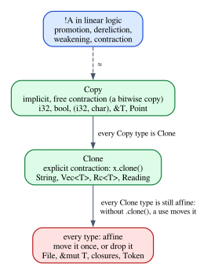

# Chapter 23 · Copy, Clone and the Exponential

The affine λ-calculus of Chapter 22 is strict to the point of being useless. It
cannot use an integer twice. It cannot call a function twice: at the end of
Chapter 22, the Lean version of the upload program could not even send two
messages, because `send` was a variable of the context and every variable is a
resource. A real language needs some values to be freely duplicable, and the
interesting question is which ones, and on what terms.

Linear logic answers with a **modality**, written $!A$ and read "of course $A$":
a marker on the formulas that may be duplicated and discarded at will. Rust
answers with two traits and a library type. `Copy` marks the types whose values
are duplicated implicitly and for free; `Clone` marks the types that can be
duplicated explicitly, by calling a method that may do real work; and `Rc` and
`Arc` share a value among several owners and keep count. These are not three
unrelated features. They are three ways of bringing back the structural rule that
Chapter 22 removed, contraction, each with a different price.

This chapter presents the exponential modality and its rules, shows that `Copy`
behaves like it and that Rust's rules for `Copy` are its rules in disguise,
contrasts `Copy` with `Clone` and `Rc`, and then makes the connection formal:
$\lambda^{\mathsf{aff}}$ extended with a `Copy` predicate, a splitting rule that
may duplicate `Copy` variables, and a generalized usage theorem proved in Lean.

**In this chapter you will learn:**

- the exponential modality $!A$ and its four rules (weakening, contraction,
  dereliction, promotion), and what each one says about resources;
- why `Copy` is contraction for free on a class of types, and why the class is
  what it is: all fields `Copy` (E0204), no destructor (E0184), `&T` but not
  `&mut T`;
- why `Clone` is a different thing: an explicit duplication *term*, with a cost
  and possibly an effect;
- how `Rc` and `Arc` share instead of duplicating, and why counting forbids them
  from being `Copy`;
- the formal statement: $\lambda^{\mathsf{aff}}$ with a `Copy` predicate and a
  splitting rule S-Both, and the generalized usage theorem, proved in Lean with
  multiplicities in $\mathbb{N} \cup \{\infty\}$;
- why functions cannot be `Copy` in general, as a Lean proof that preservation
  would fail;
- how the `affine` crate checks `Copy`, `Clone`, `Rc` and `#[derive(Copy)]`.

## Too affine to be useful

Here is the smallest program that $\lambda^{\mathsf{aff}}$ rejects and every
programmer would accept, checked by the `affine` crate in the pure discipline of
Chapter 22 (the example is `code/rust/crates/affine/examples/ch23_copy.rs`):

```text
== ch23_twice.aff, pure λ^aff (Chapter 22)
error[E0382]: use of moved value: `n`
 --> ch23_twice.aff:2:9
  |
1 | fn twice(n: i32) -> (i32, i32) {
  |          - move occurs because `n` has type `i32`, which does not implement the `Copy` trait
2 |     (n, n)
  |      -  ^ value used here after move
  |      |
  |      value moved here
```

The message is correct for the calculus: no type is `Copy` there, and the
proof of Chapter 22 that $\lambda x.\,(x, x)$ has no type did not depend on the
type of $x$ at all. Rust, of course, accepts `twice`. To accept it, a type system
has two options, and Rust uses both:

1. let certain types bring contraction back *implicitly*, so that using a
   variable does not consume it;
2. provide *explicit* duplication functions, $\tau \multimap \tau \otimes \tau$,
   which the programmer calls when needed.

The first option is the exponential modality of linear logic, and it is `Copy`.
The second is `Clone`.

## The exponential modality

Girard's linear logic keeps an assumption from being duplicated or discarded,
and then adds a way to say that a particular assumption *may* be. The formula
$!A$ means "as many $A$s as you need, including none". On types, $!\tau$ is the
type of values that may be used any number of times. Four rules say what that
means. We write them as typing rules, with ${!\Gamma}$ for a context in which
every type has the form $!\tau$:

$$
\dfrac{\Gamma \vdash e : \rho}{\Gamma, x : {!\tau} \vdash e : \rho}\;\textsf{!-Weak}
\qquad
\dfrac{\Gamma, x : {!\tau}, y : {!\tau} \vdash e : \rho}{\Gamma, z : {!\tau} \vdash e[z/x, z/y] : \rho}\;\textsf{!-Contr}
$$

$$
\dfrac{\Gamma \vdash e : {!\tau}}{\Gamma \vdash \mathsf{derelict}\,e : \tau}\;\textsf{Dereliction}
\qquad
\dfrac{{!\Gamma} \vdash e : \tau}{{!\Gamma} \vdash {!e} : {!\tau}}\;\textsf{Promotion}
$$

- **!-Weak** says that a $!\tau$ may go unused. In linear logic this is the only
  form of weakening; in affine logic every variable may go unused already, so the
  rule adds nothing new.
- **!-Contr** is contraction, restricted to $!$-types: two variables of type
  $!\tau$ may be identified, so one $!\tau$ serves two uses.
- **Dereliction** uses a $!\tau$ as an ordinary $\tau$, once. You give up the
  right to duplicate it and get the value.
- **Promotion** is the subtle one. It builds a duplicable value $!e$, but only
  from a context in which *everything* is duplicable. The reason is a resource
  argument. If $e$ used a non-duplicable resource $s$, then every copy of $!e$
  would need its own $s$, and duplicating $!e$ would duplicate $s$. So a
  duplicable value may only be built out of duplicable things.

Together they give the derivations you would expect. From $x : {!A}$,
contraction and two derelictions give a pair $A \otimes A$; weakening gives
$\mathbf{1}$. From $x : A$ alone, nothing gives $!A$: promotion needs the whole
context to be of the form ${!\Gamma}$. Girard also showed that ordinary
intuitionistic logic can be translated into linear logic by reading an
intuitionistic implication $A \to B$ as $!A \multimap B$: an ordinary function is
a linear function whose argument may be used any number of times.

Here is how the four rules correspond to Rust. The rest of the chapter explains
every row:

| Linear logic | Rust |
|---|---|
| $!\tau$ | a type `T` with `T: Copy` |
| !-Contr | a `Copy` value is copied implicitly at every use |
| !-Weak | discarding a `Copy` value is free: it has no destructor |
| Dereliction | a `Copy` value can be used like any other value |
| Promotion | `#[derive(Copy)]` requires every field to be `Copy` |
| a term $\tau \multimap \tau \otimes \tau$ | `Clone::clone`, called explicitly |



In the language of Chapter 19, a $!$-type comes with a copy map
$A \to A \otimes A$ and a discard map $A \to \mathbf{1}$ that fit together: the
comonoid structure that Chapter 19 found on the types that have a diagonal. We
stay with type theory here.

## `Copy`: contraction for free

In Rust, whether `let b = a;` moves `a` or copies it is decided by the type of
`a`, not by anything written in the program. This chapter's Rust example is
`code/rust/examples/ch23_copy_clone.rs`:

```rust
let a: i32 = 5;
let b = a; // a copy: `a` is still usable
let s = String::from("report");
let t = s; // a move: `s` is not usable any more
println!("a = {a}, b = {b}, t = {t}");
```

```text
a = 5, b = 5, t = report
```

The two `let`s have the same syntax and different rules. For `i32`, the compiler
applies contraction silently: `a` stays usable. For `String`, it applies the
affine rule: `s` is moved, and a later use would be E0382.

There is one difference between `Copy` and $!$ that shapes everything else.
$!\tau$ is a *type constructor*: from any type $\tau$ you can form $!\tau$ and
then build its values by promotion. `Copy` is a *property* of a type: a type is
`Copy` or it is not, and there is no `!String`. A `Copy` type behaves as if it
were already of the form $!\tau$. Contraction and weakening happen at every use
without being written, and dereliction is invisible, because a value of a `Copy`
type can always be used as an ordinary value. What remains of promotion is the
rule that decides which types may be `Copy`.

### Which types are `Copy`

| Type | `Copy`? | Why |
|---|---|---|
| `i32`, `bool`, `char`, `f64`, `()` | yes | plain bits, nothing owned |
| `&T`, for every `T` | yes | a shared read permission |
| `&mut T` | no | a unique permission |
| `(A, B)`, `[T; N]`, `Option<T>` | if the components are | promotion |
| a struct or enum | if it derives `Copy` and all fields are `Copy` | promotion |
| `fn` items and `fn` pointers | yes | they capture nothing |
| a closure | if everything it captures is `Copy` or a shared reference | promotion |
| `String`, `Vec<T>`, `Box<T>` | no | they own a heap allocation |
| any type with a `Drop` impl | no | see below |

A copy is a bitwise copy of the value, the same operation as a move. What
differs is only whether the source stays usable afterwards:

```rust
/// Contraction for free: a `Copy` value is duplicated by using it twice.
fn dup_copy<T: Copy>(x: T) -> (T, T) {
    (x, x)
}

/// Contraction on request: a `Clone` value is duplicated by calling `clone`.
fn dup_clone<T: Clone>(x: T) -> (T, T) {
    (x.clone(), x)
}
```

```rust
let p = Point { x: 1, y: 2 };
let (p1, p2) = dup_copy(p);
println!("{p1:?} {p2:?}, and p is still {p:?}");
// A copy is a new value in a new place, bit for bit the same.
let q = p;
println!(
    "same bits: {}, same place: {}",
    p == q,
    std::ptr::eq(&p, &q)
);
// A shared reference is Copy: the copies point to the same String.
let r = &t;
let (r1, r2) = dup_copy(r);
println!("two references, one String: {}", std::ptr::eq(r1, r2));
```

```text
Point { x: 1, y: 2 } Point { x: 1, y: 2 }, and p is still Point { x: 1, y: 2 }
same bits: true, same place: false
two references, one String: true
```

`dup_copy` is $\lambda x.\,(x, x)$, the term that Chapter 22 proved untypable, and
its bound `T: Copy` is what makes it legal: Rust's generics have an explicit
contraction permission. The copy `q` has the same bits as `p` and lives in a
different place (`std::ptr::eq` compares addresses). Copying a shared reference
duplicates the *reference*: the two copies point to the same `String`. That is
why `&T` can be `Copy` for every `T`: a shared reference is a permission to read,
and handing out more read permissions does not duplicate the data. Chapter 26
takes this further, and shows that it is precisely why affinity alone cannot
explain references.

### Promotion: every field must be `Copy`

A struct can derive `Copy` only if all its fields are `Copy`:

```rust
/// All fields are `Copy`, and there is no destructor: the derive is accepted.
#[derive(Clone, Copy, Debug, PartialEq)]
struct Point {
    x: i32,
    y: i32,
}
```

```rust
#[derive(Clone, Copy)]
struct Reading {
    sensor: String,
    value: f64,
}
```

```text
error[E0204]: the trait `Copy` cannot be implemented for this type
 --> compile_fail/ch23_copy_string_field.rs:6:8
  |
5 | #[derive(Clone, Copy)]
  |                 ---- in this derive macro expansion
6 | struct Reading {
  |        ^^^^^^^
7 |     sensor: String,
  |     -------------- this field does not implement `Copy`
```

This is promotion. To make `Reading` duplicable, every resource it is built from
must be duplicable, and a `String` is not: copying a `Reading` bit by bit would
give two owners of one heap buffer, and two frees. The rule is not specific to
`derive`; a hand-written `impl Copy for Reading {}` is rejected with the same
error.

### No destructors

A type with a destructor cannot be `Copy`, even if all its fields are:

```rust
#[derive(Clone, Copy)]
struct Token {
    id: u64,
}

impl Drop for Token {
    fn drop(&mut self) {
        println!("releasing token {}", self.id);
    }
}
```

```text
error[E0184]: the trait `Copy` cannot be implemented for this type; the type has a destructor
  --> compile_fail/ch23_copy_with_drop.rs:7:8
   |
 6 | #[derive(Clone, Copy)]
   |                 ---- in this derive macro expansion
 7 | struct Token {
   |        ^^^^^ `Copy` not allowed on types with destructors
   |
note: destructor declared here
  --> compile_fail/ch23_copy_with_drop.rs:12:5
   |
12 |     fn drop(&mut self) {
   |     ^^^^^^^^^^^^^^^^^^
```

`Copy` makes contraction implicit, and a destructor makes weakening an action
(Chapter 24). Put the two together and every silent copy would bring one more
silent destructor call: a token copied three times would be released four times.
In the rules above, that is !-Weak: discarding a $!\tau$ must be free, and a
value whose discarding runs code is not a $!\tau$. This is the reason Chapter 24
gives for E0184.

### `Copy` needs `Clone`

In the standard library the trait is declared as `pub trait Copy: Clone`, so
deriving `Copy` without `Clone` is an error too (E0277, "the trait bound
`Point: Clone` is not satisfied"). Any type that may be duplicated implicitly may
also be duplicated explicitly, and the documentation of `Clone` asks that, for a
`Copy` type, `clone` be equivalent to a copy (`unsafe` code is not allowed to rely
on that). We will prove the type-theoretic version of "`Copy` implies `Clone`"
in Lean below.

### `&mut T` is not `Copy`

A mutable reference is a *unique* permission to read and write. Duplicating it
would give two writers, which is exactly what the borrow checker exists to
prevent, so `&mut T` is affine:

```rust
fn writers(w: &mut String) -> (&mut String, &mut String) {
    let a = w;
    let b = w;
    (a, b)
}
```

```text
error[E0382]: use of moved value: `w`
 --> compile_fail/ch23_mut_ref_not_copy.rs:7:13
  |
5 | fn writers(w: &mut String) -> (&mut String, &mut String) {
  |            - move occurs because `w` has type `&mut String`, which does not implement the `Copy` trait
6 |     let a = w;
  |             - value moved here
7 |     let b = w;
  |             ^ value used here after move
```

There is a caveat that every Rust programmer has run into. A `&mut` reference
*can* be passed to two calls in a row:

```rust
fn record(log: &mut Vec<&'static str>, event: &'static str) {
    log.push(event);
}

/// `&mut` is not `Copy`, yet `log` is passed twice: each call receives a
/// fresh reborrow `&mut *log`, not a copy of `log` (Chapter 28).
fn record_twice(log: &mut Vec<&'static str>) {
    record(log, "first");
    record(log, "second");
}
```

```text
log: ["first", "second"]
```

That is not a copy. Where a `&mut` reference is expected, the compiler passes a
fresh *reborrow* `&mut *log`, a new unique reference that lives only as long as
the call, and `log` becomes usable again afterwards. Reborrowing belongs to the
calculus of borrows, and Chapter 28 derives this very program. (It is also why
the tuple `(a, w)` in place of `(a, b)` above gets a slightly different message,
"borrow of moved value": the compiler tries to reborrow `w` for the tuple.)

### Functions

`fn` items and function pointers are `Copy`: a function that captures nothing
can be duplicated freely, even as a value (`let g = send; g(a); g(b)` compiles).
That is what justifies the `affine` crate in treating declared functions as
constants that can be called again and again. A closure is a function *with captured values*, and it is
`Copy` exactly when what it captures may be duplicated: promotion again. A
closure that has captured a `String` by value is not `Copy`, and if calling it
consumes the `String`, it is only `FnOnce`, the $\multimap$ of Chapter 22. In
$\lambda^{\mathsf{aff}}$ the type $\tau \multimap \sigma$ says nothing about what
a function captured, so the safe choice is never to make a function type `Copy`.
We will see in Lean what goes wrong otherwise.

## `Clone`: duplication as a term

`Clone` has one method, `fn clone(&self) -> Self`. It is an ordinary function
that the programmer calls, and it may do anything: allocate a new buffer and copy
bytes into it, increment a counter, log a message. The difference between `Copy`
and `Clone` is the difference between a structural rule and a term:

| | `Copy` | `Clone` |
|---|---|---|
| status | a structural rule (S-Both below) | a term, $\tau \multimap \tau \otimes \tau$ |
| written in the program | never | always: `x.clone()` |
| cost | a bitwise copy | anything |
| effects | none | possible |

In the calculus, a `Clone` type comes with a constant
$\mathsf{dup}_\tau : \tau \multimap \tau \otimes \tau$, and a program that needs
two copies of $x$ writes $\mathtt{let}\ (x_1, x_2) = \mathsf{dup}_\tau\,x\ \mathtt{in}\ \dots$,
using $x$ once. (Rust's `clone` takes `&self`, a borrow, and leaves the original
where it was, so the second copy is the original itself; borrowing is Part VI,
and $\tau \multimap \tau \otimes \tau$ is its affine shadow.) The generic
function `dup_clone` above is exactly this term.

The call is visible in the source, and so is its cost:

```rust
/// A type whose duplication has a visible effect: every clone is counted.
#[derive(Debug)]
struct Specimen {
    id: u32,
    clones: Rc<Cell<u32>>,
}

impl Clone for Specimen {
    fn clone(&self) -> Specimen {
        self.clones.set(self.clones.get() + 1);
        Specimen {
            id: self.id,
            clones: Rc::clone(&self.clones),
        }
    }
}
```

```rust
let (u, v) = dup_clone(String::from("calibration"));
println!(
    "cloned strings equal: {}, same buffer: {}",
    u == v,
    u.as_ptr() == v.as_ptr()
);
let counter = Rc::new(Cell::new(0));
let specimen = Specimen {
    id: 7,
    clones: Rc::clone(&counter),
};
let (s1, s2) = dup_clone(specimen);
let (s3, _s4) = dup_clone(s1);
println!(
    "specimens {} and {}: {} clones so far",
    s2.id,
    s3.id,
    counter.get()
);
```

```text
cloned strings equal: true, same buffer: false
specimens 7 and 7: 2 clones so far
```

Cloning a `String` allocates a new buffer (the two strings are equal, their
buffers are not the same), and cloning a `Specimen` runs code that updates a
counter: two calls to `dup_clone`, two clones. Neither could happen silently,
which is the point. A type for which duplication has a cost or an effect should
make every duplication visible, and Rust achieves that by making such a type
`Clone` but not `Copy`.

Not every type is `Clone`. A file handle is not: duplicating a handle to an open
file would need a decision about what two owners of one file descriptor mean
(the standard library's `File` offers a separate `try_clone` for that). For such
types the calculus has no $\mathsf{dup}_\tau$ at all, and they stay strictly
affine.

## `Rc` and `Arc`: counted sharing

`Rc<T>` takes a third way. It does not duplicate the `T` at all. It puts the
`T` in a heap allocation together with a counter, and an `Rc<T>` is a pointer to
that allocation. `Rc::clone` copies the pointer and increments the counter; each
drop of an `Rc` decrements it; when the counter reaches zero, the `T` is dropped
and the allocation freed:

```rust
let config = Rc::new(String::from("lab-7"));
println!("count after new: {}", Rc::strong_count(&config));
let reader = Rc::clone(&config);
let writer = config.clone();
println!("count after 2 clones: {}", Rc::strong_count(&config));
println!("one allocation: {}", Rc::ptr_eq(&reader, &writer));
drop(reader);
drop(writer);
println!("count after 2 drops: {}", Rc::strong_count(&config));
```

```text
count after new: 1
count after 2 clones: 3
one allocation: true
count after 2 drops: 1
```

So `Rc` turns contraction into bookkeeping. Every duplication of the pointer is
recorded (the count goes up), and so is every discard (the count goes down). The
shared `T` itself is never duplicated. An `Rc<T>` dereferences to a shared
reference `&T`, so the owners can all read the value; to mutate it you need
either proof that you are the only owner (`Rc::get_mut` checks the count) or the
interior mutability of Chapter 26.
In the vocabulary of this chapter, `Rc<T>` is *not* $!T$: it makes both
contraction and weakening *explicit and counted*, where $!$ makes them silent.

That is also why `Rc<T>` cannot be `Copy`, whatever `T` is. A bitwise copy of the
pointer would not increment the counter, and the two copies would later
decrement it twice. And `Rc` has a destructor, the decrement, which E0184
forbids anyway. rustc knows the situation well enough to give it a special
message:

```rust
fn share(cfg: Rc<String>) -> (Rc<String>, Rc<String>) {
    (cfg, cfg)
}
```

```text
error[E0382]: the type `Rc` does not implement `Copy`
 --> compile_fail/ch23_rc_not_copy.rs:9:11
  |
8 | fn share(cfg: Rc<String>) -> (Rc<String>, Rc<String>) {
  |          --- this move could be avoided by cloning the original `Rc`, which is inexpensive
9 |     (cfg, cfg)
  |      ---  ^^^ value used here after move
  |      |
  |      value moved here
  |
  = note: consider using `Rc::clone`
help: clone the value to increment its reference count
  |
9 |     (cfg.clone(), cfg)
  |         ++++++++
```

`Arc<T>` is the same with an atomic counter, so that clones can be sent to other
threads:

```rust
let readings = Arc::new(vec![10, 20, 30]);
let handles: Vec<_> = (0..3)
    .map(|i| {
        let mine = Arc::clone(&readings);
        thread::spawn(move || mine[i] * 2)
    })
    .collect();
let doubled: Vec<i32> = handles.into_iter().map(|h| h.join().unwrap()).collect();
println!(
    "{doubled:?}, count back to {}",
    Arc::strong_count(&readings)
);
```

```text
[20, 40, 60], count back to 1
```

Each thread receives its own clone of the pointer and drops it when it finishes,
so after the joins the count is back to 1. Counting has a known blind spot: two
`Rc`s that point to each other keep each other's counts above zero forever. Such
a cycle is never freed, and Chapter 24 explains why that is a leak and not a
safety problem.

## The formal statement

We now extend $\lambda^{\mathsf{aff}}$ to make all of this precise. The extension
has two parts, and the typing rules of Chapter 22 do not change at all.

**A `Copy` predicate on types.** Fix a set $\mathcal{C}$ of base types that are
`Copy` (for us, the scalar types `i32`, `u64`, `bool`, `char`). Then

$$
\dfrac{b \in \mathcal{C}}{\mathsf{Copy}(b)}
\qquad
\dfrac{}{\mathsf{Copy}(\mathbf{1})}
\qquad
\dfrac{\mathsf{Copy}(\tau) \qquad \mathsf{Copy}(\sigma)}{\mathsf{Copy}(\tau \otimes \sigma)}
\qquad
\dfrac{\mathsf{Copy}(\tau) \qquad \mathsf{Copy}(\sigma)}{\mathsf{Copy}(\tau \oplus \sigma)}
$$

There is no rule for $\tau \multimap \sigma$ and none for
$\tau \mathbin{\&} \sigma$. A function value may hold captured resources, and an
offer is a suspended computation over resources; in both cases the type does not
mention them, so the type cannot promise that duplicating the value is harmless.

**A fourth splitting rule.** A `Copy` variable may go to *both* sides of a split:

$$
\dfrac{\Gamma = \Gamma_1 \uplus \Gamma_2 \qquad \mathsf{Copy}(\tau)}{\Gamma, x : \tau = (\Gamma_1, x : \tau) \uplus (\Gamma_2, x : \tau)}\;\textsf{S-Both}
$$

That is the whole extension. Compare it with the rules of $!$:

- S-Both is !-Contr, folded into the splitting relation instead of being a rule
  of its own. Wherever the rules of Chapter 22 split a context, a `Copy` variable
  may now be given to both premises.
- !-Weak is already there, as for every variable of an affine calculus.
- Dereliction is invisible: a `Copy` variable is still used by A-Var, like any
  other.
- Promotion survives as the definition of $\mathsf{Copy}$: a compound type is
  `Copy` only if it is built from `Copy` types. That is `#[derive(Copy)]`'s rule.

Chapter 28 uses exactly these four splitting rules, S-Empty, S-Left, S-Right and
S-Both, for its calculus of borrows, where shared references are `Copy` and
mutable references are not.

### In Lean

The Lean file of this chapter, `code/lean/Book/Ch23/Exponential.lean`, imports
Chapter 22's files and reuses their types, terms and `uses` function. The `Copy`
predicate is a function to `Bool`, decided by the structure of the type, as
rustc decides it:

```lean
/-- The base types that are `Copy`: a few of Rust's scalar types. -/
def copyBase (name : String) : Bool :=
  name == "i32" || name == "u64" || name == "bool" || name == "char"

/-- The `Copy` predicate, decided by the structure of the type, the way rustc
decides it. A pair or a sum is `Copy` when its components are (this is the rule
of *promotion*). Functions and additive pairs are never `Copy`: their values
may hold resources that their types do not mention. -/
def isCopy : Ty → Bool
  | .base n => copyBase n
  | .unit => true
  | .tensor a b => isCopy a && isCopy b
  | .plus a b => isCopy a && isCopy b
  | .lolli _ _ => false
  | .amp _ _ => false
```

```lean
def I32 : Ty := .base "i32"

example : isCopy I32 = true := rfl
example : isCopy (I32 ⊗ (I32 ⊕ .unit)) = true := rfl
example : isCopy Str = false := rfl
example : isCopy (I32 ⊗ Str) = false := rfl
example : isCopy (I32 ⊸ I32) = false := rfl

/-- Promotion: a pair is `Copy` exactly when both components are. -/
theorem isCopy_tensor (τ σ : Ty) :
    isCopy (τ ⊗ σ) = true ↔ isCopy τ = true ∧ isCopy σ = true := by
  simp [isCopy]
```

Each `example` is proved by `rfl`: Lean evaluates `isCopy` and finds `true` or
`false`. The theorem `isCopy_tensor` is promotion for pairs, and `simp [isCopy]`
proves it by unfolding the definition and simplifying the Boolean conjunction.

The splitting relation gets the fourth constructor. We make the predicate a
*parameter* `cp` of the relation, so that at the end of the chapter we can compare
the right choice of `Copy` types with a wrong one; the book's choice is `isCopy`:

```lean
/-- Splitting with duplication: the four rules of Chapter 22, plus `both`,
which gives a variable to both sides when its type satisfies the predicate
`cp`. Rule `both` is contraction, restricted to the types that `cp` accepts.
The predicate is a parameter so that we can compare choices; the book's is
`isCopy`. -/
inductive SplitC (cp : Ty → Bool) : Ctx → Ctx → Ctx → Prop where
  | nil : SplitC cp [] [] []
  | left {Γ Γ₁ Γ₂ : Ctx} {τ : Ty} :
      SplitC cp Γ Γ₁ Γ₂ → SplitC cp (some τ :: Γ) (some τ :: Γ₁) (none :: Γ₂)
  | right {Γ Γ₁ Γ₂ : Ctx} {τ : Ty} :
      SplitC cp Γ Γ₁ Γ₂ → SplitC cp (some τ :: Γ) (none :: Γ₁) (some τ :: Γ₂)
  | hole {Γ Γ₁ Γ₂ : Ctx} :
      SplitC cp Γ Γ₁ Γ₂ → SplitC cp (none :: Γ) (none :: Γ₁) (none :: Γ₂)
  | both {Γ Γ₁ Γ₂ : Ctx} {τ : Ty} :
      cp τ = true →
      SplitC cp Γ Γ₁ Γ₂ → SplitC cp (some τ :: Γ) (some τ :: Γ₁) (some τ :: Γ₂)
```

The typing rules are those of Chapter 22, with `SplitC cp` in place of `Split`:

```lean
/-- The typing rules of `λ^aff` with duplicable types: the rules of Chapter 22,
word for word, with `SplitC cp` in place of `Split`. -/
inductive HasTypeC (cp : Ty → Bool) : Ctx → Term → Ty → Prop where
  | var {Γ : Ctx} {x : Nat} {τ : Ty} :
      Γ[x]? = some (some τ) → HasTypeC cp Γ (.var x) τ
  | lam {Γ : Ctx} {e : Term} {τ σ : Ty} :
      HasTypeC cp (some τ :: Γ) e σ → HasTypeC cp Γ (.lam τ e) (τ ⊸ σ)
  | app {Γ Γ₁ Γ₂ : Ctx} {e₁ e₂ : Term} {τ σ : Ty} :
      SplitC cp Γ Γ₁ Γ₂ → HasTypeC cp Γ₁ e₁ (τ ⊸ σ) → HasTypeC cp Γ₂ e₂ τ →
      HasTypeC cp Γ (.app e₁ e₂) σ
  | unit {Γ : Ctx} : HasTypeC cp Γ .unit .unit
  | pair {Γ Γ₁ Γ₂ : Ctx} {e₁ e₂ : Term} {τ σ : Ty} :
      SplitC cp Γ Γ₁ Γ₂ → HasTypeC cp Γ₁ e₁ τ → HasTypeC cp Γ₂ e₂ σ →
      HasTypeC cp Γ (.pair e₁ e₂) (τ ⊗ σ)
  | letPair {Γ Γ₁ Γ₂ : Ctx} {e₁ e₂ : Term} {τ σ ρ : Ty} :
      SplitC cp Γ Γ₁ Γ₂ → HasTypeC cp Γ₁ e₁ (τ ⊗ σ) →
      HasTypeC cp (some σ :: some τ :: Γ₂) e₂ ρ → HasTypeC cp Γ (.letPair e₁ e₂) ρ
  | wpair {Γ : Ctx} {e₁ e₂ : Term} {τ σ : Ty} :
      HasTypeC cp Γ e₁ τ → HasTypeC cp Γ e₂ σ → HasTypeC cp Γ (.wpair e₁ e₂) (τ & σ)
  | fst {Γ : Ctx} {e : Term} {τ σ : Ty} :
      HasTypeC cp Γ e (τ & σ) → HasTypeC cp Γ (.fst e) τ
  | snd {Γ : Ctx} {e : Term} {τ σ : Ty} :
      HasTypeC cp Γ e (τ & σ) → HasTypeC cp Γ (.snd e) σ
  | inl {Γ : Ctx} {e : Term} {τ σ : Ty} :
      HasTypeC cp Γ e τ → HasTypeC cp Γ (.inl σ e) (τ ⊕ σ)
  | inr {Γ : Ctx} {e : Term} {τ σ : Ty} :
      HasTypeC cp Γ e σ → HasTypeC cp Γ (.inr τ e) (τ ⊕ σ)
  | case {Γ Γ₁ Γ₂ : Ctx} {e e₁ e₂ : Term} {τ σ ρ : Ty} :
      SplitC cp Γ Γ₁ Γ₂ → HasTypeC cp Γ₁ e (τ ⊕ σ) →
      HasTypeC cp (some τ :: Γ₂) e₁ ρ → HasTypeC cp (some σ :: Γ₂) e₂ ρ →
      HasTypeC cp Γ (.case e e₁ e₂) ρ
  | letIn {Γ Γ₁ Γ₂ : Ctx} {e₁ e₂ : Term} {τ σ : Ty} :
      SplitC cp Γ Γ₁ Γ₂ → HasTypeC cp Γ₁ e₁ τ → HasTypeC cp (some τ :: Γ₂) e₂ σ →
      HasTypeC cp Γ (.letIn e₁ e₂) σ
```

Since the new splitting relation contains the old one, every derivation of
Chapter 22 is still a derivation, whatever `cp` is; the proof is one line per
rule:

```lean
/-- Every derivation of Chapter 22 is a derivation here, whatever the
predicate: adding duplication only adds programs. -/
theorem HasType.toC {cp : Ty → Bool} {Γ : Ctx} {e : Term} {τ : Ty}
    (h : HasType Γ e τ) : HasTypeC cp Γ e τ := by
  induction h with
  | var hx => exact .var hx
  | lam _ ih => exact .lam ih
  | app hs _ _ ih₁ ih₂ => exact .app (Split.toC hs) ih₁ ih₂
  | unit => exact .unit
  | pair hs _ _ ih₁ ih₂ => exact .pair (Split.toC hs) ih₁ ih₂
  | letPair hs _ _ ih₁ ih₂ => exact .letPair (Split.toC hs) ih₁ ih₂
  | wpair _ _ ih₁ ih₂ => exact .wpair ih₁ ih₂
  | fst _ ih => exact .fst ih
  | snd _ ih => exact .snd ih
  | inl _ ih => exact .inl ih
  | inr _ ih => exact .inr ih
  | case hs _ _ _ ih ih₁ ih₂ => exact .case (Split.toC hs) ih ih₁ ih₂
  | letIn hs _ _ ih₁ ih₂ => exact .letIn (Split.toC hs) ih₁ ih₂
```

And programs that Chapter 22 rejected are now accepted, when the types allow it:

```lean
/-- For a `Copy` type, `λx. (x, x)` is well typed: rule `both` gives `x` to the
two components. So every `Copy` type has a `clone`. -/
theorem copy_dup {τ : Ty} (hc : isCopy τ = true) :
    HasTypeC isCopy [] (dup τ) (τ ⊸ τ ⊗ τ) :=
  .lam (.pair (.both hc .nil) (.var rfl) (.var rfl))

/-- `n : i32 ⊢ (n, (n, n)) : i32 ⊗ (i32 ⊗ i32)`: a `Copy` variable can be used
any number of times. -/
example : HasTypeC isCopy [some I32] (.pair (.var 0) (.pair (.var 0) (.var 0)))
    (I32 ⊗ (I32 ⊗ I32)) :=
  .pair (.both rfl .nil) (.var rfl) (.pair (.both rfl .nil) (.var rfl) (.var rfl))
```

`copy_dup` is the type-theoretic version of "`Copy` implies `Clone`": for every
`Copy` type, $\lambda x.\,(x, x)$ is a closed term of type
$\tau \multimap \tau \otimes \tau$, the type of $\mathsf{dup}_\tau$. A `Copy`
type needs no library function for duplication; the language provides one. The
derivation is Chapter 22's failed derivation of `dup`, with the split that did
not exist now supplied by `.both hc .nil`.

### The generalized usage theorem

Chapter 22's usage theorem said that every variable is used at most once. With
S-Both that is false, and `twice` is the counterexample. The right statement
gives each variable a **multiplicity**: one for an ordinary variable, unbounded
for a `Copy` variable, zero for a variable the term did not receive.

> **Theorem (generalized usage).** If $\Gamma \vdash e : \tau$ in
> $\lambda^{\mathsf{aff}}$ with `Copy`, then every variable of $\Gamma$ whose
> type is not `Copy` occurs in $e$ at most once (with the counting convention of
> Chapter 22), and a variable that is not in $\Gamma$ does not occur at all.

To state the multiplicities in Lean we need a number system with an "unbounded"
element. Mathlib provides it: `ℕ∞` (`ENat`), the natural numbers extended with a
top element `⊤`, with an addition in which $n + \top = \top$. We import only
`Mathlib.Data.ENat.Monoid`, which provides `ℕ∞`'s arithmetic and ordering, and
one lemma file about casts:

```lean
/-- The multiplicity of variable `i` in `Γ`, in `ℕ∞ = ℕ ∪ {⊤}`: unbounded for
a duplicable variable, one for any other variable, zero for a hole. -/
def availC (cp : Ty → Bool) (Γ : Ctx) (i : Nat) : ℕ∞ :=
  match Γ[i]? with
  | some (some τ) => if cp τ then ⊤ else 1
  | _ => 0
```

The key lemma changes from an equation to an inequality. A split now hands out *at
most* what the context had, because the `both` rule gives `⊤` to both sides of
a position that had `⊤`, and $\top + \top = \top$:

```lean
/-- Splitting never creates resources. It may duplicate them, but only those
whose multiplicity is already `⊤`, and `⊤ + ⊤ = ⊤`. -/
theorem SplitC.avail_le {cp : Ty → Bool} {Γ Γ₁ Γ₂ : Ctx} (hs : SplitC cp Γ Γ₁ Γ₂)
    (i : Nat) : availC cp Γ₁ i + availC cp Γ₂ i ≤ availC cp Γ i := by
  induction hs generalizing i with
  | nil => simp [availC]
  | left _ ih | right _ ih | hole _ ih =>
    cases i with
    | zero => simp [availC]
    | succ i => simpa using ih i
  | both hc _ ih =>
    cases i with
    | zero => simp [availC, hc]          -- ⊤ + ⊤ ≤ ⊤
    | succ i => simpa using ih i
```

The proof is the same as Chapter 22's, with one more case. In the `both` case at
position 0, `simp [availC, hc]` uses the hypothesis `hc : cp τ = true` to rewrite
each multiplicity to `⊤`, and Mathlib's simplification lemmas for `ℕ∞` know that
$\top + \top \le \top$. The theorem itself also follows Chapter 22's proof
step by step:

```lean
/-- **The generalized usage theorem.** Every variable is used at most as often as
its multiplicity allows, for every choice of the duplicable types. -/
theorem usageC {cp : Ty → Bool} {Γ : Ctx} {e : Term} {τ : Ty} (h : HasTypeC cp Γ e τ) :
    ∀ i, (uses i e : ℕ∞) ≤ availC cp Γ i := by
  induction h with
  | @var Γ x τ hx =>
    intro i
    by_cases hi : i = x
    · -- The variable itself: used once, and its multiplicity is 1 or ⊤.
      subst hi
      simp only [uses, ↓reduceIte, Nat.cast_one, availC, hx]
      split <;> simp
    · simp [uses, hi]
  | unit => intro i; simp [uses]
  | lam _ ih => intro i; simpa [uses] using ih (i + 1)
  | app hs _ _ ih₁ ih₂ | pair hs _ _ ih₁ ih₂ =>
    intro i
    simp only [uses, Nat.cast_add]
    exact (add_le_add (ih₁ i) (ih₂ i)).trans (hs.avail_le i)
  | letPair hs _ _ ih₁ ih₂ =>
    intro i
    have h₂ := ih₂ (i + 2)
    simp only [availC_cons_succ] at h₂
    simp only [uses, Nat.cast_add]
    exact (add_le_add (ih₁ i) h₂).trans (hs.avail_le i)
  | letIn hs _ _ ih₁ ih₂ =>
    intro i
    have h₂ := ih₂ (i + 1)
    simp only [availC_cons_succ] at h₂
    simp only [uses, Nat.cast_add]
    exact (add_le_add (ih₁ i) h₂).trans (hs.avail_le i)
  | case hs _ _ _ ih ih₁ ih₂ =>
    intro i
    have h₁ := ih₁ (i + 1)
    have h₂ := ih₂ (i + 1)
    simp only [availC_cons_succ] at h₁ h₂
    simp only [uses, Nat.cast_add]
    exact (add_le_add (ih i) (cast_max_le h₁ h₂)).trans (hs.avail_le i)
  | wpair _ _ ih₁ ih₂ =>
    intro i
    simp only [uses]
    exact cast_max_le (ih₁ i) (ih₂ i)
  | fst _ ih | snd _ ih | inl _ ih | inr _ ih =>
    intro i; simpa [uses] using ih i
```

The counts `uses i e` are natural numbers, and the multiplicities live in `ℕ∞`,
so the statement casts the count with `(uses i e : ℕ∞)`. The proof then has to
move between the two. In the `app` case, `Nat.cast_add` rewrites the cast of a
sum as a sum of casts; `add_le_add` adds the two induction hypotheses, giving
$u_1 + u_2 \le a_1 + a_2$; and `.trans` chains that with the splitting lemma
$a_1 + a_2 \le a$. Chapter 22's `omega` cannot be used here, because it works
with natural numbers and integers only, and `⊤` is neither. For the `max` of the
sharing rules there is a small helper, `cast_max_le`, proved just before the
theorem with Mathlib's fact that the cast from `ℕ` to `ℕ∞` is monotone. In the
`var` case, `split <;> simp` considers the two possible multiplicities of the
variable, `⊤` and `1`, and checks that `1` is below each.

The familiar form is a corollary, and so is the fact that `dup` is still
untypable at a non-`Copy` type:

```lean
/-- **Non-duplicable variables are used at most once.** -/
theorem non_copy_at_most_once {cp : Ty → Bool} {Γ : Ctx} {e : Term} {τ σ : Ty}
    (h : HasTypeC cp Γ e τ) {i : Nat} (hi : Γ[i]? = some (some σ)) (hσ : cp σ = false) :
    uses i e ≤ 1 := by
  have := usageC h i
  simp [availC, hi, hσ] at this
  exact_mod_cast this

/-- So `λx. (x, x)` is still untypable at every non-`Copy` type. -/
theorem dup_untypable_c {τ ρ : Ty} (hσ : isCopy τ = false) (Γ : Ctx) :
    ¬ HasTypeC isCopy Γ (dup τ) ρ := by
  intro h
  cases h with
  | lam h =>
    have := non_copy_at_most_once h (i := 0) rfl hσ
    simp [uses] at this
```

For a non-`Copy` variable, `simp [availC, hi, hσ]` turns the theorem's right-hand
side into `1`, leaving `(uses i e : ℕ∞) ≤ 1`. The tactic `exact_mod_cast`
removes the casts from that hypothesis and from the goal, and finds that they
are the same statement about natural numbers.

The theorem holds for *every* predicate `cp`, not just for `isCopy`. That is
worth pausing on, because it means that the usage theorem alone cannot tell a
good choice of `Copy` types from a bad one. The next section shows what can.

### Why functions are not `Copy`

Suppose we made every function type `Copy`, whatever the function captures.
Here is a program that uses that freedom, with $s : \mathsf{String}$ in the
context:

$$
\mathtt{let}\ f = \lambda u{:}\mathbf{1}.\,s\ \mathtt{in}\ (f\,(),\ f\,())
$$

The closure $f$ captures $s$; the body calls $f$ twice. With function types
`Copy`, the `let` body may give $f$ to both components of the pair, and $s$
occurs once in the program text, so everything type-checks. Now run one step:
the `let` substitutes the closure for $f$, and the result is

$$
((\lambda u{:}\mathbf{1}.\,s)\,(),\ (\lambda u{:}\mathbf{1}.\,s)\,())
$$

in which $s$ occurs twice and must be given to both components. String is not
`Copy`, so this term has no type. A well-typed program stepped to an ill-typed
one: **preservation fails**. In Lean:

```lean
/-- A bad choice: every function type is duplicable, whatever it captures. -/
def fnCopy : Ty → Bool
  | .lolli _ _ => true
  | t => isCopy t

/-- With `s : String` (variable 0): `let f = λu:𝟏. s in (f (), f ())`. The
closure captures `s`; the body calls the closure twice. -/
def callTwice : Term :=
  .letIn (.lam .unit (.var 1))
    (.pair (.app (.var 0) .unit) (.app (.var 0) .unit))

/-- What `callTwice` becomes after one step, `let f = v in e ⟶ e[v/f]`: the
closure, and with it `s`, now appears twice. -/
def callTwice' : Term :=
  .pair (.app (.lam .unit (.var 1)) .unit) (.app (.lam .unit (.var 1)) .unit)

/-- If closures were `Copy` whatever they capture, preservation would fail:
`callTwice` is typable, but the term it steps to is not. -/
theorem promotion_matters :
    HasTypeC fnCopy [some Str] callTwice (Str ⊗ Str) ∧
    ¬ HasTypeC fnCopy [some Str] callTwice' (Str ⊗ Str) := by
  constructor
  · -- `s` goes to the closure; the closure is shared by the two calls.
    exact .letIn (.left .nil) (.lam (.var rfl))
      (.pair (.both rfl (.hole .nil))
        (.app (.left (.hole .nil)) (.var rfl) .unit)
        (.app (.left (.hole .nil)) (.var rfl) .unit))
  · -- After the step, `s` occurs twice, and it is not duplicable.
    intro h
    have := non_copy_at_most_once h (i := 0) rfl rfl
    simp [callTwice', uses] at this

/-- With the real `isCopy`, `callTwice` is rejected in the first place: the
closure `f` is used twice, and a function type is never `Copy`. -/
theorem callTwice_rejected : ¬ HasTypeC isCopy [some Str] callTwice (Str ⊗ Str) := by
  intro h
  cases h with
  | letIn _ hf hbody =>
    -- The let-bound value is a λ, so `f` has a function type.
    cases hf with
    | lam _ =>
      have := non_copy_at_most_once hbody (i := 0) rfl rfl
      simp [uses] at this
```

The first half of `promotion_matters` is the derivation of the program, by
hand. The split `.left .nil` gives `s` to the closure, the split
`.both rfl (.hole .nil)` gives the closure `f` to both calls (allowed, since
`fnCopy` says yes to function types), and each call's split `.left (.hole .nil)`
gives `f` to the function position. The second half is the generalized usage
theorem applied to the reduct: variable 0, which is `s`, occurs twice and has
multiplicity 1. The last theorem shows that the real predicate rejects the
program from the start: after inverting the `let`, and the λ to learn that `f` has
a function type, the usage theorem finds the non-`Copy` variable `f` used twice.

This is promotion, seen from the other side. A value may be made duplicable only
if everything it holds is duplicable. Rust's rule for closures, `Copy` only when
every capture is, is that rule; in $\lambda^{\mathsf{aff}}$, where a function
type does not record its captures, the only safe rule is "never".

## `Copy` in the `affine` crate

The crate implements the extension with a `Discipline` switch: `Affine` is
Chapter 22's calculus, and `Copy` turns on the predicates of `copy.rs`, which
follow Rust's rules rather than the minimal calculus (they include references,
structs and `Rc`):

```rust
/// The `Copy` predicate, decided by the structure of the type, as in rustc.
pub fn is_copy(program: &Program, ty: &Ty) -> bool {
    match ty {
        Ty::Unit => true,
        Ty::Named(name) => {
            COPY_SCALARS.contains(&name.as_str())
                || program.structure(name).is_some_and(|s| derives(s, "Copy"))
        }
        // Promotion: a pair or a sum is Copy when its components are.
        Ty::Tuple(a, b) | Ty::Either(a, b) => {
            is_copy(program, a) && is_copy(program, b)
        }
        // A shared reference is a read permission: duplicating it is harmless.
        // A mutable reference is a unique permission: it is not Copy.
        Ty::Ref { mutable, .. } => !mutable,
        // Closures may own captured resources that their type does not show,
        // an offer `With<A, B>` is a suspended computation over resources, and
        // an `Rc` must count its copies: none of them is Copy.
        Ty::Fn(..) | Ty::With(..) | Ty::Rc(..) => false,
    }
}
```

```rust
/// The `Clone` predicate: every `Copy` type, plus types with an explicit,
/// possibly expensive duplication (`String`, `Rc<T>`, structs that derive it).
pub fn is_clone(program: &Program, ty: &Ty) -> bool {
    match ty {
        Ty::Unit => true,
        Ty::Named(name) => {
            COPY_SCALARS.contains(&name.as_str())
                || name == "String"
                || program.structure(name).is_some_and(|s| derives(s, "Clone"))
        }
        Ty::Tuple(a, b) | Ty::Either(a, b) => {
            is_clone(program, a) && is_clone(program, b)
        }
        Ty::Ref { mutable, .. } => !mutable,
        Ty::Rc(_) => true,
        Ty::Fn(..) | Ty::With(..) => false,
    }
}
```

The checker uses `is_copy` in one place, the use of a place that we saw in
Chapter 22: a use of a `Copy` place records no move, which is rule S-Both in
algorithmic form (the variable stays in the leftovers, for the next subterm to
use). A call `x.clone()` requires `is_clone` and reads `x` without moving it.
With the `Copy` discipline, `twice` is accepted, and its derivation shows the
same variable in both premises of A-Pair:

```text
== ch23_twice.aff, with Copy (Chapter 23)
ok: fn twice(n: i32) -> (i32, i32)
[A-Pair] n: i32 ⊢ (n, n) : (i32, i32)
  [A-Var] n: i32 ⊢ n : i32
  [A-Var] n: i32 ⊢ n : i32
```

The crate also accepts the programs of `ch23_copy.aff`, each of which the pure
affine discipline rejects (the example checks that too):

```text
#[derive(Clone, Copy)]
struct Point { x: i32, y: i32 }

struct Reading { sensor: String, value: i32 }

// A Copy struct can be used twice, and its fields read freely.
fn mirror(p: Point) -> (Point, Point) {
    (p, Point { x: p.y, y: p.x })
}

// Copy fields are copied out; the String field stays where it is.
fn values(r: Reading) -> ((i32, i32), Reading) {
    ((r.value, r.value), r)
}

// A shared reference is Copy.
fn readers(r: &String) -> (&String, &String) {
    (r, r)
}

// Clone is explicit, and leaves the original in place.
fn backup(s: String) -> (String, String) {
    (s.clone(), s)
}

// Cloning an Rc copies a pointer and counts the copies.
fn share(cfg: Rc<Config>) -> (Rc<Config>, Rc<Config>) {
    (cfg.clone(), cfg)
}
```

```text
== ch23_copy.aff, with Copy
ok: fn mirror(p: Point) -> (Point, Point)
ok: fn values(r: Reading) -> ((i32, i32), Reading)
ok: fn readers(r: &String) -> (&String, &String)
ok: fn backup(s: String) -> (String, String)
ok: fn share(cfg: Rc<Config>) -> (Rc<Config>, Rc<Config>)
```

`values` combines `Copy` with Chapter 22's places: copying the `Copy` field
`r.value` twice moves nothing, so `r` is still whole afterwards. Rust accepts the
same function. Finally, the checks that rustc makes on `#[derive(Copy)]` are
implemented as a direct transcription of the three rules:

```rust
/// The checks rustc makes when a struct derives `Copy`: `Clone` must be
/// derived too (E0277), every field must be `Copy` (E0204), and the type must
/// not have a destructor (E0184).
pub fn check_derives(program: &Program, s: &StructDef) -> Vec<Diagnostic> {
    let mut errors = Vec::new();
    let Some(copy) = s.derives.iter().find(|d| d.name == "Copy") else {
        return errors;
    };
    let name = &s.name.name;
    if !derives(s, "Clone") {
        errors.push(
            Diagnostic::new(
                "E0277",
                &format!("the trait bound `{name}: Clone` is not satisfied"),
            )
            .with(Label::secondary(
                copy.span,
                "in this derive macro expansion",
            ))
            .with(Label::primary(
                s.name.span,
                &format!("the trait `Clone` is not implemented for `{name}`"),
            ))
            .note("note: `Copy` requires `Clone`: `pub trait Copy: Clone`"),
        );
    }
    let bad_fields: Vec<_> = s
        .fields
        .iter()
        .filter(|(_, ty, _)| !is_copy(program, ty))
        .collect();
    if !bad_fields.is_empty() {
        let mut d = Diagnostic::new(
            "E0204",
            "the trait `Copy` cannot be implemented for this type",
        )
        .with(Label::secondary(
            copy.span,
            "in this derive macro expansion",
        ))
        .with(Label::primary(s.name.span, ""));
        for (_, _, span) in bad_fields {
            d = d.with(Label::secondary(
                *span,
                "this field does not implement `Copy`",
            ));
        }
        errors.push(d);
    }
    if let Some(span) = program.items.iter().find_map(|item| match item {
        crate::syntax::Item::DropImpl { ty, span } if ty.name == *name => Some(*span),
        _ => None,
    }) {
        errors.push(
            Diagnostic::new(
                "E0184",
                "the trait `Copy` cannot be implemented for this type; the type has a destructor",
            )
            .with(Label::secondary(copy.span, "in this derive macro expansion"))
            .with(Label::primary(s.name.span, "`Copy` not allowed on types with destructors"))
            .child("destructor declared here", Label::primary(span, "")),
        );
    }
    errors
}
```

Here are the crate's errors for the program `ch23_errors.aff`, next to rustc's
from earlier in the chapter. Promotion:

```text
error[E0204]: the trait `Copy` cannot be implemented for this type
 --> ch23_errors.aff:2:8
  |
1 | #[derive(Clone, Copy)]
  |                 ---- in this derive macro expansion
2 | struct Reading { sensor: String, value: f64 }
  |        ^^^^^^^   -------------- this field does not implement `Copy`
```

The destructor:

```text
error[E0184]: the trait `Copy` cannot be implemented for this type; the type has a destructor
 --> ch23_errors.aff:5:8
  |
4 | #[derive(Clone, Copy)]
  |                 ---- in this derive macro expansion
5 | struct Token { id: u64 }
  |        ^^^^^ `Copy` not allowed on types with destructors
  |
note: destructor declared here
 --> ch23_errors.aff:7:1
  |
7 | impl Drop for Token {}
  | ^^^^^^^^^^^^^^^^^^^^^^
```

Both match rustc's diagnostics label for label. (rustc points the note at the
`fn drop` inside the `impl`; the crate's `impl Drop for Token {}` has no body, so
it points at the whole `impl`.) A mutable reference used twice is an ordinary
E0382:

```text
error[E0382]: use of moved value: `w`
  --> ch23_errors.aff:11:13
   |
 9 | fn writers(w: &mut String) -> (&mut String, &mut String) {
   |            - move occurs because `w` has type `&mut String`, which does not implement the `Copy` trait
10 |     let a = w;
   |             - value moved here
11 |     let b = w;
   |             ^ value used here after move
```

A file handle cannot be cloned:

```text
error[E0599]: no method named `clone` found for `File` in the current scope
  --> ch23_errors.aff:16:8
   |
16 |     (f.clone(), f)
   |        ^^^^^ method not found in `File`
   |
   = note: `clone` is the method of the trait `Clone`, which this type does not implement
```

And an `Rc` used twice gets the generic E0382, with a hint that `Clone` is
available. rustc's special wording for `Rc` ("the type `Rc` does not implement
`Copy`", "clone the value to increment its reference count") says the same thing
more helpfully:

```text
error[E0382]: use of moved value: `cfg`
  --> ch23_errors.aff:20:11
   |
19 | fn share(cfg: Rc<Config>) -> (Rc<Config>, Rc<Config>) {
   |          --- move occurs because `cfg` has type `Rc<Config>`, which does not implement the `Copy` trait
20 |     (cfg, cfg)
   |      ---  ^^^ value used here after move
   |      |
   |      value moved here
   |
   = help: consider cloning the value if the performance cost is acceptable
```

## Putting it together: a measurement session

Here is a program from a laboratory, in which all three kinds of duplication meet.
A device is measured twice on the same channel, and both samples are labeled with
the operator's name:

```rust
/// A measurement: `Copy`, so it can be used as often as we like.
#[derive(Clone, Copy)]
struct Sample {
    channel: i32,
    value: i32,
}

/// The instrument: one handle, neither `Copy` nor `Clone`.
struct Device {
    reads: i32,
}

fn measure(dev: Device, ch: i32) -> (Sample, Device) {
    let value = 100 + 10 * ch + dev.reads;
    let sample = Sample { channel: ch, value };
    (
        sample,
        Device {
            reads: dev.reads + 1,
        },
    )
}

/// A labeled measurement. The operator's name is a `String`: `Clone`.
struct Record {
    op: String,
    sample: Sample,
}

fn label(op: String, sample: Sample) -> Record {
    Record { op, sample }
}

/// Measure one channel twice; label both samples with the operator's name.
fn session(dev: Device, ch: i32, op: String) -> ((Record, Record), Device) {
    let (a, dev2) = measure(dev, ch);
    let (b, dev3) = measure(dev2, ch);
    ((label(op.clone(), a), label(op, b)), dev3)
}
```

```rust
let ((r1, r2), dev) = session(Device { reads: 0 }, 3, String::from("ada"));
for r in [&r1, &r2] {
    println!(
        "{}: channel {} = {}",
        r.op, r.sample.channel, r.sample.value
    );
}
println!("device used {} times", dev.reads);
```

```text
ada: channel 3 = 130
ada: channel 3 = 131
device used 2 times
```

Each variable gets the treatment its type calls for.

- `ch: i32` is `Copy`. It is used twice, once per measurement, and nothing is
  written to make that possible: contraction for free.
- `a` and `b` are `Sample`s, a struct that derives `Copy` because both its fields
  are `i32` (promotion). They are used once each here, but could be used more.
- `dev: Device` is affine, and the program *threads* it: each `measure` consumes
  the device and returns it, and the returned one is the only one we may use
  next. Chapter 25 builds protocols on this pattern.
- `op: String` is `Clone` but not `Copy`, so the program duplicates it
  explicitly, once, with `op.clone()`, paying for one allocation.

The same program in the crate's syntax, with two buggy variants, is
`ch23_session.aff`:

```text
#[derive(Clone, Copy)]
struct Sample { channel: i32, value: i32 }

fn measure(dev: Dev, ch: i32) -> (Sample, Dev);
fn label(op: String, s: Sample) -> Rec;

// Measure one channel twice; label both samples with the operator's name.
fn session(dev: Dev, ch: i32, op: String) -> ((Rec, Rec), Dev) {
    let (a, dev2) = measure(dev, ch);
    let (b, dev3) = measure(dev2, ch);
    ((label(op.clone(), a), label(op, b)), dev3)
}

// Forgot the clone.
fn session_unlabeled(dev: Dev, ch: i32, op: String) -> ((Rec, Rec), Dev) {
    let (a, dev2) = measure(dev, ch);
    let (b, dev3) = measure(dev2, ch);
    ((label(op, a), label(op, b)), dev3)
}

// Measured with the old device.
fn session_stale(dev: Dev, ch: i32, op: String) -> ((Rec, Rec), Dev) {
    let (a, dev2) = measure(dev, ch);
    let (b, dev3) = measure(dev, ch);
    ((label(op.clone(), a), label(op, b)), dev3)
}
```

The crate accepts `session`. Its derivation, printed with the contexts as
variable names only so that it fits the page, shows each of the four
treatments:

```text
ok: fn session(dev: Dev, ch: i32, op: String) -> ((Rec, Rec), Dev)
[A-LetPair] dev, ch, op ⊢ let (a, dev2) = measure(dev, ch); … : ((Rec, Rec), Dev)
  [Call] dev, ch ⊢ measure(dev, ch) : (Sample, Dev)
    [A-Var] dev ⊢ dev : Dev
    [A-Var] ch ⊢ ch : i32
  [A-LetPair] ch, op, a, dev2 ⊢ let (b, dev3) = measure(dev2, ch); … : ((Rec, Rec), Dev)
    [Call] ch, dev2 ⊢ measure(dev2, ch) : (Sample, Dev)
      [A-Var] dev2 ⊢ dev2 : Dev
      [A-Var] ch ⊢ ch : i32
    [A-Pair] op, a, b, dev3 ⊢ (…, dev3) : ((Rec, Rec), Dev)
      [A-Pair] op, a, b ⊢ (label(op.clone(), a), label(op, b)) : (Rec, Rec)
        [Call] op, a ⊢ label(op.clone(), a) : Rec
          [Clone] op ⊢ op.clone() : String
          [A-Var] a ⊢ a : Sample
        [Call] op, b ⊢ label(op, b) : Rec
          [A-Var] op ⊢ op : String
          [A-Var] b ⊢ b : Sample
      [A-Var] dev3 ⊢ dev3 : Dev
```

`ch` appears in the contexts of *both* premises of each `measure` split: the first
`measure` receives it, and so does the rest of the program. That is rule S-Both.
`dev`, `dev2` and `dev3` each appear in exactly one leaf. The interesting line is
the one for the pair of labels: `op` appears in both of its premises, although
`String` is not `Copy`. The first premise uses `op` only through `op.clone()`,
which in Rust takes `&self`: it reads `op` through a shared borrow and leaves it
in place. The crate models that as a read that does not move, and the calculus,
which has no borrows, would write it with the constant of the previous sections,
$\mathtt{let}\ (op_1, op_2) = \mathsf{dup}\,op\ \mathtt{in}\ \dots$, using `op`
exactly once.

Forgetting the clone is a contraction of a non-`Copy` variable, and the crate
suggests the clone:

```text
error[E0382]: use of moved value: `op`
  --> ch23_session.aff:18:27
   |
15 | fn session_unlabeled(dev: Dev, ch: i32, op: String) -> ((Rec, Rec), Dev) {
   |                                         -- move occurs because `op` has type `String`, which does not implement the `Copy` trait
...
18 |     ((label(op, a), label(op, b)), dev3)
   |             --            ^^ value used here after move
   |             |
   |             value moved here
   |
   = help: consider cloning the value if the performance cost is acceptable
```

Measuring with the old device is the error that typestate (Chapter 25) relies on:
the first `measure` consumed `dev`, and only `dev2` may be used now:

```text
error[E0382]: use of moved value: `dev`
  --> ch23_session.aff:24:29
   |
22 | fn session_stale(dev: Dev, ch: i32, op: String) -> ((Rec, Rec), Dev) {
   |                  --- move occurs because `dev` has type `Dev`, which does not implement the `Copy` trait
23 |     let (a, dev2) = measure(dev, ch);
   |                             --- value moved here
24 |     let (b, dev3) = measure(dev, ch);
   |                             ^^^ value used here after move
```

In the formal system, the program's context is
`dev : Dev, ch : i32, op : String`, with multiplicities 1, $\infty$ and 1. The
generalized usage theorem says that `dev` and `op` are used at most once in any
derivation, and that `ch` may be used freely: exactly the three treatments above,
with the clone as the explicit term that turns one `op` into two.

## Common confusions

**"`Copy` is a cheap `Clone`."** They are different kinds of thing. `Copy` is a
property that makes duplication implicit, at every use, as a bitwise copy; it
has no method. `Clone` is a method that must be called. Every `Copy` type is
`Clone`, but a cheap `clone` does not make a type `Copy`: `Rc::clone` is cheap and
`Rc` is not `Copy`, because its duplication must be counted.

**"Moving is a `memcpy` and copying is a `memcpy`, so they are the same."** At the
machine level they often are. The difference is in the types: after a move the
source is no longer usable, and after a copy it is. That is the difference
between a split and S-Both, and it is decided by the type.

**"`&mut T` is used twice in my code, so it must be `Copy`."** The second use
receives a reborrow, a new and shorter-lived unique reference, created
implicitly at each call (Chapter 28). `let b = w;` after `let a = w;` is still
E0382.

**"`Rc<T>` makes `T` duplicable."** It makes the *pointer* duplicable, explicitly
and with counting. The `T` is shared, not duplicated, and is reachable only
through shared references.

**"`!A` is a type, so `Copy` should be a type constructor too."** Linear logic has
$!$ as a constructor; Rust, and the calculus of this chapter, use a predicate on
types. The two presentations agree on what may be duplicated; the predicate is
simpler to use (there is no need to write promotions and derelictions) at the
price of fixing, once per type, whether it is duplicable.

**"A type with only `Copy` fields can always be `Copy`."** Only if it has no
destructor. A destructor makes discarding an action, and an action cannot be
duplicated silently.

## Summary

- The exponential $!\tau$ marks the types for which contraction and weakening are
  allowed. Its rules are !-Weak, !-Contr, Dereliction and Promotion; promotion
  says that a duplicable value may only be built from duplicable resources.
- `Copy` behaves as if a type were already of the form $!\tau$: contraction and
  weakening are silent, dereliction is invisible, and promotion is the rule for
  which types may be `Copy` (all fields `Copy`: E0204). Destructors are excluded
  (E0184), shared references are `Copy`, and mutable references are not.
- `Clone` is a different mechanism: an explicit duplication term
  $\tau \multimap \tau \otimes \tau$, visible in the source, with a cost and
  possibly an effect. Every `Copy` type is `Clone`, and Lean proves the
  type-theoretic version: for a `Copy` type, $\lambda x.\,(x, x)$ is such a term.
- `Rc` and `Arc` share a value instead of duplicating it, and count the
  duplications and discards of the pointer; the counting is why they cannot be
  `Copy`.
- Formally, $\lambda^{\mathsf{aff}}$ with `Copy` adds a predicate on types and one
  splitting rule, S-Both; the typing rules are unchanged. The generalized usage
  theorem, proved in Lean with multiplicities in `ℕ∞`, says that non-`Copy`
  variables are still used at most once.
- The usage theorem holds for any choice of duplicable types, but preservation
  does not: if function types were `Copy` regardless of their captures, a
  well-typed program could step to an ill-typed one. That is why promotion
  matters, and why Rust's closures are `Copy` only when their captures are.
- The `affine` crate implements the extension: `Copy` places are not moved,
  `.clone()` reads without moving, and `#[derive(Copy)]` is checked as rustc
  checks it.

## Exercises

1. Using the four rules of $!$, derive $x : {!A} \vdash (\mathsf{derelict}\,x, \mathsf{derelict}\,x) : A \otimes A$
   and $x : {!A} \vdash () : \mathbf{1}$. Then explain why $x : A \vdash {!x} : {!A}$
   has no derivation.
   *Hint:* for the pair, apply !-Contr to a derivation in which two variables of
   type ${!A}$ go to the two components. For the last one, look at the context
   that Promotion requires.

2. Which of these types are `Copy` in Rust? `(i32, &String)`, `[&mut i32; 2]`,
   `Option<fn(i32) -> i32>`, the type of `move || n + 1` where `n: i32`, and the
   type of `move || s.len()` where `s: String`. Check your answers with a generic
   function `fn is_copy<T: Copy>(_: &T) {}`.
   *Hint:* apply the promotion rules component by component; for closures, look
   at what is captured, and how.

3. In Lean, prove that for every `Copy` type the discard map exists as well as
   the copy map: `HasTypeC isCopy [] (.lam τ .unit) (τ ⊸ .unit)`. Then prove that
   it exists for *every* type. Which structural rule makes the second statement
   true, and how would it fail in a linear calculus?
   *Hint:* `.lam .unit` needs no split at all; rule `unit` accepts any context.

4. In Lean, prove that `isCopy` is closed under the sum: `isCopy (τ ⊕ σ) = true ↔ isCopy τ = true ∧ isCopy σ = true`.
   Then add a type former for Rust's arrays to a copy of `Ty` and extend `isCopy`
   accordingly.
   *Hint:* the proof is the same as `isCopy_tensor`.

5. Give the `affine` crate a type `Arc<T>`, which behaves like `Rc<T>` for
   `Copy` and `Clone`, and a test showing that `(a.clone(), a)` is accepted and
   `(a, a)` rejected for `a: Arc<Config>`.
   *Hint:* add a variant to `Ty`, parse it like `Rc`, and add it to the same arms
   of `is_copy` and `is_clone` as `Rc`.

6. Write a Rust type whose `clone` panics on the second call, and use it to
   explain why the compiler may not insert calls to `clone` on its own, the way it
   inserts copies for `Copy` types.
   *Hint:* store a `Cell<bool>` (or an `Rc<Cell<u32>>`) in the value and check it
   in `clone`. An implicit duplication would run that code at places the
   programmer cannot see.
