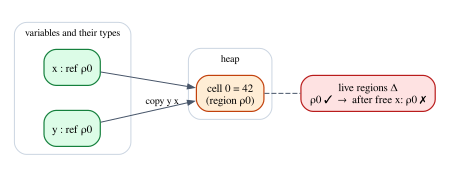
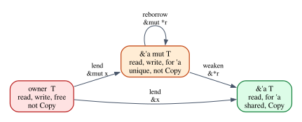

# Chapter 26 · References, Aliasing and Regions

Part V gave Rust's ownership an exact account. A value of a non-`Copy` type is
an affine resource: it may be used at most once, so a move is the absence of
contraction, `Copy` is contraction restored for a class of types, and `Drop` is
weakening with a side effect. The affine λ-calculus of Chapter 22 made this
precise, and its usage theorem proved it. That account is correct, and it
explains a great deal of Rust.

It does not explain a single `&`. Yet references are what you write most, and
almost every borrow-checker error you have fought was about a reference, not a
move. This chapter asks what goes wrong when a language hands out pointers, why
the affine account cannot be stretched to cover them, and what does cover them:
**regions**, which is what lifetimes are, and **permissions**, which is what `&`
and `&mut` are.

This is where the answer to the book's question starts to take shape. Chapter 1
asked whether Rust's ownership and lifetimes are "based on affine types". By the
end of this chapter you will see why the honest answer has two halves, and why
the second half is a different theory altogether.

**In this chapter you will learn:**

- the two ways a reference can go wrong (outliving its referent, and aliasing
  combined with mutation), and which compiler errors rule out each;
- why affine typing cannot explain borrowing: `&T` is `Copy`, and a duplicable
  pointer type is unsound without extra apparatus;
- what region calculi are (Tofte and Talpin, Cyclone), and how lifetimes,
  outlives constraints, the escape check, elision and `'static` fit them;
- the permission reading of references: a shared reference is a duplicable read
  permission, a mutable reference a unique write permission, a borrow a
  temporary transfer of permission;
- how interior mutability moves the aliasing check from compile time to run
  time;
- how to define a heap language in Lean whose semantics gets stuck on a use
  after free, and how to prove that a simple region discipline rules out every
  stuck state.

## What goes wrong with references

A reference is a pointer with rules. In C a pointer has no rules at all: it can
be copied anywhere, and nothing stops you from following it after the memory
behind it has been freed. Rust's references are the same machine pointers, and
their rules are the subject of this chapter. First, let us collect the bugs the
rules prevent. Each program below is a file in `code/rust/compile_fail/`.

### Outliving the referent

The first family of bugs is *temporal*: a reference is used after the thing it
points to has gone away.

```rust
pub fn dangling() {
    let r;
    {
        let reading = 42;
        r = &reading;
    }
    println!("{r}");
}
```

```text
error[E0597]: `reading` does not live long enough
  --> compile_fail/ch26_dangling.rs:10:13
   |
 9 |         let reading = 42;
   |             ------- binding `reading` declared here
10 |         r = &reading;
   |             ^^^^^^^^ borrowed value does not live long enough
11 |     }
   |     - `reading` dropped here while still borrowed
12 |     println!("{r}");
   |                - borrow later used here
```

Read the three labels in order. The borrow `&reading` creates a reference to a
local variable; at the closing brace the variable is dropped, its stack slot is
dead; and the reference is used afterward. In C the equivalent program compiles
and prints whatever happens to be in that stack slot. The principle the compiler
enforces is simple to state: **no reference outlives its referent**. Error E0597
("does not live long enough") is its most common form.

The same principle at a function boundary:

```rust
pub fn shout(text: &str) -> &str {
    let loud = text.to_uppercase();
    &loud
}
```

```text
error[E0515]: cannot return reference to local variable `loud`
 --> compile_fail/ch26_return_local_ref.rs:8:5
  |
8 |     &loud
  |     ^^^^^ returns a reference to data owned by the current function
```

`loud` is a `String` owned by `shout`; when `shout` returns, `loud` is dropped
and its heap buffer freed. A reference into it would dangle the moment the
caller received it. Error E0515 is the compiler noticing that the returned
reference *escapes* the region in which its referent exists, a phrase that will
become precise later in this chapter.

The third temporal bug is the one we will formalize in Lean. A box is
allocated, a second pointer to its contents is made, the box is freed through
the first pointer, and the contents are read through the second:

```rust
pub fn use_after_free() -> i32 {
    let x = Box::new(42);
    let y = &*x;
    drop(x);
    *y
}
```

```text
error[E0505]: cannot move out of `x` because it is borrowed
  --> compile_fail/ch26_free_while_borrowed.rs:9:10
   |
 7 |     let x = Box::new(42);
   |         - binding `x` declared here
 8 |     let y = &*x;
   |             --- borrow of `*x` occurs here
 9 |     drop(x);
   |          ^ move out of `x` occurs here
10 |     *y
   |     -- borrow later used here
   |
help: consider cloning the value if the performance cost is acceptable
   |
 8 -     let y = &*x;
 8 +     let y = &x.clone();
   |
```

`drop(x)` frees the heap cell, and `*y` would read it afterward: a classic use
after free *through an alias*. Rust does not let the owner `x` give the box away
(here to `drop`, which frees it) while a borrow of it is still going to be used.
The help message suggests cloning, which would give `y` its own copy and break
the aliasing.

### Aliasing and mutation

The second family is *spatial*: two paths to the same memory, at least one of
which writes.

```rust
pub fn first_then_push(orders: &mut Vec<u32>) {
    let first = &orders[0];
    orders.push(99);
    println!("first order: {first}");
}
```

```text
error[E0502]: cannot borrow `*orders` as mutable because it is also borrowed as immutable
 --> compile_fail/ch26_shared_then_mut.rs:8:5
  |
7 |     let first = &orders[0];
  |                  ------ immutable borrow occurs here
8 |     orders.push(99);
  |     ^^^^^^^^^^^^^^^ mutable borrow occurs here
9 |     println!("first order: {first}");
  |                             ----- immutable borrow later used here
```

Why is this dangerous? A `Vec` keeps its elements in a heap buffer. `push` may
find the buffer full, allocate a bigger one, move the elements, and free the old
buffer. `first` points into the old buffer. So `first` would dangle, but nothing
in the program frees anything explicitly: the free is hidden inside `push`. The
compiler cannot know whether this particular `push` reallocates, and it does not
try. It enforces a rule that covers every case: **while a shared reference to a
place is in use, the place is not mutated**. Error E0502 is that rule.

The most famous instance has a name, *iterator invalidation*:

```rust
pub fn repeat_large(orders: &mut Vec<u32>) {
    for amount in orders.iter() {
        if *amount > 100 {
            orders.push(*amount);
        }
    }
}
```

```text
error[E0502]: cannot borrow `*orders` as mutable because it is also borrowed as immutable
  --> compile_fail/ch26_iterator_invalidation.rs:9:13
   |
 7 |       for amount in orders.iter() {
   |       -             -------------
   |       |             |
   |       |             immutable borrow occurs here
   |  _____|             immutable borrow later used here
   | |
 8 | |         if *amount > 100 {
 9 | |             orders.push(*amount);
   | |             ^^^^^^^^^^^^^^^^^^^^ mutable borrow occurs here
10 | |         }
11 | |     }
   | |_____- this for loop borrows `*orders` immutably, preventing mutation within its body
   |
   = help: consider using an index-based loop instead, or collecting modifications into a separate collection
```

The iterator holds a pointer into the buffer (and a pointer to its end) for the
whole loop. A `push` in the body may reallocate the buffer, and the next
iteration would read freed memory. In C++ this is undefined behavior; Java's
collections detect it at run time, on a best-effort basis, by throwing
`ConcurrentModificationException`. Rust rejects it before the program runs, and
the diagnostic even points out that the `for` loop is the borrow.

The dual rule forbids two writers:

```rust
pub fn transfer(accounts: &mut Vec<i64>, amount: i64) {
    let from = &mut accounts[0];
    let to = &mut accounts[1];
    *from -= amount;
    *to += amount;
}
```

```text
error[E0499]: cannot borrow `*accounts` as mutable more than once at a time
 --> compile_fail/ch26_two_mut.rs:8:19
  |
7 |     let from = &mut accounts[0];
  |                     -------- first mutable borrow occurs here
8 |     let to = &mut accounts[1];
  |                   ^^^^^^^^ second mutable borrow occurs here
9 |     *from -= amount;
  |     --------------- first borrow later used here
  |
  = help: use `.split_at_mut(position)` to obtain two mutable non-overlapping sub-slices
```

Index 0 and index 1 are different elements, so this particular program would be
harmless. But `accounts[0]` is a call to `IndexMut::index_mut(&mut accounts, 0)`,
which borrows the *whole* vector, and the checker reasons about the vector as a
single place. The rule it enforces is: **a mutable reference to a place excludes
every other reference to that place**. Error E0499 is that rule, and the
`split_at_mut` that the help message suggests is the standard way to tell the
compiler that two mutable references cover disjoint parts.

The same rule, applied across threads, rules out *data races*. A data race is two
unsynchronized accesses to the same memory from different threads, at least one
of them a write, and it is undefined behavior in C, C++ and unsafe Rust alike:

```rust
use std::thread;

pub fn race() {
    let mut counter = 0;
    let first = &mut counter;
    let second = &mut counter;
    thread::scope(|s| {
        s.spawn(move || *first += 1);
        s.spawn(move || *second += 1);
    });
}
```

```text
error[E0499]: cannot borrow `counter` as mutable more than once at a time
  --> compile_fail/ch26_data_race.rs:11:18
   |
10 |     let first = &mut counter;
   |                 ------------ first mutable borrow occurs here
11 |     let second = &mut counter;
   |                  ^^^^^^^^^^^^ second mutable borrow occurs here
12 |     thread::scope(|s| {
13 |         s.spawn(move || *first += 1);
   |                         ------ first borrow later captured here by closure
```

The two threads would each increment `counter` through their own `&mut`, with
no synchronization. The compiler does not need a separate theory of threads to
reject it: two simultaneous `&mut` to one place is already an error. (The
traits `Send` and `Sync` decide which types may cross threads at all; together
with the aliasing rule they give Rust's "fearless concurrency".)

### Two principles

Every error above enforces one of two principles:

| Program | Error | Principle |
|---|---|---|
| `ch26_dangling` | E0597 | no reference outlives its referent |
| `ch26_return_local_ref` | E0515 | the same, at a function boundary |
| `ch26_free_while_borrowed` | E0505 | the owner cannot free while lent |
| `ch26_shared_then_mut` | E0502 | no mutation while shared |
| `ch26_iterator_invalidation` | E0502 | the same, for a loop-long borrow |
| `ch26_two_mut` | E0499 | at most one writer |
| `ch26_data_race` | E0499 | at most one writer, across threads |

The first is about *time*: how long a reference may be used. The second is the
slogan **aliasing XOR mutation**: at any moment, a place may have many readers or
one writer, never both. Repaired versions of these programs are in
`code/rust/examples/ch26_aliasing.rs`; two of them show how small the fix
usually is:

```rust
/// The fix for `ch26_shared_then_mut`: copy the value out, so that the shared
/// borrow ends (at its last use) before the vector is mutated.
fn first_then_push(orders: &mut Vec<u32>) {
    let first = orders[0]; // a `u32` copied out of the vector, not a reference
    orders.push(99);
    println!("first order: {first}, now {} orders", orders.len());
}

/// The fix for `ch26_iterator_invalidation`: read everything first, then
/// mutate. The shared borrow of the loop ends before `extend` begins.
fn repeat_large(orders: &mut Vec<u32>) {
    let large: Vec<u32> = orders.iter().copied().filter(|&a| a > 100).collect();
    orders.extend(large);
    println!("orders after repeating the large ones: {orders:?}");
}
```

```rust
/// The fix for `ch26_two_mut`: `split_at_mut` turns one unique permission on
/// the whole slice into two unique permissions on disjoint halves.
fn transfer(accounts: &mut [i64], amount: i64) {
    let (left, right) = accounts.split_at_mut(1);
    let from = &mut left[0];
    let to = &mut right[0];
    *from -= amount;
    *to += amount;
}

/// The fix for `ch26_data_race`: two threads, two disjoint unique permissions.
fn count_in_parallel() -> [u32; 2] {
    let mut counters = [0u32; 2];
    let (first, second) = counters.split_at_mut(1);
    thread::scope(|s| {
        s.spawn(|| first[0] += 10);
        s.spawn(|| second[0] += 20);
    });
    counters
}
```

```text
first order: 120, now 4 orders
orders after repeating the large ones: [120, 80, 300, 99, 120, 300]
accounts after transfer: [70, 80]
counters from two threads: [10, 20]
```

In `first_then_push` the value is copied out of the vector, so no reference is
alive when `push` runs. In `transfer` and `count_in_parallel`, `split_at_mut`
splits one mutable reference to the whole slice into two mutable references to
two halves that cannot overlap.

## Why affinity is not enough

It is natural to hope that references can be explained like moves, perhaps
with a cleverer affine system. This section shows why that hope fails, first in
Rust and then formally.

### `&T` is `Copy`

Recall from Chapter 23 that `Copy` is free contraction: a variable of a `Copy`
type may be used any number of times. And `&T` is `Copy`, for *every* `T`:

```rust
/// Contraction, available only for `Copy` types: the value is used twice.
fn duplicate<T: Copy>(x: T) -> (T, T) {
    (x, x)
}

fn references_are_copy() {
    let report = String::from("sensor report");
    // `String` is not `Copy`, but `&String` is: a shared reference can be
    // duplicated freely, and both copies point to the same string.
    let (r1, r2) = duplicate(&report);
    println!(
        "r1 = {r1:?}, r2 = {r2:?}, same address: {}",
        std::ptr::eq(r1, r2)
    );
    // `duplicate(&mut report)` would not compile: `&mut String` is not `Copy`.
}
```

```text
r1 = "sensor report", r2 = "sensor report", same address: true
```

`duplicate` uses its argument twice, which is contraction, and its `T: Copy`
bound makes that legal. Called with `&report` it returns two shared references
to the same `String`. So a shared reference is a *fully structural* value: it can
be copied (contraction), ignored (weakening) and used in any order (exchange).
An affine type system says nothing at all about such a value. Whatever rejects
the programs of the previous section, it is not a restriction on how many times
a `&T` is used.

A mutable reference, in contrast, is not `Copy`. It behaves exactly like an
owned value under the affine rules:

```rust
pub fn two_writers(log: &mut String) {
    let first = log;
    let second = log;
    *first = String::from("a");
    *second = String::from("b");
}
```

```text
error[E0382]: use of moved value: `log`
 --> compile_fail/ch26_mut_ref_moves.rs:8:18
  |
6 | pub fn two_writers(log: &mut String) {
  |                    --- move occurs because `log` has type `&mut String`, which does not implement the `Copy` trait
7 |     let first = log;
  |                 --- value moved here
8 |     let second = log;
  |                  ^^^ value used here after move
```

This is error E0382 from Chapter 6, word for word: `&mut String` is moved by
`let first = log`, and `log` cannot be used again. (In everyday code you rarely
see this error, because the compiler silently *reborrows* a `&mut` when you pass
it to a function: `f(log)` means `f(&mut *log)`. An assignment without a type
annotation does not reborrow, which is why the program above moves.)

So `&mut T` is affine. Does that explain E0499? Look again at `ch26_two_mut`:
`from` and `to` are two *different* variables, each used exactly once. An affine
checker that counts uses of variables would accept the program. The conflict is
not between two uses of one variable but between two values that point to the
same place, and an affine type system cannot see that, because it counts uses
of variables, not what they point to.

### The dangling-reference term

The same observation can be made formally. Take the affine λ-calculus of
Chapter 22 and add a heap: a type $\mathsf{Box}\,\tau$ of owned heap cells, with

$$
\mathsf{new} : \tau \multimap \mathsf{Box}\,\tau
\qquad\qquad
\mathsf{free} : \mathsf{Box}\,\tau \multimap \tau
$$

Nothing new is needed so far. $\mathsf{Box}\,\tau$ is an affine type, ownership of
the cell travels with the variable that holds it, and the usage theorem of
Chapter 22 guarantees that each cell is freed at most once. This is Rust's
`Box<T>`.

Now add references: a type $\mathsf{Ref}\,\tau$ of pointers that may read a
cell but do not own it. Reading should not consume anything, so references
should be duplicable (like `&T`), and taking a reference should not consume the
box. The natural rules are

$$
\dfrac{(b : \mathsf{Box}\,\tau) \in \Gamma}{\Gamma \vdash \mathsf{borrow}\ b : \mathsf{Ref}\,\tau}\;\textsf{T-Borrow}
\qquad\qquad
\dfrac{\Gamma \vdash e : \mathsf{Ref}\,\tau}{\Gamma \vdash \mathsf{read}\ e : \tau}\;\textsf{T-Read}
$$

with $\mathsf{Ref}\,\tau$ declared `Copy` and $\tau$ a `Copy` type in T-Read. The
premise of T-Borrow is a membership test, not a context split: $b$ stays
available after it is borrowed, exactly as `x` stays available after `&x` in
Rust. Every rule is affine-respectable. And yet the term

$$
\mathtt{let}\ b = \mathsf{new}\ 42\ \mathtt{in}\ 
\mathtt{let}\ r = \mathsf{borrow}\ b\ \mathtt{in}\ 
\mathtt{let}\ \_ = \mathsf{free}\ b\ \mathtt{in}\ 
\mathsf{read}\ r
$$

is well typed: $b$ is consumed once (by $\mathsf{free}$), $r$ is used once, and
nothing is duplicated that is not `Copy`. It reads freed memory.

There are exactly two ways out, and Rust uses both:

1. **Lend and return.** Make $\mathsf{borrow}$ *consume* the box, and give it
   back at the end of a delimited scope. Ownership is then never shared, only
   lent: during the scope the reference exists and the owner does not; after
   it, the owner exists again and the reference does not. Chapter 28 builds a
   calculus around this idea.
2. **Regions.** Index every reference type by a *region*, a name for the
   stretch of the program during which the reference may be used, and require
   that no reference is used outside its region.

Neither is about how many times a variable is used. The first needs a scope
and a side condition that the reference does not leak out of it; the second
needs a new sort of name in the types. Both are about *time*.

> [!IMPORTANT]
> Affinity is a statement about **multiplicity**: how many times a variable may
> be used. Lifetimes are a statement about **extent**: during which part of the
> program a reference is valid. They are orthogonal mechanisms, which Rust
> happens to check in the same pass. No amount of affine typing produces
> lifetimes.

## A heap language that goes wrong

Before we look at regions, we make the problem precise. The Lean file
`code/lean/Book/Ch26/Heap.lean` defines a tiny imperative language with a heap,
gives it a semantics that gets stuck on a use after free, and proves that a
program goes wrong. It is deliberately small: no loops, no functions, only
straight-line code, so that the proofs stay short and every idea is visible.

### Syntax and states

```lean
/-- What a variable holds: a number, or the address of a heap cell. -/
inductive Val where
  | num (n : ℕ)
  | addr (l : ℕ)
  deriving DecidableEq, Repr

/-- The commands of the language. A program is a list of commands, run from
left to right. -/
inductive Cmd where
  | alloc (x : Var) (n : ℕ)  -- x := new n     a fresh cell holding n
  | copy (y x : Var)         -- y := x         y now holds what x holds
  | read (y x : Var)         -- y := *x        read the cell x points to
  | write (x : Var) (n : ℕ)  -- *x := n        write the cell x points to
  | free (x : Var)           -- free x         deallocate the cell
  deriving Repr

/-- A program is a list of commands. -/
abbrev Prog := List Cmd
```

A variable holds either a number or the address of a heap cell. The five
commands correspond to familiar Rust operations: `alloc x n` is
`let x = Box::new(n)`, `copy y x` makes `y` a second pointer to whatever `x`
points to (like copying a `&T`), `read` and `write` follow a pointer, and
`free x` deallocates the cell, as `drop(x)` does for a box. Variables are
strings and addresses are natural numbers.

```lean
/-- The machine state: the variables, the heap and the next fresh address.
A cell that was never allocated, or has been freed, holds `none`. -/
structure State where
  env : Var → Option Val
  heap : ℕ → Option ℕ
  next : ℕ

/-- The empty state: no variables, no cells. -/
def State.init : State where
  env := fun _ => none
  heap := fun _ => none
  next := 0
```

The state has three parts. `env` gives each variable its value (or `none` if it
has none yet), `heap` gives each address its contents (or `none` if the cell was
never allocated or has been freed), and `next` is the next address that `alloc`
will hand out. Both `env` and `heap` are functions, which is the simplest way to
model a finite map in a proof; the price is that a `State` cannot be printed,
which is why later we print only some variables.

The `where` syntax after `def State.init : State` builds a structure value field
by field. It is the Lean counterpart of a Rust struct literal.

### The step relation

The semantics is a small-step relation, as in Chapter 9. A *configuration* is a
pair of the commands still to run and the current state. Written as rules, the
cases for reading and freeing are

$$
\dfrac{s.\mathit{env}(x) = \mathsf{addr}\ \ell \qquad s.\mathit{heap}(\ell) = n}{\langle \mathtt{read}\ y\ x :: k,\ s\rangle \longrightarrow \langle k,\ s[\mathit{env}(y) := \mathsf{num}\ n]\rangle}\;\textsf{E-Read}
$$

$$
\dfrac{s.\mathit{env}(x) = \mathsf{addr}\ \ell \qquad s.\mathit{heap}(\ell) = m}{\langle \mathtt{free}\ x :: k,\ s\rangle \longrightarrow \langle k,\ s[\mathit{heap}(\ell) := \mathsf{none}]\rangle}\;\textsf{E-Free}
$$

Each premise is a *requirement*: to read through `x`, `x` must hold an address,
and the cell at that address must be allocated. If a requirement fails, the rule
does not apply. In Lean:

```lean
/-- One step of execution. A configuration is the program still to run
together with the current state. -/
inductive Step : Prog × State → Prog × State → Prop where
  | alloc {x : Var} {n : ℕ} {k : Prog} {s : State} :
      Step (.alloc x n :: k, s)
        (k, { env := update s.env x (some (.addr s.next))
              heap := update s.heap s.next (some n)
              next := s.next + 1 })
  | copy {y x : Var} {v : Val} {k : Prog} {s : State}
      (hx : s.env x = some v) :
      Step (.copy y x :: k, s) (k, { s with env := update s.env y (some v) })
  | read {y x : Var} {l n : ℕ} {k : Prog} {s : State}
      (hx : s.env x = some (.addr l)) (hl : s.heap l = some n) :
      Step (.read y x :: k, s) (k, { s with env := update s.env y (some (.num n)) })
  | write {x : Var} {n l m : ℕ} {k : Prog} {s : State}
      (hx : s.env x = some (.addr l)) (hl : s.heap l = some m) :
      Step (.write x n :: k, s) (k, { s with heap := update s.heap l (some n) })
  | free {x : Var} {l m : ℕ} {k : Prog} {s : State}
      (hx : s.env x = some (.addr l)) (hl : s.heap l = some m) :
      Step (.free x :: k, s) (k, { s with heap := update s.heap l none })
```

Two pieces of notation are new. `update f a v` is Mathlib's
`Function.update`: the function that agrees with `f` everywhere except at `a`,
where it returns `v` (the file says `open Function (update)` so that we can
write it without the prefix). And `{ s with env := e }` is *structure update*:
a copy of `s` with the field `env` replaced, like Rust's
`State { env: e, ..s }`.

Notice what the rules do *not* say. There is no rule for reading a freed cell, or
for freeing it twice. When a program reaches such a command, no rule applies:
the program is **stuck**, which is our formal version of undefined behavior.

```lean
/-- Zero or more steps: Mathlib's reflexive-transitive closure of `Step`. -/
abbrev Steps := Relation.ReflTransGen Step

/-- A configuration is stuck when there is still a command to run but no
rule of `Step` applies to it. -/
def Stuck (c : Prog × State) : Prop := c.1 ≠ [] ∧ ¬ ∃ c', Step c c'

/-- A program goes wrong if, started in the empty state, it can reach a stuck
configuration. -/
def GoesWrong (p : Prog) : Prop := ∃ c, Steps (p, State.init) c ∧ Stuck c
```

`Relation.ReflTransGen` is Mathlib's reflexive-transitive closure: `Steps c c'`
holds when `c'` can be reached from `c` in zero or more steps. (Chapter 9 defined
its own `Steps`; here we use the library's.) A configuration is `Stuck` if it
still has commands to run but no step is possible, and a program `GoesWrong` if
it can reach a stuck configuration from the empty state.

### Three programs

```lean
/-- Two pointers to one cell, both used to read it, then the cell is freed.
A perfectly safe program. -/
def share : Prog :=
  [.alloc "x" 42, .copy "y" "x", .read "a" "x", .read "b" "y", .free "x"]

/-- The same aliasing, but the cell is freed *before* the alias is read. -/
def uaf : Prog :=
  [.alloc "x" 42, .copy "y" "x", .free "x", .read "z" "y"]

/-- Freeing the same cell twice, once through each pointer. -/
def doubleFree : Prog :=
  [.alloc "x" 1, .copy "y" "x", .free "x", .free "y"]
```

`share` makes two pointers to one cell, reads through both and frees the cell:
fine. `uaf` is the Rust program `ch26_free_while_borrowed` in our language: the
cell is freed through `x` and then read through `y`. `doubleFree` frees the
same cell through each of its two pointers.

To run programs, the file also defines an interpreter, `exec` for one command
and `run` for a program, that returns either the final state or a `Fault`
explaining which requirement failed: an unassigned variable, a number used as an
address, or a `dangling` access to a cell that is not allocated. (`Except` is
Lean's `Result`, as Chapter 2 explained.) Here is what happens:

```lean
/-- info: Except.ok [("a", some (Ch26.Val.num 42)), ("b", some (Ch26.Val.num 42))] -/
#guard_msgs in
#eval observe ["a", "b"] (run share State.init)

/-- info: Except.error (Ch26.Fault.dangling "y" 0) -/
#guard_msgs in
#eval observe ["z"] (run uaf State.init)

/-- info: Except.error (Ch26.Fault.dangling "y" 0) -/
#guard_msgs in
#eval observe [] (run doubleFree State.init)
```

`observe` picks out the values of the listed variables from the final state.
The safe program ends with `a` and `b` both holding 42. The other two fail with
the same fault: `y` points to cell 0, which is no longer allocated.

### Proving that a program goes wrong

An interpreter is a program, and a program can have bugs. To make sure ours
says the same thing as the step relation, the file proves two theorems. The
first says that a fault really is a stuck configuration:

```lean
/-- A command on which `exec` reports a fault is stuck: no rule applies. -/
theorem exec_error {s : State} {c : Cmd} {e : Fault} (k : Prog)
    (h : exec s c = .error e) : ¬ ∃ c', Step (c :: k, s) c' := by
  rintro ⟨c', hstep⟩
  -- Which rule could have fired? Each one contradicts the fault.
  cases hstep with
  | alloc => simp [exec] at h
  | copy hx => simp [exec, hx] at h
  | read hx hl =>
    simp only [exec] at h
    split at h
    · rename_i e' hd
      exact deref_error hd hx hl
    · cases h
  | write hx hl =>
    simp only [exec] at h
    split at h
    · rename_i e' hd
      exact deref_error hd hx hl
    · cases h
  | free hx hl =>
    simp only [exec] at h
    split at h
    · rename_i e' hd
      exact deref_error hd hx hl
    · cases h
```

If `exec` reports a fault on command `c`, then `(c :: k, s)` cannot step. The
proof assumes a step, `rintro ⟨c', hstep⟩`, and derives a contradiction.
`cases hstep` is *inversion*, as in Chapter 9: one goal per rule of `Step` that
could have produced `hstep`, each with that rule's premises as hypotheses. For
`alloc`, `exec` never fails, so `simp [exec] at h` turns `h` into a
contradiction. For `copy`, the premise `hx` says that `x` has a value, and
`simp [exec, hx] at h` shows that `exec` would have succeeded. The other three
commands follow a pointer with a helper `deref`, and `split at h` splits the
`match` on its result into its two branches. In the error branch, `hd` says that
`deref` failed, while the rule's premises `hx` and `hl` say that `x` points to
an allocated cell; the lemma `deref_error` (in the same file) shows that these
cannot both hold. In the success branch, `h` equates `.ok` with `.error`, and
`cases h` closes the goal because the constructors differ. (`rename_i` names
hypotheses that Lean introduced without a name.)

The second pair of theorems lifts this to whole programs:

```lean
/-- A successful run is a sequence of steps that ends with nothing left to do. -/
theorem run_ok {p : Prog} {s s' : State} (h : run p s = .ok s') :
    Steps (p, s) ([], s') := by
  induction p generalizing s with
  | nil =>
    simp only [run, Except.ok.injEq] at h
    subst h
    exact Relation.ReflTransGen.refl
  | cons c k ih =>
    simp only [run] at h
    split at h
    · cases h
    · rename_i s₁ hc
      exact Relation.ReflTransGen.head (exec_ok k hc) (ih h)

/-- A run that reports a fault has reached a stuck configuration. -/
theorem run_error {p : Prog} {s : State} {e : Fault} (h : run p s = .error e) :
    ∃ c, Steps (p, s) c ∧ Stuck c := by
  induction p generalizing s with
  | nil => simp [run] at h
  | cons c k ih =>
    simp only [run] at h
    split at h
    · -- The first command itself is stuck.
      rename_i e' hc
      exact ⟨(c :: k, s), Relation.ReflTransGen.refl,
        List.cons_ne_nil c k, exec_error k hc⟩
    · -- The first command runs; the fault comes later.
      rename_i s₁ hc
      obtain ⟨c', hsteps, hstuck⟩ := ih h
      exact ⟨c', Relation.ReflTransGen.head (exec_ok k hc) hsteps, hstuck⟩
```

Both are proved by induction on the program, `generalizing s` because the state
changes from one command to the next. In the `cons` case of `run_error`,
`split at h` asks whether the *first* command faulted. If it did, the stuck
configuration is the current one, reached in zero steps (`ReflTransGen.refl`),
and `exec_error` shows it is stuck. If it did not, `exec_ok` (a companion lemma
in the file) gives one step, the induction hypothesis gives the rest, and
`ReflTransGen.head` glues the first step onto the remaining ones.

With these, proving that `uaf` goes wrong takes one line:

```lean
/-- The use after free goes wrong. -/
theorem uaf_goes_wrong : GoesWrong uaf := run_error (e := .dangling "y" 0) rfl

/-- So does the double free. -/
theorem doubleFree_goes_wrong : GoesWrong doubleFree :=
  run_error (e := .dangling "y" 0) rfl

/-- The safe program runs to completion. -/
theorem share_finishes : ∃ s, Steps (share, State.init) ([], s) :=
  ⟨_, run_ok rfl⟩
```

The argument `rfl` is a proof that `run uaf State.init` equals
`.error (.dangling "y" 0)`: Lean evaluates the interpreter during type checking
and finds that both sides are the same. This is a pattern worth remembering:
*a verified interpreter turns a computation into a proof*.

### Two disciplines that fail

Now we can test the claims of the previous section on a real language. The file
`code/lean/Book/Ch26/Regions.lean` starts with two static checks that do not use
regions.

The first tracks *variables*: after `free x`, the variable `x` is dead, and
using it is an error. Pointers may be copied freely, as `&T` may.

```lean
/-- Track *variables*: `free x` marks `x` as dead, and a dead variable may not
be used again. Pointers can be copied freely, like Rust's `&T`. -/
def naiveCheck (dead : List Var) : Prog → Bool
  | [] => true
  | .alloc x _ :: k => naiveCheck (dead.erase x) k
  | .copy y x :: k => !dead.contains x && naiveCheck (dead.erase y) k
  | .read y x :: k => !dead.contains x && naiveCheck (dead.erase y) k
  | .write x _ :: k => !dead.contains x && naiveCheck dead k
  | .free x :: k => !dead.contains x && naiveCheck (x :: dead) k

/-- The naive check accepts the use after free... -/
theorem naive_accepts_uaf : naiveCheck [] uaf = true := rfl

/-- ...so it does not guarantee safety. -/
theorem naive_unsound : ¬ ∀ p, naiveCheck [] p = true → ¬ GoesWrong p :=
  fun h => h uaf naive_accepts_uaf uaf_goes_wrong
```

`naive_accepts_uaf` is proved by `rfl`: Lean runs the check and gets `true`.
The check looks reasonable, and it does catch `free x; read y x`. But `uaf` reads
through `y`, and `y` was never freed *by name*, so the check is satisfied.
Combined with `uaf_goes_wrong`, this gives `naive_unsound`: the check accepts a
program that goes wrong. Tracking names cannot work when one cell has many
names.

The second check treats pointers as affine resources, as `Box<T>` is: copying a
pointer moves it, so the source variable becomes dead.

```lean
/-- Treat pointers as affine resources, like Rust's `Box<T>`: `copy y x`
*moves* the pointer from `x` to `y`, so `x` is dead afterwards. -/
def affineCheck (dead : List Var) : Prog → Bool
  | [] => true
  | .alloc x _ :: k => affineCheck (dead.erase x) k
  | .copy y x :: k => !dead.contains x && affineCheck ((x :: dead).erase y) k
  | .read y x :: k => !dead.contains x && affineCheck (dead.erase y) k
  | .write x _ :: k => !dead.contains x && affineCheck dead k
  | .free x :: k => !dead.contains x && affineCheck (x :: dead) k

/-- The affine check rejects the use after free... -/
theorem affine_rejects_uaf : affineCheck [] uaf = false := rfl

/-- ...but it also rejects `share`, which runs safely (`share_finishes`). -/
theorem affine_rejects_share : affineCheck [] share = false := rfl
```

This one rejects `uaf`: after `copy "y" "x"` the variable `x` is dead, so
`free "x"` is an error. But it also rejects `share`, which runs perfectly well,
because `share` reads through `x` after copying it. Here is the dilemma of the
previous section, now as two theorems about a real language: **duplicable
pointers are unsafe without more information; affine pointers are safe but
cannot be shared.** References in Rust are shared and safe, so they need more
information. That information is the region.

## Regions

### Tofte and Talpin, and Cyclone

Region-based memory management was developed in the 1990s by Mads Tofte and
Jean-Pierre Talpin, for Standard ML. Their idea was to divide memory into
*regions* that are allocated and freed as a whole, in a stack discipline: a
construct $\mathtt{letregion}\ \rho\ \mathtt{in}\ e$ creates a fresh region
$\rho$, evaluates $e$, and then frees $\rho$ with everything in it. Values are
allocated "at" a region, and every type that can point into memory carries the
name of the region it points into. A type-and-effect system checks that no value
of a region is used after the region is freed, and an inference algorithm places
the `letregion`s automatically, so that ML programs could run without a garbage
collector. The approach was implemented in the ML Kit, a compiler for
Standard ML.

In the early 2000s, the Cyclone language (by Trevor Jim, Greg Morrisett, Dan
Grossman and others) brought regions to a safe dialect of C. Cyclone pointers
carry region annotations; a function can be polymorphic over the regions of its
arguments; regions are ordered by an *outlives* relation, so that a pointer into
a longer-lived region can be used where a shorter-lived one is expected; and
there are unique pointers for memory that is not shared. Every one of these is a
feature you know from Rust. Cyclone is Rust's most direct ancestor on this side
of the language.

The important observation for our question is negative: **none of these is a
substructural system**. A region type system is an ordinary type system, with
weakening, contraction and exchange, extended with a second sort of variable
(region names) and constraints between them. Rust combines a region system with
an affine one. Either alone would be unremarkable; the combination is what makes
Rust distinctive.

### A region discipline for the heap language

Here is a region discipline for our heap language. Types are numbers or
pointers into a named region:

$$
\tau ::= \mathsf{num} \mid \mathsf{ref}\ \rho
$$

A typing context $\Gamma$ assigns types to variables, and a set $\Delta$ records
which regions are *live*. In our straight-line language every `alloc` creates a
fresh region holding exactly one cell; `free` ends the region. The typing
judgment for a command has an input and an output, because commands change both
$\Gamma$ and $\Delta$: $\Delta;\Gamma \vdash c \dashv \Delta';\Gamma'$ reads "in
context $\Delta;\Gamma$ the command $c$ is well typed and leaves the context
$\Delta';\Gamma'$". The rules:

$$
\dfrac{\rho\ \text{fresh}}{\Delta;\Gamma \vdash \mathtt{alloc}\ x\ n \dashv \Delta \cup \{\rho\};\ \Gamma[x : \mathsf{ref}\ \rho]}\;\textsf{R-Alloc}
$$

$$
\dfrac{\Gamma(x) = \mathsf{ref}\ \rho \qquad \rho \in \Delta}{\Delta;\Gamma \vdash \mathtt{copy}\ y\ x \dashv \Delta;\ \Gamma[y : \mathsf{ref}\ \rho]}\;\textsf{R-Copy}
\qquad
\dfrac{\Gamma(x) = \mathsf{ref}\ \rho \qquad \rho \in \Delta}{\Delta;\Gamma \vdash \mathtt{read}\ y\ x \dashv \Delta;\ \Gamma[y : \mathsf{num}]}\;\textsf{R-Read}
$$

$$
\dfrac{\Gamma(x) = \mathsf{ref}\ \rho \qquad \rho \in \Delta}{\Delta;\Gamma \vdash \mathtt{free}\ x \dashv \Delta \setminus \{\rho\};\ \Gamma}\;\textsf{R-Free}
$$

plus a rule for `write` like R-Read, and one for copying a number. Two things
make this work, and both are worth saying slowly.

First, **a copy shares the region**. Rule R-Copy gives `y` the type
$\mathsf{ref}\ \rho$, the *same* $\rho$ as `x`. The type system now knows that
`x` and `y` are aliases: not by counting them, but because their types mention
the same region name. Copies are unrestricted, so pointers are fully structural,
exactly like `&T`.

Second, **`free` ends the region for every alias at once**. Rule R-Free removes
$\rho$ from $\Delta$ but leaves $\Gamma$ alone: `y` still has type
$\mathsf{ref}\ \rho$. What has changed is that $\rho$ is no longer live, and
every rule that uses a pointer requires its region to be live. So `read z y`
after `free x` is rejected, without the type system ever tracking that `y` was
copied from `x`.



The premise $\rho \in \Delta$ in every rule is the **escape check** of this
discipline: a pointer may be used only while its region is live. In
Tofte and Talpin's lexical version the same check takes the form "the result of
a $\mathtt{letregion}\ \rho$ block must not mention $\rho$"; we will meet Rust's
version shortly.

### The rules in Lean

The Lean version follows the mathematics closely:

```lean
/-- The type of a variable: a number, or a pointer into region `ρ`. -/
inductive Ty where
  | num
  | ref (ρ : ℕ)
  deriving DecidableEq, Repr

/-- The static context: the type of each variable, the set of live regions,
and the next unused region name. -/
structure Ctx where
  ty : Var → Option Ty
  live : ℕ → Bool
  fresh : ℕ

/-- The context of the empty program: no variables, no live regions. -/
def Ctx.init : Ctx where
  ty := fun _ => none
  live := fun _ => false
  fresh := 0
```

The live set $\Delta$ is the Boolean function `live`, and `fresh` is a counter
that supplies new region names, like `next` supplies new addresses.

```lean
/-- `CmdOK Γ c Γ'`: in the context `Γ` the command `c` is well typed and
leaves the context `Γ'`. Every use of a pointer requires its region to be
live; `free` ends the region. -/
inductive CmdOK : Ctx → Cmd → Ctx → Prop where
  | alloc {Γ : Ctx} {x : Var} {n : ℕ} :
      CmdOK Γ (.alloc x n)
        { ty := update Γ.ty x (some (.ref Γ.fresh))
          live := update Γ.live Γ.fresh true
          fresh := Γ.fresh + 1 }
  | copyNum {Γ : Ctx} {y x : Var} (hx : Γ.ty x = some .num) :
      CmdOK Γ (.copy y x) { Γ with ty := update Γ.ty y (some .num) }
  | copyRef {Γ : Ctx} {y x : Var} {ρ : ℕ}
      (hx : Γ.ty x = some (.ref ρ)) (hρ : Γ.live ρ = true) :
      CmdOK Γ (.copy y x) { Γ with ty := update Γ.ty y (some (.ref ρ)) }
  | read {Γ : Ctx} {y x : Var} {ρ : ℕ}
      (hx : Γ.ty x = some (.ref ρ)) (hρ : Γ.live ρ = true) :
      CmdOK Γ (.read y x) { Γ with ty := update Γ.ty y (some .num) }
  | write {Γ : Ctx} {x : Var} {n : ℕ} {ρ : ℕ}
      (hx : Γ.ty x = some (.ref ρ)) (hρ : Γ.live ρ = true) :
      CmdOK Γ (.write x n) Γ
  | free {Γ : Ctx} {x : Var} {ρ : ℕ}
      (hx : Γ.ty x = some (.ref ρ)) (hρ : Γ.live ρ = true) :
      CmdOK Γ (.free x) { Γ with live := update Γ.live ρ false }

/-- A program is well typed when each command is, in the context that the
previous command leaves. -/
inductive ProgOK : Ctx → Prog → Prop where
  | nil {Γ : Ctx} : ProgOK Γ []
  | cons {Γ Γ' : Ctx} {c : Cmd} {k : Prog} :
      CmdOK Γ c Γ' → ProgOK Γ' k → ProgOK Γ (c :: k)
```

Each constructor of `CmdOK` is one rule, its arguments the premises. `ProgOK`
threads the context through a list of commands: the context that one command
leaves is the context in which the next is checked.

The rules are *syntax-directed*: for each command at most one rule applies (two
for `copy`, distinguished by the type of `x`), and its premises can be checked
by looking them up. So a checker is easy to write, and it can report which
premise failed:

```lean
/-- Why a command is rejected. -/
inductive RegionError where
  | unknown (x : Var)               -- `x` has no type yet
  | notAPointer (x : Var)           -- `x` holds a number
  | deadRegion (x : Var) (ρ : ℕ)  -- `x` points into region `ρ`, which has ended
  deriving Repr

/-- The region that the pointer in `x` points into, if that region is live. -/
def liveRegion (Γ : Ctx) (x : Var) : Except RegionError ℕ :=
  match Γ.ty x with
  | none => .error (.unknown x)
  | some .num => .error (.notAPointer x)
  | some (.ref ρ) => if Γ.live ρ then .ok ρ else .error (.deadRegion x ρ)

/-- Check one command, computing the context it leaves. -/
def checkCmd (Γ : Ctx) : Cmd → Except RegionError Ctx
  | .alloc x _ => .ok { ty := update Γ.ty x (some (.ref Γ.fresh))
                        live := update Γ.live Γ.fresh true
                        fresh := Γ.fresh + 1 }
  | .copy y x =>
    match Γ.ty x with
    | some .num => .ok { Γ with ty := update Γ.ty y (some .num) }
    | _ =>
      match liveRegion Γ x with
      | .error e => .error e
      | .ok ρ => .ok { Γ with ty := update Γ.ty y (some (.ref ρ)) }
  | .read y x =>
    match liveRegion Γ x with
    | .error e => .error e
    | .ok _ => .ok { Γ with ty := update Γ.ty y (some .num) }
  | .write x _ =>
    match liveRegion Γ x with
    | .error e => .error e
    | .ok _ => .ok Γ
  | .free x =>
    match liveRegion Γ x with
    | .error e => .error e
    | .ok ρ => .ok { Γ with live := update Γ.live ρ false }

/-- Check a whole program, stopping at the first error. -/
def check (Γ : Ctx) : Prog → Except RegionError Unit
  | [] => .ok ()
  | c :: k =>
    match checkCmd Γ c with
    | .error e => .error e
    | .ok Γ' => check Γ' k
```

```lean
/-- info: Except.ok () -/
#guard_msgs in
#eval check Ctx.init share

/-- info: Except.error (Ch26.RegionError.deadRegion "y" 0) -/
#guard_msgs in
#eval check Ctx.init uaf

/-- info: Except.error (Ch26.RegionError.deadRegion "y" 0) -/
#guard_msgs in
#eval check Ctx.init doubleFree
```

The checker accepts `share` and rejects both `uaf` and `doubleFree`, in both
cases at the use of `y`, which points into region 0, already ended. Compare with
the naive check, which accepted both, and the affine check, which rejected
`share`.

Is the checker faithful to the rules? The file proves that it is, in both
directions:

```lean
/-- The checker accepts a program exactly when the typing rules do. -/
theorem check_ok {Γ : Ctx} {p : Prog} : check Γ p = .ok () ↔ ProgOK Γ p := by
  induction p generalizing Γ with
  | nil => exact ⟨fun _ => ProgOK.nil, fun _ => rfl⟩
  | cons c k ih =>
    constructor
    · intro h
      simp only [check] at h
      split at h
      · cases h
      · rename_i Γ' hc
        exact ProgOK.cons (checkCmd_ok.mp hc) (ih.mp h)
    · intro h
      cases h with
      | cons hc hk =>
        simp only [check, checkCmd_ok.mpr hc]
        exact ih.mpr hk

/-- So the typing judgment is decidable, and `decide` can use the checker. -/
instance (Γ : Ctx) (p : Prog) : Decidable (ProgOK Γ p) :=
  match h : check Γ p with
  | .ok () => isTrue (check_ok.mp h)
  | .error _ => isFalse fun hp => by rw [check_ok.mpr hp] at h; cases h

theorem share_typed : ProgOK Ctx.init share := by decide

theorem uaf_rejected : ¬ ProgOK Ctx.init uaf := by decide

theorem doubleFree_rejected : ¬ ProgOK Ctx.init doubleFree := by decide
```

`check_ok` is proved by induction on the program, using a lemma `checkCmd_ok`
that relates `checkCmd` to `CmdOK` one command at a time (both are in the file;
their proofs are the same kind of case analysis as `exec_error`). With the
equivalence in hand, the `instance` makes `ProgOK Γ p` *decidable*: to decide
it, run the checker. The `match h : check Γ p with` form names the equation
between `check Γ p` and the branch taken, so that each branch can use it:
`isTrue` packages a proof, `isFalse` a refutation. After that, `decide` proves
that `share` is well typed and that `uaf` and `doubleFree` are not.

### Safety, proved

A type system is only as good as its safety theorem. Ours says that a program
accepted by the region discipline never goes wrong, and its proof has the shape
you know from Chapter 9: progress and preservation. The new ingredient is the
invariant that connects a static context to a run-time state:

```lean
/-- How a static context describes a run-time state. `owner` says which region
each heap cell belongs to. It is *ghost* information: it exists in the proof,
not in the program or the machine. -/
structure Agree (Γ : Ctx) (s : State) (owner : ℕ → ℕ) : Prop where
  /-- Variables typed `num` hold numbers. -/
  nums : ∀ x, Γ.ty x = some .num → ∃ n, s.env x = some (.num n)
  /-- Variables typed `ref ρ` hold the address of a cell of region `ρ`. -/
  refs : ∀ x ρ, Γ.ty x = some (.ref ρ) →
    ∃ l, s.env x = some (.addr l) ∧ l < s.next ∧ owner l = ρ
  /-- Every cell allocated so far belongs to a region that has been named. -/
  named : ∀ l, l < s.next → owner l < Γ.fresh
  /-- The cells of a live region are allocated. -/
  alive : ∀ l, l < s.next → Γ.live (owner l) = true → s.heap l ≠ none
```

A `structure` whose type is `Prop` is a conjunction with named components: a
proof of `Agree Γ s owner` is a bundle of four proofs, accessed as `ha.nums`,
`ha.refs` and so on. The four fields say: variables typed `num` hold numbers;
variables typed `ref ρ` hold the address `l` of a cell that has been allocated at
some point (`l < s.next`) and belongs to region `ρ`; every cell allocated so far
belongs to a region that has already been named (`owner l < Γ.fresh`); and the
cells of every live region are still allocated.

The parameter `owner` deserves a comment. It says which region each heap cell
belongs to, and it appears nowhere in the program or in the machine: it is
**ghost** information, which exists only to state and prove the invariant. Keep
that in mind, because Rust's lifetimes are ghost information in exactly the same
sense. The compiler uses them to check the program and then erases them; no
lifetime exists at run time.

Progress says that a well-typed command can always take a step:

```lean
/-- Progress: a well-typed command can run in any state that agrees with
its context. -/
theorem progress {Γ Γ' : Ctx} {c : Cmd} {s : State} {owner : ℕ → ℕ}
    (hc : CmdOK Γ c Γ') (ha : Agree Γ s owner) (k : Prog) :
    ∃ s', Step (c :: k, s) (k, s') := by
  cases hc with
  | alloc => exact ⟨_, Step.alloc⟩
  | copyNum hx =>
    obtain ⟨n, hn⟩ := ha.nums _ hx
    exact ⟨_, Step.copy hn⟩
  | copyRef hx _ =>
    obtain ⟨l, hl, -, -⟩ := ha.refs _ _ hx
    exact ⟨_, Step.copy hl⟩
  | read hx hρ =>
    -- `x` points to a cell `l` of region `ρ`; `ρ` is live, so `l` is allocated.
    obtain ⟨l, hl, hlt, rfl⟩ := ha.refs _ _ hx
    obtain ⟨n, hn⟩ := Option.ne_none_iff_exists'.mp (ha.alive l hlt hρ)
    exact ⟨_, Step.read hl hn⟩
  | write hx hρ =>
    obtain ⟨l, hl, hlt, rfl⟩ := ha.refs _ _ hx
    obtain ⟨m, hm⟩ := Option.ne_none_iff_exists'.mp (ha.alive l hlt hρ)
    exact ⟨_, Step.write hl hm⟩
  | free hx hρ =>
    obtain ⟨l, hl, hlt, rfl⟩ := ha.refs _ _ hx
    obtain ⟨m, hm⟩ := Option.ne_none_iff_exists'.mp (ha.alive l hlt hρ)
    exact ⟨_, Step.free hl hm⟩
```

The proof is by cases on the typing rule. For `alloc` a step is always possible.
For a copy of a number, `ha.nums` provides the number, and `Step.copy` the step.
The interesting cases are the three that follow a pointer. Take `read`: the
typing rule gives `hx`, that `x` has type `ref ρ`, and `hρ`, that `ρ` is live.
From `ha.refs` we obtain the address `l` that `x` holds, the fact `hlt` that it
was allocated at some point, and (by the pattern `rfl`) that its owner is `ρ`.
Then `ha.alive l hlt hρ` says that the cell is still allocated, in the form
`s.heap l ≠ none`; the core lemma `Option.ne_none_iff_exists'` turns that into
an actual value `n` with `s.heap l = some n`, and `Step.read` applies. Here the
premise $\rho \in \Delta$ of the typing rule does its work.

Preservation says that after a step, a (possibly different) ghost `owner`
makes the new state agree with the new context. It is proved by cases, and each
case is a lemma of the form "this change to the context and this change to the
state preserve `Agree`". The heart of the matter is `free`:

```lean
/-- The heart of the matter: after `free x`, every alias of `x` is dead in
the context, and every pointer that is still live points to an allocated cell. -/
theorem agree_free {Γ : Ctx} {s : State} {owner : ℕ → ℕ} {x : Var}
    {ρ : ℕ} {l : ℕ} (ha : Agree Γ s owner) (hx : Γ.ty x = some (.ref ρ))
    (hl : s.env x = some (.addr l)) :
    Agree { Γ with live := update Γ.live ρ false }
      { s with heap := update s.heap l none } owner where
  nums := ha.nums
  refs := ha.refs
  named := ha.named
  alive l' hl' hlive := by
    -- The cell `l` that was freed belongs to `ρ`, the region that just ended.
    obtain ⟨l₀, hl₀, -, hown⟩ := ha.refs x ρ hx
    rw [hl, Option.some.injEq, Val.addr.injEq] at hl₀
    subst hl₀
    -- `l'` belongs to a region that is still live, so it is not `ρ`...
    have hne : owner l' ≠ ρ := by
      intro h
      simp [h] at hlive
    -- ...hence `l'` is not the freed cell, and its contents are unchanged.
    have hl'l : l' ≠ l := by
      rintro rfl
      exact hne hown
    simp only [update_of_ne hl'l]
    simp only [update_of_ne hne] at hlive
    exact ha.alive l' hl' hlive
```

The new context has region `ρ` dead; the new state has cell `l` freed. Three of
the four fields are untouched, so they are inherited from `ha`. The fourth,
`alive`, must be proved: take any cell `l'` whose region is still live (that is
`hlive`, stated for the *updated* `live` function). The proof proceeds in four
steps.

1. `ha.refs x ρ hx` says that `x` holds some address `l₀` owned by `ρ`. Since
   `x` holds `l` (hypothesis `hl`), rewriting with `hl` and the injectivity of
   `some` and `addr` turns `hl₀` into `l = l₀`, and `subst` replaces `l₀` by `l`
   everywhere. Now `hown : owner l = ρ`.
2. The owner of `l'` is not `ρ`: if it were, `hlive` would say that the updated
   `live` returns `true` at `ρ`, but it returns `false` there; `simp [h] at
   hlive` derives that contradiction.
3. Hence `l'` is not `l`: if it were, its owner would be `ρ` (by `hown`),
   contradicting step 2. (`rintro rfl` introduces the equation `l' = l` and
   substitutes it at once.)
4. Since `l' ≠ l`, freeing `l` did not change the cell `l'` (`update_of_ne`), and
   since `owner l' ≠ ρ`, killing `ρ` did not change whether `owner l'` is live;
   the old invariant `ha.alive` finishes the proof.

Read step 3 again: it is where aliasing is handled. A cell that is still
reachable through a live pointer cannot be the freed cell, *because the freed
cell's region is dead and the pointer's region is live*. The proof never asks
how many pointers to `l` exist.

The rest is assembly:

```lean
/-- A configuration is well typed when some context describes both the
program still to run and the current state. -/
def Typed (c : Prog × State) : Prop :=
  ∃ Γ owner, ProgOK Γ c.1 ∧ Agree Γ c.2 owner

/-- A well-typed configuration is not stuck. -/
theorem Typed.not_stuck {c : Prog × State} (h : Typed c) : ¬ Stuck c := by
  obtain ⟨p, s⟩ := c
  obtain ⟨Γ, owner, hp, ha⟩ := h
  rintro ⟨hne, hno⟩
  cases hp with
  | nil => exact hne rfl
  | cons hc _ =>
    obtain ⟨s', hs⟩ := progress hc ha _
    exact hno ⟨_, hs⟩

/-- A step from a well-typed configuration leads to a well-typed one. -/
theorem Typed.step {c c' : Prog × State} (h : Typed c) (hs : Step c c') :
    Typed c' := by
  obtain ⟨p, s⟩ := c
  obtain ⟨p', s'⟩ := c'
  obtain ⟨Γ, owner, hp, ha⟩ := h
  cases hp with
  | nil => cases hs
  | cons hc hk =>
    obtain ⟨rfl, owner', ha'⟩ := preservation hc ha hs
    exact ⟨_, owner', hk, ha'⟩

/-- Any number of steps preserve typing. -/
theorem Typed.steps {c c' : Prog × State} (h : Typed c) (hs : Steps c c') :
    Typed c' := by
  induction hs with
  | refl => exact h
  | tail _ hstep ih => exact ih.step hstep

/-- **Region safety.** A program accepted by the region discipline never goes
wrong: no use after free, no double free, no dangling write. -/
theorem regions_safe {p : Prog} (h : ProgOK Ctx.init p) : ¬ GoesWrong p := by
  rintro ⟨c, hs, hstuck⟩
  have ht : Typed (p, State.init) := ⟨Ctx.init, fun _ => 0, h, agree_init⟩
  exact (ht.steps hs).not_stuck hstuck
```

A configuration is `Typed` if some context and some ghost describe it.
`Typed.not_stuck` combines the two ways a configuration could fail to be stuck:
if no commands remain, it is finished (`hne rfl` contradicts "the program is not
empty"); otherwise `progress` provides a step. `Typed.step` is preservation for
whole configurations, and `Typed.steps` extends it to any number of steps by
induction on `Steps`: the `tail` case of `ReflTransGen` adds one step at the end
of a path. Finally, `regions_safe` starts from the empty state, which agrees
with the empty context (`agree_init`), and concludes that no reachable
configuration is stuck. **Every program the region discipline accepts runs
without a use after free, a double free or a dangling write.**

The discipline is a toy: straight-line programs, one cell per region, no
functions. Real region systems need functions that are polymorphic over
regions, regions that contain many objects, and some way to relate regions to
each other. Rust has all three, and they are called lifetimes.

## Lifetimes are region variables

### Lifetime parameters

A lifetime parameter `'a` is a region variable, and a function with lifetime
parameters is polymorphic over regions, just as a generic function is
polymorphic over types (Chapter 12):

```rust
/// One region variable for both inputs and the output: the result is valid
/// wherever *both* inputs are valid.
fn longer<'a>(a: &'a str, b: &'a str) -> &'a str {
    if a.len() >= b.len() { a } else { b }
}
```

The signature says: for every region `'a`, if both arguments are valid
throughout `'a`, then so is the result. At a call site, the compiler picks `'a`:

```rust
let station = String::from("north station");
let result;
{
    let probe = String::from("probe 7");
    result = longer(&station, &probe);
    println!("longer: {result}"); // fine: both inputs are alive here
}
// Using `result` here would be E0597: its region is that of `probe` too.
```

Both `&station` and `&probe` must be valid throughout `'a`, so `'a` can be no
larger than the part of the program where *both* `station` and `probe` exist,
which ends at the closing brace. The result has type `&'a str`, so it may be used
only inside that region, and using `result` after the brace would be E0597. Notice
that the function body is checked once, for an arbitrary `'a`, and never looks
at a call site; each call site is checked against the signature only. That is
what makes lifetime checking modular.

When the signature does not say how the result relates to the inputs, there is
nothing to check against:

```rust
pub fn longer(a: &str, b: &str) -> &str {
    if a.len() >= b.len() { a } else { b }
}
```

```text
error[E0106]: missing lifetime specifier
 --> compile_fail/ch26_missing_lifetime.rs:6:36
  |
6 | pub fn longer(a: &str, b: &str) -> &str {
  |                  ----     ----     ^ expected named lifetime parameter
  |
  = help: this function's return type contains a borrowed value, but the signature does not say whether it is borrowed from `a` or `b`
help: consider introducing a named lifetime parameter
  |
6 | pub fn longer<'a>(a: &'a str, b: &'a str) -> &'a str {
  |              ++++     ++          ++          ++
```

The help text says it exactly: the signature does not say whether the result is
borrowed from `a` or from `b`. Without that information a caller could not know
which argument must stay alive, so the function cannot be typed.

Lifetimes become most interesting when a type holds references. A tokenizer
that hands out slices of its input is a good example:

```rust
/// A tokenizer over a borrowed input. The region `'src` is the region of the
/// *input*, not of the tokenizer.
struct Tokenizer<'src> {
    input: &'src str,
    pos: usize,
}

impl<'src> Tokenizer<'src> {
    fn new(input: &'src str) -> Self {
        Tokenizer { input, pos: 0 }
    }

    /// `&mut self` is borrowed only for the call, but the token borrows from
    /// the input, so it lives as long as `'src`, not as long as the call.
    fn next_token(&mut self) -> Option<&'src str> {
        let rest = &self.input[self.pos..];
        let start = rest.find(|c: char| !c.is_whitespace())?;
        let rest = &rest[start..];
        let len = rest.find(char::is_whitespace).unwrap_or(rest.len());
        self.pos += start + len;
        Some(&rest[..len])
    }
}

fn tokens(input: &str) -> Vec<&str> {
    let mut tokenizer = Tokenizer::new(input);
    let mut out = Vec::new();
    while let Some(token) = tokenizer.next_token() {
        out.push(token); // tokens outlive the tokenizer: they borrow `input`
    }
    out
}
```

```text
tokens: ["GET", "/index.html", "HTTP/1.1"]
```

There are two regions in `next_token`: that of the `&mut self` borrow, which
lasts for one call, and `'src`, the region of the input. The return type
`Option<&'src str>` puts tokens in the second. That is why `tokens` can keep
them in a vector while calling `next_token` again: the tokens do not borrow the
tokenizer at all. With `Option<&str>`, the elision rules below would tie each
token to the `&mut self` borrow, and the second call would be rejected.

### Outlives

Regions are related by *outlives*: `'a: 'b` (read "`'a` outlives `'b`") means
that the region `'a` contains the region `'b`, so a reference valid throughout
`'a` is also valid throughout `'b`. Write $\Delta \vdash \alpha : \beta$ for
"under the assumptions $\Delta$, $\alpha$ outlives $\beta$". It is the smallest
relation closed under these rules:

$$
\dfrac{}{\Delta \vdash \alpha : \alpha}\;\textsf{O-Refl}
\qquad
\dfrac{(\alpha : \beta) \in \Delta}{\Delta \vdash \alpha : \beta}\;\textsf{O-Hyp}
\qquad
\dfrac{}{\Delta \vdash \mathsf{static} : \alpha}\;\textsf{O-Static}
$$

$$
\dfrac{\Delta \vdash \alpha : \beta \qquad \Delta \vdash \beta : \gamma}{\Delta \vdash \alpha : \gamma}\;\textsf{O-Trans}
$$

Every region outlives itself; assumptions written in the signature (a
`where 'a: 'b` clause, or `<'b, 'a: 'b>`) may be used; `'static`, the region of
the whole program, outlives every region; and outlives is transitive. A
relation that is reflexive and transitive is a *preorder*, and Chapter 16 showed
that a preorder is a category. Chapter 27 builds subtyping and variance on
exactly this preorder.

In Rust the assumptions appear in signatures:

```rust
/// An explicit outlives bound: `'long: 'short` lets a `&'long` reference be
/// returned where a `&'short` one is promised.
fn pick<'short, 'long: 'short>(
    fallback: &'long str,
    choice: &'short str,
) -> &'short str {
    if choice.is_empty() { fallback } else { choice }
}

/// `T: 'a` says that every reference inside `T` outlives `'a`, which is what
/// makes a `&'a T` meaningful.
struct Labeled<'a, T: 'a> {
    label: &'static str,
    value: &'a T,
}
```

In `pick` the body returns `fallback`, of type `&'long str`, where the signature
promises `&'short str`. That is allowed because `'long: 'short` is an assumption
(rule O-Hyp), and a reference valid for the longer region is valid for the
shorter one. The bound `T: 'a` on `Labeled` generalizes outlives from regions to
types: it says that every reference *inside* `T` outlives `'a`, so that a
`&'a T` never points to a value that contains dangling references. (Rust infers
this bound for struct fields, so writing it is optional.)

### The escape check

In our Lean discipline, the escape check was the premise "the region is live"
on every use of a pointer. Rust's lifetimes are not created and destroyed by
explicit commands, so its check takes a different form, but the content is the
same. Roughly, and as a model of what the compiler does: every reference has a
region, which must include every point of the program where the reference may
still be used, and which must be contained in the scope of the referent. When no
region satisfies both requirements, the reference would escape its referent's
scope, and the compiler reports it. E0597 is the failure inside one function
(the use comes after the referent's scope ends), E0515 is the failure at a
function's boundary (the result's region would have to extend into the caller,
past the local's scope), and E0505 is the case where the owner moves the
referent away while the reference's region is still running. Chapter 28 states
an escape check as a typing rule, in the style of Tofte and Talpin; Chapter 29
shows how rustc computes regions as sets of points in a control-flow graph.

### Elision

Most Rust code writes few lifetimes, because the compiler fills them in by three
*elision* rules, applied to function signatures:

1. Each elided lifetime in the parameters becomes a distinct lifetime parameter.
2. If there is exactly one lifetime in the parameters (elided or not), it is
   assigned to all elided lifetimes in the result.
3. If there are several, but one of them is the lifetime of `&self` or
   `&mut self`, that one is assigned to all elided lifetimes in the result.

So `fn first_word(s: &str) -> &str` means
`fn first_word<'a>(s: &'a str) -> &'a str` by rules 1 and 2, and a method
`fn name(&self) -> &str` returns a borrow of `self` by rule 3. In any other case
the result's lifetime cannot be elided, and you get E0106, as with `longer`
above. Elision is pure abbreviation: it never changes what is checked, only how
much you have to write. It is also the reason for the explicit `'src` in the
tokenizer: rule 3 would have picked the wrong region.

### `'static`

`'static` is the region of the entire execution. A string literal has type
`&'static str` because it is stored in the program's binary, and `Box::leak`
produces a `&'static mut T` because the box is never freed (Chapter 24 explained
why leaking is safe). A *bound* `T: 'static` means something weaker than "lives
forever": that `T` contains no references with a shorter region. An owned
`Vec<i32>` satisfies it, because it contains no references at all.

The most common place to meet `'static` is `std::thread::spawn`, whose closure
must be `'static`, because the new thread may outlive every region of the
function that spawned it:

```rust
use std::thread;

pub fn spawn_with_borrow() {
    let readings = vec![1, 2, 3];
    let handle = thread::spawn(|| readings.len());
    handle.join().unwrap();
}
```

```text
error[E0373]: closure may outlive the current function, but it borrows `readings`, which is owned by the current function
  --> compile_fail/ch26_spawn_borrow.rs:10:32
   |
10 |     let handle = thread::spawn(|| readings.len());
   |                                ^^ -------- `readings` is borrowed here
   |                                |
   |                                may outlive borrowed value `readings`
   |
note: function requires argument type to outlive `'static`
  --> compile_fail/ch26_spawn_borrow.rs:10:18
   |
10 |     let handle = thread::spawn(|| readings.len());
   |                  ^^^^^^^^^^^^^^^^^^^^^^^^^^^^^^^^
help: to force the closure to take ownership of `readings` (and any other referenced variables), use the `move` keyword
   |
10 |     let handle = thread::spawn(move || readings.len());
   |                                ++++
```

The note names the requirement, and the help names the fix: `move` the vector
into the closure, so that the closure owns it and contains no borrow. (Chapter
24's `thread::scope` is the other fix: it guarantees that the threads are joined
before the scope ends, so they may borrow.)

```rust
/// `'static`: string literals live in the program's binary; a leaked box
/// lives until the process ends; an owned value moved into a thread satisfies
/// a `'static` bound because it contains no borrowed references at all.
fn statics() -> usize {
    let literal: &'static str = "compiled into the binary";
    let leaked: &'static [u8] = Box::leak(vec![1, 2, 3].into_boxed_slice());
    let readings = vec![4, 5, 6];
    let handle = thread::spawn(move || readings.len()); // the fix for ch26_spawn_borrow
    literal.len() + leaked.len() + handle.join().unwrap()
}
```

## Permissions, not multiplicities

Regions say *when* a reference may be used. The aliasing rule says *how* it may
be used, and here the right vocabulary is **permissions**:

| Rust type | Permission | Duplicable? |
|---|---|---|
| `T` (the owner) | read, write, free | no |
| `&'a mut T` | read and write, during `'a` | no (unique) |
| `&'a T` | read, during `'a` | yes (`Copy`) |

The governing law is the aliasing rule, stated in terms of permissions:

> [!NOTE]
> **The aliasing rule.** At every point of the program, each place is in one of
> two situations: any number of shared (read) permissions and no unique one, or
> exactly one unique (read-write) permission and nothing else. While a place is
> lent, its owner's own permission is suspended accordingly: it may still read
> while all loans are shared, and it may do nothing while a unique loan is live.

"Many readers or one writer" is not a statement about how many times a variable
is used. It is a *disjointness* condition on claims to memory: two claims to the
same place are compatible only if both are read-only. Logicians and verification
researchers know this pattern well. John Boyland's *fractional permissions*
split a write permission into fractions that each allow reading and that must be
reassembled to write; *separation logic*, which Chapter 32 introduces, is built
on a connective $P \ast Q$ that holds when $P$ and $Q$ describe disjoint parts of
the heap. Compare what is being counted:

| Discipline | Counts |
|---|---|
| affine types (Part V) | uses of a variable |
| permissions, separation logic | claims on a place in memory |

A shared reference can be used as many times as you like, while the claim it
represents stays the same: a read-only claim for the duration of its region.
No discipline on the uses of variables can express that.



### A borrow is a temporary transfer

The diagram shows how permissions move. `&mut x` *lends* the owner's read-write
permission for a region; while that region lasts, the owner has nothing, and
when it ends, the permission comes back. `&x` lends a read permission, which
the owner keeps too, so the owner can read but not write. A unique loan can be
*reborrowed* (`&mut *r`, which the compiler inserts when you pass `r` to a
function) for a shorter region, after which it is usable again, or *weakened*
to a shared one. And `split_at_mut` splits a unique permission on a slice into
two unique permissions on disjoint halves: this is how `transfer` and
`count_in_parallel` above were made legal.

This is the "lend and return" idea from the beginning of the chapter, and it is
the honest way to make borrowing *look* affine: the owner really is unusable
while it is lent, and Chapter 28 builds a calculus on this view. What the affine
reading leaves out is *when* the permission comes back. That is a region.

### A ledger of permissions

The aliasing rule is simple enough to run. The example
`code/rust/examples/ch26_permissions.rs` checks it dynamically, on traces of
events: a place comes into existence (`Own`), is borrowed shared or unique
(`Borrow`), is read or written through a loan (`Through`) or directly by its
owner (`Direct`), and is freed (`Free`). The ledger keeps every loan, and
considers a loan *live* from its creation to its last use in the trace. That is
the idea of non-lexical lifetimes, which Chapter 29 develops on real control-flow
graphs. The rule itself is the `step` method:

```rust
/// The aliasing rule, one event at a time.
fn step(&mut self, now: usize, event: Event) -> Result<(), String> {
    match event {
        Event::Own(place) => self.owned.push(place),
        Event::Borrow {
            loan,
            place,
            unique,
        } => {
            // Shared loans coexist; a unique loan coexists with nothing.
            for (other, other_unique) in self.live_loans(place, now) {
                if unique || other_unique {
                    let how = if unique { "uniquely" } else { "shared" };
                    return Err(format!(
                        "cannot borrow `{place}` {how} while `{other}` is live"
                    ));
                }
            }
            self.loans.insert(loan, Loan { place, unique });
        }
        Event::Through(loan, access) => {
            let l = &self.loans[loan];
            if !self.owned.contains(&l.place) {
                return Err(format!("`{loan}` points to freed `{}`", l.place));
            }
            // A shared loan is a read permission only.
            if access == Access::Write && !l.unique {
                return Err(format!("cannot write through shared loan `{loan}`"));
            }
        }
        Event::Direct(place, access) => {
            // While lent, the owner may read (if all loans are shared)
            // but not write.
            for (other, other_unique) in self.live_loans(place, now) {
                if access == Access::Write || other_unique {
                    let verb = if access == Access::Write {
                        "write"
                    } else {
                        "read"
                    };
                    return Err(format!(
                        "cannot {verb} `{place}` while `{other}` is live"
                    ));
                }
            }
        }
        Event::Free(place) => {
            // Freeing needs every permission back.
            if let Some((other, _)) = self.live_loans(place, now).first() {
                return Err(format!(
                    "cannot free `{place}` while `{other}` is live"
                ));
            }
            self.owned.retain(|p| *p != place);
        }
    }
    Ok(())
}
```

Each arm is one clause of the aliasing rule. A new loan is compatible with the
live loans of the same place only if both are shared. Writing through a loan
needs a unique one. The owner may read while all loans are shared and may not
write while any loan is live. Freeing needs every loan to be over. The traces
are transcriptions of this chapter's programs:

```rust
use Access::{Read, Write};
use Event::{Borrow, Direct, Free, Own, Through};

const fn shared(loan: &'static str, place: &'static str) -> Event {
    Borrow {
        loan,
        place,
        unique: false,
    }
}

const fn unique(loan: &'static str, place: &'static str) -> Event {
    Borrow {
        loan,
        place,
        unique: true,
    }
}

/// The traces, each named after the program it comes from.
#[rustfmt::skip]
const TRACES: &[(&str, &[Event])] = &[
    // Lean's `share`: two readers, then the owner frees. Accepted.
    ("share", &[Own("x"), shared("y", "x"), shared("z", "x"),
        Through("y", Read), Through("z", Read), Free("x")]),
    // ch26_dangling (E0597) and ch26_free_while_borrowed (E0505).
    ("dangling", &[Own("reading"), shared("r", "reading"), Free("reading"),
        Through("r", Read)]),
    // ch26_shared_then_mut (E0502).
    ("shared_then_mut", &[Own("orders"), shared("first", "orders"),
        Direct("orders", Write), Through("first", Read)]),
    // The fix: the shared loan is dead after its last use. Accepted.
    ("copy_out_first", &[Own("orders"), shared("first", "orders"),
        Through("first", Read), Direct("orders", Write)]),
    // ch26_two_mut (E0499).
    ("two_mut", &[Own("accounts"), unique("from", "accounts"),
        unique("to", "accounts"), Through("from", Write), Through("to", Write)]),
    // ch26_iterator_invalidation (E0502).
    ("iterator_invalidation", &[Own("orders"), shared("iter", "orders"),
        Through("iter", Read), Direct("orders", Write), Through("iter", Read)]),
    // Writing through a shared reference (rustc: E0594).
    ("write_through_shared", &[Own("n"), shared("r", "n"), Through("r", Write)]),
    // Lend and return: a unique loan, then the owner uses the place again.
    ("lend_and_return", &[Own("log"), unique("w", "log"), Through("w", Write),
        Through("w", Write), Direct("log", Read)]),
];
```

```text
share                  ok
dangling               event 2: cannot free `reading` while `r` is live
shared_then_mut        event 2: cannot write `orders` while `first` is live
copy_out_first         ok
two_mut                event 2: cannot borrow `accounts` uniquely while `from` is live
iterator_invalidation  event 3: cannot write `orders` while `iter` is live
write_through_shared   event 2: cannot write through shared loan `r`
lend_and_return        ok
```

Every rejected program is rejected for the reason rustc gives. `share` and
`copy_out_first` are accepted because each loan is dead (used for the last
time) before the conflicting event, and `lend_and_return` shows the owner
getting its permission back. The ledger counts claims on places, never uses of
variables: in `share`, the loans `y` and `z` coexist on one place, and each could
be used a thousand times without changing the verdict.

## Interior mutability

The aliasing rule is checked at compile time, and that is sometimes too strict.
A cache that a shared object updates when it is read, a counter of how often a
sensor was queried, a graph whose nodes point to each other: all want mutation
through a shared reference. Rust's answer is *interior mutability*: types that
allow it, by moving the check somewhere else.

```rust
/// `Cell`: mutation through a shared reference, safe because no reference
/// into the cell's contents is ever handed out (values are copied in and out).
struct Sensor {
    name: &'static str,
    reads: Cell<u32>,
}

impl Sensor {
    fn read(&self) -> u32 {
        self.reads.set(self.reads.get() + 1);
        42
    }
}

/// `RefCell`: the aliasing rule checked at run time. The cell counts its
/// shared and unique borrows and refuses a conflicting one.
fn refcell_at_run_time() {
    let log = RefCell::new(vec!["boot"]);
    let reader = log.borrow(); // a shared borrow, counted by the cell
    println!(
        "while reading: try_borrow_mut is {:?}",
        log.try_borrow_mut().map(|_| ())
    );
    drop(reader); // the shared borrow ends
    log.borrow_mut().push("ready"); // now a unique borrow succeeds
    println!("after the reader is gone: {:?}", log.borrow());
}
```

```text
thermometer: read twice through two shared references, 2 reads, sum 84
while reading: try_borrow_mut is Err(BorrowMutError)
after the reader is gone: ["boot", "ready"]
```

`Cell<T>` allows mutation through `&Cell<T>` because it never hands out a
reference to its contents: `get` copies the value out and `set` replaces it, so
there is never a reader holding a pointer into the cell while it changes. (A
`Cell` also cannot be shared between threads: it is not `Sync`.) In `main`, the
example duplicates `&sensor` with the same `duplicate` function as before and
reads through both copies; the count reaches 2.

`RefCell<T>` does hand out references (`Ref` and `RefMut` guards), and it keeps
the aliasing rule by *counting* them at run time: a borrow flag records how many
shared borrows exist, or that a unique one does. `try_borrow_mut` while a `Ref`
is alive returns `Err(BorrowMutError)`, and `borrow_mut` would panic. The rule is
the same rule; only the moment of checking has moved, from compile time to run
time, and with it the cost: a counter to maintain, and a failure that is now a
panic in production instead of an error message at your desk. `Mutex` and
`RwLock` make the same trade for threads, with blocking instead of panicking. Chapter 27 will show that interior
mutability also has consequences for subtyping: `Cell<T>` must be invariant in
`T`.

## Putting it together: one bug, four checkers

Let us follow the use after free through an alias through everything this
chapter built. In Rust it is `ch26_free_while_borrowed`:

```rust
let x = Box::new(42);   // alloc x 42
let y = &*x;            // copy y x
drop(x);                // free x
*y                      // read z y
```

In the Lean heap language it is `uaf`, and `uaf_goes_wrong` proves that its
semantics gets stuck at the last command with `dangling "y" 0`: the read
follows a pointer to a freed cell.

**The naive checker**, which tracks freed variables by name, accepts it
(`naive_accepts_uaf`), and is therefore unsound (`naive_unsound`). Its mistake
is the one that makes C's pointers dangerous: it does not know that `x` and `y`
name the same cell.

**The affine checker** rejects it, because `copy y x` moves the pointer out of
`x`. But it also rejects `share`, where both pointers are only read. Affine
pointers are `Box<T>`: safe, but not shareable.

**The region checker** rejects it with `deadRegion "y" 0`: `y` has type
$\mathsf{ref}\ \rho_0$, the same as `x`, and `free x` ended $\rho_0$. It accepts
`share`. And `regions_safe` proves, once and for all, that nothing it accepts can
get stuck.

**rustc** rejects it with E0505, and **the permission ledger** rejects the same
shape of trace ("cannot free `reading` while `r` is live"). Notice *where* each
one reports the error. rustc and the ledger complain at the `drop`, because they
know that the borrow will be used later, so the loan is live at the free. Our
Lean checker complains at the read, because it only learns of the conflict when
the dead region is used. Both are sound; they differ in which line they blame.

The naive checker counts names, the affine one counts uses. The region and
permission checkers track what neither count can see: which pointers may refer
to the same memory, and for how long they may be used.

## Common confusions

**"A lifetime is how long a value lives."** A value lives in a scope; it is
created and later dropped. A lifetime is the region of the program during which
a *reference* may be used. The two are related by a constraint (a reference's
region must fit inside its referent's scope), but they are different things: a
`String` has no lifetime parameter, and a `&'a String` can have a region much
shorter than the string's scope.

**"`&T` is immutable, `&mut T` is mutable."** The more accurate words are
*shared* and *unique*. `Cell` and `RefCell` mutate through `&`, and what `&mut`
really guarantees is that nobody else can observe the place while you hold it.

**"The borrow checker counts references."** It tracks loans, but its rule is
not a count of uses. A shared reference can be copied and used any number of
times; what matters is which loans are live at the same point for the same place.

**"Rust's lifetimes are Tofte–Talpin regions."** They are descendants, not
copies. In Tofte and Talpin's system, regions are run-time areas of memory that
are allocated and freed. In Rust, memory is managed by ownership (a value is
freed when its owner drops it) and regions are purely static: they check
references and are erased before the program runs.

**"Regions replace ownership."** Rust uses both. Ownership, which is affine,
decides who frees a value and when. Regions and permissions decide how long and
in what way the value may be borrowed in the meantime.

## Summary

- References can go wrong in two ways: by outliving their referent (E0597,
  E0515, E0505) and by aliasing combined with mutation (E0502, E0499, iterator
  invalidation, data races). The second principle is "aliasing XOR mutation".
- `&T` is `Copy`, so shared references are fully structural; `&mut T` is affine.
  Neither fact explains why the bad programs are rejected: affine typing counts
  uses of variables, and the conflicts are between different variables that
  point to the same place.
- A duplicable reference type added to an affine calculus with a heap is unsound
  (the dangling-reference term). The two ways out are lend-and-return and
  regions; both are about time, not multiplicity.
- In Lean, a straight-line heap language gets stuck on a use after free. Tracking
  freed variables is unsound; affine pointers are safe but cannot be shared; a
  region discipline, in which copies share a region name and `free` ends the
  region for all aliases, is proved safe by progress and preservation, with a
  ghost map from cells to regions.
- Lifetimes are region variables: functions are polymorphic over them, outlives
  (`'a: 'b`, `T: 'a`, `'static`) is a preorder on them, the escape check keeps
  references inside their regions, and elision fills in the obvious cases.
- References are permissions: the owner can read, write and free; `&mut` is a
  unique read-write permission; `&` is a duplicable read permission. A borrow is
  a temporary transfer of permission, and the aliasing rule is a disjointness
  condition, the same idea as fractional permissions and separation logic.
- Interior mutability (`Cell`, `RefCell`, `Mutex`) keeps the aliasing rule but
  checks it at run time, or avoids handing out references altogether.

## Exercises

1. For each of the programs `ch26_dangling`, `ch26_shared_then_mut` and
   `ch26_data_race`, write the trace of events that `ch26_permissions.rs` would
   need, and predict the ledger's verdict before running it. Then add a trace for
   the repaired `count_in_parallel` from `ch26_aliasing.rs`.
   *Hint:* `split_at_mut` produces two unique loans of *different* places; treat
   the two halves as two places owned by the same function.

2. In `code/lean/Book/Ch26/Regions.lean`, show that the region discipline is
   *incomplete*: it rejects a program that never goes wrong. Use
   `[.alloc "x" 1, .copy "y" "x", .free "x", .copy "z" "y"]`, prove that it is
   rejected with `decide`, and prove that it runs to completion.
   *Hint:* copying a dangling pointer does not follow it, so the semantics
   happily performs the copy. For the second part, imitate `share_finishes`.
   Which Rust error corresponds to the rejection?

3. Add a command `move (y x : Var)` to the heap language: `y` receives `x`'s
   value, and `x` becomes unassigned. Extend `Step`, `exec`, `CmdOK` and the
   checker, and repair the proofs.
   *Hint:* in the region discipline, `y` gets `x`'s type and `x`'s type becomes
   `none`. In `Agree`, the variable `x` no longer constrains anything, so the
   preservation case is a variant of `agree_copy`.

4. Rewrite `transfer` from `ch26_two_mut.rs` without `split_at_mut`, using two
   statements `accounts[0] -= amount;` and `accounts[1] += amount;`. Explain in
   terms of loans why this version compiles while the original does not.
   *Hint:* each statement creates a unique loan of the whole vector, and the loan
   is dead at the end of the statement.

5. In `ch26_aliasing.rs`, change the return type of `Tokenizer::next_token` to
   `Option<&str>`, compile, and read the error. Which elision rule assigned which
   lifetime to the result, and why does that make `tokens` fail?
   *Hint:* rule 3. The error appears in `tokens`, not in `next_token`: the body
   still type-checks, because returning a shorter borrow is always allowed.

6. (Pen and paper.) Write a typing rule for a lexical construct
   $\mathtt{letregion}\ \rho\ \{\,k_1\,\}\ k_2$ for the heap language: allocate in
   $\rho$ during $k_1$, free the whole region at the end of $k_1$, and continue
   with $k_2$. What side condition on the context after $k_1$ plays the role of
   the escape check?
   *Hint:* in Tofte and Talpin's version the result and the remaining context
   must not mention $\rho$. In our flow-sensitive version it is enough to remove
   $\rho$ from $\Delta$, as R-Free does; compare which programs each version
   accepts.
