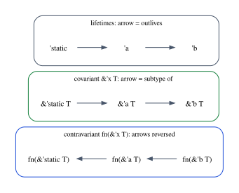
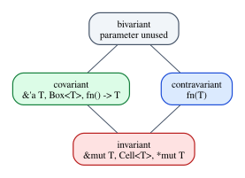

# Chapter 27 · Subtyping and Variance

In Chapter 1, Rust rejected `if ready { 1 } else { "not yet" }`, and we noted
what the compiler did *not* do: it did not look for a common supertype of the
two branches, the way a language with subtyping might. Rust has no class
hierarchy, no `Cat` that is also an `Animal`, no `i32` that is also an `i64`.
It would be easy to conclude that Rust has no subtyping at all.

It has some, and you rely on it every day. When you pass a string literal, of
type `&'static str`, to a function that expects a `&'a str` for some short `'a`,
the compiler silently uses the fact that a reference valid for the whole program
is also valid for a shorter region. That is subtyping, on lifetimes. And as soon
as there is subtyping on lifetimes, every type that contains a lifetime raises a
question: if `&'static str` can be used as `&'a str`, can `Vec<&'static str>` be
used as `Vec<&'a str>`? Can `fn(&'static str)` be used as `fn(&'a str)`? Can
`&mut &'static str` be used as `&mut &'a str`? The answers are yes, no, and
*absolutely not*, and the reasons are the theory of **variance**. Getting
variance wrong is one of the few ways to write a use after free in a type
system that otherwise looks sound, which is why it deserves a chapter.

**In this chapter you will learn:**

- what subtyping is, how the subsumption rule brings it into a type system, and
  why it makes the types of a program a preorder, hence a category;
- why lifetimes are Rust's only source of subtyping, and how it shows up in
  ordinary code;
- the four variances (covariant, contravariant, invariant, bivariant), the
  variance of `&'a T`, `&'a mut T`, `fn(T) -> U`, `Box<T>`, `Cell<T>` and
  `*mut T`, and how to make the compiler prove each one;
- why `&mut T` must be invariant in `T`, through the classic unsound program
  that invariance rejects;
- how Rust infers the variance of your own types, and how `PhantomData` chooses
  it when the compiler cannot;
- variance as functoriality: covariant and contravariant functors on the
  category of lifetimes, and variances as a small monoid;
- how to formalize a tiny language with subtyping in Lean and prove that the
  contravariant rule for functions is what makes it sound, and why Lean itself
  has coercions and subtypes but no subtyping.

## Subtyping and subsumption

A type $\sigma$ is a **subtype** of a type $\tau$, written $\sigma <: \tau$, when
every value of type $\sigma$ can be used wherever a value of type $\tau$ is
expected. In an object-oriented language, a `Cat` class extending `Animal` makes
`Cat` a subtype of `Animal`; in a language with refinement types, the type of
positive integers is a subtype of the type of integers. A type system brings
subtyping into its judgments with one rule, called **subsumption**:

$$
\dfrac{\Gamma \vdash e : \sigma \qquad \sigma <: \tau}{\Gamma \vdash e : \tau}\;\textsf{T-Sub}
$$

If $e$ has type $\sigma$, and $\sigma$ is a subtype of $\tau$, then $e$ also has
type $\tau$. The subtyping relation itself is defined by its own rules. Two of
them are always present:

$$
\dfrac{}{\tau <: \tau}\;\textsf{S-Refl}
\qquad\qquad
\dfrac{\sigma <: \tau \qquad \tau <: \upsilon}{\sigma <: \upsilon}\;\textsf{S-Trans}
$$

A relation that is reflexive and transitive is a **preorder**, and Chapter 16
showed that a preorder is a category: the objects are the types, and there is
exactly one arrow $\sigma \to \tau$ when $\sigma <: \tau$ (and none otherwise).
Identity arrows are S-Refl, composition is S-Trans, and the category laws hold
automatically because there is never more than one arrow between two objects.
Keep this picture in mind; it will turn variance into something you already
know.

Subsumption has a cost. Every other rule you have seen is *syntax-directed*:
the shape of the term determines which rule applies. T-Sub applies to every
term, at any point, so a derivation can use it anywhere, any number of times. A
type checker cannot try all of them. Practical checkers use an *algorithmic*
formulation instead, in which subtyping is checked only where it is needed (for
instance, when an argument is passed to a function) and in which transitivity
is built in rather than being a rule. We will build one in Lean later in this
chapter and prove that it decides the same relation.

There are two ways to read $\sigma <: \tau$. The *inclusion* reading says that
the values of $\sigma$ are among the values of $\tau$: every positive integer
*is* an integer, with no conversion. The *coercion* reading says that there is a
conversion from $\sigma$ to $\tau$ that the compiler inserts silently. The two
readings coincide only when the conversion does nothing. Rust's lifetime
subtyping is pure inclusion; its many coercions (deref, unsizing) are something
else, and the last part of the chapter is about the difference.

## Rust's only subtyping: lifetimes

Rust has no subtyping between nominal types. A struct cannot extend another,
an `i32` must be converted to an `i64` explicitly, and a `Box<Valve>` that
becomes a `Box<dyn Describe>` goes through a coercion that builds a new fat
pointer, not through subtyping. The one source of subtyping is the outlives
relation of Chapter 26. If `'long` outlives `'short`, a reference valid
throughout `'long` is valid throughout `'short`:

$$
\dfrac{\Delta \vdash \alpha : \beta}{\Delta \vdash \&\alpha\;\tau <: \&\beta\;\tau}\;\textsf{S-Ref}
$$

Here $\&\alpha\;\tau$ is our notation for `&'a T`, and $\Delta \vdash \alpha : \beta$
is the outlives judgment of Chapter 26. Since `'static` outlives every region,
`&'static T` is a subtype of every `&'a T`. The program
`code/rust/examples/ch27_variance.rs` starts with the most ordinary use:

```rust
/// One region for both arguments: a `&'static str` is accepted where a
/// `&'a str` is expected, because `&'static str <: &'a str`.
fn longer<'a>(a: &'a str, b: &'a str) -> &'a str {
    if a.len() >= b.len() { a } else { b }
}

fn subsumption() {
    let fallback: &'static str = "default";
    let configured = String::from("from the config file");
    let chosen = longer(fallback, &configured); // 'a := the region of `configured`
    println!("chosen: {chosen}");
}
```

```text
chosen: from the config file
```

`longer` wants two arguments of the same type `&'a str`. The compiler picks
`'a` to be the region of `configured`, and uses subsumption to view `fallback`,
of type `&'static str`, at the type `&'a str`. Nothing happens at run time: the
pointer is the same pointer. Subtyping on lifetimes is invisible in the
generated code, which is exactly what the inclusion reading predicts.

(There is a second, rarer kind of subtyping in Rust, between higher-ranked
types: a function pointer of type `for<'a> fn(&'a str)`, which accepts a
reference with any lifetime, is a subtype of `fn(&'x str)` for each particular
`'x`. It is the same idea as instantiating a generic function, Chapter 12's
universal quantifier, and the call `grow_argument(count)` below relies on it.)

## Variance

Subtyping between two lifetimes induces subtyping between bigger types that
contain them, and how it does so depends on the type constructor. This is
**variance**. For a type constructor $F$ with one parameter:

- $F$ is **covariant** if $\sigma <: \tau$ implies $F\,\sigma <: F\,\tau$: the
  subtyping goes the same way.
- $F$ is **contravariant** if $\sigma <: \tau$ implies $F\,\tau <: F\,\sigma$:
  the subtyping flips.
- $F$ is **invariant** if $F\,\sigma <: F\,\tau$ holds only when $\sigma$ and
  $\tau$ are the same type (or, more precisely, are subtypes of each other).
- $F$ is **bivariant** if $F\,\sigma <: F\,\tau$ always holds: the parameter
  does not matter, which happens when it is not used at all.

A type constructor with several parameters has a variance in each. The rules
for the classic constructors are these:

$$
\dfrac{\sigma <: \sigma' \qquad \tau <: \tau'}{\sigma \times \tau <: \sigma' \times \tau'}\;\textsf{S-Pair}
\qquad\qquad
\dfrac{\sigma' <: \sigma \qquad \tau <: \tau'}{\sigma \to \tau <: \sigma' \to \tau'}\;\textsf{S-Arrow}
$$

Pairs are covariant in both components: a pair of a cat and a dog is a pair of
two animals. Functions are covariant in the result, but **contravariant in the
argument**: notice that the premise about arguments is written $\sigma' <: \sigma$,
the "wrong" way round. The reason is clearest with callbacks. Suppose a
scheduler wants a callback of type $\mathsf{Cat} \to \mathsf{Unit}$, which it will
call with cats. A function of type $\mathsf{Animal} \to \mathsf{Unit}$, which
handles any animal, is perfectly acceptable: whatever the scheduler passes, it
can handle. So $\mathsf{Animal} \to \mathsf{Unit} <: \mathsf{Cat} \to \mathsf{Unit}$,
even though $\mathsf{Cat} <: \mathsf{Animal}$. A function that *accepts more* is
the more useful one, hence the subtype. The opposite, a function that handles
only cats used where any animal may arrive, would be a disaster.

In Rust, the variances of the standard type constructors are fixed by the
language and the standard library:

| Type | Variance in `'a` | Variance in `T` |
|---|---|---|
| `&'a T` | covariant | covariant |
| `&'a mut T` | covariant | **invariant** |
| `Box<T>`, `Vec<T>`, `Option<T>` | | covariant |
| `Cell<T>`, `RefCell<T>`, `UnsafeCell<T>` | | **invariant** |
| `*const T` / `*mut T` | | covariant / **invariant** |
| `fn(T) -> U` | | **contravariant** in `T`, covariant in `U` |
| `PhantomData<T>` | | covariant |

### Making the compiler prove it

You can make the compiler confirm every entry of the table. A function whose
body is just `x`, with a signature that converts one type into another, compiles
only if the conversion is a subtyping step. Each such function is a *witness*:
its existence is a proof, checked by the compiler, that the claimed variance
holds.

```rust
// `'long: 'short` reads "'long outlives 'short", so `&'long T <: &'short T`.

/// `&'a T` is covariant in `'a`...
fn shrink_ref<'long: 'short, 'short>(x: &'long str) -> &'short str {
    x
}

/// ...and in `T`: a reference to a longer-lived reference can be shortened.
fn shrink_ref_ref<'long: 'short, 'short, 'r>(x: &'r &'long str) -> &'r &'short str {
    x
}

/// `&'a mut T` is covariant in `'a` (but invariant in `T`: see
/// `ch27_mut_invariance`).
fn shrink_mut<'long: 'short, 'short, 'v>(x: &'long mut &'v str) -> &'short mut &'v str {
    x
}

/// `Box<T>`, `Vec<T>` and `Option<T>` are covariant in `T`.
fn shrink_box<'long: 'short, 'short>(x: Box<&'long str>) -> Box<&'short str> {
    x
}

fn shrink_vec<'long: 'short, 'short>(x: Vec<&'long str>) -> Vec<&'short str> {
    x
}

fn shrink_option<'long: 'short, 'short>(x: Option<&'long str>) -> Option<&'short str> {
    x
}

/// `fn() -> T` is covariant in `T`: a function that returns long-lived
/// references can stand in for one that returns short-lived ones.
fn shrink_result<'long: 'short, 'short>(f: fn() -> &'long str) -> fn() -> &'short str {
    f
}

/// `fn(T)` is *contravariant* in `T`: the conversion goes the other way. A
/// callback that accepts any short-lived `&str` can stand in for one that will
/// only ever be given long-lived ones.
fn grow_argument<'long: 'short, 'short>(
    f: fn(&'short str) -> usize,
) -> fn(&'long str) -> usize {
    f
}

/// Two contravariances make a covariance: `fn(fn(T))` is covariant in `T`.
fn shrink_twice<'long: 'short, 'short>(
    f: fn(fn(&'long str) -> usize) -> usize,
) -> fn(fn(&'short str) -> usize) -> usize {
    f
}
```

```text
shrink_ref, shrink_ref_ref: static
shrink_mut, then a write through it: replaced
shrink_box, shrink_vec, shrink_option: boxed ["a", "b"] Some("some")
shrink_result: a static string
grow_argument: 18
shrink_twice: 6
```

Read the signatures carefully, because the direction of each one is the
content. `shrink_ref` turns `&'long str` into `&'short str`: covariance in the
lifetime. `shrink_ref_ref` does the same one level down, inside a reference:
covariance in `T`. `shrink_mut` shortens the *outer* lifetime of a mutable
reference, but leaves the referent type `&'v str` alone: that is all that is
allowed, as we are about to see. `grow_argument` goes the other way, from a
callback that accepts `&'short str` to one that accepts `&'long str`: the
callback that accepts more is the subtype. And `shrink_twice` shows what happens
when a contravariant position is nested in another contravariant position: the
two flips cancel, and `fn(fn(T))` is covariant in `T`. Every one of these
functions compiles; reversing the direction of any of them would not.

The contravariance of `fn(T)` is also responsible for errors. Here a function
that only accepts `'static` strings is passed where a callback for a short-lived
string is needed:

```rust
fn needs_static(msg: &'static str) -> usize {
    msg.len()
}

fn call_with<'a>(callback: fn(&'a str) -> usize, msg: &'a str) -> usize {
    callback(msg)
}

pub fn report() {
    let msg = String::from("built at run time");
    call_with(needs_static, &msg);
}
```

```text
error[E0597]: `msg` does not live long enough
  --> compile_fail/ch27_contravariance.rs:16:29
   |
15 |     let msg = String::from("built at run time");
   |         --- binding `msg` declared here
16 |     call_with(needs_static, &msg);
   |               ------------  ^^^^ borrowed value does not live long enough
   |               |
   |               coercion requires that `msg` is borrowed for `'static`
17 | }
   | - `msg` dropped here while still borrowed
```

`call_with` wants a callback of type `fn(&'a str) -> usize` and a message of type
`&'a str`, with one `'a`. The callback `needs_static` has type
`fn(&'static str) -> usize`. For it to be a `fn(&'a str) -> usize`, contravariance
requires `&'a str <: &'static str`, which holds only if `'a` is `'static`. So the
compiler sets `'a` to `'static`, and then `&msg` would have to be a
`&'static str`, which it is not: `msg` is a local `String`. The compiler reports
the consequence (E0597), and its label mentions the "coercion" of the function
item `needs_static` to a function pointer, the place where the subtyping
requirement arose. This is the scheduler disaster in Rust form: a callback that
can handle only long-lived strings, offered to code that will call it with a
short-lived one.

## Why `&mut T` must be invariant

Covariance of `&'a T` in `T` is safe because a shared reference only reads: if
you can read a `&'static str` out of it, you can certainly treat what you read
as a `&'short str`. A mutable reference also *writes*, and writing reverses the
direction. Here is the classic program that shows why, kept in
`code/rust/compile_fail/ch27_mut_invariance.rs`:

```rust
fn overwrite<T>(dst: &mut T, src: T) {
    *dst = src;
}

pub fn evil() {
    let mut s: &'static str = "static data";
    {
        let local = String::from("short-lived");
        overwrite(&mut s, &local);
    }
    println!("{s}");
}
```

Suppose, for a moment, that `&mut T` were covariant in `T`. Then
`&mut s : &mut &'static str` could be viewed as `&mut &'short str`, where
`'short` is the region of `local`. The call `overwrite(&mut s, &local)` would
type-check with `T = &'short str`, and it would store a pointer to `local` into
`s`. At the closing brace `local` is dropped, and `println!("{s}")` reads freed
memory, through a variable whose type still promises a string that lives
forever. Every step is locally reasonable; only the covariance assumption is
wrong.

Rust's actual rule rejects the program:

```text
error[E0597]: `local` does not live long enough
  --> compile_fail/ch27_mut_invariance.rs:15:27
   |
12 |     let mut s: &'static str = "static data";
   |                ------------ type annotation requires that `local` is borrowed for `'static`
13 |     {
14 |         let local = String::from("short-lived");
   |             ----- binding `local` declared here
15 |         overwrite(&mut s, &local);
   |                           ^^^^^^ borrowed value does not live long enough
16 |     }
   |     - `local` dropped here while still borrowed
```

Because `&mut T` is invariant in `T`, the type `&mut &'static str` of the first
argument fixes `T = &'static str` exactly, with no room to shorten it. Then the
second argument `&local` must be a `&'static str`, and the compiler explains
that the type annotation on `s` "requires that `local` is borrowed for
`'static`", which is impossible.

The same attack can be written inside a single function, with the conflict in
the signature itself. Here the compiler names the culprit explicitly:

```rust
pub fn remember(log: &mut Vec<&'static str>, line: &str) {
    log.push(line);
}
```

```text
error[E0521]: borrowed data escapes outside of function
 --> compile_fail/ch27_invariance_escape.rs:8:5
  |
7 | pub fn remember(log: &mut Vec<&'static str>, line: &str) {
  |                 ---                          ----  - let's call the lifetime of this reference `'1`
  |                 |                            |
  |                 |                            `line` is a reference that is only valid in the function body
  |                 `log` declared here, outside of the function body
8 |     log.push(line);
  |     ^^^^^^^^^^^^^^
  |     |
  |     `line` escapes the function body here
  |     argument requires that `'1` must outlive `'static`
  |
  = note: requirement occurs because of a mutable reference to `Vec<&str>`
  = note: mutable references are invariant over their type parameter
  = help: see <https://doc.rust-lang.org/nomicon/subtyping.html> for more information about variance
```

If `&mut Vec<&'static str>` could be viewed as `&mut Vec<&'1 str>`, the `push`
would type-check, and the caller would later read a dangling `&'static str` out
of its log. The two notes at the end say exactly what this section says:
"mutable references are invariant over their type parameter".

Interior mutability writes through a *shared* reference, so it has the same
problem, and `Cell<T>` is invariant too:

```rust
use std::cell::Cell;

pub fn set_label(slot: &Cell<&'static str>, label: &str) {
    slot.set(label);
}
```

```text
error[E0521]: borrowed data escapes outside of function
 --> compile_fail/ch27_cell_invariance.rs:9:5
  |
8 | pub fn set_label(slot: &Cell<&'static str>, label: &str) {
  |                  ----                       -----  - let's call the lifetime of this reference `'1`
  |                  |                          |
  |                  |                          `label` is a reference that is only valid in the function body
  |                  `slot` declared here, outside of the function body
9 |     slot.set(label);
  |     ^^^^^^^^^^^^^^^
  |     |
  |     `label` escapes the function body here
  |     argument requires that `'1` must outlive `'static`
  |
  = note: requirement occurs because of the type `Cell<&str>`, which makes the generic argument `&str` invariant
  = note: the struct `Cell<T>` is invariant over the parameter `T`
  = help: see <https://doc.rust-lang.org/nomicon/subtyping.html> for more information about variance
```

The principle behind all three is worth stating as a rule of thumb:
**reading is covariant, writing is contravariant, and both is invariant.** A
place you can read from is a *source* of $\tau$ values, like a function
$\mathsf{Unit} \to \tau$, covariant in $\tau$. A place you can write to is a
*sink* for $\tau$ values, like a function $\tau \to \mathsf{Unit}$,
contravariant in $\tau$. A mutable reference is both at once, and the only way
for both views to be subtypes is for the types to be equal. The same reasoning
explains the rest of the table: `*const T` only reads and is covariant, `*mut T`
writes and is invariant, and the lifetime `'a` of `&'a mut T` stays covariant
because shortening a loan only gives the permission back sooner, which is
always safe.

Variance is not a style rule. A type with the wrong variance, typically a
hand-written abstraction over raw pointers, lets safe code produce exactly the
dangling reference of the classic program. That is why the next section
matters to anyone who writes `unsafe` code.

## The variance of your own types

You never declare the variance of a struct in Rust; the compiler **infers** it
from the fields. Each field's type has a variance in each parameter, and the
struct's variance is the strongest constraint among them: if a parameter
appears covariantly in one field and contravariantly in another, the struct is
invariant in it; if it appears in no field at all, the struct would be bivariant
in it. Nesting composes: a parameter inside a `fn` argument inside a `fn`
argument is covariant, as `shrink_twice` showed. We will make this calculation
precise in Lean.

A parameter that appears in no field is a problem, because a bivariant
parameter means nothing at all, and Rust rejects it (Chapter 25 met the same
error for a typestate parameter):

```rust
pub struct RawView<'a, T> {
    ptr: *const T,
    len: usize,
}
```

```text
error[E0392]: lifetime parameter `'a` is never used
 --> compile_fail/ch27_unused_param.rs:6:20
  |
6 | pub struct RawView<'a, T> {
  |                    ^^ unused lifetime parameter
  |
  = help: consider removing `'a`, referring to it in a field, or using a marker such as `PhantomData`
```

The help names the solution: `PhantomData`, a zero-sized marker type in
`std::marker`. A field of type `PhantomData<X>` takes no space, and tells the
compiler to treat the struct, for variance and for a few other purposes, *as if*
it contained an `X`. By choosing `X`, you choose the variance:

| Marker | Variance in `T` | Notes |
|---|---|---|
| `PhantomData<T>` | covariant | "owns a `T`": inherits `T`'s `Send`/`Sync` |
| `PhantomData<&'a T>` | covariant (and in `'a`) | a borrow of `T` for `'a` |
| `PhantomData<&'a mut T>` | invariant (covariant in `'a`) | a unique borrow |
| `PhantomData<fn() -> T>` | covariant | produces `T`s; always `Send` and `Sync` |
| `PhantomData<fn(T)>` | contravariant | consumes `T`s; always `Send` and `Sync` |
| `PhantomData<fn(T) -> T>` | invariant | always `Send` and `Sync` |

The last column matters as much as the second. Auto traits such as `Send` and
`Sync` are also computed from the fields, so the marker decides them too. A
function pointer is always `Send` and `Sync`, whatever its argument type, so
the `fn` markers give the variance you want without dragging in the thread-safety
of `T`. `PhantomData<T>` also tells the compiler's drop checker that dropping
the struct may drop a `T`, which matters for types that really own values
through raw pointers.

Here is a common pattern, a typed identifier that cannot be confused across
tables:

```rust
/// A typed identifier: an `Id<Order>` cannot be passed where an
/// `Id<Customer>` is expected. The `T` is only a marker, and the choice of
/// marker matters:
/// - `PhantomData<T>` would say "an `Id<T>` owns a `T`", so `Id<Rc<..>>`
///   would not be `Send` and the drop checker would assume a `T` is dropped;
/// - `PhantomData<fn() -> T>` says "an `Id<T>` produces `T`s": covariant in
///   `T`, always `Send` and `Sync`, owns nothing.
struct Id<T> {
    raw: u64,
    _marker: PhantomData<fn() -> T>,
}

// Derived `Clone` and `Copy` would require `T: Clone`; an ID is always copyable.
impl<T> Clone for Id<T> {
    fn clone(&self) -> Self {
        *self
    }
}
impl<T> Copy for Id<T> {}

impl<T> Id<T> {
    fn new(raw: u64) -> Self {
        Id {
            raw,
            _marker: PhantomData,
        }
    }
}

struct Order;
struct Customer;

fn customer_of(order: Id<Order>) -> Id<Customer> {
    Id::new(order.raw / 100)
}

fn require_send_sync<T: Send + Sync>(_: &T) -> &'static str {
    "Send + Sync"
}
```

`Id<Order>` and `Id<Customer>` are different types, so passing one where the
other is expected is a type error, while at run time both are a plain `u64`.
The marker `PhantomData<fn() -> T>` makes `Id<T>` covariant, owning nothing, and
thread-safe regardless of `T`, which is what the program checks with an `Rc`,
the standard example of a type that is neither `Send` nor `Sync`:

```text
order 4217 belongs to customer 42
Id<Rc<String>> is Send + Sync
```

With `PhantomData<T>` instead, `Id<Rc<String>>` would be neither `Send` nor
`Sync`, for no good reason.

## Variance as functoriality

Now return to the picture from the beginning of the chapter. Lifetimes ordered
by outlives form a preorder, so a category $\mathcal{L}$: one object per
lifetime, one arrow $\alpha \to \beta$ when $\alpha$ outlives $\beta$. Types
ordered by subtyping form another category $\mathcal{T}$. A type with a lifetime
parameter, such as `&'x i32`, is a map from lifetimes to types:
$\alpha \mapsto \&\alpha\;\mathtt{i32}$.

Chapter 17 defined a **functor** between categories: a map on objects and a map
on arrows that preserves identities and composition. Between preorders, there
is at most one arrow between two objects, so preserving identities and
composition is automatic, and a functor is simply a map on objects that sends
arrows to arrows: a **monotone** map. Covariance of `&'x i32` in `'x` says
exactly that whenever $\alpha \to \beta$ in $\mathcal{L}$, there is an arrow
$\&\alpha\;\mathtt{i32} \to \&\beta\;\mathtt{i32}$ in $\mathcal{T}$. **A
covariant type constructor is a functor $\mathcal{L} \to \mathcal{T}$.**

Contravariance reverses arrows. Chapter 16 built the *opposite* category
$\mathcal{L}^{op}$, with the same objects and every arrow turned around. A
contravariant constructor such as `fn(&'x i32)` sends an arrow
$\alpha \to \beta$ to an arrow $F\beta \to F\alpha$, which is an arrow-preserving
map from $\mathcal{L}^{op}$: **a contravariant type constructor is a functor
$\mathcal{L}^{op} \to \mathcal{T}$**. This is the same "contravariant functor"
that Chapter 17 met with predicates and comparators.



The two other variances fit the same pattern. An invariant constructor sends an
arrow $\alpha \to \beta$ to an arrow only when $\alpha = \beta$: it is a functor
only from the *discrete* category on the lifetimes, which keeps the objects and
throws away every arrow except the identities. A bivariant constructor sends
every pair of lifetimes to related types: it is a functor from the category with
an arrow between any two objects. So the four variances are the four ways a
type can be functorial in its parameter.

Composition of functors explains the sign rule. If $F$ and $G$ are both
contravariant, $F \circ G$ turns arrows around twice, which is not turning them
around at all: a functor $(\mathcal{L}^{op})^{op} = \mathcal{L} \to \mathcal{T}$,
covariant. That is `shrink_twice`. The variances, with composition, behave like
signs under multiplication, with two extra elements: invariance absorbs
covariance and contravariance, and bivariance absorbs everything. When a
parameter occurs in several places, the constraints are combined by a *meet* in
the lattice below: covariant and contravariant together give invariant, and
bivariant (no occurrence) is neutral.



### Functors in Lean

The file `code/lean/Book/Ch27/Functoriality.lean` makes this literal, with the
book's `Category` class from Chapter 16 (`Book.Ch16.Category`, which it
imports). Lifetimes are modeled by the point where they end, so `'a` outlives
`'b` when `b ≤ a`, and types by a small language of Rust-like types, `RTy ℕ`,
defined in `Variance.lean` below together with its subtyping relation `RSub`:

```lean
/-- Lifetimes, named by their end points. -/
structure Lifetime where
  endsAt : ℕ

/-- The category of lifetimes: a morphism `a ⟶ b` is a proof that `a`
outlives `b`. There is at most one. -/
instance : Category Lifetime where
  Hom a b := PLift (b.endsAt ≤ a.endsAt)
  id _ := ⟨Nat.le_refl _⟩
  comp g f := ⟨Nat.le_trans g.down f.down⟩
  id_comp _ := rfl
  comp_id _ := rfl
  assoc _ _ _ := rfl

/-- Closed Rust-like types. -/
structure RType where
  ty : RTy ℕ

/-- The category of types: a morphism `t ⟶ u` is a proof that `t` is a
subtype of `u`. -/
instance : Category RType where
  Hom t u := PLift (RSub t.ty u.ty)
  id t := ⟨RSub.refl t.ty⟩
  comp g f := ⟨RSub.trans f.down g.down⟩
  id_comp _ := rfl
  comp_id _ := rfl
  assoc _ _ _ := rfl
```

A morphism is a *proof* wrapped in `PLift`. The class requires morphisms to live
in `Type`, and a proof of `b ≤ a` lives in `Prop`; `PLift` lifts a proposition
into a type with one element per proof. Since all proofs of a proposition are
equal (proof irrelevance, Chapter 10), there is at most one morphism between two
objects, and the category laws hold by `rfl`.

We need a notion of functor for the book's class. Chapter 17 defines one,
`CatFunctor`; since a file of this chapter may import only Chapter 16 and its own
files, we redefine a minimal version here under the name `Fun`:

```lean
/-- A functor between two categories of the book's `Category` class. -/
structure Fun (C D : Type) [Category C] [Category D] where
  obj : C → D
  map : {a b : C} → (a ⟶ b) → (obj a ⟶ obj b)
  map_id : ∀ a, map (Category.id a) = Category.id (obj a)
  map_comp : ∀ {a b c : C} (g : b ⟶ c) (f : a ⟶ b), map (g ⊚ f) = map g ⊚ map f

/-- In these categories any two morphisms with the same ends are equal, so
the functor laws hold automatically: a functor is just a monotone map. -/
def Fun.ofMonotone {C : Type} [Category C] (obj : C → RType)
    (map : {a b : C} → (a ⟶ b) → (obj a ⟶ obj b)) : Fun C RType where
  obj := obj
  map := map
  map_id _ := rfl
  map_comp _ _ := rfl
```

`Fun.ofMonotone` is the observation above, as a definition (Chapter 17's
`monotoneFunctor` is the same idea for Mathlib's preorders): to build a functor
into a thin category, a map on objects and a map on arrows suffice, and the laws
are proved by `rfl`, because two morphisms with the same ends are definitionally
equal. Now covariant and contravariant types become functors:

```lean
/-- A covariant type (in its lifetime parameter `'x`) is a functor from
lifetimes to types. -/
def covariantFunctor (t : RTy Lft) (h : t.var = .co) : Fun Lifetime RType :=
  Fun.ofMonotone (fun a => ⟨t.inst a.endsAt⟩)
    (fun f => ⟨RTy.covariant h f.down⟩)

/-- A contravariant type is a functor from the *opposite* category of
lifetimes, where every arrow is reversed. -/
def contravariantFunctor (t : RTy Lft) (h : t.var = .contra) :
    Fun (Op Lifetime) RType :=
  Fun.ofMonotone (fun a => ⟨t.inst a.unop.endsAt⟩)
    (fun f => ⟨RTy.contravariant h f.down⟩)

/-- `&'x i32` is a functor `Lifetime ⥤ RType`... -/
def refFunctor : Fun Lifetime RType := covariantFunctor refX rfl

/-- ...and `fn(&'x i32)` a functor `Lifetimeᵒᵖ ⥤ RType`. -/
def callbackFunctor : Fun (Op Lifetime) RType :=
  contravariantFunctor (.fn refX .i32) rfl
```

`covariantFunctor` takes a type `t` with a lifetime parameter and a proof that
its inferred variance is `co`, and produces a functor from lifetimes. The map on
arrows is the theorem `RTy.covariant`, which we prove in the next section from
the soundness of variance inference. `contravariantFunctor` does the same from
`Op Lifetime`, Chapter 16's opposite category, whose arrows are the reversed
arrows of `Lifetime`. The two examples at the end pass `rfl` as the variance
proof: Lean computes the variance of `&'x i32` and of `fn(&'x i32)` and checks
that they are `co` and `contra`.

Mathlib has the same construction in general: every preorder is a category, and
a monotone function is a functor.

```lean
/-- In Mathlib, every preorder is a category (`a ⟶ b` when `a ≤ b`), and a
monotone function is a functor between such categories. -/
example : CategoryTheory.Functor ℕ ℕ :=
  Monotone.functor (f := fun n : ℕ => 2 * n) (fun _ _ h => Nat.mul_le_mul_left 2 h)
```

`Monotone.functor` takes a proof of monotonicity and returns a
`CategoryTheory.Functor` (written `ℕ ⥤ ℕ` in Mathlib's notation).

## Variance in Lean

The file `code/lean/Book/Ch27/Variance.lean` turns the algebra of variances into
definitions and theorems, and uses them to prove that variance inference, the
calculation the compiler performs for your structs, is sound.

### The algebra of variances

```lean
/-- How a type depends on a parameter. -/
inductive Variance where
  | co      -- covariant: a longer parameter gives a subtype
  | contra  -- contravariant: a shorter parameter gives a subtype
  | inv     -- invariant: only the same parameter
  | bi      -- bivariant: the parameter does not matter
  deriving DecidableEq, Repr
```

```lean
/-- `v * w` is the variance of a position of variance `w` nested inside a
position of variance `v`: like signs, two contravariances make a covariance. -/
def mul : Variance → Variance → Variance
  | bi, _ => bi
  | _, bi => bi
  | inv, _ => inv
  | _, inv => inv
  | co, w => w
  | contra, co => contra
  | contra, contra => co

instance : Mul Variance := ⟨mul⟩
instance : One Variance := ⟨co⟩
```

`mul` is composition: `v * w` is the variance of a position of variance `w`
nested inside a position of variance `v`. Bivariance absorbs everything, then
invariance absorbs what is left, covariance is the identity, and two
contravariances make a covariance. The instances `Mul` and `One` let us write
`*` and `1`.

```lean
/-- Two occurrences of a parameter, with variances `v` and `w`: the parameter
may vary only in ways that both allow. -/
def meet : Variance → Variance → Variance
  | bi, w => w
  | v, bi => v
  | co, co => co
  | contra, contra => contra
  | _, _ => inv

@[inherit_doc] scoped infixl:65 " ⊓ " => meet
```

`meet` combines two occurrences of the same parameter: bivariance (no
occurrence) is neutral, two equal variances stay as they are, and any other
combination is invariant.

```lean
/-- Composition of variances is associative, commutative, and `co` is its
unit: the variances form a commutative monoid. -/
instance : CommMonoid Variance where
  mul_assoc a b c := by cases a <;> cases b <;> cases c <;> rfl
  one_mul a := by cases a <;> rfl
  mul_one a := by cases a <;> rfl
  mul_comm a b := by cases a <;> cases b <;> rfl

/-- info: Ch27.Variance.co -/
#guard_msgs in
#eval contra * contra

/-- info: Ch27.Variance.contra -/
#guard_msgs in
#eval contra ^ 3

/-- info: Ch27.Variance.inv -/
#guard_msgs in
#eval co ⊓ contra
```

`CommMonoid` is Mathlib's class of commutative monoids. Its laws are proved by
brute force: `cases a <;> cases b <;> cases c <;> rfl` splits into the
$4 \times 4 \times 4 = 64$ combinations and checks each by computation. Being a
monoid instance gives us Mathlib's notation for free, including powers:
`contra ^ 3` is three nested contravariant positions, which is contravariant.

### What a variance means

Tables of rules are only as trustworthy as their meaning. A variance has a
precise meaning: given the relation that holds between two parameters (for
lifetimes, "outlives"), it says which relation must hold for the types to be in
the subtyping relation.

```lean
/-- The meaning of a variance: how it transforms a relation `R` on parameters
(for us, "outlives" on lifetimes) into a relation on parameters that is safe
to use for the type. -/
def apply {α : Type} : Variance → (α → α → Prop) → (α → α → Prop)
  | co, R => R
  | contra, R => fun a b => R b a
  | inv, R => fun a b => R a b ∧ R b a
  | bi, _ => fun _ _ => True
```

Covariance uses the relation as it is, contravariance flips it, invariance
needs it in both directions, and bivariance needs nothing. With this meaning, the
algebra is no longer arbitrary: the two operations are exactly composition and
intersection of meanings.

```lean
/-- Composing variances is composing their meanings. -/
theorem apply_mul {α : Type} (v w : Variance) (R : α → α → Prop) (a b : α) :
    (v * w).apply R a b ↔ v.apply (w.apply R) a b := by
  cases v <;> cases w <;> simp [HMul.hMul, Mul.mul, mul, apply] <;> tauto

/-- Meeting variances is intersecting their meanings. -/
theorem apply_meet {α : Type} (v w : Variance) (R : α → α → Prop) (a b : α) :
    (v ⊓ w).apply R a b ↔ v.apply R a b ∧ w.apply R a b := by
  cases v <;> cases w <;> simp [meet, apply] <;> tauto
```

Both proofs are case analyses over the 16 combinations, with `simp` unfolding the
definitions. What remains in some cases is a small propositional fact such as
`R a b ∧ R b a ↔ R b a ∧ R a b`, which `tauto` (a Mathlib tactic that proves
tautologies of propositional logic) finishes. In `apply_mul`, the `simp` set
includes `HMul.hMul` and `Mul.mul` so that the `*` notation unfolds to our `mul`.
These two theorems say that the map from variances to relation transformers
turns `*` into composition and the meet into conjunction: the variance algebra
is a faithful summary of how relations are transformed.

### Variance inference, proved sound

Now a small language of Rust-like types, with the lifetime of each reference
drawn from a set `L`:

```lean
/-- Rust-like types whose lifetimes are drawn from `L`. -/
inductive RTy (L : Type) where
  | i32
  | ref (a : L) (t : RTy L)       -- &'a T
  | refMut (a : L) (t : RTy L)    -- &'a mut T
  | fn (arg res : RTy L)          -- fn(T) -> U
  | cell (t : RTy L)              -- Cell<T>
  | box (t : RTy L)               -- Box<T>
  | pair (t u : RTy L)            -- a struct with two fields
  deriving Repr

/-- A lifetime in a type with one parameter: the parameter `'x`, or a fixed
scope, named by the point where it ends. -/
inductive Lft where
  | x
  | scope (n : ℕ)
  deriving Repr
```

`RTy ℕ` is a closed type, whose lifetimes are end points, and `RTy Lft` is a
type with one lifetime parameter `'x`. Subtyping on closed types follows the
Rust table:

```lean
/-- Subtyping on closed types, whose lifetimes are end points: `'a` outlives
`'b` when `b ≤ a`. -/
inductive RSub : RTy ℕ → RTy ℕ → Prop where
  | refl (t : RTy ℕ) : RSub t t
  | trans {t u w : RTy ℕ} : RSub t u → RSub u w → RSub t w
  | ref {a b : ℕ} {t u : RTy ℕ} : b ≤ a → RSub t u → RSub (.ref a t) (.ref b u)
  | refMut {a b : ℕ} {t u : RTy ℕ} :
      b ≤ a → RSub t u → RSub u t → RSub (.refMut a t) (.refMut b u)
  | fn {t t' u u' : RTy ℕ} : RSub t' t → RSub u u' → RSub (.fn t u) (.fn t' u')
  | cell {t u : RTy ℕ} : RSub t u → RSub u t → RSub (.cell t) (.cell u)
  | box {t u : RTy ℕ} : RSub t u → RSub (.box t) (.box u)
  | pair {t t' u u' : RTy ℕ} : RSub t t' → RSub u u' → RSub (.pair t u) (.pair t' u')
```

Invariance is written as subtyping in both directions (`RSub t u → RSub u t`),
as in the definition at the start of the chapter. The variance that the
compiler would infer for a type with a parameter `'x` is computed by recursion,
and `inst` replaces `'x` by a concrete lifetime:

```lean
/-- The variance of a type in its lifetime parameter `'x`. -/
def Lft.var : Lft → Variance
  | .x => co
  | .scope _ => bi

/-- The variance of a type in `'x`: the meet over every occurrence of `'x`,
each weighted by the variances of the positions it sits in. -/
def RTy.var : RTy Lft → Variance
  | .i32 => bi
  | .ref a t => a.var ⊓ (co * t.var)
  | .refMut a t => a.var ⊓ (inv * t.var)
  | .fn t u => (contra * t.var) ⊓ (co * u.var)
  | .cell t => inv * t.var
  | .box t => co * t.var
  | .pair t u => t.var ⊓ u.var

/-- Replace the parameter `'x` by the scope ending at `a`. -/
def Lft.inst (a : ℕ) : Lft → ℕ
  | .x => a
  | .scope n => n

/-- Replace `'x` by the scope ending at `a` everywhere in a type. -/
def RTy.inst (a : ℕ) : RTy Lft → RTy ℕ
  | .i32 => .i32
  | .ref l t => .ref (l.inst a) (t.inst a)
  | .refMut l t => .refMut (l.inst a) (t.inst a)
  | .fn t u => .fn (t.inst a) (u.inst a)
  | .cell t => .cell (t.inst a)
  | .box t => .box (t.inst a)
  | .pair t u => .pair (t.inst a) (u.inst a)
```

Each case is a line of the Rust table, written with the algebra: a reference
`&'a T` is covariant in `'a` (if `'a` is `'x`) and covariant in `T`, so its
variance is the meet of the two; a mutable reference has `inv` in front of its
referent; a function has `contra` in front of its argument and `co` in front of
its result; a two-field struct is the meet of its fields. Lean computes:

```lean
/-- `&'x i32` -/
def refX : RTy Lft := .ref .x .i32

/-- info: Ch27.Variance.co -/
#guard_msgs in
#eval refX.var

-- `&'s mut &'x i32`: the classic invariant position.
/-- info: Ch27.Variance.inv -/
#guard_msgs in
#eval (RTy.refMut (.scope 0) refX).var

-- `fn(&'x i32)` and `fn(fn(&'x i32))`
/-- info: Ch27.Variance.contra -/
#guard_msgs in
#eval (RTy.fn refX .i32).var

/-- info: Ch27.Variance.co -/
#guard_msgs in
#eval (RTy.fn (.fn refX .i32) .i32).var

-- `struct Holder<'x> { r: &'x i32, hits: Cell<i32> }`
/-- info: Ch27.Variance.co -/
#guard_msgs in
#eval (RTy.pair refX (.cell .i32)).var
```

The last line is a struct `Holder<'x>` with a reference field and a
`Cell<i32>` field. The `Cell` makes its contents invariant, but its contents do
not mention `'x`, so the field is bivariant in `'x` and the struct is covariant.

The theorem that makes all this trustworthy says that the inferred variance is
*sound*: whatever relation between two lifetimes the variance asks for, it
suffices for subtyping.

```lean
/-- "`'a` outlives `'b`" on end points. -/
def Outlives (a b : ℕ) : Prop := b ≤ a

/-- **Variance inference is sound.** Whatever relation between `a` and `b` the
inferred variance asks for, instantiating `'x` with `a` gives a subtype of
instantiating it with `b`. -/
theorem RTy.var_sound (t : RTy Lft) :
    ∀ a b, t.var.apply Outlives a b → RSub (t.inst a) (t.inst b) := by
  induction t with
  | i32 => exact fun _ _ _ => RSub.refl _
  | ref l t ih =>
    intro a b h
    rw [RTy.var, apply_meet, apply_mul] at h
    obtain ⟨hl, ht⟩ := h
    apply RSub.ref _ (ih a b ht)
    -- The lifetime of the reference: `'x` itself, or a fixed scope.
    cases l with
    | x => exact hl
    | scope n => exact Nat.le_refl n
  | refMut l t ih =>
    intro a b h
    rw [RTy.var, apply_meet, apply_mul] at h
    -- Invariance gives both directions for the referent.
    obtain ⟨hl, ht₁, ht₂⟩ := h
    apply RSub.refMut _ (ih a b ht₁) (ih b a ht₂)
    cases l with
    | x => exact hl
    | scope n => exact Nat.le_refl n
  | fn t u iht ihu =>
    intro a b h
    rw [RTy.var, apply_meet, apply_mul, apply_mul] at h
    obtain ⟨ht, hu⟩ := h
    -- Contravariance swaps `a` and `b` for the argument.
    exact RSub.fn (iht b a ht) (ihu a b hu)
  | cell t ih =>
    intro a b h
    rw [RTy.var, apply_mul] at h
    exact RSub.cell (ih a b h.1) (ih b a h.2)
  | box t ih =>
    intro a b h
    rw [RTy.var, apply_mul] at h
    exact RSub.box (ih a b h)
  | pair t u iht ihu =>
    intro a b h
    rw [RTy.var, apply_meet] at h
    exact RSub.pair (iht a b h.1) (ihu a b h.2)
```

The proof is by induction on the type, with one case per constructor, and each
case has the same shape: rewrite the hypothesis `h` with the definition of
`RTy.var` and the two meaning theorems, then build the subtyping proof from the
pieces. Take the `fn t u` case. After
`rw [RTy.var, apply_meet, apply_mul, apply_mul] at h`, the hypothesis says that
`contra.apply (t.var.apply Outlives) a b` and `co.apply (u.var.apply Outlives) a b`
hold. The first is, by the definition of `apply`, the relation for `t` with `a`
and `b` *swapped*. So the induction hypothesis for the argument is used at
`b a`, giving `RSub (t.inst b) (t.inst a)`, which is exactly the
contravariant premise of `RSub.fn`. The `refMut` and `cell` cases use their
induction hypothesis twice, at `a b` and at `b a`, for the two directions that
invariance demands. In the `ref` and `refMut` cases, `cases l` distinguishes
the parameter `'x` (where the outlives fact comes from `h`) from a fixed scope
(where both instantiations give the same lifetime, and `Nat.le_refl` applies).

The corollaries specialize the theorem to the two variances we used to build
functors:

```lean
/-- A covariant type: lengthening `'x` gives a subtype. -/
theorem RTy.covariant {t : RTy Lft} (h : t.var = co) {a b : ℕ} (hab : b ≤ a) :
    RSub (t.inst a) (t.inst b) :=
  t.var_sound a b (by rw [h]; exact hab)

/-- A contravariant type: *shortening* `'x` gives a subtype. -/
theorem RTy.contravariant {t : RTy Lft} (h : t.var = contra) {a b : ℕ}
    (hab : a ≤ b) : RSub (t.inst a) (t.inst b) :=
  t.var_sound a b (by rw [h]; exact hab)
```

## A tiny language with subtyping

`RSub` was given by rules, chosen to match Rust. Why are those the *right*
rules? In particular, why must the function rule be contravariant? To answer, a
type system needs a meaning, and the subtyping rules must be sound for it. The
file `code/lean/Book/Ch27/Subtyping.lean` does this for a tiny language, small
enough that the whole argument fits in a few theorems.

### Types as refinements

The language has three base types, `pos`, `nat` and `int`, all represented at
run time by integers, and function types. To give types a meaning, each type is
indexed by its *shape*, which says what its values look like at run time:

```lean
/-- The shape of a type: what its values look like at run time. -/
inductive Shape where
  | base
  | arrow (s t : Shape)

/-- The run-time values of each shape: integers, and functions. -/
@[reducible] def Shape.Val : Shape → Type
  | .base => ℤ
  | .arrow s t => s.Val → t.Val
```

`Shape.Val` computes a Lean type for each shape: integers for base types,
functions for arrows. It is marked `@[reducible]` so that Lean unfolds it
freely when checking types, which lets us write `0 < z` for a `z` of type
`Shape.base.Val`.

```lean
/-- Types, indexed by their shape. -/
inductive Ty : Shape → Type where
  | pos : Ty .base
  | nat : Ty .base
  | int : Ty .base
  | arrow {s t : Shape} (σ : Ty s) (τ : Ty t) : Ty (.arrow s t)

/-- Which values belong to a type. A function belongs to `σ ⇒ τ` when it maps
every value of `σ` to a value of `τ`. -/
def Ty.Holds : {s : Shape} → Ty s → s.Val → Prop
  | _, .pos, z => 0 < z
  | _, .nat, z => 0 ≤ z
  | _, .int, _ => True
  | _, .arrow σ τ, f => ∀ x, σ.Holds x → τ.Holds (f x)

/-- `σ ⇒ τ` is the type of functions from `σ` to `τ`. -/
scoped infixr:30 " ⇒ " => Ty.arrow
```

`Ty` is an indexed family (Chapter 25 used them for typestate): a `Ty s` is a type
of shape `s`. `Ty.Holds τ v` says that the run-time value `v` belongs to the type
`τ`. A positive integer is one that is greater than zero, and a function belongs
to $\sigma \Rightarrow \tau$ when it sends every value of $\sigma$ to a value of
$\tau$. This is the inclusion reading of types, made precise: a type is a
*predicate* on run-time values, also called a *refinement*.

The subtyping rules:

```lean
/-- The subtyping relation. -/
inductive Sub : {s : Shape} → Ty s → Ty s → Prop where
  | refl {s : Shape} (τ : Ty s) : Sub τ τ
  | trans {s : Shape} {σ τ υ : Ty s} : Sub σ τ → Sub τ υ → Sub σ υ
  | pos_nat : Sub .pos .nat
  | nat_int : Sub .nat .int
  | arrow {s t : Shape} {σ σ' : Ty s} {τ τ' : Ty t} :
      Sub σ' σ → Sub τ τ' → Sub (σ ⇒ τ) (σ' ⇒ τ')

/-- `σ <: τ`: `σ` is a subtype of `τ`. -/
scoped infix:50 " <: " => Sub
```

Because the relation is indexed by shape, only types of the same shape can be
compared, and an arrow is never a subtype of a base type. The arrow rule has the
contravariant premise `Sub σ' σ`.

### Soundness, and where contravariance is needed

Soundness says that subtyping is inclusion: every value of a subtype is a value
of the supertype. That is what makes rule T-Sub safe: a term that produces a
value of $\sigma$ can be used where a value of $\tau$ is expected, because that
value *is* a value of $\tau$.

```lean
/-- **Subsumption is sound.** A value of a subtype is a value of the
supertype. -/
theorem Sub.sound {s : Shape} {σ τ : Ty s} (h : σ <: τ) :
    ∀ v, σ.Holds v → τ.Holds v := by
  induction h with
  | refl τ => exact fun v hv => hv
  | trans _ _ ih₁ ih₂ => exact fun v hv => ih₂ v (ih₁ v hv)
  | pos_nat =>
    -- 0 < v implies 0 ≤ v.
    intro v hv
    exact le_of_lt hv
  | nat_int => exact fun _ _ => trivial
  | arrow _ _ ihσ ihτ =>
    -- `f` maps σ to τ; we must show it maps σ' to τ'.
    intro f hf x hx
    -- `x` is a σ'. Since σ' <: σ (contravariance!), `x` is also a σ...
    have hxσ := ihσ x hx
    -- ...so `f x` is a τ, and since τ <: τ', it is a τ'.
    exact ihτ (f x) (hf x hxσ)
```

The proof is by induction on the derivation of `σ <: τ`. Reflexivity is
immediate, and transitivity chains the two induction hypotheses. For `pos_nat`,
`Ty.Holds` unfolds to `0 < v` and the goal to `0 ≤ v`, and Mathlib's
`le_of_lt` converts one into the other; for `nat_int` the goal is `True`.

The arrow case is the one that matters. We have a function `f` with
`hf : (σ ⇒ τ).Holds f`, which says that `f` sends values of `σ` to values of
`τ`, and we must show that it sends values of `σ'` to values of `τ'`. So take
`x` with `hx : σ'.Holds x`. To apply `hf`, we need `x` to be a value of `σ`. The
premise of the rule is `σ' <: σ`, so the induction hypothesis `ihσ` converts
`σ'.Holds x` into `σ.Holds x`: this is the step that needs the argument premise
to point from `σ'` to `σ`. Now `hf x hxσ` says that `f x` is a value of `τ`, and
`ihτ` (from `τ <: τ'`) makes it a value of `τ'`.

With a covariant argument premise, `σ <: σ'`, the induction hypothesis would
convert `σ.Holds x` into `σ'.Holds x`, the wrong direction, and the proof would
be stuck. Being stuck in a proof is not yet a counterexample, so the file proves
that the covariant rule really is unsound:

```lean
/-- The same relation with a *covariant* rule for function arguments. -/
inductive BadSub : {s : Shape} → Ty s → Ty s → Prop where
  | refl {s : Shape} (τ : Ty s) : BadSub τ τ
  | trans {s : Shape} {σ τ υ : Ty s} : BadSub σ τ → BadSub τ υ → BadSub σ υ
  | pos_nat : BadSub .pos .nat
  | nat_int : BadSub .nat .int
  | arrow {s t : Shape} {σ σ' : Ty s} {τ τ' : Ty t} :
      BadSub σ σ' → BadSub τ τ' → BadSub (σ ⇒ τ) (σ' ⇒ τ')

/-- With the covariant rule, subsumption is unsound. -/
theorem badSub_unsound :
    ¬ ∀ {s : Shape} (σ τ : Ty s), BadSub σ τ → ∀ v, σ.Holds v → τ.Holds v := by
  intro h
  -- The bad rule derives `nat ⇒ nat <: int ⇒ nat`.
  have hsub : BadSub (Ty.nat ⇒ .nat) (Ty.int ⇒ .nat) :=
    BadSub.arrow BadSub.nat_int (BadSub.refl _)
  -- The identity function maps naturals to naturals...
  have hid : (Ty.nat ⇒ .nat).Holds (fun z : ℤ => z) := fun _ hz => hz
  -- ...so it would also map every integer to a natural, -1 included.
  have hneg : (0 : ℤ) ≤ -1 := h _ _ hsub (fun z : ℤ => z) hid (-1) trivial
  linarith
```

The covariant rule derives `nat ⇒ nat <: int ⇒ nat` from `nat <: int`. The
identity function on integers belongs to `nat ⇒ nat`, since it sends naturals to
naturals. If subsumption were sound for the bad rule, the identity would also
belong to `int ⇒ nat`, and applied to `-1` it would give a natural number, that
is `0 ≤ -1`. The hypothesis `hneg` states exactly this, and `linarith`, Mathlib's
tactic for linear arithmetic, derives the contradiction. In Rust terms: the
identity is a callback that is fine for `'static` strings; treating it as a
callback for any string is fine too, but treating a callback *for long-lived
values only* as a callback for short-lived ones is exactly the
`ch27_contravariance` error.

### An algorithm, and why transitivity can go

To check subtyping, an implementation cannot search for derivations that use
S-Trans, because the middle type $\tau$ of a transitivity step can be anything.
The algorithmic version builds transitivity in:

```lean
/-- The base types are a chain: `pos` below `nat` below `int`. -/
def Ty.rank : Ty .base → ℕ
  | .pos => 0
  | .nat => 1
  | .int => 2

/-- Subtyping as a function, with no transitivity rule: compare the ranks of
base types, and treat function types by their variance. -/
def subtype : {s : Shape} → Ty s → Ty s → Bool
  | .base, σ, τ => σ.rank ≤ τ.rank
  | .arrow _ _, .arrow σ τ, .arrow σ' τ' => subtype σ' σ && subtype τ τ'
```

On base types it compares ranks in the chain `pos < nat < int`; on arrows it
recurses with the variance of each side. There is no case for transitivity.
`subtype` is defined by *dependent* pattern matching: matching on the shape
first tells Lean that in the `.arrow` case both types must be arrows, so no
other combination needs a case.

The file proves the algorithm sound (`subtype_sound`: if it says `true`, there
is a derivation) and complete (`subtype_complete`: if there is a derivation, it
says `true`). Completeness is the interesting direction, because the rules have
S-Trans and the algorithm does not, so we must show that transitivity is
*admissible* for the algorithm, in the sense of Chapter 6: it can be derived
rather than assumed.

```lean
/-- Transitivity is *admissible*: the algorithm does not need a rule for it. -/
theorem subtype_trans : {s : Shape} → {σ τ υ : Ty s} →
    subtype σ τ = true → subtype τ υ = true → subtype σ υ = true
  | .base, _, _, _, h₁, h₂ => by
    simp only [subtype, decide_eq_true_eq] at h₁ h₂ ⊢
    omega
  | .arrow _ _, .arrow _ _, .arrow _ _, .arrow _ _, h₁, h₂ => by
    simp only [subtype, Bool.and_eq_true] at h₁ h₂ ⊢
    -- Arguments: υ's argument <: τ's <: σ's, the order flips.
    exact ⟨subtype_trans h₂.1 h₁.1, subtype_trans h₁.2 h₂.2⟩
```

This theorem is written as a recursive function, by pattern matching on the
shape: a proof by structural recursion is a proof by induction (Chapter 10 made
the same observation about derivations). On base types, `simp only` turns the Boolean
comparisons into inequalities between ranks, and `omega` chains them. On
arrows, the argument comparisons go the other way: from `σ ⇒ τ <: σ' ⇒ τ'` and
`σ' ⇒ τ' <: σ'' ⇒ τ''` we have `σ' <: σ` and `σ'' <: σ'`, so the recursive call
chains them as `σ'' <: σ' <: σ`, *in the reverse order*: `subtype_trans h₂.1 h₁.1`.
Contravariance shows up even in the proof of transitivity.

With both directions proved, the algorithm decides the relation, and `decide`
can prove and refute subtyping judgments:

```lean
/-- The algorithm decides subtyping, so `decide` can prove (and refute)
subtyping judgments. -/
instance {s : Shape} (σ τ : Ty s) : Decidable (σ <: τ) :=
  decidable_of_iff (subtype σ τ = true) ⟨subtype_sound, subtype_complete⟩

example : (Ty.int ⇒ .pos) <: (Ty.pos ⇒ .int) := by decide

example : ¬ (Ty.nat ⇒ .nat) <: (Ty.int ⇒ .nat) := by decide

example : ((Ty.pos ⇒ .int) ⇒ .pos) <: ((Ty.nat ⇒ .int) ⇒ .nat) := by decide
```

The third example is the type-level version of `shrink_twice`: in an argument of
an argument, the subtyping goes in the same direction, `pos` on the subtype side
and `nat` on the supertype side.

## Coercions are not subtyping

Rust performs many implicit conversions that look like subtyping and are not.
They are called **coercions**, and they happen only at certain *coercion sites*
(a `let` with a type annotation, a function argument, a struct field, a return
value). The main ones are:

- *deref coercion*: `&String` to `&str`, `&Box<T>` to `&T`, `&Vec<T>` to
  `&[T]`, and in general `&U` to `&T` when `U: Deref<Target = T>`;
- *unsizing*: `&[T; N]` to `&[T]`, `Box<T>` to `Box<dyn Trait>`;
- *weakening a permission*: `&mut T` to `&T`;
- *function items and non-capturing closures to function pointers*;
- the never type `!` to any type (Chapter 1).

A subtyping step reuses a value as it is. A coercion converts it, and the
example `code/rust/examples/ch27_coercions.rs` makes the conversions visible.
First, a deref coercion calls code, here a `Deref` implementation that counts
its calls:

```rust
/// A smart pointer that counts how often it is dereferenced.
struct Tracked<T> {
    value: T,
    derefs: Cell<u32>,
}

impl<T> Deref for Tracked<T> {
    type Target = T;
    fn deref(&self) -> &T {
        self.derefs.set(self.derefs.get() + 1);
        &self.value
    }
}

fn shout(s: &str) -> String {
    s.to_uppercase()
}

fn deref_coercions() {
    let name = Tracked {
        value: String::from("pump 3"),
        derefs: Cell::new(0),
    };
    // `&Tracked<String>` -> `&String` -> `&str`: two coercions, and the first
    // one is a call to our `deref`.
    let loud = shout(&name);
    println!("{loud}: Deref::deref ran {} time(s)", name.derefs.get());
}
```

Second, unsizing and function-pointer coercions change the representation:

```rust
trait Describe {
    fn describe(&self) -> String;
}

struct Valve {
    open: bool,
}

impl Describe for Valve {
    fn describe(&self) -> String {
        format!("valve open: {}", self.open)
    }
}

fn double(x: i32) -> i32 {
    2 * x
}

fn representations() {
    // Unsizing a reference to an array adds the length: a thin pointer
    // becomes a fat one.
    let readings = [1, 2, 3];
    let array_ref: &[i32; 3] = &readings;
    let slice_ref: &[i32] = array_ref;
    println!(
        "&[i32; 3]: {} bytes, &[i32]: {} bytes",
        size_of_val(&array_ref),
        size_of_val(&slice_ref)
    );
    // Unsizing a box to a trait object adds a vtable pointer.
    let boxed: Box<Valve> = Box::new(Valve { open: true });
    let size_before = size_of_val(&boxed);
    let object: Box<dyn Describe> = boxed;
    println!(
        "Box<Valve>: {size_before} bytes, Box<dyn Describe>: {} bytes ({})",
        size_of_val(&object),
        object.describe()
    );
    // A function item has its own zero-sized type; coercing it to a function
    // pointer produces an actual address.
    let item = double;
    let pointer: fn(i32) -> i32 = double;
    println!(
        "fn item: {} bytes, fn pointer: {} bytes, both give {}",
        size_of_val(&item),
        size_of_val(&pointer),
        item(21) + pointer(0)
    );
}
```

Third, lifetime subtyping changes nothing:

```rust
/// Subtyping changes nothing: the same pointer, viewed at a shorter lifetime.
fn shorten<'long: 'short, 'short>(x: &'long str) -> &'short str {
    x
}

fn subtyping_is_free() {
    let long: &'static str = "a static string";
    let short: &str = shorten(long);
    println!(
        "&'static str -> &str: {} bytes -> {} bytes, same address: {}",
        size_of_val(&long),
        size_of_val(&short),
        std::ptr::eq(long, short)
    );
}
```

```text
PUMP 3: Deref::deref ran 1 time(s)
&[i32; 3]: 8 bytes, &[i32]: 16 bytes
Box<Valve>: 8 bytes, Box<dyn Describe>: 16 bytes (valve open: true)
fn item: 0 bytes, fn pointer: 8 bytes, both give 42
&'static str -> &str: 16 bytes -> 16 bytes, same address: true
```

The `Deref` implementation ran once while `shout(&name)` was being called. A
reference to an array is a thin pointer (8 bytes on a 64-bit machine); as a
slice it becomes a fat pointer with a length (16 bytes), and the same happens
when a `Box<Valve>` becomes a `Box<dyn Describe>`, which carries a vtable
pointer (Chapter 15). A function item has a zero-sized type of its own, and only
the coercion to a function pointer materializes an address. The lifetime
subtyping step, in contrast, leaves the size and the address unchanged.

There is a second, structural difference. Subtyping lifts through type
constructors according to their variance: `Vec<&'static str>` is a subtype of
`Vec<&'a str>` because `Vec` is covariant, so no work is needed to use one as
the other. Coercions do not lift:

```rust
pub fn names(owned: Vec<&String>) -> Vec<&str> {
    owned
}
```

```text
error[E0308]: mismatched types
 --> compile_fail/ch27_no_coercion_in_vec.rs:7:5
  |
6 | pub fn names(owned: Vec<&String>) -> Vec<&str> {
  |                                      --------- expected `Vec<&str>` because of return type
7 |     owned
  |     ^^^^^ expected `Vec<&str>`, found `Vec<&String>`
  |
  = note: expected struct `Vec<&str>`
             found struct `Vec<&String>`
```

`&String` coerces to `&str`, but `Vec<&String>` does not coerce to `Vec<&str>`.
It could not, cheaply: each element would have to be converted, which means
building a new vector.

```rust
/// Subtyping lifts through `Vec` for free (`Vec` is covariant)...
fn shorten_all<'long: 'short, 'short>(v: Vec<&'long str>) -> Vec<&'short str> {
    v
}

/// ...but a coercion does not: `Vec<&String>` is not a `Vec<&str>`
/// (`ch27_no_coercion_in_vec`). Converting means building a new vector.
fn as_strs(owned: &[String]) -> Vec<&str> {
    owned.iter().map(|s| s.as_str()).collect()
}
```

The weakening of `&mut T` to `&T` is worth a separate look, because it connects
to Chapter 26: a unique permission can always be given up in favor of a shared
one.

```rust
/// `&mut T` coerces to `&T`: a unique permission can always be weakened to a
/// shared one, for as long as the unique one is not used.
fn total(values: &[u32]) -> u32 {
    values.iter().sum()
}

fn weaken(values: &mut Vec<u32>) -> u32 {
    values.push(4);
    total(values) // `&mut Vec<u32>` -> `&Vec<u32>` -> `&[u32]`
}
```

### Lean: coercions and subtypes, no subtyping

Lean has no subtyping at all: a term has a type, and no rule lets it be used at a
bigger one. What looks like subtyping is a coercion that the elaborator inserts,
and Lean shows it to you, marked `↑`. The examples are in
`code/lean/Book/Ch27/Coercions.lean`:

```lean
/-- A function on integers. -/
def double (z : ℤ) : ℤ := 2 * z

/-- info: double ↑3 : ℤ -/
#guard_msgs in
#check double (3 : ℕ)

/-- info: fun n => double ↑n : ℕ → ℤ -/
#guard_msgs in
#check fun (n : ℕ) => double n

/-- The `↑` is an ordinary function, `Int.ofNat`. -/
example (n : ℕ) : (n : ℤ) = Int.ofNat n := rfl
```

Passing a natural number to a function on integers works, and `#check` reveals
how: the argument became `↑3`, a call to the conversion function `Int.ofNat`, as
the `example` confirms by `rfl`. The conversion goes only one way:

```lean
/--
error: Type mismatch
  z
has type
  ℤ
but is expected to have type
  ℕ
-/
#guard_msgs in
def toNat (z : ℤ) : ℕ := z
```

You can add coercions for your own types with an instance of the class `Coe`,
which is how the elaborator finds them:

```lean
/-- An amount of money, in cents. -/
structure Cents where
  amount : ℕ

/-- Cents can be used where an integer is expected. -/
instance : Coe Cents ℤ where
  coe c := c.amount

/-- The sum of a list of signed amounts. -/
def balance (deltas : List ℤ) : ℤ := deltas.sum

/-- info: fun c => double ↑c.amount : Cents → ℤ -/
#guard_msgs in
#check fun (c : Cents) => double c

/-- info: 150 -/
#guard_msgs in
#eval balance [Cents.mk 250, -100]
```

The `#check` shows the inserted call (the field access `c.amount`, followed by
the `ℕ`-to-`ℤ` coercion), and the `#eval` shows that the list literal mixing
`Cents` and integers is accepted. This is Rust's deref coercion in Lean form: a
function call that the compiler writes for you.

Lean's **subtypes** are something else again, despite the name. The type
`{n : ℕ // n % 2 = 0}` is a *refinement*: its values are pairs of a number and a
proof that the number is even (Chapter 10 introduced `Subtype`).

```lean
/-- The even natural numbers, as a subtype: each value is a pair of a number
and a proof that it is even. -/
abbrev Even := {n : ℕ // n % 2 = 0}

def four : Even := ⟨4, rfl⟩

/-- info: 5 -/
#guard_msgs in
#eval four.val + 1

/-- The proof travels with the value, and can be used. -/
theorem four_even : four.val % 2 = 0 := four.property
```

An `Even` is not a natural number; `.val` (or the coercion `↑`, which unfolds to
it) extracts one. And like Rust's coercions, this one does not lift through
`List`:

```lean
/--
error: Type mismatch
  xs
has type
  List Even
but is expected to have type
  List ℕ
-/
#guard_msgs in
def evens (xs : List Even) : List ℕ := xs

/-- What works is an explicit map, which builds a new list. -/
def evens' (xs : List Even) : List ℕ := xs.map Subtype.val
```

Our tiny language connects the two ideas. Its types *are* refinements of the
run-time values, so each type gives a Lean subtype, and a subtyping proof gives a
coercion between them that does nothing to the value:

```lean
/-- The values of a type, as a Lean subtype of the run-time values. -/
abbrev Ty.Sem {s : Shape} (τ : Ty s) : Type := {v : s.Val // τ.Holds v}

/-- A subtyping proof turns a value of `σ` into a value of `τ`... -/
def Sub.coe {s : Shape} {σ τ : Ty s} (h : σ <: τ) : σ.Sem → τ.Sem :=
  fun v => ⟨v.val, h.sound v.val v.property⟩

/-- ...without changing it: the underlying run-time value is the same. -/
theorem Sub.coe_val {s : Shape} {σ τ : Ty s} (h : σ <: τ) (v : σ.Sem) :
    (h.coe v).val = v.val := rfl
```

`Ty.Sem τ` is the Lean subtype of run-time values that belong to `τ`.
`Sub.coe` keeps the value `v.val` and only replaces the proof, using
`Sub.sound`; `Sub.coe_val` states, by `rfl`, that the value is untouched. In
the *coercion* reading of subtyping, our language's subtyping is a coercion
whose run-time part is the identity, which is exactly what Rust's lifetime
subtyping is, and what Rust's deref and unsizing coercions are not.

## Putting it together: the variance of a raw-pointer view

Let us design a type with a variance that we choose on purpose: a borrowed view
of a slice, implemented with a raw pointer, the kind of type that sits at the
bottom of many data-structure crates. The first attempt was
`ch27_unused_param.rs`: a pointer and a length, with a lifetime parameter `'a`
that nothing mentions, rejected with E0392 because the compiler cannot infer a
variance for an unused parameter.

**Step 1: say what the type means.** A `RawView<'a, T>` should behave exactly
like a `&'a [T]`: it borrows the elements for `'a` and only reads them. So it
should have the variance of `&'a [T]`: covariant in `'a` and in `T`.

**Step 2: choose the marker.** "Behaves like a `&'a T`" is precisely what
`PhantomData<&'a T>` says:

```rust
/// A borrowed view of a slice through a raw pointer. The raw pointer carries
/// no lifetime, so `PhantomData<&'a T>` records the borrow: the view is
/// covariant in `'a` and `T`, exactly like `&'a [T]`.
struct RawView<'a, T> {
    ptr: *const T,
    len: usize,
    _borrow: PhantomData<&'a T>,
}

impl<'a, T> RawView<'a, T> {
    fn new(slice: &'a [T]) -> Self {
        RawView {
            ptr: slice.as_ptr(),
            len: slice.len(),
            _borrow: PhantomData,
        }
    }

    fn get(&self, i: usize) -> Option<&'a T> {
        if i < self.len {
            // SAFETY: `ptr` points to `len` initialized elements borrowed for
            // `'a` (see `new`), and `i < len`.
            Some(unsafe { &*self.ptr.add(i) })
        } else {
            None
        }
    }
}

/// The witness: the view is covariant in `'a`.
fn shrink_view<'long: 'short, 'short, T>(v: RawView<'long, T>) -> RawView<'short, T> {
    v
}

/// With `PhantomData<&'a mut T>` the type would be invariant in `T`, and with
/// `PhantomData<fn(T)>` contravariant; `PhantomData<Cell<T>>` also invariant.
#[allow(dead_code)]
struct Invariant<T>(PhantomData<Cell<T>>);
```

The inferred variance is now the meet of the fields' variances. `ptr: *const T`
is covariant in `T` and does not mention `'a`; `len` mentions nothing;
`_borrow: PhantomData<&'a T>` is covariant in both. The meet is covariant in
both, as intended. In the notation of `Variance.lean`, the variance in `'a` is
$\mathsf{bi} \sqcap \mathsf{bi} \sqcap \mathsf{co} = \mathsf{co}$.

**Step 3: make the compiler confirm it.** `shrink_view` is the witness: it
compiles, so `RawView` is covariant in `'a`. The output shows the view at work
after shrinking:

```text
view[1] = Some(4.0), view[3] = None
```

**Step 4: ask what would go wrong with another choice.** Suppose the view were
mutable, a `RawViewMut<'a, T>` that can write through its pointer. If it were
covariant in `T`, a `RawViewMut<'a, &'static str>` could be viewed as a
`RawViewMut<'a, &'short str>`, a short-lived string written into it, and the
original owner of the `&'static str` slots would read a dangling reference: the
classic program of `ch27_mut_invariance`, in a library instead of in your code.
The right marker is `PhantomData<&'a mut T>`, which makes the type invariant in
`T` and covariant in `'a`, like `&'a mut [T]`. With `*mut T` as the pointer type,
the field `ptr` would already be invariant in `T`, and the marker would only be
needed for `'a`.

**Step 5: check the auto traits.** A raw pointer is neither `Send` nor `Sync`,
so `RawView` is neither, whatever the marker. Since the view behaves like
`&'a [T]`, which is `Send` and `Sync` exactly when `T` is `Sync`, a library would
restore that with `unsafe impl<'a, T: Sync> Send for RawView<'a, T> {}` (and the
same for `Sync`), an `unsafe` promise that Chapter 32 teaches you to justify. For
the typed identifier the marker alone decided the auto traits, and that is why
`Id<T>` used `PhantomData<fn() -> T>` rather than `PhantomData<T>`.

The whole design took one line of code. The reasoning behind that line is the
entire theory of this chapter: subtyping on lifetimes, the variance of each
field, the meet that combines them, and the classic program that tells you which
answer is unsafe.

## Common confusions

**"Rust has no subtyping."** It has subtyping between lifetimes (and between
higher-ranked function types), and through variance this subtyping reaches
every type that contains a lifetime. You use it whenever a `&'static str` is
passed where a shorter `&str` is expected.

**"`&mut T` is invariant."** It is invariant in `T` and covariant in its
lifetime. Shortening the loan is always safe; changing what it points to is not.

**"Contravariance is an exotic corner case."** Every callback parameter is a
contravariant position. In Rust it shows up mostly with function pointers and
closures that take references, and in the `PhantomData<fn(T)>` marker.

**"Variance is declared."** In C#, Kotlin and Scala you declare it (`in`/`out`,
`-T`/`+T`). In Rust it is always inferred from the fields; `PhantomData` is how
you influence it.

**"A coercion is a kind of subtyping."** A coercion converts a value, may run
code, may change the representation, and does not lift through type
constructors. A subtyping step reuses the value unchanged and lifts according to
variance.

**"Lean's subtypes are subtyping."** A value of `{x // p x}` is a pair of a value
and a proof; to use it as an `α` you take its `.val`, which is a coercion. Lean
has no subsumption rule.

## Summary

- Subtyping $\sigma <: \tau$ enters a type system through the subsumption rule
  T-Sub. It is a preorder, hence a thin category, and it makes typing
  non-syntax-directed, which algorithmic formulations fix.
- Rust's only subtyping is on lifetimes: `'long: 'short` gives
  `&'long T <: &'short T`. It is pure inclusion: no code runs.
- Variance says how subtyping lifts through a type constructor: covariant,
  contravariant, invariant or bivariant. Functions are contravariant in their
  argument; `&'a T` is covariant in both parameters; `&'a mut T`, `Cell<T>` and
  `*mut T` are invariant in `T`.
- `&mut T` must be invariant: with covariance, the classic `overwrite` program
  stores a short-lived reference in a `'static` slot. Reading is covariant,
  writing contravariant, both invariant.
- Rust infers the variance of structs from their fields (a meet over
  occurrences, a product along nesting). Unused parameters are rejected (E0392);
  `PhantomData` chooses variance and auto traits.
- Variance is functoriality: covariant types are functors from the category of
  lifetimes, contravariant ones from its opposite. Variances form a commutative
  monoid under composition, with a meet for combining occurrences, and in Lean
  variance inference is proved sound.
- In a tiny language whose types are refinements, subsumption is proved sound,
  the contravariant arrow rule is exactly what the proof needs, a covariant one
  is refuted, and transitivity is admissible for the algorithm.
- Coercions (deref, unsizing, `&mut` to `&`, function pointers) are conversions,
  not subtyping. Lean has coercions (`↑`, `Coe`) and subtypes (refinements), but
  no subtyping.

## Exercises

1. Determine the variance in `'a` and in `T` of
   `struct Callback<'a, T> { f: fn(&'a T) -> usize }`. Confirm your answer by
   writing witness functions in the style of `ch27_variance.rs`, and show that
   the opposite directions do not compile.
   *Hint:* both parameters occur only inside the argument of a function pointer.

2. Assume, contrary to fact, that `Cell<T>` were covariant in `T`. Write a safe
   Rust program that would then read a dangling reference, modeled on
   `ch27_mut_invariance.rs`. Then compile it and read the actual error.
   *Hint:* create a `Cell<&'static str>`, view it as a `&Cell<&'short str>`, and
   `set` a reference to a local `String`.

3. Why is it safe for `&'a mut T` to be covariant in `'a`? Give an informal
   argument in terms of permissions (Chapter 26), and a witness function.
   *Hint:* `shrink_mut` in `ch27_variance.rs` is the witness. What can the
   holder of a shorter loan do that the holder of the longer loan could not?

4. In `code/lean/Book/Ch27/Variance.lean`, prove that `meet` is commutative,
   associative and idempotent, and that `bi` is its unit, so that the variances
   form a semilattice. Then prove `Variance.apply_meet` again, from these laws,
   for `v ⊓ v`.
   *Hint:* `cases v <;> cases w <;> rfl` for the laws.

5. Add a constructor `ptrMut (t : RTy L)`, standing for `*mut T`, to `RTy`, with
   an `RSub` rule and a `var` case, and repair `RTy.var_sound`. Which existing
   case does your proof resemble?
   *Hint:* `*mut T` is invariant in `T`, like `Cell<T>`.

6. Add pair types to `Subtyping.lean`: a shape `prod s t`, values
   `s.Val × t.Val`, a type `σ ⊗ τ` with `Holds` componentwise, the covariant
   rule S-Pair, and the corresponding case of `subtype`. Repair `Sub.sound`,
   `subtype_sound`, `subtype_trans` and `subtype_complete`.
   *Hint:* every new case follows the arrow case, but without the flip.
