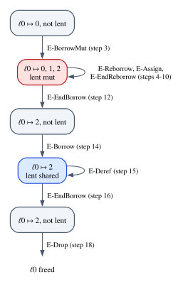
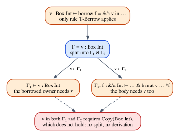

# Chapter 28 · A Core Calculus for Borrowing

Over the last six chapters we have collected the pieces of Rust's ownership
discipline one at a time: an affine λ-calculus (Chapter 22), `Copy` (Chapter
23), drops (Chapter 24), regions and the escape check (Chapter 26), subtyping
between lifetimes (Chapter 27). Each piece made sense on its own, and each came
with a promise that it explained some part of what the borrow checker does.

This chapter keeps those promises in the only way that is fully convincing: by
putting every piece into a single formal system and checking that it works. We
build a small calculus with owners, moves, drops, `Copy`, shared and mutable
borrows, lifetimes, reborrowing and the escape check, write down every typing
rule with the Rust program each premise models, and give it an operational
semantics in which reading freed memory or writing to a shared location are
*stuck* states, the formal counterpart of undefined behavior. Then we work through two derivations that every Rust
programmer has met in disguise: why a `&mut` reference can apparently be used
twice, and why the classic "push while iterating" bug has no derivation at all.

The calculus is in the spirit of the research calculi that formalize Rust's
core (Featherweight Rust and Oxide are two well-known ones), but much smaller:
small enough that a Rust crate can check its programs and print their
derivations, and that Lean can prove theorems about it in a few hundred lines.

**In this chapter you will learn:**

- how ownership, `Copy`, borrows and lifetimes fit into one type system,
  $\lambda^{\mathsf{aff}}_{\mathsf{rgn}}$, with thirteen typing rules;
- what every premise of the three borrow rules does, and which premises are
  affine bookkeeping and which are region reasoning;
- an operational semantics with a store and loan states, and what progress
  and preservation promise for it;
- why `bump(r); bump(r);` type-checks although `&mut` is not `Copy` (derivation
  I), and why the aliasing bug is rejected (derivation II);
- how the `borrowck` crate checks programs of the calculus, prints derivation
  trees, reports errors and runs programs on an abstract machine;
- how to state the rules in Lean, build a derivation as a proof term, prove that
  *no* derivation exists, and prove that a mutable reference is used at most
  once.

## What we need from Parts V and VI

Three ideas from earlier chapters carry this one. Here they are in the form we
will use them.

**Context splitting.** In the affine λ-calculus of Chapter 22, a rule with two
subterms does not give both of them the whole context. It *splits* the context:
$\Gamma = \Gamma_1 \uplus \Gamma_2$ means that every variable of $\Gamma$ goes
to $\Gamma_1$ or to $\Gamma_2$, so a variable can be used by one subterm or the
other, but not by both. That is how the type system forbids contraction, and it
is the formal version of a move: after `let t = s;` the variable `s` belongs to
the `let`'s right-hand side, so the rest of the block cannot use it (E0382).
Weakening is allowed: a variable may go unused, as in Rust, where an unused
value is simply dropped.

**`Copy` as permission to share a variable.** Chapter 23 refined the split: a
variable whose type satisfies the predicate $\mathsf{Copy}$ may go to *both*
halves. Contraction comes back, but only for the types where it is harmless.

**Regions and permissions.** Chapter 26 explained that affinity alone cannot
account for references: a shared reference is duplicable, so counting uses says
nothing about whether it outlives the data it points to. Lifetimes are *region
variables*: names for a stretch of the program during which a borrow is valid.
A reference type mentions its region (`&'a T`), and the **escape check** forbids
a value whose type mentions a region from leaving that region. A shared
reference is a duplicable read permission, a mutable reference a unique write
permission, and a borrow is a temporary transfer of permission from an owner.

Chapter 27's subtyping does not appear in this chapter. Our rules demand exact
equality of types where Rust would accept a reference with a longer lifetime
than needed, so the calculus rejects some programs that subtyping would rescue;
none of the programs we study needs it.

## The design of the calculus

Before the rules, four design decisions. Each one trades fidelity to Rust for a
system small enough to hold in your head.

**Owners are locations.** Borrowing needs something to point at. In our
calculus, a value that can be borrowed lives in a *store* (a heap), and its
owner is a pointer to that location, of type $\mathsf{Box}\,\tau$. Rust lets you
borrow any local variable (`&mut x`) as well as the contents of a `Box`; a
local variable lives in a stack frame, which is memory too, so modelling every
borrowable variable as an owned location loses nothing essential. A new
location is created with $\mathsf{new}\ e$, Rust's `Box::new(e)`.

**Borrows are lexically scoped.** A borrow is a construct with a body:
$\mathsf{borrow}\ y = \&^{\alpha} x\ \mathsf{in}\ e$ creates a reference $y$
that is valid exactly while $e$ runs. The lifetime $\alpha$ is introduced by the
construct, and its scope is the body. This is roughly how Rust worked before
non-lexical lifetimes arrived with the 2018 edition, when a borrow held in a
variable lasted until the end of that variable's scope; today's compiler
computes shorter lifetimes from the control-flow graph, and Chapter 29 is about
how.

**A borrow lends the owner and gives it back.** The borrow construct consumes
its owner, exactly as a function call consumes a moved argument, and returns it
when the body finishes, paired with the body's result. So the type of a borrow is
a pair $\mathsf{Box}\,\tau \otimes \sigma$: the owner, and whatever the body
computed. The program then rebinds the owner with a `let`:

$$
\mathsf{let}\ (x, n) = (\mathsf{borrow}\ y = \&^{\alpha} x\ \mathsf{in}\ {*y})\ \mathsf{in}\ \dots
$$

Rust hides this rebinding: after `let n = *(&x);` you still call the owner `x`.
Making it explicit is what lets plain affine context splitting express "you
cannot use the owner while it is borrowed": during the body, the owner belongs to
the borrow, not to anybody else.

**No functions.** The calculus has no λ, no function types and no lifetime
polymorphism. A Rust function `fn f<'a>(r: &'a mut i32) { body }` is modelled by
checking its body in a context where `'a` is a lifetime in scope and `r` has type
$\&^{\alpha}\mathsf{mut}\,\mathsf{Int}$, which is exactly what a function
signature means (Chapter 1 read signatures as judgments). A call is modelled by
inlining the callee. We keep the name $\lambda^{\mathsf{aff}}_{\mathsf{rgn}}$,
"affine, with regions", as a family name.

Here is the full list of what we leave out, so that you know what the calculus
does *not* claim to explain: functions and lifetime parameters on them, the
`'static` lifetime, outlives constraints (in a lexically scoped calculus they are
implicit: a lifetime introduced inside another one's scope is shorter),
subtyping and variance, structs and enums, partial moves out of places, moving a
value out of a box, reading through a `&mut`, `Drop` implementations, interior
mutability, and non-lexical lifetimes. Everything else, the things that make
borrowing borrowing, is in.

## Syntax

The types are integers, the unit type, pairs, owned locations and the two kinds
of reference. We write $\kappa$ for any lifetime and $\alpha$, $\beta$ for
lifetimes that a borrow introduces:

$$
\tau, \sigma \;::=\; \mathsf{Int} \mid \mathsf{Unit} \mid \tau_1 \otimes \tau_2 \mid \mathsf{Box}\,\tau \mid \&^{\kappa}\,\tau \mid \&^{\kappa}\mathsf{mut}\,\tau
$$

The pair type $\tau_1 \otimes \tau_2$ is the multiplicative conjunction of
Chapter 21, Rust's tuple `(T, U)`. $\&^{\kappa}\,\tau$ is Rust's `&'k T` and
$\&^{\kappa}\mathsf{mut}\,\tau$ is `&'k mut T`. The free lifetimes of a type,
$\mathrm{flv}(\tau)$, are the lifetimes it mentions:
$\mathrm{flv}(\&^{\kappa}\mathsf{mut}\,(\mathsf{Int} \otimes \&^{\beta}\mathsf{Int})) = \{\kappa, \beta\}$.

The terms are the affine core of Chapter 22 without functions, plus allocation,
dropping, reading, writing and three ways to borrow:

$$
e \;::=\; x \mid n \mid () \mid (e_1, e_2) \mid \mathsf{let}\ x = e_1\ \mathsf{in}\ e_2 \mid \mathsf{let}\ (x, y) = e_1\ \mathsf{in}\ e_2 \mid \mathsf{new}\ e \mid \mathsf{drop}\ e
$$

$$
\mid\ {*e} \mid {*e_1} := e_2 \mid \mathsf{borrow}\ y = \&^{\alpha} e_1\ \mathsf{in}\ e_2 \mid \mathsf{borrow}\ y = \&^{\alpha}\mathsf{mut}\ e_1\ \mathsf{in}\ e_2
$$

$$
\mid\ \mathsf{borrow}\ y = \&^{\alpha}\mathsf{mut}\,{*e_1}\ \mathsf{in}\ e_2
$$

Each form has a Rust counterpart, and the `borrowck` crate reads programs in a
concrete syntax that stays close to Rust's:

| Calculus | Crate syntax | Rust |
|---|---|---|
| $\mathsf{new}\ e$ | `new e` | `Box::new(e)` |
| $\mathsf{drop}\ e$ | `drop e` | `std::mem::drop(e)` |
| ${*e}$ | `*e` | `*e` (copying a `Copy` value out) |
| ${*e_1} := e_2$ | `*e1 := e2` | `*e1 = e2;` |
| $\mathsf{borrow}\ y = \&^{\alpha} e_1\ \mathsf{in}\ e_2$ | `borrow y = &'a e1 in e2` | `{ let y = &e1; e2 }` |
| $\mathsf{borrow}\ y = \&^{\alpha}\mathsf{mut}\ e_1\ \mathsf{in}\ e_2$ | `borrow y = &'a mut e1 in e2` | `{ let y = &mut e1; e2 }` |
| $\mathsf{borrow}\ y = \&^{\alpha}\mathsf{mut}\,{*e_1}\ \mathsf{in}\ e_2$ | `borrow y = &'a mut *e1 in e2` | `{ let y = &mut *e1; e2 }` |

The last form is a **reborrow**: it creates a new mutable reference from an
existing one, the `&mut *r` that you rarely write because the compiler inserts
it for you. In all three borrow forms the lifetime $\alpha$ and the variable $y$
are bound in the body $e_2$, the way a `let` binds its variable.

### The syntax in Rust and in Lean

The crate's types and terms are ordinary Rust enums
(`code/rust/crates/borrowck/src/syntax.rs`):

```rust
/// The types of the calculus.
#[derive(Clone, Debug, PartialEq, Eq)]
pub enum Ty {
    /// Integers (Rust's `i32`).
    Int,
    /// The unit type `()`.
    Unit,
    /// The pair type `τ₁ ⊗ τ₂` (Rust's tuple `(T, U)`).
    Pair(Box<Ty>, Box<Ty>),
    /// An owned location holding a `τ` (Rust's `Box<T>`).
    Box(Box<Ty>),
    /// A shared reference `&'κ τ`.
    Ref(Lifetime, Box<Ty>),
    /// A mutable reference `&'κ mut τ`.
    RefMut(Lifetime, Box<Ty>),
}
```

```rust
/// The three ways to create a reference.
#[derive(Clone, Copy, Debug, PartialEq, Eq)]
pub enum BorrowKind {
    /// `borrow y = &'a e₁ in e₂`
    Shared,
    /// `borrow y = &'a mut e₁ in e₂`
    Mut,
    /// `borrow y = &'a mut *e₁ in e₂`
    Reborrow,
}

/// The terms of the calculus.
#[derive(Clone, Debug, PartialEq, Eq)]
pub enum Term {
    Var(String),
    Lit(i64),
    Unit,
    /// `(e₁, e₂)`
    Pair(Box<Term>, Box<Term>),
    /// `let x = e₁ in e₂`
    Let(String, Box<Term>, Box<Term>),
    /// `let (x, y) = e₁ in e₂`
    LetPair(String, String, Box<Term>, Box<Term>),
    /// `new e`: allocate a location (`Box::new`).
    New(Box<Term>),
    /// `drop e`: consume a value, freeing what it owns (`std::mem::drop`).
    Drop(Box<Term>),
    /// `*e`: read through a shared reference.
    Deref(Box<Term>),
    /// `*e₁ := e₂`: write through a mutable reference.
    Assign(Box<Term>, Box<Term>),
    /// The three borrow forms. They bind `lifetime` and `var` in `body`.
    Borrow {
        kind: BorrowKind,
        lifetime: Lifetime,
        var: String,
        owner: Box<Term>,
        body: Box<Term>,
    },
    /// Run-time only: a pointer to store location `ℓ`.
    Ptr(Ptr, usize),
    /// Run-time only: `restore w after e`, the frame of a borrow in progress.
    Restore(Box<Term>, Box<Term>),
}

/// The three kinds of pointer values that exist at run time.
#[derive(Clone, Copy, Debug, PartialEq, Eq)]
pub enum Ptr {
    /// `own ℓ`, the value of an owner of type `Box τ`.
    Own,
    /// `shr ℓ`, the value of a shared reference.
    Shr,
    /// `uniq ℓ`, the value of a mutable reference.
    Uniq,
}
```

The last two variants of `Term` never appear in a program you write. They are
the run-time forms of the operational semantics, which we meet later: pointer
values into the store, and the frame of a borrow in progress. Keeping them in
the same enum mirrors the mathematics, where run-time forms extend the grammar
of terms.

The Lean version (`code/lean/Book/Ch28/Syntax.lean`) is the same two inductive
types, with variables and lifetimes named by strings so that the derivations we
build later read like the ones on paper:

```lean
/-- The types of the calculus. -/
inductive Ty where
  /-- Machine integers (Rust's `i32`). -/
  | int
  /-- The unit type `()`. -/
  | unit
  /-- The pair type `τ₁ ⊗ τ₂` (Rust's tuple `(T, U)`). -/
  | pair (τ₁ τ₂ : Ty)
  /-- An owned location in the store holding a `τ` (Rust's `Box<T>`). -/
  | box (τ : Ty)
  /-- A shared reference `&'κ τ`. -/
  | ref (κ : Lft) (τ : Ty)
  /-- A mutable reference `&'κ mut τ`. -/
  | refMut (κ : Lft) (τ : Ty)
  deriving DecidableEq, Repr
```

```lean
/-- The terms of the calculus. The three `borrow` forms bind the lifetime `α`
and the reference variable `y` in the body `e₂`. -/
inductive Term where
  | var (x : Var)
  | lit (n : Nat)
  | unit
  /-- `(e₁, e₂)` -/
  | pair (e₁ e₂ : Term)
  /-- `let x = e₁ in e₂` -/
  | letIn (x : Var) (e₁ e₂ : Term)
  /-- `let (x, y) = e₁ in e₂` -/
  | letPair (x y : Var) (e₁ e₂ : Term)
  /-- `new e`: allocate a location holding the value of `e` (`Box::new`). -/
  | new (e : Term)
  /-- `drop e`: consume a value and free what it owns (`std::mem::drop`). -/
  | drop (e : Term)
  /-- `*e`: read through a shared reference. -/
  | deref (e : Term)
  /-- `*e₁ := e₂`: write through a mutable reference. -/
  | assign (e₁ e₂ : Term)
  /-- `borrow y = &'α e₁ in e₂`: a shared borrow of the owner `e₁`. -/
  | borrow (α : Lft) (y : Var) (e₁ e₂ : Term)
  /-- `borrow y = &'α mut e₁ in e₂`: a mutable borrow of the owner `e₁`. -/
  | borrowMut (α : Lft) (y : Var) (e₁ e₂ : Term)
  /-- `borrow y = &'α mut *e₁ in e₂`: a reborrow of the mutable reference `e₁`. -/
  | reborrow (α : Lft) (y : Var) (e₁ e₂ : Term)
  deriving Repr
```

(The constructor names `letIn` and `refMut` avoid Lean's keywords `let` and
`mut`.) The free lifetimes of a type are a recursive function:

```lean
/-- `flv(τ)`: the lifetimes mentioned in a type. The escape check asks that a
fresh lifetime is not in this list. -/
def Ty.lfts : Ty → List Lft
  | .int | .unit => []
  | .pair τ₁ τ₂ => τ₁.lfts ++ τ₂.lfts
  | .box τ => τ.lfts
  | .ref κ τ | .refMut κ τ => κ :: τ.lfts
```

## `Copy` and context splitting

The predicate $\mathsf{Copy}(\tau)$ says that values of type $\tau$ may be
duplicated by simply using them twice. It is the least predicate closed under
four rules:

$$
\dfrac{}{\mathsf{Copy}(\mathsf{Int})}\;\textsf{C-Int}
\qquad
\dfrac{}{\mathsf{Copy}(\mathsf{Unit})}\;\textsf{C-Unit}
\qquad
\dfrac{}{\mathsf{Copy}(\&^{\kappa}\,\tau)}\;\textsf{C-Ref}
\qquad
\dfrac{\mathsf{Copy}(\tau_1) \qquad \mathsf{Copy}(\tau_2)}{\mathsf{Copy}(\tau_1 \otimes \tau_2)}\;\textsf{C-Pair}
$$

"Least" means that nothing else is `Copy`. In particular there is no rule for
$\mathsf{Box}\,\tau$ (an owner of a location: duplicating it would give the
location two owners, and two frees) and none for $\&^{\kappa}\mathsf{mut}\,\tau$
(a unique write permission: duplicating it would give two writers). Rule C-Ref
says that *every* shared reference is `Copy`, whatever it points to: `&String`
is `Copy` although `String` is not, because copying the reference copies the
read permission, not the string. Rule C-Pair is Rust's requirement that a type
can derive `Copy` only if all its fields are `Copy`.

In Lean the predicate is an inductive family with one constructor per rule, and
"no rule concludes `Copy (.box τ)`" becomes a one-line proof:

```lean
/-- `Copy τ`: values of type `τ` may be duplicated. The least predicate closed
under these four rules; in particular `box` and `refMut` are never `Copy`. -/
inductive Copy : Ty → Prop where
  | int : Copy .int
  | unit : Copy .unit
  | ref {κ τ} : Copy (.ref κ τ)
  | pair {τ₁ τ₂} : Copy τ₁ → Copy τ₂ → Copy (.pair τ₁ τ₂)
```

```lean
/-- An owner is not `Copy`: no rule concludes `Copy (.box τ)`, so a proof of it
cannot exist, and `nomatch` checks exactly that. -/
theorem not_copy_box (τ : Ty) : ¬ Copy (.box τ) := fun h => nomatch h

/-- A mutable reference is not `Copy` either. -/
theorem not_copy_refMut (κ : Lft) (τ : Ty) : ¬ Copy (.refMut κ τ) :=
  fun h => nomatch h
```

`nomatch h` asks Lean to consider every constructor that could have produced
`h : Copy (.box τ)`. None of the four has a conclusion of that shape, so there is
nothing to consider and the proof is complete. You will see the same idea,
"no rule fits", carry the impossibility proof of derivation II.

The split $\Gamma = \Gamma_1 \uplus \Gamma_2$ is defined by four rules that walk
through the context one entry at a time and send each entry left, right, or, if
its type is `Copy`, to both sides:

$$
\dfrac{}{\cdot = \cdot \uplus \cdot}\;\textsf{S-Empty}
\qquad
\dfrac{\Gamma = \Gamma_1 \uplus \Gamma_2}{\Gamma, x : \tau = (\Gamma_1, x : \tau) \uplus \Gamma_2}\;\textsf{S-Left}
$$

$$
\dfrac{\Gamma = \Gamma_1 \uplus \Gamma_2}{\Gamma, x : \tau = \Gamma_1 \uplus (\Gamma_2, x : \tau)}\;\textsf{S-Right}
\qquad
\dfrac{\Gamma = \Gamma_1 \uplus \Gamma_2 \qquad \mathsf{Copy}(\tau)}{\Gamma, x : \tau = (\Gamma_1, x : \tau) \uplus (\Gamma_2, x : \tau)}\;\textsf{S-Both}
$$

The dot $\cdot$ is the empty context. Rule S-Both is the whole of Chapter 23 in
one line: the exponential $!$ of linear logic, folded into the splitting
operation instead of being a type constructor. Rust makes the same choice:
`Copy` is a property of a type, not a wrapper around it. The Lean definition
transcribes the four rules, with contexts as lists whose head is the most recent
entry:

```lean
/-- A typing context: a list of variables with their types, most recent
first. -/
abbrev Ctx := List (Var × Ty)

/-- The type of `x` in `Γ`, if `x` is in `Γ`. -/
def lookup : Ctx → Var → Option Ty
  | [], _ => none
  | (y, τ) :: Γ, x => if x = y then some τ else lookup Γ x

/-- The variables of a context. -/
def dom (Γ : Ctx) : List Var := Γ.map Prod.fst
```

```lean
/-- `Split Γ Γ₁ Γ₂` is the text's `Γ = Γ₁ ⊎ Γ₂`: every entry of `Γ` goes to
the left part, to the right part, or, if its type is `Copy`, to both. -/
inductive Split : Ctx → Ctx → Ctx → Prop where
  | nil : Split [] [] []
  | left {b Γ Γ₁ Γ₂} : Split Γ Γ₁ Γ₂ → Split (b :: Γ) (b :: Γ₁) Γ₂
  | right {b Γ Γ₁ Γ₂} : Split Γ Γ₁ Γ₂ → Split (b :: Γ) Γ₁ (b :: Γ₂)
  | both {b Γ Γ₁ Γ₂} : Copy b.2 → Split Γ Γ₁ Γ₂ → Split (b :: Γ) (b :: Γ₁) (b :: Γ₂)
```

A type checker should not try all the ways to split a context: there are up to
three choices per variable, so $3^n$ splits of a context with $n$ variables. The crate instead decides by looking at the two
subterms. A variable goes to the subterm that mentions it; a variable that both
subterms mention must be `Copy`, and goes to both; otherwise the split fails, and
the failure *is* the type error:

```rust
/// Split `Γ` between a first premise `e1` and a second premise `e2` (in which
/// the variables `bound` are about to be bound). A variable goes where it is
/// used; a variable used by both premises must be `Copy`. Unused variables go
/// to the second premise, unless their name is about to be rebound there.
fn split(
    ctx: &Ctx,
    e1: &Term,
    e2: &Term,
    bound: &[&str],
    site: Site,
    whole: &Term,
) -> Result<(Ctx, Ctx), TypeError> {
    let (mut left, mut right) = (Ctx::new(), Ctx::new());
    for (x, ty) in ctx {
        let in_first = e1.occurs(x);
        let rebound = bound.contains(&x.as_str());
        let in_second = !rebound && e2.occurs(x);
        match (in_first, in_second) {
            (true, true) if ty.is_copy() => {
                left.push((x.clone(), ty.clone()));
                right.push((x.clone(), ty.clone()));
            }
            (true, true) => {
                return Err(TypeError::UsedTwice {
                    var: x.clone(),
                    ty: ty.clone(),
                    site,
                    term: whole.clone(),
                });
            }
            (true, false) => left.push((x.clone(), ty.clone())),
            (false, true) => right.push((x.clone(), ty.clone())),
            (false, false) if rebound => left.push((x.clone(), ty.clone())),
            (false, false) => right.push((x.clone(), ty.clone())),
        }
    }
    Ok((left, right))
}
```

The parameter `bound` handles rebinding. In
$\mathsf{let}\ (x, n) = e_1\ \mathsf{in}\ e_2$ an occurrence of $x$ inside
$e_2$ refers to the new $x$, so it must not pull the old $x$ into $e_2$'s part
of the context. A variable that neither side uses can go to either side: rule
T-Var below accepts extra variables in the context, and that is weakening.

## The typing rules

The judgment of the calculus is

$$
\Delta;\ \Gamma \vdash e : \tau
$$

read "with the lifetimes $\Delta$ in scope and the variables $\Gamma$, the term $e$
has type $\tau$". $\Delta$ is a list of lifetime names, Rust's `<'a, 'b>`;
$\Gamma$ is an affine context. Two conventions keep the rules short. First,
$\Gamma, x : \tau$ is only written when $x$ is not already in $\Gamma$; you can
always rename a bound variable to make this true. (Rebinding an owner after a
borrow, as in the `let` above, is allowed: by then the old $x$ has been consumed
and is no longer in the context.) Second, $\Gamma_1 \uplus \Gamma_2$ in the
conclusion of a rule means "any context that splits into $\Gamma_1$ and
$\Gamma_2$". There are thirteen rules. As in Chapter 1, they are a *model*:
Rust has no official formal semantics, and these rules describe a fragment of
what the compiler enforces, in a simplified form.

### The affine core

$$
\dfrac{(x : \tau) \in \Gamma}{\Delta;\ \Gamma \vdash x : \tau}\;\textsf{T-Var}
\qquad
\dfrac{}{\Delta;\ \Gamma \vdash n : \mathsf{Int}}\;\textsf{T-Int}
\qquad
\dfrac{}{\Delta;\ \Gamma \vdash () : \mathsf{Unit}}\;\textsf{T-Unit}
$$

$$
\dfrac{\Delta;\ \Gamma_1 \vdash e_1 : \tau_1 \qquad \Delta;\ \Gamma_2 \vdash e_2 : \tau_2}{\Delta;\ \Gamma_1 \uplus \Gamma_2 \vdash (e_1, e_2) : \tau_1 \otimes \tau_2}\;\textsf{T-Pair}
$$

$$
\dfrac{\Delta;\ \Gamma_1 \vdash e_1 : \tau_1 \qquad \Delta;\ \Gamma_2, x : \tau_1 \vdash e_2 : \sigma}{\Delta;\ \Gamma_1 \uplus \Gamma_2 \vdash \mathsf{let}\ x = e_1\ \mathsf{in}\ e_2 : \sigma}\;\textsf{T-Let}
$$

$$
\dfrac{\Delta;\ \Gamma_1 \vdash e_1 : \tau_1 \otimes \tau_2 \qquad \Delta;\ \Gamma_2, x : \tau_1, y : \tau_2 \vdash e_2 : \sigma}{\Delta;\ \Gamma_1 \uplus \Gamma_2 \vdash \mathsf{let}\ (x, y) = e_1\ \mathsf{in}\ e_2 : \sigma}\;\textsf{T-LetPair}
$$

$$
\dfrac{\Delta;\ \Gamma \vdash e : \tau}{\Delta;\ \Gamma \vdash \mathsf{new}\ e : \mathsf{Box}\,\tau}\;\textsf{T-New}
\qquad
\dfrac{\Delta;\ \Gamma \vdash e : \tau}{\Delta;\ \Gamma \vdash \mathsf{drop}\ e : \mathsf{Unit}}\;\textsf{T-Drop}
$$

These are Chapter 22's rules, with the moves and drops that Part V explained.

- **T-Var**, **T-Int** and **T-Unit** are the leaves. They accept any other
  variables in $\Gamma$, which is how weakening enters the system: a value that
  is never used is fine. (In our calculus an unused owner is *leaked*, never
  freed, which is safe; Chapter 24 explained why Rust can afford leaks, and a
  real compiler would insert the drop for you.)
- **T-Pair**, **T-Let** and **T-LetPair** split the context between their two
  premises. A variable of a non-`Copy` type is therefore used by at most one of
  them. This is the rule behind E0382: in `let c = b in (b, c)`, both the
  right-hand side and the body need `b`, and `Box Int` is not `Copy`.
- **T-LetPair** is the only way to take a pair apart. It consumes the pair once
  and binds both components, which is how the result of a borrow is unpacked.
- **T-New** allocates, Rust's `Box::new`. **T-Drop** consumes a value of any
  type, Rust's `std::mem::drop`; at run time it frees the locations the value
  owns.

### Using references

$$
\dfrac{\Delta;\ \Gamma \vdash e : \&^{\kappa}\,\tau \qquad \mathsf{Copy}(\tau)}{\Delta;\ \Gamma \vdash {*e} : \tau}\;\textsf{T-Deref}
\qquad
\dfrac{\Delta;\ \Gamma_1 \vdash e_1 : \&^{\kappa}\mathsf{mut}\,\tau \qquad \Delta;\ \Gamma_2 \vdash e_2 : \tau}{\Delta;\ \Gamma_1 \uplus \Gamma_2 \vdash {*e_1} := e_2 : \mathsf{Unit}}\;\textsf{T-Assign}
$$

Rule **T-Deref** reads through a shared reference. Its second premise matters:
reading `*e` produces a copy of the value behind the reference while the original
stays where it is, so the value must be duplicable. Without $\mathsf{Copy}(\tau)$
you could read a $\mathsf{Box}\,\mathsf{Int}$ out of a shared reference and end
up with two owners of one location. Rust reports exactly this situation as
E0507, "cannot move out of `*s` which is behind a shared reference".

Rule **T-Assign** writes through a mutable reference, and only through a mutable
one: there is no rule that assigns through $\&^{\kappa}\,\tau$, which is why
`*s = 1` with `s: &i32` is E0594. The two premises split the context, so the
reference and the new value cannot share a non-`Copy` variable. At run time the
old value is dropped, which is what Rust's `*r = v` does: an assignment to an
initialized place runs the old value's destructor first. (A purely affine
calculus would rather use a *swap* that returns the old value, Rust's
`std::mem::replace`; dropping is closer to what you write every day.)

### Borrowing

Now the three rules that go beyond affine logic:

$$
\dfrac{\Delta;\ \Gamma_1 \vdash e_1 : \mathsf{Box}\,\tau \qquad \Delta, \alpha;\ \Gamma_2, y : \&^{\alpha}\,\tau \vdash e_2 : \sigma \qquad \alpha \notin \Delta \qquad \alpha \notin \mathrm{flv}(\sigma)}{\Delta;\ \Gamma_1 \uplus \Gamma_2 \vdash \mathsf{borrow}\ y = \&^{\alpha} e_1\ \mathsf{in}\ e_2 : \mathsf{Box}\,\tau \otimes \sigma}\;\textsf{T-Borrow}
$$

$$
\dfrac{\Delta;\ \Gamma_1 \vdash e_1 : \mathsf{Box}\,\tau \qquad \Delta, \alpha;\ \Gamma_2, y : \&^{\alpha}\mathsf{mut}\,\tau \vdash e_2 : \sigma \qquad \alpha \notin \Delta \qquad \alpha \notin \mathrm{flv}(\sigma)}{\Delta;\ \Gamma_1 \uplus \Gamma_2 \vdash \mathsf{borrow}\ y = \&^{\alpha}\mathsf{mut}\ e_1\ \mathsf{in}\ e_2 : \mathsf{Box}\,\tau \otimes \sigma}\;\textsf{T-BorrowMut}
$$

$$
\dfrac{\Delta;\ \Gamma_1 \vdash e_1 : \&^{\kappa}\mathsf{mut}\,\tau \qquad \Delta, \alpha;\ \Gamma_2, y : \&^{\alpha}\mathsf{mut}\,\tau \vdash e_2 : \sigma \qquad \alpha \notin \Delta \qquad \alpha \notin \mathrm{flv}(\sigma)}{\Delta;\ \Gamma_1 \uplus \Gamma_2 \vdash \mathsf{borrow}\ y = \&^{\alpha}\mathsf{mut}\,{*e_1}\ \mathsf{in}\ e_2 : \&^{\kappa}\mathsf{mut}\,\tau \otimes \sigma}\;\textsf{T-Reborrow}
$$

The three rules have the same shape, so let us read T-BorrowMut premise by
premise, together with the Rust it models:

```rust
let mut owner: Box<T> = ...;
let result = {
    let y = &mut *owner;   // 'α starts here
    body                   // uses y; must not use `owner`
};                         // 'α ends here; `owner` is usable again
```

1. **$\Delta;\ \Gamma_1 \vdash e_1 : \mathsf{Box}\,\tau$: the owner is
   consumed.** The owner gets its own part $\Gamma_1$ of the context. Because of
   the split, a non-`Copy` variable used to produce the owner (usually the owner
   variable itself) is not available to the body. This premise is the formal
   reason why you cannot touch `owner` while it is mutably borrowed, and it is
   pure affine bookkeeping.
2. **$\Delta, \alpha;\ \Gamma_2, y : \&^{\alpha}\mathsf{mut}\,\tau \vdash e_2 : \sigma$:
   the body gets the reference.** The body is checked with the rest of the
   context, one more variable $y$ of reference type, and one more lifetime
   $\alpha$ in scope. Since $\&^{\alpha}\mathsf{mut}\,\tau$ is not `Copy`, the
   body can use $y$ at most once; to write through it twice, the body must
   reborrow it, as derivation I will show.
3. **$\alpha \notin \Delta$: the lifetime is fresh.** The borrow introduces a
   new region, distinct from every lifetime already in scope, and binds it for
   the duration of the body. In Rust you never name this lifetime; the compiler
   invents one for every borrow expression.
4. **$\alpha \notin \mathrm{flv}(\sigma)$: the escape check.** The type of the
   body's result must not mention $\alpha$. A value of type $\sigma$ is what
   survives the borrow, and if $\sigma$ mentioned $\alpha$ it could contain a
   reference created by this borrow, still pointing at the location after the
   owner is back in charge of it and free to drop it. This is the premise that
   rejects a dangling reference.
5. **The conclusion $\mathsf{Box}\,\tau \otimes \sigma$: the owner comes back.**
   Ownership was lent, not given away.

T-Borrow differs only in the kind of reference the body receives, a shared one,
which the body may copy freely by rule S-Both. T-Reborrow differs in what is
lent: not an owner but a mutable reference $\&^{\kappa}\mathsf{mut}\,\tau$, and
what comes back is that same reference, *with its original lifetime* $\kappa$.
The new reference lives for the fresh $\alpha$, which is introduced inside the
scope of $\kappa$ and therefore shorter: the outlives relation of Chapter 26
holds by construction, which is why our calculus can do without explicit
outlives constraints. The figure below shows the shape that the three rules share.


Which premises are affine and which are not? The question matters for the
question of this book, so here is the tally:

| Ingredient | Mechanism | Affine? |
|---|---|---|
| $\Gamma_1 \uplus \Gamma_2$ | context splitting | yes |
| owner consumed by the first premise | affine use | yes |
| owner returned in the conclusion | the lend-and-return shape | neutral |
| $\&^{\alpha}\mathsf{mut}\,\tau$ not `Copy` | no contraction | yes |
| $\&^{\alpha}\,\tau$ is `Copy` | contraction restored | no: the opposite |
| $\alpha$ fresh and scoped to the body | region binding | no |
| $\alpha \notin \mathrm{flv}(\sigma)$ | escape check | no |

Half of the ingredients are affine typing; the other half are a region system.
Keep this table in mind for Chapter 33.

### The rules in Lean and in Rust

In Lean the judgment is an inductive relation, one constructor per rule
(`code/lean/Book/Ch28/Typing.lean`):

```lean
/-- The typing judgment `Δ; Γ ⊢ e : τ`: `Δ` lists the lifetimes in scope,
`Γ` the variables. The premises `x ∉ dom Γ₂` spell out the text's convention
that a context is only extended with a variable it does not already contain. -/
inductive HasType : List Lft → Ctx → Term → Ty → Prop where
  | var {Δ Γ x τ} :
      lookup Γ x = some τ →
      HasType Δ Γ (.var x) τ
  | lit {Δ Γ n} : HasType Δ Γ (.lit n) .int
  | unit {Δ Γ} : HasType Δ Γ .unit .unit
  | pair {Δ Γ Γ₁ Γ₂ e₁ e₂ τ₁ τ₂} :
      Split Γ Γ₁ Γ₂ →
      HasType Δ Γ₁ e₁ τ₁ →
      HasType Δ Γ₂ e₂ τ₂ →
      HasType Δ Γ (.pair e₁ e₂) (.pair τ₁ τ₂)
  | letIn {Δ Γ Γ₁ Γ₂ x e₁ e₂ τ₁ σ} :
      Split Γ Γ₁ Γ₂ →
      HasType Δ Γ₁ e₁ τ₁ →
      x ∉ dom Γ₂ →
      HasType Δ ((x, τ₁) :: Γ₂) e₂ σ →
      HasType Δ Γ (.letIn x e₁ e₂) σ
  | letPair {Δ Γ Γ₁ Γ₂ x y e₁ e₂ τ₁ τ₂ σ} :
      Split Γ Γ₁ Γ₂ →
      HasType Δ Γ₁ e₁ (.pair τ₁ τ₂) →
      x ∉ dom Γ₂ → y ∉ dom Γ₂ → x ≠ y →
      HasType Δ ((x, τ₁) :: (y, τ₂) :: Γ₂) e₂ σ →
      HasType Δ Γ (.letPair x y e₁ e₂) σ
  | new {Δ Γ e τ} :
      HasType Δ Γ e τ →
      HasType Δ Γ (.new e) (.box τ)
  | drop {Δ Γ e τ} :
      HasType Δ Γ e τ →
      HasType Δ Γ (.drop e) .unit
  | deref {Δ Γ e κ τ} :
      HasType Δ Γ e (.ref κ τ) →
      Copy τ →
      HasType Δ Γ (.deref e) τ
  | assign {Δ Γ Γ₁ Γ₂ e₁ e₂ κ τ} :
      Split Γ Γ₁ Γ₂ →
      HasType Δ Γ₁ e₁ (.refMut κ τ) →
      HasType Δ Γ₂ e₂ τ →
      HasType Δ Γ (.assign e₁ e₂) .unit
  | borrow {Δ Γ Γ₁ Γ₂ α y e₁ e₂ τ σ} :
      Split Γ Γ₁ Γ₂ →
      HasType Δ Γ₁ e₁ (.box τ) →
      y ∉ dom Γ₂ →
      HasType (α :: Δ) ((y, .ref α τ) :: Γ₂) e₂ σ →
      α ∉ Δ →
      α ∉ σ.lfts →
      HasType Δ Γ (.borrow α y e₁ e₂) (.pair (.box τ) σ)
  | borrowMut {Δ Γ Γ₁ Γ₂ α y e₁ e₂ τ σ} :
      Split Γ Γ₁ Γ₂ →
      HasType Δ Γ₁ e₁ (.box τ) →
      y ∉ dom Γ₂ →
      HasType (α :: Δ) ((y, .refMut α τ) :: Γ₂) e₂ σ →
      α ∉ Δ →
      α ∉ σ.lfts →
      HasType Δ Γ (.borrowMut α y e₁ e₂) (.pair (.box τ) σ)
  | reborrow {Δ Γ Γ₁ Γ₂ α y e₁ e₂ κ τ σ} :
      Split Γ Γ₁ Γ₂ →
      HasType Δ Γ₁ e₁ (.refMut κ τ) →
      y ∉ dom Γ₂ →
      HasType (α :: Δ) ((y, .refMut α τ) :: Γ₂) e₂ σ →
      α ∉ Δ →
      α ∉ σ.lfts →
      HasType Δ Γ (.reborrow α y e₁ e₂) (.pair (.refMut κ τ) σ)
```

Compare a constructor with its rule. The split, written $\Gamma_1 \uplus \Gamma_2$
in the conclusion on paper, is a premise `Split Γ Γ₁ Γ₂`. The convention that a
context is only extended with a new variable becomes explicit premises such as
`y ∉ dom Γ₂` (and `x ≠ y` for a pair pattern): a proof assistant does not accept
conventions, so everything that the paper leaves implicit must be written down.
`α :: Δ` is $\Delta, \alpha$, and `α ∉ σ.lfts` is the escape check.

In the crate, the three borrow rules share one function. It follows the
premises in order: freshness, split, the owner, the body with the new lifetime
and variable, and the escape check last, because only then is $\sigma$ known:

```rust
/// Rules T-Borrow, T-BorrowMut and T-Reborrow.
fn check_borrow(
    delta: &[Lifetime],
    ctx: &Ctx,
    e: &Term,
    kind: BorrowKind,
    alpha: &Lifetime,
    y: &str,
    owner: &Term,
    body: &Term,
) -> Result<Derivation, TypeError> {
    let rule = borrow_rule(kind);
    // Freshness: α ∉ Δ.
    if delta.contains(alpha) {
        return Err(TypeError::LifetimeInScope {
            lifetime: alpha.clone(),
            rule,
            term: e.clone(),
        });
    }
    // Γ = Γ₁ ⊎ Γ₂: the owner (or the reborrowed reference) gets Γ₁.
    let (c1, mut c2) = split(ctx, owner, body, &[y], Site::Borrow(kind), e)?;
    let d1 = check(delta, &c1, owner)?;
    // What the body receives (y's type), and what comes back afterwards.
    let (y_ty, returned) = match (kind, d1.conclusion.ty.clone()) {
        (BorrowKind::Shared, Ty::Box(t)) => {
            (Ty::Ref(alpha.clone(), t.clone()), Ty::Box(t))
        }
        (BorrowKind::Mut, Ty::Box(t)) => {
            (Ty::RefMut(alpha.clone(), t.clone()), Ty::Box(t))
        }
        (BorrowKind::Reborrow, Ty::RefMut(k, t)) => {
            (Ty::RefMut(alpha.clone(), t.clone()), Ty::RefMut(k, t))
        }
        (kind, found) => {
            let expected = match kind {
                BorrowKind::Reborrow => "a mutable reference &'κ mut τ",
                _ => "an owner Box τ",
            };
            return Err(TypeError::Mismatch {
                rule,
                expected: expected.into(),
                found,
                term: e.clone(),
            });
        }
    };
    // The body is checked with α in scope and y bound to the new reference.
    let mut delta2 = delta.to_vec();
    delta2.push(alpha.clone());
    let mut notes = vec![
        split_note(&c1, &c2),
        format!("fresh: '{alpha} ∉ Δ = {{{}}}", quoted(delta)),
    ];
    c2.push((y.to_string(), y_ty));
    let d2 = check(&delta2, &c2, body)?;
    // The escape check: α ∉ flv(σ).
    let sigma = d2.conclusion.ty.clone();
    if sigma.mentions(alpha) {
        return Err(TypeError::Escape {
            lifetime: alpha.clone(),
            ty: sigma,
            rule,
            term: e.clone(),
        });
    }
    notes.push(format!("escape check: '{alpha} ∉ flv({sigma})"));
    let ty = Ty::pair(returned, sigma);
    Ok(node(rule, delta, ctx, e, ty, notes, vec![d1, d2]))
}
```

Every rule of the calculus is *syntax-directed*: for each form of term exactly one
rule can conclude it, so the checker never searches. When it succeeds, it
returns a `Derivation`, a tree of rule applications with their conclusions and
side conditions:

```rust
/// A judgment `Δ; Γ ⊢ e : τ`.
#[derive(Clone, Debug, PartialEq, Eq)]
pub struct Judgment {
    pub lifetimes: Vec<Lifetime>,
    pub ctx: Ctx,
    pub term: Term,
    pub ty: Ty,
}

/// A derivation tree: the rule used at the root, its conclusion, the side
/// conditions it checked, and the derivations of its premises.
#[derive(Clone, Debug, PartialEq, Eq)]
pub struct Derivation {
    pub rule: &'static str,
    pub conclusion: Judgment,
    pub side_conditions: Vec<String>,
    pub premises: Vec<Derivation>,
}
```

## Operational semantics

A type system is only as good as the promise it keeps, so we need to say what
programs *do*. The semantics runs terms against a store, and its central device
is a **loan state** for every location.

**Values** are integers, unit, pairs of values and three kinds of pointer:

$$
v, w \;::=\; n \mid () \mid (v_1, v_2) \mid \mathsf{own}\,\ell \mid \mathsf{shr}\,\ell \mid \mathsf{uniq}\,\ell
$$

$\mathsf{own}\,\ell$ is the value of an owner, $\mathsf{shr}\,\ell$ of a shared
reference and $\mathsf{uniq}\,\ell$ of a mutable one, each pointing to a
location $\ell$. At run time there are no lifetimes: references are plain
pointers, exactly as in compiled Rust.

**The store** $S$ maps each allocated location to its contents and its loan
state. We write $S(\ell) = v^{m}$ when $\ell$ holds $v$ in state $m$, where
$m$ is $\mathsf{none}$ (not lent), $\mathsf{shared}$ (lent through a shared
borrow) or $\mathsf{mut}$ (lent through a mutable borrow). The loan states play
no part in the computation itself; they are the bookkeeping that lets the
semantics *detect* a violation of the aliasing rules.

**A borrow in progress** is a run-time term
$\mathsf{restore}\ w\ \mathsf{after}\ e$: run $e$, then hand back $w$ (the owner,
or the reborrowed reference) next to the result. A configuration
$\langle S;\ e \rangle$ steps to $\langle S';\ e' \rangle$ by these rules:

$$
\dfrac{\ell \notin \mathrm{dom}(S)}{\langle S;\ \mathsf{new}\ v \rangle \longrightarrow \langle S[\ell \mapsto v^{\mathsf{none}}];\ \mathsf{own}\,\ell \rangle}\;\textsf{E-New}
\qquad
\dfrac{S' = \mathrm{free}(S, v)}{\langle S;\ \mathsf{drop}\ v \rangle \longrightarrow \langle S';\ () \rangle}\;\textsf{E-Drop}
$$

$$
\dfrac{}{\langle S;\ \mathsf{let}\ x = v\ \mathsf{in}\ e \rangle \longrightarrow \langle S;\ e[v/x] \rangle}\;\textsf{E-Let}
\qquad
\dfrac{}{\langle S;\ \mathsf{let}\ (x, y) = (v_1, v_2)\ \mathsf{in}\ e \rangle \longrightarrow \langle S;\ e[v_1/x, v_2/y] \rangle}\;\textsf{E-LetPair}
$$

$$
\dfrac{S(\ell) = v^{\mathsf{shared}}}{\langle S;\ {*\mathsf{shr}\,\ell} \rangle \longrightarrow \langle S;\ v \rangle}\;\textsf{E-Deref}
\qquad
\dfrac{S(\ell) = w^{\mathsf{mut}} \qquad S' = \mathrm{free}(S[\ell \mapsto v^{\mathsf{mut}}], w)}{\langle S;\ {*\mathsf{uniq}\,\ell} := v \rangle \longrightarrow \langle S';\ () \rangle}\;\textsf{E-Assign}
$$

$$
\dfrac{S(\ell) = v^{\mathsf{none}}}{\langle S;\ \mathsf{borrow}\ y = \&^{\alpha}\,\mathsf{own}\,\ell\ \mathsf{in}\ e \rangle \longrightarrow \langle S[\ell \mapsto v^{\mathsf{shared}}];\ \mathsf{restore}\ \mathsf{own}\,\ell\ \mathsf{after}\ e[\mathsf{shr}\,\ell/y] \rangle}\;\textsf{E-Borrow}
$$

$$
\dfrac{S(\ell) = v^{\mathsf{none}}}{\langle S;\ \mathsf{borrow}\ y = \&^{\alpha}\mathsf{mut}\ \mathsf{own}\,\ell\ \mathsf{in}\ e \rangle \longrightarrow \langle S[\ell \mapsto v^{\mathsf{mut}}];\ \mathsf{restore}\ \mathsf{own}\,\ell\ \mathsf{after}\ e[\mathsf{uniq}\,\ell/y] \rangle}\;\textsf{E-BorrowMut}
$$

$$
\dfrac{S(\ell) = v^{\mathsf{mut}}}{\langle S;\ \mathsf{borrow}\ y = \&^{\alpha}\mathsf{mut}\,{*\mathsf{uniq}\,\ell}\ \mathsf{in}\ e \rangle \longrightarrow \langle S;\ \mathsf{restore}\ \mathsf{uniq}\,\ell\ \mathsf{after}\ e[\mathsf{uniq}\,\ell/y] \rangle}\;\textsf{E-Reborrow}
$$

$$
\dfrac{S(\ell) = w^{m}}{\langle S;\ \mathsf{restore}\ \mathsf{own}\,\ell\ \mathsf{after}\ v \rangle \longrightarrow \langle S[\ell \mapsto w^{\mathsf{none}}];\ (\mathsf{own}\,\ell, v) \rangle}\;\textsf{E-EndBorrow}
$$

$$
\dfrac{}{\langle S;\ \mathsf{restore}\ \mathsf{uniq}\,\ell\ \mathsf{after}\ v \rangle \longrightarrow \langle S;\ (\mathsf{uniq}\,\ell, v) \rangle}\;\textsf{E-EndReborrow}
$$

Here $e[v/x]$ is substitution (Chapter 7), and $\mathrm{free}(S, v)$ removes
from the store every location that $v$ owns: for each $\mathsf{own}\,\ell$ inside
$v$, the location $\ell$, and recursively whatever its contents own. It is
defined only if each of those locations is still allocated and in state
$\mathsf{none}$. One more rule, the congruence rule, lets a step happen inside
a larger term, always in the leftmost subterm that is not yet a value (a pair is
evaluated left to right, a `let` evaluates its right-hand side before its body,
a borrow evaluates its owner before lending it, and a frame runs its body).

The premises above the lines are **guards**. Reading requires the location to
be lent shared; writing requires it to be lent mutably; borrowing an owner
requires it not to be lent; dropping requires everything dropped to be allocated
and not lent. A configuration that is not a value and where no rule applies is
**stuck**, and every way of getting stuck corresponds to a memory-safety bug:
reading or writing freed memory, freeing twice, freeing something that is lent,
writing to a location while it is shared. Being stuck is the calculus's
undefined behavior. A *panic* would be something else entirely: a defined,
orderly way to stop.

Notice what E-Reborrow does to the store: nothing. At run time `&mut *r` is
just `r`; everything a reborrow means happens in the type system.

### The semantics in Rust

The crate's `eval` module implements these rules as a small-step interpreter.
The store is a map from locations to cells with a loan state:

```rust
/// The loan state of a location.
#[derive(Clone, Copy, Debug, PartialEq, Eq)]
pub enum Loan {
    /// Not borrowed: the owner may be borrowed, dropped or moved.
    None,
    /// Lent through a shared borrow: readable through `shr ℓ`.
    Shared,
    /// Lent through a mutable borrow: writable through `uniq ℓ`.
    Mut,
}

/// One store location: its value and its loan state.
#[derive(Clone, Debug, PartialEq, Eq)]
pub struct Cell {
    pub value: Term,
    pub loan: Loan,
}

/// The store: a finite map from locations to cells.
#[derive(Clone, Debug, Default, PartialEq, Eq)]
pub struct Store {
    cells: BTreeMap<usize, Cell>,
    next: usize,
}
```

and the three borrow rules share one function that checks the guard, updates
the loan state, substitutes a pointer for $y$ and wraps the body in its frame:

```rust
/// The three borrow rules. A borrow lends the location (guard: it is not
/// lent already), substitutes a reference for `y` in the body, and wraps
/// the body in a frame that gives the owner back at the end.
fn borrow(
    &mut self,
    kind: BorrowKind,
    y: &str,
    owner: Term,
    body: &Term,
    whole: &Term,
) -> Result<(Term, &'static str), Stuck> {
    let (l, needs, lend_as, reference, rule) = match (kind, &owner) {
        (BorrowKind::Shared, Term::Ptr(Ptr::Own, l)) => {
            (*l, Loan::None, Loan::Shared, Ptr::Shr, "E-Borrow")
        }
        (BorrowKind::Mut, Term::Ptr(Ptr::Own, l)) => {
            (*l, Loan::None, Loan::Mut, Ptr::Uniq, "E-BorrowMut")
        }
        (BorrowKind::Reborrow, Term::Ptr(Ptr::Uniq, l)) => {
            (*l, Loan::Mut, Loan::Mut, Ptr::Uniq, "E-Reborrow")
        }
        _ => return Err(ill_formed(whole, "cannot borrow this value")),
    };
    let cell = self.store.cell(l, whole)?;
    if cell.loan != needs {
        let reason = format!("ℓ{l} is {}, so it cannot be {}", cell.loan, lend_as);
        return Err(Stuck {
            redex: whole.summary(),
            reason,
        });
    }
    cell.loan = lend_as;
    let body = subst(body, y, &Term::Ptr(reference, l));
    Ok((Term::Restore(Box::new(owner), Box::new(body)), rule))
}
```

Here is a complete well-typed program, closed so that it can run: it allocates
a location, borrows it mutably, writes through two reborrows, gives the owner
back, reads the result through a shared borrow and frees the location
(`crates/borrowck/examples/ch28_run.rs`):

```rust
const PROGRAM: &str = "
fn main() {
    let b = new 0 in
    let (b, u) = (borrow r = &'a mut b in
                    let (r1, u1) = (borrow y1 = &'b1 mut *r in *y1 := 1) in
                    let (r2, u2) = (borrow y2 = &'b2 mut *r1 in *y2 := 2) in
                    ()) in
    let (b, n) = (borrow s = &'c b in *s) in
    let u = drop b in
    n
}";
```

The example checks it and runs it, printing the rule of every step and the store
after it:

```text
type: Int
 1  E-New          ℓ0 ↦ 0
 2  E-Let          ℓ0 ↦ 0
 3  E-BorrowMut    ℓ0 ↦ 0 [mut]
 4  E-Reborrow     ℓ0 ↦ 0 [mut]
 5  E-Assign       ℓ0 ↦ 1 [mut]
 6  E-EndReborrow  ℓ0 ↦ 1 [mut]
 7  E-LetPair      ℓ0 ↦ 1 [mut]
 8  E-Reborrow     ℓ0 ↦ 1 [mut]
 9  E-Assign       ℓ0 ↦ 2 [mut]
10  E-EndReborrow  ℓ0 ↦ 2 [mut]
11  E-LetPair      ℓ0 ↦ 2 [mut]
12  E-EndBorrow    ℓ0 ↦ 2
13  E-LetPair      ℓ0 ↦ 2
14  E-Borrow       ℓ0 ↦ 2 [shared]
15  E-Deref        ℓ0 ↦ 2 [shared]
16  E-EndBorrow    ℓ0 ↦ 2
17  E-LetPair      ℓ0 ↦ 2
18  E-Drop         ∅
19  E-Let          ∅
value: 2
```

Follow the loan state of $\ell_0$ down the right column. It becomes
$\mathsf{mut}$ at step 3, stays $\mathsf{mut}$ through both reborrows (steps 4 to
10: reborrows do not touch the store), goes back to not lent when the mutable
borrow ends at step 12, is lent shared for the read at steps 14 and 15, and the
location disappears at step 18. The figure below draws the same history.



## Metatheory

What does the type system guarantee about the semantics? The statements follow
the pattern of Chapter 9, adapted to a store. To type a configuration we need a
**store typing** $\Sigma$ that gives each location the type of its contents,
typing rules for the run-time values
($\mathsf{own}\,\ell : \mathsf{Box}\,\Sigma(\ell)$ and so on), and a notion of a
**well-formed configuration**: the stored values have the types $\Sigma$ says,
and the loan state of every location agrees with the term (a location is lent
exactly when a `restore` frame for it is running, shared or mutable according to
the kind of borrow, and its references occur only inside that frame).

> **Theorem (progress).** If $\langle S;\ e \rangle$ is well formed and
> $\cdot;\ \cdot \vdash_{\Sigma} e : \tau$, then $e$ is a value or
> $\langle S;\ e \rangle \longrightarrow \langle S';\ e' \rangle$ for some $S'$
> and $e'$.
>
> **Theorem (preservation).** If $\langle S;\ e \rangle$ is well formed,
> $\cdot;\ \cdot \vdash_{\Sigma} e : \tau$ and
> $\langle S;\ e \rangle \longrightarrow \langle S';\ e' \rangle$, then
> $\langle S';\ e' \rangle$ is well formed and
> $\cdot;\ \cdot \vdash_{\Sigma'} e' : \tau$ for a store typing $\Sigma'$ that
> agrees with $\Sigma$ on the locations that are still allocated.

Together they give safety: a well-typed closed program never gets stuck, so it
never reads freed memory, never frees twice, never frees what is lent and never
writes to a shared location. We will not prove the two theorems here; a full
proof is long (the run-time typing must record which lifetime lends which
location, so that the escape check can be connected to the values that leave a
frame), and RustBelt, which Chapter 32 describes, proves a much stronger result
for a much larger language. What we can do is see *why* each guard holds in a
well-typed program, because each one rests on a single premise of the rules:

- **Borrowing or dropping an owner finds it not lent.** While $\ell$ is lent,
  its owner $\mathsf{own}\,\ell$ sits inside a `restore` frame, where no rule can
  reach it, and there is no other copy of it because $\mathsf{Box}\,\tau$ is not
  `Copy`. *Affinity.*
- **Reading through $\mathsf{shr}\,\ell$ finds $\ell$ lent shared.** A shared
  reference is created inside a frame and cannot leave it, because its type
  mentions the borrow's lifetime and the escape check forbids exactly that.
  *Regions.*
- **Writing through $\mathsf{uniq}\,\ell$ finds $\ell$ lent mutably.** The same
  argument, for mutable references.
- **No location is freed twice.** Only an owner frees, and owners cannot be
  duplicated. *Affinity again.*

Here is the division of labor in one table:

| Guarantee | Comes from |
|---|---|
| no double free | $\mathsf{Box}\,\tau$ is not `Copy` (affinity) |
| a mutable reference is unique | $\&^{\kappa}\mathsf{mut}\,\tau$ is not `Copy` (affinity) |
| the owner is untouchable while lent | the borrow consumes it until its body ends (affinity plus scoping) |
| no dangling reference | the escape check (regions) |
| lifetimes do not get confused | freshness (regions) |

The semantics is deliberately coarse, and it is worth knowing where. A reborrow
does not change the store, so if an ill-typed program let a reborrowed reference
escape, two $\mathsf{uniq}\,\ell$ pointers would coexist and the machine would not
notice. Semantic models of Rust such as Stacked Borrows and Tree Borrows, which
Chapter 32 describes, tag every pointer to catch exactly such cases.

The guards are not decoration. The `ch28_go_wrong` example takes two programs
that the checker rejects and runs them anyway:

```rust
/// A reference escapes its borrow and is used after the owner is dropped.
const DANGLING: &str = "
fn dangling() {
    let b = new 5 in
    let (b, r) = (borrow y = &'a b in y) in
    let u = drop b in
    *r
}";

/// Derivation II, closed: the owner is created by the program itself.
const ALIASING: &str = "
fn aliasing() {
    let v = new 1 in
    borrow f = &'a v in
      let (v2, u) = (borrow m = &'b mut v in *m := 4) in
      *f
}";
```

```text
== dangling
error: borrowed value does not live long enough
-- run without checking:
 1  E-New          ℓ0 ↦ 5
 2  E-Let          ℓ0 ↦ 5
 3  E-Borrow       ℓ0 ↦ 5 [shared]
 4  E-EndBorrow    ℓ0 ↦ 5
 5  E-LetPair      ℓ0 ↦ 5
 6  E-Drop         ∅
 7  E-Let          ∅
stuck at `*shr ℓ0`:
  ℓ0 has been freed (use after free)

== aliasing
error: `v` is used while it is borrowed
-- run without checking:
 1  E-New          ℓ0 ↦ 1
 2  E-Let          ℓ0 ↦ 1
 3  E-Borrow       ℓ0 ↦ 1 [shared]
stuck at `borrow m = &'b mut own ℓ0 in …`:
  ℓ0 is lent shared, so it cannot be lent mut
```

The first program lets a shared reference escape its borrow, drops the owner and
reads through the reference: a use after free, which the machine catches as a
failed guard. The checker had rejected it with the escape check. The second is
derivation II, which we are about to study: the machine gets stuck when the body
tries to lend $\ell_0$ mutably while it is lent shared.

## Worked derivation I: a `&mut` reborrow

Here is a puzzle that every Rust programmer meets eventually. A `&mut i32` is not
`Copy`; by everything Part V said, it is an affine value that can be used at most
once. Yet this compiles (`code/rust/examples/ch28_reborrows.rs`):

```rust
fn set(r: &mut i32, value: i32) {
    *r = value;
}

/// Derivation I in Rust: `r` is used twice. Each call receives a fresh
/// reborrow `&mut *r`, which the compiler inserts.
fn twice(r: &mut i32) {
    set(r, 1);
    set(r, 2);
}
```

The resolution is that `set(r, 1)` does not pass `r`. Because `set` expects a
`&mut i32`, the compiler inserts an **implicit reborrow** and passes `&mut *r`, a
new reference that lives only for the call. During the call `r` is lent; after
it, `r` is usable again. Written out by hand, with one block per reborrow:

```rust
/// The same function with the reborrows written out, one block for each
/// `borrow y = &'b mut *r in ...` of the calculus.
fn twice_explicit(r: &mut i32) {
    {
        let y1 = &mut *r;
        *y1 = 1;
    }
    {
        let y2 = &mut *r;
        *y2 = 2;
    }
}
```

Inlining `set` turns this into a term of the calculus. In the crate's syntax, as
a program whose parameters form the initial context
(`crates/borrowck/examples/ch28_borrowck.rs`):

```rust
/// Derivation I. In Rust: `fn twice(r: &mut i32) { set(r, 1); set(r, 2); }`,
/// where each call passes an implicit reborrow `&mut *r`.
const TWICE: &str = "
fn twice<'a>(r: &'a mut Int) {
    let (r1, u1) = (borrow y1 = &'b1 mut *r in *y1 := 1) in
    let (r2, u2) = (borrow y2 = &'b2 mut *r1 in *y2 := 2) in
    ()
}";
```

We want to derive $\alpha;\ r : M_{\alpha} \vdash \mathit{twice} : \mathsf{Unit}$,
where $M_{\kappa}$ abbreviates $\&^{\kappa}\mathsf{mut}\,\mathsf{Int}$ and we
write $\alpha$ for `'a`, $\beta_1$ and $\beta_2$ for `'b1` and `'b2`. Call the
two reborrows $E_1$ and $E_2$.

**Step 1: the body of the first reborrow.** In the lifetime context
$\Delta_1 = \alpha, \beta_1$, the body writes `1` through $y_1$. Rule T-Assign
splits the context $y_1 : M_{\beta_1}$, giving $y_1$ to the reference and
nothing to the literal:

$$
\mathcal{D}_1 \;=\; \dfrac{\dfrac{}{\Delta_1;\ y_1 : M_{\beta_1} \vdash y_1 : M_{\beta_1}}\;\textsf{T-Var} \qquad \dfrac{}{\Delta_1;\ \cdot \vdash 1 : \mathsf{Int}}\;\textsf{T-Int}}{\Delta_1;\ y_1 : M_{\beta_1} \vdash {*y_1} := 1 : \mathsf{Unit}}\;\textsf{T-Assign}
$$

**Step 2: the reborrow.** Rule T-Reborrow, with $\kappa := \alpha$,
$\tau := \mathsf{Int}$ and $\sigma := \mathsf{Unit}$, splits $r : M_{\alpha}$
by giving $r$ to the reborrowed expression and nothing to the body:

$$
\dfrac{\dfrac{}{\alpha;\ r : M_{\alpha} \vdash r : M_{\alpha}}\;\textsf{T-Var} \qquad \mathcal{D}_1 \qquad \beta_1 \notin \{\alpha\} \qquad \beta_1 \notin \mathrm{flv}(\mathsf{Unit})}{\alpha;\ r : M_{\alpha} \vdash E_1 : M_{\alpha} \otimes \mathsf{Unit}}\;\textsf{T-Reborrow}
$$

All four premises hold: the first by T-Var, the second is $\mathcal{D}_1$, the
lifetime $\beta_1$ is fresh, and the body's type $\mathsf{Unit}$ mentions no
lifetime at all, so the escape check passes.

Now look at the conclusion. The type is $M_{\alpha} \otimes \mathsf{Unit}$: the
reborrow **consumed** $r$, exactly as affinity demands, and **produced a new
reference at the same lifetime** $\alpha$, as the first component of the pair.
So `r` really is used only once. What makes `set(r, 1); set(r, 2);` legal is not
that `&mut` can be duplicated, but that each reborrow hands back a fresh binding
of the same type. Rust hides the rebinding; the calculus makes it a `let`.

**Step 3: unpack and repeat.** Rule T-LetPair unpacks the pair into
$r_1 : M_{\alpha}$ and $u_1 : \mathsf{Unit}$. The second premise's context,
$r_1 : M_{\alpha}, u_1 : \mathsf{Unit}$, contains a reference of exactly the
same type as the original $r$, so Steps 1 and 2 apply again with $r_1$,
$\beta_2$ and $y_2$, giving
$\alpha;\ r_1 : M_{\alpha} \vdash E_2 : M_{\alpha} \otimes \mathsf{Unit}$. A
second T-LetPair unpacks that pair, and the final $()$ is typed by T-Unit, whose
context $u_1, r_2, u_2$ is simply ignored (weakening). The derivation is
complete.

Here is the same derivation as the crate prints it. Each line is a rule
application; the lines below a rule list its side conditions (the split and, for
borrows, freshness and the escape check), followed by its premises:

```text
== twice (Δ = {'a})
T-LetPair  r: &'a mut Int ⊢ let (r1, u1) = … in … : Unit
│ split: Γ₁ = r | Γ₂ = ·
├─ T-Reborrow  r: &'a mut Int ⊢ borrow y1 = &'b1 mut *r in … : &'a mut Int ⊗ Unit
│  │ split: Γ₁ = r | Γ₂ = ·
│  │ fresh: 'b1 ∉ Δ = {'a}
│  │ escape check: 'b1 ∉ flv(Unit)
│  ├─ T-Var  r: &'a mut Int ⊢ r : &'a mut Int
│  └─ T-Assign  y1: &'b1 mut Int ⊢ *y1 := 1 : Unit
│     │ split: Γ₁ = y1 | Γ₂ = ·
│     ├─ T-Var  y1: &'b1 mut Int ⊢ y1 : &'b1 mut Int
│     └─ T-Int  · ⊢ 1 : Int
└─ T-LetPair  r1: &'a mut Int, u1: Unit ⊢ let (r2, u2) = … in () : Unit
   │ split: Γ₁ = r1 | Γ₂ = u1
   ├─ T-Reborrow  r1: &'a mut Int ⊢ borrow y2 = &'b2 mut *r1 in … : &'a mut Int ⊗ Unit
   │  │ split: Γ₁ = r1 | Γ₂ = ·
   │  │ fresh: 'b2 ∉ Δ = {'a}
   │  │ escape check: 'b2 ∉ flv(Unit)
   │  ├─ T-Var  r1: &'a mut Int ⊢ r1 : &'a mut Int
   │  └─ T-Assign  y2: &'b2 mut Int ⊢ *y2 := 2 : Unit
   │     │ split: Γ₁ = y2 | Γ₂ = ·
   │     ├─ T-Var  y2: &'b2 mut Int ⊢ y2 : &'b2 mut Int
   │     └─ T-Int  · ⊢ 2 : Int
   └─ T-Unit  u1: Unit, r2: &'a mut Int, u2: Unit ⊢ () : Unit
```

### What each side condition bought

Every premise of T-Reborrow rules out a real bug. Take them away one at a time:

| Ingredient | What would go wrong without it |
|---|---|
| the split $\Gamma_1 \uplus \Gamma_2$ | the body could use $r$ as well as $y_1$: two live `&mut` to one location |
| $\neg\mathsf{Copy}(M_{\beta_1})$ | the body could duplicate $y_1$ |
| $\beta_1$ fresh | two regions could share a name; here that only makes the escape check stricter, but the substitution lemmas of a full proof need distinct names |
| $\beta_1 \notin \mathrm{flv}(\sigma)$ | the body could return $y_1$, which would then alias the returned $r_1$ |
| the conclusion returns $M_{\alpha}$ | one reborrow would consume $r$ for good, and the second write would be rejected |

The last row is not hypothetical: Rust behaves exactly like that when it does
not insert the reborrow. The compiler inserts implicit reborrows only where the
expected type is known to be a mutable reference. When the parameter is generic,
the argument is simply moved:

```rust
fn consume<T>(_value: T) {}

pub fn twice_generic(r: &mut i32) {
    consume(r);
    consume(r);
}
```

```text
error[E0382]: use of moved value: `r`
  --> compile_fail/ch28_no_reborrow.rs:11:13
   |
 9 | pub fn twice_generic(r: &mut i32) {
   |                      - move occurs because `r` has type `&mut i32`, which does not implement the `Copy` trait
10 |     consume(r);
   |             - value moved here
11 |     consume(r);
   |             ^ value used here after move
   |
help: consider creating a fresh reborrow of `r` here
   |
10 |     consume(&mut *r);
   |             ++++++
```

Read the error with the calculus in mind: "move occurs because `r` has type
`&mut i32`, which does not implement the `Copy` trait". Without a reborrow,
`&mut` is affine, and the compiler's suggestion is literally rule T-Reborrow:
"consider creating a fresh reborrow of `r` here". With the explicit reborrows,
the generic version compiles (`twice_generic` in the example). This is good
empirical evidence that the account in this chapter is the right one.

### The borrow rules as Rust functions

You can write the three borrow rules as Rust functions, and their signatures say
everything the rules say:

```rust
/// Rule T-Borrow as a Rust function. The owner goes in and comes back out,
/// next to the result of the body. `for<'a>` makes the lifetime fresh, and
/// `S` is chosen outside its scope, so `S` cannot mention `'a`: that is the
/// escape check.
fn lend<T, S>(owner: Box<T>, body: impl for<'a> FnOnce(&'a T) -> S) -> (Box<T>, S) {
    let result = body(&*owner);
    (owner, result)
}

/// Rule T-BorrowMut.
fn lend_mut<T, S>(
    mut owner: Box<T>,
    body: impl for<'a> FnOnce(&'a mut T) -> S,
) -> (Box<T>, S) {
    let result = body(&mut *owner);
    (owner, result)
}

/// Rule T-Reborrow. The reference comes back with its original lifetime `'k`.
fn reborrow<'k, T, S>(
    r: &'k mut T,
    body: impl for<'a> FnOnce(&'a mut T) -> S,
) -> (&'k mut T, S) {
    let result = body(&mut *r);
    (r, result)
}
```

Each function takes the owner (or the reference) by value: it is consumed. The
body is a closure that receives the new reference. The higher-ranked bound
`for<'a>` (Chapter 12) says that the closure must work for *every* lifetime
`'a`, which makes `'a` fresh: the closure cannot assume anything about it. The
result type `S` is a type parameter of the outer function, chosen before `'a`
is even in scope, so `S` cannot mention `'a`: that is the escape check, enforced
by Rust's own type checker. (Try `lend(b, |y| y)`: rustc rejects the closure,
because returning `y` would require its lifetime to outlive the closure call.)
And the owner comes back in the result pair. With these functions, derivation I
can be transcribed into Rust term by term, and it compiles:

```rust
/// Derivation I, transcribed from the calculus term by term.
fn twice_calculus(r: &mut i32) {
    let (r1, ()) = reborrow(r, |y1| *y1 = 1);
    let (_r2, ()) = reborrow(r1, |y2| *y2 = 2);
}
```

```text
twice:            n = 2
twice_explicit:   n = 2
twice_generic:    n = 1
twice_calculus:   n = 2
read_then_push:   first = 1, v = [1, 2, 3, 4]
```

### Derivation I in Lean

In Lean a derivation is a proof term, built from the constructors of `HasType`
(`code/lean/Book/Ch28/Derivations.lean`). First the term itself and the
abbreviation $M_{\kappa}$:

```lean
/-- `M κ` abbreviates `&'κ mut Int`, as in the text. -/
abbrev M (κ : Lft) : Ty := .refMut κ .int
```

```lean
/-- The body of `fn twice<'a>(r: &'a mut i32)`: two writes through `r`, each
through a reborrow that hands `r` back under a new name.

    let (r1, u1) = borrow y1 = &'b1 mut *r in *y1 := 1 in
    let (r2, u2) = borrow y2 = &'b2 mut *r1 in *y2 := 2 in
    () -/
def twice : Term :=
  .letPair "r1" "u1" (.reborrow "b1" "y1" (.var "r") (.assign (.var "y1") (.lit 1)))
    (.letPair "r2" "u2" (.reborrow "b2" "y2" (.var "r1") (.assign (.var "y2") (.lit 2)))
      .unit)
```

Then $\mathcal{D}_1$, which is one line: rule T-Assign (`.assign`) applied to
the split that sends `y1` left (`.left .nil`), a T-Var leaf whose premise
`lookup [("y1", M "b1")] "y1" = some (M "b1")` holds by computation (`rfl`), and
a T-Int leaf (`.lit`):

```lean
/-- `𝒟₁`, the body of the first reborrow:
`'b1, 'a; y1 : &'b1 mut Int ⊢ *y1 := 1 : Unit`. -/
theorem d₁ :
    HasType ["b1", "a"] [("y1", M "b1")] (.assign (.var "y1") (.lit 1)) .unit :=
  .assign (.left .nil) (.var rfl) .lit
```

The first reborrow is rule T-Reborrow applied to its six premises, in the order
of the constructor. The side conditions are decidable facts about concrete
strings and lists, so `decide` proves them by evaluation, as it did in Chapter 1:

```lean
/-- The first reborrow, `E₁`, by rule T-Reborrow:
`'a; r : &'a mut Int ⊢ E₁ : &'a mut Int ⊗ Unit`. -/
theorem e₁ :
    HasType ["a"] [("r", M "a")]
      (.reborrow "b1" "y1" (.var "r") (.assign (.var "y1") (.lit 1)))
      (.pair (M "a") .unit) :=
  .reborrow
    (.left .nil)   -- split: `r` goes to the reborrowed expression
    (.var rfl)     -- 'a; r : &'a mut Int ⊢ r : &'a mut Int
    (by decide)    -- `y1` is a new variable
    d₁             -- the body, with 'b1 in scope
    (by decide)    -- freshness: 'b1 ∉ ['a]
    (by decide)    -- escape check: 'b1 ∉ flv(Unit)
```

The second reborrow is the same derivation for `r1` and `'b2`, and the whole
derivation puts the pieces together with two T-LetPair steps. The second split,
`.left (.right .nil)`, sends `r1` to the reborrow and `u1` to the body:

```lean
/-- The second reborrow, `E₂`: the same derivation, for `r1` and `'b2`. -/
theorem e₂ :
    HasType ["a"] [("r1", M "a")]
      (.reborrow "b2" "y2" (.var "r1") (.assign (.var "y2") (.lit 2)))
      (.pair (M "a") .unit) :=
  .reborrow (.left .nil) (.var rfl) (by decide)
    (.assign (.left .nil) (.var rfl) .lit) (by decide) (by decide)
```

```lean
/-- Derivation I: `'a; r : &'a mut Int ⊢ twice : Unit`. -/
theorem twice_typed : HasType ["a"] [("r", M "a")] twice .unit :=
  .letPair (.left .nil) e₁ (by decide) (by decide) (by decide)
    (.letPair (.left (.right .nil)) e₂ (by decide) (by decide) (by decide)
      .unit)
```

Lean checks every step: if a split sent a variable to the wrong side, or a
lifetime were not fresh, the term would not type-check and the theorem would not
exist.

## Worked derivation II: the aliasing bug

The classic bug: take a reference into a vector, push onto the vector (which may
reallocate its buffer), then use the reference.

```rust
pub fn aliasing_bug() {
    let mut v: Vec<i32> = vec![1, 2, 3];
    let first: &i32 = &v[0];
    v.push(4);
    println!("{first}");
}
```

```text
error[E0502]: cannot borrow `v` as mutable because it is also borrowed as immutable
  --> compile_fail/ch28_aliasing_bug.rs:9:5
   |
 8 |     let first: &i32 = &v[0];
   |                        - immutable borrow occurs here
 9 |     v.push(4);
   |     ^^^^^^^^^ mutable borrow occurs here
10 |     println!("{first}");
   |                ----- immutable borrow later used here
```

In the calculus, the vector is an owner `v : Box Int`, the reference `first` is
a shared borrow `f` of `v` (of the whole vector rather than of its first
element, a simplification), and `v.push(4)` is a write through a mutable borrow
of `v`. The use of `first` after the push puts the push inside the shared
borrow's body:

```rust
/// Derivation II. In Rust: `let first = &v[0]; v.push(4); println!("{first}");`
const ALIASING: &str = "
fn aliasing(v: Box Int) {
    borrow f = &'a v in
      let (v2, u) = (borrow m = &'b mut v in *m := 4) in
      *f
}";
```

**Why no derivation exists.** The term is a shared borrow, and since the rules
are syntax-directed, only T-Borrow can conclude it. T-Borrow requires the context
$v : \mathsf{Box}\,\mathsf{Int}$ to be split into $\Gamma_1$, for the owner, and
$\Gamma_2$, for the body. The owner is the variable $v$, and the only rule for a
variable is T-Var, so $v$ must be in $\Gamma_1$. The body contains
$\mathsf{borrow}\ m = \&^{\beta}\mathsf{mut}\ v\ \mathsf{in}\ \dots$, whose owner
is $v$ again, so by the same reasoning $v$ must be in the body's context, which
is built from $\Gamma_2$. The variable would have to be on both sides, and rule
S-Both allows that only if $\mathsf{Copy}(\mathsf{Box}\,\mathsf{Int})$, which no
rule concludes. There is no split, so there is no derivation. The figure below
draws the argument.



The crate reports the failed split, naming the variable, the rule and the two
premises that both need it:

```text
== aliasing (Δ = {})
error: `v` is used while it is borrowed
  in: borrow f = &'a v in …
  `v` is needed by the borrowed owner and by the body of the borrow,
  but `v: Box Int` is not Copy, so the split Γ = Γ₁ ⊎ Γ₂
  of T-Borrow can give it to only one of them
```

rustc's message speaks of *borrows*: "cannot borrow `v` as mutable because it is
also borrowed as immutable". The calculus's reason is a failed *context split*.
They agree because rule T-Borrow consumes the owner for the whole duration of
the borrow. You can watch the same agreement inside rustc by transcribing the
term with the `lend` functions from derivation I:

```rust
pub fn aliasing_lend(v: Box<Vec<i32>>) -> i32 {
    let (_v, first) = lend(v, |f| {
        let (_v2, ()) = lend_mut(v, |m| m.push(4));
        f[0]
    });
    first
}
```

```text
error[E0382]: use of moved value: `v`
  --> compile_fail/ch28_aliasing_lend.rs:20:31
   |
19 | pub fn aliasing_lend(v: Box<Vec<i32>>) -> i32 {
   |                      - move occurs because `v` has type `Box<Vec<i32>>`, which does not implement the `Copy` trait
20 |     let (_v, first) = lend(v, |f| {
   |                            -  ^^^ value used here after move
   |                            |
   |                            value moved here
21 |         let (_v2, ()) = lend_mut(v, |m| m.push(4));
   |                                  - use occurs due to use in closure
   |
```

Now rustc reports E0382, use of a moved value: the owner was moved into `lend`,
and the closure (the body) needs it again. This is the affine phrasing of the
same bug, and it is exactly the calculus's phrasing.

**What non-lexical lifetimes changed.** Delete the `println!` from the Rust
program and rustc accepts it, because `first` is no longer used after the push:
its borrow is dead. Our calculus would still reject the corresponding term,
because a lexical borrow lasts for its whole body. To make the program typable
you narrow the borrow by hand, reading before pushing, and both the calculus and
Rust accept the result:

```rust
/// The aliasing program repaired: the shared borrow ends (and gives `v` back)
/// before the mutable borrow begins.
fn read_then_push(v: Box<Vec<i32>>) -> (Box<Vec<i32>>, i32) {
    let (v, first) = lend(v, |f| f[0]);
    let (v, ()) = lend_mut(v, |m| m.push(4));
    (v, first)
}
```

Closing this gap is why the real borrow checker is a dataflow analysis rather
than a type system (Chapter 29).

### Derivation II in Lean: proving that no derivation exists

Lean lets us turn "there is no derivation" into a theorem. The statement says:
for every lifetime context `Δ` and every type `τ`, there is no proof of
`HasType Δ [("v", .box .int)] aliasing τ`.

```lean
/-- The classic aliasing bug, with `v : Box Int` standing for the vector:

    borrow f = &'a v in
      let (v2, u) = borrow m = &'b mut v in *m := 4 in
      *f -/
def aliasing : Term :=
  .borrow "a" "f" (.var "v")
    (.letPair "v2" "u" (.borrowMut "b" "m" (.var "v") (.assign (.var "m") (.lit 4)))
      (.deref (.var "f")))
```

```lean
/-- No derivation exists, whatever the lifetimes in scope and the result
type. The proof inverts the rules: each `cases` asks "which rule could have
produced this judgment, and with which premises?". -/
theorem aliasing_untypable (Δ : List Lft) (τ : Ty) :
    ¬ HasType Δ [("v", .box .int)] aliasing τ := by
  intro h
  -- Only T-Borrow concludes a shared borrow.
  cases h with
  | borrow hs hv _ hbody _ _ =>
    -- The context `v : Box Int` must be split between `v` and the body.
    cases hs with
    | both hc _ =>
      -- Give `v` to both sides? Only if `Box Int` were `Copy`.
      exact not_copy_box _ hc
    | right hs =>
      -- Give `v` to the body: the borrowed expression `v` has no context.
      cases hs
      have hmem := hv.var_mem
      simp [dom] at hmem
    | left hs =>
      -- Give `v` to the borrowed expression: the body only has `f`.
      cases hs
      cases hbody with
      | letPair hs₂ hbm _ _ _ _ =>
        cases hbm with
        | borrowMut hs₃ hv₃ _ _ _ _ =>
          -- The inner `&mut v` needs `v`, in a part of a part of `[f]`.
          have hmem :=
            dom_subset hs₂.sublist.1 (dom_subset hs₃.sublist.1 hv₃.var_mem)
          simp [dom] at hmem
```

The proof is the paper argument, one inversion at a time. `intro h` assumes a
derivation `h` and aims for a contradiction. `cases h` asks Lean which
constructors of `HasType` could have produced `h`. Lean compares the conclusion
of every constructor with `HasType Δ [("v", .box .int)] aliasing τ`, discards
those whose term does not match (only `.borrow` produces a shared borrow), and
gives us the premises of the one that is left: the split `hs`, the derivation `hv`
of the owner, and the derivation `hbody` of the body.

`cases hs` does the same for the split of the one-entry context. S-Empty cannot
match a non-empty list, so three cases remain, one for each place `v` can go:

- **Both sides** (`both`): the premise `hc` claims that `Box Int` is `Copy`, and
  `not_copy_box` refutes it.
- **Right** (`right`): the owner's context is empty. (The inner `cases hs`
  splits the rest of the context, which is empty, so it has a single case.)
  `hv.var_mem` is a small lemma from `Typing.lean`, the inversion of T-Var: a
  variable that has a type is in the context. Here it says `"v" ∈ dom []`, and
  `simp` reduces that to `False`.
- **Left** (`left`): after the same inner `cases hs`, the body's context is
  `[("f", &'a Int)]`. Two more inversions open the body: it is a `let`-pair (`.letPair`), whose right-hand
  side is a mutable borrow (`.borrowMut`), whose owner is the variable `v`. Its
  context `Γ₅` is a part of a part of `[f]` (each split produces sublists of its
  context, a lemma called `Split.sublist`), so `v` would be in `dom [f]`, and
  `simp` sees that `"v" ∈ ["f"]` is false.

Every branch ends in a contradiction, so `h` cannot exist. There is also a
shorter route, through the metatheorem of the next section: `v` occurs twice in
the term, and the theorem says that a non-`Copy` variable occurs at most once in
any well-typed term:

```lean
/-- info: 2 -/
#guard_msgs in
#eval aliasing.occ "v"

/-- The same fact, as a corollary of the usage theorem: `v` occurs twice. -/
theorem aliasing_untypable' (Δ : List Lft) (τ : Ty) :
    ¬ HasType Δ [("v", .box .int)] aliasing τ := fun h =>
  have once : aliasing.occ "v" ≤ 1 :=
    h.used_at_most_once (by decide) rfl (not_copy_box .int)
  absurd once (by decide)
```

### The escape check, in Lean

The usage theorem explains derivation II, but not every rejection is affine. The
dangling program of the `ch28_go_wrong` example reduces to its core,
$\mathsf{borrow}\ y = \&^{\alpha} b\ \mathsf{in}\ y$, which uses $b$ only once.
It is rejected by the escape check alone, and the Lean proof finds exactly that
premise:

```lean
/-- A borrow whose body returns the reference itself:
`borrow y = &'a b in y`. -/
def escape : Term := .borrow "a" "y" (.var "b") (.var "y")

/-- Rejected by the escape check, and by nothing else. -/
theorem escape_untypable (Δ : List Lft) (τ : Ty) :
    ¬ HasType Δ [("b", .box .int)] escape τ := by
  intro h
  cases h with
  | borrow _ _ _ hbody _ hesc =>
    -- The body `y` has the type of `y` in its context: `&'a τ'`.
    cases hbody with
    | var hl =>
      simp [lookup] at hl
      subst hl
      -- So the escape check demands `'a ∉ flv(&'a τ')`, which is false.
      simp [Ty.lfts] at hesc
```

After inverting T-Borrow, the body `y` must be typed by T-Var, so its type is
the type of `y` in the body's context, `&'a τ'` for the owner's content type
`τ'`. `simp [lookup] at hl` computes the lookup and turns `hl` into the
equation `Ty.ref "a" τ' = σ`, and `subst` replaces σ everywhere. The escape
check premise `hesc` now reads `"a" ∉ (Ty.ref "a" τ').lfts`, and `simp` unfolds
`lfts` and finds `"a"` at the head of the list. The usage theorem has nothing to
say here: `b` is used once.

```lean
/-- The usage theorem cannot explain this rejection: `b` is used once. -/
example : escape.occ "b" = 1 := by decide
```

In real Rust, the same bug (keep a reference to the box, drop the box, use the
reference) is E0505:

```text
error[E0505]: cannot move out of `b` because it is borrowed
  --> compile_fail/ch28_drop_while_borrowed.rs:9:10
   |
 7 |     let b = Box::new(5);
   |         - binding `b` declared here
 8 |     let r: &i32 = &b;
   |                   -- borrow of `b` occurs here
 9 |     drop(b);
   |          ^ move out of `b` occurs here
10 |     *r
   |     -- borrow later used here
   |
help: consider cloning the value if the performance cost is acceptable
   |
 8 |     let r: &i32 = &b.clone();
   |                     ++++++++
```

## The metatheorem: a mutable reference is used at most once

We close the formal part with a real theorem about all derivations at once, the
calculus's version of Chapter 22's usage theorem. If a variable has a type that
is not `Copy` (an owner or a mutable reference) then it occurs at most once in
any well-typed term. "Occurs" means *free* occurrences, counted by a recursive
function on terms that skips the scope of any binder for the same name:

```lean
/-- The number of free occurrences of `x` in a term. A binder for `x` hides
the occurrences in its scope. -/
def Term.occ (x : Var) : Term → Nat
  | .var y => if x = y then 1 else 0
  | .lit _ | .unit => 0
  | .pair e₁ e₂ | .assign e₁ e₂ => e₁.occ x + e₂.occ x
  | .new e | .drop e | .deref e => e.occ x
  | .letIn y e₁ e₂ | .borrow _ y e₁ e₂ | .borrowMut _ y e₁ e₂
  | .reborrow _ y e₁ e₂ => e₁.occ x + (if x = y then 0 else e₂.occ x)
  | .letPair y z e₁ e₂ => e₁.occ x + (if x = y ∨ x = z then 0 else e₂.occ x)
```

Two lemmas carry the proof. The first is about splits, and it is the formal core
of the whole chapter: a non-`Copy` variable goes to exactly one side.

```lean
/-- The heart of the matter. When `Γ` splits into `Γ₁` and `Γ₂`, a variable
whose type is not `Copy` ends up in exactly one of the two parts. -/
theorem Split.non_copy {Γ Γ₁ Γ₂ : Ctx} (hs : Split Γ Γ₁ Γ₂) (hnd : (dom Γ).Nodup)
    {x : Var} {σ : Ty} (hx : lookup Γ x = some σ) (hσ : ¬ Copy σ) :
    (lookup Γ₁ x = some σ ∧ x ∉ dom Γ₂) ∨ (lookup Γ₂ x = some σ ∧ x ∉ dom Γ₁) := by
  induction hs with
  | nil => simp [lookup] at hx
  | @left b Γ Γ₁ Γ₂ hs ih =>
    obtain ⟨y, τ⟩ := b
    rw [dom_cons, List.nodup_cons] at hnd
    by_cases hxy : x = y
    · -- `x` is the entry that went left; it is not repeated further down.
      subst hxy
      simp [lookup] at hx
      subst hx
      exact Or.inl ⟨by simp [lookup], fun hm => hnd.1 (dom_subset hs.sublist.2 hm)⟩
    · rw [lookup_cons_ne hxy] at hx
      rcases ih hnd.2 hx with ⟨h₁, h₂⟩ | ⟨h₁, h₂⟩
      · exact Or.inl ⟨by rw [lookup_cons_ne hxy]; exact h₁, h₂⟩
      · exact Or.inr ⟨h₁, by simp [hxy, h₂]⟩
  | @right b Γ Γ₁ Γ₂ hs ih =>
    obtain ⟨y, τ⟩ := b
    rw [dom_cons, List.nodup_cons] at hnd
    by_cases hxy : x = y
    · subst hxy
      simp [lookup] at hx
      subst hx
      exact Or.inr ⟨by simp [lookup], fun hm => hnd.1 (dom_subset hs.sublist.1 hm)⟩
    · rw [lookup_cons_ne hxy] at hx
      rcases ih hnd.2 hx with ⟨h₁, h₂⟩ | ⟨h₁, h₂⟩
      · exact Or.inl ⟨h₁, by simp [hxy, h₂]⟩
      · exact Or.inr ⟨by rw [lookup_cons_ne hxy]; exact h₁, h₂⟩
  | @both b Γ Γ₁ Γ₂ hc hs ih =>
    obtain ⟨y, τ⟩ := b
    rw [dom_cons, List.nodup_cons] at hnd
    by_cases hxy : x = y
    · -- The entry shared by both parts is `Copy`, but `x` is not.
      subst hxy
      simp [lookup] at hx
      subst hx
      exact absurd hc hσ
    · rw [lookup_cons_ne hxy] at hx
      rcases ih hnd.2 hx with ⟨h₁, h₂⟩ | ⟨h₁, h₂⟩
      · exact Or.inl ⟨by rw [lookup_cons_ne hxy]; exact h₁, by simp [hxy, h₂]⟩
      · exact Or.inr ⟨by rw [lookup_cons_ne hxy]; exact h₁, by simp [hxy, h₂]⟩
```

The proof is by induction on the split. In each step case it asks whether the
entry just handled is `x` itself (`by_cases hxy : x = y`). If it is, then in the
cases `left` and `right` it went to one side, and the other side cannot contain
`x` because the context has no repeated variables (`hnd`, the `Nodup` hypothesis)
and each side is a sublist of the context. In the case `both` the entry must be
`Copy`, contradicting `hσ`. If the entry is some other variable, the induction
hypothesis applies to the rest of the context, and `lookup_cons_ne` (looking up
`x` past a different variable) moves the conclusion back up.

The second lemma says that a variable absent from the context does not occur in a
well-typed term (`HasType.occ_eq_zero` in `Typing.lean`). It is a
straightforward induction on the derivation, and we use it without showing it.

Here is the theorem. The first cases are the easy ones:

```lean
/-- **Usage theorem.** In a well-typed term, a variable whose type is not `Copy`
occurs free at most once. (The context must not repeat a variable; contexts
built by the rules never do.) -/
theorem HasType.used_at_most_once {Δ : List Lft} {Γ : Ctx} {e : Term} {τ : Ty}
    (h : HasType Δ Γ e τ) (hnd : (dom Γ).Nodup)
    {x : Var} {σ : Ty} (hx : lookup Γ x = some σ) (hσ : ¬ Copy σ) :
    e.occ x ≤ 1 := by
  induction h generalizing x with
  | var _ =>
    -- A variable occurs once in itself and zero times in any other variable.
    simp only [Term.occ]
    split <;> omega
  | lit | unit => simp [Term.occ]
  | new _ ih | drop _ ih | deref _ _ ih =>
    -- One premise, same context: the induction hypothesis is the answer.
    exact ih hnd hx
```

The proof is by induction on the derivation `h`, `generalizing x` so that the
induction hypothesis can be used for whatever variable a premise needs.

- **T-Var**: the term is a variable `y`, and `occ` is `1` if `x = y` and `0`
  otherwise. `simp only [Term.occ]` unfolds the definition, `split` considers
  the two branches of the `if`, and `omega` (the arithmetic decision procedure
  you met in Chapter 2) checks `1 ≤ 1` and `0 ≤ 1`.
- **T-Int and T-Unit**: there are no variables at all.
- **T-New, T-Drop, T-Deref**: one premise with the same context; the induction
  hypothesis is exactly the goal.

The two-premise rules without binders, T-Pair and T-Assign, are where the split
lemma does its work:

```lean
| pair hs h₁ h₂ ih₁ ih₂ | assign hs h₁ h₂ ih₁ ih₂ =>
  simp only [Term.occ]
  -- `x` went to exactly one side of the split.
  rcases hs.non_copy hnd hx hσ with ⟨hin, hout⟩ | ⟨hin, hout⟩
  · have := ih₁ (nodup_of_sublist hs.sublist.1 hnd) hin
    have := h₂.occ_eq_zero hout
    omega
  · have := h₁.occ_eq_zero hout
    have := ih₂ (nodup_of_sublist hs.sublist.2 hnd) hin
    omega
```

`rcases` takes apart the disjunction from `Split.non_copy`. If `x` went left,
the induction hypothesis for the left premise bounds its occurrences in `e₁` by
1 (the left part has no repeated variables either, being a sublist), and
`occ_eq_zero` says it does not occur in `e₂` at all. `omega` adds the two
facts. If `x` went right, the roles are swapped.

The rules with a binder (T-Let and the three borrow rules, which all bind a
variable in their second premise) need one more observation:

```lean
| letIn hs h₁ hy h₂ ih₁ ih₂ | borrow hs h₁ hy h₂ _ _ ih₁ ih₂
| borrowMut hs h₁ hy h₂ _ _ ih₁ ih₂ | reborrow hs h₁ hy h₂ _ _ ih₁ ih₂ =>
  simp only [Term.occ]
  rcases hs.non_copy hnd hx hσ with ⟨hin, hout⟩ | ⟨hin, hout⟩
  · -- `x` went to the first premise; the body cannot mention it.
    have := ih₁ (nodup_of_sublist hs.sublist.1 hnd) hin
    split
    · omega
    · rename_i hne
      have := h₂.occ_eq_zero (x := x) (by simp [hne, hout])
      omega
  · -- `x` went to the body, so it differs from the variable bound there.
    have := h₁.occ_eq_zero hout
    have hne := ne_of_mem_dom (mem_dom_of_lookup hin) hy
    have hnd₂ := nodup_of_sublist hs.sublist.2 hnd
    have := ih₂ (by rw [dom_cons, List.nodup_cons]; exact ⟨hy, hnd₂⟩)
      (by rw [lookup_cons_ne hne]; exact hin)
    simp only [hne, ite_false]
    omega
```

If `x` went to the first premise, the body either rebinds `x` (then `occ` counts
nothing there, by definition) or does not mention it at all (`occ_eq_zero`,
since `x` is neither in `Γ₂` nor the bound variable). If `x` went to the body,
then `x` is different from the bound variable `y`, because `y ∉ dom Γ₂` while
`x` is in `Γ₂` (`ne_of_mem_dom`). So the body's context `(y, _) :: Γ₂` still has
no repeated variables, looking up `x` in it finds the same type, and the
induction hypothesis applies. T-LetPair, not shown, is the same argument with two
bound variables. The theorem holds for all derivations, whatever the term.

The case this chapter cares about is a corollary:

```lean
/-- The case the chapter cares about: a mutable reference is used at most
once. -/
theorem HasType.ref_mut_used_at_most_once {Δ : List Lft} {Γ : Ctx} {e : Term}
    {τ : Ty} (h : HasType Δ Γ e τ) (hnd : (dom Γ).Nodup)
    {r : Var} {κ : Lft} {σ : Ty} (hr : lookup Γ r = some (.refMut κ σ)) :
    e.occ r ≤ 1 :=
  h.used_at_most_once hnd hr (not_copy_refMut κ σ)
```

and the contrast with shared references is two small examples: a shared
reference goes to both sides of a pair by S-Both, while a mutable one makes the
pair untypable.

```lean
/-- A shared reference may go to both sides of a split: `(s, s)` is fine. -/
theorem shared_twice :
    HasType ["a"] [("s", .ref "a" .int)] (.pair (.var "s") (.var "s"))
      (.pair (.ref "a" .int) (.ref "a" .int)) :=
  .pair (.both .ref .nil) (.var rfl) (.var rfl)

/-- A mutable reference may not: `(r, r)` has no type at all. -/
theorem mut_twice_untypable (τ : Ty) :
    ¬ HasType ["a"] [("r", M "a")] (.pair (.var "r") (.var "r")) τ := fun h =>
  absurd (h.ref_mut_used_at_most_once (r := "r") (by decide) rfl) (by decide)
```

Note what the theorem does *not* say. It says nothing about lifetimes: the
escape check, freshness and the scoping of borrows play no role in its proof.
The usage theorem is the affine half of the calculus, proved; the region half
needs the semantics, which is why safety needs both.

## Putting it together: a checker for the calculus

The `borrowck` crate is a small pipeline with one module per stage: `parse`
reads a program in the concrete syntax into the types of `syntax`, `check`
builds a derivation or explains which premise fails, and `eval` runs the program
on the abstract machine. The main example prints both worked derivations:

```rust
fn main() {
    for src in [TWICE, ALIASING] {
        let program = parse_program(src).expect("the sample programs parse");
        let delta: Vec<String> =
            program.lifetimes.iter().map(|k| format!("'{k}")).collect();
        println!("== {} (Δ = {{{}}})", program.name, delta.join(", "));
        match check_program(&program) {
            Ok(derivation) => println!("{derivation}"),
            Err(error) => println!("{error}"),
        }
        println!();
    }
}
```

To see the calculus as a whole, here is a suite of programs, each paired with
the rustc error code that the corresponding real Rust program produces (every
one of those was checked against the compiler)
(`crates/borrowck/examples/ch28_suite.rs`):

```rust
/// Each program is preceded by rustc's verdict on the corresponding Rust
/// program: `ok`, or the error code it reports.
const SUITE: &str = "
// rustc: ok
fn twice<'a>(r: &'a mut Int) {
    let (r1, u1) = (borrow y1 = &'b1 mut *r in *y1 := 1) in
    let (r2, u2) = (borrow y2 = &'b2 mut *r1 in *y2 := 2) in ()
}
// rustc: E0502
fn aliasing(v: Box Int) {
    borrow f = &'a v in let (v2, u) = (borrow m = &'b mut v in *m := 4) in *f
}
// rustc: ok
fn read_then_push(v: Box Int) {
    let (v, n) = (borrow f = &'a v in *f) in
    let (v, u) = (borrow m = &'b mut v in *m := 4) in n
}
// rustc: E0499
fn two_mut(v: Box Int) {
    borrow m1 = &'a mut v in borrow m2 = &'b mut v in *m1 := 1
}
// rustc: E0505
fn dangling(b: Box Int) {
    let (b, r) = (borrow y = &'a b in y) in let u = drop b in *r
}
// rustc: E0505
fn drop_while_borrowed(b: Box Int) { borrow y = &'a b in let u = drop b in *y }
// rustc: E0382
fn use_after_move(b: Box Int) { let c = b in (b, c) }
// rustc: ok
fn share<'a>(s: &'a Int) { (s, s) }
// rustc: E0507
fn move_out<'a>(s: &'a Box Int) { *s }
// rustc: E0594
fn write_shared<'a>(s: &'a Int) { *s := 1 }
";
```

```text
program              rustc   the calculus
twice                ok      ok: Unit
aliasing             E0502   error: `v` is used while it is borrowed
read_then_push       ok      ok: Int
two_mut              E0499   error: `v` is used while it is borrowed
dangling             E0505   error: borrowed value does not live long enough
drop_while_borrowed  E0505   error: `b` is used while it is borrowed
use_after_move       E0382   error: use of moved value: `b`
share                ok      ok: &'a Int ⊗ &'a Int
move_out             E0507   error: cannot move out of a shared reference
write_shared         E0594   error: cannot assign through a shared reference
```

Read the table row by row and match each verdict to the rule that produced it:

- `twice` and `read_then_push` are the two programs we derived, and `share`
  copies a shared reference by S-Both.
- `aliasing` (E0502), `two_mut` (E0499), `drop_while_borrowed` (E0505) and
  `use_after_move` (E0382) are four different rustc errors, but in the calculus
  they are one error: a non-`Copy` variable needed by both premises of a split.
  The compiler distinguishes them by what the second use does (borrow, borrow
  mutably, move, use after a move); the calculus sees a single structural rule
  missing.
- `dangling` is the escape check, the only region error in the suite.
- `move_out` (E0507) is the $\mathsf{Copy}(\tau)$ premise of T-Deref, and
  `write_shared` (E0594) is the absence of any rule that writes through a shared
  reference.

The Lean relation `HasType` is the specification: it states what a derivation
is, without saying how to find one. The Rust checker is an algorithm that finds
derivations by deciding each split from the subterms. We did not prove the
algorithm sound with respect to the specification (Chapter 3 shows the technique
on a simpler language); the crate's tests and the Lean proofs check the same
derivations from both ends.

## Common confusions

**"A reborrow copies the `&mut`."** It does not, at least not in the type
system. The reborrow consumes the reference and hands it back afterwards, with
the same lifetime, under a new name. At run time it is a pointer copy (rule
E-Reborrow does not touch the store), but statically the original is unusable
while the reborrow lives: that is the split in T-Reborrow.

**"Lifetimes are affine resources."** Nothing in the calculus counts uses of a
lifetime. A lifetime is a name for a region; the rules that mention it
(freshness, the escape check) are about *scope*, not about *multiplicity*. The
shared reference, the paradigm example of a type with a lifetime, is the most
freely duplicable value of the calculus.

**"This is how rustc checks borrows."** No. The calculus is a *specification*,
stricter than today's compiler (it rejects programs that NLL accepts). rustc
runs a dataflow analysis on MIR, which Chapter 29 builds in miniature.

**"Getting stuck is a panic."** A panic is defined behavior: the program stops in
an orderly way, running destructors. Getting stuck means the semantics has no
answer, which corresponds to undefined behavior. The type system rules out the
latter and says nothing about the former.

**"The escape check is about returning references from functions."** That is one
instance (E0515). The check applies to every borrow, and it also rejects a
reference stored in a variable that outlives the borrow (E0597) and, as the
`dangling` program shows, a reference used after the owner is dropped (E0505).

## Summary

- $\lambda^{\mathsf{aff}}_{\mathsf{rgn}}$ combines the affine core of Part V
  (context splitting, `Copy`, drops) with a region system (lexically scoped
  borrows, fresh lifetimes, the escape check) in thirteen syntax-directed typing
  rules.
- A borrow lends its owner and gives it back: its type is
  $\mathsf{Box}\,\tau \otimes \sigma$. Because the owner is consumed by the
  borrow, "no use of the owner while it is borrowed" is just context splitting.
- `Copy` is a predicate that lets a variable go to both sides of a split. Shared
  references are `Copy`; owners and mutable references are not.
- The operational semantics gives every location a loan state; reading, writing,
  borrowing and freeing have guards, and a failed guard is a stuck state, the
  calculus's undefined behavior. Progress and preservation say that well-typed
  programs never get stuck. A reborrow changes nothing at run time.
- Derivation I: `bump(r); bump(r);` works because each implicit reborrow consumes
  `r` and returns a reference of the same type. Without the reborrow (a generic
  parameter), `&mut` is affine and rustc reports E0382.
- Derivation II: the aliasing bug fails at the first rule, because the owner
  would have to go to both premises of T-Borrow and `Box` is not `Copy`. rustc
  calls it E0502; the calculus calls it a failed split.
- In Lean, the rules are an inductive relation, derivations are proof terms,
  impossibility is proved by inversion (`cases`, `nomatch`), and the usage
  theorem proves that a non-`Copy` variable, in particular a mutable reference, is
  used at most once. The escape check is the part of the system that the usage
  theorem cannot explain.

## Exercises

1. Write the term $\mathsf{borrow}\ y = \&^{\alpha}\mathsf{mut}\ b\ \mathsf{in}\ y$
   with $b : \mathsf{Box}\,\mathsf{Int}$ in the crate's syntax and check it.
   Which premise of T-BorrowMut fails? Write a Rust function with the same bug
   and compare rustc's error code with the ones in this chapter.
   *Hint:* the body's type is $\&^{\alpha}\mathsf{mut}\,\mathsf{Int}$; in Rust,
   try returning `&mut *b` from a function that owns the box `b`.

2. Write the complete derivation tree of `read_then_push` from the suite, with
   every split. Then construct it in Lean as a proof of
   `HasType [] [("v", .box .int)] readThenPush .int` for a suitable definition of
   `readThenPush`.
   *Hint:* in the first `let`-pair the variable `v` goes left; in the second,
   `v` goes left and `n` goes right, all the way down to the final `n`. Build
   the derivation from the leaves up, as `twice_typed` does.

3. Add a rule T-DerefMut that reads a `Copy` value through a mutable reference,
   to the crate's checker and to Lean's `HasType`. Does the usage theorem still
   hold? Repair its proof.
   *Hint:* the new constructor has one premise and the same context, so the new
   case of `used_at_most_once` is the same as the case for `deref`. Note that the
   reference is consumed by the read, so reading and then writing needs a
   reborrow.

4. Prove in Lean that
   `borrow y = &'a mut b in (y, y)` has no type in the context `b : Box Int`.
   *Hint:* invert T-BorrowMut with `cases`, then apply
   `HasType.ref_mut_used_at_most_once` to the derivation of the body, whose
   context starts with `("y", .refMut "a" _)`. You need to show that this
   context has no repeated variables: `y` is not in the rest of it (a premise of
   the rule), and the rest is a sublist of `[b]`.

5. Find a program that the checker rejects but that the interpreter runs to a
   value without getting stuck. Does that mean the checker is too strict? What
   would go wrong if you extended the program?
   *Hint:* try `use_after_move` from the suite, made closed with `new`. Look at
   the value it produces: how many owners does location $\ell_0$ have, and what
   would two `drop`s do?

6. Design a *shared reborrow*, `borrow y = &'a *e1 in e2`, which takes a mutable
   reference $e_1 : \&^{\kappa}\mathsf{mut}\,\tau$ and gives the body a shared
   reference $y : \&^{\alpha}\,\tau$ (Rust's `&*r`). Write the typing rule and the
   reduction rule. What loan state does the location need while the shared
   reborrow runs, and what must happen when it ends?
   *Hint:* during the body the location must be readable but not writable, so
   its state must change from $\mathsf{mut}$ to $\mathsf{shared}$ and back. The
   frame must remember which state to restore.
