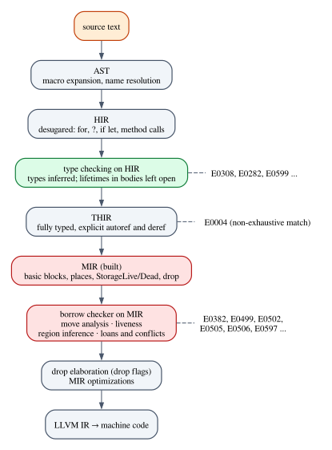
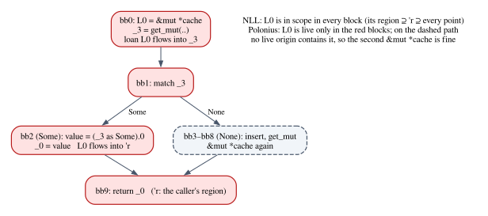

# Chapter 29 · How rustc Really Checks Borrows

Chapter 28 ended with a type system for borrowing: a dozen rules, derivations
that Lean checks, and a proof that the classic aliasing bug has no derivation at
all. It also ended with a confession. Its calculus rejects this program, and the
Rust compiler accepts it:

```rust
/// The borrow `first` is last used before the push: NLL accepts this, a
/// lexical borrow checker (Rust before 2018) rejected it.
fn first_then_push() -> usize {
    let mut readings = vec![10, 20, 30];
    let first = &readings[0];
    println!("first = {first}");
    readings.push(40);
    readings.len()
}
```

The reference `first` is used for the last time on the `println!` line, so by
the time `readings.push(40)` runs, nobody can observe the old buffer through
`first` any more. A borrow that is lexically scoped, as in Chapter 28's calculus
and in Rust before 2018, lasts until the closing brace and makes the `push` an
error. Today's compiler sees that the borrow is *dead* after its last use.

To see that, the compiler must follow the program as a graph: which statements
can run after which, which values may still be used later. This chapter opens
the hood. We follow a function from source text to MIR, the control-flow graph
the borrow checker works on; we build the dataflow analyses that run on it in a
Rust crate that reproduces rustc's error messages; and we prove in Lean the
facts about fixpoints that make those analyses trustworthy. On the way we meet
two-phase borrows, a safe program that the stable borrow checker still
rejects, and Polonius, the reformulation designed to accept it.

**In this chapter you will learn:**

- why rustc's borrow checker is a static analysis rather than a type system, and
  what each kind of checker is good at;
- what MIR is: basic blocks, places, `StorageLive` and `StorageDead`, drops,
  and how to look at the real thing;
- how dataflow analysis works (lattices, transfer functions, the worklist
  algorithm) and how it finds moved values (E0382) and live variables;
- how non-lexical lifetimes compute regions as sets of program points, and how
  loans and their conflicts produce E0499, E0502 and E0506;
- what two-phase borrows are, why `v.push(v.len())` compiles and
  `v.push(v.pop().unwrap())` does not;
- why NLL rejects "problem case #3", and how Polonius' formulation in terms of
  origins and loans accepts it;
- how to prove in Lean that a dataflow solver returns a fixpoint, the least one,
  and always terminates on a finite lattice.

## A type system or an analysis?

Chapter 28's calculus is a type system in the sense of Chapter 3. There is a
judgment, there are inference rules, and a program is accepted when a
derivation exists. The rules are *syntax-directed*: each one looks at one form
of term, and the derivation has the shape of the program's syntax tree. A
borrow is a construct with a body, $\mathsf{borrow}\ y = \&^{\alpha} x\
\mathsf{in}\ e$, and its lifetime is that body. That design has real virtues.
The derivation is a certificate that anybody can check, the rules compose (if
the parts are well typed, so is the whole), and the metatheory is a matter of
induction on derivations, which is what made the Lean proofs of Chapter 28
possible.

rustc's borrow checker works differently. It does not look for a derivation. It
turns the function body into a control-flow graph, computes *facts* at every
point of the graph ("`job` may have been moved", "`first` will be used again",
"the loan of `readings` is still in force"), and reports an error wherever some
point violates a rule. That is a **static analysis**, and in particular a
*dataflow* analysis: facts flow along the edges of the graph until nothing
changes.

| | Type system (Chapter 28) | Analysis (rustc) |
|---|---|---|
| Works on | the syntax tree | the control-flow graph |
| Produces | a derivation | facts at every program point |
| A borrow lasts | its lexical scope | while a reference made from it may be used |
| Rejects when | no derivation exists | some path reaches a conflict |

Both are *conservative*: they reject some programs that would never misbehave,
because deciding exactly which programs misbehave is impossible in general (it
would decide the halting problem). The analysis is conservative in a specific,
well-defined way: it considers every path through the graph as possible,
without evaluating conditions. rustc says so itself, in a note it attaches to
one of its errors:

```rust
fn calibrate(warm: bool) -> i32 {
    let offset: i32;
    if warm {
        offset = 2;
    }
    offset
}
```

```text
error[E0381]: used binding `offset` is possibly-uninitialized
  --> compile_fail/ch29_maybe_uninit.rs:10:5
   |
 6 |     let offset: i32;
   |         ------ binding declared here but left uninitialized
 7 |     if warm {
   |        ---- if this `if` condition is `false`, `offset` is not initialized
 8 |         offset = 2;
 9 |     }
   |      - an `else` arm might be missing here, initializing `offset`
10 |     offset
   |     ^^^^^^ `offset` used here but it is possibly-uninitialized
   |
   = note: when checking initialization, the compiler describes possible control-flow paths without evaluating whether branch conditions can actually have the values shown
```

Read the note at the end. The compiler is not claiming that `warm` can be
false at run time; it is telling you that its reasoning is about *paths*.

What the analysis buys is *flow sensitivity*: the facts can differ from one
point to the next and from one branch to the other, which is exactly what
`first_then_push` needs. What it gives up is the certificate: there is no
derivation to print, and an error message has to reconstruct a story ("borrow
later used here") from a table of facts. Chapter 33 will build on this trade:
the theories of Parts V and VI describe *what* the borrow checker enforces;
*how* it enforces it is the subject of this chapter.

> [!NOTE]
> Everything this chapter says about rustc describes the pinned compiler, Rust
> 1.99, and its documented design. The internals of rustc are not a stable
> interface: names, passes and dump formats change between releases. The ideas
> (MIR, dataflow, regions as sets of points, loans) have been stable for years.

## From source text to MIR

A Rust function goes through several representations before machine code comes
out, and different errors come from different stages:



The **AST** is the syntax tree of Chapter 3, after macro expansion and name
resolution. The **HIR** (high-level intermediate representation) is the AST
with some sugar removed: `for` loops become `loop` plus `match`, `?` and
`if let` become `match`. **Type checking** runs on the HIR: it infers types
(Chapter 13), resolves method calls, and inserts the implicit operations such
as auto-referencing of method receivers. E0308 and E0282 come from here.

Type checking does *not* decide the lifetimes inside a function body. It needs
lifetimes to check signatures and trait bounds, but the lifetime of each borrow
expression inside the body is left open: the type checker records types with the
regions *erased*. The **THIR** (typed HIR) is the fully typed, fully explicit
version of the body, every autoref and deref spelled out; pattern exhaustiveness
(E0004) is checked on it, and it is the input to MIR building.

**MIR** (mid-level intermediate representation) is a control-flow graph, and
the borrow checker runs on it. It gives every region in the body a fresh
inference variable (rustc calls this step *renumbering*), type-checks the MIR
once more to collect constraints between those variables, computes which
variables are live and which places are initialized, solves the region
constraints, and checks every access against the loans in force. After borrow
checking, *drop elaboration* decides how to run the destructors, and the MIR is
optimized and translated to LLVM IR.

### What MIR looks like

Here is a function that moves a `String` on one path only, from
`code/rust/examples/ch29_nll_accepts.rs`:

```rust
/// `job` is moved on one path only, so at the end of the function it is
/// "maybe initialized": the compiler drops it under a run-time drop flag.
fn maybe_archive(urgent: bool) {
    let job = String::from("backup");
    if urgent {
        archive(job);
    }
}
```

And here is its MIR, exactly as the borrow checker sees it. A nightly compiler
can dump MIR at any stage with the unstable flag `-Zdump-mir`; this listing was
produced by `rustc 1.101.0-nightly (2026-10-08)` with

```sh
rustc +nightly --edition 2024 --emit=metadata \
  -Zdump-mir=maybe_archive -Zdump-mir-dir=mir_dump examples/ch29_nll_accepts.rs
```

taking the file `mir_dump/ch29_nll_accepts.maybe_archive.-------.nll.0.mir` and
removing the source-position comments at the end of each line:

```text
fn maybe_archive(_1: bool) -> () {
    debug urgent => _1;
    let mut _0: ();
    let _2: std::string::String;
    let mut _3: bool;
    let _4: usize;
    let mut _5: std::string::String;
    scope 1 {
        debug job => _2;
    }

    bb0: {
        StorageLive(_2);
        _2 = <String as From<&str>>::from(const "backup") -> [return: bb1, unwind: bb9];
    }

    bb1: {
        FakeRead(ForLet(None), _2);
        StorageLive(_3);
        _3 = copy _1;
        switchInt(move _3) -> [0: bb4, otherwise: bb2];
    }

    bb2: {
        StorageLive(_4);
        StorageLive(_5);
        _5 = move _2;
        _4 = archive(move _5) -> [return: bb3, unwind: bb7];
    }

    bb3: {
        StorageDead(_5);
        StorageDead(_4);
        _0 = const ();
        goto -> bb5;
    }

    bb4: {
        _0 = const ();
        goto -> bb5;
    }

    bb5: {
        StorageDead(_3);
        drop(_2) -> [return: bb6, unwind: bb9];
    }

    bb6: {
        StorageDead(_2);
        return;
    }

    bb7 (cleanup): {
        drop(_5) -> [return: bb8, unwind terminate(cleanup)];
    }

    bb8 (cleanup): {
        drop(_2) -> [return: bb9, unwind terminate(cleanup)];
    }

    bb9 (cleanup): {
        resume;
    }
}
```

Let us read it.

- **Locals.** `_0` is the *return place*, where the function's result is
  written. `_1` to `_n` are the arguments, here `_1` for `urgent`. The rest are
  user variables and compiler temporaries: `_2` is `job` (the `debug` lines map
  names to locals), `_3` holds the condition, `_4` the discarded result of
  `archive`, `_5` the argument passed to it.
- **Basic blocks.** `bb0` to `bb9` are straight-line sequences of *statements*
  ending in one *terminator*, the only place where control can branch.
  `switchInt(move _3) -> [0: bb4, otherwise: bb2]` is the `if`; a call is a
  terminator too, because the callee may unwind.
- **Places.** Assignments, moves and borrows act on *places*: a local followed
  by *projections*, such as `(*_1)` (follow a reference) or `(_3 as Some).0` (a
  field of an enum variant). This is where Rust tracks moves per place rather
  than per variable, as Chapter 22 anticipated.
- **Operands.** `copy _1` reads a `Copy` value, `move _2` moves a value out
  (after it, `_2` is uninitialized), `const "backup"` is a constant.
- **Storage.** `StorageLive(_2)` and `StorageDead(_2)` mark where the local's
  stack slot comes into existence and where it is freed: the lexical scope of
  the variable, from `let` to the closing brace.
- **Drops.** `drop(_2) -> bb6` is a terminator that runs the destructor of `_2`
  *if* the value is still there. At this stage the compiler does not yet know
  whether it is, and that is the question drop elaboration answers later.
- **Unwinding.** The `unwind` targets and the `cleanup` blocks are the paths
  taken if a call panics. `FakeRead` statements are markers for the borrow
  checker that do nothing at run time.

You do not need a nightly compiler to see MIR. The stable flag `--emit=mir`
writes the MIR *after* borrow checking and optimization. Running
`rustc --edition 2024 --emit=mir -o accepts.mir examples/ch29_nll_accepts.rs`
with the pinned 1.99 and keeping the same function gives:

```text
fn maybe_archive(_1: bool) -> () {
    debug urgent => _1;
    let mut _0: ();
    let _2: std::string::String;
    let _3: usize;
    let mut _4: std::string::String;
    let mut _5: bool;
    scope 1 {
        debug job => _2;
    }

    bb0: {
        _5 = const false;
        _5 = const true;
        _2 = <String as From<&str>>::from(const "backup") -> [return: bb1, unwind continue];
    }

    bb1: {
        switchInt(copy _1) -> [0: bb3, otherwise: bb2];
    }

    bb2: {
        _5 = const false;
        _4 = move _2;
        _3 = archive(move _4) -> [return: bb3, unwind continue];
    }

    bb3: {
        switchInt(copy _5) -> [0: bb4, otherwise: bb5];
    }

    bb4: {
        _5 = const false;
        return;
    }

    bb5: {
        drop(_2) -> [return: bb4, unwind continue];
    }
}
```

Two things changed. The storage markers and cleanup blocks are gone, and a new
local `_5: bool` has appeared: a **drop flag**, the hidden boolean of Chapter 24.
It is set to `true` in `bb0`, set back to `false` in `bb2` just before `job` is
moved into `archive`, and tested in `bb3`, which runs `drop(_2)` (in `bb5`) only
if the flag is still `true`. By the end of the section on move analysis you
will be able to compute that this flag is needed.

### The miniature MIR

The crate `mini-nll` (`code/rust/crates/mini-nll`) has a miniature MIR with the
same shapes. Its locals, blocks, program points and region variables are
newtypes around indices:

```rust
/// A local: `_0` is the return place, `_1 ..= _n` are the arguments, and the
/// rest are user variables and compiler temporaries.
#[derive(Clone, Copy, Debug, PartialEq, Eq, PartialOrd, Ord, Hash)]
pub struct Local(pub usize);

/// A basic block, printed `bb3`.
#[derive(Clone, Copy, Debug, PartialEq, Eq, PartialOrd, Ord, Hash)]
pub struct BlockId(pub usize);

/// A program point: statement `index` of `block`. The terminator of a block
/// with `n` statements is at index `n`. Printed `bb3[1]`, as rustc does.
#[derive(Clone, Copy, Debug, PartialEq, Eq, PartialOrd, Ord, Hash)]
pub struct Location {
    pub block: BlockId,
    pub index: usize,
}

/// A region (lifetime) variable, printed `'?4` like rustc's inference
/// variables, or by its name (`'r`) if it is a named lifetime parameter.
#[derive(Clone, Copy, Debug, PartialEq, Eq, PartialOrd, Ord, Hash)]
pub struct RegionVid(pub usize);
```

A place is a local and a list of projections:

```rust
/// One step of a path into memory.
#[derive(Clone, Copy, Debug, PartialEq, Eq, PartialOrd, Ord, Hash)]
pub enum ProjectionElem {
    /// `*p`: follow a reference.
    Deref,
    /// `p.0`, `p.1`: a field of a struct, a tuple or an enum variant.
    Field(usize),
    /// `(p as Some)`: view an enum value as one of its variants.
    Downcast(&'static str),
}

/// A place: a local followed by projections, such as `_1`, `(*_1)` or
/// `(_3 as Some).0`. Moves, borrows and assignments all act on places.
#[derive(Clone, Debug, PartialEq, Eq, PartialOrd, Ord, Hash)]
pub struct Place {
    pub local: Local,
    pub projection: Vec<ProjectionElem>,
}
```

Types are reduced to what the borrow checker needs: which regions they mention,
whether they are `Copy`, whether they have a destructor. A `String` or a
`Vec<i32>` is `Owned`; a reference carries its region; `Option<&'a mut String>`
is an `Adt` with an argument:

```rust
#[derive(Clone, Copy, Debug, PartialEq, Eq)]
pub enum Mutability {
    Not,
    Mut,
}

/// Just enough of a type to know the regions it mentions, whether it is
/// `Copy`, and whether it has a destructor.
#[derive(Clone, Debug, PartialEq, Eq)]
pub enum Ty {
    /// `i32`, `usize`, `bool`, `()`: `Copy`, no destructor.
    Scalar(&'static str),
    /// `String`, `Vec<i32>`, `HashMap<u32, String>`: owns memory, is not
    /// `Copy`, has a destructor, and mentions no regions.
    Owned(&'static str),
    /// `&'a T` and `&'a mut T`.
    Ref(RegionVid, Mutability, Box<Ty>),
    /// A generic enum or struct applied to arguments: `Option<&'a mut String>`.
    Adt(&'static str, Vec<Ty>),
}
```

Statements and terminators are those of the real dump, minus what this
chapter does not use. A borrow `&'k p` carries its own region variable `'k`,
and a call carries one piece of its signature, `result_borrows_from`, saying
that the result borrows from an argument, as in
`fn index<'a>(&'a Vec<T>, usize) -> &'a T`:

```rust
#[derive(Clone, Copy, Debug, PartialEq, Eq)]
pub enum BorrowKind {
    /// `&p`
    Shared,
    /// `&mut p`
    Mut,
    /// A `&mut p` inserted by the compiler (method receivers, implicit
    /// reborrows of arguments, overloaded compound assignment). It is only
    /// *reserved* when created and *activated* at its first use.
    TwoPhaseMut,
}

/// An operand: how a value is read.
#[derive(Clone, Debug, PartialEq, Eq)]
pub enum Operand {
    /// Read a `Copy` value; the place stays initialized.
    Copy(Place),
    /// Move the value out; the place becomes uninitialized.
    Move(Place),
    /// A constant such as `const 40_i32`.
    Const(&'static str),
}

/// The right-hand side of an assignment.
#[derive(Clone, Debug, PartialEq, Eq)]
pub enum Rvalue {
    Use(Operand),
    /// `&'k p` or `&'k mut p`. Every borrow expression creates a *loan*, and
    /// `'k` is the loan's region.
    Ref(RegionVid, BorrowKind, Place),
    BinaryOp(&'static str, Operand, Operand),
    /// `discriminant(p)`: which variant an enum value is (used by `match`).
    Discriminant(Place),
}
```

```rust
#[derive(Clone, Debug, PartialEq, Eq)]
pub enum StatementKind {
    Assign(Place, Rvalue),
    /// The local's storage is allocated: it is now in scope, uninitialized.
    StorageLive(Local),
    /// The local's storage is freed: it goes out of scope.
    StorageDead(Local),
    /// `let x = ...;` marks the binding as read (rustc's `FakeRead(ForLet)`).
    FakeRead(Local),
}

#[derive(Clone, Debug, PartialEq, Eq)]
pub enum TerminatorKind {
    Goto(BlockId),
    /// Jump on the value of an integer: `[0: bb4, otherwise: bb2]`.
    SwitchInt {
        discr: Operand,
        targets: Vec<(&'static str, BlockId)>,
    },
    /// `dest = func(args) -> target`. If `result_borrows_from` is
    /// `Some(i)`, the signature ties the regions of the result to the regions
    /// of argument `i`, as in `fn index<'a>(&'a Vec<T>, usize) -> &'a T`.
    Call {
        func: &'static str,
        args: Vec<Operand>,
        dest: Place,
        target: BlockId,
        result_borrows_from: Option<usize>,
    },
    /// Run the destructor of `place` (if it is still initialized).
    Drop {
        place: Place,
        target: BlockId,
    },
    Return,
}
```

The bodies in `src/programs.rs` are translated from real functions by hand,
following the MIR that rustc builds for them. A small builder keeps the
translation readable, and attaches spans to statements *by content*, so that
error messages can point into the real source file:

```rust
/// ```text
/// fn maybe_archive(urgent: bool) {
///     let job = String::from("backup");
///     if urgent {
///         archive(job);
///     }
/// }
/// ```
pub fn maybe_archive() -> Body {
    let mut b = Builder::new("maybe_archive", ACCEPTS_FILE, ACCEPTS);
    b.ret(scalar("()"));
    let urgent = b.arg(
        "urgent",
        scalar("bool"),
        b.span("fn maybe_archive", "urgent"),
    );
    let job = b.var("job", owned("String"), b.span("let job", "job"));
    let cond = b.temp(scalar("bool"));
    let archived = b.temp(scalar("usize"));
    let arg = b.temp(owned("String"));
    let [bb0, bb1, bb2, bb3, bb4, bb5, bb6] = [(); 7].map(|_| b.block());

    b.storage_live(bb0, job);
    let from = b.span("let job", "String::from(\"backup\")");
    let callee = b.span("let job", "String::from");
    b.call(bb0, job, "String::from", vec![cst("\"backup\"")], bb1)
        .spans(from, callee);

    b.fake_read(bb1, job);
    b.storage_live(bb1, cond);
    b.assign(bb1, cond, Rvalue::Use(copy(urgent)), None);
    b.switch(bb1, mv(cond), vec![("0", bb4), ("otherwise", bb2)]);

    b.storage_live(bb2, archived);
    b.storage_live(bb2, arg);
    let moved = b.span("archive(job)", "job");
    b.assign(bb2, arg, Rvalue::Use(mv(job)), Some(moved));
    let call = b.span("archive(job)", "archive(job)");
    let callee = b.span("archive(job)", "archive");
    b.call(bb2, archived, "archive", vec![mv(arg)], bb3)
        .spans(call, callee);

    b.storage_dead(bb3, arg);
    b.storage_dead(bb3, archived);
    b.assign(bb3, Local(0), Rvalue::Use(cst("()")), None);
    b.goto(bb3, bb5);

    b.assign(bb4, Local(0), Rvalue::Use(cst("()")), None);
    b.goto(bb4, bb5);

    b.storage_dead(bb5, cond);
    b.drop(bb5, job, bb6);

    let end = b.closing_brace();
    b.storage_dead_at(bb6, job, end);
    b.ret_term(bb6);
    b.finish()
}
```

Printed in rustc's format by `crates/mini-nll/examples/ch29_mir.rs`, the result
is the real dump without the unwinding machinery:

```text
fn maybe_archive(_1: bool) -> () {
    debug urgent => _1;
    debug job => _2;
    let _0: ();
    let _2: String;
    let _3: bool;
    let _4: usize;
    let _5: String;

    bb0: {
        StorageLive(_2);
        _2 = String::from(const "backup") -> bb1;
    }

    bb1: {
        FakeRead(ForLet, _2);
        StorageLive(_3);
        _3 = copy _1;
        switchInt(move _3) -> [0: bb4, otherwise: bb2];
    }

    bb2: {
        StorageLive(_4);
        StorageLive(_5);
        _5 = move _2;
        _4 = archive(move _5) -> bb3;
    }

    bb3: {
        StorageDead(_5);
        StorageDead(_4);
        _0 = const ();
        goto -> bb5;
    }

    bb4: {
        _0 = const ();
        goto -> bb5;
    }

    bb5: {
        StorageDead(_3);
        drop(_2) -> bb6;
    }

    bb6: {
        StorageDead(_2);
        return;
    }
}
edges: bb0->bb1 bb1->bb4 bb1->bb2 bb2->bb3 bb3->bb5 bb4->bb5 bb5->bb6
```

The crate has nine such programs: the four functions of
`examples/ch29_nll_accepts.rs` that rustc accepts and five of this chapter's
compile-fail programs. Every analysis below runs on all of them.

## Dataflow analysis

A dataflow analysis attaches a *fact* to every program point. For the move
check, the fact at a point is "the set of places that may be uninitialized
here"; for liveness, "the set of locals whose value may still be used". Three
ingredients define an analysis.

**A lattice of facts.** The facts must be ordered by "knows less, knows more",
with a least element $\bot$ ("nothing yet") and a *join* $x \sqcup y$, the
least fact that is above both (Chapter 5 met joins in Heyting algebras). For
sets of places the order is $\subseteq$, the join is $\cup$ and $\bot$ is
$\emptyset$. Joining is what happens where control-flow paths merge: a place
that *may* be uninitialized on one incoming path may be uninitialized after the
merge.

**A transfer function** $f_n$ for every node $n$ of the graph, saying how
executing $n$ changes the facts. Most transfer functions in this chapter have
the *gen/kill* form $f_n(x) = \mathit{gen}_n \cup (x \setminus
\mathit{kill}_n)$: the statement adds some facts and removes others. A move out
of `_2` *gens* "`_2` may be uninitialized"; an assignment to `_2` *kills* it.

**A direction.** In a *forward* analysis facts flow along the edges
(initialization: what happened before determines what holds now). In a
*backward* analysis they flow against them (liveness: what happens later
determines what is live now).

The facts we want satisfy, at every node $n$ of a forward analysis, the
equation

$$
\mathit{in}(n) = \mathit{entry}(n) \sqcup \bigsqcup_{m \in \mathrm{pred}(n)} f_m(\mathit{in}(m))
$$

where $\mathit{entry}(n)$ holds the boundary facts (at the start of the
function: "every local except the arguments is uninitialized") and the big join
runs over the predecessors of $n$. A backward analysis is the same with
successors in place of predecessors. In a graph with loops the equations are
recursive, so we cannot just compute them in order. We solve them by
*iteration*: start with $\bot$ everywhere, apply the equations, and repeat until
nothing changes. If the transfer functions are **monotone** (more facts in,
more facts out) and the lattice has no infinite ascending chains, the iteration
stops, and what it stops at is the *least* solution, the most precise facts
that satisfy all the equations. We will prove all of this in Lean shortly.

### A framework in Rust

rustc has a generic dataflow framework (`rustc_mir_dataflow`) in which each
analysis supplies its lattice and transfer functions. `mini-nll` has a
miniature one, in `src/dataflow.rs`:

```rust
#[derive(Clone, Copy, Debug, PartialEq, Eq)]
pub enum Direction {
    /// Facts flow along the edges of the CFG (initialization, loans).
    Forward,
    /// Facts flow against the edges (liveness: "used later").
    Backward,
}

/// A dataflow analysis. `Domain` must be a join-semilattice with `bottom` as
/// its least element, and the two `apply_*` functions must be monotone; then
/// the worklist algorithm terminates (if the lattice has finite height) and
/// computes the least solution of the dataflow equations.
pub trait Analysis {
    type Domain: Clone + PartialEq + Debug;
    const DIRECTION: Direction;

    /// The least element: "no facts yet".
    fn bottom(&self, body: &Body) -> Self::Domain;

    /// The facts at the boundary: on entry to `bb0` for a forward analysis,
    /// at every `return` for a backward one.
    fn boundary(&self, body: &Body) -> Self::Domain;

    /// Join `other` into `state`; return `true` if `state` grew.
    fn join(&self, state: &mut Self::Domain, other: &Self::Domain) -> bool;

    /// The effect of a statement (applied "backwards" for a backward analysis).
    fn apply_statement(
        &self,
        state: &mut Self::Domain,
        stmt: &Statement,
        loc: Location,
    );

    /// The effect of a terminator.
    fn apply_terminator(
        &self,
        state: &mut Self::Domain,
        term: &Terminator,
        loc: Location,
    );
}
```

The solver keeps one state per basic block (the facts on entry, in the
direction of the analysis) and a *worklist* of blocks to process. Processing a
block pushes its state through the block's statements and joins the result into
the next blocks; any block whose state grew goes back on the worklist:

```rust
/// Iterate to the fixpoint with a worklist of basic blocks.
pub fn solve<A: Analysis>(body: &Body, analysis: A) -> Results<A> {
    let n = body.blocks.len();
    let preds = body.predecessors();
    let mut states = vec![analysis.bottom(body); n];
    let mut worklist: VecDeque<usize> = (0..n).collect();
    match A::DIRECTION {
        Direction::Forward => states[0] = analysis.boundary(body),
        Direction::Backward => {
            for bb in body.block_ids() {
                if body.successors(bb).is_empty() {
                    states[bb.0] = analysis.boundary(body);
                }
            }
            worklist = (0..n).rev().collect();
        }
    }
    let mut queued = vec![true; n];
    let mut block_visits = 0;

    while let Some(bb) = worklist.pop_front() {
        queued[bb] = false;
        block_visits += 1;
        // Push the state through the block...
        let mut state = states[bb].clone();
        apply_block(body, &analysis, bb, &mut state, |_, _| {});
        // ...and join it into the neighbors that come next in our direction.
        let next: Vec<usize> = match A::DIRECTION {
            Direction::Forward => body.successors(BlockId(bb)),
            Direction::Backward => preds[bb].clone(),
        }
        .into_iter()
        .map(|b| b.0)
        .collect();
        for succ in next {
            if analysis.join(&mut states[succ], &state) && !queued[succ] {
                queued[succ] = true;
                worklist.push_back(succ);
            }
        }
    }
    Results {
        analysis,
        block_states: states,
        block_visits,
    }
}
```

The `join` method returns `true` exactly when the state grew, so the worklist
only revisits blocks that can learn something new. With monotone transfer
functions and a finite lattice, a state can only grow a finite number of times,
so the loop ends.

## Move analysis

The first analysis rustc runs answers the question behind E0382: at this point,
may this place have been moved out of (or never initialized)? rustc tracks
*move paths*, places without dereferences (`_2`, `(_3 as Some).0`), since what
lies behind a reference is not owned by the function. The analysis is
`MaybeUninit`, in `src/moves.rs`:

```rust
/// Forward "may" analysis: a move path is in the set at a point if on *some*
/// path from the start of the function to that point it was never
/// initialized, or was moved out of, or its storage died.
pub struct MaybeUninit;

impl Analysis for MaybeUninit {
    type Domain = PlaceSet;
    const DIRECTION: Direction = Direction::Forward;

    fn bottom(&self, _body: &Body) -> PlaceSet {
        PlaceSet::new()
    }

    fn boundary(&self, body: &Body) -> PlaceSet {
        // On entry, everything except the arguments is uninitialized.
        (0..body.locals.len())
            .filter(|&i| i == 0 || i > body.arg_count)
            .map(|i| Place::from(Local(i)))
            .collect()
    }

    fn join(&self, state: &mut PlaceSet, other: &PlaceSet) -> bool {
        let before = state.len();
        state.extend(other.iter().cloned());
        state.len() != before
    }

    fn apply_statement(&self, state: &mut PlaceSet, stmt: &Statement, _: Location) {
        match &stmt.kind {
            StatementKind::Assign(dest, rv) => {
                for p in moved_places(&rv.operands()) {
                    mark_uninit(state, &p); // gen: moved out
                }
                mark_init(state, dest); // kill: (re)initialized
            }
            StatementKind::StorageLive(l) | StatementKind::StorageDead(l) => {
                mark_uninit(state, &Place::from(*l));
            }
            StatementKind::FakeRead(_) => {}
        }
    }

    fn apply_terminator(&self, state: &mut PlaceSet, term: &Terminator, _: Location) {
        match &term.kind {
            TerminatorKind::Call { args, dest, .. } => {
                let args: Vec<&Operand> = args.iter().collect();
                for p in moved_places(&args) {
                    mark_uninit(state, &p);
                }
                mark_init(state, dest);
            }
            TerminatorKind::Drop { place, .. } => mark_uninit(state, place),
            _ => {}
        }
    }
}
```

Read it as gen/kill: a `move` gens its place, an assignment kills its
destination, `StorageLive` and `StorageDead` gen the local (a fresh or freed
slot holds no value), and a `drop` leaves the place uninitialized. The example
`crates/mini-nll/examples/ch29_dataflow.rs` runs it on `maybe_archive`, with
two more analyses that we will need, and prints the state on entry to each
block:

```rust
/// Solve `analysis` on `body` and print the state at the entry of every
/// block (for a backward analysis: at the exit, where it starts).
fn show<A, T>(body: &Body, title: &str, analysis: A)
where
    A: Analysis<Domain = BTreeSet<T>>,
    T: Display,
{
    let results = solve(body, analysis);
    println!("{title} ({} block visits)", results.block_visits);
    for (bb, state) in body.block_ids().zip(&results.block_states) {
        println!("  {bb}: {}", set(state));
    }
}
```

```text
maybe-uninitialized, on entry (7 block visits)
  bb0: {_0, _2, _3, _4, _5}
  bb1: {_0, _3, _4, _5}
  bb2: {_0, _4, _5}
  bb3: {_0, _2, _5}
  bb4: {_0, _4, _5}
  bb5: {_2, _4, _5}
  bb6: {_2, _3, _4, _5}
maybe-initialized, on entry (7 block visits)
  bb0: {_1}
  bb1: {_1, _2}
  bb2: {_1, _2, _3}
  bb3: {_1, _3, _4}
  bb4: {_1, _2, _3}
  bb5: {_0, _1, _2, _3}
  bb6: {_0, _1}
```

Follow `_2` (`job`) through the first table. Uninitialized on entry to `bb0`,
initialized by the call to `String::from`, it is absent in `bb1` and `bb2`;
moved into `_5` in `bb2`, it is back on entry to `bb3`. Block `bb5` has two
predecessors, `bb3` (where `_2` may be uninitialized) and `bb4` (where it is
not), and the join keeps it. With no loop in the graph, each block was
processed exactly once.

### The E0382 check

With the facts in hand, the check is a loop over every use of every place:

```rust
/// Report every use of a place that may be uninitialized: E0382 if some
/// path moved out of it, E0381 if it was never initialized.
pub fn check_moves(body: &Body) -> Vec<Diagnostic> {
    let uninit = solve(body, MaybeUninit).states_before(body);
    let mut diags = Vec::new();
    for loc in body.locations() {
        for (place, kind) in uses_at(body, loc) {
            if let Some(missing) = overlaps(&uninit[&loc], &place) {
                diags.push(report_uninit_use(body, loc, &place, kind, &missing));
            }
        }
    }
    diags
}
```

When a use finds its place in the maybe-uninitialized set, the error message
needs the moves responsible, so `report_uninit_use` walks *backwards* from the
use, along every path, until it meets a move of the place (or an assignment
that initializes it, which ends that path). Here is the analysis on the variant
of `maybe_archive` that uses `job` after the `if`:

```rust
fn conditional_move(urgent: bool) -> usize {
    let job = String::from("backup");
    if urgent {
        archive(job);
    }
    job.len()
}
```

`mini-nll` reports, in the last lines of the same output:

```text
error[E0382]: borrow of moved value: `job`
  --> compile_fail/ch29_conditional_move.rs:14:5
   |
10 |     let job = String::from("backup");
   |         --- move occurs because `job` has type `String`, which does not implement the `Copy` trait
11 |     if urgent {
12 |         archive(job);
   |                 --- value moved here
13 |     }
14 |     job.len()
   |     ^^^ value borrowed here after move
```

and the real compiler reports:

```text
error[E0382]: borrow of moved value: `job`
  --> compile_fail/ch29_conditional_move.rs:14:5
   |
10 |     let job = String::from("backup");
   |         --- move occurs because `job` has type `String`, which does not implement the `Copy` trait
11 |     if urgent {
12 |         archive(job);
   |                 --- value moved here
13 |     }
14 |     job.len()
   |     ^^^ value borrowed here after move
   |
note: consider changing this parameter type in function `archive` to borrow instead if owning the value isn't necessary
  --> compile_fail/ch29_conditional_move.rs:4:17
   |
 4 | fn archive(job: String) -> usize {
   |    -------      ^^^^^^ this parameter takes ownership of the value
   |    |
   |    in this function
help: consider cloning the value if the performance cost is acceptable
   |
12 |         archive(job.clone());
   |                    ++++++++
```

Up to rustc's extra note and suggestion, the two are identical, down to the
columns of the underlines. That is no accident of formatting: the facts are the
same facts. "Borrow of moved value" because the use is `job.len()`, which
borrows `job` (in MIR, `_7 = &_2`); "value moved here" because the backward
walk found the move `_6 = move _2` in `bb2`.

The same walk explains the loop version of the error from Chapter 6, "value
moved here, in previous iteration of loop": when the backward search from a use
in a loop body comes back around the back edge to the use itself, the move it
finds is the use's own move, one iteration earlier. (The crate's tests build
exactly this case.) And a place that was never initialized on some path gives
E0381 instead, as in `calibrate` above.

### Drop elaboration and drop flags

The dual analysis, `MaybeInit`, computes the places that *may be initialized*.
Its table is the second one in the output above. Drop elaboration combines the
two at every `drop`:

```rust
/// What drop elaboration does with a `drop(place)` terminator.
#[derive(Clone, Copy, Debug, PartialEq, Eq)]
pub enum DropStyle {
    /// The place is definitely uninitialized here: the drop is deleted.
    Dead,
    /// The place is definitely initialized: drop it unconditionally.
    Static,
    /// Initialized on some paths only: drop it if a run-time flag says so.
    Conditional,
    /// Partly moved out: drop the fields that are still there.
    Open,
}

/// Classify every `drop` terminator, as rustc's drop elaboration does after
/// borrow checking.
pub fn drop_styles(body: &Body) -> Vec<(Location, Place, DropStyle)> {
    let init = solve(body, MaybeInit).states_before(body);
    let uninit = solve(body, MaybeUninit).states_before(body);
    let mut out = Vec::new();
    for bb in body.block_ids() {
        if let TerminatorKind::Drop { place, .. } = &body.blocks[bb.0].terminator.kind {
            let loc = body.terminator_location(bb);
            let maybe_init = overlaps(&init[&loc], place).is_some();
            let style = match overlaps(&uninit[&loc], place) {
                _ if !maybe_init => DropStyle::Dead,
                None => DropStyle::Static,
                Some(q) if q.is_prefix_of(place) => DropStyle::Conditional,
                Some(_) => DropStyle::Open,
            };
            out.push((loc, place.clone(), style));
        }
    }
    out
}
```

```text
drop elaboration:
  maybe_archive: bb5[1] drop(_2) is Conditional
  record_count: bb3[4] drop(_1) is Dead
```

At the `drop(_2)` in `bb5`, `_2` is in both sets: maybe initialized (through
`bb4`) and maybe uninitialized (through `bb3`). Only a run-time flag can tell,
which is the `_5` you saw in the optimized MIR. In `record_count`, which we
meet below, the value is moved into the return place on every path before the
`drop`, so it is definitely uninitialized there and the drop is deleted: the
optimized MIR of `record_count` has no `drop` on its normal path at all.

## Liveness

The second analysis is the one non-lexical lifetimes are built on. A local is
**live** at a point if the value it holds there may be read later, along some
path. It is a backward analysis: a *use* gens the local (reading it later makes
it live now), a *definition* kills it (whatever it held before is overwritten,
so that value is dead):

```rust
/// Backward "may" analysis: the locals whose current value may be used later.
pub struct Liveness;

impl Liveness {
    /// An assignment to `dest`: a *def* of the local if the whole local is
    /// overwritten, a *use* if we write through a reference stored in it.
    fn def(state: &mut LocalSet, dest: &Place) {
        if dest.projection.is_empty() {
            state.remove(&dest.local);
        } else if dest.has_deref() {
            state.insert(dest.local);
        }
    }
}

impl Analysis for Liveness {
    type Domain = LocalSet;
    const DIRECTION: Direction = Direction::Backward;

    fn bottom(&self, _body: &Body) -> LocalSet {
        LocalSet::new()
    }

    fn boundary(&self, _body: &Body) -> LocalSet {
        LocalSet::new() // nothing is used after `return`
    }

    fn join(&self, state: &mut LocalSet, other: &LocalSet) -> bool {
        union(state, other)
    }

    // Backward: first remove what the statement defines, then add what it
    // uses (the uses happen before the definition).
    fn apply_statement(&self, state: &mut LocalSet, stmt: &Statement, _: Location) {
        match &stmt.kind {
            StatementKind::Assign(dest, rv) => {
                Self::def(state, dest);
                for p in rv.places() {
                    state.insert(p.local);
                }
            }
            StatementKind::StorageLive(l) | StatementKind::StorageDead(l) => {
                state.remove(l);
            }
            StatementKind::FakeRead(l) => {
                state.insert(*l);
            }
        }
    }

    fn apply_terminator(&self, state: &mut LocalSet, term: &Terminator, _: Location) {
        match &term.kind {
            TerminatorKind::Call { args, dest, .. } => {
                Self::def(state, dest);
                for p in args.iter().filter_map(Operand::place) {
                    state.insert(p.local);
                }
            }
            TerminatorKind::SwitchInt { discr, .. } => {
                if let Some(p) = discr.place() {
                    state.insert(p.local);
                }
            }
            // A drop uses the value: its destructor may read it.
            TerminatorKind::Drop { place, .. } => {
                state.insert(place.local);
            }
            TerminatorKind::Return => {
                state.insert(Local(0));
            }
            TerminatorKind::Goto(_) => {}
        }
    }
}
```

A `drop` counts as a use: the destructor may read the value. rustc refines this
distinction (a variable that is live only because of its drop is *drop-live*,
and only the regions its destructor may actually touch are kept alive), which
matters for types with a `Drop` impl that hold references. Our programs do not
need the refinement.

On `maybe_archive` (the third table of the output, the state on *exit* from
each block, where a backward analysis starts):

```text
live, on exit (7 block visits)
  bb0: {_1, _2}
  bb1: {_2}
  bb2: {_2}
  bb3: {_0, _2}
  bb4: {_0, _2}
  bb5: {_0}
  bb6: {}
```

`_2` is live on exit from `bb0` through `bb4` because the `drop(_2)` in `bb5`
reads it, and `_0` is live from the moment it is assigned until the `return`.
Notice that liveness says nothing about initialization: on exit from `bb3`,
`job` has been moved, yet it is "live" because the `drop` will look at it. Each
analysis answers one question, and the borrow checker combines them.

## Dataflow, proved

The Rust solver *is* a fixpoint computation, and the claims we made about it
(it stops, the result satisfies the equations, the result is the most precise
one) are theorems. The file `code/lean/Book/Ch29/Dataflow.lean` proves them.
Chapter 28 proved things about derivations; here we prove things about an
algorithm, so this is where the contrast between "type system" and "analysis"
becomes concrete in Lean too.

A dataflow problem has nodes `ι` and facts in a type `α` that is a
join-semilattice with a least element: Mathlib's classes `SemilatticeSup` (a
partial order with `⊔`) and `OrderBot` (with `⊥`). The `inputs` of a node are
its predecessors for a forward analysis and its successors for a backward one,
so one definition serves both directions:

```lean
/-- A dataflow problem with nodes `ι` and facts `α`. For a forward analysis
the `inputs` of a node are its predecessors in the control-flow graph; for a
backward analysis they are its successors. -/
structure Problem (ι α : Type) [SemilatticeSup α] [OrderBot α] where
  /-- The nodes whose facts flow into each node. -/
  inputs : ι → List ι
  /-- Facts that hold at a node whatever flows in (the boundary condition). -/
  entry : ι → α
  /-- The transfer function of each node. -/
  transfer : ι → α → α
```

Joining a list of facts is a fold, with two lemmas that say it is the least
upper bound of the list:

```lean
/-- The join of a list of facts: `x₁ ⊔ x₂ ⊔ ... ⊔ ⊥`. -/
def joinAll : List α → α
  | [] => ⊥
  | x :: xs => x ⊔ joinAll xs

/-- Every element of the list is below the join... -/
theorem le_joinAll {x : α} : ∀ {xs : List α}, x ∈ xs → x ≤ joinAll xs
  | _ :: _, h => by
    rcases List.mem_cons.mp h with rfl | h
    · exact le_sup_left
    · exact le_trans (le_joinAll h) le_sup_right

/-- ...and the join is below every upper bound of the list. -/
theorem joinAll_le {y : α} : ∀ {xs : List α}, (∀ x ∈ xs, x ≤ y) → joinAll xs ≤ y
  | [], _ => bot_le
  | x :: _, h =>
    sup_le (h x List.mem_cons_self)
      (joinAll_le fun z hz => h z (List.mem_cons_of_mem x hz))
```

The first lemma is proved by recursion on the list, with `rcases` splitting the
membership hypothesis into "it is the head" (and then `le_sup_left` applies) or
"it is in the tail" (and then the recursive call gives `x ≤ joinAll xs`, which
`le_sup_right` lifts past the head). The second is a term: an upper bound of
the head and of the tail is an upper bound of their join (`sup_le`).

`step` computes the right-hand side of the dataflow equations at every node at
once, and `IsSolution` says that a state satisfies every constraint: the
boundary facts are included, and so is everything that flows along an edge:

```lean
/-- One round of the dataflow equations, at every node at once. -/
def step (P : Problem ι α) (s : ι → α) : ι → α :=
  fun v => P.entry v ⊔ joinAll ((P.inputs v).map fun u => P.transfer u (s u))

/-- A solution satisfies every constraint: the boundary facts, and every edge
`u → v`, whose transferred facts must be included in the facts at `v`. -/
def IsSolution (P : Problem ι α) (s : ι → α) : Prop :=
  ∀ v, P.entry v ≤ s v ∧ ∀ u ∈ P.inputs v, P.transfer u (s u) ≤ s v
```

The solver is the iteration, with fuel, as in Chapter 7's normalizer: Lean
insists that every function terminates, and "repeat until nothing changes" does
not obviously do so.

```lean
/-- Iterate `step` until nothing changes, for at most `fuel` rounds. -/
def solve [DecidableEq (ι → α)] (P : Problem ι α) : ℕ → (ι → α) → Option (ι → α)
  | 0, _ => none
  | fuel + 1, s => if P.step s = s then some s else P.solve fuel (P.step s)
```

The test `P.step s = s` compares two functions `ι → α`; Lean can decide it
when `ι` is finite and equality on `α` is decidable, which is the instance the
`[DecidableEq (ι → α)]` argument asks for.

The first theorem is the basic guarantee: a converged result is a fixpoint.

```lean
/-- If the solver returns `r`, then `r` is a fixpoint of `step`. -/
theorem solve_fixpoint [DecidableEq (ι → α)] (P : Problem ι α) :
    ∀ (fuel : ℕ) (s r : ι → α), P.solve fuel s = some r → P.step r = r := by
  intro fuel
  induction fuel with
  | zero =>
    -- With no fuel the solver returns `none`, so there is nothing to prove.
    intro s r h
    simp [solve] at h
  | succ fuel ih =>
    intro s r h
    -- Unfold one round: either `step s = s` and `r = s`, or we recurse.
    unfold solve at h
    split at h
    · -- Converged: `h : some s = some r` and the test said `step s = s`.
      rename_i hfix
      cases h
      exact hfix
    · -- Not yet: the recursive call returned `r`; the induction hypothesis
      -- (for one unit of fuel less, starting from `step s`) finishes.
      exact ih (P.step s) r h
```

The proof is an induction on the fuel. With zero fuel the solver returned
`none`, so the hypothesis `none = some r` is absurd and `simp` closes the goal.
With `fuel + 1`, `unfold solve` exposes the `if`, and `split` gives one goal
per branch. In the first, `cases h` identifies `r` with `s`, and the test's
hypothesis `step s = s` is the goal. In the second, the solver recursed on
`step s`, and the induction hypothesis (stated for every starting state, which
is why `intro s r` comes after `induction`) finishes.

Next, fixpoints and solutions. A state is a solution exactly when one more
round of `step` does not take it any higher:

```lean
/-- Being a solution is the same as being a *post-fixpoint*: `step s ≤ s`. -/
theorem isSolution_iff (P : Problem ι α) (s : ι → α) :
    P.IsSolution s ↔ P.step s ≤ s := by
  constructor
  · intro hs v
    obtain ⟨hentry, hedges⟩ := hs v
    apply sup_le hentry
    apply joinAll_le
    intro x hx
    obtain ⟨u, hu, rfl⟩ := List.mem_map.mp hx
    exact hedges u hu
  · intro hs v
    constructor
    · exact le_trans le_sup_left (hs v)
    · intro u hu
      have hmem : P.transfer u (s u) ∈ (P.inputs v).map fun w => P.transfer w (s w) :=
        List.mem_map.mpr ⟨u, hu, rfl⟩
      exact le_trans (le_joinAll hmem) (le_trans le_sup_right (hs v))
```

Left to right: `step s v` is a join, so it is below `s v` if both halves are
(`sup_le`): the boundary half by the first part of the hypothesis, the list half
by `joinAll_le`, each element of the list being, by `List.mem_map`, the transfer
of some input `u`. Right to left: `entry v` is below `step s v`
(`le_sup_left`), which is below `s v`; and each input's contribution is in the
list, hence below its join, hence below `step s v` and `s v`. A fixpoint is in
particular a solution:

```lean
/-- A fixpoint of `step` satisfies all the dataflow constraints. -/
theorem fixpoint_isSolution (P : Problem ι α) {r : ι → α} (h : P.step r = r) :
    P.IsSolution r :=
  (P.isSolution_iff r).mpr (le_of_eq h)
```

So the solver's answer satisfies every dataflow constraint. Is it the *best*
answer? Any state with at least the right facts at every node is a solution:
"every place may be uninitialized everywhere" satisfies all the equations of the
move analysis, and it would reject every program. We want the least solution,
and for that the transfer functions must be monotone (Chapter 17 introduced
Mathlib's `Monotone`). Then `step` is monotone too:

```lean
/-- With monotone transfer functions, `step` is monotone. -/
theorem step_mono (P : Problem ι α) (hmono : ∀ u, Monotone (P.transfer u)) :
    Monotone P.step := by
  intro s t hst v
  apply sup_le_sup (le_refl _)
  exact joinAll_map_mono (fun u => hmono u (hst u)) _
```

and the result of the solver is below every solution:

```lean
/-- The solver computes the *least* solution: starting below any solution
`t`, every round stays below `t`, so the result does too. -/
theorem solve_least [DecidableEq (ι → α)] (P : Problem ι α)
    (hmono : ∀ u, Monotone (P.transfer u)) {t : ι → α} (ht : P.IsSolution t) :
    ∀ (fuel : ℕ) (s r : ι → α), s ≤ t → P.solve fuel s = some r → r ≤ t := by
  have hpost : P.step t ≤ t := (P.isSolution_iff t).mp ht
  intro fuel
  induction fuel with
  | zero => intro s r _ h; simp [solve] at h
  | succ fuel ih =>
    intro s r hs h
    unfold solve at h
    split at h
    · cases h; exact hs
    · -- `step s ≤ step t ≤ t`: one more round keeps us below `t`.
      exact ih (P.step s) r (le_trans (P.step_mono hmono hs) hpost) h

/-- In particular, starting from `⊥`. -/
theorem solve_bot_least [DecidableEq (ι → α)] (P : Problem ι α)
    (hmono : ∀ u, Monotone (P.transfer u)) {t r : ι → α} (ht : P.IsSolution t)
    {fuel : ℕ} (h : P.solve fuel ⊥ = some r) : r ≤ t :=
  P.solve_least hmono ht fuel ⊥ r bot_le h
```

The proof is the classic argument for least fixpoints, again by induction on
the fuel. If the current state `s` is below a solution `t`, then `step s` is
below `step t` (monotonicity), which is below `t` (`t` is a solution, so a
post-fixpoint). Starting from `⊥`, which is below everything, every iterate
stays below `t`, and so does the final answer. In the language of the borrow
checker: the solver flags a place as maybe-uninitialized only if *every*
consistent assignment of facts would flag it too.

A useful corollary compares two problems that differ only in their boundary
facts. We will need it for regions:

```lean
/-- More boundary facts give a larger least solution. (Chapter 29 uses this to
compare lexical and non-lexical regions.) -/
theorem solve_mono_entry [DecidableEq (ι → α)] (P Q : Problem ι α)
    (hinputs : P.inputs = Q.inputs) (htransfer : P.transfer = Q.transfer)
    (hentry : P.entry ≤ Q.entry) (hmono : ∀ u, Monotone (P.transfer u))
    {fp fq : ℕ} {rp rq : ι → α}
    (hp : P.solve fp ⊥ = some rp) (hq : Q.solve fq ⊥ = some rq) : rp ≤ rq := by
  -- `rq` solves `Q`, hence also `P`, whose constraints are weaker.
  have hq_sol : Q.IsSolution rq := Q.fixpoint_isSolution (Q.solve_fixpoint fq ⊥ rq hq)
  have hp_sol : P.IsSolution rq := by
    intro v
    obtain ⟨he, hedges⟩ := hq_sol v
    refine ⟨le_trans (hentry v) he, ?_⟩
    rw [hinputs, htransfer]
    exact hedges
  exact P.solve_bot_least hmono hp_sol hp
```

Finally, termination. With fuel the solver may give up, so we prove that on a
finite lattice a certain amount of fuel is always enough:

```lean
/-- If the `k`-th iterate is already a fixpoint and the fuel exceeds `k`, the
solver returns something. -/
theorem solve_isSome [DecidableEq (ι → α)] (P : Problem ι α) :
    ∀ (fuel k : ℕ) (s : ι → α), P.step^[k + 1] s = P.step^[k] s → k < fuel →
      (P.solve fuel s).isSome := by
  intro fuel
  induction fuel with
  | zero => intro k s _ hk; omega
  | succ fuel ih =>
    intro k s hfix hk
    unfold solve
    split
    · rfl
    · rename_i hne
      cases k with
      | zero => exact absurd hfix hne
      | succ k =>
        -- Iterating `k + 1` times from `s` is iterating `k` times from `step s`.
        rw [Function.iterate_succ_apply, Function.iterate_succ_apply] at hfix
        exact ih k (P.step s) hfix (by omega)

/-- On a finite lattice, monotone transfer functions and `|ι → α| + 1` rounds
of fuel are enough. (The bound is crude: the real one is the number of nodes
times the height of the lattice, plus one.) -/
theorem solve_terminates [Fintype ι] [DecidableEq ι] [Fintype α] [DecidableEq α]
    (P : Problem ι α) (hmono : ∀ u, Monotone (P.transfer u)) :
    (P.solve (Fintype.card (ι → α) + 1) ⊥).isSome := by
  set N := Fintype.card (ι → α)
  let it : ℕ → ι → α := fun k => P.step^[k] ⊥
  -- The iterates form an increasing chain ⊥ ≤ step ⊥ ≤ step (step ⊥) ≤ ...
  have hchain : Monotone it := by
    apply monotone_nat_of_le_succ
    intro k
    induction k with
    | zero => exact bot_le
    | succ k ihk =>
      simp only [it, Function.iterate_succ_apply'] at ihk ⊢
      exact P.step_mono hmono ihk
  -- Pigeonhole: N + 1 iterates in a set of size N, so two of them are equal.
  obtain ⟨i, j, hij, heq⟩ := Fintype.exists_ne_map_eq_of_card_lt
    (fun k : Fin (N + 1) => it k) (by simp [N])
  -- Between two equal iterates the chain is flat, so the smaller index is a fixpoint.
  have flat : ∀ a b : ℕ, a < b → it a = it b → it (a + 1) = it a := by
    intro a b hab hab'
    apply le_antisymm
    · rw [hab']; exact hchain (by omega)
    · exact hchain (by omega)
  have key : ∃ k, k < N + 1 ∧ it (k + 1) = it k := by
    rcases lt_or_gt_of_ne (Fin.val_ne_of_ne hij) with h | h
    · exact ⟨i, i.isLt, flat i j h heq⟩
    · exact ⟨j, j.isLt, flat j i h heq.symm⟩
  obtain ⟨k, hk, hfix⟩ := key
  exact P.solve_isSome (N + 1) k ⊥ hfix hk
```

`solve_isSome` says that if the `k`-th iterate is already a fixpoint, fuel
`k + 1` suffices; its induction peels one iteration off with
`Function.iterate_succ_apply`. `solve_terminates` finds such a `k`. The iterates
`⊥, step ⊥, step (step ⊥), ...` form an ascending chain
(`monotone_nat_of_le_succ` reduces this to one step at a time, proved by
induction with `step_mono`). The first `N + 1` iterates live in a set of `N`
states, so by the pigeonhole principle (Mathlib's
`Fintype.exists_ne_map_eq_of_card_lt`) two coincide, and between two equal
elements of an ascending chain the chain is flat (`le_antisymm`): the earlier
one is a fixpoint. The bound is wildly pessimistic (the real one is the number
of nodes times the height of the lattice), but it needs no computation.

### The same analyses, in Lean

`code/lean/Book/Ch29/MoveAnalysis.lean` runs these definitions on the control
flow graph of `maybe_archive`: the same seven blocks, the same six locals.
Block-level transfer functions are gen/kill functions again (composing gen/kill
functions gives a gen/kill function), and every gen/kill function is monotone:

```lean
/-- A gen/kill transfer function: add the facts `gen`, remove the facts
`kill`, keep the rest. -/
def genKill {β : Type} [DecidableEq β] (gen kill : Finset β) (x : Finset β) : Finset β :=
  gen ∪ (x \ kill)

/-- Every gen/kill function is monotone. -/
theorem genKill_mono {β : Type} [DecidableEq β] (gen kill : Finset β) :
    Monotone (genKill gen kill) := by
  intro x y hxy
  -- `≤` on finite sets is `⊆`; union and difference respect it.
  exact Finset.union_subset_union (le_refl gen) (Finset.sdiff_subset_sdiff hxy (le_refl kill))
```

```lean
/-- Maybe-uninitialized locals (forward). The gen/kill sets summarize each
block: in `bb2`, `_5 = move _2` and `archive(move _5)` move out of `_2` and
`_5` (gen) and the call initializes `_4` (kill). -/
def maybeUninit : Problem Block (Finset Loc) where
  inputs := preds
  entry := fun b => if b = 0 then {0, 2, 3, 4, 5} else ∅
  transfer := fun b =>
    match b.val with
    | 0 => genKill ∅ {2}         -- `_2 = String::from(..)`
    | 1 => genKill ∅ {3}         -- `_3 = copy _1`
    | 2 => genKill {2, 5} {4}    -- moves of `_2`, `_5`; `_4 = archive(..)`
    | 3 => genKill {4, 5} {0}    -- `StorageDead(_5)`, `StorageDead(_4)`, `_0 = ()`
    | 4 => genKill ∅ {0}         -- `_0 = ()`
    | 5 => genKill {2, 3} ∅      -- `StorageDead(_3)`, `drop(_2)`
    | _ => genKill {2} ∅         -- `StorageDead(_2)`
```

`#eval` runs the solver, and the results are exactly the tables printed by the
Rust example (maybe-uninitialized, maybe-initialized, and live on exit):

```lean
/-- info: some [[0, 2, 3, 4, 5], [0, 3, 4, 5], [0, 4, 5], [0, 2, 5], [0, 4, 5], [2, 4, 5], [2, 3, 4, 5]] -/
#guard_msgs in
#eval (maybeUninit.solve 10 ⊥).map table

/-- info: some [[1], [1, 2], [1, 2, 3], [1, 3, 4], [1, 2, 3], [0, 1, 2, 3], [0, 1]] -/
#guard_msgs in
#eval (maybeInit.solve 10 ⊥).map table

/-- info: some [[1, 2], [2], [2], [0, 2], [0, 2], [0], []] -/
#guard_msgs in
#eval (liveness.solve 10 ⊥).map table
```

The drop-flag decision becomes a boolean that `decide` evaluates, and the
general theorems apply to the concrete analysis: its answer is the least
solution, and the solver terminates (this time without running it):

```lean
/-- Drop elaboration's question at `drop(_2)` in `bb5`: is `_2` both maybe
initialized and maybe uninitialized there? -/
def needsDropFlag : Bool :=
  match maybeInit.solve 10 ⊥, maybeUninit.solve 10 ⊥ with
  | some init, some uninit => decide (2 ∈ init 5 ∧ 2 ∈ uninit 5)
  | _, _ => false

theorem drop_needs_flag : needsDropFlag = true := by decide
```

```lean
/-- All three analyses have monotone transfer functions... -/
theorem maybeUninit_mono : ∀ b, Monotone (maybeUninit.transfer b) := by
  intro b
  simp only [maybeUninit]
  split <;> exact genKill_mono _ _

/-- ...so the solver's answer is below every other solution: it is the most
precise one. Any `t` that satisfies the dataflow constraints says "maybe
uninitialized" at least wherever `r` does. -/
theorem maybeUninit_least {r t : Block → Finset Loc}
    (h : maybeUninit.solve 10 ⊥ = some r) (ht : maybeUninit.IsSolution t) : r ≤ t :=
  maybeUninit.solve_bot_least maybeUninit_mono ht h

/-- And the solver always terminates, without our having to run it. -/
theorem maybeUninit_terminates :
    (maybeUninit.solve (Fintype.card (Block → Finset Loc) + 1) ⊥).isSome :=
  maybeUninit.solve_terminates maybeUninit_mono
```

`simp only [maybeUninit]` unfolds the definition so that the `match` becomes
visible, and `split` produces one goal per case, each closed by `genKill_mono`
(the `<;>` combinator runs the second tactic on every goal the first produced).

## Non-lexical lifetimes

Now the borrows. In Chapter 26 a lifetime was a *region*, and Chapter 27 ordered
regions by "outlives". Non-lexical lifetimes (NLL) give the word a precise
meaning inside a function body: **a region is a set of program points**. A
reference of type `&'a T` may be used only at points that belong to `'a`, and a
loan of a place, made by a borrow expression `&'k p`, is in force at the points
of `'k`.

The regions are the unknowns of a constraint problem. Each region variable
starts empty and must satisfy two kinds of constraints:

$$
\dfrac{x \text{ is live at } P \qquad \rho \text{ occurs in the type of } x}{P \in \rho}\;\textsf{R-Live}
\qquad\qquad
\dfrac{\rho_1 : \rho_2 \qquad P \in \rho_2}{P \in \rho_1}\;\textsf{R-Outlives}
$$

Rule R-Live is the heart of NLL: a reference keeps its region alive where it
may still be used, not where it is in scope. Rule R-Outlives reads Chapter 27's
outlives relation as inclusion of point sets. The outlives constraints come
from the statements of the body, by the subtyping rules of Chapter 27:

- an assignment `x = y` where `y: &'a T` and `x: &'b T` needs `&'a T` to be a
  subtype of `&'b T`, which (references being covariant in their region) is
  `'a: 'b`;
- a borrow `x = &'k p` gives the rvalue the type `&'k T`, so it generates
  `'k: 'b` for the region `'b` of `x`; and the point of the borrow belongs to
  `'k`;
- a **reborrow** `x = &'k *r`, where `r: &'r T`, also generates `'r: 'k`: the
  original reference must stay valid as long as the reborrow (the T-Reborrow
  rule of Chapter 28, as a constraint);
- a call relates arguments to results as the callee's signature says: `index`
  returns a reference with its argument's region.

In `mini-nll` a constraint remembers where it was generated:

```rust
/// `sup: sub`, generated at `location`: the region `sup` must outlive (as a
/// set of points: contain) the region `sub`.
#[derive(Clone, Copy, Debug, PartialEq, Eq, PartialOrd, Ord)]
pub struct OutlivesConstraint {
    pub sup: RegionVid,
    pub sub: RegionVid,
    pub location: Location,
}
```

The liveness constraints give each region its starting points, using the
liveness analysis (or, for the lexical checker we will compare against, the
`StorageLive`/`StorageDead` scopes):

```rust
/// The liveness constraints: the starting value of every region.
pub fn initial_values(body: &Body, mode: RegionMode) -> RegionValues {
    let n = body.regions.len();
    let mut points = vec![BTreeSet::new(); n];
    let mut ends = vec![BTreeSet::new(); n];
    // A region in the type of a live (or in-scope) local contains the point.
    for (loc, locals) in alive_locals(body, mode) {
        for local in locals {
            for r in body.decl(local).ty.regions() {
                points[r.0].insert(loc);
            }
        }
    }
    // A borrow's region contains the point where the borrow happens.
    for loc in body.locations() {
        if let Some(Statement {
            kind: StatementKind::Assign(_, Rvalue::Ref(k, _, _)),
            ..
        }) = body.blocks[loc.block.0].statements.get(loc.index)
        {
            points[k.0].insert(loc);
        }
    }
    // A named region outlives the whole body, and itself.
    for r in body.universal_regions() {
        points[r.0] = body.locations().into_iter().collect();
        ends[r.0].insert(r);
    }
    RegionValues { points, ends }
}
```

A *named* lifetime parameter like the `'r` of `fn get_default<'r>` is a
**universal** region: the caller chooses it, and all the function knows is that
it outlives the whole call. So it contains every point of the body, plus a
marker `end('r)` for "the part of the caller after the call". Solving is again
a fixpoint, this time over the constraint graph:

```rust
/// Grow the regions until every outlives constraint holds. Returns the
/// solution and the number of passes over the constraints.
pub fn propagate(
    mut values: RegionValues,
    constraints: &[OutlivesConstraint],
) -> (RegionValues, usize) {
    let mut passes = 0;
    loop {
        passes += 1;
        let mut changed = false;
        for c in constraints {
            // 'sup: 'sub  means  value('sup) ⊇ value('sub)
            let sub_points = values.points[c.sub.0].clone();
            let sub_ends = values.ends[c.sub.0].clone();
            let before = (values.points[c.sup.0].len(), values.ends[c.sup.0].len());
            values.points[c.sup.0].extend(sub_points);
            values.ends[c.sup.0].extend(sub_ends);
            changed |=
                before != (values.points[c.sup.0].len(), values.ends[c.sup.0].len());
        }
        if !changed {
            return (values, passes);
        }
    }
}
```

rustc solves the same problem more cleverly (it computes the strongly connected
components of the constraint graph and propagates once over them), but the
answer is the same least solution. Note one thing the solver *ignores*: the
`location` field. NLL treats `'a: 'b` as plain set inclusion, whatever the point
where it was generated. Remember this; it is the root of problem case #3.

### rustc's regions, and ours

Here is a function that needs everything at once:

```rust
/// `counts.push(counts.len())`: the receiver is borrowed mutably *before* the
/// argument is evaluated. Two-phase borrows make this legal.
fn record_count() -> Vec<usize> {
    let mut counts = Vec::new();
    counts.push(counts.len());
    counts
}
```

A nightly compiler's dump of its borrow-checking stage begins with the region
values that rustc computed. Produced like the dump of `maybe_archive` above,
with `-Zdump-mir=record_count`, with the long reasons for each constraint
shortened to `Boring(..)` and `CallArgument(..)`:

```text
| Free Region Mapping
| '?0 | Global | ['?0, '?1]
| '?1 | Local | ['?1]
|
| Inferred Region Values
| '?0 | U0 | {bb0[0..=1], bb1[0..=7], bb2[0..=1], bb3[0..=4], bb4[0..=1], bb5[0], bb6[0], '?0, '?1}
| '?1 | U0 | {bb0[0..=1], bb1[0..=7], bb2[0..=1], bb3[0..=4], bb4[0..=1], bb5[0], bb6[0], '?1}
| '?2 | U0 | {bb1[3..=7], bb2[0..=1]}
| '?3 | U0 | {bb1[6..=7]}
| '?4 | U0 | {bb1[4..=7], bb2[0..=1]}
| '?5 | U0 | {bb1[7]}
| '?6 | U0 | {bb1[7]}
| '?7 | U0 | {bb2[1]}
|
| Inference Constraints
| '?0 live at {bb0[0..=1], bb1[0..=7], bb2[0..=1], bb3[0..=4], bb4[0..=1], bb5[0], bb6[0]}
| '?1 live at {bb0[0..=1], bb1[0..=7], bb2[0..=1], bb3[0..=4], bb4[0..=1], bb5[0], bb6[0]}
| '?2 live at {bb1[3]}
| '?3 live at {bb1[6]}
| '?4 live at {bb1[4..=7], bb2[0..=1]}
| '?5 live at {bb1[7]}
| '?6 live at {bb1[7]}
| '?7 live at {bb2[1]}
| '?2: '?4 due to Boring(..) at bb1[3]
| '?3: '?5 due to Boring(..) at bb1[6]
| '?4: '?7 due to CallArgument(..) at bb2[1]
| '?5: '?6 due to CallArgument(..) at bb1[7]
|
| Borrows
| bw0: issued at bb1[3] in '?2
| bw1: issued at bb1[6] in '?3
```

Below the header comes the MIR; here are its first three blocks, which
`mini-nll` reproduces statement for statement (without the `unwind` edges):

```text
bb0: {
    StorageLive(_1);
    _1 = Vec::<usize>::new() -> [return: bb1, unwind: bb6];
}

bb1: {
    FakeRead(ForLet(None), _1);
    StorageLive(_2);
    StorageLive(_3);
    _3 = &mut _1;
    StorageLive(_4);
    StorageLive(_5);
    _5 = &_1;
    _4 = Vec::<usize>::len(move _5) -> [return: bb2, unwind: bb5];
}

bb2: {
    StorageDead(_5);
    _2 = Vec::<usize>::push(move _3, move _4) -> [return: bb3, unwind: bb5];
}
```

The points are numbered as before: `bb1[3]` is `_3 = &mut _1`, `bb1[6]` is
`_5 = &_1`, `bb1[7]` the call to `len`, `bb2[1]` the call to `push`.

`'?0` and `'?1` are free regions that rustc always creates (`'?0` is
`'static`). `'?2` is the loan of `&mut _1` at `bb1[3]` (the "Borrows" section
says so), and `'?4` the region in the type of `_3`, which receives it: hence
`'?2: '?4`. `'?4` is live from `bb1[4]` to `bb2[1]`, the call to `push` that
uses `_3`. `'?3` and `'?5` are the same story for `&_1` and `_5`, and `'?6`,
`'?7` are the regions of the callees' parameters. Now our own region
inference, from `crates/mini-nll/examples/ch29_regions.rs`:

```text
record_count: outlives constraints
  '?2: '?0  at bb1[3]
  '?3: '?1  at bb1[6]
record_count: region values (2 passes)
  '?0 = {bb1[4..=7], bb2[0..=1]}   type of _3
  '?1 = {bb1[7]}                   type of _5
  '?2 = {bb1[3..=7], bb2[0..=1]}   loan L0 = &'?2 mut _1 at bb1[3]
  '?3 = {bb1[6..=7]}               loan L1 = &'?3 _1 at bb1[6]
```

The numbering differs, but the sets are the same: the loan of `&mut _1` is
`{bb1[3..=7], bb2[0..=1]}` in both, and the shared loan `{bb1[6..=7]}`. Two
passes were enough: one to propagate, one to see that nothing changes. Note how
short the shared loan's region is: born at `bb1[6]`, dead after the call to
`len`. That will matter for two-phase borrows.

### Lexical versus non-lexical

Back to `first_then_push`. Its loan of `readings` (the `&_1` passed to
`Index::index`) has, under the two rules:

```text
first_then_push: loan L0 = &'?2 _1 at bb1[3]
  NLL     '?2 = {bb1[3..=4], bb2[0..=5]}
  lexical '?2 = {bb1[2..=4], bb2[0..=5], bb3[0..=5], bb4[0..=4], bb5[0..=1]}
```

Under NLL the region ends inside `bb2`, where `println!` uses `first` for the
last time; the push activates its borrow at `bb3[5]`, outside it. Under the
lexical rule the region runs to `bb5[1]`, the `StorageDead` of `first` at the
closing brace, and the lexical checker reports, in the style of pre-2018
compilers:

```text
error[E0502]: cannot borrow `readings` as mutable because it is also borrowed as immutable
  --> examples/ch29_nll_accepts.rs:24:5
   |
22 |     let first = &readings[0];
   |                  -------- immutable borrow occurs here
23 |     println!("first = {first}");
24 |     readings.push(40);
   |     ^^^^^^^^ mutable borrow occurs here
25 |     readings.len()
26 | }
   | - immutable borrow ends here
```

Regions as sets of points can do something intervals of source text cannot:
leave out a branch. In `branch_borrow`, `tail` borrows `log` and is used on one
branch only:

```rust
/// `tail` is used on one branch only; on the other branch it is dead, so its
/// loan is not in scope there (NLL "problem case #2").
fn branch_borrow(verbose: bool) -> Vec<u32> {
    let mut log = Vec::new();
    let tail = &mut log;
    if verbose {
        tail.push(1);
    } else {
        log.push(2);
    }
    log
}
```


The NLL region of the loan contains the `then` branch but not the `else`
branch, because on the `else` branch `tail` is dead. The NLL RFC (RFC 2094)
called this situation "problem case #2: conditional control flow", and NLL
solves it.

`code/lean/Book/Ch29/Regions.lean` makes the point in Lean, on the program
points of the figure:

```lean
/-- The program points of `branch_borrow`:

    0: _3 = &'L mut _2          let tail = &mut log;
    1: switchInt(_5)            if verbose
    2: _7 = &'R mut (*_3)       tail.push(1)       (then)
    3: Vec::push(move _7, 1)
    4: _9 = &'E mut _2          log.push(2)        (else)
    5: Vec::push(move _9, 2)
    6: _0 = move _2             log
    7: StorageDead(_3)          }
    8: return
-/
abbrev Point := Fin 9

def next : Point → List Point := fun p =>
  match p.val with
  | 0 => [1] | 1 => [2, 4] | 2 => [3] | 3 => [6] | 4 => [5] | 5 => [6]
  | 6 => [7] | 7 => [8] | _ => []

/-- The references: `tail` (`_3`), and the receivers `_7` and `_9`. -/
abbrev Ref := Fin 3
```

Liveness of the three references is one more backward `Problem` over these
points (`liveIn` in the file). Region inference is one more instance too: the
nodes are the region variables, the inputs of `'a` are the regions `'b` with
`'a: 'b`, every transfer function is the identity, and the boundary facts are
the liveness constraints. Rule R-Outlives *is* the dataflow equation.

```lean
/-- The region variables: `'t`, `'7`, `'9` (in the types of `tail`, `_7` and
`_9`) and the loan regions `'L`, `'R`, `'E`. -/
abbrev Region := Fin 6

/-- The region in the type of each reference. -/
def typeRegion : Ref → Region := fun x => ⟨x.val, by omega⟩

/-- The outlives constraints `'a: 'b`, listed as the regions `'b` whose points
must flow into each `'a`:
`'L: 't` (point 0), `'R: '7` (point 2), `'t: 'R` (point 2, the reborrow of
`*tail`), `'E: '9` (point 4). -/
def outlives : Region → List Region := fun r =>
  match r.val with
  | 3 => [0] | 4 => [1] | 0 => [4] | 5 => [2] | _ => []

/-- Each loan region contains the point of its borrow. -/
def borrowPoint : Region → Finset Point := fun r =>
  match r.val with
  | 3 => {0} | 4 => {2} | 5 => {4} | _ => ∅

/-- Region inference as a dataflow problem: identity transfer functions,
the constraint graph as edges, and the starting points as boundary facts. -/
def inference (start : Region → Finset Point) : Problem Region (Finset Point) where
  inputs := outlives
  entry := start
  transfer := fun _ x => x

/-- NLL: a region contains the points where a reference whose type mentions
it is live. -/
def nllStart (r : Region) : Finset Point :=
  borrowPoint r ∪ Finset.univ.filter fun p => ∃ x ∈ liveIn p, typeRegion x = r

/-- Lexical: a region contains the points where such a reference is in scope
(from its `StorageLive` to its `StorageDead`). -/
def scope (x : Ref) : Finset Point :=
  match x.val with
  | 0 => {0, 1, 2, 3, 4, 5, 6, 7}    -- tail: to the end of the function
  | 1 => {2, 3}                      -- _7: the statement `tail.push(1)`
  | _ => {4, 5}                      -- _9: the statement `log.push(2)`

def lexicalStart (r : Region) : Finset Point :=
  borrowPoint r ∪ Finset.univ.filter fun p => ∃ x, p ∈ scope x ∧ typeRegion x = r

def regionsOf (start : Region → Finset Point) : Region → Finset Point :=
  match (inference start).solve 20 ⊥ with
  | some r => r
  | none => fun _ => Finset.univ

def regionTable (start : Region → Finset Point) : List (List ℕ) :=
  (List.finRange 6).map fun r => ((regionsOf start r).sort (· ≤ ·)).map Fin.val

/-- info: [[1, 2, 3], [3], [5], [0, 1, 2, 3], [2, 3], [4, 5]] -/
#guard_msgs in
#eval regionTable nllStart

/-- info: [[0, 1, 2, 3, 4, 5, 6, 7], [2, 3], [4, 5], [0, 1, 2, 3, 4, 5, 6, 7], [2, 3], [4, 5]] -/
#guard_msgs in
#eval regionTable lexicalStart
```

The regions are numbered as in `mini-nll`: `'?0` for `tail`'s type, `'?3` for
the loan `'L`. Under NLL the loan's region is `{0, 1, 2, 3}`, under the lexical
rule `{0, ..., 7}`, and `decide` checks the consequences:

```lean
/-- The loan `'L` of `log` (for `tail`) is not in scope at point 4, where the
`else` branch borrows `log` again, nor at point 6, where `log` is moved: NLL
accepts the program. -/
theorem nll_accepts : 4 ∉ regionsOf nllStart 3 ∧ 6 ∉ regionsOf nllStart 3 := by decide

/-- With lexical regions the loan reaches both points: E0499 at 4, E0505 at 6. -/
theorem lexical_rejects : 4 ∈ regionsOf lexicalStart 3 ∧ 6 ∈ regionsOf lexicalStart 3 := by
  decide

/-- The NLL region of the loan is not an interval of the source: it contains
the `then` branch (points 2 and 3) but not the `else` branch. -/
theorem nll_region : regionsOf nllStart 3 = {0, 1, 2, 3} := by decide
```

The last theorem of the file is general rather than computed. If every live
reference is in scope (which is how liveness and scopes relate in any program,
since a variable can only be used while it exists), every NLL region is
contained in the corresponding lexical one. The proof is `solve_mono_entry`:
the two problems have the same edges and the same transfer functions, and
differ only in their boundary facts.

```lean
/-- In general: if every live reference is in scope, every NLL region is
contained in the corresponding lexical region. The proof is `solve_mono_entry`:
the two problems differ only in their boundary facts. -/
theorem nll_le_lexical (hstart : nllStart ≤ lexicalStart) :
    regionsOf nllStart ≤ regionsOf lexicalStart := by
  unfold regionsOf
  split
  · rename_i rn hn
    split
    · rename_i rl hl
      exact Problem.solve_mono_entry (inference nllStart) (inference lexicalStart)
        rfl rfl hstart (fun _ => monotone_id) hn hl
    · intro r; exact Finset.subset_univ _
  · -- The NLL solver did not converge: impossible here, as `decide` shows.
    rename_i hn
    exact absurd hn (by decide)

/-- For `branch_borrow` the hypothesis holds: a live reference is in scope. -/
theorem live_in_scope : nllStart ≤ lexicalStart := by decide

theorem nll_regions_smaller : regionsOf nllStart ≤ regionsOf lexicalStart :=
  nll_le_lexical live_in_scope
```

Since an error needs a loan in force at a conflicting point, smaller regions
mean fewer errors: in this model, NLL never rejects a program that the lexical
checker accepts. (The crate's tests check the inclusion on all nine programs.)

## Loans and conflicts

The last stage puts regions to work. Every borrow expression in the body
creates a **loan**:

```rust
/// A loan: the result of one borrow expression `&'k p` / `&'k mut p`.
#[derive(Clone, Debug, PartialEq, Eq)]
pub struct Loan {
    pub kind: BorrowKind,
    /// The borrowed place.
    pub place: Place,
    /// The loan's region `'k`.
    pub region: RegionVid,
    /// Where the borrow happens (for a two-phase borrow: its reservation).
    pub location: Location,
    /// The local that receives the reference.
    pub temp: Local,
    /// For a two-phase borrow: the first use of `temp`, where it activates.
    pub activation: Option<Location>,
    pub span: Option<Span>,
}
```

A loan is *in scope* at the points reachable from its creation without leaving
its region, and without passing a point that kills it (overwriting or freeing
the local the borrowed place is based on). That is a forward analysis too, the
one rustc calls `Borrows`:

```rust
impl BorrowsInScope<'_> {
    fn apply(&self, state: &mut BTreeSet<LoanId>, loc: Location) {
        // Leaving the region: the loan can no longer be used from here on.
        state.retain(|&id| self.values.contains(self.loans[id].region, loc));
        for id in loans_killed_at(self.body, self.loans, loc) {
            state.remove(&id);
        }
        for (id, loan) in self.loans.iter().enumerate() {
            if loan.location == loc {
                state.insert(id);
            }
        }
    }
}
```

Then every statement is decomposed into **accesses**, each a place, a depth and
a kind:

```rust
#[derive(Clone, Copy, Debug, PartialEq, Eq)]
pub enum Depth {
    /// Touches the place itself, not what it points to (assignment, `StorageDead`).
    Shallow,
    /// Touches the place and everything reachable from it.
    Deep,
}

#[derive(Clone, Copy, Debug, PartialEq, Eq)]
pub enum AccessKind {
    /// `copy p`, `discriminant(p)`.
    ReadCopy,
    /// `&p`.
    ReadBorrow,
    /// `p = ...`.
    Mutate,
    /// `move p`.
    Move,
    /// `&mut p`.
    MutBorrow,
    /// A two-phase `&mut p` at its reservation: acts like a shared borrow.
    Reservation,
    /// A two-phase `&mut p` at its activation: now acts like `&mut p`.
    Activation(LoanId),
    /// `StorageDead(p)` or `drop(p)`.
    StorageDeadOrDrop,
}

#[derive(Clone, Debug, PartialEq, Eq)]
pub struct Access {
    pub place: Place,
    pub depth: Depth,
    pub kind: AccessKind,
    pub span: Option<Span>,
}
```

and each access is checked against the loans in scope at its point. Two
questions decide whether there is an error. Does the access touch the borrowed
memory? Two places conflict when one is a prefix of the other, with two
refinements: different fields are disjoint, and a *shallow* access such as
overwriting a reference does not reach what the reference points to:

```rust
/// Can an access to `access` (at `depth`) touch memory of the borrowed place?
pub fn places_conflict(borrowed: &Place, access: &Place, depth: Depth) -> bool {
    if borrowed.local != access.local {
        return false;
    }
    for (b, a) in borrowed.projection.iter().zip(&access.projection) {
        if b != a {
            return false; // different fields or variants: disjoint memory
        }
    }
    if borrowed.projection.len() <= access.projection.len() {
        return true; // the access is inside the borrowed place
    }
    // The access is to a prefix of the borrowed place, e.g. `x` vs `(*x).0`.
    // A shallow access does not go through a dereference.
    let rest = &borrowed.projection[access.projection.len()..];
    depth == Depth::Deep || !rest.contains(&ProjectionElem::Deref)
}
```

And are the access and the loan compatible? This is "aliasing XOR mutation"
from Chapter 26, as a table:

| Access | Shared loan | Mutable loan | Two-phase loan, reserved |
|---|---|---|---|
| read (`copy p`, `&p`) | ok | E0503, E0502 | ok |
| reservation of a two-phase `&mut p` | ok | E0499 | E0499 |
| `&mut p`, or an activation | E0502 | E0499 | E0499 |
| assignment `p = v` | E0506 | E0506 | E0506 |
| move out of `p` | E0505 | E0505 | E0505 |
| `StorageDead(p)`, `drop(p)` | E0597 | E0597 | E0597 |

The two-phase column, reservations and activations are explained in the next
section. In code:

```rust
/// The error code if `access` conflicts with a loan of kind `loan`, given
/// whether the loan (if two-phase) has been activated.
pub fn conflict(
    access: AccessKind,
    loan: BorrowKind,
    loan_active: bool,
) -> Option<&'static str> {
    use AccessKind::*;
    match (access, loan) {
        // Reading is compatible with shared loans, and so is a reservation.
        (ReadCopy | ReadBorrow | Reservation, BorrowKind::Shared) => None,
        // Reading is compatible with a two-phase loan that is only reserved.
        (ReadCopy | ReadBorrow, _) if !loan_active => None,
        (ReadCopy, _) => Some("E0503"),
        (ReadBorrow, _) => Some("E0502"),
        (MutBorrow | Activation(_), BorrowKind::Shared) => Some("E0502"),
        (MutBorrow | Reservation | Activation(_), _) => Some("E0499"),
        (Mutate, _) => Some("E0506"),
        (Move, _) => Some("E0505"),
        (StorageDeadOrDrop, _) => Some("E0597"),
    }
}
```

When an access conflicts with a loan, the error message explains *why* the loan
is still in force. `explain` walks forward from the error, inside the loan's
region, to the first use of a reference that may carry the loan ("borrow later
used here"); for the lexical checker it looks for the end of the scope instead;
and when the loan flows into a named region, it points at the return. Here is
`still_used`, the version of `first_then_push` with the two middle lines
swapped:

```rust
fn still_used() {
    let mut readings = vec![10, 20, 30];
    let first = &readings[0];
    readings.push(40);
    println!("first = {first}");
}
```

`crates/mini-nll/examples/ch29_nll.rs` runs four checkers on all nine programs
and prints a table of error codes, then this program's error under NLL:

```rust
let mut header = format!("{:<22}", "program");
for checker in Checker::ALL {
    header += &format!(" {:<12}", checker.name());
}
println!("{}", header.trim_end());
for body in programs::all() {
    let mut row = format!("{:<22}", body.name);
    for checker in Checker::ALL {
        let codes: Vec<&str> =
            check(&body, checker).iter().map(|d| d.code).collect();
        let cell = if codes.is_empty() {
            "ok".to_string()
        } else {
            codes.join(",")
        };
        row += &format!(" {cell:<12}");
    }
    println!("{}", row.trim_end());
}
```

```text
program                lexical      NLL, no 2PB  NLL          Polonius
maybe_archive          ok           ok           ok           ok
conditional_move       E0382        E0382        E0382        E0382
first_then_push        E0502        ok           ok           ok
still_used             E0502        E0502        E0502        E0502
branch_borrow          E0499,E0505  ok           ok           ok
assign_while_borrowed  E0506        E0506        E0506        E0506
record_count           E0502        E0502        ok           ok
rotate_top             E0499        E0499        E0499        E0499
get_default            E0499,E0499  E0499,E0499  E0499,E0499  ok

error[E0502]: cannot borrow `readings` as mutable because it is also borrowed as immutable
 --> compile_fail/ch29_still_used.rs:8:5
  |
7 |     let first = &readings[0];
  |                  -------- immutable borrow occurs here
8 |     readings.push(40);
  |     ^^^^^^^^^^^^^^^^^ mutable borrow occurs here
9 |     println!("first = {first}");
  |                        ----- immutable borrow later used here
```

And here is rustc:

```text
error[E0502]: cannot borrow `readings` as mutable because it is also borrowed as immutable
 --> compile_fail/ch29_still_used.rs:8:5
  |
7 |     let first = &readings[0];
  |                  -------- immutable borrow occurs here
8 |     readings.push(40);
  |     ^^^^^^^^^^^^^^^^^ mutable borrow occurs here
9 |     println!("first = {first}");
  |                        ----- immutable borrow later used here
```

The two messages are identical, and the crate's tests check that for this
program and three others: our rendering must be a prefix of rustc's `.stderr`
snapshot. The same machinery finds E0506 in `assign_while_borrowed`, where the
access is an assignment (a shallow write) to a place with a loan in scope:

```rust
fn assign_while_borrowed() -> i32 {
    let mut total = 10;
    let r = &total;
    total = 20;
    *r + total
}
```

```text
error[E0506]: cannot assign to `total` because it is borrowed
 --> compile_fail/ch29_assign_while_borrowed.rs:8:5
  |
7 |     let r = &total;
  |             ------ `total` is borrowed here
8 |     total = 20;
  |     ^^^^^^^^^^ `total` is assigned to here but it was already borrowed
9 |     *r + total
  |     -- borrow later used here
```

Read the table column by column. The *lexical* checker rejects
`first_then_push` and `branch_borrow`, which today's compiler accepts. *NLL
without two-phase borrows* fixes those, but rejects `record_count`. *NLL*, which
is what rustc 1.99 implements, agrees with the real compiler on every one of
the nine programs: it accepts the four from `ch29_nll_accepts.rs`, and reports
exactly rustc's error codes for the five compile-fail programs. The last
column, *Polonius*, differs from NLL in one place, `get_default`. The next two
sections are about the last two columns.

## Two-phase borrows

`counts.push(counts.len())` looks innocent, but desugar it. A method call
evaluates its receiver first, so it is

```rust
Vec::push(&mut counts, Vec::len(&counts))
```

with the `&mut counts` taken *before* `&counts`, while the mutable loan is in
scope. Under the rules so far that is E0502, and that is the verdict of the
"NLL, no 2PB" column. Rust accepts it because of **two-phase borrows**: a
mutable borrow that the compiler inserts is first only *reserved*, and becomes
*active* at its first use, which here is the call to `push`. While reserved it
behaves like a shared borrow: other reads, including new shared borrows, are
allowed; writes are not. At activation it is checked again, now as a mutable
borrow against every other loan in scope. In `record_count` the shared loan of
`counts` has region `{bb1[6..=7]}`, so by the time the reservation activates
at `bb2[1]` it is gone:

```text
L0 = &'?2 mut _1 at bb1[3], two-phase, activated at bb2[1]
L1 = &'?3 _1 at bb1[6]
record_count, NLL, no 2PB: 1 error(s)
error[E0502]: cannot borrow `counts` as immutable because it is also borrowed as mutable
  --> examples/ch29_nll_accepts.rs:45:17
   |
45 |     counts.push(counts.len());
   |     ------ ---- ^^^^^^ immutable borrow occurs here
   |     |      |
   |     |      mutable borrow later used by call
   |     mutable borrow occurs here
record_count, NLL: 0 error(s)
```

(That is `crates/mini-nll/examples/ch29_two_phase.rs`. The real dump does not
show which borrows are two-phase; `mini-nll` prints a `// two-phase` comment.)

Two-phase borrows apply to borrows the compiler inserts: the auto-referenced
receiver of a method call, the implicit reborrow of a `&mut` argument, and the
mutable borrow behind an overloaded compound assignment such as `+=` on a
`String`. All three compile, and `main` (in the same example file) checks the
result:

```rust
/// More two-phase borrows: an implicit reborrow of a `&mut` argument, and the
/// mutable borrow behind an overloaded `+=`.
fn put(dst: &mut Vec<usize>, n: usize) {
    dst.push(n);
}

fn more_two_phase(v: &mut Vec<usize>) -> String {
    put(v, v.len()); // `v` is reborrowed as `&mut *v` (two-phase)
    v.push(*v.last().unwrap()); // shared reads before the activation are fine
    let mut banner = String::from("ab");
    banner += &banner.to_uppercase(); // `AddAssign::add_assign(&mut banner, ..)`
    banner
}
```

```text
more_two_phase: v = [7, 1, 1], banner = abAB
```

An explicit `&mut` is an ordinary mutable borrow, active at once. Writing the
desugaring of `record_count` by hand is rejected:

```rust
fn record_count_explicit() -> Vec<usize> {
    let mut counts = Vec::new();
    Vec::push(&mut counts, counts.len());
    counts
}
```

```text
error[E0502]: cannot borrow `counts` as immutable because it is also borrowed as mutable
 --> compile_fail/ch29_explicit_mut_borrow.rs:8:28
  |
8 |     Vec::push(&mut counts, counts.len());
  |     --------- -----------  ^^^^^^ immutable borrow occurs here
  |     |         |
  |     |         mutable borrow occurs here
  |     mutable borrow later used by call
```

And a reservation tolerates *reads* before the activation, not writes. If the
argument needs a mutable borrow of the receiver, the reservation conflicts with
it:

```rust
fn rotate_top(stack: &mut Vec<i32>) {
    stack.push(stack.pop().unwrap());
}
```

```text
error[E0499]: cannot borrow `*stack` as mutable more than once at a time
 --> compile_fail/ch29_two_phase_limit.rs:6:16
  |
6 |     stack.push(stack.pop().unwrap());
  |     ----- ---- ^^^^^ second mutable borrow occurs here
  |     |     |
  |     |     first borrow later used by call
  |     first mutable borrow occurs here
  |
help: try adding a local storing this argument...
 --> compile_fail/ch29_two_phase_limit.rs:6:16
  |
6 |     stack.push(stack.pop().unwrap());
  |                ^^^^^^^^^^^
help: ...and then using that local as the argument to this call
 --> compile_fail/ch29_two_phase_limit.rs:6:5
  |
6 |     stack.push(stack.pop().unwrap());
  |     ^^^^^^^^^^^^^^^^^^^^^^^^^^^^^^^^
```

`mini-nll` (the last lines of `ch29_two_phase`) reproduces the error and its
three labels, including rustc's layout of several labels on one line:

```text
rotate_top, NLL: 1 error(s)
error[E0499]: cannot borrow `*stack` as mutable more than once at a time
 --> compile_fail/ch29_two_phase_limit.rs:6:16
  |
6 |     stack.push(stack.pop().unwrap());
  |     ----- ---- ^^^^^ second mutable borrow occurs here
  |     |     |
  |     |     first borrow later used by call
  |     first mutable borrow occurs here
```

"First borrow later used by call" points at `push`: the first loan is still
reserved, but its activation (the call) comes after the second borrow, so its
region contains the second borrow's point. rustc suggests the fix in the part of
the message we do not reproduce: evaluate `stack.pop().unwrap()` into a local
first.

## Problem case #3

The NLL RFC listed several "problem cases" that the lexical checker got wrong.
NLL solved most of them. Number 3, "conditional control flow across
functions", it did not:

```rust
fn get_default<'r>(cache: &'r mut HashMap<u32, String>, key: u32) -> &'r mut String {
    match cache.get_mut(&key) {
        Some(value) => value,
        None => {
            cache.insert(key, String::new());
            cache.get_mut(&key).unwrap()
        }
    }
}
```

The function looks a key up in a cache and returns a mutable reference to the
value, inserting a default first if the key is missing. It is perfectly safe:
on the `None` path the first borrow of `cache` returned nothing, so nobody can
use it. The pinned compiler rejects it twice:

```text
error[E0499]: cannot borrow `*cache` as mutable more than once at a time
  --> compile_fail/ch29_problem_case_3.rs:12:13
   |
 8 |   fn get_default<'r>(cache: &'r mut HashMap<u32, String>, key: u32) -> &'r mut String {
   |                  -- lifetime `'r` defined here
 9 |       match cache.get_mut(&key) {
   |       -     ----- first mutable borrow occurs here
   |  _____|
   | |
10 | |         Some(value) => value,
11 | |         None => {
12 | |             cache.insert(key, String::new());
   | |             ^^^^^ second mutable borrow occurs here
...  |
15 | |     }
   | |_____- returning this value requires that `*cache` is borrowed for `'r`

error[E0499]: cannot borrow `*cache` as mutable more than once at a time
  --> compile_fail/ch29_problem_case_3.rs:13:13
   |
 8 |   fn get_default<'r>(cache: &'r mut HashMap<u32, String>, key: u32) -> &'r mut String {
   |                  -- lifetime `'r` defined here
 9 |       match cache.get_mut(&key) {
   |       -     ----- first mutable borrow occurs here
   |  _____|
   | |
10 | |         Some(value) => value,
11 | |         None => {
12 | |             cache.insert(key, String::new());
13 | |             cache.get_mut(&key).unwrap()
   | |             ^^^^^ second mutable borrow occurs here
14 | |         }
15 | |     }
   | |_____- returning this value requires that `*cache` is borrowed for `'r`
```

Follow the constraints. The first `get_mut` reborrows `*cache` (loan L0) and
returns `Option<&'?1 mut String>`, tied to L0's region by the signature. On the
`Some` path the reference flows into `value` and then into the return place,
whose type is `&'r mut String`; that generates `'?4: 'r` and, down the chain,
`L0: 'r`. But `'r` is a universal region: it contains every point of the body.
NLL's constraints are location-insensitive, so L0's region must contain every
point too, *including those on the `None` path*, where the second and third
mutable borrows of `*cache` happen. `crates/mini-nll/examples/ch29_polonius.rs`
shows it:

```text
L0 = &'?9 mut (*_1) at bb0[2]
NLL: region of L0 = {every point, end('r)}
NLL: 2 errors; the first one:
error[E0499]: cannot borrow `*cache` as mutable more than once at a time
  --> compile_fail/ch29_problem_case_3.rs:12:13
   |
 8 | fn get_default<'r>(cache: &'r mut HashMap<u32, String>, key: u32) -> &'r mut String {
   |                -- lifetime `'r` defined here
 9 |     match cache.get_mut(&key) {
   |           ----- first mutable borrow occurs here
10 |         Some(value) => value,
   |                        ----- returning this value requires that `*cache` is borrowed for `'r`
11 |         None => {
12 |             cache.insert(key, String::new());
   |             ^^^^^ second mutable borrow occurs here
```

(rustc draws the "returning this value" label under the whole `match`;
`mini-nll` puts it on the returned `value`. The rest of the message is the
same, and so is the second error, which our table reports as the second
E0499.)

The problem is not the constraint `L0: 'r`. On the `Some` path it is right: the
caller receives L0's reference and may use it for all of `'r`. The problem is
that NLL has one region per loan for the whole function, so a fact that holds
on one path leaks to the other.



Until the borrow checker learns better, the workarounds trade a little
efficiency for a borrow the checker can follow: look the key up twice, or let
the standard library's entry API do the case analysis behind a single borrow:

```rust
/// Problem case #3 rewritten so that NLL accepts it: look the key up twice.
fn get_default_twice<'r>(
    cache: &'r mut HashMap<u32, String>,
    key: u32,
) -> &'r mut String {
    if !cache.contains_key(&key) {
        cache.insert(key, String::new());
    }
    cache.get_mut(&key).unwrap()
}

/// The idiomatic version: the entry API does the case analysis inside the
/// library, behind a single mutable borrow.
fn get_default_entry<'r>(
    cache: &'r mut HashMap<u32, String>,
    key: u32,
) -> &'r mut String {
    cache.entry(key).or_default()
}
```

```text
cache = [(1, "one!"), (2, "two")]
```

## Polonius

Polonius is a reformulation of the borrow checker that Niko Matsakis proposed
in 2018 as a set of Datalog rules (Datalog is a logic-programming language of
facts and rules over relations, whose meaning is a least fixpoint, like our
dataflow solver's). Its key move is to turn regions around.
In NLL a region is a set of *points*, and you ask whether a point is in a loan's
region. In Polonius a region, called an **origin**, is a set of *loans*: the
loans that a reference with that origin in its type might have come from. The
outlives constraint flips meaning accordingly. `'a: 'b` in NLL says "`'a`
contains every point of `'b`"; in Polonius it says "every loan in `'a` is also
in `'b`", written `subset('a, 'b)`. Both say that a reference may flow from
`'a` to `'b`.

The other move is to make every fact *located*: an origin contains a loan *at a
point*, and a subset relation holds *at a point*. Here are the core rules, a
simplified version of the "naive" variant of Polonius:

```text
origin_contains_loan_on_entry(O, L, P) :- loan_issued_at(O, L, P).
origin_contains_loan_on_entry(O2, L, P) :-
    origin_contains_loan_on_entry(O1, L, P), subset(O1, O2, P).
origin_contains_loan_on_entry(O, L, Q) :-
    origin_contains_loan_on_entry(O, L, P), !loan_killed_at(L, P),
    cfg_edge(P, Q), origin_live_on_entry(O, Q).

subset(O1, O2, P) :- subset_base(O1, O2, P).
subset(O1, O3, P) :- subset(O1, O2, P), subset(O2, O3, P).
subset(O1, O2, Q) :-
    subset(O1, O2, P), cfg_edge(P, Q),
    origin_live_on_entry(O1, Q), origin_live_on_entry(O2, Q).

loan_live_at(L, P) :-
    origin_contains_loan_on_entry(O, L, P), origin_live_on_entry(O, P).
errors(L, P) :- loan_invalidated_at(L, P), loan_live_at(L, P).
```

Each rule is an inference rule written sideways: the conclusion before `:-`,
the premises after it. The *input* relations come from the MIR: `cfg_edge` is
the graph, `loan_issued_at(O, L, P)` says that the borrow at `P` creates loan
`L` with origin `O`, `subset_base(O1, O2, P)` is an outlives constraint
generated at `P`, `loan_killed_at` is our kill rule, `origin_live_on_entry`
comes from liveness (a named origin like `'r` is live everywhere), and
`loan_invalidated_at` is the conflict table. Rule by rule: a loan is in its
origin where it is issued; loans flow along subset relations; facts cross a CFG
edge only into points where the origin is still live; subset relations are
transitive and survive an edge only while both origins are live. A loan is live
where a live origin contains it, and an error is an invalidated live loan.

The difference from NLL is in the edge rules. When an origin dies, its loans
are no longer carried forward, *on that path*. In `mini-nll` the rules run as
one more forward analysis of our framework, whose state at a point is the pair
of relations:

```rust
#[derive(Clone, Debug, Default, PartialEq, Eq)]
pub struct PoloniusState {
    /// `origin_contains_loan_on_entry(o, l)`: origin `o` may hold a reference
    /// created by loan `l`.
    pub contains: BTreeSet<(RegionVid, LoanId)>,
    /// `subset(o1, o2)`: every loan in `o1` is also in `o2`.
    pub subset: BTreeSet<(RegionVid, RegionVid)>,
}
```

```rust
impl PoloniusLoans<'_> {
    fn apply(&self, state: &mut PoloniusState, loc: Location) {
        let live = &self.live_origins[&loc];
        // Facts about dead origins are not carried into this point.
        state.contains.retain(|(o, _)| live.contains(o));
        state
            .subset
            .retain(|(a, b)| live.contains(a) && live.contains(b));
        // loan_issued_at and subset_base for this point.
        for (id, loan) in self.loans.iter().enumerate() {
            if loan.location == loc {
                state.contains.insert((loan.region, id));
            }
        }
        state
            .subset
            .extend(self.subset_base.get(&loc).into_iter().flatten().copied());
        // Close under transitivity and under "loans flow along subsets".
        loop {
            let mut new_subset = Vec::new();
            for &(a, b) in &state.subset {
                for &(c, d) in &state.subset {
                    if b == c && !state.subset.contains(&(a, d)) {
                        new_subset.push((a, d));
                    }
                }
            }
            let mut new_contains = Vec::new();
            for &(o, l) in &state.contains {
                for &(a, b) in &state.subset {
                    if a == o && !state.contains.contains(&(b, l)) {
                        new_contains.push((b, l));
                    }
                }
            }
            if new_subset.is_empty() && new_contains.is_empty() {
                break;
            }
            state.subset.extend(new_subset);
            state.contains.extend(new_contains);
        }
        // Killed loans do not flow to the successors.
        let killed = loans_killed_at(self.body, self.loans, loc);
        state.contains.retain(|(_, l)| !killed.contains(l));
    }
}
```

Filtering by liveness *on entry* to a point is the edge rule: since the join of
two states is a union, filtering after the join is the same as filtering on
each incoming edge. On `get_default`, the second half of the
`ch29_polonius` output lists, on entry to each block, the live origins that
contain L0:

```text
Polonius: live origins containing L0, on entry to each block
  bb0: -     StorageLive(_3);
  bb1: '?1   StorageDead(_5);
  bb2: '?1   StorageLive(_7);
  bb3: -     StorageLive(_8);
  bb4: -     _8 = HashMap::insert(move _9, copy _2, move _10) -> bb5;
  bb5: -     StorageDead(_10);
  bb6: -     StorageDead(_8);
  bb7: -     StorageDead(_13);
  bb8: -     StorageDead(_11);
  bb9: 'r    StorageDead(_3);
Polonius: inside bb2 (the `Some` arm)
  bb2[1]: '?1   _7 = move (_3 as Some).0;
  bb2[2]: '?4   _0 = move _7;
  bb2[3]: 'r    StorageDead(_7);
  bb2[4]: 'r    goto -> bb9;
Polonius: 0 errors
```

`'?1` is the origin inside the type of `_3`, the `Option` returned by the first
`get_mut`, and `'?4` the origin of `value`. L0 reaches `'?1` at the call. On the
`Some` path, `_3` is still live (its payload is about to be moved out), and the
loan flows from `'?1` to `'?4` and then into `'r` at `_0 = move _7`. On the
`None` path, `_3` is dead from the first point of `bb3`, so its origin's facts
are dropped, and `'r` never received L0 on that path. No live origin contains
L0 in `bb3` to `bb8`, the borrows of `*cache` there invalidate nothing live, and
there are no errors.

### The status of Polonius

Polonius' history is a good example of why this book asks you to check the
status of ongoing work yourself. The original implementation was a separate
library, also called `polonius`, driven by a small Datalog engine, which a
nightly compiler could use instead of NLL with the unstable flag `-Zpolonius`.
It established that the formulation accepts problem case #3, but it was never
fast enough to replace NLL, and the Rust project's later work has aimed at
bringing the same location-sensitive reasoning into rustc's own analyses.

Here is what the compilers installed while this chapter was written do with
`compile_fail/ch29_problem_case_3.rs`:

- the pinned stable compiler, **rustc 1.99.0** (2026-09-28), rejects it with the
  two E0499 errors shown above;
- **rustc 1.101.0-nightly** (2026-10-08) accepts it without any flag, and rejects
  it again with the two E0499 errors when given `-Zpolonius=off`; its
  `-Zpolonius` flag accepts the values `legacy`, `off` and `next`.

So on that nightly the default borrow checker already accepts problem case #3.
Whether this has reached a stable release by the time you read this, and under
which name, is exactly the kind of thing to check rather than to remember: run
`rustc --edition 2024 --crate-type lib compile_fail/ch29_problem_case_3.rs` with
your own compiler, and look at the Rust project's announcements.

## Putting it together: `branch_borrow`, end to end

Let us take one program through the whole borrow checker, with the output of
`crates/mini-nll/examples/ch29_walkthrough.rs`, and see each stage do its job.
The program is `branch_borrow`, whose points you saw in the figure above.

**MIR and loans.** Building MIR makes every borrow explicit. There are three:
`tail = &mut log`, the two-phase reborrow `&mut *tail` for `tail.push(1)`, and
the two-phase borrow of `log` for `log.push(2)`.

```text
L0 = &'?3 mut _2 at bb1[2]
L1 = &'?4 mut (*_3) at bb2[2]
L2 = &'?5 mut _2 at bb4[2]
```

**Move analysis.** `log` is initialized in `bb0` and only moved at the very end,
into the return place; every use finds it initialized, so the move check is
silent. (The `drop(_2)` after the move is dead, and drop elaboration will delete
it.)

**Liveness.** `tail` is assigned at `bb1[2]` and used for the last time at
`bb2[2]`, in the `then` branch. On the `else` branch it is never used, so it is
not live there:

```text
tail (_3) live at {bb1[3..=7], bb2[0..=2]}
```

**Constraints.** The assignment `tail = &'?3 mut log` gives `'?3: '?0`; the
reborrow for `tail.push(1)` gives `'?4: '?1` for its temporary and, because it
reborrows `*tail`, `'?0: '?4`; the `else` borrow gives `'?5: '?2`:

```text
constraint '?3: '?0 at bb1[2]
constraint '?4: '?1 at bb2[2]
constraint '?0: '?4 at bb2[2]
constraint '?5: '?2 at bb4[2]
```

**Regions and loans in scope.** The point to check is `bb4[2]`, where the `else`
branch borrows `log`. The loans in scope there decide everything:

```text
log.push(2) borrows `log` at bb4[2]
NLL:
  region of L0 = {bb1[2..=7], bb2[0..=3]}
  loans in scope at bb4[2]: {}
  0 error(s)
lexical:
  region of L0 = {bb1[2..=7], bb2[0..=3], bb3[0..=3], bb4[0..=3], bb5[0..=3], bb6[0..=3]}
  loans in scope at bb4[2]: {L0}
  2 error(s)
```

Under NLL, L0's region is `tail`'s liveness plus the reborrow, entirely inside
`bb1` and `bb2`; at `bb4[2]` no loan is in scope, and the program is accepted.
Under the lexical rule, L0's region is `tail`'s scope, which runs to its
`StorageDead` in `bb6`, so L0 is in scope at `bb4[2]` and again at the final
move of `log`:

```text
error[E0499]: cannot borrow `log` as mutable more than once at a time
  --> examples/ch29_nll_accepts.rs:59:9
   |
55 |     let tail = &mut log;
   |                -------- first mutable borrow occurs here
...
59 |         log.push(2);
   |         ^^^ second mutable borrow occurs here
...
62 | }
   | - first borrow ends here
error[E0505]: cannot move out of `log` because it is borrowed
  --> examples/ch29_nll_accepts.rs:61:5
   |
54 |     let mut log = Vec::new();
   |             --- binding `log` declared here
55 |     let tail = &mut log;
   |                -------- borrow of `log` occurs here
...
61 |     log
   |     ^^^ move out of `log` occurs here
62 | }
   | - borrow ends here
```

**And in Lean.** `Regions.lean` computed the same two regions on the
simplified points of the figure (`{0, 1, 2, 3}` against `{0, ..., 7}`), proved
with `decide` that the second `push` and the final move fall inside the lexical
region and outside the NLL one, and proved once and for all that NLL regions
are contained in lexical ones.

Every stage was a fixpoint over a graph; none built a derivation. The rules
enforced are those of Chapters 26 and 28 (moves are affine, `&mut` is unique, a
loan forbids conflicting accesses while it lasts), but *how long a loan lasts*
is computed from the graph, point by point.

## Common confusions

**"A lifetime is a scope."** In a function body, a lifetime is a set of program
points, computed from where references are used, and it need not be contiguous
in the source (`branch_borrow`'s loan skips the `else` branch). A lifetime
*parameter* such as `'a` in a signature is different again: a universal region
chosen by the caller, which from inside the body contains every point.

**"With NLL, a borrow ends at the last use of the variable."** Almost. A loan
lasts while *any* reference derived from it may be used: a copy of the
reference, a reborrow, a value returned to the caller, a struct holding it. And
a drop is a use: a value whose type has a destructor and holds a reference
keeps the borrow alive until the end of its scope, because the destructor runs
there.

**"The borrow checker runs on my source code."** It runs on MIR, after
desugaring: that is why a message can say "first borrow later used by call" at
a method name, the call being a terminator and the autoref a separate borrow.

**"Two-phase borrows make `&mut` a little bit shared."** Only between the
reservation and the activation, only for borrows the compiler inserts, and
only against reads. `v.push(v.pop().unwrap())` is still an error, and so is
`Vec::push(&mut v, v.len())`.

**"Rejected by the borrow checker means unsafe."** It means the analysis could
not prove the program safe. Problem case #3 is safe; NLL's facts are just not
located precisely enough. Every analysis of this kind is conservative
somewhere.

**"Polonius is a new language feature."** It changes no syntax and no typing
rule. It is a more precise analysis, designed to accept more of the programs
that are already safe.

## Summary

- rustc's borrow checker is a static analysis on MIR, not a search for
  derivations. It is flow-sensitive and conservative: it considers every path,
  without evaluating conditions.
- MIR is a control-flow graph of basic blocks whose statements act on places;
  `StorageLive`/`StorageDead` mark scopes, `drop` runs destructors, and drop
  elaboration adds drop flags where needed. `--emit=mir` shows MIR on stable,
  `-Zdump-mir` every stage on nightly.
- A dataflow analysis is a lattice of facts, monotone transfer functions and a
  direction; the worklist algorithm finds the least solution. In Lean we proved
  that a converged result is a fixpoint, that it satisfies every constraint,
  that it is the least solution, and that enough fuel always exists.
- Maybe-uninitialized places give E0382 and E0381; maybe-initialized places
  together with them decide drop flags; liveness is backward and feeds
  regions.
- NLL regions are sets of points: liveness constraints plus outlives
  constraints, solved by propagation. Loans are in scope where their region
  allows, and an access that conflicts with a loan in scope is E0499, E0502,
  E0503, E0505, E0506 or E0597. NLL regions are contained in lexical ones.
- Two-phase borrows reserve compiler-inserted mutable borrows and activate them
  at first use, which accepts `v.push(v.len())`.
- NLL's constraints are location-insensitive, which rejects problem case #3.
  Polonius makes origins sets of loans and locates every fact on the graph, and
  accepts it. rustc 1.99 rejects it; the nightly of October 2026 accepts it.

## Exercises

1. Hand-run the move analysis on this loop, block by block, and explain the
   error rustc gives ("value moved here, in previous iteration of loop"):
   `fn send_all(msg: String) { loop { consume(msg); } }`. How many times does
   the worklist process the loop block before the fixpoint?
   *Hint:* the MIR has `bb0: goto -> bb1` and
   `bb1: _2 = consume(move _1) -> bb1`. On the first visit `_1` is initialized
   on entry to `bb1`; the back edge joins in the state after the move.

2. Add a program to `mini-nll`: translate
   `fn shrink(v: &mut Vec<i32>) { let first = &v[0]; v.clear(); println!("{first}"); }`
   to the miniature MIR, check that the NLL checker reports E0502, and compare
   its message with rustc's.
   *Hint:* copy `still_used`; the borrowed place is now `*v`, so use
   `deref(v)` for the borrow, and give `v` a type with a region of its own.

3. In Lean, define a *must* analysis ("definitely initialized") on the
   `maybe_archive` graph. Its merge operation is intersection and it starts
   from "everything", so it does not fit `Problem` as it stands: write a small
   solver of your own that starts every block at `Finset.univ` and intersects
   at merge points, then prove with `decide` that on every block its answer is
   the complement of `maybeUninit`'s.
   *Hint:* a place is definitely initialized exactly when it is not maybe
   uninitialized; `Finset.univ \ s` is the complement of `s`.

4. In Lean, prove that `step` is *inflationary* on the iterates from `⊥`: for
   every `k`, `P.step^[k] ⊥ ≤ P.step^[k + 1] ⊥`, assuming monotone transfer
   functions. (The proof of `solve_terminates` contains it; extract it as a
   lemma of its own.)
   *Hint:* induction on `k`; the base case is `bot_le`, the step uses
   `Function.iterate_succ_apply'` and `step_mono`.

5. Rewrite `get_default` with a `match` on `cache.contains_key(&key)` in a way
   that NLL accepts, and explain in terms of loans and regions why your version
   is accepted while problem case #3 is not.
   *Hint:* `contains_key` takes `&self` and returns a `bool`, which carries no
   loan; after it returns, no reference derived from `cache` is live.

6. Using the Polonius rules of this chapter, compute by hand which origins
   contain the loan of `readings` at each point of `still_used`, and confirm
   that `errors` contains the activation of the push. Then do the same for
   `first_then_push` and show that `errors` is empty.
   *Hint:* the loan flows from the borrow's origin into `_3`'s, then through
   `index` into `first`'s; the only question at the push is whether `first` is
   live there.
