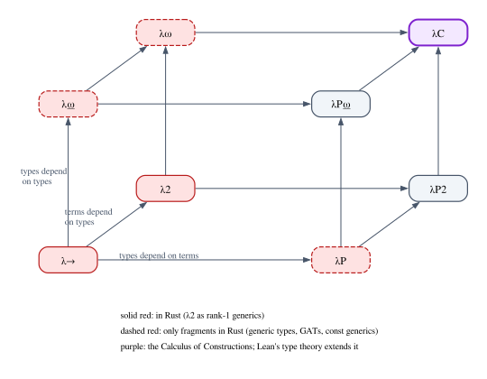

# Chapter 30 · Dependent Types

In Chapter 1 you met a Lean function that Rust cannot write. It returned the
first element of an array, and it took two arguments: the array `xs`, and a
proof `h : 0 < xs.size` that the array is not empty. The type of the second
argument mentions the *value* of the first. We called this a dependent type,
noted that it is the feature that sets Lean apart from Rust, and promised a
chapter about it. This is that chapter.

Dependent types have been in the background ever since: Chapter 8's
intrinsically typed terms, Chapter 10's `Sigma` and `Subtype`, Chapter 25's vault
indexed by its balance. Now we look at them directly: what it means for a type
to depend on a term, which type formers this requires, what changes about
equality, and how much of it a Rust programmer can have today.

The payoff is large. When types may mention values, a type can state a precise
property, such as "a vector of exactly three elements", "an index smaller than
the length" or "a proof that these two numbers are equal", and the type checker
checks it. The price is that type checking sometimes has to compute, and that
some equations which are obviously true need a proof before the type checker
accepts them. Chapter 31 then uses dependent types for their most ambitious
purpose: writing a program's full specification as its type.

**In this chapter you will learn:**

- what a type family is, and the two type formers that dependent types add:
  Π-types (dependent functions) and Σ-types (dependent pairs), with their rules;
- the difference between the parameters and the indices of an inductive family,
  and how a length-indexed vector makes `head` total and `zip` length-preserving;
- how Lean's `Vector`, `Fin` and the notations `xs[i]`, `xs[i]'h`, `xs[i]?` and
  `xs[i]!` turn bounds checks into proof obligations;
- equality as a type, rewriting with `rw` and `▸`, the difference between
  definitional and propositional equality, and why it shapes the way you write
  indices;
- the λ-cube, and where Rust, Haskell and Lean sit in it;
- how far Rust gets: const generics, Peano numerals at the type level, Σ-types
  as slices and trait objects, newtypes as refinement types, and what is still
  unstable;
- how to build dimension-checked matrices in Lean, prove their laws, and connect
  them to Mathlib's `Matrix`.

## Types that mention terms

Every type constructor you use daily in Rust takes types as arguments:
`Vec<T>`, `Option<T>`, `Result<T, E>`, `HashMap<K, V>`. There is one familiar
exception. In `[u8; 4]` the `4` is a number, and `[u8; 4]` and `[u8; 5]` are
different types: a function that expects one rejects the other. A *value*
appears inside a type.

Type theory says that such a type **depends** on a term. Here are three types
that we would like to have, each depending on a value:

- `Vec α n`, the lists of elements of type `α` of length exactly `n`;
- `Fin n`, the natural numbers smaller than `n`;
- `a = b`, the proofs that `a` and `b` are equal.

### Type families

To talk about types like these we need functions that return types. In Lean
this needs no special machinery: `Type` is itself a type (it lives in
`Type 1`, as Chapter 12 explained), so a function can return a type just as it
returns a number. A function whose result is a type is called a **type family**.
The Lean code for this section is in `code/lean/Book/Ch30/Vectors.lean`:

```lean
/-- A type that depends on a value: a function from `Bool` to `Type`. -/
def Answer : Bool → Type
  | true => ℕ
  | false => String

/-- A dependent function: the *type* of the result depends on the *value* of
the argument. Its type is the Π-type `(b : Bool) → Answer b`. -/
def answer : (b : Bool) → Answer b
  | true => (42 : ℕ)
  | false => "no number today"
```

`Answer` is a family indexed by `Bool`: `Answer true` is `ℕ` and `Answer false`
is `String`. The function `answer` is the interesting part. Its result type,
`Answer b`, depends on the argument `b`. To check the first clause, Lean must
check that `42` has type `Answer true`; it computes `Answer true` by running the
definition of `Answer`, gets `ℕ`, and the check succeeds. Notice what just
happened: to type-check a program, the type checker *ran* a program. That is the
first and most important consequence of letting types mention terms.

```lean
/-- info: 42 -/
#guard_msgs in
#eval (answer true : ℕ)

/-- info: "no number today" -/
#guard_msgs in
#eval (answer false : String)
```

(The ascriptions `(answer true : ℕ)` tell `#eval` how to print the result;
Lean accepts them because `Answer true` computes to `ℕ`.) Rust has no
counterpart to `answer`: the return type of a Rust function is fixed by its
signature, and generic code can choose a type based on another *type* (through
an associated type) but never based on a value.

### Π-types: dependent functions

The type of `answer` is written `(b : Bool) → Answer b` in Lean, and
$\Pi b{:}\mathsf{Bool}.\,\mathsf{Answer}\,b$ in type theory. It is a
**Π-type**, or dependent function type: the type of functions whose result type
depends on the argument. Three rules describe it. The first says when a Π-type
is a well-formed type at all:

$$
\dfrac{\Gamma \vdash A : \mathsf{Type} \qquad \Gamma,\, x : A \vdash B : \mathsf{Type}}{\Gamma \vdash \Pi x{:}A.\,B : \mathsf{Type}}\;\textsf{Pi-Form}
$$

The second premise is where dependency enters: $B$ is checked in a context that
contains $x$, so $B$ may mention $x$. In other words, $B$ is a type family over
$A$. The introduction and elimination rules are the familiar rules for λ and
application from Chapter 8, with one change:

$$
\dfrac{\Gamma,\, x : A \vdash b : B}{\Gamma \vdash \lambda x.\, b : \Pi x{:}A.\,B}\;\textsf{Pi-Intro}
\qquad\qquad
\dfrac{\Gamma \vdash f : \Pi x{:}A.\,B \qquad \Gamma \vdash a : A}{\Gamma \vdash f\,a : B[a/x]}\;\textsf{Pi-Elim}
$$

The change is in the conclusion of Pi-Elim. The type of $f\,a$ is $B[a/x]$: the
family $B$ with the actual argument $a$ substituted for $x$. Applying `answer`
to `true` gives a value of type `Answer true`; applying it to `false` gives one
of type `Answer false`. The substitution in the *type* is the whole point.

When $B$ does not mention $x$, the substitution does nothing, and the rules
become exactly those of the ordinary function type $A \to B$ from Chapter 8:
$A \to B$ is the special case of $\Pi x{:}A.\,B$ in which the result type does
not depend on the argument. In Lean, `A → B`, `(x : A) → B` and `∀ x : A, B` are
all spellings of Π-types. Chapter 10 used the last one: under Curry–Howard, Π is
the universal quantifier. Chapter 12's polymorphic `{α : Type} → α → α` is a
Π-type whose argument is a type.

Why the letter Π, for *product*? Think of a dependent function over a finite
type as a table with one entry per argument. A function of type
`(b : Bool) → Answer b` is completely described by two values, `f true : ℕ` and
`f false : String`; so such functions correspond one to one with pairs in
`ℕ × String`. In general, $\Pi x{:}A.\,B$ is the product of the types $B[a/x]$
over all $a$ in $A$, the way $\prod$ is a product of numbers.

### Σ-types: dependent pairs

The second type former is the **Σ-type**, or dependent pair type. An element of
$\Sigma x{:}A.\,B$ is a pair $(a, b)$ in which the *type* of $b$ depends on the
*value* of $a$:

$$
\dfrac{\Gamma \vdash A : \mathsf{Type} \qquad \Gamma,\, x : A \vdash B : \mathsf{Type}}{\Gamma \vdash \Sigma x{:}A.\,B : \mathsf{Type}}\;\textsf{Sigma-Form}
\qquad\qquad
\dfrac{\Gamma \vdash a : A \qquad \Gamma \vdash b : B[a/x]}{\Gamma \vdash (a, b) : \Sigma x{:}A.\,B}\;\textsf{Sigma-Intro}
$$

$$
\dfrac{\Gamma \vdash p : \Sigma x{:}A.\,B}{\Gamma \vdash \pi_1\,p : A}\;\textsf{Sigma-Fst}
\qquad\qquad
\dfrac{\Gamma \vdash p : \Sigma x{:}A.\,B}{\Gamma \vdash \pi_2\,p : B[\pi_1\,p/x]}\;\textsf{Sigma-Snd}
$$

Rule Sigma-Intro says that to build a pair, the second component must have the
type that the family assigns to the *first component*. Rule Sigma-Snd says that
the type of the second projection mentions the first projection. When $B$ does
not mention $x$, the rules collapse to those of the ordinary product $A \times B$.
Lean writes the Σ-type `(x : A) × B` or `Σ x, B`, builds pairs with the
anonymous constructor `⟨a, b⟩`, and projects with `.1` and `.2`.

Why Σ, for *sum*? Take the family `Answer` again. A pair `⟨b, v⟩` with
`v : Answer b` is either `⟨true, n⟩` with `n : ℕ` or `⟨false, s⟩` with
`s : String`. That is a tagged union of `ℕ` and `String`:

```lean
/-- A dependent pair: a tag `b`, and a value whose type depends on the tag.
This is exactly what a Rust `enum` with two variants stores. -/
def mixed : List ((b : Bool) × Answer b) :=
  [⟨true, (7 : ℕ)⟩, ⟨false, "seven"⟩, ⟨true, (8 : ℕ)⟩]

/-- To use a component we look at the tag first, as a `match` on an enum does. -/
def describe : (b : Bool) × Answer b → String
  | ⟨true, n⟩ => "number " ++ Nat.repr n
  | ⟨false, s⟩ => String.append "text " s

/-- info: ["number 7", "text seven", "number 8"] -/
#guard_msgs in
#eval mixed.map describe
```

This is precisely what a Rust `enum` is. The discriminant is the first
component, the payload is the second, and the type of the payload depends on the
discriminant. A `match` on an enum is Σ-elimination: inspect the tag, and only
then do you know the type of what it carries, as `describe` does here. So Rust
does have Σ-types, built into the language, as long as the first component
ranges over a finite set of variants that you list in advance. What it lacks is
a Σ over an arbitrary type, such as "some natural number `n`, and a vector of
length `n`". We will meet Rust's partial substitutes for that later in the
chapter.

Under Curry–Howard, Σ is the existential quantifier: a proof of
$\exists x.\,P(x)$ is a witness together with a proof that the witness has the
property. Chapter 10 explained the subtlety that Lean keeps two versions apart:
`Sigma`, which lives in `Type` and whose first component you can project out and
compute with, and `Exists`, which lives in `Prop` and whose witness cannot be
extracted into data. A third relative, the subtype `{ x : A // P x }`, is a Σ
whose second component is a proof. It will be everywhere in this chapter and the
next.

| | Π-type | Σ-type |
|---|---|---|
| Lean | `(x : A) → B x` | `(x : A) × B x` |
| non-dependent case | `A → B` | `A × B` |
| over `Bool` | a pair | a tagged union |
| logic | $\forall x.\,P(x)$ | $\exists x.\,P(x)$ |
| closest in Rust | `fn f<const N: usize>` | `enum`, slices, `dyn Trait` |

## Indexed families

Type families defined by a function, like `Answer`, are handy, but the families
that matter most are defined *inductively*, constructor by constructor. The
standard example is the vector of a given length.

### Parameters and indices

```lean
/-- Lists that know their length. `α` is a *parameter* (the same in every
constructor); the natural number after the colon is an *index* (each
constructor chooses it). -/
inductive Vec (α : Type) : ℕ → Type where
  | nil : Vec α 0
  | cons {n : ℕ} : α → Vec α n → Vec α (n + 1)
```

`Vec α` is a function from `ℕ` to `Type`, one type for each length. The
declaration distinguishes two kinds of arguments:

- `α`, written *before* the colon, is a **parameter**: the same in the result
  type of every constructor. Rust's generic parameters are parameters in this
  sense: every variant of `Option<T>` produces an `Option<T>` for the same `T`.
- The `ℕ` *after* the colon is an **index**: each constructor chooses its value.
  `nil` produces index `0`, and `cons` turns index `n` into `n + 1`. Rust has no
  indices (Haskell has them through an extension called GADTs).

You have seen indexed families before: `Nat.le` in Chapter 10 and `Term Γ τ` in
Chapter 8. The braces in `cons {n : ℕ}` make `n` an implicit argument
(Chapter 2), inferred from the type of the tail.

### Functions whose types depend on their arguments

```lean
/-- `n` copies of `x`: a Π-type, because the length of the result is the
argument `n`. -/
def replicate : (n : ℕ) → α → Vec α n
  | 0, _ => nil
  | n + 1, x => cons x (replicate n x)

def toList {n : ℕ} : Vec α n → List α
  | nil => []
  | cons x xs => x :: toList xs

/-- From a list to a vector whose length is the length of *that* list. -/
def ofList : (xs : List α) → Vec α xs.length
  | [] => nil
  | x :: xs => cons x (ofList xs)
```

`replicate` has a Π-type: the length of the result is the argument `n`. Each
clause is checked against the type with the pattern substituted for `n`: the
first must produce a `Vec α 0`, the second a `Vec α (n + 1)`. The type of
`ofList` mentions the argument `xs` itself.

```lean
/-- info: Ch30.Vec.replicate {α : Type} (n : ℕ) : α → Vec α n -/
#guard_msgs in
#check replicate

/-- info: Ch30.Vec.ofList {α : Type} (xs : List α) : Vec α xs.length -/
#guard_msgs in
#check ofList

/-- info: [7, 7, 7] -/
#guard_msgs in
#eval (replicate 3 7).toList
```

### A total `head` and a length-preserving `zip`

Here is the function that gives indexed families their reputation:

```lean
/-- The first element. The argument has length `n + 1`, so the `nil` case
cannot occur, and Lean does not ask for it. -/
def head {n : ℕ} : Vec α (n + 1) → α
  | cons x _ => x

def tail {n : ℕ} : Vec α (n + 1) → Vec α n
  | cons _ xs => xs
```

There is no case for `nil`, and Lean does not complain. The argument has type
`Vec α (n + 1)`. If it were `nil`, its type would be `Vec α 0`, so the index
`0` would have to equal `n + 1`. Those are built from different constructors of
`ℕ` (`Nat.zero` and `Nat.succ`), so no `n` can make them equal, and Lean removes
the case. This is **dependent pattern matching**: matching on a value also
refines the indices in its type, and cases whose indices cannot fit are
discarded. The function is total, and the compiled code contains no check and no
panic.

```lean
def three : Vec ℕ 3 := ofList [10, 20, 30]
def two : Vec Char 2 := ofList ['a', 'b']
```

```lean
/-- info: 10 -/
#guard_msgs in
#eval three.head

/-- info: [20, 30] -/
#guard_msgs in
#eval three.tail.toList
```

The definitions of `three` and `two` deserve a second look. `ofList [10, 20, 30]`
has type `Vec ℕ [10, 20, 30].length`, and we declared the type `Vec ℕ 3`. Lean
accepts this because `[10, 20, 30].length` computes to `3`: the type checker
evaluates again.

Applying `head` to an empty vector is a type error:

```lean
/--
error: Application type mismatch: The argument
  nil
has type
  Vec ℕ 0
but is expected to have type
  Vec ℕ (?m.2 + 1)
in the application
  nil.head
-/
#guard_msgs in
example : ℕ := head (nil : Vec ℕ 0)
```

The argument `nil` has type `Vec ℕ 0`, and `head` expected a
`Vec ℕ (?m.2 + 1)`, where `?m.2` is a metavariable (Chapter 13) standing for the
implicit `n`. Unification found no `n` with `n + 1 = 0`. (Lean prints `head nil`
as `nil.head`.) In Rust, `v[0]` on an empty vector panics and `v.first()`
returns an `Option`; here the question never arises at run time, because a
program that could ask it does not type-check.

`zip` is the second classic:

```lean
/-- Both arguments have the same length `n`. Mismatched cases such as
`nil, cons ..` are impossible, so they are not written. -/
def zip {n : ℕ} : Vec α n → Vec β n → Vec (α × β) n
  | nil, nil => nil
  | cons x xs, cons y ys => cons (x, y) (zip xs ys)

def map {n : ℕ} (f : α → β) : Vec α n → Vec β n
  | nil => nil
  | cons x xs => cons (f x) (map f xs)
```

Both arguments have the same index `n`. If the first is `nil`, then `n` is `0`,
so the second must be `nil` too; if the first is a `cons`, the second must be a
`cons`. The mixed cases are impossible, and again Lean removes them. Rust's
`Iterator::zip` silently stops at the shorter input; this `zip` cannot be
called with inputs of different lengths:

```lean
/-- info: [(10, 'x'), (20, 'y'), (30, 'z')] -/
#guard_msgs in
#eval (three.zip (ofList ['x', 'y', 'z'])).toList
```

```lean
/--
error: Application type mismatch: The argument
  two
has type
  Vec Char 2
but is expected to have type
  Vec ?m.5 3
in the application
  three.zip two
-/
#guard_msgs in
example := three.zip two
```

### `Fin`: numbers that know their bound

Indexing needs a type of valid positions. Lean's core library defines it as a
structure with two fields, a number and a proof:

```lean
structure Fin (n : ℕ) where
  val  : ℕ
  isLt : val < n
```

A value of type `Fin n` is a natural number together with evidence that it is
smaller than `n`. `Fin 3` has exactly three elements, and `Fin 0` has none,
because no proof of `i < 0` exists. Indexing a vector with a `Fin` is total:

```lean
/-- Total indexing: an index of type `Fin n` is a number together with a proof
that it is less than `n`. There is no `nil` case: `Fin 0` is empty. -/
def get {n : ℕ} : Vec α n → Fin n → α
  | cons x _, ⟨0, _⟩ => x
  | cons _ xs, ⟨i + 1, h⟩ => xs.get ⟨i, by omega⟩
```

In the second clause the vector is `cons _ xs` with `xs : Vec α m`, and the
index is `⟨i + 1, h⟩` with `h : i + 1 < m + 1`. The recursive call needs a
`Fin m`, so we build `⟨i, _⟩` and prove `i < m` with `omega` (Chapter 2), which
decides linear arithmetic and finds the proof from `h`. There is no clause for
`nil`, because `Fin 0` is empty.

```lean
/-- info: 30 -/
#guard_msgs in
#eval three.get 2

/-- info: 30 -/
#guard_msgs in
#eval three.get ⟨2, by decide⟩
```

In `three.get 2` the numeral `2` is read as an element of `Fin 3`. The second
line builds the index explicitly, with `decide` proving `2 < 3`. An index that is
out of range cannot be built:

```lean
/--
error: Tactic `decide` proved that the proposition
  5 < 3
is false
-/
#guard_msgs in
example : ℕ := three.get ⟨5, by decide⟩
```

Numerals, however, are a trap:

```lean
-- A numeral of type `Fin 3` is reduced modulo 3: `5` means `2`.
/-- info: (2, 30) -/
#guard_msgs in
#eval ((5 : Fin 3), three.get 5)
```

> [!WARNING]
> A numeral of type `Fin n` is reduced modulo `n`, so `(5 : Fin 3)` is `2`, and
> `three.get 5` happily returns the element at position 2. The type guarantees
> that the index is in range, not that it is the index you meant. Build indices
> that come from outside with `⟨i, proof⟩`, which fails loudly when the proof
> does not exist.

### Concatenation and the order of indices

```lean
/-- Concatenation. The length of the result is `m + n`, not `n + m`: the
section on equality in this chapter explains why the order matters. -/
def append {n m : ℕ} : Vec α n → Vec α m → Vec α (m + n)
  | nil, ys => ys
  | cons x xs, ys => cons x (append xs ys)
```

The result of appending a vector of length `n` and one of length `m` has length
`m + n`. You would probably have written `n + m`, and the reason we did not is
one of the most instructive facts about dependent types; the section on
equality below explains it. Lean does not simplify the index in the type it
displays:

```lean
/-- info: three.append three : Vec ℕ (3 + 3) -/
#guard_msgs in
#check three.append three
```

`Vec ℕ (3 + 3)` is nevertheless the same type as `Vec ℕ 6`, because `3 + 3`
computes to `6`: you can declare a constant of type `Vec ℕ 6` and give it
`three.append three` as its value.

An indexed type tells the truth about its index, and we can prove it:

```lean
/-- The index tells the truth: the list underneath has length `n`. -/
theorem length_toList {n : ℕ} (v : Vec α n) : v.toList.length = n := by
  induction v with
  | nil => rfl
  | cons x xs ih => simp [toList, ih]

theorem toList_ofList (xs : List α) : (ofList xs).toList = xs := by
  induction xs with
  | nil => rfl
  | cons x xs ih => simp [ofList, toList, ih]

theorem toList_append {n m : ℕ} (xs : Vec α n) (ys : Vec α m) :
    (xs.append ys).toList = xs.toList ++ ys.toList := by
  induction xs with
  | nil => rfl
  | cons x xs ih => simp [append, toList, ih]
```

`length_toList` is proved by induction on the vector. In the `nil` case both
sides compute to `0`, and `rfl` closes the goal. In the `cons x xs` case the goal
is `(cons x xs).toList.length = n + 1` and `ih : xs.toList.length = n`;
`simp [toList, ih]` unfolds `toList` one step, uses the library fact that
`(a :: l).length = l.length + 1`, rewrites with `ih`, and closes `n + 1 = n + 1`.
Induction on an indexed family replaces the index in each case (by `0`, or by
`n + 1`) automatically. The other two proofs follow the same pattern.

### Σ again: when the length depends on the contents

Some operations produce a vector whose length cannot be computed from the
lengths of the inputs. Keeping only the elements that satisfy a predicate is the
standard example: the length of the result depends on the *elements*. Its type
is a Σ-type, "some length `m`, and a vector of that length":

```lean
/-- Keeping the elements that satisfy `p`: the length of the result depends on
the *contents* of the vector, not just on its length, so the result is a
dependent pair: some length `m`, and a vector of that length. -/
def filter (p : α → Bool) {n : ℕ} : Vec α n → (m : ℕ) × Vec α m
  | nil => ⟨0, nil⟩
  | cons x xs =>
    let ⟨m, ys⟩ := filter p xs
    if p x then ⟨m + 1, cons x ys⟩ else ⟨m, ys⟩
```

```lean
/-- info: 2 -/
#guard_msgs in
#eval (three.filter (· > 15)).1

/-- info: [20, 30] -/
#guard_msgs in
#eval (three.filter (· > 15)).2.toList
```

A Σ-type hides the index, but a theorem can recover what we know about it:

```lean
/-- What the Σ-type forgot, a theorem can recover: filtering never makes a
vector longer. -/
theorem filter_length_le (p : α → Bool) {n : ℕ} (v : Vec α n) :
    (v.filter p).1 ≤ n := by
  induction v with
  | nil => simp [filter]
  | cons x xs ih =>
    simp only [filter]
    split <;> simp <;> omega
```

In the `cons` case, `simp only [filter]` unfolds one step, leaving the first
projection of an `if p x then … else …`. `split` makes one goal per branch, and
`<;>` runs the next tactic on every goal: `simp` computes the projection, and
`omega` finishes with `ih : (filter p xs).1 ≤ n`.

Hiding the length altogether gives back ordinary lists:

```lean
/-- A vector of *some* length: the Σ-type `Σ n, Vec α n`. Forgetting the length
gives back an ordinary list. -/
abbrev SomeVec (α : Type) := (n : ℕ) × Vec α n

def SomeVec.ofList {α : Type} (xs : List α) : SomeVec α := ⟨xs.length, Vec.ofList xs⟩
```

`SomeVec α` and `List α` carry the same information. A list *is* a Σ-type: a
length, and that many elements. We will see the same fact in Rust, where a slice
reference stores its length next to the pointer.

## Lean's vectors and indexing with proofs

Our `Vec` is a linked list with a length in its type. Lean's core library has a
vector type of its own, built differently:

```lean
/--
info: structure Vector.{u} (α : Type u) (n : ℕ) : Type u
number of parameters: 2
fields:
  Vector.toArray : Array α
  Vector.size_toArray : self.toArray.size = n
constructor:
  Vector.mk.{u} {α : Type u} {n : ℕ} (toArray : Array α) (size_toArray : toArray.size = n) : Vector α n
-/
#guard_msgs in
#print Vector
```

A `Vector α n` is an `Array α` (Lean's contiguous array, the counterpart of
Rust's `Vec`) bundled with a proof that its size is `n`. Proofs are erased when
Lean compiles a program (Chapter 10), so a `Vector` costs exactly what an
`Array` costs. The operations have the types you would expect:

```lean
/-- info: #v[1, 2, 3] ++ #v[4, 5] : Vector ℕ (3 + 2) -/
#guard_msgs in
#check #v[1, 2, 3] ++ #v[4, 5]

/-- info: #[1, 2, 3, 4, 5] -/
#guard_msgs in
#eval (#v[1, 2, 3] ++ #v[4, 5]).toArray

/-- info: @Vector.push : {α : Type u_1} → {n : ℕ} → Vector α n → α → Vector α (n + 1) -/
#guard_msgs in
#check @Vector.push
```

Indexing is where the design pays off. Lean's indexing notation `v[i]` asks for
a proof that `i` is in range and tries to find it on its own; when it cannot,
you have alternatives:

```lean
/-- An index of type `Fin n` is always valid. -/
def atFin {n : ℕ} (v : Vector ℕ n) (i : Fin n) : ℕ := v[i]

/-- A proof in the context is found automatically. -/
def atProof {n : ℕ} (v : Vector ℕ n) (i : ℕ) (h : i < n) : ℕ := v[i]

/-- A proof can be given explicitly with `'`: here it needs a small argument. -/
def atNext {n : ℕ} (v : Vector ℕ n) (i : ℕ) (h : i + 1 < n) : ℕ := v[i]'(by omega)

/-- A run-time test produces the proof: in the `then` branch, `h : i < n`. -/
def atOr {n : ℕ} (v : Vector ℕ n) (i : ℕ) (default : ℕ) : ℕ :=
  if h : i < n then v[i] else default

/-- Rust's two options are also available: `v[i]?` and `v[i]!`. -/
def atOpt {n : ℕ} (v : Vector ℕ n) (i : ℕ) : Option ℕ := v[i]?
```

Indexing runs a small tactic, `get_elem_tactic`, which looks for the fact in
the context and tries some simple arithmetic; that is how `atProof` works. In
`atNext` the fact `i < n` only *follows* from the hypothesis, so `v[i]'proof`
supplies it explicitly. In `atOr` the proof comes from a run-time test: the
*dependent if* `if h : i < n then … else …` names the condition, and in the
`then` branch `h : i < n` is a hypothesis. This is the bridge between a dynamic
check and a static guarantee.

```lean
/-- info: (30, 20, 99, none) -/
#guard_msgs in
#eval (atFin #v[10, 20, 30] 2, atNext #v[10, 20, 30] 1 (by decide),
  atOr #v[10, 20, 30] 7 99, atOpt #v[10, 20, 30] 7)
```

Without any of these, Lean refuses, with the message you first saw in
Chapter 1:

```lean
/--
error: failed to prove index is valid, possible solutions:
  - Use `have`-expressions to prove the index is valid
  - Use `a[i]!` notation instead, runtime check is performed, and 'Panic' error message is produced if index is not valid
  - Use `a[i]?` notation instead, result is an `Option` type
  - Use `a[i]'h` notation instead, where `h` is a proof that index is valid
n : ℕ
v : Vector ℕ n
i : ℕ
⊢ i < n
-/
#guard_msgs in
def atUnchecked {n : ℕ} (v : Vector ℕ n) (i : ℕ) : ℕ := v[i]
```

The message ends with the goal it could not prove, `⊢ i < n`. Here are the
options side by side with Rust's:

| Lean | Rust | when `i` is out of range |
|---|---|---|
| `v[i]`, proof found | (none) | cannot happen |
| `v[i]'h` | (none) | cannot happen |
| `v[i]?` | `v.get(i)` | `none` |
| `v[i]!` | `v[i]` | panic |
| `if h : i < n then v[i] else d` | `if i < v.len() { v[i] } else { d }` | `d` |

The last row looks the same in both languages, but it is not. In Lean, the test
produces a proof that the indexing consumes. In Rust, the test produces a
`bool` that the type system forgets, and `v[i]` checks the bound again (the
optimizer often removes the second check, but as an optimization, not a
guarantee).

Subtypes are the general form of "a value with a proof attached". A percentage
is a natural number with a proof that it is at most 100:

```lean
/-- A subtype: natural numbers together with a proof that they are at most
100. A dependent pair whose second component is a proof. -/
abbrev Percent := { n : ℕ // n ≤ 100 }

/-- Halving stays in range, and Lean demands a proof of it: `p.property` is the
proof stored inside `p` (`p.val ≤ 100`), and `omega` derives the new bound. -/
def half (p : Percent) : Percent :=
  ⟨p.val / 2, by have h := p.property; omega⟩

/-- `Fin n` is the same idea, packaged as a structure. -/
example : Fin 3 := ⟨2, by decide⟩
```

```lean
/-- info: 21 -/
#guard_msgs in
#eval (half ⟨42, by decide⟩).val
```

To return a `Percent`, `half` must prove that the new value is at most 100,
using the evidence carried by its input. We will compare this with Rust's way of
guaranteeing the same invariant later in the chapter.

## Equality as a type

The third of our dependent types was `a = b`. In a dependently typed language
equality is no longer just a boolean test: it decides which programs
type-check.

### Equality from scratch

Equality is an inductive family with a single constructor. Here it is from
scratch, in `code/lean/Book/Ch30/Equality.lean`:

```lean
/-- Equality from scratch: an inductive family with a single constructor.
There is a proof of `Same a b` only when `a` and `b` are the same. -/
inductive Same {α : Type} : α → α → Prop where
  | refl (a : α) : Same a a
```

`Same a b` is a proposition indexed by two values. The only constructor,
`refl a`, builds a proof of `Same a a`, where both indices are the same. So a
proof of `Same a b` can exist only when `a` and `b` are the same value. That
single constructor is enough to derive everything we expect from equality:

```lean
theorem symm {a b : α} (h : Same a b) : Same b a := by
  cases h          -- `h` can only be `refl a`, so Lean replaces `b` by `a`
  exact refl a     -- goal: Same a a

theorem trans {a b c : α} (hab : Same a b) (hbc : Same b c) : Same a c := by
  cases hab        -- now `b` is `a`
  cases hbc        -- now `c` is `a`
  exact refl a

theorem congrArg (f : α → β) {a b : α} (h : Same a b) : Same (f a) (f b) := by
  cases h
  exact refl (f a)

/-- Transport: whatever holds of `a` holds of anything the same as `a`. -/
theorem subst (P : α → Prop) {a b : α} (h : Same a b) (pa : P a) : P b := by
  cases h
  exact pa

/-- Our `Same` and Lean's `Eq` are interchangeable. -/
theorem iff_eq {a b : α} : Same a b ↔ a = b := by
  constructor
  · intro h; cases h; rfl
  · intro h; cases h; exact refl a
```

Every proof starts with `cases h`. Since `h` can only have been built by
`refl`, whose indices are equal, Lean unifies `b` with `a` and replaces `b` by
`a` in the goal: dependent pattern matching once more, as in `head`. The theorem
`subst` is the essence of equality: any property of `a` is a property of
anything equal to `a`. This principle, **transport**, is the elimination rule of
the equality type. Lean's own equality is defined in exactly the same way:

```lean
/--
info: inductive Eq.{u_1} : {α : Sort u_1} → α → α → Prop
number of parameters: 2
constructors:
Eq.refl : ∀ {α : Sort u_1} (a : α), a = a
-/
#guard_msgs in
#print Eq
```

(`Sort u_1` makes `Eq` universe-polymorphic, Chapter 12. `#print` reports two
parameters, `α` and the left side `a`: since `a` is uniform in the constructor,
Lean promotes it from an index to a parameter.)

### Definitional and propositional equality

**Definitional equality** is what the type checker sees by itself. Two terms
are definitionally equal if they compute to the same result: by unfolding
definitions, by β-reduction (substituting arguments into function bodies), and by
running pattern matching on constructors. The tactic `rfl` (and the term `rfl`)
proves `a = b` exactly when `a` and `b` are definitionally equal:

```lean
example : 2 + 2 = 4 := rfl                       -- computation on numerals
example (n : ℕ) : n + 0 = n := rfl               -- one step of `Nat.add`
example (n : ℕ) : (fun k => k + 1) n = n + 1 := rfl   -- a β-reduction
example : Vec.three.head = 10 := rfl             -- unfolding our own definitions
```

**Propositional equality** is the type `a = b` itself: anything you can *prove*.
Every definitional equality is a propositional one (by `rfl`), but not the other
way around. Here is the standard example:

```lean
/--
error: Type mismatch
  rfl
has type
  ?m.9 = ?m.9
but is expected to have type
  0 + n = n
-/
#guard_msgs in
example (n : ℕ) : 0 + n = n := rfl
```

`n + 0 = n` was accepted by `rfl`, but `0 + n = n` is not. The statement is
true, of course; it is just not true *by computation*. To see why, look at how
addition on natural numbers is defined in Lean's core library (simplified from
the file `Init/Prelude.lean` of the toolchain):

```lean
protected def Nat.add : Nat → Nat → Nat
  | n, .zero   => n
  | n, .succ m => .succ (Nat.add n m)
```

Addition is defined by recursion on its *second* argument. `n + 0` matches the
first equation, whatever `n` is, and computes to `n`: definitional. `0 + n`, for
a variable `n`, matches neither equation, because the second argument is not
known to be `zero` or `succ m`; the computation is stuck, and `rfl` has nothing
to compare. To prove `0 + n = n` we need induction:

```lean
theorem zero_add' (n : ℕ) : 0 + n = n := by
  induction n with
  | zero => rfl                 -- 0 + 0 = 0 is a computation
  | succ k ih =>
    -- ih   : 0 + k = k
    -- goal : 0 + (k + 1) = k + 1
    show (0 + k) + 1 = k + 1    -- the same goal, after one step of `Nat.add`
    rw [ih]                     -- replace `0 + k` by `k`; `rw` then closes `k + 1 = k + 1`
```

In the `succ` case the goal `0 + (k + 1) = k + 1` *can* compute one step,
because the second argument is now a successor; `show` restates it in the
computed form `(0 + k) + 1 = k + 1`, which Lean accepts because the two are
definitionally equal. Then `rw [ih]` **rewrites**: it replaces the left side of
`ih : 0 + k = k` by its right side, and closes the resulting `k + 1 = k + 1` by
trying `rfl`. (`rw [← h]` rewrites from right to left.) The lesson:
definitional equality is fixed by how your functions recurse; propositional
equality is everything you can prove.

### Why the order of indices matters

With dependent types the distinction decides which programs type-check,
because the type checker compares *types* by definitional equality. Here is
`append` with the index `n + m`, the way you would first write it:

```lean
/--
error: Type mismatch
  ys
has type
  Vec α m
but is expected to have type
  Vec α (0 + m)
---
error: Type mismatch
  Vec.cons x (appendNM xs ys)
has type
  Vec α (n✝ + m + 1)
but is expected to have type
  Vec α (n✝ + 1 + m)
-/
#guard_msgs in
def appendNM {α : Type} {n m : ℕ} : Vec α n → Vec α m → Vec α (n + m)
  | .nil, ys => ys
  | .cons x xs, ys => .cons x (appendNM xs ys)
```

Both clauses fail. In the first, `ys : Vec α m` must have type
`Vec α (0 + m)`, and `0 + m` is not definitionally `m`. In the second, the clause
produces length `n + m + 1` but must produce `n + 1 + m`, which does not compute
for a variable `m`. (The dagger in `n✝` marks a name you cannot refer to, here
the implicit length of the tail.) The `append` of `Vectors.lean` used `m + n`,
and with that order both clauses check by computation: `m + 0` is `m`, and
`m + (n + 1)` is `(m + n) + 1`. The index follows the recursion. That is the
first fix, and the one to prefer.

The second fix is to keep the type you want and *transport* the value along a
proof of the equation. If `h : a = b` and `v : Vec α a`, then `h ▸ v` is the
same vector, seen at type `Vec α b`:

```lean
/-- Concatenation with the length `n + m`: we reuse `append`, whose result has
length `m + n`, and transport it along the equation `m + n = n + m`. -/
def append' {n m : ℕ} (xs : Vec α n) (ys : Vec α m) : Vec α (n + m) :=
  Nat.add_comm m n ▸ xs.append ys
```

`Nat.add_comm m n : m + n = n + m` is a library theorem, proved by induction.
The triangle `▸` is our `subst`, used on data; Lean works out what to rewrite
from the expected type. Transport changes the type and nothing else:

```lean
/-- Transport changes the type, not the elements. -/
theorem toList_cast {n m : ℕ} (h : n = m) (v : Vec α n) :
    (h ▸ v : Vec α m).toList = v.toList := by
  subst h      -- replace `m` by `n` everywhere; now `h ▸ v` is just `v`
  rfl

theorem toList_append' {n m : ℕ} (xs : Vec α n) (ys : Vec α m) :
    (xs.append' ys).toList = xs.toList ++ ys.toList := by
  rw [append', toList_cast, toList_append]
```

In `toList_cast`, `subst h` replaces `m` by `n` everywhere; then `h ▸ v` is a
transport along `n = n`, which computes to `v`, and `rfl` finishes. In
`toList_append'`, `rw` unfolds `append'`, removes the transport with
`toList_cast`, and applies `toList_append`. Transport works, but every theorem
about `append'` must see through the `▸`. Experienced users of dependent types
choose indices so that the equations they need hold by computation.

### Decidable equality

The last ingredient connects equality with running programs. Chapter 5
introduced `Decidable`: a proposition is decidable when there is an algorithm
that answers it, and the answer carries evidence either way:

```lean
/-- info: true -/
#guard_msgs in
#eval decide (2 + 2 = 4)

inductive Color where
  | red | green | blue
  deriving DecidableEq, Repr

/-- info: false -/
#guard_msgs in
#eval decide (Color.red = Color.blue)

/--
info: inductive Decidable : Prop → Type
number of parameters: 1
constructors:
Decidable.isFalse : {p : Prop} → ¬p → Decidable p
Decidable.isTrue : {p : Prop} → p → Decidable p
-/
#guard_msgs in
#print Decidable
```

A `Decidable p` is `isTrue` with a proof of `p` or `isFalse` with a proof of
`¬p`; `decide` runs the algorithm, and `deriving DecidableEq` generates one, as
`#[derive(PartialEq)]` does in Rust. The difference is the evidence: Rust's `==`
returns a `bool`, and nothing remembers what it was a test of. A dependent `if`
turns the evidence into something the types can use:

```lean
/-- From a vector of unknown length to a vector of length `n`. The run-time
test `h : k = n` produces a proof, and the proof changes the type. -/
def SomeVec.toVec? {α : Type} (n : ℕ) : SomeVec α → Option (Vec α n)
  | ⟨k, v⟩ => if h : k = n then some (h ▸ v) else none
```

```lean
/-- info: some [1, 2, 3] -/
#guard_msgs in
#eval ((SomeVec.ofList [1, 2, 3]).toVec? 3).map Vec.toList

/-- info: none -/
#guard_msgs in
#eval ((SomeVec.ofList [1, 2, 3]).toVec? 4).map Vec.toList
```

`toVec?` takes a vector whose length `k` is known only at run time (a Σ-type)
and tests `k = n`. In the `then` branch the test has produced a proof
`h : k = n`, and `h ▸ v` transports the vector to type `Vec α n`. This is the
general pattern for crossing from data that arrives at run time (Σ) to code that
demands static guarantees (Π): decide, then transport.

Not every proposition is decidable. Equality of functions `ℕ → ℕ` is not: no
algorithm can compare two functions on infinitely many inputs. Quantifiers over
infinite types are not decidable either, though bounded ones are:

```lean
/--
error: failed to synthesize
  Decidable (∀ (n : ℕ), n + 0 = n)

Hint: Additional diagnostic information may be available using the `set_option diagnostics true` command.
-/
#guard_msgs in
example : ∀ n : ℕ, n + 0 = n := by decide

/-- A bounded quantifier is decidable: Lean checks the hundred cases. -/
example : ∀ n < 100, 0 + n = n := by decide
```

## The λ-cube

In the early 1990s Henk Barendregt organized a family of typed λ-calculi as
the corners of a cube, which gives us a map for placing Rust and Lean. Start
from the simply typed λ-calculus of Chapter 8, where terms depend on terms.
There are three independent ways to add a dependency:

- **terms depending on types**: polymorphism, a term that takes a type as an
  argument, as in `fn id<T>(x: T) -> T` (System F, Chapter 12);
- **types depending on types**: type operators, as in `Vec<T>` viewed as a
  function from types to types (Chapter 17);
- **types depending on terms**: dependent types, the subject of this chapter.

Each subset of the three gives a system, and the eight systems form the cube:



The corner λ→ is Chapter 8. Moving back gives λ2, System F (Chapter 12).
Moving up gives $\lambda\underline{\omega}$ (read "weak lambda omega"), with
type operators but no polymorphism, and λω, System Fω, with both: the system in which you can
quantify over type constructors, which is what a `Functor` class needs
(Chapter 17). Moving right adds dependent types: λP is the system known as LF,
used as a logical framework for encoding logics. The far corner, λC, has all
three dependencies: it is the **Calculus of Constructions** of Thierry Coquand
and Gérard Huet (1988), in which terms and types live in one language and any
of them may depend on any other.

Here is where Rust, Lean and Haskell sit, with the caveats that a picture this
simple requires:

| Language | Polymorphism | Type operators | Dependent types |
|---|---|---|---|
| Rust | rank-1 generics; rank-2 only via traits and `for<'a>` | generic types, but no abstraction over them; GATs as a workaround | const generics only |
| Haskell (GHC) | higher-rank types (extension) | higher-kinded types, `Functor` | approximated: GADTs, type families, type-level data |
| Lean | full (Π over types) | full (functions into `Type`) | full: λC and more |

GHC's core language is an extension of System Fω, and its dependent-type
features simulate Π-types by keeping a type-level copy of the values involved.
Lean is beyond the cube altogether: its type theory adds to the Calculus of
Constructions inductive types (every `inductive` in this book), a hierarchy of
universes and an impredicative `Prop` (Chapter 12), and quotient types. This
family of systems is usually called the Calculus of Inductive Constructions;
Rocq (formerly Coq) is based on it too.

One more distinction matters in practice. Without dependent types, type
checking never runs programs: Rust's types can be checked and erased without
evaluating anything but constant expressions. From λP on, deciding whether two
types are equal means computing with terms, as with `Answer true` and
`Vec ℕ (3 + 3)`. That is why a dependently typed language insists on
termination (Chapter 2, and Chapter 31 in detail): if the type checker runs your
programs, a non-terminating program would make type checking loop forever.

## Rust's approximations

Rust has no Π-types over arbitrary values, but it has partial substitutes, and
they are how working Rust code gets some of this chapter's guarantees.

### Const generics

A **const generic** parameter, `const N: usize` in angle brackets, is a
value-level parameter of a type or function. Arrays `[T; N]` are the built-in
example. The code is in `code/rust/examples/ch30_const_generics.rs`:

```rust
/// The dot product of two arrays of the same length `N`. The length is a
/// const parameter: a value that is part of the type, inferred at each call.
fn dot<const N: usize>(a: [i64; N], b: [i64; N]) -> i64 {
    let mut sum = 0;
    for i in 0..N {
        sum += a[i] * b[i];
    }
    sum
}
```

Calling `dot` with two arrays of length 3 instantiates `N = 3`:

```rust
println!("dot([1, 2, 3], [4, 5, 6]) = {}", dot([1, 2, 3], [4, 5, 6]));
```

```text
dot([1, 2, 3], [4, 5, 6]) = 32
```

Arrays of lengths 3 and 4 would be a type error. This is a restricted Π-type:
in effect,
$\mathtt{dot} : \Pi N{:}\mathtt{usize}.\,[\mathtt{i64}; N] \to [\mathtt{i64}; N] \to \mathtt{i64}$.
A matrix type with dimensions in its type follows the same idea:

```rust
/// An `R × C` matrix of integers. `R` and `C` are values of type `usize`, and
/// they are part of the type: `Matrix<2, 3>` and `Matrix<3, 2>` are different
/// types.
#[derive(Clone, Copy, Debug, PartialEq, Eq)]
struct Matrix<const R: usize, const C: usize> {
    rows: [[i64; C]; R],
}

impl<const R: usize, const C: usize> Matrix<R, C> {
    fn new(rows: [[i64; C]; R]) -> Self {
        Matrix { rows }
    }

    /// Rows become columns: an `R × C` matrix becomes a `C × R` matrix.
    fn transpose(&self) -> Matrix<C, R> {
        let mut out = [[0; R]; C];
        for i in 0..R {
            for j in 0..C {
                out[j][i] = self.rows[i][j];
            }
        }
        Matrix { rows: out }
    }
}
```

```rust
/// `(R × C) * (C × K) = (R × K)`. The left operand's column count and the
/// right operand's row count are the *same* parameter `C`, so a product with
/// mismatched inner dimensions has no implementation to use.
impl<const R: usize, const C: usize, const K: usize> Mul<Matrix<C, K>>
    for Matrix<R, C>
{
    type Output = Matrix<R, K>;

    fn mul(self, rhs: Matrix<C, K>) -> Matrix<R, K> {
        let mut out = [[0; K]; R];
        for i in 0..R {
            for k in 0..K {
                for j in 0..C {
                    out[i][k] += self.rows[i][j] * rhs.rows[j][k];
                }
            }
        }
        Matrix { rows: out }
    }
}
```

The `Mul` implementation exists for a left operand `Matrix<R, C>` and a right
operand `Matrix<C, K>` with the *same* `C`. The identity only exists for square
shapes, because its `impl` block is for `Matrix<N, N>`:

```rust
/// The identity exists only for square matrices: this `impl` block is for
/// `Matrix<N, N>`, so `Matrix::<2, 3>::identity()` does not exist.
impl<const N: usize> Matrix<N, N> {
    fn identity() -> Self {
        let mut rows = [[0; N]; N];
        for (i, row) in rows.iter_mut().enumerate() {
            row[i] = 1;
        }
        Matrix { rows }
    }
}
```

```rust
let a = Matrix::new([[1, 2, 3], [4, 5, 6]]); // Matrix<2, 3>
let b = Matrix::new([[7, 8], [9, 10], [11, 12]]); // Matrix<3, 2>
let ab: Matrix<2, 2> = a * b;
let ba: Matrix<3, 3> = b * a;
println!("a * b       = {:?}", ab.rows);
println!("b * a       = {:?}", ba.rows);
println!("transpose a = {:?}", a.transpose().rows);
assert_eq!(Matrix::<2, 2>::identity() * a, a);
assert_eq!(a * Matrix::<3, 3>::identity(), a);
assert_eq!((a * b).transpose(), b.transpose() * a.transpose());
println!("identity laws and (a * b)^T = b^T * a^T hold");
```

```text
a * b       = [[58, 64], [139, 154]]
b * a       = [[39, 54, 69], [49, 68, 87], [59, 82, 105]]
transpose a = [[1, 4], [2, 5], [3, 6]]
identity laws and (a * b)^T = b^T * a^T hold
```

The annotations `Matrix<2, 2>` and `Matrix<3, 3>` are checked, not trusted.
Multiplying a 2 × 3 matrix by another 2 × 3 matrix fails with one of the few
Rust type errors that talk about numbers
(`code/rust/compile_fail/ch30_matrix_mismatch.rs`):

```rust
pub fn product(a: Matrix<2, 3>, b: Matrix<2, 3>) {
    let _c = a * b;
}
```

```text
error[E0308]: mismatched types
  --> compile_fail/ch30_matrix_mismatch.rs:20:18
   |
20 |     let _c = a * b;
   |                  ^ expected `3`, found `2`
   |
   = note: expected struct `Matrix<3, _>`
              found struct `Matrix<2, 3>`
```

The only candidate implementation requires the right operand to be
`Matrix<3, _>`, and `3` is not `2`: E0308, a mismatch between two *values*
inside two types.

### What const generics cannot do

On stable Rust 1.99 a const parameter may only have an integer type, `bool` or
`char`, and inside a type it may only appear on its own, never inside an
expression. So the result type of vertical stacking, with `R1 + R2` rows, cannot
be written (`code/rust/compile_fail/ch30_const_arithmetic.rs`):

```rust
/// Stack `top` (R1 rows) on `bottom` (R2 rows): the result has R1 + R2 rows.
pub fn vstack<const R1: usize, const R2: usize, const C: usize>(
    top: Matrix<R1, C>,
    bottom: Matrix<R2, C>,
) -> Matrix<{ R1 + R2 }, C> {
    todo!()
}
```

```rust
/// A tensor shape: `N` dimensions, and an array of exactly `N` extents.
pub struct Shape<const N: usize, const DIMS: [usize; N]>;
```

```text
error: generic parameters may not be used in const operations
  --> compile_fail/ch30_const_arithmetic.rs:14:15
   |
14 | ) -> Matrix<{ R1 + R2 }, C> {
   |               ^^ cannot perform const operation using `R1`
   |
   = help: const parameters may only be used as standalone arguments here, i.e. `R1`

error: generic parameters may not be used in const operations
  --> compile_fail/ch30_const_arithmetic.rs:14:20
   |
14 | ) -> Matrix<{ R1 + R2 }, C> {
   |                    ^^ cannot perform const operation using `R2`
   |
   = help: const parameters may only be used as standalone arguments here, i.e. `R2`

error[E0770]: the type of const parameters must not depend on other generic parameters
  --> compile_fail/ch30_const_arithmetic.rs:21:54
   |
21 | pub struct Shape<const N: usize, const DIMS: [usize; N]>;
   |                                                      ^ the type must not depend on the parameter `N`

error: `[usize; N]` is forbidden as the type of a const generic parameter
  --> compile_fail/ch30_const_arithmetic.rs:21:46
   |
21 | pub struct Shape<const N: usize, const DIMS: [usize; N]>;
   |                                              ^^^^^^^^^^
   |
   = note: the only supported types are integers, `bool`, and `char`
```

The first two errors (which have no error code) reject `R1 + R2` inside a
type. The third, E0770, rejects a const parameter whose *type* depends on another
parameter: `DIMS` would be an array of `N` extents, a genuinely dependent kind.
The fourth rejects arrays as the type of a const parameter at all. Lifting these
restrictions is the goal of unstable features, notably `generic_const_exprs`
and `adt_const_params`; they are available only on nightly compilers and still
being designed, so check their current status before relying on them.

On stable Rust, the usual workaround is to let the caller name the result size
and check the arithmetic separately:

```rust
/// Stable Rust cannot write the result type `Matrix<{ R1 + R2 }, C>`. The
/// workaround: let the caller name the result size `R`, and check `R == R1 + R2`
/// in a `const` block when the function is instantiated.
fn vstack<const R1: usize, const R2: usize, const R: usize, const C: usize>(
    top: Matrix<R1, C>,
    bottom: Matrix<R2, C>,
) -> Matrix<R, C> {
    const { assert!(R == R1 + R2, "vstack: R must be R1 + R2") };
    let mut rows = [[0; C]; R];
    rows[..R1].copy_from_slice(&top.rows);
    rows[R1..].copy_from_slice(&bottom.rows);
    Matrix { rows }
}
```

```rust
let stacked: Matrix<4, 3> = vstack(a, a);
println!("vstack(a, a) = {:?}", stacked.rows);
```

```text
vstack(a, a) = [[1, 2, 3], [4, 5, 6], [1, 2, 3], [4, 5, 6]]
```

An inline `const { … }` block is evaluated at compile time for each set of
concrete parameters: had the caller asked for a `Matrix<5, 3>`, the build would
stop with error E0080. There is a subtlety, which we checked with rustc 1.99:
the check happens only when the function is *instantiated*, during code
generation, so `cargo check` does not report it and `cargo build` does. The same
technique gives a `first` that rejects empty arrays:

```rust
/// The first element of a non-empty array. Stable Rust has no way to write
/// `where N > 0` in the signature; the inline `const` block is evaluated when
/// the function is instantiated with a concrete `N`, and a failed assertion
/// stops the compilation.
fn first<T, const N: usize>(items: &[T; N]) -> &T {
    const { assert!(N > 0, "first() needs a non-empty array") };
    &items[0]
}
```

Compare Lean's `head`, and the `vstack` at the end of this chapter: Lean checks
the arithmetic in the type, for all sizes at once, when the definition is
written. Rust checks each instantiation, after type checking; the generic
function itself is never verified.

### From run-time data to static shapes

Data from a file or a network has a length known only at run time. Rust bridges
the gap the way Lean's `toVec?` did, with a checked conversion:

```rust
/// From run-time data to a static shape. The number of values on the line is
/// known only at run time; `try_from` checks it once, and from then on the
/// length is part of the type.
fn parse_row<const N: usize>(line: &str) -> Result<[i64; N], String> {
    let mut values = Vec::new();
    for word in line.split_whitespace() {
        let value: i64 = word
            .parse()
            .map_err(|_| format!("not a number: {word:?}"))?;
        values.push(value);
    }
    let found = values.len();
    <[i64; N]>::try_from(values)
        .map_err(|_| format!("expected {N} numbers, found {found}"))
}
```

```rust
let row: Result<[i64; 3], String> = parse_row("1 2 3");
println!("parse_row::<3>(\"1 2 3\") = {row:?}");
let short: Result<[i64; 3], String> = parse_row("1 2");
println!("parse_row::<3>(\"1 2\")   = {short:?}");
if let Ok(r) = row {
    // From here on the length is static: `dot` accepts only another [i64; 3].
    println!("dot(row, row) = {}", dot(r, r));
}
```

```text
parse_row::<3>("1 2 3") = Ok([1, 2, 3])
parse_row::<3>("1 2")   = Err("expected 3 numbers, found 2")
dot(row, row) = 14
```

The difference from Lean is that `N` must be fixed at compile time: the caller
decides that it wants three numbers, and the data either has three or is
rejected. In Lean, as the walkthrough at the end of the chapter shows, the
length itself can come from the data.

### Peano numerals at the type level

Before const generics, Rust programmers encoded numbers as *types*, and the
technique still helps where const generics cannot do arithmetic. Zero is a type
`Z`, and the successor of `N` is `S<N>`
(`code/rust/examples/ch30_type_level_nat.rs`):

```rust
/// Zero, as a type.
struct Z;

/// The successor of `N`, as a type. `PhantomData<N>` lets the struct mention
/// `N` without storing a value of it: `S<N>` has size zero.
struct S<N>(PhantomData<N>);

/// Reflection: from a number that lives in the types back to an ordinary
/// `usize` value. The compiler computes `VALUE` by recursion on the type.
trait Nat {
    const VALUE: usize;
}

impl Nat for Z {
    const VALUE: usize = 0;
}

impl<N: Nat> Nat for S<N> {
    const VALUE: usize = N::VALUE + 1;
}

type One = S<Z>;
type Two = S<One>;
type Three = S<Two>;
type Five = S<S<Three>>;
```

`PhantomData<N>` is a zero-sized marker from the standard library that lets a
struct mention a type parameter without storing a value of it, so `S<S<Z>>` is
an empty struct whose *type* encodes the number 2. The trait `Nat` reflects a
type-level number back to a value, computed by recursion on the type.

Addition is a trait with an associated type, defined by two `impl` blocks that
mirror the two equations of addition by recursion on the first argument:

```rust
/// Addition as a function on types, by recursion on the first argument:
///   0 + m = m
///   (n + 1) + m = (n + m) + 1
/// `<N as Plus<M>>::Sum` is the type-level number `N + M`.
trait Plus<M> {
    type Sum;
}

impl<M> Plus<M> for Z {
    type Sum = M;
}

impl<N: Plus<M>, M> Plus<M> for S<N> {
    type Sum = S<N::Sum>;
}
```

To find `<S<S<Z>> as Plus<M>>::Sum`, the trait solver uses the second `impl`,
which asks for `<S<Z> as Plus<M>>::Sum`, and so on down to `Z`. This is
computation by search, as in a logic programming language such as Prolog: the
`impl` blocks are rules, and the solver chains them.

```rust
type TwoPlusThree = <Two as Plus<Three>>::Sum;
println!("Two + Three = {}", short_name::<TwoPlusThree>());
println!("            = {} (as a value)", TwoPlusThree::VALUE);
```

```text
Two + Three = S<S<S<S<S<Z>>>>>
            = 5 (as a value)
```

With numbers in types, we can build Rust's version of `Vec α n`:

```rust
/// A vector whose length `N` is part of its type. The elements live in an
/// ordinary `Vec`; `N` exists only at compile time.
struct Vect<T, N> {
    items: Vec<T>,
    len: PhantomData<N>,
}

impl<T> Vect<T, Z> {
    /// The empty vector has length zero.
    fn nil() -> Self {
        Vect {
            items: Vec::new(),
            len: PhantomData,
        }
    }
}

impl<T, N> Vect<T, N> {
    /// Adding an element makes the vector one longer: `N` becomes `S<N>`.
    fn push(mut self, x: T) -> Vect<T, S<N>> {
        self.items.push(x);
        Vect {
            items: self.items,
            len: PhantomData,
        }
    }

    /// Both vectors have the same length `N`, so no element is left over.
    fn zip<U>(self, other: Vect<U, N>) -> Vect<(T, U), N> {
        let items = self.items.into_iter().zip(other.items).collect();
        Vect {
            items,
            len: PhantomData,
        }
    }

    /// The result has length `N + M`, computed by the trait solver.
    fn append<M>(mut self, other: Vect<T, M>) -> Vect<T, <N as Plus<M>>::Sum>
    where
        N: Plus<M>,
    {
        self.items.extend(other.items);
        Vect {
            items: self.items,
            len: PhantomData,
        }
    }

    fn as_slice(&self) -> &[T] {
        &self.items
    }
}

impl<T, N: Nat> Vect<T, N> {
    /// The length is read from the type, not from the `Vec`.
    fn len(&self) -> usize {
        N::VALUE
    }
}

/// `head` and `tail` exist only for vectors of length `S<N>`, that is, for
/// non-empty vectors. On `Vect<T, Z>` the methods are simply not there.
impl<T, N> Vect<T, S<N>> {
    fn head(&self) -> &T {
        &self.items[0]
    }

    fn tail(mut self) -> Vect<T, N> {
        self.items.remove(0);
        Vect {
            items: self.items,
            len: PhantomData,
        }
    }
}
```

`Vect<T, N>` stores an ordinary `Vec<T>`; `N` exists only at compile time.
Each signature transcribes a dependent type from the Lean section: `push` goes
from `N` to `S<N>`, `zip` demands the same `N` twice, `append` returns
`<N as Plus<M>>::Sum`, and `head` and `tail` live in an `impl` block for
`Vect<T, S<N>>` only.

```rust
let names: Vect<&str, Three> = Vect::nil().push("ada").push("alan").push("grace");
println!("names       = {:?}, len {}", names.as_slice(), names.len());
println!("head        = {}", names.head());
let years = Vect::nil().push(1815).push(1912).push(1906);
let pairs = names.zip(years);
println!("zipped      = {:?}", pairs.as_slice());
let rest: Vect<(&str, i32), Two> = pairs.tail();
println!("tail        = {:?}", rest.as_slice());
```

```rust
let xs: Vect<u8, Three> = Vect::nil().push(1).push(2).push(3);
let ys: Vect<u8, Two> = Vect::nil().push(4).push(5);
// This annotation is checked: it compiles only because 3 + 2 = 5.
let zs: Vect<u8, Five> = xs.append(ys);
println!("appended    = {:?}, len {}", zs.as_slice(), zs.len());
```

```text
names       = ["ada", "alan", "grace"], len 3
head        = ada
zipped      = [("ada", 1815), ("alan", 1912), ("grace", 1906)]
tail        = [("alan", 1912), ("grace", 1906)]
appended    = [1, 2, 3, 4, 5], len 5
```

The two classic mistakes are type errors. The head of an empty vector is a
method that does not exist (`ch30_head_of_empty.rs`):

```rust
pub fn first_of_nothing() -> i32 {
    let empty: Vect<i32, Z> = Vect(Vec::new(), PhantomData);
    *empty.head()
}
```

```text
error[E0599]: no method named `head` found for struct `Vect<i32, Z>` in the current scope
  --> compile_fail/ch30_head_of_empty.rs:18:12
   |
 7 | pub struct Vect<T, N>(Vec<T>, PhantomData<N>);
   | --------------------- method `head` not found for this struct
...
18 |     *empty.head()
   |            ^^^^ method not found in `Vect<i32, Z>`
   |
   = note: the method was found for `Vect<T, S<N>>`
```

Zipping vectors of lengths 2 and 1 is a mismatch between `S<S<Z>>` and `S<Z>`
(`ch30_zip_lengths.rs`):

```rust
pub fn pair_up(names: Vect<&str, S<S<Z>>>, ages: Vect<u32, S<Z>>) {
    let _pairs = names.zip(ages);
}
```

```text
error[E0308]: mismatched types
  --> compile_fail/ch30_zip_lengths.rs:17:28
   |
17 |     let _pairs = names.zip(ages);
   |                        --- ^^^^ expected `Vect<_, S<S<Z>>>`, found `Vect<u32, S<Z>>`
   |                        |
   |                        arguments to this method are incorrect
   |
   = note: expected struct `Vect<_, S<S<Z>>>`
              found struct `Vect<u32, S<Z>>`
note: method defined here
  --> compile_fail/ch30_zip_lengths.rs:10:12
   |
10 |     pub fn zip<U>(self, other: Vect<U, N>) -> Vect<(T, U), N> {
   |            ^^^          -----------------
```

### The limit: the trait solver does not do induction

Our `Plus` recurses on its *first* argument, the mirror image of Lean's `Nat.add`.
So in Rust `Z + m = m` holds by computation (the first `impl` says so), while
`n + Z = n` does not. Try to append an empty vector to a vector of unknown
length and keep the type (`ch30_plus_zero.rs`):

```rust
pub fn append_nil<T, N: Plus<Z>>(v: Vect<T, N>) -> Vect<T, N> {
    let nil: Vect<T, Z> = Vect(Vec::new(), PhantomData);
    append(v, nil)
}
```

```text
error[E0308]: mismatched types
  --> compile_fail/ch30_plus_zero.rs:30:5
   |
28 | pub fn append_nil<T, N: Plus<Z>>(v: Vect<T, N>) -> Vect<T, N> {
   |                      -                             ---------- expected `Vect<T, N>` because of return type
   |                      |
   |                      expected this type parameter
29 |     let nil: Vect<T, Z> = Vect(Vec::new(), PhantomData);
30 |     append(v, nil)
   |     ^^^^^^^^^^^^^^ expected `Vect<T, N>`, found `Vect<T, <N as Plus<Z>>::Sum>`
   |
   = note: expected struct `Vect<_, N>`
              found struct `Vect<_, <N as Plus<Z>>::Sum>`
help: consider further restricting this bound
   |
28 | pub fn append_nil<T, N: Plus<Z, Sum = N>>(v: Vect<T, N>) -> Vect<T, N> {
   |                               +++++++++
```

This is the Rust twin of the failed `rfl` in the equality section. For each
concrete `N` the solver would compute `<N as Plus<Z>>::Sum` and find `N`; for a
*generic* `N` it cannot, because proving `n + 0 = n` for all `n` takes
induction, and the trait solver only unfolds `impl` blocks. Rust has no proof
terms either, so there is no `▸`. The compiler's suggestion is revealing: add
the bound `N: Plus<Z, Sum = N>`, that is, *assume* the equation, and let every
caller discharge it with a concrete `N`. Trait bounds are Rust's only proof
obligations, and the solver is its only prover.

### Σ-types in Rust: hiding the index

Vectors of different lengths have different types, so to store them together
we must forget the length: we need
$\Sigma n.\,\mathtt{Vect}\langle T, n\rangle$. A trait object provides it:

```rust
/// `Σ n. Vect<T, n>`: a vector of *some* length. The trait object hides the
/// type-level length; `len` still reports it, computed from the hidden type.
trait SomeVect<T> {
    fn len(&self) -> usize;
    fn items(&self) -> &[T];
}

impl<T, N: Nat> SomeVect<T> for Vect<T, N> {
    fn len(&self) -> usize {
        N::VALUE
    }

    fn items(&self) -> &[T] {
        &self.items
    }
}
```

```rust
// Vectors of different lengths have different types, so they cannot share
// a `Vec`, unless the length is hidden behind a trait object.
let bag: Vec<Box<dyn SomeVect<u8>>> = vec![
    Box::new(Vect::nil().push(7)),
    Box::new(zs),
    Box::new(Vect::<u8, Z>::nil()),
];
for v in &bag {
    println!("some vector of length {}: {:?}", v.len(), v.items());
}
```

```text
some vector of length 1: [7]
some vector of length 5: [1, 2, 3, 4, 5]
some vector of length 0: []
```

The trait object is an existential package (Chapter 15): it hides
`Vect<u8, N>`, and with it `N`, but its vtable still computes `len` from the
hidden type. Rust also has a built-in Σ-type over lengths that you use every
day: the slice. Coercing `&[i64; 3]` to `&[i64]` moves the length from the type
into the value, next to the pointer:

```rust
// A slice is a dependent pair: a length, and that many elements. Coercing
// `&[i64; 3]` to `&[i64]` moves the length from the type into the value,
// so the reference doubles in size.
let array: [i64; 3] = [1, 2, 3];
let slice: &[i64] = &array;
println!(
    "size_of::<&[i64; 3]>() = {}, size_of::<&[i64]>() = {}, slice.len() = {}",
    size_of::<&[i64; 3]>(),
    size_of::<&[i64]>(),
    slice.len()
);
```

```text
size_of::<&[i64; 3]>() = 8, size_of::<&[i64]>() = 16, slice.len() = 3
```

The slice reference is twice as large because it *is* a pair: a length $n$ and
a pointer to $n$ elements. `Vec<T>` is the owning version of the same Σ-type,
and converting back to an array with `try_from` is the check-and-transport
pattern of `toVec?`.

### "Parse, don't validate": newtypes as refinement types

A **refinement type** is a type together with a predicate, such as "integers
between 0 and 100"; Lean's subtypes are refinement types with proofs. Rust gets
part of the benefit from a newtype with a private field
(`code/rust/examples/ch30_refinements.rs`):

```rust
mod percent {
    /// An integer between 0 and 100. The field is private: outside this
    /// module, the only way to obtain a `Percent` is `Percent::new`.
    #[derive(Clone, Copy, Debug, PartialEq, Eq, PartialOrd, Ord)]
    pub struct Percent(u8);

    impl Percent {
        pub fn new(value: u8) -> Option<Percent> {
            if value <= 100 {
                Some(Percent(value))
            } else {
                None
            }
        }

        pub fn get(self) -> u8 {
            self.0
        }

        /// Halving keeps the value in range. Nothing checks that claim: inside
        /// the module, the invariant is our responsibility.
        pub fn half(self) -> Percent {
            Percent(self.0 / 2)
        }
    }
}

use percent::Percent;
```

Outside the module `percent` the field is invisible, so every `Percent` comes
from `Percent::new`, which checks the bound. Forging one is a privacy error
(`ch30_private_constructor.rs`):

```rust
pub fn forge() -> percent::Percent {
    percent::Percent(250)
}
```

```text
error[E0603]: tuple struct constructor `Percent` is private
  --> compile_fail/ch30_private_constructor.rs:19:14
   |
 4 |     pub struct Percent(u8);
   |                        -- a constructor is private if any of the fields is private
...
19 |     percent::Percent(250)
   |              ^^^^^^^ private tuple struct constructor
   |
note: the tuple struct constructor `Percent` is defined here
  --> compile_fail/ch30_private_constructor.rs:4:5
   |
 4 |     pub struct Percent(u8);
   |     ^^^^^^^^^^^^^^^^^^^^^^^
help: consider making the field publicly accessible
   |
 4 |     pub struct Percent(pub u8);
   |                        +++
```

(The compiler's suggestion, making the field public, would dissolve the
invariant.) Shapes can encode invariants too: a vector that stores its first
element separately cannot be empty, so its `first` and `max` need neither
`Option` nor a panic:

```rust
/// A vector with at least one element. The first element is stored on its own,
/// so an empty `NonEmpty` cannot even be written down.
#[derive(Debug)]
struct NonEmpty<T> {
    first: T,
    rest: Vec<T>,
}

impl<T> NonEmpty<T> {
    fn from_vec(mut items: Vec<T>) -> Option<NonEmpty<T>> {
        if items.is_empty() {
            None
        } else {
            let first = items.remove(0);
            Some(NonEmpty { first, rest: items })
        }
    }

    /// Total: no `Option`, no panic.
    fn first(&self) -> &T {
        &self.first
    }

    fn len(&self) -> usize {
        1 + self.rest.len()
    }

    /// Total as well: a non-empty collection always has a largest element.
    fn max(&self) -> &T
    where
        T: Ord,
    {
        self.rest
            .iter()
            .fold(&self.first, |best, x| if x > best { x } else { best })
    }
}
```

The slogan "parse, don't validate", popularized by Alexis King, describes how to
use such types. *Validating* means checking data and getting a `bool`, which is
soon forgotten. *Parsing* means checking it once, at the boundary of the
program, and returning a value of a more precise type that records the result:

```rust
/// Validation: the check returns a `bool`, and the knowledge is lost as soon
/// as the `bool` is. Every later use of the data must check again, or trust.
fn validate_scores(raw: &[u8]) -> bool {
    !raw.is_empty() && raw.iter().all(|&s| s <= 100)
}

/// Parsing: the check returns a value whose *type* records what was checked.
fn parse_scores(raw: &[u8]) -> Option<NonEmpty<Percent>> {
    let mut scores = Vec::new();
    for &s in raw {
        scores.push(Percent::new(s)?);
    }
    NonEmpty::from_vec(scores)
}

/// No checks needed: the argument's type guarantees a non-empty list of
/// percentages.
fn best(scores: &NonEmpty<Percent>) -> Percent {
    *scores.max()
}
```

```text
[87, 92, 45]: valid = true, 3 scores, first 87, best 92, half of best 46
[87, 192]: valid = false, rejected by the parser
[]: valid = false, rejected by the parser
```

`best` needs no checks, because its argument's type rules out both empty input
and out-of-range scores: the same move as `toVec?`, which turned a test into a
more precise type.

The difference is who checks the invariant *inside* the abstraction.
`Percent::half` builds `Percent(self.0 / 2)` directly, and nothing verifies that
the result is in range; if someone changed it to `self.0 * 2`, the program would
still compile. In Lean, `half` had to prove `p.val / 2 ≤ 100`, and the doubling
version would be rejected. Rust's newtype is a refinement type whose proofs are
trusted, behind an encapsulation boundary; Lean's subtype is one whose proofs
are checked.

## Matrices with dimensions in their types

Back to Lean, for the matrices that Rust could multiply but not stack
(`code/lean/Book/Ch30/Matrix.lean`). An `m × n` matrix of integers gives an entry
for every row index in `Fin m` and column index in `Fin n`:

```lean
/-- An `m × n` matrix of integers: an entry for every row index `i : Fin m` and
column index `j : Fin n`. -/
@[ext]
structure Mat (m n : ℕ) where
  entry : Fin m → Fin n → ℤ
```

The structure gives the type a name of its own, which keeps error messages
readable. `@[ext]` generates an *extensionality* lemma (matrices with equal
entries are equal), which lets the `ext` tactic reduce an equation between
matrices to one between entries.

```lean
/-- `(m × n) * (n × p) = (m × p)`: the inner dimensions are the same `n`. -/
def mul (A : Mat m n) (B : Mat n p) : Mat m p :=
  ⟨fun i k => ∑ j, A.entry i j * B.entry j k⟩

instance : HMul (Mat m n) (Mat n p) (Mat m p) := ⟨mul⟩

def transpose (A : Mat m n) : Mat n m := ⟨fun i j => A.entry j i⟩

/-- The identity matrix exists only for square shapes. -/
def one (n : ℕ) : Mat n n := ⟨fun i j => if i = j then 1 else 0⟩

/-- Stack `A` on top of `B`: the result has `m + n` rows. -/
def vstack (A : Mat m q) (B : Mat n q) : Mat (m + n) q :=
  ⟨Fin.append A.entry B.entry⟩
```

As in Rust, the inner dimensions of `mul` are one variable `n`. `∑ j, …` is
Mathlib's notation for a sum over all elements of a finite type, here all
`j : Fin n`. `vstack`, the operation Rust could not type, has `m + n` rows; its
body uses `Fin.append`, which combines functions on `Fin m` and `Fin n` into one
on `Fin (m + n)`. To compute and prove with these operations, we state how each
entry is computed, as **simp lemmas**:

```lean
/-- How to compute an entry of each operation. The `simp` attribute lets the
`simp` tactic use these equations, left to right, on its own. -/
@[simp] theorem mul_entry (M : Mat m n) (N : Mat n p) (i : Fin m) (k : Fin p) :
    (M * N).entry i k = ∑ j, M.entry i j * N.entry j k := rfl

@[simp] theorem transpose_entry (M : Mat m n) (i : Fin n) (j : Fin m) :
    M.transpose.entry i j = M.entry j i := rfl

@[simp] theorem one_entry (i j : Fin n) :
    (one n).entry i j = if i = j then 1 else 0 := rfl
```

Each lemma holds by definition (`rfl`); its value is the `@[simp]` attribute,
which adds it to the equations that `simp` uses on its own, left to right.
Chapter 31 says more about simp lemmas.

```lean
def A : Mat 2 3 := ⟨![![1, 2, 3], ![4, 5, 6]]⟩
def B : Mat 3 2 := ⟨![![7, 8], ![9, 10], ![11, 12]]⟩
```

```lean
/-- info: [[58, 64], [139, 154]] -/
#guard_msgs in
#eval (A * B).toLists

/-- info: [[39, 54, 69], [49, 68, 87], [59, 82, 105]] -/
#guard_msgs in
#eval (B * A).toLists

/-- info: [[1, 2, 3], [4, 5, 6], [1, 4], [2, 5], [3, 6]] -/
#guard_msgs in
#eval A.toLists ++ A.transpose.toLists

/-- info: [[1, 2, 3], [4, 5, 6], [1, 2, 3], [4, 5, 6]] -/
#guard_msgs in
#eval (A.vstack A).toLists
```

Mathlib's notation `![…]` gives a function on `Fin n` by its values. The
results agree with the Rust program, and a mismatch is rejected as in Rust:

```lean
/--
error: Application type mismatch: The last
  A
argument has type
  Mat 2 3
but is expected to have type
  Mat 3 ?m.5
in the application
  A.mul A
-/
#guard_msgs in
example := A.mul A
```

Rust's example *tested* the identity and transpose laws on one pair of
matrices. In Lean we prove them for all matrices of all sizes:

```lean
theorem transpose_transpose (M : Mat m n) : M.transpose.transpose = M := rfl

theorem transpose_mul (M : Mat m n) (N : Mat n p) :
    (M * N).transpose = N.transpose * M.transpose := by
  ext k i
  -- goal: (M * N).transpose.entry k i = (N.transpose * M.transpose).entry k i
  simp only [transpose_entry, mul_entry]
  -- goal: ∑ j, M.entry i j * N.entry j k = ∑ j, N.entry j k * M.entry i j
  simp only [Int.mul_comm]

theorem mul_one (M : Mat m n) : M * one n = M := by
  ext i j
  -- goal after the simp lemmas: ∑ k, M.entry i k * (if k = j then 1 else 0) = M.entry i j
  simp

theorem mul_assoc (L : Mat m n) (M : Mat n p) (N : Mat p q) :
    (L * M) * N = L * (M * N) := by
  ext i l
  simp only [mul_entry]
  -- goal: ∑ k, (∑ j, L i j * M j k) * N k l = ∑ j, L i j * ∑ k, M j k * N k l
  simp only [Finset.sum_mul, Finset.mul_sum]   -- push the products inside the sums
  rw [Finset.sum_comm]                          -- swap the order of summation
  simp only [Int.mul_assoc]
```

- `transpose_transpose` holds by definition: transposing twice swaps the indices
  back, and `rfl` sees it.
- `transpose_mul` starts with `ext k i`, which reduces the equation between
  matrices to one between their entries at row `k` and column `i`. The entry
  lemmas compute both sides, and rewriting with the commutativity of integer
  multiplication, `Int.mul_comm`, makes the two sums identical.
- `mul_one` is a single `simp`: after the entry lemmas, the goal is a sum of
  `M.entry i k * (if k = j then 1 else 0)` over all `k`, and Mathlib's simp set
  knows that such a sum picks out the term `k = j`.
- `mul_assoc` is the real work. `Finset.sum_mul` and `Finset.mul_sum`
  distribute the products into the sums, so both sides become double sums;
  `Finset.sum_comm` swaps the order of summation on the left; `Int.mul_assoc`
  re-brackets the products. Each step is a Mathlib lemma, applied by name.

Stacking distributes over multiplication, and the proof shows how to reason
about an index in `Fin (m + n)`:

```lean
/-- Multiplying a stack multiplies each block. -/
theorem vstack_mul (A₁ : Mat m n) (A₂ : Mat p n) (B : Mat n q) :
    (vstack A₁ A₂) * B = vstack (A₁ * B) (A₂ * B) := by
  ext i k
  -- a row index of the stack is a row of `A₁` or a row of `A₂`
  cases i using Fin.addCases with
  | left i => simp [vstack]
  | right i => simp [vstack]
```

`cases i using Fin.addCases` splits a row index of the stacked matrix into two
cases: a row `i` of the top block (the index `Fin.castAdd`, numerically `i`) and
a row `i` of the bottom block (the index `Fin.natAdd`, numerically `m + i`).
In each case Mathlib's simp lemmas about `Fin.append` select the right block, and
the entry lemmas finish.

### In Mathlib

Mathlib defines `Matrix m n α := m → n → α`. The difference from our `Mat` is
that the indices `m` and `n` are arbitrary *types* (finite ones, for
multiplication), not numbers: `Matrix (Fin 2) (Fin 3) ℤ` is our `Mat 2 3`. The
notation `!![…]` separates rows with semicolons:

```lean
/-- info: !![58, 64; 139, 154] -/
#guard_msgs in
#eval !![1, 2, 3; 4, 5, 6] * !![7, 8; 9, 10; 11, 12]
```

Our multiplication is Mathlib's, entry by entry, and that lets us borrow
Mathlib's theorems:

```lean
/-- Our matrices are Mathlib's, with the dimensions turned into index types. -/
def toMatrix (M : Mat m n) : Matrix (Fin m) (Fin n) ℤ := M.entry

theorem toMatrix_mul (M : Mat m n) (N : Mat n p) :
    toMatrix (M * N) = toMatrix M * toMatrix N := by
  ext i k
  rw [Matrix.mul_apply]   -- Mathlib's definition of an entry of a product
  rfl                     -- ... is ours, entry by entry
```

```lean
theorem toMatrix_injective {M N : Mat m n} (h : toMatrix M = toMatrix N) : M = N :=
  Mat.ext h

/-- Associativity again, this time borrowed from Mathlib's `Matrix.mul_assoc`. -/
theorem mul_assoc' (L : Mat m n) (M : Mat n p) (N : Mat p q) :
    (L * M) * N = L * (M * N) := by
  apply toMatrix_injective
  rw [toMatrix_mul, toMatrix_mul, toMatrix_mul, toMatrix_mul]
  exact Matrix.mul_assoc (toMatrix L) (toMatrix M) (toMatrix N)
```

`apply toMatrix_injective` reduces the goal to an equation between Mathlib
matrices, `rw` pushes `toMatrix` inside the products, and Mathlib's
`Matrix.mul_assoc` closes the goal: a pattern you will use often with
libraries.

Indexing by types instead of numbers has a beautiful consequence for stacking.
Mathlib's version of `vstack` is `Matrix.fromRows`, and its result is indexed by
the *sum type* of the two row types:

```lean
/--
info: Matrix.fromRows.{u_1, u_3, u_4, u_5} {R : Type u_1} {m₁ : Type u_3} {m₂ : Type u_4} {n : Type u_5} (A₁ : Matrix m₁ n R)
  (A₂ : Matrix m₂ n R) : Matrix (m₁ ⊕ m₂) n R
-/
#guard_msgs in
#check Matrix.fromRows
```

A row of the stack is either a row of the top block (`Sum.inl i`) or a row of the
bottom block (`Sum.inr i`), and no arithmetic appears in the type at all: the
`m + n` of our `vstack` has become `m₁ ⊕ m₂`, and the case split that
`Fin.addCases` performed is now an ordinary `match` on a sum. Mathlib's lemma
`Matrix.fromRows_mul` is the analogue of our `vstack_mul`. This is the algebra of
types from Chapter 11 at work: $|m_1 \oplus m_2| = |m_1| + |m_2|$, so the sum type
is the type-level version of addition, and it needs no equations about `+` to
use.

## Putting it together: shapes from data

Let us combine everything into one small program: read two matrices whose sizes
are known only at run time, and multiply them if their shapes allow it. In Rust,
`Matrix<R, C>` cannot help, because `R` and `C` must be fixed at compile time; a
Rust program would use a dynamic matrix type with a run-time check in every
multiplication. Lean keeps the static guarantee even though the shapes come from
data. The first step reads a list of rows into a matrix of a given shape, if it
has that shape:

```lean
/-- The rows, for printing. -/
def toLists (A : Mat m n) : List (List ℤ) :=
  List.ofFn fun i => List.ofFn fun j => A.entry i j

/-- From run-time data: succeeds only if the shape is exactly `m × n`. -/
def ofLists? (m n : ℕ) (rows : List (List ℤ)) : Option (Mat m n) :=
  if h : rows.length = m ∧ ∀ r ∈ rows, r.length = n then
    some ⟨fun i j =>
      let row := rows[i.val]'(by omega)
      row[j.val]'(by
        have hr : row.length = n := h.2 row (List.getElem_mem _)
        omega)⟩
  else
    none
```

`ofLists?` tests a decidable proposition: there are `m` rows, and every row has
length `n`. In the `then` branch its proof `h` is used twice: `omega` finds the
first half in the context to prove that row index `i` is in range, and `h.2`
applied to the selected row proves that column index `j` is. Without the test,
the indexing would not type-check.

```lean
/-- info: some [[1, 2, 3], [4, 5, 6]] -/
#guard_msgs in
#eval (ofLists? 2 3 [[1, 2, 3], [4, 5, 6]]).map toLists

/-- info: none -/
#guard_msgs in
#eval (ofLists? 2 3 [[1, 2, 3], [4, 5]]).map toLists
```

The second step hides the shape, because before reading the data we do not know
it: a matrix of *some* shape is a Σ-type with two indices. Multiplying two such
matrices tests the inner dimensions, transports, and multiplies:

```lean
/-- A matrix of some shape, known only at run time: a Σ-type with two
indices. -/
abbrev SomeMat := (m : ℕ) × (n : ℕ) × Mat m n

/-- Read the shape from the data, then check that the data has that shape. -/
def SomeMat.ofLists (rows : List (List ℤ)) : Option SomeMat :=
  let m := rows.length
  let n := (rows.headD []).length
  (Mat.ofLists? m n rows).map fun M => ⟨m, n, M⟩

/-- Multiply two matrices of unknown shapes. The test `h : n' = n` is decided
at run time; its proof turns `B : Mat n' p` into a `Mat n p`, and from there on
the dimension-checked `*` takes over. -/
def SomeMat.mul : SomeMat → SomeMat → Option SomeMat
  | ⟨m, n, A⟩, ⟨n', p, B⟩ =>
    if h : n' = n then some ⟨m, p, A * (h ▸ B)⟩ else none

def SomeMat.toLists (M : SomeMat) : List (List ℤ) := M.2.2.toLists

/-- Parse both inputs and multiply them, or explain what went wrong. -/
def multiplyText (xs ys : List (List ℤ)) : String :=
  match SomeMat.ofLists xs, SomeMat.ofLists ys with
  | some A, some B =>
    match A.mul B with
    | some C => s!"{A.1}x{A.2.1} * {B.1}x{B.2.1} = {C.toLists}"
    | none => s!"cannot multiply {A.1}x{A.2.1} by {B.1}x{B.2.1}"
  | _, _ => "ragged input"
```

```lean
/-- info: "2x3 * 3x2 = [[58, 64], [139, 154]]" -/
#guard_msgs in
#eval multiplyText [[1, 2, 3], [4, 5, 6]] [[7, 8], [9, 10], [11, 12]]

/-- info: "cannot multiply 2x3 by 2x3" -/
#guard_msgs in
#eval multiplyText [[1, 2, 3], [4, 5, 6]] [[1, 2, 3], [4, 5, 6]]

/-- info: "ragged input" -/
#guard_msgs in
#eval multiplyText [[1, 2, 3], [4, 5]] [[1], [2], [3]]
```

Follow the types through `SomeMat.mul`. The arguments are dependent pairs
`⟨m, n, A⟩` and `⟨n', p, B⟩` with `A : Mat m n` and `B : Mat n' p`, so `A * B`
does not type-check: `n` and `n'` are different variables. The dependent `if`
decides `n' = n` at run time, and in the `then` branch its proof `h` transports
`B` to type `Mat n p`; from there on, the multiplication is the
dimension-checked `*` whose laws we proved for all sizes. Every check happens
once, where the data enters, and its result is recorded in a type. This is the
pattern of the whole chapter: Σ for data whose shape is discovered at run time,
decidable tests that produce proofs, transport into the precise types, and
Π-typed functions that rely on them.

## Common confusions

**"Dependent types means types are computed at run time."** No. Type checking
still happens before the program runs, and types are still erased afterwards.
The type checker reasons about values *symbolically*: it knows that
`replicate n x` has length `n` for every `n`, without knowing `n`. Run-time
values enter types only through variables, as in `toVec?`.

**"If `rfl` fails, the equation is false."** `rfl` only checks definitional
equality: whether the two sides compute to the same thing. `0 + n = n` is true
and needs a proof by induction. When `rfl` fails on a statement you believe,
look at how the functions involved recurse.

**"`(5 : Fin 3)` is a type error."** It is not: numerals of type `Fin n` wrap
around modulo `n`. The type promises that an index is in range, not that it is
the index you meant. Use `⟨5, proof⟩` when an out-of-range number should be an
error.

**"Const generics are dependent types."** They are a first step. The values in
Rust's types must be known at compile time, may only be integers, `bool` or
`char`, cannot be combined with arithmetic on stable Rust, and come with no
proofs. Lean's indices can be any terms, including variables bound at run time,
with the whole apparatus of propositional equality.

**"Σ and ∃ are the same thing."** They correspond under Curry–Howard, but Lean
keeps them apart (Chapter 10): from a `Σ n, Vec α n` you can extract the length
and compute with it, from a proof of `∃ n, P n` you cannot.

## Summary

- A type **depends** on a term when it mentions it. A function that returns
  types is a **type family**; Lean has them natively because `Type` is itself a
  type.
- **Π-types** $\Pi x{:}A.\,B$ are dependent functions; their elimination rule
  substitutes the argument into the result type. $A \to B$ is the special case
  where $B$ does not mention $x$. Under Curry–Howard Π is $\forall$.
- **Σ-types** $\Sigma x{:}A.\,B$ are dependent pairs; $A \times B$ is the special
  case. A Rust enum is a Σ-type over its finite set of variants; slices and
  `Vec` are Σ-types over lengths; trait objects hide indices existentially.
- In an inductive family, **parameters** are uniform across constructors and
  **indices** are chosen by each constructor. Dependent pattern matching refines
  indices and discards impossible cases, which makes `head` total and `zip`
  length-preserving.
- `Fin n` and Lean's `Vector α n` turn bounds checks into proof obligations;
  `v[i]`, `v[i]'h`, `v[i]?`, `v[i]!` and the dependent `if h : …` give the
  choice between static proof, `Option`, panic and run-time test with evidence.
- Equality is an inductive family with one constructor; its elimination rule is
  **transport** (`▸`, `subst`, `rw`). **Definitional** equality is decided by
  computation and depends on how functions recurse (`n + 0 = n` by `rfl`,
  `0 + n = n` by induction); **propositional** equality is anything you can
  prove. Indices that follow the recursion avoid transports.
- In the **λ-cube**, Rust has λ2 and fragments of λω and λP; Lean's type theory
  goes beyond the corner λC with inductive types and universes.
- Rust's approximations: const generics (no arithmetic, no proofs on stable),
  type-level Peano numerals (computation by trait resolution, no induction),
  Σ-types as slices and trait objects, and newtypes with private fields as
  refinement types whose invariants are trusted rather than proved.

## Exercises

1. **Reverse, twice.** In a scratch copy of `Vectors.lean`, define
   `snoc : Vec α n → α → Vec α (n + 1)`, which adds an element at the end, and use
   it to define `reverse : Vec α n → Vec α n`. Then try to define the fast
   version `revAcc : Vec α n → Vec α m → Vec α (n + m)` with an accumulator, and
   explain the error.
   *Hint:* `snoc` and `reverse` type-check without any proof, because their
   indices follow the recursion. For `revAcc`, the recursive call
   `revAcc xs (cons x acc)` has length `n + (m + 1)`, but the clause needs
   `(n + 1) + m` (Lean's message may point at `xs` instead, because it matches
   the expected type first). Transport along `Nat.succ_add_eq_add_succ n m`,
   which states `n.succ + m = n + m.succ`, and in the `nil` case along
   `Nat.zero_add m`.

2. **Type-level multiplication.** In `ch30_type_level_nat.rs`, define a trait
   `Times<M>` with an associated type `Product`, using the equations
   $0 \cdot m = 0$ and $(n + 1) \cdot m = m + n \cdot m$. Check with `short_name`
   that the compiler computes $2 \cdot 3 = 6$.
   *Hint:* the second `impl` needs two bounds, one for the recursive product and
   one to add `M` to it: `impl<N: Times<M>, M> Times<M> for S<N> where M: Plus<<N as Times<M>>::Product>`.

3. **The transpose of the identity.** Prove in Lean that
   `(Mat.one n).transpose = Mat.one n`, and that
   `(M * N).transpose.transpose = M * N` (one of the two needs no work at all).
   *Hint:* for the first, `ext i j` and then `simp [eq_comm]`; the entry of the
   transposed identity at `(i, j)` is `if j = i then 1 else 0`.

4. **Π and Σ over `Bool`, by hand.** Write, in Lean, functions
   `toPair : ((b : Bool) → Answer b) → ℕ × String` and
   `fromPair : ℕ × String → ((b : Bool) → Answer b)`, and prove that
   `toPair (fromPair p) = p`. Then do the same for `(b : Bool) × Answer b` and
   `ℕ ⊕ String`. On paper, explain what these two isomorphisms say about the
   names "product" and "sum".
   *Hint:* `fromPair p` is defined by pattern matching on the Boolean:
   `fun | true => p.1 | false => p.2`. The first round trip holds by `rfl`
   after `cases p`.

5. **A `NonEmpty` with a proof.** Define
   `NonEmptyList α := { xs : List α // xs ≠ [] }` and a total function
   `head : NonEmptyList α → α`. Compare with `NonEmpty<T>` in
   `ch30_refinements.rs`: which invariants does each version check, and where?
   Does the Lean version need to hide anything?
   *Hint:* match on the pair: `| ⟨[], h⟩ => absurd rfl h | ⟨x :: _, _⟩ => x`.
   In the first case `h : [] ≠ []`, and `absurd rfl h` derives anything from
   the contradiction.

6. **Where does the arithmetic go?** In Rust, write a function
   `hstack<const R: usize, const C1: usize, const C2: usize, const C: usize>` that
   places two matrices side by side, with the `const` assertion technique of
   `vstack`. In Lean, define `hstack` on `Mat` with result type
   `Mat m (n₁ + n₂)`. Which of the two can be wrong for some sizes without the
   compiler noticing until the function is used?
   *Hint:* in Lean, use `Fin.append` on each row: `⟨fun i => Fin.append (A.entry i) (B.entry i)⟩`.
