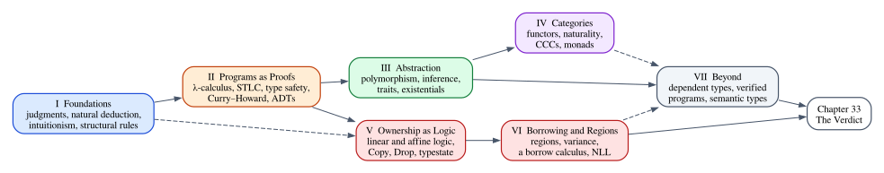

# Two Languages, One Idea

Every time the Rust compiler rejects one of your programs, it has done something
remarkable. It has looked at a program it has never seen, considered every way
that program could run, and concluded that at least one of them could go wrong.
A value used after it was moved, a reference that outlives the data it points
to, a `String` where an `i32` was expected: the compiler did not find these by
running your code and watching it fail. It found them by *reasoning* about the
code, following a small set of rules, before the program ran even once.

Those rules form a **type system**, and the mathematical study of type systems
is called **type theory**. This book is about type theory and about its two
closest relatives, logic and category theory, which turn out to be the same
subject seen from different angles. It is also about the type system you use
every day. Rust's is one of the richest in any mainstream language, and almost
every part of it, from enums and generics to ownership and lifetimes, is a
chapter of type theory in disguise.

We will study all of this with two languages side by side. Rust shows where the
ideas live in a production language, and where that language deviates from the
clean theory. Lean, a functional programming language that is also a proof
assistant, lets us state the ideas precisely and have a machine check every
proof. This first chapter introduces the basic vocabulary of type theory, takes
a first look at both languages, and asks the question that the rest of the book
will answer.

**In this chapter you will learn:**

- what a type theory is made of: syntax, judgments, inference rules and
  computation;
- how to read a typing rule and build a derivation, using Rust's own expressions
  as examples;
- the three readings of a type: as a classification of values, as a proposition
  and as an object;
- why this book pairs Rust with Lean, and what each language can do that the
  other cannot;
- how to evaluate, check and prove things in Lean, and how the book checks its
  own outputs;
- the question that runs through the whole book, and a map of how we will answer
  it.

## What a type theory is made of

A type theory is a formal system, which means a precisely defined game played
with symbols. Every type theory, from the smallest one in Chapter 3 to the one
inside Lean, has four ingredients.

1. **Syntax.** The *terms* (also called expressions or programs) and the *types*.
   In Rust, `x + 1`, `if b { 1 } else { 2 }` and `|s: &str| s.len()` are terms;
   `i32`, `bool` and `Vec<String>` are types.
2. **Judgments.** Statements that the system can establish. The judgment you will
   see most often is the *typing judgment*, written $\Gamma \vdash e : \tau$ and
   read "in the context $\Gamma$, the term $e$ has type $\tau$".
3. **Inference rules.** Recipes that say how a judgment follows from other
   judgments.
4. **Computation rules.** Rules that say what terms *do*: how `2 + 3` becomes
   `5`, how a function call becomes its body.

Type safety, the property that makes a type system worth having, is a statement
about how the third ingredient constrains the fourth. Let us look at each of
them in turn.

### Contexts and judgments

A term usually mentions variables, and its type depends on what we know about
them. The term `x + y` has type `i32` if `x` and `y` do, and no type at all if
`x` is a `String`. The **context** $\Gamma$ (a capital Greek gamma) records what
we assume about the free variables:

$$
\Gamma = x_1 : \tau_1,\; x_2 : \tau_2,\; \dots,\; x_n : \tau_n
$$

The turnstile $\vdash$ separates the assumptions from the conclusion. So

$$
x : \mathtt{i32},\; y : \mathtt{i32} \vdash x + y : \mathtt{i32}
$$

is a judgment that says: assuming `x` and `y` are `i32`, the term `x + y` is an
`i32`. It is important to understand what a judgment is *not*. It is not a piece
of the program; it is a statement *about* the program, made in a language one
level up (the *metalanguage*). It is not true or false the way `x > 0` is; it is
*derivable* or not, according to the rules.

You have read judgments like this one many times without the notation. A
function signature is one:

```rust
{{#include ../../code/rust/examples/ch01_first_types.rs:add}}
```

The parameter list is the context, the return type is the type, the body is the
term. The signature promises: "under the assumptions `x: i32` and `y: i32`, the
body has type `i32`". The compiler's job is to check that promise.

### Inference rules

The rules of a type theory are written in a two-dimensional notation borrowed
from logic. Here are five rules for a small fragment of Rust: integer literals,
variables, addition, `if` and `let`.

$$
\dfrac{}{\Gamma \vdash n : \mathtt{i32}}\;\textsf{T-Lit}
\qquad\qquad
\dfrac{(x : \tau) \in \Gamma}{\Gamma \vdash x : \tau}\;\textsf{T-Var}
$$

$$
\dfrac{\Gamma \vdash e_1 : \mathtt{i32} \qquad \Gamma \vdash e_2 : \mathtt{i32}}{\Gamma \vdash e_1 + e_2 : \mathtt{i32}}\;\textsf{T-Add}
$$

$$
\dfrac{\Gamma \vdash c : \mathtt{bool} \qquad \Gamma \vdash e_1 : \tau \qquad \Gamma \vdash e_2 : \tau}{\Gamma \vdash \mathtt{if}\ c\ \{e_1\}\ \mathtt{else}\ \{e_2\} : \tau}\;\textsf{T-If}
$$

$$
\dfrac{\Gamma \vdash e_1 : \tau_1 \qquad \Gamma,\, x : \tau_1 \vdash e_2 : \tau_2}{\Gamma \vdash \mathtt{let}\ x = e_1;\ e_2 : \tau_2}\;\textsf{T-Let}
$$

Each rule has **premises** above the line and a **conclusion** below it. A rule
says: if you have established all the premises, you may conclude the conclusion.
The name on the right is just a label. A rule with no premises, like T-Lit, is an
**axiom**: its conclusion holds outright. Read aloud:

- **T-Lit**: an integer literal has type `i32`, in any context. (Rust is subtler,
  with literal types inferred from context; this is a model of a fragment.)
- **T-Var**: a variable has the type the context assigns to it.
- **T-Add**: if both operands have type `i32`, so does their sum.
- **T-If**: if the condition is a `bool` and *both branches have the same type*
  $\tau$, the whole `if` has type $\tau$.
- **T-Let**: if $e_1$ has type $\tau_1$, and $e_2$ has type $\tau_2$ *when we
  additionally assume* $x : \tau_1$, then `let x = e1; e2` has type $\tau_2$.
  The comma in $\Gamma, x : \tau_1$ means "extend the context". This is how a
  `let` brings a variable into scope.

The letters $\Gamma$, $e_1$, $\tau$ and so on are **metavariables**: placeholders
for any context, term or type. A rule is a schema that stands for infinitely many
concrete instances. T-Add with $e_1 := x$ and $e_2 := 1$ is one instance; with
$e_1 := x + y$ and $e_2 := z$ it is another.

### Derivations

A **derivation** is a tree of rule instances. Its root is the judgment we want,
each node is justified by a rule whose premises are the node's children, and the
leaves are axioms (or premises like $(x : \mathtt{i32}) \in \Gamma$ that can be
checked directly). Here is the derivation for the body of `add`, with
$\Gamma = x : \mathtt{i32},\, y : \mathtt{i32}$:

$$
\dfrac{\dfrac{(x : \mathtt{i32}) \in \Gamma}{\Gamma \vdash x : \mathtt{i32}}\;\textsf{T-Var} \qquad \dfrac{(y : \mathtt{i32}) \in \Gamma}{\Gamma \vdash y : \mathtt{i32}}\;\textsf{T-Var}}{\Gamma \vdash x + y : \mathtt{i32}}\;\textsf{T-Add}
$$

Read it from the bottom: to show that `x + y` is an `i32`, use T-Add, which
requires showing that `x` and `y` are `i32`; each of those follows from T-Var
because the context says so. Every judgment the compiler accepts has a
derivation like this one behind it, and **type checking is the search for a
derivation**. When the search fails, you get an error message, which is the
compiler's description of where the search got stuck.

Derivations will be everywhere in this book. In Chapter 3 we build a type
checker in Rust that prints them, and in Lean we will represent them as data,
construct them, and prove theorems about all of them at once.

### Computation and type safety

The fourth ingredient says how programs run. We write $e \longrightarrow e'$ for
"$e$ takes one step of computation and becomes $e'$":

$$
2 + 3 \longrightarrow 5
\qquad\qquad
\mathtt{if\ true}\ \{e_1\}\ \mathtt{else}\ \{e_2\} \longrightarrow e_1
$$

A term that cannot step any further is either a **value** (a finished result such
as `5` or `true`) or **stuck**: a nonsensical state such as `true + 5`, where no
rule applies but the computation is not done. Getting stuck is the formal version
of a crash, or worse.

The point of a type system is the **type safety** theorem, usually split in two:

- **Progress.** A well-typed closed term is either a value or can take a step. It
  is never stuck.
- **Preservation.** If a well-typed term takes a step, the result is well typed,
  with the same type.

Together they say that a well-typed program, run for any number of steps, never
reaches a stuck state. Robin Milner put it in a famous slogan in 1978:
*well-typed programs cannot "go wrong"*. What counts as "going wrong" depends on
the semantics. For safe Rust it includes reading freed memory, data races and
using uninitialized values, collectively called *undefined behavior*. It does
not include panics, deadlocks, memory leaks or infinite loops: Rust's type system
makes no promise about those, and we will see why in later chapters.

In Chapter 9 we will state progress and preservation for a small language and
prove them completely in Lean. For now, keep the shape of the idea: rules that
only look at the program text (typing) guarantee something about every possible
run (computation).

## Rust's expressions, read as judgments

Rust is an *expression-oriented* language: almost everything has a value and a
type, including blocks, `if`, `match` and loops. That makes it a good place to
practice reading rules. This chapter's Rust example,
`code/rust/examples/ch01_first_types.rs`, walks through a few cases.

### Blocks and the unit type

A block `{ s1; s2; e }` is an expression. Its statements are checked in order,
each `let` extending the context the way rule T-Let does, and its type and value
are those of the final expression `e`. If the block ends with a statement (a
semicolon) instead of an expression, it has no final expression, and its value is
`()`, the only value of the **unit type** `()`:

```rust
{{#include ../../code/rust/examples/ch01_first_types.rs:blocks}}
```

```text
{{#include ../../code/rust/output/ch01_first_types.txt:2:4}}
```

(The output comes from running the example; `type_name_of_val` is a standard
library function that returns the name of a value's type.) The unit type has
exactly one value, so a value of type `()` carries no information. It is what a
function returns when it is called only for its effects. In type theory it is
usually written $\mathbf{1}$, and in Chapter 11 you will see why it deserves the
name of a number.

### `if` and rule T-If

Since `if` is an expression, it has a type, and rule T-If says what that type is:
both branches must have the same type $\tau$, and then so does the `if`:

```rust
{{#include ../../code/rust/examples/ch01_first_types.rs:if_expression}}
```

Rule T-If is strict: it asks for *one* $\tau$ that fits both branches. This
program violates it:

```rust
{{#include ../../code/rust/compile_fail/ch01_if_branches.rs:describe}}
```

The first branch has an integer type and the second has type `&str`, and no
single type fits both, so no instance of T-If applies and no derivation exists.
The compiler reports exactly that:

```text
{{#include ../../code/rust/compile_fail/ch01_if_branches.stderr}}
```

Notice what the compiler did *not* do. It did not look for some common
supertype of the two branches, the way a language with subtyping might, nor did
it decide the type at run time based on which branch is taken, the way a
dynamically typed language would. Both choices are possible designs, and both
have costs: the first needs a subtyping relation (Chapter 27), the second gives
up checking before the program runs. Rust's rule is the simplest one, and it is
the same rule we will write in every type theory in this book.

### The never type

Some expressions never produce a value at all: `panic!(...)`, `loop {}` without
a `break`, `return`, `break` and `continue`. Rust gives them the **never type**,
written `!`. The never type has *no* values; an expression of type `!` can only
diverge, exit or jump elsewhere.

That is exactly what makes it useful. Look at this function:

```rust
{{#include ../../code/rust/examples/ch01_first_types.rs:never}}
```

The `match` has two arms, and by the same reasoning as T-If they must have the
same type. The first arm is a `u32`. The second is a `panic!`, of type `!`. The
compiler accepts it because `!` **coerces to any type**: since no value of type
`!` can ever exist, pretending that this arm produces a `u32` can never cause a
problem. In logic this principle is ancient: from a contradiction, anything
follows (*ex falso quodlibet*). In type theory, the type with no values is
written $\mathbf{0}$ or $\bot$, and it is the type-theoretic version of "false".
You will meet it again in almost every chapter of Part I and Part II.

> [!NOTE]
> The never type `!` is only partly stable: you can write `fn f() -> !`, but not
> yet use `!` as an ordinary type such as `Vec<!>`. The standard library provides
> `std::convert::Infallible`, an `enum` with no variants, as a stable type with no
> values, and you can define your own: `enum Void {}`. Chapter 5 uses one.

### Rules are a model

The rules we wrote are a simplified *model* of what the Rust compiler does. The
real compiler infers the types of integer literals, inserts coercions,
autoreferences method receivers, and does a great many other things that our
five rules ignore. Rust has no official formal semantics: there is a reference
manual written in English and a compiler that is believed to implement it.
Researchers have built formal *core calculi* that capture the essential parts of
Rust, and we will build several small ones ourselves. When this book writes a
typing rule "for Rust", it is always a model in this sense, and the text will
point out where the model and the compiler differ.

## Three readings of a type

So far we have treated types the way programmers do: as a classification of
values. `bool` is the set of the two values `true` and `false`; `(i32, bool)` is
the set of pairs; a function type is the set of functions. A type system is a
lightweight, automatic way to rule out programs that mix up these sets.

That is the first reading. Two more readings will change how you see types.

**The logician's reading: types are propositions.** Look at this Rust function
from the chapter's example:

```rust
{{#include ../../code/rust/examples/ch01_first_types.rs:swap}}
```

Ignore what it does and read its type as a sentence: "for all `A` and `B`, if
you give me an `A` and a `B`, I can give you a `B` and an `A`". Now replace
"give me a value of type" with "assume", and "a pair" with "and": "for all
propositions $A$ and $B$, if $A$ and $B$, then $B$ and $A$". That is a theorem of
logic, and the function body is its proof: it shows how to turn evidence for
"$A$ and $B$" into evidence for "$B$ and $A$". This is the **Curry–Howard
correspondence**: types are propositions, programs are proofs, and a type is
"true" exactly when some program has that type. Part II is devoted to it.

**The category theorist's reading: types are objects.** Category theory does not
look inside types at all. It looks at how types are connected by functions: a
function `f: A -> B` is an *arrow* from `A` to `B`, arrows can be composed, and
there is an identity arrow on every type. From this point of view a pair type
`(A, B)` is not "a set of pairs" but "the type with two projections such that
every pair of functions into `A` and `B` factors uniquely through it". That
sounds needlessly abstract, but it is the kind of description that works in
*every* setting at once: for types and functions, for propositions and proofs,
for sets and relations. Part IV develops it.

The three readings line up in a table that you will see, in more detail, many
times in this book:

| Type | As a set of values | As a proposition | As an object |
|---|---|---|---|
| `(A, B)` | pairs | $A$ and $B$ | product |
| `A -> B` | functions | $A$ implies $B$ | exponential |
| `enum Either<A, B>` | tagged union | $A$ or $B$ | coproduct |
| `()` | one value | true | terminal object |
| `!` / `enum Void {}` | no values | false | initial object |

The remarkable fact, which took logicians and computer scientists most of the
twentieth century to see clearly, is that these are not three subjects with a
loose analogy between them. They are one subject.

## Why Rust and Lean

### What Rust brings

Rust's type system collects ideas from fifty years of programming-language
research and puts them in the hands of working programmers:

- **algebraic data types** (structs, enums, `match`), from the ML family
  (Chapter 11);
- **parametric polymorphism**, generics that behave like System F, implemented by
  monomorphization (Chapter 12);
- **local type inference**, a deliberately restricted cousin of Hindley–Milner
  (Chapter 13);
- **traits**, which are type classes, the design that Haskell introduced
  (Chapter 14);
- **existential types**, as `impl Trait` and `dyn Trait` (Chapter 15);
- an **affine ownership discipline**: moves, `Copy`, `Clone` and `Drop`
  (Part V);
- **regions** and **permissions**, as lifetimes and the rules for `&` and `&mut`
  (Part VI);
- **subtyping and variance**, on lifetimes only (Chapter 27);
- a first step toward **dependent types**, as const generics (Chapter 30).

Because these are features of a real language, you can experiment with them:
write a program, compile it, read the error. And because Rust is a real language
with real constraints (performance, backwards compatibility, usability), it
deviates from the textbook versions of these ideas in interesting ways. Every
type in Rust has a value, `panic!()`, which makes Rust useless as a logic
(Chapter 10). Type inference stops at function signatures (Chapter 13). There are
no higher-kinded types, so there is no `Functor` trait (Chapter 17). The borrow
checker is not a type system in the textbook sense at all, but a dataflow
analysis (Chapter 29). We will pay as much attention to these deviations as to
the matches: they show what the theory costs in practice.

### What Lean brings

Lean 4 is a functional programming language. You can write ordinary programs in
it, with structures, inductive types (Lean's enums), pattern matching, type
classes, `do` notation, mutable-looking loops and `IO`; it compiles to native
code, and Lean itself is written in Lean. Chapter 2 introduces it from a Rust
programmer's point of view.

What makes Lean different from Rust is that its types are much more expressive.
In Lean a type can mention values. There is a type of "arrays of length 3", a type
of "natural numbers less than `n`", and, most importantly, a type of "proofs that
`2 * sumTo n = n * (n + 1)`". Since propositions are types and proofs are
programs, writing a proof in Lean *is* writing a program of a certain type, and
checking the proof *is* type checking. A small, carefully engineered part of
Lean, its *kernel*, checks every proof, so a theorem that Lean accepts has been
verified down to the axioms of its logic.

This makes Lean a *proof assistant*, and the book uses it as a laboratory. Each
toy language we study is defined in Lean as a data type. Its typing rules become
a Lean definition, so that "a derivation of $\Gamma \vdash e : \tau$" is a
Lean value. Its theorems (the checker is sound, evaluation is deterministic, a
well-typed term never gets stuck, a variable in an affine term is used at most
once) are stated and proved. When the book claims something about a formal
system, it usually backs the claim with a Lean proof that you can read, step
through and modify.

Lean comes with **Mathlib**, a library of mathematics built and maintained by
Lean's community. Think of it as Lean's equivalent of a large, carefully curated
set of crates: definitions (numbers, sets, finite sets, functions, algebraic
structures, categories), hundreds of thousands of proved theorems about them,
and *tactics*, automated proof steps that make proofs short and readable. The
book's Lean project depends on it, the way a Cargo project depends on a crate,
and we will use it from this chapter on.

### Rust implements, Lean proves

Here is the division of labor in miniature. Carl Friedrich Gauss is said to have
noticed, as a schoolboy, that $0 + 1 + \dots + n = n(n+1)/2$. In Rust, we can
compute the sum both ways and compare:

```rust
{{#include ../../code/rust/examples/ch01_first_types.rs:gauss}}
```

```rust
{{#include ../../code/rust/examples/ch01_first_types.rs:gauss_test}}
```

```text
{{#include ../../code/rust/output/ch01_first_types.txt:10:10}}
```

That is good evidence, and in a real project it would be a good test. But it is
evidence about 10,001 numbers, and there are infinitely many. In Lean we can
prove the formula for every `n`, as you will see in a moment. The pattern repeats
throughout the book: the Rust programs are fast, practical, and checked on many
inputs; the Lean developments are slower to write and checked for all inputs.
Each makes the other more trustworthy. In Chapter 31 we will use this pattern
deliberately, testing a Rust implementation against a verified Lean model.

## A first session with Lean

The Lean code for this chapter is in `code/lean/Book/Ch01/FirstSteps.lean`. You
can read it here, but you will get much more out of it with the file open in an
editor that runs Lean as you type (Appendix A explains how to set up VS Code with
the Lean 4 extension). The editor shows Lean's responses in a side panel called
the **infoview**: the output of commands, the type of the expression under the
cursor, and, inside a proof, the current goal.

### Evaluating and checking

The file starts with the line `import Mathlib.Tactic.Ring`, which loads the part
of Mathlib that this chapter uses (the `ring` tactic, and with it Mathlib's
notation for numbers). Imports in Lean are like `use` declarations in Rust,
except that they name modules of the whole project and its dependencies, and they
must come first in the file.

Lean files contain declarations (definitions, theorems) and *commands* that ask
Lean something. The two commands you will use most are `#eval`, which runs an
expression and prints the result, and `#check`, which prints an expression's
type without running it:

```lean
{{#include ../../code/lean/Book/Ch01/FirstSteps.lean:eval_check}}
```

Each command is preceded by two extra lines, and this is a convention used
throughout the book, so it deserves an explanation. The command `#guard_msgs in`
tells Lean: "run the next command, capture everything it prints, and compare it
with the doc comment above". The doc comment `/-- info: 5 -/` is the expected
output. If the output differs in any way, Lean reports an error and the book's
build fails. So the outputs you see in this book are not copied by hand: Lean
checks them every time the project is built.

Read the three outputs. `#eval 2 + 3` prints `5`. `#check 2 + 3` prints
`2 + 3 : ℕ`, which is Lean's way of writing a typing judgment with an empty
context: the colon means "has type", exactly as in $\vdash 2 + 3 : \mathbb{N}$.
`ℕ` is the type of natural numbers $0, 1, 2, \dots$, which Lean uses by default
for numerals. (Its name in Lean's core library is `Nat`; `ℕ` is a notation that
Mathlib adds, and Lean uses it when printing. You can type it in the editor as
`\N`.) The third line checks an anonymous function, written
`fun (n : ℕ) => n + 1` (Rust would write `|n: u64| n + 1`), and reports its
type `ℕ → ℕ`.

### A first definition

Definitions use `def`. Here is Rust's `add`, in Lean:

```lean
{{#include ../../code/lean/Book/Ch01/FirstSteps.lean:add}}
```

```lean
{{#include ../../code/lean/Book/Ch01/FirstSteps.lean:add_check}}
```

The parameters `(x y : ℤ)` are the context, `ℤ` after the colon is the
result type, and the body follows `:=`. `ℤ` (Mathlib's notation for Lean's `Int`)
is the type of all integers, without overflow: Lean's integers are arbitrary
precision, and fixed-width types like `Int32` exist too. The definition lives in the namespace `Ch01` (every file of
the book wraps its contents in a namespace named after its chapter), so its full
name is `Ch01.add`.

Rule T-If holds in Lean too, and Lean rejects the analogue of our Rust program.
The `#guard_msgs` mechanism also checks expected *errors*, which lets the book
show you rejected programs that are still part of a file that compiles:

```lean
{{#include ../../code/lean/Book/Ch01/FirstSteps.lean:if_branches}}
```

The message is worded differently but says the same thing as Rust's: the `else`
branch has type `String`, and it was expected to have type `ℕ`, the type of the
whole `if`. (The `ready = true` in the last line is how Lean displays the
condition `ready` of type `Bool` when it is used as a proposition; Chapter 5
explains the difference between `Bool` and `Prop`.)

### A first theorem

Now the interesting part. Here is the sum $0 + 1 + \dots + n$, defined by
recursion:

```lean
{{#include ../../code/lean/Book/Ch01/FirstSteps.lean:sum_to}}
```

```lean
{{#include ../../code/lean/Book/Ch01/FirstSteps.lean:sum_to_eval}}
```

The definition is written by *pattern matching* on the argument, like a Rust
`match`: the sum up to `0` is `0`, and the sum up to `n + 1` is `n + 1` plus the
sum up to `n`. Every natural number is either `0` or `n + 1` for some `n`, so the
two cases cover everything, and each recursive call is on a smaller number, so
the recursion terminates. Lean checks both facts; it does not accept definitions
that might not terminate unless you explicitly ask for it (Chapter 2 explains
why).

Here is Gauss's formula as a Lean theorem, with its proof:

```lean
{{#include ../../code/lean/Book/Ch01/FirstSteps.lean:gauss}}
```

A `theorem` looks like a `def`, and that is no accident. The part after the colon,
`2 * sumTo n = n * (n + 1)`, is a *type*: the type of proofs of that equation. The
part after `:=` is a *program* of that type, a proof. Here the program is written
with `by`, which switches to **tactic mode**: instead of writing the proof term
directly, we give Lean a sequence of instructions (tactics) that build it. The
comments show the **goal**, what remains to be proved, at each point; in an editor
you would see them in the infoview as you move the cursor.

Let us go through the proof line by line.

- `induction n with` starts a proof by induction on `n`, exactly as you would on
  paper. It creates two goals, one for each way a natural number can be built.
- In the `zero` case the goal is `2 * sumTo 0 = 0 * (0 + 1)`. Both sides compute
  to `0`: `sumTo 0` is `0` by the first equation of the definition. The tactic
  `rfl` (for *reflexivity*) proves an equation whose two sides compute to the same
  value.
- In the `succ k` case Lean gives us the **induction hypothesis** `ih`, the
  formula for `k`, and asks for the formula for `k + 1`.
- `rw [sumTo, mul_add, ih]` rewrites the goal three times, left to right. First
  it uses the second defining equation of `sumTo` to unfold `sumTo (k + 1)` into
  `k + 1 + sumTo k`. Then it uses `mul_add`, Mathlib's distributive law
  $a \cdot (b + c) = a \cdot b + a \cdot c$, to turn `2 * (k + 1 + sumTo k)` into
  `2 * (k + 1) + 2 * sumTo k`. Finally it uses `ih` to replace `2 * sumTo k` with
  `k * (k + 1)`. This is the step where the induction hypothesis is used.
- What remains, `2 * (k + 1) + k * (k + 1) = (k + 1) * (k + 1 + 1)`, no longer
  mentions `sumTo`: it is an identity between polynomials in `k`, true because
  both sides multiply out to $k^2 + 3k + 2$. The `ring` tactic from Mathlib proves
  exactly such identities: it normalizes both sides as polynomials and compares
  them.

When the last goal is closed, Lean accepts the theorem. If any step were wrong
(a rewrite that does not apply, a goal that `ring` cannot prove), Lean would
report an error at that line, and the theorem would not exist.

There is more to proofs than tactics, and later chapters build up the toolbox
slowly. For now, notice the shape: a theorem is a type, a proof is a program of
that type, and the program is checked like any other.

### Claims that are true and claims that are false

For a specific number, the equation is a computation, and Lean can check it by
computing:

```lean
{{#include ../../code/lean/Book/Ch01/FirstSteps.lean:examples}}
```

An `example` is a theorem without a name. The first proof is `rfl`: both sides
compute to `6`. The second uses `decide`, which evaluates a decidable proposition
to `true` or `false` and succeeds if it gets `true`. If the claim is false, Lean
says so:

```lean
{{#include ../../code/lean/Book/Ch01/FirstSteps.lean:false_claim}}
```

### Types that carry proofs

Here is something Rust cannot express. In Rust, `xs[0]` on an empty slice panics
at run time. In Lean, a function can demand, as an argument, a *proof* that the
index is valid:

```lean
{{#include ../../code/lean/Book/Ch01/FirstSteps.lean:first}}
```

The parameter `h : 0 < xs.size` is a proof that the array is not empty. Its type
mentions the value of another parameter, `xs`: this is a **dependent type**, and
it is the feature that sets Lean apart from Rust. When we call `first #[5, 6]`, we
must supply the proof; `by decide` computes it, because `0 < 2` is a decidable
fact. If we try to index without a proof, Lean refuses, and helpfully lists the
alternatives:

```lean
{{#include ../../code/lean/Book/Ch01/FirstSteps.lean:first_unproved}}
```

The options are illuminating: `xs[0]!` panics at run time when the index is
invalid (that is what Rust's `xs[0]` does), `xs[0]?` returns an `Option` (that is
Rust's `xs.get(0)`), and `xs[0]'h` takes a proof `h`. Lean offers all three, and
the third has no counterpart in Rust. Chapter 30 is about dependent types.

### Propositions as types, once more

The swap function from the Rust example has a Lean twin:

```lean
{{#include ../../code/lean/Book/Ch01/FirstSteps.lean:and_swap}}
```

`p ∧ q` is the proposition "$p$ and $q$", and a proof of it is a pair of a proof
of `p` and a proof of `q`, written with angle brackets `⟨hp, hq⟩`. The proof of
`and_swap` is a function that takes such a pair apart and builds the swapped one:
character for character the same program as Rust's `swap`. Chapter 10 explains
why, and where the parallel between the two languages breaks down.

### Which axioms did we use?

Lean can tell you what a theorem ultimately rests on. The command
`#print axioms` lists the axioms that a proof uses, directly or through the
library lemmas it relies on. To make the point, here is a second proof of Gauss's
formula that leaves the arithmetic to a more powerful automatic tactic, `grind`:

```lean
{{#include ../../code/lean/Book/Ch01/FirstSteps.lean:gauss_auto}}
```

```lean
{{#include ../../code/lean/Book/Ch01/FirstSteps.lean:axioms}}
```

Our `and_swap` uses no axioms at all: it is a program built from the rules of the
type theory alone. Our `gauss` uses one standard axiom of Lean's logic,
`propext` (propositions that imply each other are equal), through the lemmas that
`rw` and `ring` rely on. The `grind` version uses two more: `Quot.sound` (which
underlies quotient types and, through them, function extensionality) and
`Classical.choice`, from which the law of excluded middle follows: `grind`
reasons classically. Neither proof is wrong. But they are different kinds of
proof, and in Chapter 5 you will learn what the difference means and why a
constructive proof (one that does not use `Classical.choice`) carries more
information than a classical one.

## The question of this book

There is a sentence you may have read in a blog post, a talk or a discussion
thread: *Rust's ownership and lifetimes are based on affine types.* It sounds
authoritative, it is repeated often, and it is rarely explained. This book takes
it as its central question:

> Is it true that Rust's ownership and lifetime concepts are based on affine
> types?

To answer it we need a surprising amount of machinery. "Affine types" are the
type-theoretic side of *affine logic*, a logic in which an assumption may be used
at most once. To say what that means we need natural deduction and the
**structural rules** (Chapters 4 and 6), the rules that silently allow ordinary
logic to use an assumption twice or not at all. To connect logic to types we need
the λ-calculus and the Curry–Howard correspondence (Part II). Then we can remove
structural rules, build the affine λ-calculus and compare it with Rust's moves,
`Copy`, `Clone` and `Drop` (Part V). Then we need references, regions, permissions
and variance, a calculus with borrows, and a look at how the compiler actually
checks them (Part VI). Only then can we give a verdict.

There is also a methodological trap in the question, and it is worth pointing out
now. "Based on" can mean at least three different things:

1. **Historical**: the designers knew the research on linear and affine types and
   drew on it.
2. **Specificational**: the rules the compiler enforces are exactly the rules of
   an affine type system.
3. **Implementational**: the compiler works by building derivations in an affine
   type system.

These can have different answers, and keeping them apart is most of the work of
answering honestly. Without spoiling the details, here is the shape of the
answer we will reach in Chapter 33: the claim is **half true**. One half of
Rust's discipline really is affine, in a precise sense that we will prove things
about; the other half is a different theory altogether. Which half is which, and
why the difference matters, is what Parts V and VI are about.

## A map of the book

The book has seven parts. The diagram shows how they depend on each other.



- **Part I — Foundations** (Chapters 1–6): the two languages, judgments and
  rules, natural deduction, intuitionism, the structural rules.
- **Part II — Programs as Proofs** (Chapters 7–11): the λ-calculus, simple
  types and closures, a mechanized proof of type safety, Curry–Howard, algebraic
  data types.
- **Part III — Abstraction** (Chapters 12–15): parametric polymorphism, type
  inference, traits and type classes, existential types.
- **Part IV — Categories** (Chapters 16–20): categories, functors, natural
  transformations, cartesian closed categories, monads.
- **Part V — Ownership as Logic** (Chapters 21–25): substructural logics, the
  affine λ-calculus, `Copy` and `Clone`, `Drop`, typestate.
- **Part VI — Borrowing and Regions** (Chapters 26–29): regions and permissions,
  variance, a borrow calculus, the real borrow checker.
- **Part VII — Beyond** (Chapters 30–33): dependent types, verified programs,
  semantic soundness and `unsafe`, the verdict.

Read Parts I and II in order; Chapter 2, which teaches Lean, is a prerequisite for
everything that follows. After that you can follow your interest: Part IV only
needs Parts I and II; Parts V and VI also need only Parts I and II and are best
read together; Part VII draws on everything.

## Common confusions

**"A judgment is a boolean expression."** It is not. `x > 0` is a term of the
language, evaluated when the program runs. $\Gamma \vdash e : \tau$ is a statement
in the metalanguage, about the term $e$, established (or not) by building a
derivation. Chapter 3 keeps the two levels carefully apart, and Lean makes the
distinction concrete: a Rust `bool` corresponds to Lean's `Bool`, while a judgment
corresponds to a Lean `Prop`.

**"Type safety means the program is correct."** It means the program does not go
wrong *in the specific sense the semantics defines*. A well-typed Rust program can
still compute the wrong answer, panic, deadlock or run forever. A Lean theorem
about a program is a much stronger statement, because its type can say what
"correct" means; but it is only as good as the statement you wrote.

**"Lean is only for mathematicians."** Lean is a general-purpose functional
language, and a fast one; the proof-assistant side is what this book uses most,
but every Lean file here also contains ordinary programs that you can run with
`#eval`.

**"`#guard_msgs` is part of the program."** It is a testing device: it changes
nothing about the definitions in the file. If you delete the `#guard_msgs in` line
and the doc comment above it, the command still runs and simply prints its output
in the infoview.

## Summary

- A type theory has four ingredients: syntax (terms and types), judgments such as
  $\Gamma \vdash e : \tau$, inference rules that derive judgments, and
  computation rules that run terms.
- A derivation is a tree of rule instances. Type checking is the search for a
  derivation; a type error is a report of where the search failed.
- Type safety (progress and preservation) says that well-typed programs never
  reach a stuck state. What "stuck" means depends on the semantics; for safe Rust
  it rules out undefined behavior but not panics, leaks or non-termination.
- Rust is expression-oriented, and its blocks, `if` and never type are instances
  of simple rules: rule T-If explains error E0308, and the never type is the empty
  type, which coerces to every type.
- Types can be read as sets of values, as propositions (Curry–Howard) and as
  objects of a category. These three readings are one subject.
- Rust shows where the theory lives in practice and where practice deviates from
  it; Lean states the theory precisely and checks proofs mechanically.
- In Lean, `#eval` runs, `#check` shows types, a `theorem` is a type with a
  program (a proof) of that type, and `#guard_msgs` checks the outputs shown in
  this book. `#print axioms` shows what a proof rests on.
- The book's question, whether Rust's ownership and lifetimes are "based on"
  affine types, has a precise answer that we will reach in Chapter 33.

## Exercises

1. Write the full derivation tree for the body of
   `fn f(b: bool) -> i32 { if b { 1 } else { 2 } }`, using rules T-Var, T-Lit and
   T-If. You will need a rule for the boolean variable `b` in the context.
   *Hint:* the context is $\Gamma = b : \mathtt{bool}$, and the derivation has
   three branches above the T-If line.

2. Which premise of T-If fails for `if c { 1 } else { "a" }`? Sketch two different
   changes to the type system that would accept the program, and for each, say
   what you would lose.
   *Hint:* one change introduces a type that contains both integers and strings;
   the other gives up knowing the type before the program runs.

3. What is the type of `loop {}`? Why does `let x: i32 = loop {};` compile, while
   `let x: i32 = loop { break; };` does not? Check your answers with the compiler.
   *Hint:* a `loop` that is exited with `break` has the type of the value given to
   `break`, and a bare `break` gives `()`.

4. In Lean, prove that `sumTo` is monotone:
   `theorem sumTo_le (n : ℕ) : sumTo n ≤ sumTo (n + 1)`. Add it to a scratch
   copy of `FirstSteps.lean` inside `namespace Ch01`.
   *Hint:* no induction is needed. Unfold one step with `simp only [sumTo]`, and
   finish with `omega`, a decision procedure for linear arithmetic.

5. Prove the three-way rotation `theorem rotate (p q r : Prop) : p ∧ q ∧ r → r ∧ p ∧ q`
   in Lean, and write the corresponding generic function `rotate` on triples in
   Rust. Then run `#print axioms rotate`.
   *Hint:* `p ∧ q ∧ r` means `p ∧ (q ∧ r)`, and the anonymous constructor
   notation flattens nested pairs: `fun ⟨hp, hq, hr⟩ => ⟨hr, hp, hq⟩`.

6. Prove `gauss` without Mathlib's `ring`, using only tactics from Lean's core
   library. Then compare the two proofs with `#print axioms`.
   *Hint:* after `rw [sumTo, Nat.mul_add, ih]`, multiply everything out with
   `simp only [Nat.add_mul, Nat.mul_add, Nat.mul_one, Nat.one_mul]`; the goal
   becomes linear if you treat `k * k` as an unknown, and `omega` (a decision
   procedure for linear arithmetic) can finish it.
