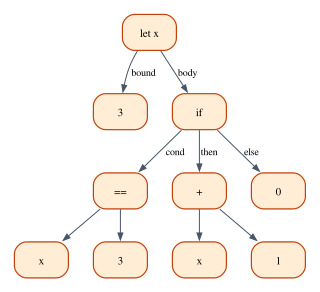

# Judgments, Rules and Derivations

Chapter 1 introduced the vocabulary of type theory informally: a judgment such as
$\Gamma \vdash e : \tau$, inference rules with premises above a line, and
derivations, trees of rule instances that justify a judgment. We wrote five rules
for a fragment of Rust and built one small derivation by hand. That was enough to
read a rule, but not enough to *trust* one. What exactly is a rule? What does it
mean for a judgment to be derivable? When a type checker says "this program has
type `Nat`", how do we know it is telling the truth?

This chapter answers those questions for a complete, if tiny, language called
**Arith**: natural numbers and booleans, addition, equality, `if` and `let`. We
build it three times. On paper, as a grammar, a set of typing rules and a set of
evaluation rules. In Rust, as the `arith` crate: a parser, a type checker that
produces derivation trees as data and prints them, and an evaluator. And in
Lean, where the typing rules become an inductive definition, derivations become
proof terms, and the type checker becomes a function about which we prove the
first real theorem of the book: **the checker is sound**, every type it reports is
backed by a derivation. Along the way we look at Rust's own expressions through
the same lens, and at what type safety does and does not promise.

**In this chapter you will learn:**

- the difference between concrete and abstract syntax, and how a BNF grammar
  defines syntax trees, which become enums in Rust and inductive types in Lean;
- what a judgment is, how inference rules define a relation inductively, and why
  a judgment holds exactly when it has a derivation;
- how to build derivations by hand, how a type checker searches for them, and
  how to represent them as data (Rust) and as proof terms (Lean);
- how Rust's blocks, `if`, unit type, never type and `Infallible` fit simple
  typing rules, and where the model needs care;
- what type safety means for Arith, what "going wrong" means, and why type
  systems reject some programs that would run fine;
- the difference between checking, synthesis and inference, and between
  structural and nominal types;
- how to prove, step by step in Lean, that the Arith checker is sound and
  complete, and that types are unique.

## Syntax, concrete and abstract

Here is a program in Arith:

```text
let x = 3 in if x == 3 then x + 1 else 0
```

That line of text is the program's **concrete syntax**: the characters a
programmer types. A compiler does not work with characters for long. Its parser
turns them into a tree, the program's **abstract syntax**, which records only the
structure: which operation is applied to which sub-expressions.



Everything that the concrete syntax needs only to be readable and unambiguous is
gone from the tree: spaces, parentheses, keywords, the precedence that says that
`x + 1 == 2` means `(x + 1) == 2`. The tree for `(1 + 2) + 3` and the tree for
`1 + 2 + 3` are the same tree. Type checkers, evaluators and proofs all work on
abstract syntax, and so does the rest of this book.

### Grammars

The set of Arith's trees is defined by a **grammar** in Backus–Naur form (BNF):

```text
τ ::= Nat | Bool

e ::= n                          natural-number literal
    | true | false               boolean literals
    | x                          variable
    | e + e                      addition
    | e == e                     equality test
    | if e then e else e         conditional
    | let x = e in e             local definition
```

Read `::=` as "is one of" and `|` as "or". The first line says that a type $\tau$
is either `Nat` or `Bool`. The second says that an expression is a literal, a
variable, or one of five compound forms built from smaller expressions. The
letters $n$ and $x$ stand for any natural number and any variable name. This
grammar describes *trees*: `e + e` means "a node labeled `+` with two children
that are expressions", and the question of how to write such a tree as text,
with which parentheses, is left to the concrete syntax.

A grammar is our first example of an **inductive definition**: the set of
expressions is the *smallest* set that contains the literals and variables and is
closed under the five ways of building bigger expressions. "Smallest" is what
rules out infinite or circular trees: every expression is built in finitely many
steps, which is what makes recursion and induction over expressions work. You
will see the same pattern again in a moment, for judgments.

### Arith in Rust

Each alternative of the grammar becomes a variant of an enum. The `arith` crate
(in `code/rust/crates/arith`) defines them in `src/syntax.rs`:

```rust
{{#include ../../code/rust/crates/arith/src/syntax.rs:ty}}
```

```rust
{{#include ../../code/rust/crates/arith/src/syntax.rs:expr}}
```

The sub-expressions are boxed because `Expr` is recursive. The crate also has a
parser (`src/parse.rs`) that turns text into an `Expr`, with the usual
recursive-descent structure: one function per precedence level, so that `+`
binds tighter than `==` and both bind tighter than `if` and `let`. In the other
direction, `Expr` implements `Display`, printing a tree with only the parentheses
that are needed. A test in the crate prints thousands of random trees and parses
them back, checking that the result is the same tree: concrete syntax is just a
way of writing abstract syntax down.

### Arith in Lean

In Lean, the grammar becomes two inductive types, in
`code/lean/Book/Ch03/Arith.lean`:

```lean
{{#include ../../code/lean/Book/Ch03/Arith.lean:ty}}
```

```lean
{{#include ../../code/lean/Book/Ch03/Arith.lean:expr}}
```

No `Box` is needed, as Chapter 2 explained. We do not write a parser in Lean; we
write trees directly, using the constructors:

```lean
{{#include ../../code/lean/Book/Ch03/Arith.lean:sample}}
```

The file also defines `Expr.render`, the same precedence-based printer as the
Rust crate's, so that we can see a tree as text:

```lean
{{#include ../../code/lean/Book/Ch03/Arith.lean:render_eval}}
```

## Judgments

A **judgment** is a statement *about* syntax that we may or may not be able to
establish. Arith has two kinds:

- the typing judgment $\Gamma \vdash e : \tau$, "in the context $\Gamma$, the
  expression $e$ has type $\tau$";
- the evaluation judgment $\rho \vdash e \Downarrow v$, "in the environment
  $\rho$, the expression $e$ evaluates to the value $v$".

Other type theories have other judgment forms: "$\tau$ is a well-formed type",
"$e_1$ and $e_2$ are equal", or, in logic, "$A$ is true", which Chapter 4 studies
in detail. The form of a judgment is a design decision, and a type theory is in
large part a choice of judgment forms and of the rules that relate them.

A judgment is not part of the language it talks about. The Arith expression
`x == 3` is a *term* of Arith: a program that computes a boolean when it runs. The
judgment $x : \mathsf{Nat} \vdash x \mathbin{\mathtt{==}} 3 : \mathsf{Bool}$ is a
statement in our *metalanguage*, the language in which we describe Arith, and it
is about the term. It is not true or false at run time; it is derivable or not,
once and for all. Keeping the two levels apart is the most important habit this
chapter can give you. In Lean the separation is concrete: Arith expressions are
values of the Lean type `Expr`, and the typing judgment will be a Lean
*proposition* about such values. Lean is our metalanguage, and Arith is
*embedded* in it as data. (This style of formalization is called a *deep
embedding*.)

### Contexts

A context lists the types of the variables in scope:

```text
Γ ::= ∅ | Γ, x : τ
```

A context is either empty or a smaller context extended with one more binding.
We write $\Gamma(x) = \tau$ when the *most recent* binding of $x$ in $\Gamma$ has
type $\tau$. "Most recent" matters, because a `let` may bind a name that is
already bound, and then the inner binding *shadows* the outer one, exactly as in
Rust:

```rust,ignore
let x = true;
let x = 5;      // shadows the first x
x + 1           // this x is the number
```

The Rust crate represents a context as a vector of bindings, newest last, and
searches it from the end:

```rust
{{#include ../../code/rust/crates/arith/src/typing.rs:ctx}}
```

The Lean version is a list of pairs, newest *first*, so that extending the
context is just `::`:

```lean
{{#include ../../code/lean/Book/Ch03/Arith.lean:ctx}}
```

`abbrev` makes `Ctx` a transparent abbreviation: a `Ctx` *is* a list, and every
list function applies to it. In particular `Γ.lookup x` is the core library's
`List.lookup`, which returns the value paired with the *first* occurrence of the
key, the most recent binding:

```lean
{{#include ../../code/lean/Book/Ch03/Arith.lean:lookup}}
```

## Inference rules

### The typing rules of Arith

Here are the typing rules, one for each form of expression:

$$
\dfrac{}{\Gamma \vdash n : \mathsf{Nat}}\;\textsf{T-Num}
\qquad\qquad
\dfrac{}{\Gamma \vdash b : \mathsf{Bool}}\;\textsf{T-Bool}
\qquad\qquad
\dfrac{\Gamma(x) = \tau}{\Gamma \vdash x : \tau}\;\textsf{T-Var}
$$

$$
\dfrac{\Gamma \vdash e_1 : \mathsf{Nat} \qquad \Gamma \vdash e_2 : \mathsf{Nat}}{\Gamma \vdash e_1 + e_2 : \mathsf{Nat}}\;\textsf{T-Add}
\qquad\qquad
\dfrac{\Gamma \vdash e_1 : \tau \qquad \Gamma \vdash e_2 : \tau}{\Gamma \vdash e_1 \mathbin{\mathtt{==}} e_2 : \mathsf{Bool}}\;\textsf{T-Eq}
$$

$$
\dfrac{\Gamma \vdash e_1 : \mathsf{Bool} \qquad \Gamma \vdash e_2 : \tau \qquad \Gamma \vdash e_3 : \tau}{\Gamma \vdash \mathtt{if}\ e_1\ \mathtt{then}\ e_2\ \mathtt{else}\ e_3 : \tau}\;\textsf{T-If}
$$

$$
\dfrac{\Gamma \vdash e_1 : \tau_1 \qquad \Gamma,\, x : \tau_1 \vdash e_2 : \tau_2}{\Gamma \vdash \mathtt{let}\ x = e_1\ \mathtt{in}\ e_2 : \tau_2}\;\textsf{T-Let}
$$

In T-Bool, $b$ stands for either boolean literal. In words:

- **T-Num** and **T-Bool**: literals have their obvious types, in any context.
- **T-Var**: a variable has the type of its most recent binding.
- **T-Add**: a sum is a `Nat` if both operands are.
- **T-Eq**: an equality test is a `Bool` if both sides have the *same* type
  $\tau$, whichever it is. So `1 == 2` and `true == false` are well typed, and
  `1 == true` is not.
- **T-If**: the condition must be a `Bool` and the branches must agree on a type
  $\tau$, which is then the type of the whole expression (Rust's rule, from
  Chapter 1).
- **T-Let**: type $e_1$ first; then type $e_2$ in the context extended with
  $x : \tau_1$. The scope of $x$ is $e_2$ and nothing else.

### Anatomy of a rule

A rule is made of **premises** (above the line) and a **conclusion** (below it).
A rule without premises, such as T-Num, is an **axiom**. The letters $\Gamma$,
$e_1$, $\tau$, $n$ and $x$ are **metavariables**: a rule is a *schema*, and every
way of replacing its metavariables by actual contexts, expressions and types gives
an *instance* of the rule. T-Add with $\Gamma := x : \mathsf{Nat}$,
$e_1 := x$ and $e_2 := 1$ is the instance

$$
\dfrac{x : \mathsf{Nat} \vdash x : \mathsf{Nat} \qquad x : \mathsf{Nat} \vdash 1 : \mathsf{Nat}}{x : \mathsf{Nat} \vdash x + 1 : \mathsf{Nat}}\;\textsf{T-Add}
$$

T-Var has a premise of a different kind, $\Gamma(x) = \tau$, which is not a typing
judgment but a fact about the context that can be checked directly. Such
premises are often called **side conditions**.

Notice something about T-Eq: the metavariable $\tau$ occurs in the premises but
not in the conclusion. To use the rule backwards, from a goal
$\Gamma \vdash e_1 \mathbin{\mathtt{==}} e_2 : \mathsf{Bool}$, you must come up with
a $\tau$ that works, and nothing in the goal tells you what it is. T-Let has the
same feature with $\tau_1$. We will see how a checker copes with this when we
build one.

### What the rules define

The rules do not *compute* anything. They define a **relation**: a set of
triples $(\Gamma, e, \tau)$ for which the judgment $\Gamma \vdash e : \tau$
holds. Which set? Many sets are "closed under the rules", meaning that whenever
the premises of a rule instance are in the set, so is the conclusion; the set of
*all* triples is one of them, and it is useless. The rules define the
**smallest** such set: a judgment holds only if the rules force it to. This is
the same idea as in the grammar, and it has two consequences that we will use
constantly.

1. **A judgment holds if and only if it has a derivation.** A derivation is the
   finite tree of rule instances that forces the judgment into the set. If there
   is no derivation, nothing forces it, and the smallest set leaves it out.
2. **Rule induction.** To prove that every derivable judgment has some property
   $P$, it is enough to show that each rule preserves $P$: if the premises have
   it, so does the conclusion. This is induction on the height of derivations,
   and it is how the theorems at the end of this chapter are proved.

A third consequence is specific to Arith. Each form of expression is the
conclusion of exactly one rule: a sum can only be typed by T-Add, an `if` only by
T-If. So if $\Gamma \vdash e_1 + e_2 : \tau$ is derivable, its derivation ends
with T-Add, and therefore $\tau = \mathsf{Nat}$ and both operands have type
`Nat`. Reasoning backwards from a judgment to the premises that must have
produced it is called **inversion**, and a system in which the syntax of the
expression determines the rule is called **syntax-directed**.

## Derivations

### A derivation by hand

Let us derive the type of our sample program,
$\mathtt{let}\ x = 3\ \mathtt{in}\ \mathtt{if}\ x \mathbin{\mathtt{==}} 3\ \mathtt{then}\ x + 1\ \mathtt{else}\ 0$,
in the empty context (which we do not write: $\vdash e : \tau$ means
$\emptyset \vdash e : \tau$). The tree is too wide for one page, so we build it
from named pieces. Let $\Gamma_1 = x : \mathsf{Nat}$. The condition and the first
branch:

$$
\mathcal{D}_1 = \dfrac{\dfrac{\Gamma_1(x) = \mathsf{Nat}}{\Gamma_1 \vdash x : \mathsf{Nat}}\;\textsf{T-Var} \qquad \dfrac{}{\Gamma_1 \vdash 3 : \mathsf{Nat}}\;\textsf{T-Num}}{\Gamma_1 \vdash x \mathbin{\mathtt{==}} 3 : \mathsf{Bool}}\;\textsf{T-Eq}
$$

$$
\mathcal{D}_2 = \dfrac{\dfrac{\Gamma_1(x) = \mathsf{Nat}}{\Gamma_1 \vdash x : \mathsf{Nat}}\;\textsf{T-Var} \qquad \dfrac{}{\Gamma_1 \vdash 1 : \mathsf{Nat}}\;\textsf{T-Num}}{\Gamma_1 \vdash x + 1 : \mathsf{Nat}}\;\textsf{T-Add}
$$

Then the `if`, writing $e_{\mathrm{if}}$ for the whole conditional:

$$
\mathcal{D}_3 = \dfrac{\mathcal{D}_1 \qquad \mathcal{D}_2 \qquad \dfrac{}{\Gamma_1 \vdash 0 : \mathsf{Nat}}\;\textsf{T-Num}}{\Gamma_1 \vdash e_{\mathrm{if}} : \mathsf{Nat}}\;\textsf{T-If}
$$

and finally the `let`, whose second premise is typed in the extended context
$\Gamma_1$:

$$
\dfrac{\dfrac{}{\vdash 3 : \mathsf{Nat}}\;\textsf{T-Num} \qquad \mathcal{D}_3}{\vdash \mathtt{let}\ x = 3\ \mathtt{in}\ e_{\mathrm{if}} : \mathsf{Nat}}\;\textsf{T-Let}
$$

Check each step against the rules. In T-Eq the hidden $\tau$ is `Nat`; in T-Let
the hidden $\tau_1$ is `Nat`, and that choice is what puts $x : \mathsf{Nat}$ into
the context of $\mathcal{D}_3$. The whole tree has ten rule instances (counting
the two T-Var nodes, whose side conditions are not rules) and height four.

### Type checking is a search for derivations

How would a program find this tree? Read the rules from the bottom up. Given
$\Gamma$ and $e$, look at the form of $e$: since Arith is syntax-directed, exactly
one rule can have produced it, and its premises say what to derive next. The
hidden metavariables are not a problem if we *compute* types instead of guessing
them: for T-Let, derive the type of $e_1$ first, and use the $\tau_1$ we found to
extend the context; for T-Eq, derive the types of both sides and compare them.
A checker that computes the type from the expression is said to **synthesize**
it, and for Arith synthesis always succeeds when a derivation exists.

The Rust checker, in `src/typing.rs`, returns the derivation itself. A
`Derivation` is a tree whose nodes record the rule, the judgment it concludes and
the sub-derivations of its premises:

```rust
{{#include ../../code/rust/crates/arith/src/typing.rs:derivation}}
```

and `check` builds it by following the rules backwards, one arm per rule:

```rust
{{#include ../../code/rust/crates/arith/src/typing.rs:check}}
```

Compare each arm with its rule. The `Add` arm derives both operands and insists
(with the helper `expect`) that each has type `Nat`, then builds a T-Add node
whose premises are the two sub-derivations. The `Eq` and `If` arms use `agree` to
demand that two derived types coincide; this is how the hidden $\tau$ of T-Eq is
found rather than guessed. The `Let` arm checks the body in `ctx.extend(x, ...)`,
the context $\Gamma, x : \tau_1$.

### Derivations as data

The example `crates/arith/examples/ch03_arith.rs` parses sample programs, checks
them and prints the derivations with `Derivation::render`, which writes each
judgment on its own line, the premises indented under their conclusion:

```rust
{{#include ../../code/rust/crates/arith/examples/ch03_arith.rs:show_derivation}}
```

```text
{{#include ../../code/rust/output/ch03_arith.txt:1:25}}
```

The second tree is the derivation we built by hand, printed root first: the
fraction notation draws trees with the root at the bottom, this printout with the
root at the top, but the tree is the same. The third shows shadowing: in the
context `x : Bool, x : Nat`, the variable `x` has type `Nat`, the most recent
binding.

Having the derivation as data has a practical benefit: anyone can *check* it
without trusting the checker that produced it. `Derivation::verify` walks the
tree and confirms that every node is a correct instance of its rule:

```rust
{{#include ../../code/rust/crates/arith/src/typing.rs:verify}}
```

`verify` searches for nothing. It only compares judgments that are already
written in the tree, which makes it much simpler than `check`, and so much easier
to get right. This division of labor, a clever and possibly buggy program that
*finds* a certificate and a simple program that *checks* it, is exactly how Lean
itself is built: tactics and the elaborator search for proofs, and a small kernel
checks the proof terms they produce. The crate's tests verify every derivation
that `check` builds, and also confirm that tampered derivations (a wrong type,
a wrong rule, a missing premise) are rejected.

### When no derivation exists

When the search fails, the checker reports where it got stuck:

```rust
{{#include ../../code/rust/crates/arith/src/typing.rs:type_error}}
```

The example prints the error for a few ill-typed programs, and then runs them
anyway with the evaluator, which we will meet shortly:

```text
{{#include ../../code/rust/output/ch03_arith.txt:27:38}}
```

Each message names the rule that could not be applied and the premise that
failed: for `1 + true`, rule T-Add needs `true : Nat`, and T-Bool can only give
`true : Bool`. By inversion, T-Add is the *only* rule that could conclude a typing
of `1 + true`, so no derivation exists at all, not just none that the checker
found. The last program is more interesting: it is rejected, but it runs fine.
We will come back to it.

## The rules in Lean

### The typing judgment as an inductive predicate

In Lean, the typing rules become one definition:

```lean
{{#include ../../code/lean/Book/Ch03/Arith.lean:has_type}}
```

`HasType` is an **inductive predicate**: an inductive type, like `Expr`, but one
whose values are *proofs*. Its type, `Ctx → Expr → Ty → Prop`, says that for
every context, expression and type, `HasType Γ e τ` is a proposition, the
judgment $\Gamma \vdash e : \tau$. Each constructor is one rule. Its arguments are
the premises and its result type is the conclusion: the constructor `add` says
"from a proof of `HasType Γ e₁ .nat` and a proof of `HasType Γ e₂ .nat`, you get a
proof of `HasType Γ (.add e₁ e₂) .nat`", which is rule T-Add. The side condition
of T-Var becomes an ordinary premise, a proof that the lookup returns `τ`.

The metavariables of the rules are the names `Γ`, `e₁`, `τ` and so on in the
constructors. We did not declare them: Lean's auto-bound implicits (Chapter 2)
turn them into implicit arguments of each constructor, as `#check` shows:

```lean
{{#include ../../code/lean/Book/Ch03/Arith.lean:has_type_check}}
```

Read the `∀` as "for all values of the metavariables": this is the rule schema
T-Let, stated as the type of a function from proofs of the premises to a proof
of the conclusion.

Being an inductive definition, `HasType` is automatically the *smallest*
relation closed under its constructors: a proof of `HasType Γ e τ` can only be
built by applying constructors, finitely many times. Lean also generates the two
principles that this smallness gives: `induction` on a proof of `HasType` (rule
induction) and `cases` on it (inversion).

### Derivations are proof terms

A derivation is now a Lean term built from the constructors. The derivation of
$\vdash 1 + 2 : \mathsf{Nat}$ is T-Add applied to two instances of T-Num:

```lean
{{#include ../../code/lean/Book/Ch03/Arith.lean:deriv_add}}
```

and the derivation we built by hand for the sample program is this term, whose
nesting is the shape of the tree:

```lean
{{#include ../../code/lean/Book/Ch03/Arith.lean:deriv_sample}}
```

Each `HasType.var rfl` is a T-Var node: its premise, that looking up `"x"` in
`[("x", .nat)]` gives `some .nat`, holds by computation, so `rfl` proves it. The
hidden metavariables of T-Let and T-Eq are found by Lean's unifier, much as our
Rust checker found them, by matching the types of the sub-derivations.

Writing proof terms by hand is instructive once. The usual way is to build them
with tactics, starting from the goal and working upwards, which is exactly the
backwards reading of the rules:

```lean
{{#include ../../code/lean/Book/Ch03/Arith.lean:deriv_tactics}}
```

`unfold sample` replaces the name by its definition so that the goal shows the
tree. `apply HasType.letE` says "the last rule is T-Let" and leaves one goal per
premise. The first goal displays the unknown $\tau_1$ as `?τ₁`, a *metavariable*
in Lean's sense, a hole that later steps may fill: `exact HasType.num` fills it
with `Ty.nat`, and from then on the second goal mentions `[("x", Ty.nat)]`. The
second version lets the tactic `constructor` do the choosing. Given a goal of the
form `HasType ...`, it tries the constructors and applies the first one whose
conclusion fits. `repeat` applies it again to the first remaining goal, and again,
until it fails; here it fails only when no goals are left. Along the way it also
meets the `lookup` equations of T-Var, which `constructor` closes with
`Eq.refl`. Because Arith is syntax-directed, the first constructor that fits is
always the right one, so this naive search succeeds.

Here a Rust programmer may ask: where is the derivation *data*? In Rust we could
print it and count its nodes. In Lean, `HasType` lives in `Prop`, and Lean treats
any two proofs of the same proposition as equal (*proof irrelevance*), so a
function that computes data cannot look inside a proof. Had we declared `HasType` with values
in `Type` instead, derivations would be ordinary data that functions could
inspect, like the Rust `Derivation`. Chapter 10 explains the difference between
`Prop` and `Type`; for this chapter, what matters is that a judgment holds exactly
when its proposition has a proof.

## Rust's expressions as instances of rules

Chapter 1 used Rust's expressions to motivate the rules. With Arith in hand we
can look at them more precisely, and see where Rust needs rules of a kind that
Arith does not have. As always, these are *models* of what the compiler does, not
an official specification. The program is `code/rust/examples/ch03_expressions.rs`.

### Blocks are nested `let`s

Everything in Rust is an expression, including blocks. A block with `let`
statements and a final expression is Arith's `let` in different clothes:

```rust
{{#include ../../code/rust/examples/ch03_expressions.rs:block_as_lets}}
```

The body is `let a = 2 in let b = a + 3 in a * b`, typed by two instances of
T-Let. A statement that is not a `let`, such as `e1;`, adds a rule of its own,
which we can call T-Seq: $e_1$ must have *some* type, which is then thrown away,
and the block has the type of what follows.

$$
\dfrac{\Gamma \vdash e_1 : \tau_1 \qquad \Gamma \vdash e_2 : \tau_2}{\Gamma \vdash \{\, e_1;\ e_2 \,\} : \tau_2}\;\textsf{T-Seq}
$$

### Unit, and `if` without `else`

The unit type has one value, and one axiom:

$$
\dfrac{}{\Gamma \vdash () : ()}\;\textsf{T-Unit}
$$

A block that ends with a semicolon has no final expression, and is typed as if
it ended with `()`. An `if` without `else` behaves as if it had `else { () }`, so
rule T-If forces its `then` branch to have type `()` as well:

$$
\dfrac{\Gamma \vdash e_1 : \mathtt{bool} \qquad \Gamma \vdash e_2 : ()}{\Gamma \vdash \mathtt{if}\ e_1\ \{e_2\} : ()}\;\textsf{T-IfUnit}
$$

That is why such an `if` is only useful for its effects:

```rust
{{#include ../../code/rust/examples/ch03_expressions.rs:if_without_else}}
```

and why using one for its value is an error, E0317, whose message spells out the
rule:

```rust
{{#include ../../code/rust/compile_fail/ch03_if_without_else.rs:missing_else}}
```

```text
{{#include ../../code/rust/compile_fail/ch03_if_without_else.stderr}}
```

### The never type: a rule that is not syntax-directed

Some expressions never produce a value: `return`, `break`, `continue`, `panic!`
and a `loop` without `break`. Rust gives them the never type `!`, and Chapter 1
explained that `!` coerces to every type. As a rule:

$$
\dfrac{\Gamma \vdash e : \,!}{\Gamma \vdash e : \tau}\;\textsf{T-Never}
$$

This rule is different from all of Arith's. Its conclusion is not tied to any
form of expression: *any* expression of type `!` can be given *any* type. A system
with such a rule is no longer syntax-directed, and types are no longer unique (an
expression of type `!` has every type). The compiler copes by applying the
coercion only where a specific type is expected. Here are expressions of type `!`
in four positions:

```rust
{{#include ../../code/rust/examples/ch03_expressions.rs:never_positions}}
```

`return 0` and `continue` are typed `!` and coerced to whatever their context
expects. The `loop` itself has the type of the values given to `break`, here
`u32`. In the last `let`, the `else` branch is a `panic!`, coerced to `u32` so
that T-If can apply.

### `Infallible` and the empty `match`

The never type is only partly stable, as Chapter 1 noted, and the standard library
offers `std::convert::Infallible`, an enum with no variants, as a stable type with
no values. It is empty just like `!`, but it is an ordinary enum, and the
coercion rule of `!` does not apply to it:

```rust
{{#include ../../code/rust/compile_fail/ch03_infallible.rs:absurd}}
```

```text
{{#include ../../code/rust/compile_fail/ch03_infallible.stderr}}
```

To use an empty enum as a value of another type you must write its
*elimination* explicitly, as a `match` with no arms. A `match` needs one arm per
variant, and there are none, so the empty `match` is exhaustive and, having no
arms that could disagree, can be given any type:

$$
\dfrac{\Gamma \vdash e : \mathtt{Infallible}}{\Gamma \vdash \mathtt{match}\ e\ \{\} : \tau}\;\textsf{T-Absurd}
$$

```rust
{{#include ../../code/rust/examples/ch03_expressions.rs:infallible}}
```

T-Absurd, unlike T-Never, is syntax-directed: the expression `match e {}` says
which rule to use. The second half of the listing shows a more common use. A
function with error type `Infallible` cannot fail, so the pattern `Ok(n)` covers
every possible value of `Result<usize, Infallible>`, and the compiler accepts
`let Ok(n) = ...;` without an `else`. In logic, the empty type is falsehood, and
T-Absurd is the principle "from a contradiction, anything follows"; Chapter 5
builds negation on it.

## Evaluation and type safety

### The evaluation judgment

Types are only half of a language. The other half is what programs do. Arith's
**values** are the results of evaluation:

```text
v ::= n | true | false
```

and its evaluation judgment $\rho \vdash e \Downarrow v$ is defined by rules too,
where an environment $\rho$ maps variables to values. Here are the main ones (the
rule for `==` compares two numbers or two booleans, and E-IfFalse is the mirror
image of E-IfTrue):

$$
\dfrac{}{\rho \vdash n \Downarrow n}\;\textsf{E-Num}
\qquad\qquad
\dfrac{\rho(x) = v}{\rho \vdash x \Downarrow v}\;\textsf{E-Var}
\qquad\qquad
\dfrac{\rho \vdash e_1 \Downarrow n_1 \qquad \rho \vdash e_2 \Downarrow n_2}{\rho \vdash e_1 + e_2 \Downarrow n_1 + n_2}\;\textsf{E-Add}
$$

$$
\dfrac{\rho \vdash e_1 \Downarrow \mathtt{true} \qquad \rho \vdash e_2 \Downarrow v}{\rho \vdash \mathtt{if}\ e_1\ \mathtt{then}\ e_2\ \mathtt{else}\ e_3 \Downarrow v}\;\textsf{E-IfTrue}
\qquad\qquad
\dfrac{\rho \vdash e_1 \Downarrow v_1 \qquad \rho,\, x \mapsto v_1 \vdash e_2 \Downarrow v_2}{\rho \vdash \mathtt{let}\ x = e_1\ \mathtt{in}\ e_2 \Downarrow v_2}\;\textsf{E-Let}
$$

Look closely at E-Add. The `+` in $e_1 + e_2$, in the expression, is Arith
syntax: a node of the tree. The $+$ in $n_1 + n_2$, in the result, is ordinary
addition of numbers, in the metalanguage. The rule says that the meaning of the
syntax `+` is mathematical addition. It is the clearest example of the two levels
of this chapter sitting side by side. Notice also that E-IfTrue does not mention
$e_3$: the branch that is not taken is not evaluated.

This style of semantics, which relates an expression directly to its final value,
is called **big-step**. Chapter 9 uses the other style, *small-step*, which
describes one step of computation at a time. Each has its uses, and the
difference matters for languages whose programs can run forever.

### The evaluator

The Rust evaluator implements the rules as a recursive function, in
`src/eval.rs`:

```rust
{{#include ../../code/rust/crates/arith/src/eval.rs:eval}}
```

It never looks at types. When an operation meets a value of the wrong kind, such
as adding a boolean, no rule applies: the evaluation is **stuck**. The evaluator
reports that as an error:

```rust
{{#include ../../code/rust/crates/arith/src/eval.rs:eval_error}}
```

The Lean evaluator, in `Arith.lean`, is the same function, with `none` for a
stuck evaluation:

```lean
{{#include ../../code/lean/Book/Ch03/Arith.lean:eval}}
```

```lean
{{#include ../../code/lean/Book/Ch03/Arith.lean:eval_eval}}
```

### Type safety, informally

The output of the rejected programs above showed the connection between the two
halves. `1 + true` is ill typed, and when we run it anyway it gets stuck. That is
what the type system is for. For Arith, **type safety** says:

> If $\vdash e : \tau$, then $\vdash e \Downarrow v$ for some value $v$ of type
> $\tau$.

A well-typed closed program never gets stuck, and its result has the predicted
type. This is Milner's slogan from Chapter 1, *well-typed programs cannot go
wrong*, made precise for one language, and the precision lies in defining what
"wrong" means: here, reaching a state where no evaluation rule applies. For a
language whose programs may run forever, the statement is split into the two
lemmas you met in Chapter 1, *progress* (a well-typed program is a value or can
take a step) and *preservation* (a step keeps the type), and Chapter 9 proves
them completely for a richer language. Arith programs always terminate, so the
big-step statement suffices.


The crate *tests* the statement. On twenty thousand random expressions, it
checks that every one the checker accepts verifies, evaluates without getting
stuck, and produces a value of the predicted type:

```rust
{{#include ../../code/rust/crates/arith/src/lib.rs:safety_test}}
```

Two observations keep this honest. First, "wrong" means *stuck in the semantics*,
and nothing else. Arith's numbers are unbounded, but the Rust implementation
stores them in a `u64`, and a well-typed sum can overflow:

```text
{{#include ../../code/rust/output/ch03_arith.txt:40:42}}
```

The type system does not, and cannot, prevent this: overflow is not a stuck state
of the semantics but a limit of the machine that runs it. Rust is in the same
position. Its type system rules out undefined behavior, its notion of going wrong,
and does not rule out panics, overflow (which panics in debug builds), deadlocks
or infinite loops.

Second, type systems are **conservative**. `if 1 == 1 then 1 else false` is
rejected, because T-If demands that both branches have the same type, yet it
evaluates to `1` without trouble, since the `else` branch is never taken. The
type checker does not run the program; it reasons about all runs at once, and
here it cannot tell that the condition is always true. Every useful type system
rejects some programs that would have been fine. For realistic languages this is
unavoidable: whether a program in a Turing-complete language ever goes wrong is
undecidable, so a checker that always terminates must err on one side, and
type checkers err on the side of rejecting.

## Checking, synthesis and inference

Our checker takes $\Gamma$ and $e$ and *produces* $\tau$. Three related problems
are worth telling apart, because later chapters solve each of them:

- **Type checking** proper: given $\Gamma$, $e$ and $\tau$, decide whether
  $\Gamma \vdash e : \tau$ holds.
- **Type synthesis**: given $\Gamma$ and $e$, find a $\tau$ such that
  $\Gamma \vdash e : \tau$, or report that there is none. Our checker does this.
  For Arith, synthesis also solves checking: synthesize, then compare, which is
  correct because types are unique (proved below).
- **Type inference**: the program leaves out type information that the rules
  need, and the checker must reconstruct it. Arith never needs annotations,
  because the only binder, `let`, gets the type of its variable from $e_1$. A
  function `fun x => x + 1` is different: nothing in the term says what `x` is,
  and the checker must introduce an unknown type and solve equations about it.
  That is *unification*, and Chapter 13 builds the classic algorithm.

Real languages mix the three. Rust checks function bodies against their
signatures, synthesizes the types of most expressions, and infers the types of
local variables (as in `let v = Vec::new();`, whose element type is found from
later uses), but only inside one function body: the signatures of functions are
never inferred.
Chapter 8 introduces *bidirectional* type checking, which alternates between
checking and synthesis in a principled way, and Chapter 13 covers inference and
Rust's place in it.

## Structural and nominal types

When are two types the same? Arith's answer is trivial, `Nat` is `Nat`, but real
languages need a policy. A type is **structural** if its identity is its
structure: two tuple types `(f64, f64)` are the same type wherever they are
written, and so are two array, reference or function-pointer types with the same
components. A type alias does not even create a type, only a new name for an
existing one. A type is **nominal** if its identity is its declaration: two
structs with the same fields are different types, because they were declared
separately.

```rust
{{#include ../../code/rust/examples/ch03_expressions.rs:structural_nominal}}
```

Nominal typing is what makes the *newtype* pattern useful. A distance and a
duration are both `f64`, but `Meters` and `Seconds` are not interchangeable, and
swapping them is a type error:

```rust
{{#include ../../code/rust/compile_fail/ch03_nominal.rs:units}}
```

```text
{{#include ../../code/rust/compile_fail/ch03_nominal.stderr}}
```

The compiler even notices that swapping the arguments would fix the call. Lean
behaves the same way: every `structure` and `inductive` declaration creates a new
type, while `abbrev` (as for `Ctx`) only introduces a name. In type theory,
structural types such as products are the primitive ones; when Chapter 11 writes
$A \times B$, the honest Rust counterpart is the tuple `(A, B)`, and a
`struct Pair(A, B)` is a product only up to an isomorphism.

## Putting it together: the checker is correct

We now have two descriptions of Arith's type system: the rules, which say which
judgments hold, and a checker, which computes types. Are they the same? A bug in
the checker could make it accept a program that has no derivation, and then the
type safety guarantee, which is about derivable judgments, would say nothing
about that program. In Rust, the crate's tests give us evidence. In Lean we can
settle the question.

### The checker in Lean

The Lean checker has the same structure as the Rust one, returning
`Option Ty` instead of a derivation:

```lean
{{#include ../../code/lean/Book/Ch03/Arith.lean:check}}
```

```lean
{{#include ../../code/lean/Book/Ch03/Arith.lean:check_eval}}
```

The `match` on two (or three) results at once is the Lean counterpart of the
Rust checker's sequence of `?` and `expect`: for a sum, only the case where both
operands have type `Nat` succeeds, and any other combination falls through to
`none`.

### Soundness

**Soundness** says that the checker never claims a type without a derivation to
back it. The theorem and its proof are in `code/lean/Book/Ch03/Soundness.lean`:

```lean
{{#include ../../code/lean/Book/Ch03/Soundness.lean:check_sound}}
```

The proof is by induction on the expression `e`, one case per constructor, and
each case mirrors one arm of the checker. Let us go through it.

**The induction.** `induction e generalizing Γ τ with` sets up a structural
induction on `e`. In each case for a compound expression, Lean provides an
induction hypothesis for every sub-expression: in the `add` case, `ih₁` says that
the theorem holds for `e₁`, and `ih₂` for `e₂`. The word `generalizing` matters.
Without it, `ih₁` would speak about the *same* `Γ` and `τ` as the goal, but the
sub-expressions have *other* types (the operands of a sum are `Nat` even when we
know nothing yet about `τ`), and the body of a `let` lives in a *bigger* context.
With `generalizing Γ τ`, each induction hypothesis reads "for every `Γ` and `τ`,
if the checker says `τ` for this sub-expression in `Γ`, there is a derivation",
which is strong enough to use at whatever context and type the case needs.

**Literals.** In the `num` case the hypothesis is
`h : check Γ (Expr.num n) = some τ`. `simp only [check, Option.some.injEq] at h`
unfolds `check`, which turns `h` into `some Ty.nat = some τ`, and then uses the
injectivity of `some` (the lemma `Option.some.injEq`) to get `h : Ty.nat = τ`.
`subst h` replaces `τ` by `Ty.nat` everywhere, leaving the goal
`HasType Γ (Expr.num n) Ty.nat`, which is rule T-Num: `exact HasType.num`. The
`bool` case is identical.

**Variables.** `check Γ (.var x)` is *defined* as `Γ.lookup x`, so the hypothesis
`h : check Γ (Expr.var x) = some τ` already is, up to unfolding, the premise of
T-Var, and `exact HasType.var h` is accepted. (`exact` checks the term against the
goal up to computation, so no explicit unfolding is needed.)

**Sums.** This is the case that shows the method. After unfolding, `h` says that a
`match` on `check Γ e₁, check Γ e₂` returned `some τ`. `split at h` splits the
proof into one case per arm of that `match`, adding to each case what Lean learned
about the discriminants:

- In the first arm, both checks returned `some Ty.nat`. Lean records this in two
  hypotheses with names it invented (shown as `heq✝¹` and `heq✝` in the infoview),
  and `rename_i h₁ h₂` names them. Now `h : some Ty.nat = some τ`, and `cases h`
  solves this equation by substituting `Ty.nat` for `τ`. The goal is
  `HasType Γ (e₁.add e₂) Ty.nat`. Rule T-Add needs derivations for both operands,
  and the induction hypotheses provide them: `ih₁ h₁` turns "the checker says
  `Nat` for `e₁`" into "`e₁` has type `Nat`". So
  `exact HasType.add (ih₁ h₁) (ih₂ h₂)` closes the case: we have *built* the
  derivation from the derivations of the parts.
- In the other arm the `match` returned `none`, so `h : none = some τ`, which is
  impossible (different constructors), and `contradiction` closes the case.

**Equality and conditionals.** The same pattern, with one more `split` for the
`if τ₁ = τ₂` inside the arm. In the branch where the two types are equal,
`rename_i same` names the hypothesis `same : τ₁ = τ₂`, `cases h` fixes the type of
the result, and `subst same` identifies `τ₁` and `τ₂`, so that the induction
hypotheses give derivations at the *same* type, which is what T-Eq and T-If
demand. In the branch where the types differ, the checker returned `none`, and
`contradiction` closes the case.

**`let`.** After the split, `h₁ : check Γ e₁ = some τ₁` and
`h : check ((x, τ₁) :: Γ) e₂ = some τ`. The first gives a derivation of
`HasType Γ e₁ τ₁` by `ih₁ h₁`. The second is about the body *in the extended
context*, and here `generalizing` pays off: `ih₂` holds for every context,
including `(x, τ₁) :: Γ`, so `ih₂ h` is a derivation of the body. Rule T-Let
combines them.

Every case built a derivation from the derivations of the sub-expressions,
following the same rule the checker followed. That is what soundness means: the
checker's recursion and the derivation's structure are the same tree.

### Completeness

The converse says that the checker finds every type that can be derived:

```lean
{{#include ../../code/lean/Book/Ch03/Soundness.lean:check_complete}}
```

This time the induction is on the *derivation* `h`: rule induction, with one case
per rule rather than per form of expression. In each case the goal is to show that
the checker returns the type in the rule's conclusion, and the induction
hypotheses say that it returns the right types for the premises. For T-Num and
T-Bool the checker's answer is `some .nat` or `some .bool` by definition, so
`rfl` works. For T-Var the premise *is* the claim. For the compound rules,
`simp [check, ih₁, ih₂]` unfolds `check`, rewrites the recursive calls with the
induction hypotheses (for example `check Γ e₁` becomes `some Ty.nat`), and then
the `match` reduces to the right arm and the `if τ = τ` to its `then` branch.

Together the two theorems say that `check Γ e = some τ` and `HasType Γ e τ` are
the same statement. That makes the typing judgment *decidable*, and Lean can be
told so with an instance of the `Decidable` class, built from the checker:

```lean
{{#include ../../code/lean/Book/Ch03/Soundness.lean:check_iff}}
```

`decidable_of_iff` turns a decision procedure for one proposition into one for an
equivalent proposition. With the instance in place, `decide` proves typing
judgments, and their negations, by running the checker inside Lean, with the
soundness and completeness theorems guaranteeing that the answer is right.

### Uniqueness of types

An Arith expression has at most one type in a given context. We prove it twice.
The first proof works directly on derivations:

```lean
{{#include ../../code/lean/Book/Ch03/Soundness.lean:type_unique}}
```

Two derivations of the same expression are given, `h₁` with type `σ` and `h₂`
with type `τ`. The proof is by induction on `h₁`, generalizing `τ` so that the
induction hypotheses work for any second derivation. In each case, `cases h₂`
performs **inversion** on the second derivation: it asks Lean which rules could
have concluded `HasType Γ e τ` for this particular `e`. Since Arith is
syntax-directed, only one rule fits, and Lean replaces `h₂` by the premises of
that rule, solving any equations this imposes on `τ`.

- For a literal, the only rule is T-Num (or T-Bool), whose conclusion forces
  `τ = Ty.nat`. After `cases h₂`, the goal is `Ty.nat = Ty.nat`, and `rfl`
  closes it. The cases for `+` and `==` are the same, since their rules fix the
  result type.
- For a variable, both derivations end with T-Var, with premises
  `hσ : Γ.lookup x = some σ` and `hτ : Γ.lookup x = some τ`. Rewriting `hτ` with
  `hσ` gives `some σ = some τ`, and `Option.some.inj` (injectivity of `some`)
  gives `σ = τ`. Here, at the leaves of the tree, is where uniqueness really comes
  from: a context assigns each variable one type.
- For an `if`, the type of the whole is the type of the first branch in both
  derivations. Inverting `h₂` gives its derivation `h₂₁` of the first branch at
  type `τ`, and the induction hypothesis `ih₁`, for the first branch of `h₁`,
  turns it into `σ = τ`.
- For a `let`, the two derivations may *a priori* have typed `e₁` differently,
  and then typed the body in different contexts. The induction hypothesis for
  `e₁` rules that out: `have same := ih₁ h₂₁` proves that the two types of `e₁`
  are equal, `subst same` makes the two contexts identical, and the induction
  hypothesis for the body finishes.

The second proof is a corollary of the theorems about the checker:

```lean
{{#include ../../code/lean/Book/Ch03/Soundness.lean:type_unique_corollary}}
```

By completeness, the checker returns `some σ` and `some τ` for the same input. It
is a function, so the two results are equal, and `some` is injective. This proof
is shorter because the work was done in the completeness proof; the direct proof
shows the technique, induction plus inversion, that later chapters use when there
is no checker to lean on.

Uniqueness fails for Rust as a whole: the literal `1` can be an `i32`, a `u8` or
any other integer type depending on context, and the never type has every type.
That is part of why Rust needs inference rather than plain synthesis.

### Proving that no derivation exists

Finally, a typing error is a claim that *no* derivation exists, and we can prove
such claims:

```lean
{{#include ../../code/lean/Book/Ch03/Soundness.lean:no_derivation}}
```

`¬ P` means "`P` implies false" (Chapter 4 explains why), so the proof starts
with `intro h`, assuming a derivation `h`, and must reach a contradiction. `cases
h` inverts it: only T-Add can conclude a typing of a sum, so `h` must have come
from T-Add, whose second premise `h₂` would be a derivation of
`HasType [] (.bool true) .nat`. Inverting `h₂` asks which rule concludes that a
boolean literal has type `Nat`. None does: T-Bool only gives `Bool`. With no
possible rule, `cases h₂` has no cases to produce, and the proof is complete.
This is the formal version of the Rust checker's message for `1 + true`, and the
`decide` example earlier proved a similar fact by running the checker; here we
reasoned about the rules directly.

## Common confusions

**"The grammar is about text."** A BNF grammar in type theory describes trees.
Parentheses, precedence and spacing belong to the concrete syntax and the parser.
When a rule says $e_1 + e_2$, it means a `+` node with two children, however it
was written.

**"The rules are the type checker."** The rules *define* a relation; they do not
say how to compute it, and a rule like T-Never shows that reading them as an
algorithm is not always straightforward. A checker is a separate program, and
whether it agrees with the rules is a theorem (soundness and completeness) that
must be proved. For Arith it is; for Rust, the compiler is the de facto
definition, and the research calculi that model it are checked against it.

**"Well typed means the program cannot fail."** It means the program cannot go
wrong in the specific sense the semantics defines. A well-typed Arith program can
overflow the Rust evaluator, and a well-typed Rust program can panic or loop
forever.

**"The never type is the unit type."** `()` has exactly one value, so an expression
of type `()` always produces it. `!` has no values, so an expression of type `!`
never produces anything. The first is "true" and the second "false" in the logical
reading of Chapter 1's table.

**"A derivation is just a proof tree on paper."** It is a mathematical object that
can be represented, built, checked and reasoned about: as a Rust struct, as a Lean
proof term, and as the input to `induction` and `cases`. That is what makes the
theorems of this chapter possible.

## Summary

- Abstract syntax is a tree; a BNF grammar defines the set of trees inductively,
  and becomes an enum in Rust and an inductive type in Lean. Concrete syntax is
  how trees are written as text.
- A judgment is a statement about syntax made in the metalanguage. Arith has a
  typing judgment $\Gamma \vdash e : \tau$ and an evaluation judgment
  $\rho \vdash e \Downarrow v$.
- Inference rules have premises, a conclusion and metavariables; axioms have no
  premises; side conditions are premises of another kind. The rules define the
  smallest relation closed under them, so a judgment holds exactly when it has a
  derivation, and properties of derivable judgments are proved by rule induction.
- In a syntax-directed system each form of expression is concluded by one rule,
  which makes inversion and type checking straightforward. Rust's T-Never is a
  rule that is not syntax-directed.
- Type checking is a search for a derivation. The `arith` crate returns
  derivations as data, prints them, and verifies them independently; type errors
  report where the search failed.
- In Lean the typing judgment is an inductive predicate `HasType`; derivations are
  proof terms, built by hand or with `apply`, `exact`, `constructor` and
  `repeat`; `induction` and `cases` on derivations are rule induction and
  inversion.
- Type safety for Arith: well-typed closed programs evaluate to a value of the
  predicted type and never get stuck. "Wrong" means stuck in the semantics; type
  systems are conservative and reject some harmless programs.
- Synthesis computes a type, checking verifies a given one, inference
  reconstructs missing type information. Structs and enums are nominal; tuples,
  arrays, references and aliases are structural.
- The Lean checker is sound and complete with respect to the rules, which makes
  the judgment decidable, and types are unique; the proofs are inductions whose
  cases mirror the rules.

## Exercises

1. Write out the complete derivation tree, in fraction notation, for
   $\vdash \mathtt{let}\ b = (1 \mathbin{\mathtt{==}} 2)\ \mathtt{in}\ \mathtt{if}\ b\ \mathtt{then}\ 0\ \mathtt{else}\ 1 : \mathsf{Nat}$.
   Then check your answer with the `arith` crate, by adding the program to
   `ch03_arith.rs`.
   *Hint:* name the sub-derivations as in this chapter; the context of the body is
   $b : \mathsf{Bool}$, and T-Eq is used with $\tau = \mathsf{Nat}$.

2. Add a comparison `e <= e` to Arith in Rust: a new `Expr` variant, a token and
   a parser case, a typing rule T-Le (both operands `Nat`, result `Bool`), an
   evaluation case, a `Rule::Le` with its `verify` case, and tests. The random
   safety test should keep passing once the generator produces the new form.
   *Hint:* parse `<=` at the same level as `==`. Write the rule as a fraction first.

3. Make the same extension in Lean: add `| le (e₁ e₂ : Expr)` to `Expr`, a
   constructor to `HasType`, a case to `check`, and repair the proofs of
   `check_sound`, `check_complete` and `type_unique`.
   *Hint:* Lean will tell you exactly which cases are missing. Each new case is a
   copy of the corresponding `add` case with the result type changed.

4. Prove type safety for Arith in Lean: if `HasType Γ e τ` and the environment
   `ρ` gives each variable of `Γ` a value of the right type, then
   `∃ v, eval ρ e = some v ∧ v.ty = τ`.
   *Hint:* state the assumption on `ρ` as
   `∀ x σ, Γ.lookup x = some σ → ∃ v, ρ.lookup x = some v ∧ v.ty = σ`, put it
   after the colon together with `∀ ρ`, and do induction on the derivation. For a
   value `v` with `v.ty = .nat`, `cases v` and `simp [Value.ty] at h` recover the
   number; in the `ite` case, do the same for the condition and then `cases` on
   the boolean. The `letE` case is the hardest: show that the extended
   environment matches the extended context by `by_cases` on whether the variable
   looked up is `x`, simplifying `List.lookup`.

5. Prove in Lean that `if true then 1 else false` has no type:
   `theorem ite_untypable (τ : Ty) : ¬ HasType [] (.ite (.bool true) (.num 1) (.bool false)) τ`,
   first by inversion as in `add_bool_untypable`, then with `cases τ <;> decide`
   (why is `decide` alone not enough?). Which premise of T-If fails?
   *Hint:* after `cases h` you get derivations of `1 : τ` and `false : τ`;
   inverting the first forces `τ = Ty.nat`, and then the second has no rule.

6. Explain, in terms of the rules T-Never and T-Absurd, why
   `fn f() -> u32 { return 7; }` and `fn g(x: Infallible) -> u32 { match x {} }`
   compile, while `fn h(x: Infallible) -> u32 { x }` does not. Then define your
   own `enum Void {}` and write a function `fn absurd<T>(v: Void) -> T`.
   *Hint:* `return 7;` is a statement whose expression has type `!`; the body
   block then has no final expression of type `u32`, but the compiler knows the
   block diverges.
