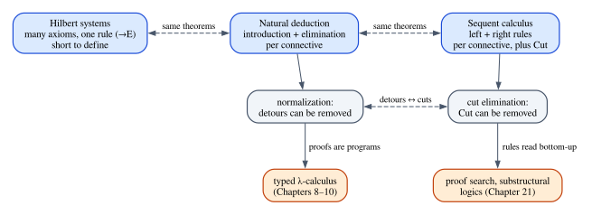

# Natural Deduction

In Chapter 3 you met judgments, inference rules and derivations, and used them to
describe which programs of a small language are well typed. This chapter applies
the same machinery to a different subject: logic itself. The question is old and
simple. When is a proof a proof? Mathematicians reason by assuming things,
drawing consequences, splitting into cases and discharging assumptions when they
are no longer needed, and for most of history nobody wrote down the rules of that
game precisely. In the mid-1930s Gerhard Gentzen did, and he called his system
*natural deduction*, because it follows the way people actually reason.

Natural deduction matters to us for three reasons. It is the logic that Lean
checks whenever you write a proof. Its rules obey a precise design principle,
*harmony*, which explains their shapes and shows how one badly designed rule can
wreck a logic. And its proofs turn out to be programs: the rules are, almost
symbol for symbol, the typing rules of a functional language, and the way proofs
simplify is the way programs run. Part II is built on that fact.

**In this chapter you will learn:**

- the difference between a proposition and a judgment, and what a hypothetical
  judgment $\Gamma \vdash A$ is;
- the introduction and elimination rules for $\land$, $\to$, $\lor$, $\top$ and
  $\bot$, with negation defined as $A \to \bot$, in tree notation and in sequent
  notation;
- harmony: why detours can be removed (local soundness) and why nothing is lost
  (local completeness), and how Prior's `tonk` shows that harmony matters;
- normalization, the subformula property and consistency, and a first look at
  the sequent calculus and cut elimination;
- how to prove propositional formulas in Lean, with proof terms and with the
  tactics `intro`, `exact`, `apply`, `constructor`, `cases`, `rcases`, `obtain`,
  `left`, `right`, `exfalso` and `contradiction`;
- how to define natural deduction *inside* Lean and prove it sound with respect
  to truth tables;
- how to build a proof checker in Rust that gives good error messages, and what
  happens to it when you add `tonk`.

## Propositions and judgments

### Formulas

We start with the objects that logic is about. Fix a supply of *atomic
propositions*: statements whose internal structure we do not analyze, such as
"the connection is open" or "the order was paid". Formulas are built from atoms
with a handful of connectives:

$$
A, B \;::=\; P \;\mid\; \top \;\mid\; \bot \;\mid\; A \land B \;\mid\; A \lor B \;\mid\; A \to B
$$

where $P$ ranges over atoms and $A$, $B$ over formulas (in rules, letters such
as $A$, $B$, $C$ stand for any formula), $\top$ ("truth") is a proposition that
is trivially true, $\bot$ ("falsity", read "bottom") is one that is never true, and $\land$,
$\lor$, $\to$ are "and", "or" and "implies". This is a grammar of trees, like the
grammar of `Arith` in Chapter 3: $A \land B \to C$ is a tree whose root is $\to$.
The usual conventions keep the parentheses down: $\neg$ binds tightest, then
$\land$, then $\lor$, then $\to$, and $\to$ groups to the right, so
$A \to B \to C$ means $A \to (B \to C)$.

Two connectives are deliberately missing, because we define them:

$$
\neg A \;:=\; A \to \bot \qquad\qquad A \leftrightarrow B \;:=\; (A \to B) \land (B \to A)
$$

"Not $A$" *means* "$A$ implies falsity": to refute $A$ is to show that assuming
$A$ leads to absurdity. This definition is not a shortcut. As you will see, it
gives negation exactly the rules one would want, and Chapter 5 explains why it is
the right reading of "not".

### "A is true" is a judgment

The most useful distinction in this subject, stressed by Per Martin-Löf, is the
one between a **proposition** and a **judgment**. A proposition, such as
$A \land B$, is a piece of syntax, an object we talk about. A judgment is an act of
knowledge *about* such an object. The judgment we care about here is

$$
A\ \mathit{true}
$$

read "$A$ is true", or more precisely "we have evidence for $A$". There are other
judgment forms. You have already seen "$e$ has type $\tau$" in Chapter 3, and
"$A$ is a well-formed formula" is another. Inference rules relate judgments, never
propositions: the horizontal line in a rule is not a connective, and it says
"if you know the judgments above, you may conclude the one below".

### Hypothetical judgments

We rarely know that something is true outright. Mostly we know that something is
true *provided* other things are: "if the payment cleared and the item is in
stock, the order can ship". This is a **hypothetical judgment**, written

$$
A_1, \dots, A_n \vdash B
$$

and read "assuming $A_1, \dots, A_n$, $B$ is true". The list on the left of the
turnstile $\vdash$ is the **context**, usually called $\Gamma$, and the whole
thing $\Gamma \vdash B$ is called a **sequent**. With an empty context, $\vdash B$
says that $B$ is true outright.

> [!WARNING]
> $A \vdash B$ and $\vdash A \to B$ are different judgments. The first is a
> hypothetical judgment about $B$; the second is a categorical judgment about a
> formula that happens to contain the symbol $\to$. The rules below make them
> *interderivable* (each follows from the other), but they live at different
> levels: $\vdash$ belongs to the metalanguage, $\to$ to the object language.
> Keeping them apart is what will let Chapter 6 ask "which rules govern the left
> side of $\vdash$?", a question about the judgment, not about any connective.

Is $\Gamma$ a set, a multiset or a list? Choosing "set" quietly decides that
assumptions can be reordered, ignored and reused at will. We take $\Gamma$ to be
a **list**, and in this chapter we use it as freely as ordinary logic does;
Chapter 6 turns each of those freedoms into an explicit rule and asks what
happens when one is removed, which is where Rust's ownership enters the story.

## The rules of natural deduction

Gentzen organized the rules by connective. Each connective has **introduction
rules**, which say how to prove a formula with that connective at the root, and
**elimination rules**, which say how to use one. We write the rules in sequent
style, with the context in every judgment.

### Hypotheses

The simplest rule says that you may use what you assumed:

$$
\dfrac{A \in \Gamma}{\Gamma \vdash A}\;\textsf{Hyp}
$$

The premise $A \in \Gamma$ is a side condition that you check by looking at the
list, not a judgment you derive.

### Conjunction

To prove $A \land B$, prove $A$ and prove $B$. To use $A \land B$, take either
part:

$$
\dfrac{\Gamma \vdash A \qquad \Gamma \vdash B}{\Gamma \vdash A \land B}\;{\land}\textsf{I}
\qquad\qquad
\dfrac{\Gamma \vdash A \land B}{\Gamma \vdash A}\;{\land}\textsf{E}_1
\qquad\qquad
\dfrac{\Gamma \vdash A \land B}{\Gamma \vdash B}\;{\land}\textsf{E}_2
$$

Notice that both premises of ∧I have the *same* context $\Gamma$. Whatever
assumptions are available are available to both halves of the proof. This is
called context *sharing*, and it is exactly the point where linear and affine
logic (Part V) will part ways with ordinary logic.

### Implication

To prove $A \to B$, assume $A$ and prove $B$. To use $A \to B$, supply an $A$:

$$
\dfrac{\Gamma, A \vdash B}{\Gamma \vdash A \to B}\;{\to}\textsf{I}
\qquad\qquad
\dfrac{\Gamma \vdash A \to B \qquad \Gamma \vdash A}{\Gamma \vdash B}\;{\to}\textsf{E}
$$

→E is the ancient rule *modus ponens*. →I is the interesting one: its premise
has one more assumption than its conclusion. Reading upward, it says "to prove
$A \to B$, add $A$ to your assumptions and prove $B$". Reading downward, it says
that once $B$ is proved under the assumption $A$, the assumption can be
**discharged**: the conclusion $A \to B$ no longer depends on it. The two rules
together explain the warning above: $\Gamma, A \vdash B$ holds exactly when
$\Gamma \vdash A \to B$ does.

### Two notations

Gentzen did not write contexts. In his **tree notation**, a derivation is a tree
whose leaves are assumptions, and a rule that discharges an assumption marks the
corresponding leaves with a label, here $u$:

$$
\dfrac{\begin{matrix}[A]^{u} \\ \vdots \\ B\end{matrix}}{A \to B}\;{\to}\textsf{I}^{u}
$$

The brackets say that the leaves $A$ labeled $u$ are closed by the →I step with
the same label; the dots stand for the derivation of $B$, which may use $A$ any
number of times. Sequent notation carries the same information by writing the
open assumptions to the left of $\vdash$ at every step. Trees are compact on
paper; sequents make the context explicit, which programs and the structural
rules of Chapter 6 need. The Rust checker later in this chapter reads proofs in
Gentzen's style and prints them in sequent style.

> [!NOTE]
> Tree notation hides something. A single →I step with label $u$ closes *every*
> leaf labeled $u$, however many there are. Nothing in the notation counts the
> uses of an assumption, so using $A$ twice is free. That silent freedom is the
> structural rule of *contraction*, and Chapter 6 brings it into the open.

### Disjunction

To prove $A \lor B$, prove one of them. Using $A \lor B$ is reasoning by cases:

$$
\dfrac{\Gamma \vdash A}{\Gamma \vdash A \lor B}\;{\lor}\textsf{I}_1
\qquad\qquad
\dfrac{\Gamma \vdash B}{\Gamma \vdash A \lor B}\;{\lor}\textsf{I}_2
$$

$$
\dfrac{\Gamma \vdash A \lor B \qquad \Gamma, A \vdash C \qquad \Gamma, B \vdash C}{\Gamma \vdash C}\;{\lor}\textsf{E}
$$

∨E says: if $A \lor B$ holds, and $C$ follows from $A$, and $C$ also follows from
$B$, then $C$ holds. Each case discharges its own assumption. The conclusion $C$
is arbitrary: it is whatever you were trying to prove when you decided to split
into cases. This rule looks very different from ∧E, and we will see shortly that
it has to.

### Truth and falsity

$\top$ has one introduction rule with no premises, and no elimination rule.
$\bot$ has no introduction rule, and one elimination rule:

$$
\dfrac{}{\Gamma \vdash \top}\;{\top}\textsf{I}
\qquad\qquad
\dfrac{\Gamma \vdash \bot}{\Gamma \vdash C}\;{\bot}\textsf{E}
$$

⊥E is *ex falso quodlibet*, "from falsity, anything", which you met in Chapter 1
as Rust's never type coercing to every type. It is the rule people find most
suspicious, and harmony will explain why it is exactly right.

### Negation, for free

Since $\neg A$ is $A \to \bot$, negation needs no rules of its own. The rules for
$\to$ with $B := \bot$ read:

$$
\dfrac{\Gamma, A \vdash \bot}{\Gamma \vdash \neg A}\;{\to}\textsf{I}
\qquad\qquad
\dfrac{\Gamma \vdash \neg A \qquad \Gamma \vdash A}{\Gamma \vdash \bot}\;{\to}\textsf{E}
$$

To refute $A$, assume it and derive absurdity; a refutation of $A$ together with
a proof of $A$ is absurd. Everything we prove about implication (harmony,
normalization) therefore holds for negation automatically.

### A first derivation

Let us derive $A \land B \vdash B \land A$. Write $\Gamma = A \land B$:

$$
\dfrac{\dfrac{\dfrac{A \land B \in \Gamma}{\Gamma \vdash A \land B}\;\textsf{Hyp}}{\Gamma \vdash B}\;{\land}\textsf{E}_2 \qquad \dfrac{\dfrac{A \land B \in \Gamma}{\Gamma \vdash A \land B}\;\textsf{Hyp}}{\Gamma \vdash A}\;{\land}\textsf{E}_1}{\Gamma \vdash B \land A}\;{\land}\textsf{I}
$$

Read it from the bottom, the way you would search for it. The goal is a
conjunction, so try ∧I, which asks for $B$ and $A$ separately. Neither is an
assumption, but both are parts of the assumption $A \land B$, so ∧E2 and ∧E1
extract them, and Hyp closes each branch. One more step, →I, discharges the
assumption and gives $\vdash A \land B \to B \land A$.

The single assumption $A \land B$ was used twice, once in each branch, which is
legal because ∧I shares its context. Remember this derivation: in Chapter 21 it
becomes illegal, and in Rust, with a non-`Copy` pair taken apart in two places,
it becomes error E0382, "use of moved value".

Here is a second example, with negation: $\vdash A \to \neg\neg A$, that is,
$A \to ((A \to \bot) \to \bot)$. In tree notation:

$$
\dfrac{\dfrac{\dfrac{[\neg A]^{v} \qquad [A]^{u}}{\bot}\;{\to}\textsf{E}}{\neg\neg A}\;{\to}\textsf{I}^{v}}{A \to \neg\neg A}\;{\to}\textsf{I}^{u}
$$

Applying the assumption $\neg A$ (label $v$) to the assumption $A$ (label $u$)
gives $\bot$; discharging $v$ and then $u$ gives the implication. Chapter 5 is
largely about the fact that the converse, $\neg\neg A \to A$, has no derivation.

## Proving it in Lean

Lean's logic is natural deduction, extended to a much richer language. Chapter 2
showed you `theorem`, `example` and the first tactics; this section shows how
Lean represents propositions and proofs, and how each rule of natural deduction
becomes either a function you can apply or a tactic. The code is in
`code/lean/Book/Ch04/Tactics.lean`.

### Propositions are types

In Lean a proposition is a type whose type is `Prop`:

```lean
{{#include ../../code/lean/Book/Ch04/Tactics.lean:props}}
```

`2 + 2 = 5` is a perfectly good proposition: false propositions are types too,
just types with no elements. A **proof** of `p` is a term of type `p`, and
checking a proof is type checking. This is the Curry–Howard correspondence of
Chapter 10; for now, take it as Lean's way of implementing the judgment
"$A$ true": `h : p` means "`h` is evidence for `p`".

### The rules are functions

Lean's core library provides the connectives `∧`, `∨`, `→`, `True`, `False` and
`¬`, and their rules as named functions:

```lean
{{#include ../../code/lean/Book/Ch04/Tactics.lean:rules}}
```

Read the types as rules. `And.intro` turns a proof of `a` and a proof of `b` into
a proof of `a ∧ b`: that is ∧I, with `a` and `b` implicit (in braces), so that
Lean infers them. `And.left` is ∧E1, `Or.inl` is ∨I1, `True.intro` is ⊤I, and
`Or.elim` is ∨E: a disjunction, a way from `a` to `c`, a way from `b` to `c`,
hence `c`. `False.elim` is ⊥E; its result can be any `Sort`, even a type of data,
like Rust's never type coercing to anything. There is no function for →I or →E:
implication *is* the function type, so →I is writing a `fun` and →E is applying
it. Negation is defined exactly as in the text:

```lean
{{#include ../../code/lean/Book/Ch04/Tactics.lean:not}}
```

(The attribute `implicit_reducible` tells Lean to unfold `Not` freely when it
compares types, so that a proof of `p → False` is accepted where `¬p` is
expected.)

### Proof terms

With these functions, a proof is an expression:

```lean
{{#include ../../code/lean/Book/Ch04/Tactics.lean:terms}}
```

The first is the derivation of $A \land B \vdash B \land A$ as a term: the
hypothesis `h` plays the role of $\Gamma$, and the nesting of `And.intro`,
`And.right` and `And.left` is the shape of the tree. In `imp_trans`,
`fun hpq hqr hp => ...` is three uses of →I and `hqr (hpq hp)` two uses of →E.
Lean also offers shorthand: angle brackets for introductions, `.1` and `.2` for
projections, and patterns in `fun`:

```lean
{{#include ../../code/lean/Book/Ch04/Tactics.lean:anonymous}}
```

### Tactics: the rules read upward

For longer proofs it is easier to work the way you searched for the derivation
above: from the goal upward. That is **tactic mode**. After `by`, Lean shows a
*goal*, a sequent `Γ ⊢ A` listing the hypotheses you have and what you must
prove, and each tactic applies a rule backwards, replacing the goal by the
premises of that rule. Here is each rule as a tactic.

`intro` is →I and `exact` closes a goal with a term of exactly its type (here
rule Hyp):

```lean
{{#include ../../code/lean/Book/Ch04/Tactics.lean:intro_exact}}
```

After `intro hp` the goal is the premise of →I. The editor's infoview lists the
hypotheses `p : Prop` and `hp : p` on separate lines above the target `⊢ p`:
sequent notation, written vertically.

`apply` is →E used backwards: if the goal is `r` and you have `f : q → r`,
`apply f` leaves you to prove `q`:

```lean
{{#include ../../code/lean/Book/Ch04/Tactics.lean:apply}}
```

`constructor` applies the introduction rule of the goal's connective, here ∧I,
and leaves one goal per premise; the bullets `·` focus on each goal in turn:

```lean
{{#include ../../code/lean/Book/Ch04/Tactics.lean:constructor}}
```

`obtain ⟨hp, hq⟩ := h` eliminates a conjunction: it replaces `h : p ∧ q` with
its two parts, which is ∧E1 and ∧E2 at once:

```lean
{{#include ../../code/lean/Book/Ch04/Tactics.lean:obtain}}
```

`left` and `right` are ∨I1 and ∨I2: they commit to one side of a disjunction:

```lean
{{#include ../../code/lean/Book/Ch04/Tactics.lean:left_right}}
```

`cases h with` is ∨E. It produces one goal for each way `h` could have been
built, each with the corresponding assumption, exactly like the two right-hand
premises of the rule:

```lean
{{#include ../../code/lean/Book/Ch04/Tactics.lean:cases}}
```

The names `inl` and `inr` are the constructors of `Or` (the functions `Or.inl` and
`Or.inr` you saw above). If you know Rust, `cases` will remind you of `match`:
one arm per variant, each arm binding the variant's payload. That is not a
coincidence, and Chapter 10 explains it.

`rcases` and `rintro` take nested structures apart in one step. The pattern
`⟨hp, hq | hr⟩` says "split the conjunction, then split its second component,
which is a disjunction, into two cases":

```lean
{{#include ../../code/lean/Book/Ch04/Tactics.lean:rcases}}
```

`exfalso` is ⊥E read upward: whatever the goal is, replace it with `False`, since
a proof of `False` proves anything. Here the proof of `False` comes from →E,
applying `hnp : ¬p` (which *is* `p → False`) to `hp : p`:

```lean
{{#include ../../code/lean/Book/Ch04/Tactics.lean:exfalso}}
```

`contradiction` is a small automation: it closes any goal when the context is
visibly inconsistent, for instance when it contains both `p` and `¬p`. Behind the
scenes it uses →E and ⊥E, just as the previous proof did by hand:

```lean
{{#include ../../code/lean/Book/Ch04/Tactics.lean:contradiction}}
```

Negation needs no tactics of its own. To prove `¬p`, `intro` a proof of `p` and
derive `False`; to use `¬p`, apply it:

```lean
{{#include ../../code/lean/Book/Ch04/Tactics.lean:negation}}
```

In `not_and_not`, the pattern after `intro` takes the conjunction apart as it is
introduced. `↔` is a structure whose two fields are the two directions, so
`constructor` splits it:

```lean
{{#include ../../code/lean/Book/Ch04/Tactics.lean:curry}}
```

Finally, when a step is wrong, Lean says which goal it could not close and why:

```lean
{{#include ../../code/lean/Book/Ch04/Tactics.lean:wrong}}
```

After `intro hp` the goal is `q`, and `hp` has type `p`, so `exact hp` fails:
there is no rule that turns a proof of `p` into a proof of an unrelated `q`.

### What a tactic proof really is

A tactic script is not the proof; it is a program that *builds* the proof term.
The command `#print` shows the term that Lean stored:

```lean
{{#include ../../code/lean/Book/Ch04/Tactics.lean:print}}
```

The second one is literally the term we wrote by hand for `imp_trans`. In the
first, `obtain` produced `And.casesOn h fun hp hq => ...`: "take `h` apart into its
two components and continue with them". Disjunction is more verbose:

```lean
{{#include ../../code/lean/Book/Ch04/Tactics.lean:print_or}}
```

The `motive` describes the conclusion of the case analysis; the `h = t →` inside
it and the final `Eq.refl h` are bookkeeping that `cases` adds so that each
branch can remember which case it is in. What remains is `Or.casesOn h (fun hp => Or.inr hp) (fun hq => Or.inl hq)`:
one function per case, which is the ∨E rule. Tactics are a convenient way to
write natural-deduction trees, and the kernel checks the trees.

## Harmony

Why these rules and not others? The answer is a design principle that natural
deduction makes visible, and it is the conceptual heart of the chapter.

### Introductions define, eliminations follow

Gentzen remarked that the introduction rules can be seen as *definitions* of the
connectives: $A \land B$ is whatever you get from a proof of $A$ and a proof of
$B$, and nothing more. The eliminations must then be *justified* by the
introductions: they may extract exactly what an introduction put in. Extracting
more proves things that should not be provable; extracting less loses
information. The two halves of the requirement are **local soundness** and
**local completeness**; together they are **harmony**.

### Local soundness: detours can be removed

A **detour** is an introduction rule immediately followed by an elimination of
the same connective. Local soundness says that every detour can be removed,
leaving a derivation of the same conclusion from the same assumptions. For
conjunction, suppose the premises of ∧I have derivations $\mathcal{D}_1$ (of
$\Gamma \vdash A$) and $\mathcal{D}_2$ (of $\Gamma \vdash B$). The detour on
the left becomes the derivation on the right:

$$
\dfrac{\dfrac{\Gamma \vdash A \qquad \Gamma \vdash B}{\Gamma \vdash A \land B}\;{\land}\textsf{I}}{\Gamma \vdash A}\;{\land}\textsf{E}_1
\qquad\mapsto\qquad
\Gamma \vdash A \;\text{ by } \mathcal{D}_1
$$

We built $A \land B$ from a proof of $A$ only to take $A$ out again; we could have
used $\mathcal{D}_1$ directly, and $\mathcal{D}_2$ is thrown away. ∧E2 is
symmetric. For implication, let $\mathcal{D}_1$ derive $\Gamma, A \vdash B$ and
$\mathcal{D}_2$ derive $\Gamma \vdash A$:

$$
\dfrac{\dfrac{\Gamma, A \vdash B}{\Gamma \vdash A \to B}\;{\to}\textsf{I} \qquad \Gamma \vdash A}{\Gamma \vdash B}\;{\to}\textsf{E}
\qquad\mapsto\qquad
\Gamma \vdash B \;\text{ by } \mathcal{D}_1[\mathcal{D}_2/A]
$$

We proved $B$ from the assumption $A$, packaged that as $A \to B$, and applied it
to a proof of $A$. The direct proof, written $\mathcal{D}_1[\mathcal{D}_2/A]$,
is $\mathcal{D}_1$ with every use of the assumption $A$ (every Hyp leaf for it)
replaced by a copy of $\mathcal{D}_2$. This is the most important
reduction in the book. Proving a lemma and immediately applying it is a function
definition followed by a call, and removing the detour is substituting the
argument for the parameter. In the λ-calculus of Chapter 7 it is written

$$
(\lambda x.\, e)\; v \;\longrightarrow\; e[v/x]
$$

and called **β-reduction**. The basic step of computation is local soundness for
implication: computation was not added to logic from outside, it is the act of
removing detours from proofs.

For disjunction, if the disjunction was built by ∨I1 from a derivation
$\mathcal{D}$ of $\Gamma \vdash A$, we know which case of ∨E applies, and can
take it. With $\mathcal{E}_1$ deriving the first case, $\Gamma, A \vdash C$:

$$
\dfrac{\dfrac{\Gamma \vdash A}{\Gamma \vdash A \lor B}\;{\lor}\textsf{I}_1 \qquad \Gamma, A \vdash C \qquad \Gamma, B \vdash C}{\Gamma \vdash C}\;{\lor}\textsf{E}
\qquad\mapsto\qquad
\Gamma \vdash C \;\text{ by } \mathcal{E}_1[\mathcal{D}/A]
$$

In a programming language this is a `match` on a value whose variant is known:
`match Left(v) { Left(x) => e1, Right(y) => e2 }` evaluates to `e1` with `v` for
`x`. Falsity has no introduction rule, so there is no detour to remove and local
soundness holds vacuously; the same goes for truth, which has no elimination.

### Local completeness: nothing is lost

Local completeness asks the opposite question: are the eliminations strong
enough? Given *any* derivation of a formula, can we take it apart with the
eliminations and rebuild it with the introductions? For conjunction, given any
derivation $\mathcal{D}$ of $\Gamma \vdash A \land B$:

$$
\Gamma \vdash A \land B
\qquad\mapsto\qquad
\dfrac{\dfrac{\Gamma \vdash A \land B}{\Gamma \vdash A}\;{\land}\textsf{E}_1 \qquad \dfrac{\Gamma \vdash A \land B}{\Gamma \vdash B}\;{\land}\textsf{E}_2}{\Gamma \vdash A \land B}\;{\land}\textsf{I}
$$

where both copies of $\Gamma \vdash A \land B$ on the right are proved by
$\mathcal{D}$.

For implication, from $\mathcal{D}$ proving $A \to B$ we assume $A$, apply
$\mathcal{D}$ with →E and discharge with →I. For disjunction, we split
$\mathcal{D}$ with ∨E and rebuild each case with the matching ∨I. For truth, any
derivation of $\top$ can be replaced by ⊤I. On programs these expansions are
called **η**: a pair `p` is the same as `(p.0, p.1)`, a function `f` the same as
`|x| f(x)`, and any value of type `()` is `()`.

| Condition | Proof-theoretic content | Computational content |
|---|---|---|
| local soundness | detours can be removed | β-reduction |
| local completeness | eliminations recover everything | η-expansion |

The two halves of harmony are exactly the two halves of the equational theory of
the λ-calculus. You will meet β and η again in Chapters 7, 8 and 19.

### Harmony in Lean

Lean takes Gentzen's remark literally. When you define a proposition with
`inductive`, you give only its introduction rules, the constructors, and Lean
*derives* the elimination rule. The file `code/lean/Book/Ch04/Harmony.lean`
defines our own copies of the connectives:

```lean
{{#include ../../code/lean/Book/Ch04/Harmony.lean:inductive_connectives}}
```

For each one Lean generates a *recursor*, its most general elimination rule:

```lean
{{#include ../../code/lean/Book/Ch04/Harmony.lean:recursors}}
```

The recursor of `MyOr` takes one function per constructor and proves `motive t`
for any `t : MyOr a b`. The motive is the conclusion $C$ of ∨E, here allowed to
depend on the proof being eliminated (the `⋯` are proofs that Lean does not
print). The recursor of `MyTrue` needs the motive in the single case
`MyTrue.intro` and gives back nothing new: the useless elimination that ⊤ does
without. The recursor of `MyFalse` has *no* cases and proves any motive: it is
⊥E. With a constant motive, the familiar rules fall out:

```lean
{{#include ../../code/lean/Book/Ch04/Harmony.lean:derived_elims}}
```

Because elimination is derived from introduction, every inductive proposition in
Lean is harmonious by construction. You cannot define `tonk` (next section) with
`inductive`: you can only state its introduction rule, and Lean will hand you the
matching, harmless elimination.

Local soundness and completeness are invisible on proofs in Lean, because two
proofs of the same proposition are always considered equal (proof irrelevance,
Chapter 10). They are visible on *data*, where Lean's evaluator performs exactly
the reductions above:

```lean
{{#include ../../code/lean/Book/Ch04/Harmony.lean:beta}}
```

```lean
{{#include ../../code/lean/Book/Ch04/Harmony.lean:eta}}
```

All the β-rules hold by `rfl`, that is, by computation. So do the η-rules for
pairs, functions and `Unit`, which Lean builds into its notion of definitional
equality. The η-rule for sums does not: it needs `cases s` and then `rfl` in each
case (the combinator `<;>` runs the tactic after it on every goal produced by the
one before it). The odd one out is again disjunction, whose elimination has a
different shape, as we will see after the next section.

### Tonk

In 1960 Arthur Prior challenged the idea that rules can define the meaning of a
connective. If they can, he said, consider the connective `tonk`, with an
introduction rule borrowed from $\lor$ and an elimination rule borrowed from
$\land$:

$$
\dfrac{\Gamma \vdash A}{\Gamma \vdash A \mathbin{\mathsf{tonk}} B}\;\textsf{tonk-I}
\qquad\qquad
\dfrac{\Gamma \vdash A \mathbin{\mathsf{tonk}} B}{\Gamma \vdash B}\;\textsf{tonk-E}
$$

Each rule looks innocent alone. Together they prove everything:

$$
\dfrac{\dfrac{\dfrac{}{\vdash \top}\;{\top}\textsf{I}}{\vdash \top \mathbin{\mathsf{tonk}} \bot}\;\textsf{tonk-I}}{\vdash \bot}\;\textsf{tonk-E}
$$

and from $\bot$, by ⊥E, any formula at all. A logic in which everything is
provable is useless. Harmony is the precise diagnosis: the detour tonk-I followed
by tonk-E cannot be removed, because we have a derivation of $A$, need one of
$B$, and nothing connects them. Prior's challenge was that "meaning given by
rules" licenses nonsense; the answer is that only harmonious rules give meaning,
and harmony is a checkable property.

In Lean we can state the catastrophe as a theorem: no operation on propositions
satisfies both of tonk's rules, because any such operation would prove `False`.
And no truth table can make both rules sound:

```lean
{{#include ../../code/lean/Book/Ch04/Harmony.lean:tonk}}
```

The proof of `no_tonk` is the derivation above, written as a term. In
`no_tonk_table`, tonk-I demands that `f true b` be `true` and tonk-E demands that
`f a false` be `false`, and the row `a = true, b = false` cannot satisfy both:
`contradiction` closes the goal because the hypothesis `false = true` equates two
different constructors of `Bool`.

### Why ∨E and ⊥E look strange

Most people find ∨E odd on first contact: ∧E simply extracts a component, while
∨E has three premises and an arbitrary conclusion $C$. Harmony forces this shape.
$A \lor B$ may have been introduced by either of two rules, and the elimination
cannot know which. The strongest thing it can do is require the user to handle
*both* cases, and let them produce whatever they like. That is what makes local
soundness work for both introductions at once. The pattern is general:

| Introduction rules | Shape of the elimination | Examples |
|---|---|---|
| one | projections: take out what was put in | $\land$, $\to$ |
| several | case analysis: handle every introduction | $\lor$ |
| none | case analysis with zero cases: conclude anything | $\bot$ |
| one, with no premises | nothing to take out: no elimination | $\top$ |

⊥E is therefore not a special license for absurdity. It is the case analysis of
∨E with zero cases, and Lean's `MyFalse.rec` above has exactly that shape. Rust
has the same thing: an `enum` with no variants can be matched with no arms, and
the match has any type you like.

```rust,ignore
enum Void {}

fn absurd<T>(v: Void) -> T {
    match v {} // zero variants, zero arms: this is rule ⊥E
}
```

(This fragment is compiled as part of `code/rust/examples/ch05_negation.rs`,
which Chapter 5 discusses.) Is ⊥E dangerous? Only in a context that is already
contradictory: the consistency theorem below shows that $\bot$ is never provable
from no assumptions. Explosion only says that an impossible situation constrains
nothing, just as an unreachable `match` arm can claim any type because it never
runs.

## Normalization, subformulas and consistency

A derivation with no detours is called **normal**. Removing one detour can create
others (substituting a derivation into a hole can place an introduction right
above an elimination), so it is not obvious that repeatedly removing detours
ever stops. It does:

- **Normalization theorem** (Dag Prawitz). Every derivation can be reduced to a
  normal derivation of the same sequent. Weak normalization says that some
  sequence of reductions terminates; strong normalization says that every
  sequence does, whatever detour you choose to remove first. Both hold for the
  system of this chapter.

Normal derivations have a remarkable property:

- **Subformula property.** Every formula that occurs in a normal derivation is a
  subformula of the conclusion or of an open assumption.

A normal proof never invents anything: it is built from pieces of its conclusion
and assumptions. (The full theorem needs a few extra reductions, called
*permutative conversions*, that move ∨E and ⊥E out of the way; we will not need
them.) Detours are where "foreign" formulas come from, as the Rust normalizer will
show.

From these two theorems follows something that sounds like it should need a
semantic argument:

- **Consistency.** There is no derivation of $\vdash \bot$.

*Proof sketch.* Suppose there were one; by normalization there is a normal one.
Its last rule cannot be an introduction, because $\bot$ has none, nor Hyp,
because the context is empty. So it is an elimination. Follow its *major* premise (the one containing the eliminated
connective) upward, then that rule's major premise, and so on. In a normal
derivation no major premise is the conclusion of an introduction, so the path
runs through eliminations only, and along it the context never changes
(eliminations extend the context only in the case premises of ∨E). The path ends
at a Hyp, which needs a formula in the context, but the context is empty.

Consistency, normally a question about meaning, follows from a syntactic fact
about how proofs simplify. Each of these results has a programming reading, which
Part II develops:

| Result | Statement | Reading for programs |
|---|---|---|
| weak normalization | some reduction sequence ends | some evaluation order terminates |
| strong normalization | every reduction sequence ends | every evaluation order terminates |
| subformula property | normal proofs use only subformulas | values are built from their types' parts |
| consistency | $\bot$ has no closed proof | the empty type has no closed value |

Rust, with `loop {}`, has no normalization theorem, and indeed `loop {}` has
every type including the empty one. Chapter 10 explains why that makes Rust
useless as a logic and harmless as a programming language.

## Sequent calculus and cut elimination

Gentzen gave a second presentation of the same logic, the **sequent calculus**
(LJ, for the intuitionistic version). It keeps the introductions, now called
*right rules*, and replaces each elimination by a *left rule* that introduces the
connective on the left of $\vdash$, among the assumptions. For conjunction and
implication:

$$
\dfrac{\Gamma, A, B \vdash C}{\Gamma, A \land B \vdash C}\;{\land}\textsf{L}
\qquad\qquad
\dfrac{\Gamma \vdash A \qquad \Gamma, B \vdash C}{\Gamma, A \to B \vdash C}\;{\to}\textsf{L}
$$

Read ∧L as "an assumption $A \land B$ can be split into two assumptions", and →L
as "to use an assumption $A \to B$, prove $A$, then continue with $B$ as an
assumption". Every rule of the sequent calculus builds up formulas, never takes
them apart, with one exception:

$$
\dfrac{\Gamma \vdash A \qquad \Gamma, A \vdash C}{\Gamma \vdash C}\;\textsf{Cut}
$$

Cut is "prove a lemma $A$, then use it". Gentzen's main theorem, the
*Hauptsatz*, is that cut is unnecessary:

- **Cut elimination.** Every derivation in the sequent calculus can be
  transformed into one that does not use Cut.

Cut elimination and normalization are two faces of one phenomenon: translating
between the two systems maps cuts to detours. The price is size. Cut-free proofs
can be enormously larger than proofs with cuts, which is the proof-theoretic
reason why mathematicians use lemmas even though, in principle, they need not.

Why have two systems? Because they are good at different things.



Natural deduction is where proofs look like programs. The sequent calculus is
where proof *search* lives: in a cut-free proof every rule, read bottom-up, only
takes apart the goal and the assumptions, so a program can search by trying the
finitely many rules that apply. It is also where **substructural logic** was
born: the phrase means "a sequent calculus with some structural rules removed",
and Chapters 6 and 21 use exactly this vocabulary. *Hilbert systems*, with many
axioms and only modus ponens, are short to define and awkward to use; we will not
need them.

## A proof checker in Rust

It is instructive to build a proof checker of our own, in the language you know,
and watch it reject bad proofs. The crate `natded` (in `code/rust/crates/natded`)
has a formula type with a parser and printer, proof trees, the checker with its
error messages, truth tables, and detour removal.

### Formulas and proofs as data

Formulas are an `enum`, one variant per case of the grammar, plus Prior's `tonk`,
which the checker will reject unless we ask for it:

```rust
{{#include ../../code/rust/crates/natded/src/formula.rs:formula}}
```

A proof is a tree with one variant per rule. It is written in Gentzen's style:
assumptions have names, and the rules that discharge an assumption (→I, and each
case of ∨E) choose the name:

```rust
{{#include ../../code/rust/crates/natded/src/proof.rs:proof}}
```

A few rules carry a formula. →I records the formula of the assumption it
introduces (Gentzen's $[A]^u$), ∨I1 records the other disjunct, and ⊥E records
its conclusion: these are formulas that cannot be computed from the premises.
Everything else the checker works out. Short constructor functions (`hyp`,
`and_i`, `imp_i`, ...) make proofs readable. Here is the derivation of
$\vdash A \land B \to B \land A$, from the example program
`code/rust/crates/natded/examples/ch04_proof_checker.rs`:

```rust
{{#include ../../code/rust/crates/natded/examples/ch04_proof_checker.rs:and_comm}}
```

### The checker

`Checker::check` walks the tree, computing the formula each node proves and
checking that each rule is applied to premises of the right shape. It returns a
`Derivation`, the same tree with the full sequent at every node, or a
`CheckError`. Here are the two rules for implication:

```rust
{{#include ../../code/rust/crates/natded/src/check.rs:infer_imp}}
```

For →I, the checker extends the context with the named assumption, checks the
body there, and concludes $A \to B$ in the *original* context: discharge is the
scoping of a variable. For →E, it insists that the first premise proves an
implication and the second its antecedent. The other rules follow the same
pattern. Printed, the derivation of $\vdash A \land B \to B \land A$ is the
earlier tree in sequent notation, with each rule (and the assumption it uses or
discharges) on the right:

```text
{{#include ../../code/rust/output/ch04_proof_checker.txt:1:6}}
```

Each sequent is proved by the rule on its line from the sequents indented just
below it. The context on the second line is $A \land B$ because →I added it; the
root's context is empty because →I discharged it.

### Error messages

A checker is only as useful as its error messages. Three wrong proofs:

```rust
{{#include ../../code/rust/crates/natded/examples/ch04_proof_checker.rs:errors}}
```

```text
{{#include ../../code/rust/output/ch04_proof_checker.txt:19:24}}
```

Each error names the failing rule and its position (`root.2.1` would mean "the
first premise of the second premise of the root"). The first proof applies ∧E1 to
an implication. The second uses `u` in the second premise of ∧I, but `u` was
discharged by the →I in the first premise: an assumption exists only inside the
subproof that discharges it, as a variable exists only in its scope. The third
applies $A \to C$ to a proof of $B$. These messages read like Rust's E0308
"mismatched types", and Chapter 10 explains why: a type checker is a proof
checker.

### Truth tables and soundness, tested

The crate also evaluates formulas in the classical two-valued way, the truth
tables you may know from digital logic: an atom is true or false, and each
connective computes a truth value from those of its parts.

```rust
{{#include ../../code/rust/crates/natded/src/truth.rs:eval}}
```

(`eval_with` also takes a candidate truth table for `tonk`; we will need it at
the end of this section.) Truth tables give a *semantics*, an account of what
formulas mean that does not mention proofs. A proof system is **sound** for a semantics when everything it
proves is true in that semantics. For truth tables this means: if
$\Gamma \vdash A$ is derivable, then every row that makes all of $\Gamma$ true
makes $A$ true. The example program checks this on the proofs it builds, and
uses the contrapositive to show that a formula is *not* provable:

```rust
{{#include ../../code/rust/crates/natded/examples/ch04_proof_checker.rs:soundness}}
```

```text
{{#include ../../code/rust/output/ch04_proof_checker.txt:26:31}}
```

The second part is the useful one: since $A \lor B \to A$ is false in the row
$A = F$, $B = T$, soundness guarantees that no proof exists. A Rust program can
only check soundness proof by proof; in Lean we will prove it once and for all.

### Normalizing proofs

The module `natded::normalize` implements the local-soundness reductions. Its
core is a function that recognizes a detour at the root of a proof and removes
it:

```rust
{{#include ../../code/rust/crates/natded/src/normalize.rs:contract}}
```

These are the reductions of the harmony section, line by line. →I/→E calls
`substitute`, which replaces every use of the assumption by the argument proof,
renaming inner assumptions where needed so that the argument's own open
assumptions are not captured (substitution in the λ-calculus needs the same care,
Chapter 7). `normalize` applies `contract` anywhere in the tree until no detour
is left. The example `ch04_harmony.rs` proves $A \land B \vdash B \land A$
through a lemma:

```rust
{{#include ../../code/rust/crates/natded/examples/ch04_harmony.rs:detour}}
```

```text
{{#include ../../code/rust/output/ch04_harmony.txt:1:9}}
```

The lemma $A \land B \to B \land A$ does not occur in the sequent, and
`foreign_formulas` reports it: the subformula property fails. (Notice also that
the context of the lemma's body contains $A \land B$ twice, once as `u` and once
as `x`: contexts are lists.) One reduction later:

```rust
{{#include ../../code/rust/crates/natded/examples/ch04_harmony.rs:normalized}}
```

```text
{{#include ../../code/rust/output/ch04_harmony.txt:11:17}}
```

The normal proof is the direct one, it proves the same sequent, and it uses only
subformulas. The checker re-checks it: reduction preserves correctness, which is
the logical form of a property you will meet as *preservation* in Chapter 9.

### Adding tonk

Now the experiment: `Checker::with_tonk()` also accepts Prior's two rules.

```rust
{{#include ../../code/rust/crates/natded/examples/ch04_harmony.rs:tonk}}
```

```text
{{#include ../../code/rust/output/ch04_harmony.txt:19:24}}
```

The ordinary checker stops at the first rule it does not know, tonk-E at the
root. The extended checker accepts a proof of $\vdash \bot$, and with one more
⊥E a proof of $A \land \neg A$. Two diagnoses, one semantic and one
proof-theoretic:

```rust
{{#include ../../code/rust/crates/natded/examples/ch04_harmony.rs:tonk_diagnosis}}
```

```text
{{#include ../../code/rust/output/ch04_harmony.txt:25:26}}
```

Of the 16 possible truth tables for a binary connective, four make tonk-I sound
(those with $A \mathbin{\mathsf{tonk}} B$ true whenever $A$ is, such as
disjunction) and four make tonk-E sound (those with it false whenever $B$ is,
such as conjunction), but none does both: this is the Rust twin of Lean's
`no_tonk_table`. And the normalizer finds the detour but has no reduction for
it. The checker itself has no bug; it faithfully implements a broken logic.

## A deep embedding in Lean

The Rust checker tests soundness on examples. To prove it for every derivation,
we need derivations to be mathematical objects. So far we have used Lean's own
`Prop` and `∧`: a **shallow embedding**, in which the logic we study is Lean's
logic. That is convenient for proving things *in* the logic, but not *about* it:
there is no Lean statement "this proposition has no natural-deduction proof",
because Lean's propositions are not data we can inspect. A **deep embedding**
defines the syntax and the rules as ordinary inductive types, as Chapter 3 did
for `Arith`; then formulas and derivations are values, and we can prove theorems
about all of them. The code is in `code/lean/Book/Ch04/Deep.lean`.

### Formulas and derivability

Formulas are an inductive type, with atoms numbered rather than named, and
negation defined:

```lean
{{#include ../../code/lean/Book/Ch04/Deep.lean:formula}}
```

```lean
{{#include ../../code/lean/Book/Ch04/Deep.lean:atoms}}
```

The judgment $\Gamma \vdash A$ becomes an inductive predicate with one
constructor per rule, the same technique as the typing judgment `HasType` of
Chapter 3:

```lean
{{#include ../../code/lean/Book/Ch04/Deep.lean:proves}}
```

Compare each constructor with its rule: the arguments are the premises, the
result type is the conclusion, and the implicit arguments in braces are the
metavariables. The context is a list, and an assumption added by →I or ∨E goes at
the front: `A :: Γ` in the code is $\Gamma, A$ on paper. A value of type
`Proves Γ A` *is* a derivation tree.

### Derivations as terms and as tactic scripts

Here is $A \land B \vdash B \land A$ once more, now as a value of the deep
embedding:

```lean
{{#include ../../code/lean/Book/Ch04/Deep.lean:and_comm_term}}
```

The term has the shape of the tree: `.andI` at the root, `.andE2` and `.andE1`
below it, `.hyp` at the leaves. Each `.hyp` needs a proof that the formula is in
the context; `List.Mem.head _` says "it is the first element of the list". The
same derivation can be built bottom-up with tactics, applying one constructor at
a time:

```lean
{{#include ../../code/lean/Book/Ch04/Deep.lean:and_comm_tactic}}
```

`apply Proves.impI` turns the goal `Proves [] (P ∧ Q → Q ∧ P)` into its premise
`Proves [P ∧ Q] (Q ∧ P)`. After `apply Proves.andI`, there are two goals. For the
first, `apply Proves.andE2 (A := P)` says "this $Q$ comes from a conjunction
$P \land Q$": we must name the left conjunct `P` ourselves, because ∧E2 has a
formula in its premise that does not occur in its conclusion, and Lean cannot
guess it. That is a general feature of elimination rules, and it is why searching
for natural-deduction proofs is harder than searching in the sequent calculus.
Finally `apply Proves.hyp` leaves the membership goal `P ∧ Q ∈ [P ∧ Q]`, which
`simp` proves by simplifying it to `True`.

### Truth tables in Lean

The truth-table semantics is a recursive function into `Bool`:

```lean
{{#include ../../code/lean/Book/Ch04/Deep.lean:eval}}
```

A valuation `v : Nat → Bool` gives a truth value to every atom. To check a
formula with $n$ atoms we need the $2^n$ rows of its table:

```lean
{{#include ../../code/lean/Book/Ch04/Deep.lean:valuations}}
```

```lean
{{#include ../../code/lean/Book/Ch04/Deep.lean:taut_eval}}
```

(`flatMap` maps each valuation to a list and concatenates the lists, like Rust's
`flat_map`; each existing row is kept and copied with atom `n` set to `true`.)

### Soundness

Now the theorem. It says: if `Γ ⊢ A` is derivable, then every valuation that
makes all of `Γ` true makes `A` true. The proof is by **induction on the
derivation**, one case per rule, the same kind of proof as the soundness of the
`Arith` checker in Chapter 3:

```lean
{{#include ../../code/lean/Book/Ch04/Deep.lean:soundness}}
```

`induction h with` produces one goal per constructor of `Proves`, and in each
case the induction hypotheses (`ih`, `ih₁`, ...) state the theorem for the
premises. Let us go through the cases.

- **hyp**: the conclusion is in the context, and every formula in the context is
  true by assumption `hΓ`.
- **topI**: `eval v .top` is `true` by definition, so `rfl` closes the goal.
- **botE**: the induction hypothesis says `eval v .bot = true`; `simp [eval] at
  hbot` rewrites it to `false = true`, recognizes it as impossible and closes the
  goal. The premise of ⊥E can never be true, so its conclusion is never at risk.
- **andI, orI1, orI2**: `simp` unfolds `eval` and uses the induction hypotheses
  to finish the Boolean computation.
- **andE1, andE2**: the hypothesis says `eval v A && eval v B = true`; `simp`
  turns it into a conjunction of two equations, and we take the one we need.
- **orE**: the main hypothesis says one of the disjuncts is true. In each case we
  apply the induction hypothesis for the corresponding branch, which needs every
  formula in the *extended* context to be true: the new head is the true
  disjunct, and the rest is `Γ`. The `rcases ... with rfl | hC` splits
  membership in `A :: Γ` into "it is `A`" and "it is in `Γ`".
- **impI**: the conclusion is `!eval v A || eval v B`. If `A` is false, this is
  true already. If `A` is true, the context `A :: Γ` is all true, so the induction
  hypothesis gives `eval v B = true`. The syntax `@impI Γ A B _ ih` names the
  implicit arguments so that we can talk about `A` and `B`.
- **impE**: both premises are true, and `simp` combines them.

There is no clever idea in this proof, and that is the point: soundness is checked
rule by rule, and a rule like tonk would leave a case that no tactic can close.

### What soundness buys

Soundness turns a semantic fact into a statement about proofs. The first
consequence is consistency, this time with a complete proof:

```lean
{{#include ../../code/lean/Book/Ch04/Deep.lean:consistency}}
```

A derivation of `⊥` would make `eval v .bot` true for any valuation, but it is
`false`. The same argument shows that specific formulas have no derivation,
something no amount of failed searching could establish:

```lean
{{#include ../../code/lean/Book/Ch04/Deep.lean:not_derivable}}
```

(`fun n => n = 1` is a valuation: the proposition `n = 1` is decidable, so Lean
turns it into the `Bool` that is `true` exactly for atom 1, which is `Q`.)

Soundness has a limit, and it is a deep one. The converse, **completeness**,
would say that every formula true in all rows is derivable. For the rules of this
chapter it is false:

```lean
{{#include ../../code/lean/Book/Ch04/Deep.lean:lem_tautology}}
```

Excluded middle, $A \lor \neg A$, is a tautology, yet it has no derivation in our
system. Truth tables cannot show this, because it is true in every row. Chapter 5
builds two finer semantics, Kripke models and Heyting algebras, and uses them to
prove in Lean that `Proves [] (.or P P.neg)` is impossible.

## Classical logic, in one rule

The system of this chapter is **intuitionistic** natural deduction. Classical
logic, the logic of truth tables, is obtained by adding one more rule, for
instance *reductio ad absurdum*:

$$
\dfrac{\Gamma, \neg A \vdash \bot}{\Gamma \vdash A}\;\textsf{RAA}
$$

"To prove $A$, assume it is false and derive a contradiction." With RAA,
$A \lor \neg A$ becomes derivable, and the system is complete for truth tables.
RAA is neither an introduction nor an elimination: it belongs to no connective
and falls outside the harmony story. That is not an argument against classical
logic, but it is a first sign that the two systems differ in character. Chapter 5
is devoted to the difference, and to why Lean's core logic is intuitionistic
while `Classical.em` sits in its library.

## Putting it together: one formula, four checks

Let us follow a single formula through everything in this chapter:

$$
(A \to B) \to A \lor C \to B \lor C
$$

"If $A$ implies $B$, then $A$ or $C$ implies $B$ or $C$." In programming terms
it is `map` for the left side of a sum.

**On paper.** Work bottom-up. Two →I steps assume $A \to B$ (call it $g$) and
$A \lor C$ (call it $d$), leaving the goal $B \lor C$. Split $d$ with ∨E. In the
case $A$ (call it $a$), apply $g$ to $a$ with →E and finish with ∨I1; in the
case $C$, use ∨I2. With $\Gamma = A \to B,\, A \lor C$:

$$
\dfrac{\Gamma \vdash A \lor C \qquad \dfrac{\dfrac{\Gamma, A \vdash A \to B \qquad \Gamma, A \vdash A}{\Gamma, A \vdash B}\;{\to}\textsf{E}}{\Gamma, A \vdash B \lor C}\;{\lor}\textsf{I}_1 \qquad \dfrac{\Gamma, C \vdash C}{\Gamma, C \vdash B \lor C}\;{\lor}\textsf{I}_2}{\Gamma \vdash B \lor C}\;{\lor}\textsf{E}
$$

followed by two →I steps, with the leaves closed by Hyp.

**In Lean, shallowly.** The tactic proof follows the paper proof step by step:

```lean
{{#include ../../code/lean/Book/Ch04/Tactics.lean:or_map}}
```

**In Lean, deeply.** The same derivation as a value of `Proves`. The eliminated
formulas must be given explicitly for ∨E (which disjunction we split) and →E
(which antecedent we prove):

```lean
{{#include ../../code/lean/Book/Ch04/Deep.lean:or_map}}
```

**In Rust.** The proof tree for the checker:

```rust
{{#include ../../code/rust/crates/natded/examples/ch04_proof_checker.rs:or_map}}
```

```text
{{#include ../../code/rust/output/ch04_proof_checker.txt:8:17}}
```

The printed derivation is the paper tree, upside down and with every context
written out: ∨E discharges `a` in its second premise and `c` in its third, and
the contexts grow accordingly. Four representations, one proof; `#print or_map`
would show a fifth, a program.

## Common confusions

**"$\vdash$ and $\to$ are the same thing."** They are interderivable, by →I and
→E, but not the same. $\Gamma \vdash A$ is a judgment about $A$, made in the
metalanguage; $A \to B$ is a formula, an object the judgment talks about. The
distinction is what lets Chapter 6 change the rules for contexts without
touching any connective.

**"A tautology must be provable."** For classical logic, yes: that is
completeness. For the intuitionistic rules of this chapter, no: $A \lor \neg A$
is a tautology without a derivation. Soundness goes one way only, and Chapter 5
gives the semantics for which intuitionistic logic is complete.

**"`exfalso`, `contradiction` and ⊥E are classical reasoning."** They are not.
⊥E is an ordinary intuitionistic rule: it uses a proof of $\bot$ that you already
have. Classical reasoning is RAA, which *produces* a proof of $A$ from a
refutation of $\neg A$. The difference between "from a contradiction, anything"
and "if $\neg A$ is contradictory, then $A$" is the subject of Chapter 5.

**"Harmony is about truth."** Harmony is a property of rules and proofs, checked
without any semantics: can detours be removed, can formulas be rebuilt? That it
also guarantees consistency (through normalization) is a theorem, not the
definition.

**"Tactic proofs are a different kind of proof."** A tactic script is a program
that builds a proof term, and `#print` shows the term. The kernel never sees the
tactics.

## Summary

- A proposition is syntax; a judgment such as "$A$ true" or $\Gamma \vdash A$ is
  an assertion about it. Inference rules relate judgments.
- Natural deduction gives each connective introduction rules (how to prove it)
  and elimination rules (how to use it). →I and ∨E discharge assumptions;
  negation is $A \to \bot$ and inherits the rules of $\to$.
- Tree notation (with discharge labels) and sequent notation (with explicit
  contexts) carry the same information.
- Harmony: eliminations take out exactly what introductions put in. Local
  soundness is β-reduction, local completeness is η-expansion, and the shape of
  each elimination follows from its introductions. Prior's `tonk` fails local
  soundness and proves $\bot$.
- Normal derivations have the subformula property; normalization implies
  consistency. The sequent calculus with cut elimination is the same logic
  organized for proof search.
- In Lean, propositions are types in `Prop` and proofs are terms; tactics apply
  rules backwards, and `#print` shows the resulting term. Inductive propositions
  get harmonious eliminators for free.
- A deep embedding makes formulas and derivations data. We proved soundness for
  truth tables by induction on derivations, and derived consistency and
  non-derivability results from it. Completeness fails: excluded middle is a
  tautology without a derivation.
- The Rust crate `natded` checks proof trees, explains its rejections, tests
  soundness against truth tables and normalizes proofs; with `tonk` enabled it
  accepts a proof of $\bot$.

## Exercises

1. Derive $\vdash A \to (B \to A)$ and $\vdash (A \to B \to C) \to (A \land B \to C)$
   in tree notation with discharge labels. In the first, one assumption is
   discharged but never used: which? Then check both proofs with `natded`.
   *Hint:* the unused assumption is discharged by a →I whose label appears on no
   leaf. Chapter 6 calls this weakening.

2. State local soundness and local completeness for $\top$. One of them is
   vacuous: which, and why? Write the expansion for $\top$ as a Lean equation on
   `Unit` and prove it.
   *Hint:* ⊤ has an introduction and no elimination, so no detour can form. The
   equation is in `Harmony.lean`.

3. In Lean, using only the tactics of this chapter, prove
   `p ∨ (q ∧ r) → (p ∨ q) ∧ (p ∨ r)`, `¬(p ∨ q) → ¬p ∧ ¬q` and
   `(p → q) → (p → r) → p → q ∧ r`. Then `#print` one of them and match the term
   against your tactic script.
   *Hint:* `rintro (hp | ⟨hq, hr⟩)` splits the first hypothesis; for the second,
   `intro h` and then `constructor`, and in each branch `intro` and `apply h`.

4. In the deep embedding, build a value of `Proves [] (.imp P P.neg.neg)` (the
   derivation of $A \to \neg\neg A$ from this chapter). Then prove
   `¬ Proves [] (.imp (.imp P Q) (.imp Q P))` using `soundness`.
   *Hint:* unfold `Formula.neg` mentally: you need two `impI` and one `impE`.
   For the second part, find a row of the truth table that falsifies the formula
   and pass it to `soundness` as in `or_imp_not_derivable`.

5. Add the rule $\dfrac{\Gamma \vdash \top}{\Gamma \vdash C}$ ("⊤E") to a copy of
   the `natded` checker and derive $\vdash \bot$. Which harmony condition does
   the rule violate? Compare it with `tonk`.
   *Hint:* ⊤I puts nothing in, so this elimination takes out more than was put
   in: the detour ⊤I/⊤E has nothing to reduce to.

6. Consider a "conjunction" $A \circ B$ with the introduction rule of $\land$
   and only the elimination ∧E1. Show that it is locally sound but not locally
   complete, that adding it does not make $\bot$ derivable, and say what is lost.
   *Hint:* read $A \circ B$ as $A \land B$ to translate every derivation, so
   consistency is inherited; but $B$ can never be recovered from $A \circ B$.
