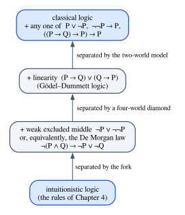
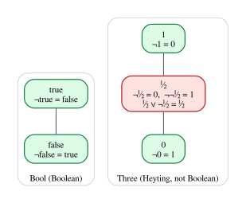

# Intuitionism and the Meaning of Proof

Chapter 4 ended with a puzzle. The formula $A \lor \neg A$, "every proposition is
true or false", holds in every row of its truth table, yet the rules of natural
deduction cannot derive it. And in Chapter 1, `#print axioms` showed that a proof
by the `grind` tactic relied on something called `Classical.choice`, while a
hand-written proof did not. Both observations point to the same fact: there are
two respectable notions of proof, and the logic we have been using is the more
demanding one.

That logic is called **intuitionistic** (or constructive). In it, to prove "$A$
or $B$" you must say which, and to prove "there exists an $x$" you must produce
one. This chapter explains where the idea comes from, what it costs (some
classical laws fail), what it buys (proofs that carry information, which is why
it is the logic of programming), and why classical logic is not wrong but sits
inside it. We then build two semantics in which intuitionistic logic, unlike truth
tables, is exactly right: Kripke models and Heyting algebras. With them we finally
prove in Lean that excluded middle is not derivable in the system of Chapter 4.

**In this chapter you will learn:**

- the Brouwer–Heyting–Kolmogorov (BHK) interpretation, in which a proof of
  $A \lor B$ is a proof of one side *together with the information which*, and a
  proof of $A \to B$ is a method;
- which classical laws fail constructively (excluded middle, double-negation
  elimination, Peirce's law, one De Morgan law), and what you gain in exchange:
  the disjunction and existence properties;
- why classical logic is not wrong: the double-negation translation, and the
  constructive proof of $\neg\neg(A \lor \neg A)$;
- how negation as $A \to \bot$ looks in Rust, with empty types, `Infallible` and
  the never type;
- how Lean separates the two worlds: `Classical.em`, `Classical.byContradiction`,
  `Decidable`, and `#print axioms`;
- Kripke semantics, a two-world countermodel to excluded middle checked by
  `decide`, and an exhaustive countermodel search in Rust;
- Heyting algebras, built from scratch in Lean and then taken from Mathlib, and
  a first look at the categorical reading of logic.

## Brouwer and the meaning of "true"

Intuitionism began in the early twentieth century with the Dutch mathematician
L. E. J. Brouwer, as a philosophy of mathematics rather than a logic. Its central
claim is that mathematical truth *is* provability: to assert $A$ is to possess a
construction, a mental proof, of $A$, not to report a fact about a realm that
exists independently of what we can establish. Brouwer was suspicious of formal
logic; the formal system was written down by his student Arend Heyting around
1930, and the logic it defines is exactly the logic of Chapter 4's rules.

The consequence for logic follows quickly. If asserting "$A$ or $B$" means having
a construction of $A$ or having a construction of $B$, then asserting
"$A \lor \neg A$ for every $A$" means claiming a method that, for every
proposition, either proves it or refutes it. Nobody has such a method; for many
open problems we have neither. So excluded middle cannot be asserted *in
general*.

A classic example shows what a classical proof can leave out. *There exist
irrational numbers $a$ and $b$ such that $a^b$ is rational.* Proof: consider
$\sqrt{2}^{\sqrt{2}}$. If it is rational, take $a = b = \sqrt{2}$. If not, take
$a = \sqrt{2}^{\sqrt{2}}$ and $b = \sqrt{2}$, since then
$a^b = \sqrt{2}^{\sqrt{2} \cdot \sqrt{2}} = \sqrt{2}^2 = 2$. The proof is
classically impeccable, and at the end you still do not know which pair works.
It used excluded middle on a question it never answered. An intuitionist does
not say the proof is wrong; they say it proves something weaker than it claims:
that the non-existence of such a pair is absurd.

> [!NOTE]
> Intuitionism does not claim that excluded middle is *false*. As we will prove,
> $\neg\neg(A \lor \neg A)$ is intuitionistically provable: excluded middle can
> never be refuted. It is just not available as a general principle, because
> asserting a disjunction requires knowing which side holds.

## The BHK interpretation

The **Brouwer–Heyting–Kolmogorov interpretation** says what counts as a proof of
each kind of formula. Kolmogorov contributed a reading of propositions as
*problems* and proofs as *solutions*, which is the same idea in a programmer's
vocabulary. The table adds a column for Rust and one for Lean.

| Formula | A proof is | Rust | Lean |
|---|---|---|---|
| $A \land B$ | a proof of $A$ and a proof of $B$ | `(A, B)` | `⟨ha, hb⟩` |
| $A \lor B$ | a tag saying which side, and a proof of it | `enum Either<A, B>` | `Or.inl ha` |
| $A \to B$ | a method turning proofs of $A$ into proofs of $B$ | `fn(A) -> B` | `fun ha => ...` |
| $\top$ | the trivial proof | `()` | `True.intro` |
| $\bot$ | none exists | `enum Void {}` | (no constructor) |
| $\neg A$ | a method turning proofs of $A$ into proofs of $\bot$ | `fn(A) -> Void` | `fun ha => ...` |
| $\forall x.\, A(x)$ | a method giving, for each $x$, a proof of $A(x)$ | generic `fn` (on types) | `fun x => ...` |
| $\exists x.\, A(x)$ | a witness $x$ and a proof of $A(x)$ | `impl Trait` (on types) | `⟨x, h⟩` |

Two observations. First, the BHK column *is* the type column: the explanation of
the connectives that intuitionists gave in the 1930s is a description of data
types, decades before Curry and Howard made the correspondence formal. That is
why Chapter 10 can be short: the work is done here. (The Rust entries for the
quantifiers are only approximations, since Rust cannot quantify over values;
Chapter 10 discusses this.)

Second, the $\lor$ and $\exists$ rows are exactly where classical logic parts
company. Both demand that a proof contain information: which side, which
witness. A classical proof of $A \lor B$ may contain no such information, as the
$\sqrt{2}$ example shows. Everything else in this chapter follows from taking
those two rows seriously.

## What fails, and what you gain

### Excluded middle and its relatives

These classical laws have no intuitionistic proof:

| Law | Formula |
|---|---|
| excluded middle | $A \lor \neg A$ |
| double-negation elimination | $\neg\neg A \to A$ |
| Peirce's law | $((A \to B) \to A) \to A$ |
| one De Morgan law | $\neg(A \land B) \to \neg A \lor \neg B$ |
| material implication | $(A \to B) \to \neg A \lor B$ |
| converse contraposition | $(\neg B \to \neg A) \to (A \to B)$ |

Each has an easy classical proof. In Lean, classical reasoning is available
through two library functions:

```lean
{{#include ../../code/lean/Book/Ch05/Constructive.lean:classical_axioms}}
```

`Classical.em` is excluded middle, and `Classical.byContradiction` is the rule
RAA of Chapter 4: to prove `p`, show that `¬p` leads to `False`. Both are
theorems, proved from the **axiom** `Classical.choice` (with help from two other
axioms that we meet in a moment). Choice says that
from the knowledge that a type is nonempty (`Nonempty α`, a proposition) you can
obtain an element of it. That is precisely the step from "something exists" to
"here it is" that BHK refuses. With these, the classical laws are short (the code
is in `code/lean/Book/Ch05/Constructive.lean`):

```lean
{{#include ../../code/lean/Book/Ch05/Constructive.lean:classical}}
```

`dne` applies `byContradiction`, which turns the goal `p` into `¬p → False`.
`peirce` splits on `Classical.em p`. `not_and_or` uses the tactic `by_cases`,
which does the same split with a friendlier syntax. Now the tool that tells
proofs apart, `#print axioms`, which you met in Chapter 1:

```lean
{{#include ../../code/lean/Book/Ch05/Constructive.lean:print_axioms}}
```

`nn_em` and `not_or_iff`, proved below, use no axioms at all: they are
constructions in the BHK sense. `dne` and `not_and_or` depend on
`Classical.choice` (and on `propext` and `Quot.sound`, two further axioms that
Lean's library uses to derive excluded middle from choice; they are not
classical by themselves). Whenever you want to know whether a Lean proof is
constructive, this is the command to run.

### All or nothing

Excluded middle, double-negation elimination and Peirce's law are not three
separate principles. Over intuitionistic logic, each one, assumed for all
propositions, implies the others. In Lean the implications are constructive
proofs that take the principle as a hypothesis:

```lean
{{#include ../../code/lean/Book/Ch05/Constructive.lean:all_or_nothing}}
```

The first proof splits on the excluded-middle hypothesis. The second applies
double-negation elimination to `nn_em`, the constructive proof of
$\neg\neg(p \lor \neg p)$ that we study below. The third instantiates Peirce's
law with `q := False`: its premise `(p ∨ ¬p → False) → p ∨ ¬p` is again
discharged by `nn_em`. And `#print axioms` confirms that these implications are
themselves constructive. Adding any one of the three principles to the rules of
Chapter 4 gives full classical logic; there is no "slightly classical" logic made
of just one of them.

The De Morgan law is different, and the difference is easy to miss. It is
equivalent not to excluded middle but to the weaker **weak excluded middle**,
$\neg A \lor \neg\neg A$. Between intuitionistic and classical logic there are
in fact infinitely many **intermediate logics**, and the two weaker principles
above define two of them:



The models in the labels are the subject of the Kripke section below, where a
Rust program finds them.

### What survives

Much of everyday logic survives. All of these are constructive:

```lean
{{#include ../../code/lean/Book/Ch05/Constructive.lean:constructive}}
```

Read them as programs. `dni` takes a proof `hp` and a refutation `hnp` and
applies the second to the first. `tne` turns a refutation of $\neg\neg p$ into a
refutation of $p$ by feeding it `dni p hp`: triple negation collapses to single
negation, although double negation does not collapse to nothing. `contra` is
composition. In `not_or_iff`, a refutation of $p \lor q$ yields refutations of
each side by composing with `Or.inl` and `Or.inr`, and conversely a pair of
refutations handles both cases of a disjunction. `not_and_of_or_not` is the
direction of De Morgan's law that needs no information: if one side is refuted,
the conjunction is.

| Constructive | Classical only |
|---|---|
| $A \to \neg\neg A$ | $\neg\neg A \to A$ |
| $\neg\neg\neg A \leftrightarrow \neg A$ | $A \lor \neg A$ |
| $\neg(A \land \neg A)$ | $\neg(A \land B) \to \neg A \lor \neg B$ |
| $\neg\neg(A \lor \neg A)$ | $(\neg B \to \neg A) \to (A \to B)$ |
| $\neg(A \lor B) \leftrightarrow \neg A \land \neg B$ | $(A \to B) \to \neg A \lor B$ |
| $(\neg A \lor \neg B) \to \neg(A \land B)$ | $((A \to B) \to A) \to A$ |
| $(A \to B) \to (\neg B \to \neg A)$ | |

A pattern is visible: the constructive laws produce negations, and the classical
ones produce disjunctions or extract a positive fact from negative information.

### What you gain: disjunction and existence

Here is the payoff, which an introduction that only lists failures hides.

- **Disjunction property.** If $\vdash A \lor B$ is derivable intuitionistically
  (with no assumptions), then $\vdash A$ or $\vdash B$ is derivable.
- **Existence property.** If $\vdash \exists x.\, A(x)$ is derivable in
  intuitionistic predicate logic, then $\vdash A(t)$ is derivable for some term
  $t$.

Both follow from normalization (Chapter 4). A normal derivation with no
assumptions must end with an introduction rule, by the same argument that proved
consistency: an elimination at the root would lead up a chain of eliminations to
an assumption, and there are none. For $A \lor B$ that introduction is ∨I1 or
∨I2, and its premise is a proof of the chosen side. You will meet this argument
again in Chapter 9 as the *canonical forms* lemma: a closed value of a type has
the shape that the type's introduction rules allow (a value of type `Bool` is
`true` or `false`).

Classical logic has neither property. $\vdash A \lor \neg A$ is classically
derivable for an atom $A$, but neither $\vdash A$ nor $\vdash \neg A$ is (each
is false in some row of the truth table). A classical proof of a disjunction may
carry no information about which side holds, and a classical existence proof may
contain no witness. Compare two Lean proofs:

```lean
{{#include ../../code/lean/Book/Ch05/Constructive.lean:witness}}
```

`exists_square` contains its witness, 7, and uses no axioms. `drinker` is a
famous puzzle, usually called the drinker paradox: in any nonempty pub there is
someone such that, if they drink, everyone drinks. The proof asks whether
everyone drinks. If so, anyone will do; if not, `Classical.not_forall` (a
classical lemma: from "not everyone drinks", someone who does not) produces a
non-drinker, who satisfies the claim vacuously. The proof is correct, and it
never tells you who the person is, because the question it asked has no
computable answer.

This is precisely why intuitionistic logic is the logic of programming, and why
every proof assistant with computational content (Lean's core, Rocq, Agda) is
built on it. A program that has computed a value of type `Result<T, E>` knows
which variant it holds; a program must *have* the `T` to return it. If you want
to run a proof, the proof needs the witness.

> [!NOTE]
> In Lean, `∃` and `∨` live in `Prop`, where proofs are not meant to be run, and
> Lean deliberately forbids extracting the witness of an `∃` into ordinary data
> (Chapter 10 explains this *elimination restriction*). The informative versions
> are types of data: `Σ` and subtypes for existence, `Sum` and `Decidable` for
> disjunction. We meet `Decidable` below.

## Classical logic is not wrong

Two facts keep the story balanced.

### The double-negation translation

The first is a theorem of Glivenko:

- **Glivenko's theorem.** A propositional formula $A$ is a classical tautology
  if and only if $\neg\neg A$ is intuitionistically derivable.

So classical propositional logic *embeds* into intuitionistic logic: put $\neg\neg$
in front and every classical theorem becomes an intuitionistic one. Gödel and
Gentzen extended the idea to predicate logic with a translation that inserts
double negations more carefully (in front of atoms, disjunctions and
existentials). Nothing is lost in terms of what can be proved. What changes is
what a proof *gives you*: a proof of $\neg\neg A$ is weaker information than a
proof of $A$.

The most important instance is $\neg\neg(A \lor \neg A)$. Here is its proof in
tactic mode:

```lean
{{#include ../../code/lean/Book/Ch05/Constructive.lean:nn_em}}
```

Follow the goals. We must prove `¬¬(p ∨ ¬p)`, which unfolds to
`¬(p ∨ ¬p) → False`, so `intro k` gives us a refutation `k` of excluded middle
and leaves the goal `False`. The only way to produce `False` is to use `k`, so
`apply k`, and now we must prove `p ∨ ¬p`. We cannot know whether `p` holds, so
we commit to the right side, `¬p`, which is a promise: "give me a `p` and I will
produce `False`". `intro hp` accepts such a `p`. Now we have a proof of `p` in
hand, so we go back to `k` a second time and give it the left side, `Or.inl hp`.
The term is short:

```lean
{{#include ../../code/lean/Book/Ch05/Constructive.lean:nn_em_term}}
```

The proof answers "¬p", and if that answer is ever challenged with an actual
proof of `p`, it changes its mind and answers "p" using the very proof that was
used to challenge it. Notice that `k` is used twice. That will matter when we
write the same program in Rust.

### Double negation is a monad

The second fact explains Glivenko's theorem computationally. Double negation
behaves like a *monad*, a structure you will meet properly in Chapter 20: there
is a way to put a value in (`pure`) and a way to chain computations (`bind`):

```lean
{{#include ../../code/lean/Book/Ch05/Constructive.lean:nn_monad}}
```

`nn_pure` is `dni` again. `nn_bind` says: to refute a refutation `k` of `q`, run
the double-negated `p` with a continuation that sends each `p` to `f`, and
passes `k` along. The payoff is `nn_not_and_or`: inside the double negation we
may borrow `p ∨ ¬p` from `nn_em` and then reason classically, and the result is
a constructive proof of the double negation of the classical De Morgan law, with
no axioms. The same trick gives the double negations of the other classical laws:

```lean
{{#include ../../code/lean/Book/Ch05/Constructive.lean:nn_more}}
```

Programmers know $\neg\neg A$ under another name. Replace $\bot$ by an arbitrary
answer type $R$: then $(A \to R) \to R$ is a value in **continuation-passing
style**, a computation that, instead of returning an $A$, takes a consumer of
$A$s. Double-negation elimination would be a way to get the $A$ out of a
continuation-passing computation without supplying a consumer, which is
impossible in a pure language. Timothy Griffin observed that classical logic
corresponds to programs with first-class continuations: Peirce's law is the type
of the control operator `call/cc`, and a classical proof by contradiction is a
program that captures its continuation and jumps back to it. Classical logic is
perfectly computational; it computes with control effects rather than with pure
functions.

We can run `nn_em` in Rust, with `Void` replaced by an answer type so that the
program can actually return something. The full program is
`code/rust/examples/ch05_negation.rs`:

```rust
{{#include ../../code/rust/examples/ch05_negation.rs:nn_em}}
```

`Neg<A, R>` is a consumer of `A`s producing an `R`. The consumer `k` is called
twice, so it must be shareable: an `Rc<dyn Fn>` rather than a `Box<dyn FnOnce>`.
In the logic of Chapter 4, using an assumption twice is free; in Rust it costs
an `Rc`, a first glimpse of Chapter 6. Here is a consumer that, when handed a
refutation, tests it on the number 42:

```rust
{{#include ../../code/rust/examples/ch05_negation.rs:main_nn_em}}
```

```text
{{#include ../../code/rust/output/ch05_negation.txt:6:9}}
```

The trace is the "change of mind" in action: `k` first receives
`Right(refutation)`, applies the refutation to 42, and the refutation calls `k`
again with `Left(42)`. The final answer comes from the second call.

## Negation, truth and falsity

### Three states of knowledge

Classically, every proposition is true or false. Intuitionistically there are
three situations, and conflating them is the commonest error in reading
intuitionistic statements:

| Situation | Meaning | Rust analogy |
|---|---|---|
| $\vdash A$ | we have a construction of $A$ | a value of type `A` exists |
| $\vdash \neg A$ | we have a refutation of $A$ | a function `A -> Void` exists |
| neither | $A$ is open: no judgment can be asserted | we know nothing |

$\neg A$ is a positive claim that needs positive evidence: a method that turns
any proof of $A$ into absurdity, which amounts to showing that $A$ has no proof.
"$A$ is not provable" is a different statement altogether, a fact *about* the
logic (like "excluded middle has no derivation"), which cannot even be written as
a formula inside it. Excluded middle would say that the third row is always
empty.

### Empty types in Rust

The Rust side of negation is the empty type. An `enum` with no variants has no
values, and matching on it needs no arms:

```rust
{{#include ../../code/rust/examples/ch05_negation.rs:void}}
```

A refutation is a function into `Void`. Here are three of the constructive laws
as Rust functions, plus $\neg\bot$:

```rust
{{#include ../../code/rust/examples/ch05_negation.rs:not}}
```

These functions can be built but never run to completion, since that would
produce a `Void`; the example only constructs them, and the compiler's
acceptance is the point. (`Box<dyn FnOnce>` is used because each refutation is
called at most once; `nn_em` above needed more.)

The standard library has its own empty type, `std::convert::Infallible`, used for
operations that cannot fail. The compiler knows that empty types have no values
and uses it: a pattern for the impossible case can be omitted.

```rust
{{#include ../../code/rust/examples/ch05_negation.rs:infallible}}
```

`let Ok(name) = s.parse::<Name>();` is accepted as an irrefutable pattern
because the `Err` variant would need a value of type `Infallible`. This is ⊥E
used by the exhaustiveness checker: the `Err` case is handled "by absurdity",
with zero arms. Finally, Rust's built-in empty type is the never type `!`:

```rust
{{#include ../../code/rust/examples/ch05_negation.rs:never}}
```

```text
{{#include ../../code/rust/output/ch05_negation.txt:1:5}}
```

Empty types have size zero: no bits are needed to store a value that never
exists. The never type coerces to `u32` in `digit_value`, which is ⊥E built into
the language. The difference from `Void` is that `!` is also the type of
divergence: `loop {}` and `panic!()` have type `!`, so in Rust the empty type
*does* have "proofs", and Rust is inconsistent as a logic. Chapter 10 returns to
this.

## Decidable propositions in Lean

Lean draws the line between constructive and classical reasoning with a class.
`Decidable p` is a *type of data* recording which of `p` and `¬p` holds, together
with the proof:

```lean
{{#include ../../code/lean/Book/Ch05/Constructive.lean:decidable_print}}
```

Compare with `p ∨ ¬p`. Both have two cases, but `Or` is a `Prop`, whose proofs
Lean erases when it compiles, while `Decidable p` lives in `Type`: a value of it
is a bit of information a program can branch on. `Decidable p` is the BHK
reading of excluded middle for one particular `p`, and an instance of the class
is a decision procedure. That is why `if` on a proposition needs one:

```lean
{{#include ../../code/lean/Book/Ch05/Constructive.lean:if_prop}}
```

Equality of natural numbers is decidable, so `parity` compiles and runs. For an
arbitrary `p`, Lean cannot synthesize an instance: there is no procedure that
decides every proposition. `choose'` asks its caller for the instance instead,
and `choose' (3 < 5)` gets one from the library. The `decide` tactic that you have
used since Chapter 1 works the same way: it evaluates the `Decidable` instance of
the goal and succeeds if the answer is `isTrue`.

Classical logic offers a way out, at a price:

```lean
{{#include ../../code/lean/Book/Ch05/Constructive.lean:noncomputable}}
```

`Classical.propDecidable` produces a `Decidable p` for every `p`, using
`Classical.choice`. The definition type-checks, but Lean requires the keyword
`noncomputable`: there is no code to generate, because the axiom of choice has
no algorithm behind it. In Lean the boundary between constructive and classical
mathematics is not a matter of style; it is the boundary between what can be run
and what cannot.

## Kripke semantics

Truth tables are too coarse for intuitionistic logic: excluded middle is true in
every row. Saul Kripke's semantics, from the 1960s, replaces the single row with
a *process* of acquiring knowledge.

### Worlds and forcing

A **Kripke model** consists of:

- a set $W$ of **worlds**, thought of as states of knowledge;
- a preorder $\le$ on $W$ (reflexive and transitive), where $w \le w'$ means
  "$w'$ is a possible future of $w$, in which we know at least as much";
- for each world, the set of atoms known at that world, which must be
  **monotone**: once known, an atom stays known in every future.

The **forcing** relation $w \Vdash A$, "at $w$ we know $A$", is defined by
recursion on $A$:

- $w \Vdash P$ iff the atom $P$ is known at $w$;
- $w \Vdash \top$ always, and $w \Vdash \bot$ never;
- $w \Vdash A \land B$ iff $w \Vdash A$ and $w \Vdash B$;
- $w \Vdash A \lor B$ iff $w \Vdash A$ or $w \Vdash B$;
- $w \Vdash A \to B$ iff for every $w' \ge w$, if $w' \Vdash A$ then
  $w' \Vdash B$.

The clauses for $\land$, $\lor$, $\top$ and $\bot$ are those of truth tables,
evaluated at one world. Implication is the only clause that looks at other
worlds: asserting $A \to B$ now is a commitment that holds *whatever we learn
later*. For negation this gives

$$
w \Vdash \neg A \quad\text{iff}\quad \text{no } w' \ge w \text{ forces } A
$$

$\neg A$ holds when $A$ is refuted now *and will stay refuted forever*. That is
much stronger than "$A$ is not known yet", and the gap between the two is where
intuitionistic logic lives. Similarly, $w \Vdash \neg\neg A$ iff every future of
$w$ can be extended to a world that forces $A$: $A$ is not available yet, but it
can never be ruled out.

A sequent $\Gamma \vdash A$ is **valid** if in every Kripke model, every world
that forces all formulas of $\Gamma$ forces $A$. Two theorems connect the
semantics with the rules of Chapter 4:

- **Soundness.** Every derivable sequent is valid.
- **Completeness** (Kripke). Every valid sequent is derivable.

We will prove soundness in Lean. Completeness is harder and we only state it; the
Rust search below gives evidence for it on small examples.

### A two-world countermodel

Take two worlds, *now* and *later*, with $\mathit{now} \le \mathit{later}$. Nothing is known now;
later, the atom $P$ has been established.


Check excluded middle at *now*:

- $\mathit{now} \not\Vdash P$, because $P$ is not known yet;
- $\mathit{now} \not\Vdash \neg P$, because a future world, *later*, forces $P$;
- so $\mathit{now} \not\Vdash P \lor \neg P$.

That is the whole counterexample, and the whole intuition: $P$ is undecided now
and becomes true later, so neither disjunct can be asserted now. The same model
refutes double-negation elimination: every future of *now* can reach a world
forcing $P$, so $\mathit{now} \Vdash \neg\neg P$, yet $\mathit{now} \not\Vdash P$. By soundness,
none of these formulas is derivable.

Notice what happens with a single world: the quantifier "for every $w' \ge w$"
ranges over $w$ alone, and the clause for $\to$ becomes the truth table. A
one-world Kripke model *is* a row of a truth table, and classical logic is
intuitionistic logic in a world where nothing more can ever be learned.

### Kripke models in Lean

The file `code/lean/Book/Ch05/Kripke.lean` imports the deep embedding of
Chapter 4 (`Book.Ch04.Deep`, from the same pair of chapters) and gives it a Kripke
semantics. A model is a structure over a type of worlds with a preorder, which we
take from Mathlib's class `Preorder` (it provides `≤`, `le_refl` and
`le_trans`):

```lean
{{#include ../../code/lean/Book/Ch05/Kripke.lean:model}}
```

```lean
{{#include ../../code/lean/Book/Ch05/Kripke.lean:forces}}
```

`Forces` is a `Prop`-valued function defined by recursion on the formula, one
equation per clause. The negation clause comes out as expected:

```lean
{{#include ../../code/lean/Book/Ch05/Kripke.lean:forces_neg}}
```

The key lemma is monotonicity: forcing is never lost.

```lean
{{#include ../../code/lean/Book/Ch05/Kripke.lean:monotone}}
```

This proof is a recursive function, defined by pattern matching on the formula
and the proof of forcing, and Lean checks that every recursive call is on a
smaller formula. Atoms are monotone by the model's `mono` field. For a
conjunction, both parts move forward; for a disjunction, whichever part holds
moves forward. For an implication, `h` promises $B$ in every future of $w$ that
forces $A$; a future $w''$ of $w'$ is also a future of $w$, by `le_trans`. That
is where transitivity is needed.

Soundness is proved by induction on derivations, like the truth-table version
of Chapter 4:

```lean
{{#include ../../code/lean/Book/Ch05/Kripke.lean:soundness}}
```

Most cases are as before. The two interesting ones are the rules for
implication. For **impI** we must show that $w$ forces $A \to B$: take any future
$w'$ with `hle : w ≤ w'` that forces $A$. The induction hypothesis applies at
$w'$ with context `A :: Γ`, so we must show that $w'$ forces everything in it:
$A$ by assumption, and each formula of `Γ` because it was forced at $w$ and
forcing is monotone. Without monotonicity, the proof would break exactly here.
For **impE** we use the implication at $w$ itself, which is its own future by
`le_refl`.

### Deciding forcing with decide

For a model with finitely many worlds, forcing is decidable: each quantifier
"for every $w'$" ranges over a finite list. We say so with an instance. First a
small class for types whose elements can be listed:

```lean
{{#include ../../code/lean/Book/Ch05/Kripke.lean:enumerable}}
```

`decidable_of_iff` builds a decision procedure for `∀ w, p w` from one for the
equivalent `∀ w ∈ elems, p w`, which core Lean can decide by checking the list.
Then forcing is decidable by recursion on the formula:

```lean
{{#include ../../code/lean/Book/Ch05/Kripke.lean:decidable}}
```

Each case asks Lean to find the instance for the unfolded clause
(`inferInstanceAs`), after making the instances for the subformulas available
with `have`. Now the two-world model. The worlds are a two-element type with its
order:

```lean
{{#include ../../code/lean/Book/Ch05/Kripke.lean:stage}}
```

```lean
{{#include ../../code/lean/Book/Ch05/Kripke.lean:two_worlds}}
```

The valuation is a pattern match: atom 0 (`P`) is known `later`, nothing else
anywhere. Monotonicity is proved by checking every pair of worlds. And now
`decide` checks the countermodel, clause by clause, by evaluating the decision
procedure:

```lean
{{#include ../../code/lean/Book/Ch05/Kripke.lean:two_worlds_facts}}
```

With soundness, each failure becomes a statement about the proof system of
Chapter 4:

```lean
{{#include ../../code/lean/Book/Ch05/Kripke.lean:not_derivable}}
```

If excluded middle had a derivation `h`, then `kripke_soundness h` would make it
forced at `now` in `twoWorlds` (the empty context is trivially forced, which
`simp` checks), contradicting `lem_fails`. This is the theorem that Chapter 4
could not prove with truth tables. And yet:

```lean
{{#include ../../code/lean/Book/Ch05/Kripke.lean:incomplete}}
```

all three are tautologies. And the proof that excluded middle is not derivable
is itself constructive (`propext` and `Quot.sound` come from `simp`; there is no
`Classical.choice`):

```lean
{{#include ../../code/lean/Book/Ch05/Kripke.lean:not_derivable_axioms}}
```

Finally, the claim that classical logic is the one-world case is a theorem:

```lean
{{#include ../../code/lean/Book/Ch05/Kripke.lean:one_world}}
```

(`local instance` gives `Unit` its trivial order in this file only.) The proof
goes formula by formula; for implication, the "for every future" clause has only
the present to check, and `simp_all` reduces both sides to the same Boolean
condition.

### A fork

Two worlds in a line are not enough to refute every classical law. The De
Morgan law $\neg(P \land Q) \to \neg P \lor \neg Q$ needs a world with two
incomparable futures, as on the right of the figure above:

```lean
{{#include ../../code/lean/Book/Ch05/Kripke.lean:fork}}
```

```lean
{{#include ../../code/lean/Book/Ch05/Kripke.lean:fork_facts}}
```

At the root, $P \land Q$ is refuted, because no world knows both. But $\neg P$
fails at the root (the left branch learns $P$) and $\neg Q$ fails too (the right
branch learns $Q$). The root commits to the refutation of the conjunction without
being able to say which conjunct is to blame.

### Searching for countermodels in Rust

How did we know which models to try? We searched. The program
`code/rust/examples/ch05_kripke.rs` enumerates every Kripke model with at most
three worlds and two atoms, and for each formula looks for a world where it
fails. Forcing is the definition, transcribed:

```rust
{{#include ../../code/rust/examples/ch05_kripke.rs:model}}
```

The enumeration builds every partial order on $n$ worlds (every subset of
ordered pairs that is reflexive, antisymmetric and transitive) and every
monotone valuation (every set of worlds closed upward, for each atom).
Restricting to partial orders loses nothing: worlds that are below each other
force the same formulas and can be merged.

```rust
{{#include ../../code/rust/examples/ch05_kripke.rs:enumerate}}
```

```rust
{{#include ../../code/rust/examples/ch05_kripke.rs:search}}
```

```text
{{#include ../../code/rust/output/ch05_kripke.txt}}
```

Read a line such as `2 worlds, 0≤1, P@{1} Q@{}, fails at 0` as "worlds 0 and 1
with $0 \le 1$, $P$ known at world 1, $Q$ nowhere; the formula fails at world 0":
our two-world model. Because the models are enumerated by size, each one
reported is a smallest countermodel. Excluded middle, double-negation
elimination and Peirce's law all fall to two worlds. The De Morgan law, weak
excluded middle and the linearity axiom $(P \to Q) \lor (Q \to P)$ survive every
model with two worlds and need the fork. That is the semantic shadow of the
diagram of intermediate logics: the two-world chain validates the De Morgan law
but refutes excluded middle, so the De Morgan law cannot imply excluded middle.
(The search only tries atoms for $P$ and $Q$, but in fact every instance of the
De Morgan law holds on any frame in which two futures of a world always have a
common future, as in a chain.) The six intuitionistic laws at the bottom hold in
all 564 models, as soundness predicts. A search is evidence, not proof; the proofs are the Lean files.

## Heyting algebras

Kripke models describe intuitionistic logic with worlds; the algebraic semantics
describes it with an ordered set of truth values. For classical logic the truth
values form a **Boolean algebra**: `true` and `false`, or more generally the
subsets of a set, with $\cap$, $\cup$ and complement. Intuitionistic logic needs
a weaker structure.

### Definition

A **Heyting algebra** is a partially ordered set $(H, \le)$ with

- a least element $\bot$ and a greatest element $\top$;
- binary meets $a \sqcap b$ (greatest lower bound, "and") and joins $a \sqcup b$
  (least upper bound, "or");
- an implication $a \Rightarrow b$ characterized by **residuation**:

$$
c \le (a \Rightarrow b) \quad\text{iff}\quad c \sqcap a \le b
$$

Read $\le$ as "entails". Residuation says that $a \Rightarrow b$ is the weakest
element that, together with $a$, entails $b$: it is →I and →E rolled into one
equivalence, exactly as $\Gamma, A \vdash B$ holds iff $\Gamma \vdash A \to B$.
Negation is defined as in Chapter 4: $\neg a = a \Rightarrow \bot$, the largest
element whose meet with $a$ is $\bot$. In a Boolean algebra, $a \Rightarrow b$
is $\neg a \sqcup b$ and $a \sqcup \neg a = \top$. In a Heyting algebra the
second equation may fail: $\neg a$ is only a *pseudo-complement*.

The smallest example that is not Boolean is the three-element chain
$0 < ½ < 1$: false, undecided, true. In a chain, meet is minimum, join is
maximum, and $a \Rightarrow b$ is $1$ if $a \le b$ and $b$ otherwise. Then
$\neg½ = ½ \Rightarrow 0 = 0$, so
$½ \sqcup \neg½ = ½ \ne 1$: excluded middle fails at the
undecided value. And $\neg\neg½ = \neg 0 = 1 \ne ½$:
double-negation elimination fails too.



### A Heyting algebra class from scratch

In `code/lean/Book/Ch05/Heyting.lean` we write the definition as a Lean class.
We borrow only the *notation* from Lean and Mathlib: the classes `LE`, `Min`,
`Max`, `HImp`, `Top` and `Bot` carry the symbols `≤`, `⊓`, `⊔`, `⇨`, `⊤` and `⊥`
and no laws at all. Every law is a field of our class:

```lean
{{#include ../../code/lean/Book/Ch05/Heyting.lean:class}}
```

`extends` makes our class include the notation classes, like a Rust trait with
supertraits. Mathlib has a class with the same name; inside `namespace Ch05` ours
shadows it, and we refer to Mathlib's as `_root_.HeytingAlgebra` at the end of
the file. Negation is a definition:

```lean
{{#include ../../code/lean/Book/Ch05/Heyting.lean:neg}}
```

From the axioms alone we can prove the laws of intuitionistic negation:

```lean
{{#include ../../code/lean/Book/Ch05/Heyting.lean:laws}}
```

These are term-mode proofs that chain the axioms, and they follow the logic
closely. `himp_inf_le` is modus ponens: residuation read from right to left,
applied to `a ⇨ b ≤ a ⇨ b`. `le_neg_neg` is $a \le \neg\neg a$, the algebraic
`dni`: by residuation it suffices that $a \sqcap \neg a \le \bot$, which is modus
ponens after swapping the meet. `neg_anti` says that negation reverses the order,
and `neg_neg_neg` combines the two into the collapse of triple negation. (Inside
`namespace HeytingAlgebra`, names such as `le_trans` refer to the fields of our
class.) Residuation also implies that every Heyting algebra is distributive,
which soundness for ∨E needs:

```lean
{{#include ../../code/lean/Book/Ch05/Heyting.lean:distrib}}
```

### Soundness in every Heyting algebra

A formula is interpreted by recursion, and a context by the meet of its formulas:

```lean
{{#include ../../code/lean/Book/Ch05/Heyting.lean:interp}}
```

```lean
{{#include ../../code/lean/Book/Ch05/Heyting.lean:heyting_soundness}}
```

The statement says that a derivation of $\Gamma \vdash A$ gives
$⟦\Gamma⟧ \le ⟦A⟧$ in every Heyting algebra. Each case is one law: Hyp is "a meet
is below its parts" (by induction on the position of the formula in the
context), ∧I is `le_inf`, the eliminations are `inf_le_left` and `inf_le_right`,
∨E is distributivity followed by `sup_le`, →I is residuation, and →E is modus
ponens. The proof uses no axioms at all.

### Two instances

The two-element algebra is `Bool`, and its laws are checked by `decide`, which
tries every combination of values:

```lean
{{#include ../../code/lean/Book/Ch05/Heyting.lean:bool}}
```

The three-element chain needs a type of its own:

```lean
{{#include ../../code/lean/Book/Ch05/Heyting.lean:three}}
```

Each law is checked by `cases` on every argument followed by `decide`: at most
27 combinations. Now the facts computed above:

```lean
{{#include ../../code/lean/Book/Ch05/Heyting.lean:three_facts}}
```

And with soundness, a second, algebraic proof that excluded middle is not
derivable, independent of Kripke models:

```lean
{{#include ../../code/lean/Book/Ch05/Heyting.lean:three_soundness}}
```

Soundness gives `⊤ ≤ ½ ⊔ ¬½` for the interpretation that sends every atom to
`½`; `revert this` turns that hypothesis into the goal `⊤ ≤ ... → False`, which
`decide` refutes by computing.

The two semantics are closely related: the up-closed sets of worlds of a Kripke
model (the "propositions" that respect monotonicity) form a Heyting algebra. The
three-element chain comes from the two-world model: the up-sets are $\emptyset$,
$\{\mathit{later}\}$ and $\{\mathit{now}, \mathit{later}\}$, which are $0$, $½$ and $1$. Another
classic source of Heyting algebras is topology: the open sets of a space, with
$U \Rightarrow V$ the interior of $(X \setminus U) \cup V$. In the real line,
$U = \mathbb{R} \setminus \{0\}$ has $\neg U = \mathrm{int}\{0\} = \emptyset$ and
$\neg\neg U = \mathbb{R} \ne U$: the missing point is undecided.

### Negation in a Heyting algebra

The elements with $\neg\neg a = a$ are called **regular**. Every negation is
regular (that is `neg_neg_neg`), and one can show that the regular elements form
a Boolean algebra. That is Glivenko's theorem in algebraic form: the map
$a \mapsto \neg\neg a$ projects intuitionistic truth values onto classical ones,
and classical logic is the logic of the regular elements, *inside*
intuitionistic logic rather than beyond it. In the three-element chain the
regular elements are $0$ and $1$; the undecided $½$ is what the projection
forgets.

### In Mathlib

Mathlib's `HeytingAlgebra` states residuation the same way, and `Prop` is an
instance:

```lean
{{#include ../../code/lean/Book/Ch05/Heyting.lean:mathlib}}
```

Every one of these holds by `rfl`: in Mathlib's instance, `≤` on `Prop` *is*
implication, meet *is* `∧`, Heyting implication *is* `→`, and the complement *is*
`¬`. Propositions are the truth values of a Heyting algebra, with entailment as
the order. Mathlib calls negation the *complement* `aᶜ`, and the laws we proved
by hand are library lemmas (`le_compl_compl`, `compl_compl_compl`). Mathlib also
makes `Prop` a `BooleanAlgebra`, which needs excluded middle, and `#print axioms`
shows it:

```lean
{{#include ../../code/lean/Book/Ch05/Heyting.lean:mathlib_bool}}
```

## The categorical reading

One more step of abstraction connects this chapter with Part IV. A preorder is a
category in which there is at most one arrow between two objects: an arrow
$a \to b$ exists exactly when $a \le b$ (Chapter 16 makes this precise). In that
reading, meet is a *product*, join is a *coproduct*, $\top$ and $\bot$ are the
terminal and initial objects, and residuation

$$
c \sqcap a \le b \quad\text{iff}\quad c \le (a \Rightarrow b)
$$

has the shape of currying, $\mathrm{Hom}(C \times A, B) \cong \mathrm{Hom}(C, B^A)$.
A category with products and this currying property is called **cartesian
closed**, and Chapter 19 shows that cartesian closed categories are exactly the
models of the simply typed λ-calculus. A Heyting algebra is a cartesian closed
category in which all proofs of the same entailment are identified; the general
case keeps *proofs* as arrows instead of just "provable or not", which is the
Curry–Howard correspondence one level up.

| Logic | Categorical structure |
|---|---|
| intuitionistic | cartesian closed category (with coproducts) |
| intuitionistic, proofs ignored | Heyting algebra |
| classical, proofs ignored | Boolean algebra |
| linear (Chapter 21) | symmetric monoidal closed category |
| affine | symmetric monoidal closed, with a terminal unit |

The last rows preview Part V. Residuation survives when the product $\sqcap$ is
replaced by a tensor $\otimes$ that cannot duplicate or discard: the diagonal
$a \to a \times a$ is contraction, the map $a \to \top$ is weakening, and dropping
them is what turns intuitionistic logic into linear logic, and Rust's moves into
an affine type system. Classical logic, on the other hand, does not have a good
proof-relevant version of this table: a well-known argument (usually credited to
André Joyal) shows that a cartesian closed category with an initial object, in
which the canonical arrow $a \to \neg\neg a$ is an isomorphism for every object,
collapses to a preorder. Classical proofs
need control operators, not just functions.

## Putting it together: the De Morgan law

Let us follow one formula through the chapter: $\neg(A \land B) \to \neg A \lor \neg B$.

**Classically, it is easy.** `not_and_or` splits on `p` with `by_cases`. If `p`
holds, `q` must fail, since `p ∧ q` is refuted; if not, `¬p` is the left
disjunct. `#print axioms` reports `Classical.choice`.

**Constructively, half of it holds.** The converse, $\neg A \lor \neg B \to
\neg(A \land B)$, is `not_and_of_or_not`, with no axioms: given a refutation of
one side, refute the conjunction by projecting out that side. The classical
direction asks for more: from a refutation of the conjunction, a *decision* about
which conjunct is to blame. BHK asks where that decision comes from, and there is
no answer.

**A countermodel shows it cannot be proved.** The Rust search reports that no
model with one or two worlds refutes the law, and that the fork does:

```text
{{#include ../../code/rust/output/ch05_kripke.txt:9:10}}
```

Lean confirms the countermodel by `decide` and turns it into a theorem about the
proof system with `kripke_soundness`: `de_morgan_not_derivable`, in the fork
section above. The root forces $\neg(P \land Q)$ but neither $\neg P$ nor
$\neg Q$.

**It is not as strong as excluded middle.** The two-world model, which refutes
excluded middle, validates every instance of this law (it is a chain, so any two
futures have a common future). So adding the De Morgan law to intuitionistic
logic does not give classical logic: it gives the intermediate logic of weak
excluded middle.

**Its double negation is constructive.** `nn_not_and_or` proves
$\neg\neg(\neg(A \land B) \to \neg A \lor \neg B)$ without axioms, by borrowing
$A \lor \neg A$ inside the double-negation monad, as Glivenko's theorem
promises. Classical reasoning is available constructively, as long as the
conclusion is negative.

## Common confusions

**"Intuitionists believe excluded middle is false."** They do not; its negation
is refutable, since $\neg\neg(A \lor \neg A)$ is a theorem. Excluded middle is
not *assertible* in general, because asserting a disjunction requires knowing
which side holds.

**"Proof by contradiction is classical."** It depends on what is being proved.
To prove $\neg A$, assuming $A$ and deriving $\bot$ is just →I, and perfectly
constructive. To prove $A$ by assuming $\neg A$ and deriving $\bot$ is RAA, which
is classical. Mathematicians use the same phrase for both.

**"Lean is a classical proof assistant."** Lean's core logic is intuitionistic;
classical logic enters through one axiom, `Classical.choice`, which the library
uses to prove `Classical.em`. Mathlib uses it freely, and so do some tactics
(`grind`, `simp` with classical lemmas, `by_cases`). `#print axioms` tells you
which of your results depend on it.

**"A Kripke world is a possible world where every proposition is true or
false."** A Kripke world is a state of knowledge. $w \not\Vdash A$ does not mean
that $A$ is false at $w$, only that it is not known there; falsity at $w$ is
$w \Vdash \neg A$, which constrains every future.

**"`Decidable p` is the same as `p ∨ ¬p`."** Both have two cases, but
`Decidable p` is data that a program can branch on, while `p ∨ ¬p` is a
proposition whose proofs are erased. Every `Decidable p` gives `p ∨ ¬p`; the
converse needs `Classical.choice` and gives up computability.

## Summary

- In intuitionistic logic, truth is provability. The BHK interpretation says what
  a proof of each connective is, and it is a description of data types: pairs,
  tagged unions, functions, the unit type and the empty type.
- Excluded middle, double-negation elimination and Peirce's law fail
  constructively and are equivalent to one another; the De Morgan law
  $\neg(A \land B) \to \neg A \lor \neg B$ fails too, but is weaker.
- In exchange, intuitionistic proofs have the disjunction and existence
  properties: they carry the information which side and which witness. That is
  what makes them programs.
- Classical logic embeds into intuitionistic logic by double negation
  (Glivenko); $\neg\neg(A \lor \neg A)$ is constructive, and $\neg\neg$ behaves
  like a continuation monad. Classical proofs compute with control operators.
- Negation is $A \to \bot$: a refutation is a function into the empty type. Rust
  has empty enums, `Infallible` and `!`, and its exhaustiveness checker uses
  emptiness.
- In Lean, `Classical.em` and `byContradiction` rest on the axiom
  `Classical.choice`; `Decidable p` is the computable form of excluded middle,
  needed by `if` and by `decide`; `#print axioms` tells constructive proofs from
  classical ones.
- Kripke models (worlds of knowledge, monotone forcing, implication quantifying
  over the future) are sound and complete for intuitionistic logic. A two-world
  model refutes excluded middle; we proved soundness in Lean and checked the
  countermodel by `decide`, so excluded middle is not derivable.
- Heyting algebras are lattices with residuated implication. We built the class
  from scratch, proved soundness of natural deduction in every instance, and
  refuted excluded middle in the three-element chain. Mathlib's `Prop` is a
  Heyting algebra with `≤` as implication.
- Categorically, a Heyting algebra is a thin cartesian closed category; dropping
  the cartesian structure leads to the linear and affine logics of Part V.

## Exercises

1. Find, by hand, a Kripke countermodel to material implication
   $(P \to Q) \to \neg P \lor Q$, and check each clause of the forcing
   definition. Then add the formula to the list in `ch05_kripke.rs` and compare
   with the program's answer.
   *Hint:* two worlds suffice. $P$ must be undecided at the root, so that
   $\neg P$ fails there, and $P \to Q$ must hold at the root, so $Q$ must become
   known wherever $P$ does. (With $Q$ never known, $P \to Q$ fails at the root and
   the implication holds vacuously.)

2. Prove in Lean, without `Classical`, that `¬¬(p → q) → ¬¬p → ¬¬q` (the
   double-negation monad applied to a function) and that `¬¬(¬p ∨ ¬¬p)`. Check
   both with `#print axioms`.
   *Hint:* for the first, `intro h hp k` and then `apply h; intro hpq; apply hp;
   intro hp'; exact k (hpq hp')`. For the second, imitate `nn_em`: commit to the
   right disjunct first, and when it is challenged, switch to the left.

3. Prove that double-negation elimination implies Peirce's law, constructively:
   `(∀ p : Prop, ¬¬p → p) → ∀ p q : Prop, ((p → q) → p) → p`.
   *Hint:* apply the hypothesis to `p`, then `intro k` with `k : ¬p`; to use the
   assumption `(p → q) → p`, build a function `p → q` from `k` with `absurd`.

4. Add a three-world chain `now ≤ soon ≤ later` to `Kripke.lean`, with `P` known
   only at `later`. Use `decide` to check that excluded middle fails at `now` and
   at `soon`, and that `(P → Q) ∨ (Q → P)` holds at every world.
   *Hint:* copy `Stage` and its instances; the order is "rank of the first ≤ rank
   of the second", so `le_trans` follows by `decide` after `cases`.

5. In the three-element chain, compute Peirce's law
   $((a \Rightarrow b) \Rightarrow a) \Rightarrow a$ for $a = ½$,
   $b = 0$. Then prove `¬ Proves [] (.imp (.imp (.imp P Q) P) P)` in Lean using
   `HeytingAlgebra.soundness` and `Three`.
   *Hint:* $½ \Rightarrow 0 = 0$, $0 \Rightarrow ½ = 1$,
   $1 \Rightarrow ½ = ½$. Interpret atom 0 as `half` and atom 1 as
   `zero`: `fun n => if n = 0 then Three.half else Three.zero`, and finish as in
   `lem_not_derivable'`.

6. Extend the Rust search to four worlds and find a frame (an order, without a
   valuation) on which weak excluded middle $\neg P \lor \neg\neg P$ holds at every
   world for *every* valuation, but linearity $(P \to Q) \lor (Q \to P)$ fails for
   some valuation.
   *Hint:* weak excluded middle holds on every frame in which any two futures of
   a world have a common future. Try a diamond: a root, two incomparable worlds,
   and a top above both.
