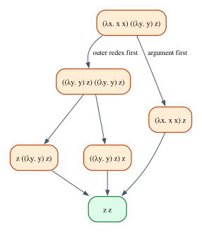
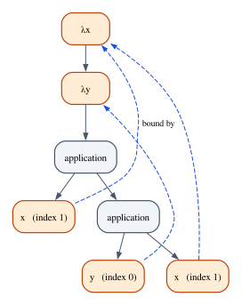

# The Lambda Calculus

Every closure you have written in Rust, `|x| x + 1`, `|order| order.total()`,
`move || report`, descends from a notation that Alonzo Church introduced in the
1930s to study what it means for a function to be computable. His
**λ-calculus** has exactly three constructs: variables, functions and
applications. There are no numbers, no booleans, no loops and no data
structures, and yet it can express every computation a Rust program can. It is
the smallest programming language there is, and nearly every idea in Part II
of this book (types, type safety, the Curry–Howard correspondence) is first
stated for it.

This chapter studies the λ-calculus *without* types. That may seem like an
odd place to start a book about type theory, but it is the right one: to see
what types buy you, you need to see the language they constrain. You will meet
programs that run forever, functions that take themselves as arguments, and
numbers built out of nothing but functions. You will also meet the operation at
the heart of every programming language implementation, **substitution**, and
the subtle bug, *variable capture*, that makes it harder than it looks. In
Chapter 8 we add types and watch most of the strangeness disappear.

**In this chapter you will learn:**

- the syntax of λ-terms, free and bound variables, and α-equivalence;
- capture-avoiding substitution, why the naive version is wrong, and how de
  Bruijn indices remove the problem altogether;
- β-reduction, normal forms, the reduction strategies normal order,
  call-by-name and call-by-value, and the Church–Rosser theorem;
- divergence ($\Omega$) and recursion without names (the $Y$ and $Z$
  combinators);
- Church encodings of booleans, pairs, numerals and arithmetic, computed by the
  book's `lambda` crate;
- how Lean represents λ-terms, defines reduction as an inductive relation, proves
  facts about it, and why it refuses a normalizer that has no fuel.

## Three constructs

The terms of the untyped λ-calculus are given by a grammar with three cases:

$$
t \;::=\; x \;\mid\; \lambda x.\,t \;\mid\; t\;t
$$

- A **variable** $x$.
- An **abstraction** $\lambda x.\,t$: the function with parameter $x$ and body
  $t$. In Rust you would write `|x| t`.
- An **application** $t\;u$: the function $t$ applied to the argument $u$. In
  Rust, `t(u)`.

That is all. The notation needs two conventions to keep parentheses under
control. Application associates to the **left**, so $f\,a\,b$ means
$(f\,a)\,b$: apply $f$ to $a$, then apply the result to $b$. And the body of a
$\lambda$ extends **as far to the right as possible**, so
$\lambda x.\,x\,y$ means $\lambda x.\,(x\,y)$, not $(\lambda x.\,x)\,y$.

Every function takes exactly one argument. A function of two arguments is a
function that returns a function: $\lambda x.\,\lambda y.\,x$ takes $x$ and
returns a function that takes $y$ and returns $x$. This is called **currying**
(after Haskell Curry, although the idea is older), and we often abbreviate
$\lambda x.\,\lambda y.\,t$ as $\lambda x\,y.\,t$. In Rust the same function is
`|x| move |y| x`.

Some terms we will use over and over:

| Term | Name | Rust closure |
|---|---|---|
| $\lambda x.\,x$ | identity, $I$ | `\|x\| x` |
| $\lambda x.\,\lambda y.\,x$ | constant, $K$ | `\|x\| move \|_y\| x` |
| $\lambda f.\,\lambda g.\,\lambda x.\,g\,(f\,x)$ | composition | `\|f\| move \|g\| move \|x\| g(f(x))` |
| $\lambda x.\,x\,x$ | self-application, $\delta$ | none (see the end of the chapter) |
| $(\lambda x.\,x\,x)\,(\lambda x.\,x\,x)$ | $\Omega$ | none |

The last two rows are the first sign that the untyped calculus can do things
Rust cannot. We will come back to them.

### The `lambda` crate

This chapter's Rust code is the crate `lambda` (in `code/rust/crates/lambda`).
Its central type is the abstract syntax of λ-terms, an `enum` with one variant
per grammar case:

```rust
{{#include ../../code/rust/crates/lambda/src/term.rs:term}}
```

A `Lam` owns its body and an `App` owns both of its parts, so a term is a tree;
the `Box`es are there because a recursive `enum` must have a known size (Chapter
11 explains why). The crate also has a small parser, so that examples can be
written as text, `parse("λf. λx. f (f x)")` (with `\` accepted for `λ`), and a
printer that follows the two conventions above and prints the minimum number of
parentheses. We will not discuss the parser; it is a routine piece of code.

## Free and bound variables

In $\lambda x.\,x\,y$ the two variables play different roles. The $x$ refers to
the parameter of the enclosing $\lambda$: it is **bound**. The $y$ refers to
nothing inside the term: it is **free**, and its meaning must come from outside,
the way a global variable or a variable from an enclosing scope gets its meaning
in Rust. The set of free variables is defined by recursion on the term:

$$
\mathrm{FV}(x) = \{x\}
\qquad
\mathrm{FV}(\lambda x.\,t) = \mathrm{FV}(t) \setminus \{x\}
\qquad
\mathrm{FV}(t\;u) = \mathrm{FV}(t) \cup \mathrm{FV}(u)
$$

The middle equation is the only interesting one: a $\lambda$ removes its own
parameter from the free variables of its body. The **scope** of a binder
$\lambda x$ is its body, and an occurrence of $x$ is bound by the *nearest*
enclosing $\lambda x$. So in $\lambda x.\,\lambda x.\,x$ the occurrence of $x$
belongs to the inner $\lambda$, exactly as an inner `let x` shadows an outer one
in Rust. A term with no free variables is **closed**; closed terms are complete
programs, open terms are fragments.

The same name can even be free and bound in one term: in
$x\,(\lambda x.\,x)$ the first $x$ is free and the second is bound. That is
legal, but confusing, and you will see shortly that it is also where the bugs
live. In the crate, `free_vars` is a direct transcription of the three
equations:

```rust
{{#include ../../code/rust/crates/lambda/src/term.rs:free_vars}}
```

The free variables of a function body are something you already know well under
another name. When you write `|y| x + y` in Rust, the variable `x` is free in the
closure body, and the compiler must arrange for the closure to have access to it:
it **captures** `x`. The captures of a Rust closure are exactly the free
variables of its body. Chapter 8 develops this connection.

## Substitution, and the capture problem

How does a λ-term compute? By applying functions to arguments, and applying
$\lambda x.\,t$ to $s$ means: take the body $t$ and replace every free
occurrence of the parameter $x$ by $s$. We write this operation $t[x := s]$,
"$t$ with $s$ for $x$". (Chapters 4 and 6 wrote the same operation $t[s/x]$;
both notations are common.) It is what a compiler does when it inlines a
function call, and what you do by hand when you compute
$(x \mapsto x^2 + 1)(3) = 3^2 + 1$.

### The naive definition

The obvious definition replaces occurrences of $x$ and stops at a $\lambda x$,
because inside it $x$ means something else:

- $x[x := s] = s$, and $y[x := s] = y$ when $y \neq x$;
- $(t\;u)[x := s] = t[x := s]\;u[x := s]$;
- $(\lambda x.\,t)[x := s] = \lambda x.\,t$ (the parameter $x$ shadows our $x$);
- $(\lambda y.\,t)[x := s] = \lambda y.\,t[x := s]$ when $y \neq x$.

A first example works fine. Substituting the identity for $x$ in $x\,y$:

$$
(x\;y)[x := \lambda z.\,z] = x[x := \lambda z.\,z]\;\;y[x := \lambda z.\,z] = (\lambda z.\,z)\;y
$$

Now a second example. Take the constant function $\lambda y.\,x$: whatever you
give it, it returns $x$. Substitute the variable $y$ for $x$:

$$
(\lambda y.\,x)[x := y] = \lambda y.\,(x[x := y]) = \lambda y.\,y
$$

Something went badly wrong. We started with a function that ignores its argument
and returns $x$, and we asked for the same function returning $y$ instead (the
$y$ from outside, whatever it is). We ended with the identity function, which
returns its argument. The free $y$ that we substituted in has been
**captured** by the $\lambda y$ that happened to be in the way: it now refers to
the parameter, not to the outside variable it was supposed to mean.

This is not a contrived corner case. It changes the answers of programs. The
term $K\,y\,z = (\lambda x.\,\lambda y.\,x)\,y\,z$ should evaluate to $y$,
because $K$ returns its first argument. Here it is, computed by a reducer that
uses the naive substitution, next to the crate's real reducer (the naive
substitution is written out in `crates/lambda/examples/ch07_capture.rs`, where
it is clearly marked as wrong):

```rust
{{#include ../../code/rust/crates/lambda/examples/ch07_capture.rs:naive}}
```

```text
{{#include ../../code/rust/output/ch07_capture.txt:1:7}}
```

The naive reducer computes
$(\lambda x.\,\lambda y.\,x)\,y\,z \to (\lambda y.\,y)\,z \to z$: the first step
captured $y$, and the second step
then returned the wrong argument.

You have met this bug before, in a different costume. In C, a macro that
declares a local variable `x` and multiplies it by its argument goes wrong when
the caller passes an expression that mentions the caller's own `x`: after
textual expansion, that `x` refers to the macro's local variable instead. Rust's
`macro_rules!` is **hygienic**: the local variables a macro introduces live in
their own syntactic context and cannot capture the caller's, which is exactly
capture avoidance. The chapter's closure example,
`code/rust/examples/ch07_rust_lambdas.rs`, checks it:

```rust
{{#include ../../code/rust/examples/ch07_rust_lambdas.rs:hygiene}}
```

```text
{{#include ../../code/rust/output/ch07_rust_lambdas.txt:15:15}}
```

### Capture-avoiding substitution

The fix is to notice that the *name* of a bound variable does not matter. The
function $\lambda y.\,x$ is the same function as $\lambda w.\,x$: both ignore
their argument and return $x$. So before substituting under a binder that would
capture something, we rename the binder to a fresh name. The last case of the
definition splits in two:

- $(\lambda y.\,t)[x := s] = \lambda y.\,t[x := s]$ when $y \neq x$ and
  $y \notin \mathrm{FV}(s)$: no danger, go ahead;
- $(\lambda y.\,t)[x := s] = \lambda y'.\,(t[y := y'])[x := s]$ when $y \neq x$
  and $y \in \mathrm{FV}(s)$, where $y'$ is a **fresh** name, one that occurs
  neither in $t$ nor in $s$.

Let us redo the example step by step. We want $(\lambda y.\,x)[x := y]$.

1. The term is an abstraction $\lambda y.\,t$ with $t = x$, and the binder $y$ is
   different from $x$, the variable we substitute for.
2. Is $y$ free in the replacement $s = y$? Yes. If we went under the binder, the
   $y$ in $s$ would be captured. So we take the second case.
3. Choose a fresh name: $y'$ occurs nowhere, so it will do.
4. Rename the binder: $t[y := y'] = x[y := y'] = x$, giving $\lambda y'.\,x$.
   This is the same function as before.
5. Now substitute safely: $\lambda y'.\,x[x := y] = \lambda y'.\,y$.

The result, $\lambda y'.\,y$, is a constant function returning the outside $y$,
as it should be, and $K\,y\,z$ now evaluates to $y$. In the crate, the two cases
look like this:

```rust
{{#include ../../code/rust/crates/lambda/src/term.rs:subst}}
```

The condition also checks that $x$ actually occurs free in the body: if it does
not, nothing will be substituted, and there is nothing to rename. Fresh names
are made by adding primes until the name is unused:

```rust
{{#include ../../code/rust/crates/lambda/src/term.rs:fresh}}
```

### α-equivalence

Renaming a bound variable, consistently and without capturing anything, does not
change what a term means. Two terms that differ only in this way are called
**α-equivalent**, written $t \equiv_\alpha u$:
$\lambda x.\,x \equiv_\alpha \lambda y.\,y$ and
$\lambda x.\,\lambda y.\,x\,y \equiv_\alpha \lambda a.\,\lambda b.\,a\,b$, but
$\lambda x.\,\lambda y.\,x \not\equiv_\alpha \lambda x.\,\lambda y.\,y$ (the
first returns its first argument, the second its second).

From now on we treat α-equivalent terms as *the same term*, as your IDE does
when it offers "rename variable" (a refactoring that is safe exactly when the
new name captures nothing). Capture-avoiding substitution is only defined up to
α anyway, since it depends on which fresh name you pick. Later in the chapter we
will see a representation in which α-equivalent terms are *literally* equal.

## β-reduction

With substitution in hand, computation is a single rule. A **redex** (reducible
expression) is an application whose function part is an abstraction,
$(\lambda x.\,t)\;s$, and it **β-reduces** to $t[x := s]$. Since a redex can
appear anywhere inside a term, we also need rules that allow a step inside the
parts of an application and inside the body of a $\lambda$. In the notation of
Chapter 3, the one-step relation $t \longrightarrow t'$ is defined by four rules:

$$
\dfrac{}{(\lambda x.\,t)\;s \longrightarrow t[x := s]}\;\textsf{Beta}
\qquad
\dfrac{t \longrightarrow t'}{t\;s \longrightarrow t'\;s}\;\textsf{AppL}
$$

$$
\dfrac{s \longrightarrow s'}{t\;s \longrightarrow t\;s'}\;\textsf{AppR}
\qquad
\dfrac{t \longrightarrow t'}{\lambda x.\,t \longrightarrow \lambda x.\,t'}\;\textsf{Abs}
$$

Rule Beta does the work; the other three only say *where* it may be applied. We
write $t \longrightarrow^* t'$ for "zero or more steps". Here is a complete
computation:

$$
(\lambda x.\,\lambda y.\,x)\;a\;b
\;\longrightarrow\; (\lambda y.\,a)\;b
\;\longrightarrow\; a
$$

The first step contracts the redex $(\lambda x.\,\lambda y.\,x)\;a$ (inside the
left part of the outer application, by rule AppL), substituting $a$ for $x$. The
second contracts $(\lambda y.\,a)\;b$, substituting $b$ for $y$; since $y$ does
not occur in $a$, the argument $b$ simply disappears.

Look at what substitution does to its argument, because it will matter for the
rest of the book. In $(\lambda x.\,x\,x)\;s \longrightarrow s\;s$ the argument
$s$ is **duplicated**; in $(\lambda y.\,a)\;b \longrightarrow a$ it is
**discarded**. These are the term-level versions of the structural rules of
Chapter 6, contraction and weakening. The λ-calculus uses them freely. Rust does
not: duplicating a `String` needs an explicit `.clone()`, and in Part V we will
build a λ-calculus that, like Rust, refuses to duplicate.

A term that contains no redex at all is in **normal form**: $\lambda x.\,x$,
$x\,(\lambda y.\,y)$ and $\lambda f.\,\lambda x.\,f\,(f\,x)$ are normal forms;
$\lambda x.\,(\lambda y.\,y)\,x$ is not, because there is a redex under the
$\lambda$. A normal form is the "answer" of a computation. Not every term has
one:

$$
\Omega = (\lambda x.\,x\,x)\;(\lambda x.\,x\,x)
\;\longrightarrow\; (x\,x)[x := \lambda x.\,x\,x]
= (\lambda x.\,x\,x)\;(\lambda x.\,x\,x) = \Omega
$$

$\Omega$ reduces to itself in one step, and that is the only step it can take,
so every reduction sequence from $\Omega$ is infinite. It is the λ-calculus
version of `loop {}`.

## Reduction strategies

A term can contain several redexes, and the rules do not say which one to
contract first. A **reduction strategy** makes that choice. Three strategies
matter:

- **Normal order**: always contract the **leftmost, outermost** redex, the one
  whose $\lambda$ comes first when you read the term from the left, and reduce
  under $\lambda$ too. Arguments are substituted unevaluated.
- **Call-by-name**: like normal order, but never reduce under a $\lambda$ and
  never inside an argument. A function body is not evaluated until the function
  is called, and an argument is not evaluated until it is used.
- **Call-by-value**: before contracting $(\lambda x.\,t)\;s$, first reduce the
  argument $s$ to a **value** (an abstraction); never reduce under a $\lambda$.

You know call-by-value very well: it is what Rust does. When you call
`f(g(x))`, Rust evaluates `g(x)` first, completely, and only then calls `f`.
And Rust never evaluates the body of a closure until the closure is called. The
crate implements the three strategies as one `step` function:

```rust
{{#include ../../code/rust/crates/lambda/src/reduce.rs:strategy}}
```

```rust
{{#include ../../code/rust/crates/lambda/src/reduce.rs:step}}
```

Read the `App` case carefully. If the function part is an abstraction, we have a
redex at the top; normal order and call-by-name contract it at once,
call-by-value only once the argument is a value (otherwise it steps inside the
argument). If the function part is not an abstraction, all three strategies try
to step inside it first; then call-by-name stops, and the other two continue
with the argument. Around `step`, a function `reduce` runs a strategy for at
most a given number of steps, the **fuel**, and reports whether it finished:

```rust
{{#include ../../code/rust/crates/lambda/src/reduce.rs:reduction}}
```

The fuel is not an implementation detail. A reducer for the untyped λ-calculus
*cannot* know in advance whether a term has a normal form (that is the halting
problem in disguise), so a reducer that wants to be sure of stopping must give
up after some number of steps. We will meet the same idea in Lean, where it is
not optional.

### Strategies disagree about termination

The example `crates/lambda/examples/ch07_strategies.rs` runs the three
strategies on a few terms. The first is a function that throws its argument
away, applied to $\Omega$:

```text
{{#include ../../code/rust/output/ch07_strategies.txt:5:8}}
```

Normal order and call-by-name contract the outer redex first, the argument is
discarded, and the answer is $\lambda y.\,y$. Call-by-value insists on reducing
the argument to a value first, and $\Omega$ never becomes a value. The same
program terminates under one strategy and runs forever under another. You can
see the same difference in Rust, where arguments are evaluated even if the
function ignores them, and a closure is the standard way to delay evaluation
(the call-by-name behavior, written by hand):

```rust
{{#include ../../code/rust/examples/ch07_rust_lambdas.rs:by_value_use}}
```

```text
{{#include ../../code/rust/output/ch07_rust_lambdas.txt:4:10}}
```

This is why `Option::unwrap_or_else` takes a closure while `unwrap_or` takes a
value: `unwrap_or(expensive())` always runs `expensive()`, call-by-value, while
`unwrap_or_else(|| expensive())` runs it only if needed.

The second term duplicates an argument that is itself a redex:

```text
{{#include ../../code/rust/output/ch07_strategies.txt:10:13}}
```

Normal order substitutes the unevaluated argument, duplicating it, and then has
to reduce both copies: three steps. Call-by-value reduces the argument once,
before substituting it: two steps. Call-by-name stops early, at
$z\,((\lambda y.\,y)\,z)$: the head of the term is the variable $z$, which is
not a function the strategy can call, and call-by-name does not look inside
arguments. A term whose head cannot be reduced further like this is in **weak
head normal form**; it is where lazy languages stop evaluating, and the
remaining redex would be evaluated only if someone needed it. The third term
shows the other difference, reduction under $\lambda$:

```text
{{#include ../../code/rust/output/ch07_strategies.txt:15:18}}
```

For call-by-value and call-by-name, $\lambda x.\,(\lambda y.\,y)\,x$ is already
finished: it is a function, and its body will be evaluated when it is called.
That is how every programming language treats function bodies, Rust included.
Normal order reduces inside and finds the normal form $\lambda x.\,x$.

Normal order earns its name with a classical theorem (a consequence of the
**standardization theorem**): if a term has a normal form at all, normal order
reaches it. Normal
order is the safe choice when you want *the* answer of a term. It is not the
efficient choice: it can duplicate unevaluated work, as the second example
showed. Lazy languages such as Haskell use a refinement, *call-by-need*, that
substitutes unevaluated arguments but shares them, so that each one is
evaluated at most once.

## Confluence: the answer does not depend on the route

If different strategies can disagree about *whether* a term has an answer, can
they disagree about *what* the answer is? No, and this is the most important
theorem about the untyped λ-calculus.

> **Theorem (Church–Rosser, 1936).** If $t \longrightarrow^* u_1$ and
> $t \longrightarrow^* u_2$, then there is a term $v$ with
> $u_1 \longrightarrow^* v$ and $u_2 \longrightarrow^* v$.

However two computations diverge, they can always be brought back together.
This property is called **confluence**. The diagram shows the complete
reduction graph of the second term above: every path ends at $z\,z$.



The proof is not hard to understand but long to write down carefully (the
standard method, due to Tait and Martin-Löf, goes through "parallel reduction",
which contracts any set of redexes at once), and we will not do it. Its most
useful consequence is immediate: **a term has at most one normal form**. If
$t \longrightarrow^* n_1$ and $t \longrightarrow^* n_2$ with both normal, the
theorem gives a common $v$; but a normal form cannot step, so $n_1 = v = n_2$
(up to α). Whatever strategy you use, if it finds an answer, it finds *the*
answer. Confluence says nothing about termination, though; $\Omega$ is perfectly
confluent.

> [!NOTE]
> Rust has no such theorem, and could not: as soon as a language has side
> effects, the order of evaluation is observable. `f(print("a"), print("b"))`
> prints `ab` because Rust specifies left-to-right evaluation of arguments. The
> pure λ-calculus has no effects, so only termination can tell strategies apart.

## Recursion without names

The λ-calculus has no `fn`, no names for functions, and therefore no obvious way
to write a recursive function. A recursive definition such as
$\mathit{fact} = \lambda n.\,\dots\,\mathit{fact}\,(n-1)\,\dots$ refers to
itself, and the calculus has no way to say "itself". Yet recursion is possible,
and $\Omega$ shows how: $\Omega$ manages to reproduce itself by applying a
function to a copy of itself. Generalize the trick and you get Curry's
**fixed-point combinator**:

$$
Y = \lambda f.\,(\lambda x.\,f\,(x\,x))\;(\lambda x.\,f\,(x\,x))
$$

Watch what it does to an arbitrary $g$. Write
$W = (\lambda x.\,g\,(x\,x))\, (\lambda x.\,g\,(x\,x))$.

1. $Y\,g \longrightarrow W$, substituting $g$ for $f$.
2. $W \longrightarrow g\,W$, substituting $\lambda x.\,g\,(x\,x)$ for $x$ in
   $g\,(x\,x)$: the two copies of $x$ become two copies of the same function,
   and their application is $W$ again.

So $W \longrightarrow g\,W \longrightarrow g\,(g\,W) \longrightarrow \cdots$:
$W$ is a **fixed point** of $g$, a term that $g$ maps to itself (up to
reduction). To define factorial, write its body with the recursive call as a
parameter,

$$
\mathit{factStep} = \lambda \mathit{fact}.\,\lambda n.\,\mathit{if}\;(\mathit{iszero}\;n)\;1\;(\mathit{times}\;n\;(\mathit{fact}\;(\mathit{pred}\;n)))
$$

and take its fixed point: $Y\,\mathit{factStep}$ behaves as the factorial,
because each time the body needs the recursive call, $W$ unfolds once more. (The
helpers $\mathit{if}$, $\mathit{iszero}$, $\mathit{times}$ and $\mathit{pred}$
are λ-terms too; we build them in the next section.)

$Y$ only works with a lazy strategy. Under call-by-value, step 2 must first
evaluate the argument $W$ of $g$, which requires evaluating $W$ again, forever:
the self-application $x\,x$ is evaluated before anyone asks for it. The fix is
to hide the self-application under a $\lambda$, which call-by-value does not
enter. Replacing $x\,x$ by its **η-expansion** $\lambda v.\,x\,x\,v$ (a function
that, when called with $v$, does what $x\,x$ would do) gives the call-by-value
fixed-point combinator

$$
Z = \lambda f.\,(\lambda x.\,f\,(\lambda v.\,x\,x\,v))\;(\lambda x.\,f\,(\lambda v.\,x\,x\,v))
$$

The crate defines both, together with a factorial body for call-by-value whose
branches are wrapped in $\lambda d.\,\dots$ so that only the chosen branch runs
(another use of $\lambda$ to delay evaluation):

```rust
{{#include ../../code/rust/crates/lambda/src/church.rs:fixpoints}}
```

```text
{{#include ../../code/rust/output/ch07_strategies.txt:20:22}}
```

With $Y$, call-by-value never gets anywhere: the term keeps unfolding, and in 200
steps it grew from 141 to more than 23,000 nodes. With $Z$, it computes a value
in 175 steps. Because call-by-value stops at a $\lambda$, that value is not yet
the numeral $6$ but a function that still has work inside it; normal order
finishes the job.

In Rust, recursion comes from named `fn` items, which may call themselves. A
closure cannot refer to itself directly (it has no name, and, as Chapter 8
shows, its type would have to contain itself), which is why recursive helpers in
Rust are written as nested `fn`s or receive themselves as an explicit argument.

## Church encodings

The λ-calculus has no data, only functions. Church's insight was that data can
be represented by *what you can do with it*. These representations are called
**Church encodings**, and they are the clearest demonstration that three
constructs are enough.

### Booleans

What do you do with a boolean? You choose between two alternatives. So a boolean
*is* a chooser:

$$
\mathit{true} = \lambda t.\,\lambda f.\,t
\qquad
\mathit{false} = \lambda t.\,\lambda f.\,f
\qquad
\mathit{if} = \lambda b.\,\lambda x.\,\lambda y.\,b\;x\;y
$$

$\mathit{if}\;\mathit{true}\;x\;y \longrightarrow^* \mathit{true}\;x\;y \longrightarrow^* x$.
The $\mathit{if}$ does nothing but pass its arguments to
the boolean: a Church boolean is its own conditional. The logical operations
follow by choosing well:
$\mathit{and} = \lambda a.\,\lambda b.\,a\;b\; \mathit{false}$ ("if $a$ then
$b$, else false"), and similarly for
$\mathit{or}$ and $\mathit{not}$. In the crate:

```rust
{{#include ../../code/rust/crates/lambda/src/church.rs:booleans}}
```

The helper `with` parses a template and substitutes the given terms for its free
variables, so that `and` can mention `false` by name:

```rust
{{#include ../../code/rust/crates/lambda/src/church.rs:with}}
```

### Pairs

What do you do with a pair? You take it apart. A pair is a function waiting for
a selector, and the selectors are the booleans:

$$
\mathit{pair} = \lambda a.\,\lambda b.\,\lambda s.\,s\;a\;b
\qquad
\mathit{fst} = \lambda p.\,p\;\mathit{true}
\qquad
\mathit{snd} = \lambda p.\,p\;\mathit{false}
$$

$\mathit{fst}\;(\mathit{pair}\;a\;b) \longrightarrow^* \mathit{pair}\;a\;b\; \mathit{true} \longrightarrow^* \mathit{true}\;a\;b \longrightarrow^* a$.

### Numerals

What do you do with a natural number $n$? You do something $n$ times. The
Church numeral $\overline{n}$ takes a function $f$ and a starting point $x$ and
applies $f$ to $x$, $n$ times:

$$
\overline{0} = \lambda f.\,\lambda x.\,x
\qquad
\overline{1} = \lambda f.\,\lambda x.\,f\,x
\qquad
\overline{n} = \lambda f.\,\lambda x.\,\underbrace{f\,(f\,(\cdots(f}_{n}\,x)))
$$

Arithmetic follows from this one idea:

- $\mathit{succ} = \lambda n.\,\lambda f.\,\lambda x.\,f\,(n\,f\,x)$: do it $n$
  times, then once more.
- $\mathit{plus} = \lambda m.\,\lambda n.\,\lambda f.\,\lambda x.\,m\,f\,(n\,f\,x)$:
  do it $n$ times, then $m$ more times.
- $\mathit{times} = \lambda m.\,\lambda n.\,\lambda f.\,m\,(n\,f)$: "do $f$ $n$
  times" is a function; do *that* $m$ times.
- $\mathit{power} = \lambda m.\,\lambda n.\,n\,m$: apply $m$ itself $n$ times.
- $\mathit{iszero} = \lambda n.\,n\,(\lambda z.\,\mathit{false})\;\mathit{true}$:
  start from $\mathit{true}$; any application of $\lambda z.\,\mathit{false}$
  turns it into $\mathit{false}$.

The example `crates/lambda/examples/ch07_church.rs` shows
$\mathit{succ}\; \overline{1}$ reduced in normal order, one step per line:

```text
{{#include ../../code/rust/output/ch07_church.txt:6:10}}
```

Follow it. The first step substitutes $\overline{1}$ for $n$ in the body of
$\mathit{succ}$. Normal order then goes under the two $\lambda$s, finds that the
head $f$ is a variable, and moves into the argument
$(\lambda f.\,\lambda x.\,f\, x)\,f\,x$, whose leftmost redex is
$(\lambda f.\,\lambda x.\,f\,x)\,f$: the
numeral 1 receives the "outer" $f$ (second line). Then $(\lambda x.\,f\,x)\,x$
contracts to $f\,x$, and the result is
$\lambda f.\,\lambda x.\,f\,(f\,x) = \overline{2}$.

The predecessor is famously harder: there is no way to "undo" one application
of $f$. The solution, a trick due to Kleene, counts up with pairs: start from
$(0, 0)$ and apply $(a, b) \mapsto (b, b + 1)$ $n$ times; the pair becomes
$(n - 1, n)$, and its first component is the predecessor. Subtraction is then
"apply $\mathit{pred}$ $n$ times":

```rust
{{#include ../../code/rust/crates/lambda/src/church.rs:pred}}
```

Here are the encodings at work. Each program is reduced to normal form in normal
order, and the result is read back as a number or a boolean:

```text
{{#include ../../code/rust/output/ch07_church.txt:12:22}}
```

The last line is the factorial defined with $Y$: 1525 β-steps to compute
$3! = 6$. The λ-calculus is not an efficient way to multiply, but it is a
complete one: every function on natural numbers that a Turing machine can
compute can be written as a λ-term on Church numerals. Kleene and Turing showed
in the 1930s that the functions definable in the λ-calculus are exactly those
that Turing machines compute, one of the pieces of evidence for the
Church–Turing thesis.

One more line of the output deserves attention:

```text
{{#include ../../code/rust/output/ch07_church.txt:26:28}}
```

The boolean $\mathit{false}$ and the numeral $\overline{0}$ are the *same term*
(up to α). Nothing in the untyped calculus can tell a boolean from a number;
$\mathit{iszero}$ applied to $\mathit{true}$ happily produces an answer, and so
does $\mathit{plus}$ applied to a pair. The calculus is not unsafe in the sense
of crashing (every term is a function, and every function can be applied), but
it gives no help at all against meaningless programs. That is the job of types.

### Church numerals in Rust

Rust closures can play the same game, with one important difference: they are
typed. A Church numeral at the fixed type `u64` is "a function that takes an
`f: u64 -> u64` and returns `f` composed with itself $n$ times":

```rust
{{#include ../../code/rust/examples/ch07_rust_lambdas.rs:church}}
```

```text
{{#include ../../code/rust/output/ch07_rust_lambdas.txt:11:14}}
```

Three things in this code are worth noticing. First, the `Rc<dyn Fn>`: every
closure in Rust has its own type (Chapter 8), so to give "all numerals" a single
type we put them behind a pointer to a trait object. Second, the `f.clone()` in
`succ` and `plus`: the λ-term $\lambda f.\,\lambda x.\,f\,(n\,f\,x)$ uses $f$
twice, and Rust makes that duplication explicit, as it makes every duplication
explicit. Third, what is missing: `power`. In the untyped calculus
$\mathit{power} = \lambda m.\,\lambda n.\,n\,m$ applies the numeral $n$ to the
numeral $m$, which means using $n$ at the type "functions on numerals" rather
than "functions on `u64`". A numeral that works at *every* type at once needs
parametric polymorphism of a kind Rust does not have for closures; Chapter 12
explains what is missing and how far traits can simulate it.

## De Bruijn indices: names are the problem

Capture-avoiding substitution works, but it is fiddly: we must compute free
variables, invent fresh names, and remember that the result is only defined up
to α. Every implementation of a language with binders faces this, and the
Dutch mathematician N. G. de Bruijn proposed a radical solution in the early
1970s, while working on Automath, one of the first proof checkers: get rid of
the names.

A bound variable is replaced by a number, its **de Bruijn index**: how many
$\lambda$s you must cross, going outward from the occurrence, to reach its
binder. The binders themselves carry no name at all:

$$
\lambda x.\,x = \lambda.\,0
\qquad
\lambda x.\,\lambda y.\,x = \lambda.\,\lambda.\,1
\qquad
\lambda x.\,\lambda y.\,x\,(y\,x) = \lambda.\,\lambda.\,1\,(0\,1)
$$



The same variable can have different indices at different places (in
$\lambda x.\,x\,(\lambda y.\,x)$ the two occurrences of $x$ are $0$ and $1$),
and different variables can share an index. What the indices capture is the
*binding structure* and nothing else. Free variables are numbered beyond the
binders, according to an agreed list of free names (the **naming context**): in
the context $[z]$, the term $\lambda x.\,x\,z$ is $\lambda.\,0\,1$.

The payoff is immediate: **α-equivalent terms have identical de Bruijn
representations**, because renaming bound variables does not change any index.
The crate's `alpha_eq` simply converts both terms and compares them with `==`:

```text
{{#include ../../code/rust/output/ch07_capture.txt:13:17}}
```

The conversion walks the term with a stack of the enclosing binders' names; a
variable's index is its distance from the top of the stack, which also handles
shadowing correctly (the nearest binder wins):

```rust
{{#include ../../code/rust/crates/lambda/src/debruijn.rs:to_de_bruijn}}
```

### Shifting and substitution

Names are gone, but substitution still needs care, because indices are
*relative*: the same variable has a different index depending on how many
binders surround it. Two operations handle this.

**Shifting.** When a term is moved under an extra binder, its free variables
must point one level further out. The function $\mathsf{shift}_c$ adds one to every index
that is at least the **cutoff** $c$; indices below the cutoff are bound inside
the term and stay put:

- $\mathsf{shift}_c(k) = k$ if $k < c$, and $k + 1$ if $k \geq c$;
- $\mathsf{shift}_c(\lambda.\,t) = \lambda.\,\mathsf{shift}_{c+1}(t)$ (one more binder, so
  the cutoff grows);
- $\mathsf{shift}_c(t\;u) = \mathsf{shift}_c(t)\;\mathsf{shift}_c(u)$.

**Substitution.** $t[j := s]$ replaces index $j$ by $s$. For β-reduction we
also want the indices above $j$ to *decrease* by one, because the $\lambda$ that
bound $j$ disappears:

- $k[j := s] = k$ if $k < j$, $s$ if $k = j$, and $k - 1$ if $k > j$;
- $(\lambda.\,t)[j := s] = \lambda.\,t[j + 1 := \mathsf{shift}_0(s)]$;
- $(t\;u)[j := s] = t[j := s]\;u[j := s]$.

Under a binder, the variable we are looking for is one level further away (so
$j + 1$), and the replacement $s$ must be shifted, so that its free variables
skip the binder we just entered. That shift is precisely what capture-avoiding
renaming did with names. β-reduction becomes

$$
(\lambda.\,t)\;s \longrightarrow t[0 := s]
$$

and there are no names to clash, no fresh names to invent. The Rust code is a
line-by-line transcription:

```rust
{{#include ../../code/rust/crates/lambda/src/debruijn.rs:shift}}
```

```rust
{{#include ../../code/rust/crates/lambda/src/debruijn.rs:db_subst}}
```

> [!NOTE]
> Pierce's *Types and Programming Languages* defines a general shift
> $\mathsf{shift}^d_c$ by any amount $d$, possibly negative, a substitution that does
> not lower indices, and β as "shift up the argument, substitute, shift the
> result down". Our version folds the lowering into the substitution, so only
> upward shifts are ever needed, which suits natural numbers (`usize` in Rust,
> `Nat` in Lean). The two definitions give the same results.

Now the capture example once more, nameless. In the naming context $[y]$, the
term $(\lambda x.\,\lambda y.\,x)\,y$ is $(\lambda.\,\lambda.\,1)\,0$. The
β-step substitutes $0$ for index $0$ in the body $\lambda.\,1$:

1. The body is an abstraction, so we go under it: we now look for index $1$, and
   the replacement $0$ is shifted to $\mathsf{shift}_0(0) = 1$.
2. Inside, we find index $1$, which is the one we are looking for: replace it by
   the shifted replacement, $1$.
3. The result is $\lambda.\,1$: under one binder, index $1$ points past it, to
   the free variable $y$. It is $\lambda y'.\,y$, exactly what capture-avoiding
   substitution produced.

If you forget the shift in step 1, the replacement stays $0$, and the result is
$\lambda.\,0$, the identity: the capture bug, back again in a new notation.

```text
{{#include ../../code/rust/output/ch07_capture.txt:9:11}}
```

De Bruijn indices turn the capture problem into arithmetic that is easy to get
right once and for all, which is why most proof assistants, Lean included, use
them internally. Their cost is readability, so real implementations keep names
for printing. The crate checks that both representations compute the same
thing: the de Bruijn reducer takes the same 1525 steps on the factorial and
reaches the same normal form.

```text
{{#include ../../code/rust/output/ch07_church.txt:24:24}}
```

## The λ-calculus in Lean

Now we formalize the calculus in Lean, in `code/lean/Book/Ch07/Untyped.lean` and
`code/lean/Book/Ch07/Normalize.lean` (the second imports the first). We use de
Bruijn indices from the start; you have just seen why.

### Terms, shifting and substitution

A term is an inductive type with three constructors, as in Rust. Lean needs no
`Box`: an inductive type may refer to itself directly, and Lean's runtime
represents the values as pointers anyway.

```lean
{{#include ../../code/lean/Book/Ch07/Untyped.lean:term}}
```

The file also defines a printer that writes terms the way the Rust crate does,
and a few named terms. (`deriving DecidableEq` asks Lean to generate a decision
procedure for equality of terms, which we will use later.)

```lean
{{#include ../../code/lean/Book/Ch07/Untyped.lean:examples}}
```

`shift` and `subst` are the definitions from the previous section, written by
pattern matching. Each recursive call is on a direct subterm, so Lean accepts
them as **structural recursion** without further ado (Chapter 2 explains how Lean
checks this):

```lean
{{#include ../../code/lean/Book/Ch07/Untyped.lean:shift}}
```

```lean
{{#include ../../code/lean/Book/Ch07/Untyped.lean:subst}}
```

Two facts about them, proved by `rfl` because both sides compute to the same
term: the nameless capture example, and the step that turns $\Omega$ into
itself.

```lean
{{#include ../../code/lean/Book/Ch07/Untyped.lean:subst_examples}}
```

### Reduction as an inductive relation

The four rules Beta, AppL, AppR and Abs become the four constructors of an
inductive predicate, exactly as typing rules did in Chapter 3. A value of type
`Step t u` is a derivation that $t$ reduces to $u$ in one step:

```lean
{{#include ../../code/lean/Book/Ch07/Untyped.lean:step}}
```

For "many steps" we use a definition from Mathlib. `Relation.ReflTransGen r` is
the **reflexive-transitive closure** of a relation `r`: `ReflTransGen r a b`
holds when you can get from `a` to `b` in zero or more `r`-steps. It is defined
as an inductive predicate with two constructors, `refl` (zero steps) and `tail`
(some steps, then one more), and Mathlib proves the expected lemmas about it,
among them `single` (one step is many steps), `head` (one step followed by many)
and `trans`. We import it with `import Mathlib.Logic.Relation`.

```lean
{{#include ../../code/lean/Book/Ch07/Untyped.lean:steps}}
```

A first proof: $K\,a\,b \longrightarrow^* a$, with $a$ and $b$ the free variables
0 and 1.

```lean
{{#include ../../code/lean/Book/Ch07/Untyped.lean:k_reduces}}
```

The goal is a `Steps` statement, and we build the sequence from the front.
`Relation.ReflTransGen.head` takes a first step and leaves the rest as a new
goal; we give it the derivation `Step.appL _ (Step.beta _ _)`, which says
"contract the redex $K\,(\mathtt{var}\ 0)$ inside the left part". The
underscores are filled in by unification: Lean works out the terms from the
goal. Notice that we never wrote down the intermediate term: Lean computed
`subst 0 (var 0) (lam (var 1))` itself, and it is `lam (var 1)`, the constant
function returning variable 0 (which is index 1 under the binder). What remains
is `Steps (app (lam (var 1)) (var 1)) (var 0)`, and `single` turns it into one
more `Step`, a Beta step whose substitution drops the argument and lowers index
1 to 0.

### Ω, formally

$\Omega$ steps to itself:

```lean
{{#include ../../code/lean/Book/Ch07/Untyped.lean:omega_steps}}
```

The proof is a Beta step whose stated result is
`subst 0 delta (app (var 0) (var 0))`; Lean accepts it as a proof of
`Step omega omega` because that substitution *computes* to `omega` (the two are
**definitionally equal**). More interesting is that $\Omega$ can *only* step to
itself, so it never reaches a normal form. These are statements about *all*
possible reductions, the kind of fact a test cannot establish:

```lean
{{#include ../../code/lean/Book/Ch07/Untyped.lean:omega_only}}
```

The first theorem is proved by **case analysis on the derivation** `h`:
`cases h` asks which rule could have produced `Step omega t`. Rule `beta` fits,
with `t` forced to be the substitution, which computes to `omega` (`rfl`). Rule
`appL` fits only if `delta` itself steps; a second `cases` finds that only
`body` applies, then that `app (var 0) (var 0)` would have to step, and finally
that no rule lets a variable step: the case is impossible and disappears. Rule
`appR` is the same, for the argument. `omega_steps_inv` extends this to many
steps by induction on the `ReflTransGen` derivation, and `omega_no_normal_form`
combines the two: a reachable normal term would be `omega` (the `rw`), and
`omega` is not normal because it steps.

### A normalizer, and a proof that it is right

Next, a function that performs one step of normal-order reduction, the Lean twin
of the crate's `step_normal`:

```lean
{{#include ../../code/lean/Book/Ch07/Normalize.lean:step_fn}}
```

The patterns overlap: `app (lam t) s` is listed before the general `app t s`,
and Lean, like Rust's `match`, tries them in order. We now prove that this
function agrees with the relation `Step`: every step it takes is a `Step`
(soundness), and it finds a step whenever one exists (completeness). Soundness
first:

```lean
{{#include ../../code/lean/Book/Ch07/Normalize.lean:step_sound}}
```

The tactic `fun_induction step t` is **functional induction**: an induction
that follows the branches of the *function* `step` rather than the constructors
of the *type* `Term`. When we defined `step`, Lean generated an induction
principle with one case per branch (`case1` to `case5`, in order) and an
induction hypothesis per recursive call, so each case knows which branch `step`
took. In `case1` the hypothesis `none = some u` is absurd (`contradiction`). In
`case2`, the core lemma `Option.map_eq_some_iff` turns
`Option.map lam (step t) = some u` into `step t = some t'` with `u = lam t'`;
`obtain` unpacks it (the `rfl` pattern replaces `u` by `lam t'`), and rule
`body` lifts the induction hypothesis under the λ. In `case3`, `cases h` on
`some (subst 0 s t) = some u` identifies `u` with the substitution, and `beta`
applies. `case4` and `case5` use `appL` and `appR` the same way.

Completeness is proved by induction on the derivation of `Step t u`, showing in
each case that `step t` is `some _`. The only subtlety is the overlapping
pattern: to unfold `step` on an application, Lean must know that its function
part is not a λ, and the lemma `step_app` packages that fact (`step.eq_4` is the
equation Lean generated for the fourth branch of `step`):

```lean
{{#include ../../code/lean/Book/Ch07/Normalize.lean:step_app}}
```

```lean
{{#include ../../code/lean/Book/Ch07/Normalize.lean:step_complete}}
```

In the `appL` and `appR` cases, `cases t` separates a λ in function position
(the root is then a redex, and `simp [step]` sees that `step` returns `some`)
from the other shapes, where `step_app` applies; its side condition, "this is
not a λ", is discharged by `simp`. The corollary `normal_of_step_none` is what we
need: if `step` returns `none`, the term is normal.

With these, a **fuel-based normalizer** is easy to write and to prove correct.
It takes a number of steps as an extra argument and decreases it at each step,
so Lean sees structural recursion on the fuel:

```lean
{{#include ../../code/lean/Book/Ch07/Normalize.lean:normalize}}
```

```lean
{{#include ../../code/lean/Book/Ch07/Normalize.lean:normalize_sound}}
```

The proof is an induction on the fuel. With zero fuel the hypothesis is false
(`simp [normalize] at h` reduces it to `False`). With `fuel + 1`,
`cases hs : step t` splits on what `step t` returned and remembers it as `hs`.
If `none`, `normalize` returned `t`, which reaches itself in zero steps and is
normal by `normal_of_step_none`. If `some t'`, the induction hypothesis covers
the rest of the run from `t'`, and `head` prepends the first step, justified by
`step_sound`.

### Computing proofs

Now Church numerals, in de Bruijn form (the comments give the named version):

```lean
{{#include ../../code/lean/Book/Ch07/Normalize.lean:church}}
```

```lean
{{#include ../../code/lean/Book/Ch07/Normalize.lean:church_eval}}
```

`#eval` runs `normalize`: $2 + 3$ normalizes to the numeral 5, and $\Omega$
exhausts its fuel. The soundness theorem turns such computations into proofs:

```lean
{{#include ../../code/lean/Book/Ch07/Normalize.lean:church_theorems}}
```

`normalize_sound` needs a proof that `normalize 100 (...) = some (church 5)`.
Since `Term` has decidable equality, that equation is a decidable proposition,
and `decide` asks Lean's kernel (the small trusted core that checks every proof)
to evaluate it. This pattern, "write a procedure, prove it sound, run it", is
called **proof by reflection**, and many large automated proofs work this way.

For specific numbers, computation is enough. For *all* numbers, we need a real
proof. Here is one:
$\mathit{succ}\;\overline{n} \longrightarrow^* \overline{n + 1}$ for every $n$.

```lean
{{#include ../../code/lean/Book/Ch07/Normalize.lean:succ_lemmas}}
```

```lean
{{#include ../../code/lean/Book/Ch07/Normalize.lean:steps_congr}}
```

```lean
{{#include ../../code/lean/Book/Ch07/Normalize.lean:succ_correct}}
```

The proof follows the reduction you saw in the Rust trace, three steps, but for
a symbolic $n$:

- **Step 1** contracts the outer redex. We take the Beta step as `this` and let
  `simp` compute its substitution; since `church n` is closed, shifting it
  changes nothing (`shift_church`, by induction on `n`). `exact this` matches
  the result against `h1`.
- **Step 2** contracts `church n 1`. The substitution turns the numeral's own
  `f` (index 1) into index 2, the outer $f$ seen from under the numeral's
  remaining binder (`subst_iterApp_f`, again by induction).
- **Step 3** substitutes $x$ for $x$, lowering index 2 back to 1
  (`subst_iterApp_x`).

Steps 2 and 3 happen under two λs and in the argument of $f$; `steps_body` and
`steps_appR` carry a reduction sequence into such a context, each by a short
induction. The final term is `lam (lam (app (var 1) (iterApp 1 n)))`, which is
`church (n + 1)` by definition, so Lean accepts it as it is.

### Why Lean insists on fuel

Why not write a normalizer without fuel, one that simply keeps stepping until
it reaches a normal form? Here is the attempt, and Lean's answer:

```lean
{{#include ../../code/lean/Book/Ch07/Normalize.lean:no_fuel}}
```

Lean requires every function to terminate, and it must see why. It first tried
**structural recursion**, but `t'` is the result of a reduction step, not a
subterm of `t`. It then tried **well-founded recursion** on the size of the term
(`sizeOf`) and left the goal it could not prove: `sizeOf t' < sizeOf t`. That
goal is false, since a β-step can make a term bigger (you saw $Y$ grow from 141
to 23,536 nodes). In fact *no* measure can work, because the function does not
terminate on $\Omega$. Lean is not being fussy; it is right. And it must be
strict: if it accepted `def loop (n : Nat) : Nat := loop n + 1`, the equation
`loop 0 = loop 0 + 1` would prove `0 = 1` (Chapter 10 makes this precise).
What Lean offers instead is `partial`:

```lean
{{#include ../../code/lean/Book/Ch07/Normalize.lean:partial}}
```

A `partial def` is compiled and runs, so `#eval` works (and would loop forever
on $\Omega$). The price is that the logic knows nothing about it. Lean only
requires its type to be inhabited (here it is: `fun t => t` has type
`Term → Term`), and then treats the function as an *opaque* constant: you cannot
unfold it in a proof, even on an input where it obviously returns at once.

```lean
{{#include ../../code/lean/Book/Ch07/Normalize.lean:partial_opaque}}
```

So the choice in Lean is: fuel, which makes the function total and lets you
prove theorems about it (`normalize_sound`), or `partial`, which makes it
runnable and nothing more. Rust makes the second choice for every function:
`loop` and unrestricted recursion are always available, and termination is never
checked. Chapter 8 shows that adding types to the λ-calculus brings termination
back, for free.

## Rust closures are typed λ-terms

Rust's closures are λ-abstractions, and calling a closure is β-reduction in
call-by-value order. Here are the combinators from the beginning of the chapter,
written in Rust:

```rust
{{#include ../../code/rust/examples/ch07_rust_lambdas.rs:combinators}}
```

```text
{{#include ../../code/rust/output/ch07_rust_lambdas.txt:1:3}}
```

The difference is in the signatures: every parameter and every result has a
type. Most of the time the types are generic, so the combinators work for any
types `A`, `B` and `C`, but each use of a combinator picks specific ones. That
restriction is what rules out the strange terms of this chapter. Try to write
the self-application $\delta = \lambda x.\,x\,x$ as a closure:

```rust
{{#include ../../code/rust/compile_fail/ch07_self_application.rs:delta}}
```

```text
{{#include ../../code/rust/compile_fail/ch07_self_application.stderr}}
```

The compiler must know the type of `x` to call it, and nothing tells it. But
annotations cannot help either. Suppose `x` had some type $T$. Since `x` is
called, $T$ must be a function type, say $A \to B$. Since `x` is its own
argument, $A$ must be $T$. So $T = T \to B$: a type that contains itself as a
proper part, which no finite type does. Chapter 8 turns this argument into a
theorem (proved in Lean), and Chapter 13 shows the same failure in type
inference, where it is detected by a check called the *occurs check*. Without
$\delta$ there is no $\Omega$, no $Y$ and no $Z$, and, as Chapter 8 shows, no
non-termination at all.

## Putting it together: the factorial of 3

Let us retrace how the crate computes $3!$, the last line of the arithmetic
table, because it uses nearly every idea of this chapter.

1. **Encoding.** The numerals, $\mathit{iszero}$, $\mathit{times}$ and
   $\mathit{pred}$ are Church encodings; $\mathit{pred}$ uses Church pairs, and
   the conditional is a Church boolean. The `with` helper assembles them by
   substituting closed terms for names, so no renaming is ever needed there.
2. **Recursion.** `fact_step` abstracts the body of factorial over the
   recursive call, and $Y$ ties the knot: $Y\,\mathit{factStep}$ unfolds once
   for every recursive call.
3. **Strategy.** Normal order finds the answer in 1525 steps. Call-by-value
   loops with $Y$; with $Z$ and delayed branches it computes a value, which
   normal order then tidies up into the numeral.
4. **Substitution and confluence.** Every step is a capture-avoiding
   substitution, and by the Church–Rosser theorem any strategy that reaches a
   normal form reaches this one, $\overline{6}$.
5. **Two representations.** The de Bruijn reducer, which never renames
   anything, makes the same choices and reaches the same normal form.
6. **Reading back.** `decode_numeral` recognizes
   $\lambda f.\,\lambda x.\,f\,(\cdots(f\,x))$ and counts the $f$s. It must be
   told to expect a number, because $\mathit{false}$ and $\overline{0}$ are the
   same term.

In Lean, the same computation would be a theorem: `normalize` with enough fuel,
plus `normalize_sound`, proves that the factorial term reduces to `church 6`.
The Rust program computes; the Lean development guarantees that the computation
means what we think.

## Common confusions

**"Substitution is search and replace."** It is not, as the capture example
shows: replacing text inside a binder can change which binder a variable refers
to. Substitution is defined on syntax trees, respects scopes, and renames bound
variables when necessary.

**"α-equivalent terms are different programs."** They are the same program
written with different parameter names. Every reasonable operation on terms
gives α-equivalent results on α-equivalent inputs, which is why we identify
them, and why de Bruijn indices, which make them equal, are so convenient.

**"A de Bruijn index is a position in the term."** It counts *binders*, not
symbols: it is the number of $\lambda$s between the occurrence and its binder.
The same variable can have different indices in different places.

**"Normal order is the efficient strategy."** It is the *complete* one: it finds
a normal form whenever there is one. It can be slower than call-by-value,
because it may duplicate unevaluated arguments. Real languages choose
call-by-value (Rust, OCaml) or call-by-need (Haskell).

**"Church–Rosser means every computation terminates."** It means computations
never disagree about the result. $\Omega$ is confluent and has no result.

**"The untyped λ-calculus can go wrong."** Not in the sense of crashing: every
term is a function, so every application can proceed. What it lacks is any
protection against *meaningless* programs, such as adding a boolean to a pair;
it computes an answer, just not a sensible one. Once we add genuine constants
like numbers in Chapter 8, "applying the number 3" really does get stuck, and
types become indispensable.

## Summary

- The untyped λ-calculus has three constructs: variables, abstractions
  $\lambda x.\,t$ and applications $t\;u$. Functions of several arguments are
  curried.
- A $\lambda$ binds its parameter in its body; the other variables are free.
  The free variables of a Rust closure's body are its captures.
- Substitution $t[x := s]$ must avoid capture: when a binder would capture a
  free variable of $s$, rename the binder first. Naive substitution changes the
  meaning of programs; `macro_rules!` hygiene is the same idea.
- β-reduction, $(\lambda x.\,t)\,s \longrightarrow t[x := s]$, is the only
  computation rule. It duplicates and discards arguments freely.
- Strategies choose the redex: normal order (complete), call-by-name (lazy),
  call-by-value (Rust's). They can disagree on termination, never on the
  result: the Church–Rosser theorem makes normal forms unique.
- $\Omega$ diverges; $Y$ and $Z$ produce recursion from self-application; Church
  encodings represent booleans, pairs and numbers as functions, enough for all
  computable functions.
- De Bruijn indices replace names by binder distances: α-equivalence becomes
  equality, and capture avoidance becomes shifting.
- In Lean, terms are an inductive type, reduction is an inductive relation, a
  fuel-based normalizer is proved sound, and computation can produce proofs.
  Lean rejects a normalizer without fuel because it cannot terminate on every
  input; `partial` makes it runnable but opaque to proofs.
- Rust closures are typed λ-terms, and types rule out self-application:
  `|x| x(x)` has no type.

## Exercises

1. Compute the free variables of $\lambda x.\,y\,(\lambda y.\,x\,y\,z)$, then
   compute $(\lambda x.\,y\,(\lambda y.\,x\,y\,z))[y := x\,z]$ by hand, step by
   step, renaming where necessary. Check your answer with the crate
   (`parse` and `Term::subst`, comparing with `alpha_eq`).
   *Hint:* the outer $\lambda x$ would capture the $x$ of $x\,z$, so it must
   be renamed; the inner $\lambda y$ binds $y$ itself, so the substitution
   stops there.

2. Reduce $(\lambda x.\,\lambda y.\,y\,x)\,((\lambda z.\,z)\,a)\,(\lambda w.\,w)$
   in normal order and in call-by-value, writing every step. Count the steps.
   Which strategy is faster here, and why? Confirm with `trace`.
   *Hint:* look at how many times $x$ is used in the body.

3. Define Church encodings of `xor` and of
   $\mathit{double} = \lambda n.\,\mathit{plus}\;n\;n$ with the crate's `with`
   helper (copy it into the example, since it is private to the crate), and add
   rows for them to the table in `ch07_church.rs`.
   *Hint:* $\mathit{xor} = \lambda a.\,\lambda b.\,a\;(\mathit{not}\;b)\;b$.

4. Convert $\lambda f.\,(\lambda x.\,f\,(x\,x))\,(\lambda x.\,f\,(x\,x))$ ($Y$) to
   de Bruijn indices, then perform one step of β-reduction on $Y\,g$ (with $g$
   free, index 0 in the naming context $[g]$) using the definitions of shift and
   substitution, by hand.
   *Hint:* $Y$ is $\lambda.\,(\lambda.\,1\,(0\,0))\,(\lambda.\,1\,(0\,0))$. The
   substitution enters one binder (the $\lambda x$) on its way to each
   occurrence of $f$, so it looks for index 1 there and inserts $g$, shifted
   to index 1. The result looks exactly like the body of $Y$, but its index 1
   now means $g$.

5. In Lean, prove `Steps (app I (app I I)) I` (with `I` from `Untyped.lean`) in
   two ways: by building the sequence with `Relation.ReflTransGen.head` and
   `Step` constructors, and by computation with `normalize_sound` and `decide`.
   Then state and prove that `I` is normal.
   *Hint:* for normality, `intro t h` and then `cases h` twice: a variable
   cannot step.

6. Prove in Lean that `normalize` is monotone in its fuel: if
   `normalize n t = some u` then `normalize (n + 1) t = some u`.
   *Hint:* induction on `n` generalizing `t`, and in the successor case
   `cases hs : step t` followed by `simp [normalize, hs]` on both the hypothesis
   and the goal.
