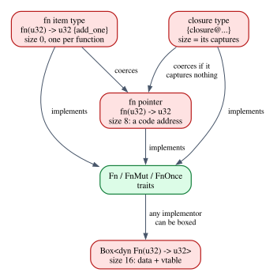
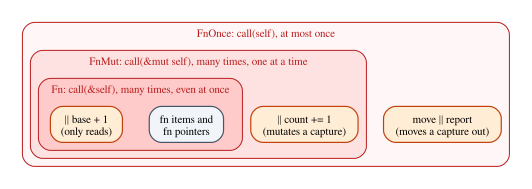

# The Simply Typed Lambda Calculus and Closures

The untyped λ-calculus of Chapter 7 can compute anything, and it cannot tell
anything apart. The boolean $\mathit{false}$ and the number $\overline{0}$ are
the same term; $\mathit{plus}$ applied to a pair produces an answer;
$\lambda x.\,x\,x$ applies a function to itself, and $\Omega$ runs forever. In
1940 Alonzo Church added **types** to his calculus, and most of this strangeness
disappeared at once. The result, the **simply typed λ-calculus** (STLC), is the
smallest interesting type theory, the core of every typed functional language,
and the system that Chapter 9 proves safe and Chapter 10 reads as logic.

Rust's functions are typed λ-terms too, but a Rust programmer meets function
types in several costumes that the clean theory does not have: `fn` items,
function pointers, closures with anonymous types, `impl Fn`, `dyn Fn`, and three
traits, `Fn`, `FnMut` and `FnOnce`. The second half of this chapter explains
them one by one, and shows that the three traits answer a question the
λ-calculus never asks: how many times may a function be called? That question
leads straight to Part V.

**In this chapter you will learn:**

- the types and typing rules of the STLC with unit, booleans, naturals, pairs
  and sums, as introduction and elimination rules;
- the computation rules β and η, why every well-typed term terminates, and why
  $\lambda x.\,x\,x$ has no type;
- bidirectional type checking, where λ checks but does not synthesize, and how
  the book's `stlc` crate implements it with an evaluator based on closures;
- what Rust's `fn` items, function pointers, closures, `impl Fn` and `dyn Fn`
  are, and what each costs;
- capture modes, `move`, and the `Fn`/`FnMut`/`FnOnce` hierarchy read as "how
  many times may this resource be used";
- why currying, free in the λ-calculus, has a price in Rust;
- how Lean represents intrinsically typed terms whose evaluator is total and
  safe by construction, and how that differs from the extrinsic style of
  Chapter 9.

## Types for the λ-calculus

The types are built from three base types and three type formers:

$$
\tau, \sigma \;::=\; \mathtt{Unit} \;\mid\; \mathtt{Bool} \;\mid\; \mathtt{Nat} \;\mid\; \sigma \to \tau \;\mid\; \sigma \times \tau \;\mid\; \sigma + \tau
$$

$\sigma \to \tau$ is the type of functions from $\sigma$ to $\tau$,
$\sigma \times \tau$ the type of pairs, and $\sigma + \tau$ the type of **tagged
unions**:
a value of $\sigma + \tau$ is either a $\sigma$ tagged "left" or a $\tau$ tagged
"right", like a Rust `enum Either<S, T> { Left(S), Right(T) }`. The arrow
associates to the right, $\mathtt{Nat} \to \mathtt{Nat} \to \mathtt{Nat}$ meaning
$\mathtt{Nat} \to (\mathtt{Nat} \to \mathtt{Nat})$, the type of curried
two-argument functions.

The terms are those of Chapter 7, with an annotation on the parameter of each
$\lambda$, plus constants and operations for the new types:

$$
t \;::=\; x \mid \lambda x{:}\tau.\,t \mid t\;t \mid () \mid \mathtt{true} \mid \mathtt{false} \mid \mathtt{if}\;t\;\mathtt{then}\;t\;\mathtt{else}\;t
$$

$$
\mid\; 0 \mid \mathtt{succ}\;t \mid \mathtt{iter}\;t\;t\;t \mid (t, t) \mid \mathtt{fst}\;t \mid \mathtt{snd}\;t
$$

$$
\mid\; \mathtt{inl}\;t \mid \mathtt{inr}\;t \mid \mathtt{case}\;t\;\mathtt{of}\;\mathtt{inl}\;x \Rightarrow t \mid \mathtt{inr}\;y \Rightarrow t
$$

Most of these are familiar. `iter n z s` applies the function `s` to `z`, `n`
times: it is the way to compute with a natural number, the typed version of a
Church numeral (Chapter 7), and the same thing as `(0..n).fold(z, |acc, _|
s(acc))` in Rust. `case` is a two-armed `match` on a sum, binding `x` in the
first arm and `y` in the second.

Annotating every parameter, as in $\lambda x{:}\mathtt{Nat}.\,\mathtt{succ}\;x$,
is called the **Church style** of typing: types are part of the terms. In the
**Curry style** terms stay unannotated and a type is something you assign to
them afterwards, possibly in several ways ($\lambda x.\,x$ has every type
$\tau \to \tau$). We will use both: Church style for the rules, Curry style in
the Lean theorem about self-application, and a mixture, bidirectional checking,
in the Rust checker.

## The typing rules

The judgment is $\Gamma \vdash t : \tau$, as in Chapter 3, with a context
$\Gamma = x_1 : \tau_1, \dots, x_n : \tau_n$ that later entries may shadow. The
heart of the system is three rules, for variables, abstraction and application:

$$
\dfrac{(x : \tau) \in \Gamma}{\Gamma \vdash x : \tau}\;\textsf{T-Var}
\qquad
\dfrac{\Gamma,\, x : \sigma \vdash t : \tau}{\Gamma \vdash \lambda x{:}\sigma.\,t : \sigma \to \tau}\;\textsf{T-Lam}
\qquad
\dfrac{\Gamma \vdash t : \sigma \to \tau \qquad \Gamma \vdash u : \sigma}{\Gamma \vdash t\;u : \tau}\;\textsf{T-App}
$$

Rule T-Lam says: to type a function, assume its parameter has the annotated type
and type the body. Rule T-App says: a function of type $\sigma \to \tau$ applied
to a $\sigma$ gives a $\tau$. You have relied on both every time Rust checked a
closure: `|x: u32| x + 1` has type "`u32` to `u32`" because, with `x: u32`, the
body is a `u32`.

The other types follow one pattern. Each type former has **introduction** rules,
which build values of the type, and **elimination** rules, which use them. For
booleans, naturals, pairs and sums:

$$
\dfrac{}{\Gamma \vdash \mathtt{true} : \mathtt{Bool}}\;\textsf{T-True}
\qquad
\dfrac{\Gamma \vdash c : \mathtt{Bool} \qquad \Gamma \vdash t : \tau \qquad \Gamma \vdash u : \tau}{\Gamma \vdash \mathtt{if}\;c\;\mathtt{then}\;t\;\mathtt{else}\;u : \tau}\;\textsf{T-If}
$$

$$
\dfrac{}{\Gamma \vdash 0 : \mathtt{Nat}}\;\textsf{T-Zero}
\qquad
\dfrac{\Gamma \vdash n : \mathtt{Nat}}{\Gamma \vdash \mathtt{succ}\;n : \mathtt{Nat}}\;\textsf{T-Succ}
\qquad
\dfrac{\Gamma \vdash n : \mathtt{Nat} \qquad \Gamma \vdash z : \tau \qquad \Gamma \vdash s : \tau \to \tau}{\Gamma \vdash \mathtt{iter}\;n\;z\;s : \tau}\;\textsf{T-Iter}
$$

$$
\dfrac{\Gamma \vdash t : \sigma \qquad \Gamma \vdash u : \tau}{\Gamma \vdash (t, u) : \sigma \times \tau}\;\textsf{T-Pair}
\qquad
\dfrac{\Gamma \vdash p : \sigma \times \tau}{\Gamma \vdash \mathtt{fst}\;p : \sigma}\;\textsf{T-Fst}
\qquad
\dfrac{\Gamma \vdash p : \sigma \times \tau}{\Gamma \vdash \mathtt{snd}\;p : \tau}\;\textsf{T-Snd}
$$

$$
\dfrac{\Gamma \vdash t : \sigma}{\Gamma \vdash \mathtt{inl}\;t : \sigma + \tau}\;\textsf{T-Inl}
\qquad
\dfrac{\Gamma \vdash t : \tau}{\Gamma \vdash \mathtt{inr}\;t : \sigma + \tau}\;\textsf{T-Inr}
$$

$$
\dfrac{\Gamma \vdash e : \sigma + \tau \qquad \Gamma,\, x : \sigma \vdash t : \rho \qquad \Gamma,\, y : \tau \vdash u : \rho}{\Gamma \vdash \mathtt{case}\;e\;\mathtt{of}\;\mathtt{inl}\;x \Rightarrow t \mid \mathtt{inr}\;y \Rightarrow u : \rho}\;\textsf{T-Case}
$$

plus T-False (like T-True) and T-Unit, $\Gamma \vdash () : \mathtt{Unit}$. Rule
T-If is Chapter 1's rule, unchanged. Rule T-Case is Rust's `match`: both arms
must produce the same type $\rho$, and each arm may use the payload of its
variant. The table sums up the pattern, with the Rust feature that plays each
role:

| Type | Introduction | Elimination | In Rust |
|---|---|---|---|
| $\sigma \to \tau$ | $\lambda x{:}\sigma.\,t$ | application | closures, `fn` |
| $\sigma \times \tau$ | $(t, u)$ | `fst`, `snd` | tuples, `.0`, `.1` |
| $\sigma + \tau$ | `inl`, `inr` | `case` | `enum`, `match` |
| `Bool` | `true`, `false` | `if` | `bool`, `if` |
| `Nat` | `0`, `succ` | `iter` | `u64`, loops, `fold` |
| `Unit` | `()` | (none needed) | `()` |

If this table reminds you of Chapter 4, it should. Erase the terms from the
rules and keep only the types: T-Lam becomes the introduction rule for
implication, T-App is *modus ponens*, T-Pair and T-Fst are the rules for
$\land$, T-Inl and T-Case the rules for $\lor$. That is not a coincidence, and
Chapter 10 is devoted to it.

### A derivation

Here is the derivation for `twice`, the function that applies its argument twice:

$$
\vdash \lambda f{:}\mathtt{Nat} \to \mathtt{Nat}.\,\lambda x{:}\mathtt{Nat}.\,f\,(f\,x) : (\mathtt{Nat} \to \mathtt{Nat}) \to \mathtt{Nat} \to \mathtt{Nat}
$$

Write $\Gamma = f : \mathtt{Nat} \to \mathtt{Nat},\, x : \mathtt{Nat}$. The
inner application $f\,x$ is typed by T-App from two variables:

$$
\mathcal{D} \;=\; \dfrac{\dfrac{}{\Gamma \vdash f : \mathtt{Nat} \to \mathtt{Nat}}\;\textsf{T-Var} \qquad \dfrac{}{\Gamma \vdash x : \mathtt{Nat}}\;\textsf{T-Var}}{\Gamma \vdash f\,x : \mathtt{Nat}}\;\textsf{T-App}
$$

The outer application uses $\mathcal{D}$ as its second premise, and two uses of
T-Lam move $x$ and then $f$ out of the context and into the type:

$$
\dfrac{\dfrac{\dfrac{\Gamma \vdash f : \mathtt{Nat} \to \mathtt{Nat} \qquad \mathcal{D}}{\Gamma \vdash f\,(f\,x) : \mathtt{Nat}}\;\textsf{T-App}}{f : \mathtt{Nat} \to \mathtt{Nat} \vdash \lambda x{:}\mathtt{Nat}.\,f\,(f\,x) : \mathtt{Nat} \to \mathtt{Nat}}\;\textsf{T-Lam}}{\vdash \lambda f{:}\mathtt{Nat} \to \mathtt{Nat}.\,\lambda x{:}\mathtt{Nat}.\,f\,(f\,x) : (\mathtt{Nat} \to \mathtt{Nat}) \to \mathtt{Nat} \to \mathtt{Nat}}\;\textsf{T-Lam}
$$

Notice that $f$ is used twice. The context is shared by both premises of T-App,
so a variable may be used as often as we like; that is contraction (Chapter 6)
at work, and it is exactly what Part V will restrict.

## Computation: β and η

The computation rules are the β-rule of Chapter 7 plus one rule for each
elimination applied to an introduction:

- $(\lambda x{:}\tau.\,t)\;v \longrightarrow t[x := v]$;
- $\mathtt{fst}\;(v_1, v_2) \longrightarrow v_1$ and
  $\mathtt{snd}\;(v_1, v_2) \longrightarrow v_2$;
- $\mathtt{case}\;(\mathtt{inl}\;v)\;\mathtt{of}\;\mathtt{inl}\;x \Rightarrow t \mid \mathtt{inr}\;y \Rightarrow u \;\longrightarrow\; t[x := v]$,
  and symmetrically for `inr`;
- $\mathtt{if}\;\mathtt{true}\;\mathtt{then}\;t\;\mathtt{else}\;u \longrightarrow t$,
  and symmetrically for `false`;
- $\mathtt{iter}\;0\;z\;s \longrightarrow z$ and
  $\mathtt{iter}\;(\mathtt{succ}\;n)\;z\;s \longrightarrow s\;(\mathtt{iter}\;n\;z\;s)$.

Each rule removes a *detour*: something was built only to be taken apart at
once. Chapter 4 called the logical version of this **local soundness**, and you
can now see why the slogan "proof simplification is computation" is literally
true.

The **η-rules** go the other way. They say that every value of a type is
determined by what you can do with it:

$$
\lambda x{:}\sigma.\,f\,x \;\equiv\; f \quad (x \notin \mathrm{FV}(f))
\qquad\qquad
(\mathtt{fst}\;p,\, \mathtt{snd}\;p) \;\equiv\; p
$$

A function that only passes its argument on to $f$ *is* $f$; a pair rebuilt from
its two projections *is* the pair. Chapter 4 called this **local completeness**.
η is usually stated as an equation rather than a reduction step, and it is the
principle behind a refactoring you have probably done: Clippy's
`redundant_closure` lint suggests replacing `.map(|x| f(x))` with `.map(f)`. Rust
shows why η needs care in a real language, though. In `.map(|x| make_f()(x))`,
`make_f()` runs once per element, while in `.map(make_f())` it runs once, before
the call: under call-by-value with side effects, η-reducing can change when
things happen.

## What types buy: termination

The most striking consequence of the typing rules is a theorem.

> **Theorem (strong normalization).** If $\vdash t : \tau$ in the STLC, then
> every reduction sequence starting from $t$ is finite.

Every well-typed program terminates, whatever the evaluation order. The theorem
was proved by William Tait in the 1960s with a method now called **logical
relations**, which Chapter 32 explains; for System T, the STLC with `iter`, the
proof is a little longer but the result is the same. We will not prove it here,
but we can see the most important thing it rules out: self-application.

### Why $\lambda x.\,x\,x$ has no type

Suppose $\Gamma \vdash \lambda x{:}\sigma.\,x\,x : \tau$ for some annotation
$\sigma$. Read the rules backward:

1. Only T-Lam concludes a judgment about a $\lambda$, so
   $\tau = \sigma \to \rho$ for some $\rho$, and
   $\Gamma, x : \sigma \vdash x\,x : \rho$.
2. Only T-App concludes a judgment about an application, so the first $x$ has a
   type $\sigma' \to \rho$ and the second has type $\sigma'$.
3. Only T-Var types a variable, and it gives $x$ the type $\sigma$ in both
   places. So $\sigma = \sigma' \to \rho$ and $\sigma = \sigma'$.

Together: $\sigma = \sigma \to \rho$. But the type $\sigma \to \rho$ contains
$\sigma$ as a proper part, so it is strictly bigger than $\sigma$, and no type is
equal to a strictly bigger type. There is no such $\sigma$. Without
$\delta = \lambda x.\,x\,x$ there is no $\Omega$, no $Y$ and no $Z$.

This argument is short enough to check in Lean, and the file
`code/lean/Book/Ch08/Extrinsic.lean` does. It defines raw, unannotated λ-terms
with de Bruijn indices and a Curry-style typing relation `HasType`, one
constructor per rule (we look at it more closely at the end of the chapter).
First, the size argument:

```lean
{{#include ../../code/lean/Book/Ch08/Extrinsic.lean:arrow_ne}}
```

Every inductive type in Lean comes with a function `sizeOf` that counts
constructors, and Lean proves equations such as
`sizeOf (σ ⇒ τ) = 1 + sizeOf σ + sizeOf τ` automatically. `congrArg sizeOf h`
applies `sizeOf` to both sides of the assumed equation `h : (σ ⇒ τ) = σ`;
`simp` rewrites with the size equations, and `omega` (a decision procedure for
linear arithmetic over the naturals) sees that
`1 + sizeOf σ + sizeOf τ = sizeOf σ` is impossible. Then the theorem, which
follows the three steps above exactly:

```lean
{{#include ../../code/lean/Book/Ch08/Extrinsic.lean:no_self_app}}
```

Each `cases` is "only rule X concludes a judgment of this shape": Lean tries
every constructor of `HasType`, discards those whose conclusion cannot match,
and gives us the premises of the one that can. After the last two, `e₁` and
`e₂` say what looking up index 0 in the context `σ :: Γ` returned; `simp`
computes the lookup, leaving `σ = σ' ⇒ ρ` and `σ = σ'`, and `arrow_ne_self`
finishes. Notice that the theorem holds for every context and every type: no
annotation, no context, nothing can rescue self-application.

Rust agrees. Chapter 7 showed `|x| x(x)` failing because the type of `x` was
unknown; giving `x` a type cannot help, by the argument above. Generics do not
help either. Here a generic function asks for a closure `F` that can be called
with a reference to its own type, and the closure we pass would need a type that
contains itself:

```rust
{{#include ../../code/rust/compile_fail/ch08_closure_takes_itself.rs:self_apply}}
```

```text
{{#include ../../code/rust/compile_fail/ch08_closure_takes_itself.stderr}}
```

"Recursive type with infinite-size name" is the compiler's way of saying
$\sigma = \sigma \to \rho$. (The note about a bug fix refers to the history of
this check and can be ignored.)

### The price of termination

Strong normalization is a strong guarantee, and it has a price: a language in
which every program terminates cannot express every computable function. (A
total language cannot even contain an interpreter for itself, by the same
diagonal argument that makes the halting problem undecidable.) To get general
recursion back, a language adds a fixed-point operator `fix` with the typing rule
"if $f : \tau \to \tau$ then $\mathtt{fix}\;f : \tau$", and loses termination.
That extended calculus, usually called PCF, is the core of languages such as ML
and Haskell.

Rust makes the same choice: recursive `fn`s and `loop` are unrestricted, so Rust
is Turing complete, and its type system promises nothing about termination. A
Rust function of type `fn(u64) -> u64` may run forever, and `loop {}` has every
type (Chapter 1). Lean makes the opposite choice, and Chapter 7 showed what it
costs: functions must be shown to terminate, or be marked `partial` and become
opaque to proofs. Chapter 10 explains why a proof assistant has no alternative.

## Bidirectional type checking

Writing a type on every $\lambda$ is tedious, and Rust rarely asks you to. In
`orders.iter().map(|o| o.total)` you do not annotate `o`; the compiler knows it
from `map`'s signature. The type of the closure's parameter flows *into* the
closure from its surroundings. **Bidirectional type checking** turns this
observation into a disciplined algorithm by splitting the typing judgment in
two:

- **synthesis**, $\Gamma \vdash t \Rightarrow \tau$: from the term alone, the
  checker computes its type $\tau$ (the type is an *output*);
- **checking**, $\Gamma \vdash t \Leftarrow \tau$: the checker is *given* $\tau$
  and verifies that $t$ has it (the type is an *input*).

Each rule is written for one mode. Variables, applications, projections and
annotated terms synthesize; an unannotated $\lambda$ is checked:

$$
\dfrac{(x : \tau) \in \Gamma}{\Gamma \vdash x \Rightarrow \tau}\;\textsf{S-Var}
\qquad
\dfrac{\Gamma \vdash t \Rightarrow \sigma \to \tau \qquad \Gamma \vdash u \Leftarrow \sigma}{\Gamma \vdash t\;u \Rightarrow \tau}\;\textsf{S-App}
\qquad
\dfrac{\Gamma \vdash t \Leftarrow \tau}{\Gamma \vdash (t : \tau) \Rightarrow \tau}\;\textsf{S-Ann}
$$

$$
\dfrac{\Gamma,\, x : \sigma \vdash t \Leftarrow \tau}{\Gamma \vdash \lambda x.\,t \Leftarrow \sigma \to \tau}\;\textsf{C-Lam}
\qquad
\dfrac{\Gamma \vdash t \Leftarrow \sigma}{\Gamma \vdash \mathtt{inl}\;t \Leftarrow \sigma + \tau}\;\textsf{C-Inl}
\qquad
\dfrac{\Gamma \vdash t \Rightarrow \sigma \qquad \sigma = \tau}{\Gamma \vdash t \Leftarrow \tau}\;\textsf{C-Switch}
$$

Read S-App as an algorithm: synthesize the type of the function; it must be an
arrow $\sigma \to \tau$; now *check* the argument against $\sigma$, which we just
learned; the result is $\tau$. Read C-Lam the same way: we are given
$\sigma \to \tau$, so we know the type of $x$ without an annotation, and we
check the body against $\tau$. C-Switch connects the modes: to check a term that
can synthesize, synthesize and compare. S-Ann goes the other way: an annotation
turns a term that can only be checked into one that synthesizes.

The rules follow a simple recipe: **introduction forms check, elimination forms
synthesize**. An elimination form has a "principal" subterm whose type
determines everything (the function in an application, the pair in a
projection), so it can synthesize. An introduction form often cannot: from
$\lambda x.\,x$ alone there is no way to know the type of $x$, and from
$\mathtt{inl}\;3$ there is no way to know the right half of the sum. That is why
**a λ checks but does not synthesize**: the information it lacks, the type of its
parameter, can only come from outside, from an expected type or an annotation.
(A λ whose parameter *is* annotated can synthesize, and our checker allows that
too.) In practice annotations are needed in only two places: at the top of a
definition, and where a λ is applied on the spot, as in
$(\lambda x.\,t)\;u$, which is rare in real code.

### Bidirectional checking in Rust

Rust is not literally a bidirectional checker (Chapter 13 shows that it also
solves equations between types), but its handling of closures has exactly this
flavor. When a closure appears where a function type is expected, the expected
type supplies its parameter types: checking mode. When it does not, the compiler
must find the parameter type some other way, and if it needs it too early, it
gives up:

```rust
{{#include ../../code/rust/compile_fail/ch08_closure_needs_annotation.rs:len}}
```

```text
{{#include ../../code/rust/compile_fail/ch08_closure_needs_annotation.stderr}}
```

To call the method `len` the compiler must know the type of `s`, and at that
point nothing has told it; the later call `len("checked")` comes too late. Two
fixes correspond to the two rules above: annotate the parameter
(`|s: &str| s.len()`, which makes the closure synthesize), or put the closure
where a type is expected, as in `let len: fn(&str) -> usize = |s| s.len();` or
`words.iter().map(|s| s.len())` (checking mode, rule C-Lam). The same happens
with sums: `let r = Ok(3);` alone is rejected with "type annotations needed for
`Result<i32, _>`", because, like $\mathtt{inl}\;3$, `Ok(3)` says nothing about
the error type.

## The `stlc` crate

This chapter's crate, `code/rust/crates/stlc`, implements the language with a
bidirectional checker and an evaluator. The syntax is two `enum`s:

```rust
{{#include ../../code/rust/crates/stlc/src/syntax.rs:ty}}
```

```rust
{{#include ../../code/rust/crates/stlc/src/syntax.rs:term}}
```

`Lam` carries an `Option<Ty>`: `None` for $\lambda x.\,t$, `Some` for
$\lambda x{:}\tau.\,t$. A parser and a printer handle the concrete syntax used in
this chapter, with `λ`, `→` and `×` (or `\`, `->` and `*` in ASCII).

### The checker

The checker is a struct holding the context, with two mutually recursive
methods, one per judgment. Here are the synthesis rules for the λ-fragment:

```rust
{{#include ../../code/rust/crates/stlc/src/check.rs:infer_core}}
```

Each arm is one rule: `Var` is S-Var, `Ann` is S-Ann (check, then return the
annotation), `App` is S-App, an annotated `Lam` synthesizes by extending the
context and synthesizing the body, and an unannotated `Lam` is an error. The
rules for the other forms follow the recipe: literals synthesize, `if`
synthesizes the type of its first branch and checks the second against it, and
`inl`/`inr` refuse to synthesize. The checking rules:

```rust
{{#include ../../code/rust/crates/stlc/src/check.rs:check}}
```

The first arm is C-Lam: the expected type $\sigma \to \tau$ provides the
parameter's type (and if there is an annotation too, it must agree). Pairs,
injections, `if`, `let`, `case` and `iter` push the expected type into their
parts. The last arm is C-Switch. The method `under` extends the context for the
duration of a closure and pops the binding afterwards, so that inner bindings
shadow outer ones and disappear when their scope ends.

The crate can record every judgment the checker visits. The example
`crates/stlc/examples/ch08_stlc.rs` checks an unannotated `twice` against
$(\mathtt{Nat} \to \mathtt{Nat}) \to \mathtt{Nat} \to \mathtt{Nat}$:

```text
{{#include ../../code/rust/output/ch08_stlc.txt:9:19}}
```

Read it from the top. Two C-Lam steps move $f$ and $x$ into the context, with
types taken from the expected type. The body `f (f x)` is checked against
`Nat`, but an application cannot be checked directly: C-Switch synthesizes its
type instead (the `⇒` line one level down, with the result `Nat`, compared with
the expected `Nat`). S-App synthesizes the type of `f`, `Nat → Nat`, and checks
the argument `f x` against `Nat`, which repeats the pattern one level deeper,
ending with the variable `x`, checked by switching to synthesis. Information
flows down through `⇐` and back up through `⇒`, and no annotation was needed.

When the search for a derivation fails, the error points at the subterm where it failed:

```text
{{#include ../../code/rust/output/ch08_stlc.txt:30:40}}
```

The last one is self-application with an annotation: whatever type we give `x`,
the second `x` is checked against the domain of the first, and the types do not
match.

### The evaluator: environments and closures

To *run* programs, the crate does not substitute, as Chapter 7 did; it uses an
**environment**, a list of variable bindings, the way real interpreters and
compilers work. Evaluating a $\lambda$ cannot evaluate its body (the parameter
has no value yet), so it produces a **closure**: the parameter, the body, and the
values of the body's other free variables, captured from the environment.

```rust
{{#include ../../code/rust/crates/stlc/src/eval.rs:value}}
```

```rust
{{#include ../../code/rust/crates/stlc/src/eval.rs:make_closure}}
```

```rust
{{#include ../../code/rust/crates/stlc/src/eval.rs:apply}}
```

`make_closure` computes the free variables of the λ (Chapter 7) and copies their
values, and only theirs, out of the environment. Calling a closure evaluates its
body in the captured environment extended with the argument. This is **lexical
scope**: a function sees the variables of the place where it was *defined*, not
of the place where it is called. The evaluator itself is call-by-value, like
Rust:

```rust
{{#include ../../code/rust/crates/stlc/src/eval.rs:eval}}
```

Here is the crate's small library, with the types the checker synthesizes, and
some programs that use it (`with_library` wraps each program in `let`s that
define the library):

```text
{{#include ../../code/rust/output/ch08_stlc.txt:1:7}}
```

```text
{{#include ../../code/rust/output/ch08_stlc.txt:21:28}}
```

`pred` is Kleene's pair trick from Chapter 7, now typed. The last line is the
interesting one: `add 3` is a function, and its value is a closure whose body is
`λn. iter m n (λk: Nat. succ k)` and whose captured environment is `m = 3`. Only
`m` is captured, because it is the only free variable of the body; the library
functions in scope are not.

Look at the `Err(Stuck(...))` arms of `eval`. They are reached when the evaluator
finds something it cannot handle, such as an `if` on a number. If we skip the
checker, ill-typed programs reach them:

```text
{{#include ../../code/rust/output/ch08_stlc.txt:42:44}}
```

For every program the checker accepts, these arms are dead code. That claim is
the **progress** theorem, and Chapter 9 proves it, for a language like this one,
in Lean.

## Functions in Rust

In the STLC there is one kind of function type, $\sigma \to \tau$. In Rust there
are several, because Rust cares about two things the calculus ignores: what a
function value occupies in memory, and what it is allowed to do with the data it
captured. The example `code/rust/examples/ch08_closures.rs` explores them all.



### `fn` items and function pointers

A function declared with `fn` is called a **`fn` item**, and each one has its own
type, distinct from every other function's, even one with the same signature:

```rust
{{#include ../../code/rust/examples/ch08_closures.rs:fn_items}}
```

```rust
{{#include ../../code/rust/examples/ch08_closures.rs:fn_items_use}}
```

```text
{{#include ../../code/rust/output/ch08_closures.txt:1:3}}
```

The type of `add_one` is a **zero-sized type**: the compiler knows statically
which function it is, so a value of that type needs no bytes at all, and a call
through it compiles to a direct call. (The compiler writes this type as
`fn(u32) -> u32 {add_one}` in error messages.) To put two different functions in
one array, they must have one type, and Rust **coerces** both to the **function
pointer** type `fn(u32) -> u32`: an 8-byte code address, called indirectly. A
function pointer is the closest thing in Rust to the $\sigma \to \tau$ of the
STLC: one type for all functions with that signature.

### Closures and their anonymous types

A closure is more than code: it carries the values of the variables it captures.
The compiler implements each closure expression as an anonymous struct with one
field per capture, plus an implementation of the call operator. Roughly (this
sketch is not compiled; the real traits cannot be implemented by hand in stable
Rust):

```rust,ignore
// let percent: u16 = 3;
// let by_value = move |x: u16| x * percent;
// becomes, approximately:
struct ByValueClosure {
    percent: u16, // the captured variable
}
impl Fn(u16) -> u16 for ByValueClosure {
    fn call(&self, x: u16) -> u16 {
        x * self.percent
    }
}
```

This is the same representation as the `stlc` crate's `Closure`: code plus
captured environment. The size of a closure is the size of its captures:

```rust
{{#include ../../code/rust/examples/ch08_closures.rs:closure_sizes}}
```

```text
{{#include ../../code/rust/output/ch08_closures.txt:4:5}}
```

A closure that captures nothing is zero-sized, like a `fn` item. One that
captures `percent` by reference holds a pointer (8 bytes); one that captures it
by value holds a copy of the `u16` (2 bytes); one that owns a `String` holds the
`String` itself (24 bytes: pointer, capacity and length).

Since each closure expression defines its own struct, **every closure has its
own type**, and no two closures, even textually identical ones, have the same
type. The type has no name you can write, which is why the compiler prints it as
`{closure@...}` with a source location. This runs into a rule you know from
Chapter 1, T-If:

```rust
{{#include ../../code/rust/compile_fail/ch08_closure_types_differ.rs:scaler}}
```

```text
{{#include ../../code/rust/compile_fail/ch08_closure_types_differ.stderr}}
```

The two branches have two different types, so no instance of T-If applies. The
compiler's suggestion is the standard fix: erase the difference behind a pointer,
`Box<dyn Fn(u32) -> u32>`. (If neither closure captured anything, the program
would compile: both would be coerced to the function pointer type
`fn(u32) -> u32`.) A capturing closure can never become a function pointer,
because a code address has nowhere to keep the captured data:

```rust
{{#include ../../code/rust/compile_fail/ch08_capture_to_fn_pointer.rs:shift}}
```

```text
{{#include ../../code/rust/compile_fail/ch08_capture_to_fn_pointer.stderr}}
```

### `impl Fn` and `dyn Fn`

Since closure types cannot be named, functions that accept or return closures
name them through the traits they implement. `impl Fn(u64) -> u64` in argument
position means "some type implementing this trait, chosen by the caller": it is a
generic parameter in disguise, and each call is compiled separately for the
closure's actual type (monomorphization, Chapter 12), so the call is direct and
can be inlined. In return position it means "some type chosen by the function,
which the caller may not know": an *existential* type, the subject of Chapter
15. `dyn Fn(u64) -> u64` is a **trait object**: a pointer to the closure's data
together with a pointer to a table of its methods (the *vtable*). It is the only
way to treat closures of different types uniformly, for example in a `Vec`:

```rust
{{#include ../../code/rust/examples/ch08_closures.rs:dyn_fn}}
```

```text
{{#include ../../code/rust/output/ch08_closures.txt:14:15}}
```

The box costs a heap allocation (unless the closure is zero-sized), and each
call goes through the vtable, an indirect call the compiler usually cannot
inline. The three representations,
generic `impl Fn`, function pointer and `dyn Fn`, are three engineering answers
to one mathematical type $\sigma \to \tau$.

### Capture modes

How does a closure capture a variable? The compiler picks the least powerful
mode that the body needs:

- **by shared reference** (`&x`) if the body only reads `x`;
- **by mutable reference** (`&mut x`) if the body modifies `x`;
- **by value** (moving `x` into the closure) if the body moves `x` out.

The keyword `move` overrides the choice: every captured variable is captured by
value (moved, or copied if its type is `Copy`). Since the 2021 edition, a closure
that uses only a field `x.a` captures just that field, not all of `x`.

```rust
{{#include ../../code/rust/examples/ch08_closures.rs:capture_modes}}
```

```text
{{#include ../../code/rust/output/ch08_closures.txt:6:8}}
```

`total` borrows `prices`, so `prices` stays usable. `count` borrows `calls`
mutably for as long as `count` is in use, so `calls` can be printed only after
the last call. `send` owns `report`. Borrowing captures are governed by the
borrow checker like any other reference, and the most common surprise is a
closure that outlives what it borrows:

```rust
{{#include ../../code/rust/compile_fail/ch08_closure_escapes.rs:make_adder}}
```

```text
{{#include ../../code/rust/compile_fail/ch08_closure_escapes.stderr}}
```

The closure reads `n`, so it captures `&n`, a reference to a local variable that
dies when `make_adder` returns. `move` fixes it by storing a copy of `n` in the
closure. Lifetimes of references are the subject of Part VI; here it is enough
to see that the λ-calculus has no such issue, because its variables are not
places in memory.

### `Fn`, `FnMut` and `FnOnce`

Calling a closure is calling a method on its struct, and the question is how the
method receives `self`. The three possibilities are three traits, here in
simplified form (the real ones are generic over the argument tuple and cannot be
implemented in stable Rust):

```rust,ignore
trait FnOnce<Args> {
    type Output;
    fn call_once(self, args: Args) -> Self::Output; // consumes the closure
}
trait FnMut<Args>: FnOnce<Args> {
    fn call_mut(&mut self, args: Args) -> Self::Output; // exclusive access
}
trait Fn<Args>: FnMut<Args> {
    fn call(&self, args: Args) -> Self::Output; // shared access
}
```

What a closure's body does with its captures decides which traits it implements:

- if it moves a captured value out, it can only be called by value, once: it
  implements `FnOnce` only;
- if it mutates a capture, it needs exclusive access: `FnMut` (and therefore
  `FnOnce`);
- if it only reads, shared access suffices: `Fn` (and therefore `FnMut` and
  `FnOnce`).

The supertrait chain `Fn: FnMut: FnOnce` says that every `Fn` closure can be used
where an `FnMut` or `FnOnce` is expected: a function that may be called many
times through a shared reference may certainly be called through an exclusive
one, or once. `fn` items and function pointers implement all three.



Functions that *accept* closures choose the weakest trait they need, which
gives the caller the most freedom:

```rust
{{#include ../../code/rust/examples/ch08_closures.rs:callers}}
```

```rust
{{#include ../../code/rust/examples/ch08_closures.rs:traits_use}}
```

```text
{{#include ../../code/rust/output/ch08_closures.txt:9:13}}
```

`reads` is `Fn`, so it can be passed to both `call_twice` and `call_twice_mut`.
`bumps` mutates `ticks`, so it is only `FnMut`. `greet` was declared `move`, but
its body only reads `greeting`, so it is `Fn`: **`move` decides how variables
are captured, not which traits the closure implements**. Passing `&greet` works
because a shared reference to an `Fn` closure is itself an `Fn` closure, and
afterwards `greet` is still ours. The compiler rejects the two combinations that
would be unsound. A mutating closure where `Fn` is required:

```rust
{{#include ../../code/rust/compile_fail/ch08_fn_mutates.rs:count_calls}}
```

```text
{{#include ../../code/rust/compile_fail/ch08_fn_mutates.stderr}}
```

and an `FnOnce` closure called twice:

```rust
{{#include ../../code/rust/compile_fail/ch08_fnonce_twice.rs:send_twice}}
```

```text
{{#include ../../code/rust/compile_fail/ch08_fnonce_twice.stderr}}
```

The second error is E0382, "use of moved value", the error of Chapter 6. The
first call moved `send` (calling an `FnOnce` consumes it), so there is nothing
left to call. Read the three traits as answers to the question **how many times
may this function be used?** `FnOnce`: at most once, because a call uses up
resources. `FnMut`: any number of times, one at a time. `Fn`: any number of
times, even simultaneously from several places. In the STLC the question does
not arise: every function is a value that can be used any number of times,
because the calculus has contraction. Rust's `FnOnce` is a function that can be
used *at most once*, an **affine** function, and Chapter 21 will write its type
as $A \multimap B$, the linear implication of linear logic. This is the first
place where the book's question, whether Rust's ownership is "based on affine
types", shows up in the type of a function.

### The cost of currying

In the λ-calculus, a two-argument function and its curried form are
interchangeable at no cost: $(A \times B) \to C$ and $A \to (B \to C)$ are
isomorphic (Chapter 11 proves it), and partial application is just
application. In Rust, currying a particular function by hand is easy and cheap:

```rust
{{#include ../../code/rust/examples/ch08_closures.rs:fee}}
```

`fee_curried(3)` is a closure that captures `percent`: 8 bytes, no allocation.
But a *generic* `curry`, turning any two-argument function into a curried one,
runs into three costs at once. The natural signature does not even compile:

```rust
{{#include ../../code/rust/compile_fail/ch08_curry_nested_impl.rs:curry}}
```

```text
{{#include ../../code/rust/compile_fail/ch08_curry_nested_impl.stderr}}
```

Rust allows `impl Trait` in the return type of a function, but not inside the
return type of an `Fn` bound. The version that compiles boxes the inner closure:

```rust
{{#include ../../code/rust/examples/ch08_closures.rs:curry}}
```

1. **An allocation.** The inner closure is a `Box<dyn Fn>`: one heap allocation
   per partial application (it holds at least `a`), and an indirect call per
   use.
2. **Clones.** The inner closure is `Fn`, so it may be called many times, and
   each call needs its own `A` to pass to `f`, which takes `A` by value. It must
   clone `a` on every call. The outer closure must also clone `f` into each inner
   closure, hence `Clone` on `f`.
3. **`'static` bounds.** A boxed trait object must say how long the data it
   points to lives; here we require it to own everything (`'static`, Chapter 26).

The example counts the clones with a type that increments a counter in its
`Clone` implementation:

```rust
{{#include ../../code/rust/examples/ch08_closures.rs:currying_use}}
```

```text
{{#include ../../code/rust/output/ch08_closures.txt:16:24}}
```

Three calls, three clones of the captured value. None of this is a flaw in Rust:
it is what currying *means* once values have owners and functions may be called
many times. The λ-calculus duplicates freely (contraction) and never frees
anything; Rust makes duplication explicit and memory management visible, and the
cost of currying is the bill.

## Intrinsically typed terms in Lean

So far, a term and its type have been separate things: there is a set of terms,
some of which are well typed, and a typing relation that says which. This is
called **extrinsic** typing ("types from outside"), and it is the style of
Chapter 3, of the `stlc` crate, and of Chapter 9. Lean, with its dependent types,
allows another style. In **intrinsic** typing, the type of a term is part of the
term's *Lean type*: `Term Γ τ` is the type of terms of type `τ` in context `Γ`,
and a term that is not well typed cannot be constructed at all. The file is
`code/lean/Book/Ch08/Intrinsic.lean`.

### Types, and what they mean

The object language's types are an ordinary inductive type, with a scoped
notation `⇒` for the arrow (scoped so that it does not leak into other files),
and each type has a *meaning*: the Lean type of its values.

```lean
{{#include ../../code/lean/Book/Ch08/Intrinsic.lean:ty}}
```

```lean
{{#include ../../code/lean/Book/Ch08/Intrinsic.lean:denote}}
```

`Ty.denote` is a function from object-language types to Lean types: `nat`
means `Nat`, an arrow means a Lean function type, `prod` means a Lean pair, and
`sum` means Lean's sum type `⊕`. (`@[reducible]` lets Lean unfold it freely
while checking types, so that a value of `nat.denote` can be used as a `Nat`.)

### Variables are proofs of membership

A variable must carry its type. We use the indexed family that Chapter 6
introduced for contexts: `Var Γ τ` is a position in the list `Γ` at which the
type `τ` occurs. `here` is the most recent binding, de Bruijn index 0, and
`there` skips one; but unlike Chapter 7's bare numbers, a `Var` *proves* that the
position holds the right type.

```lean
{{#include ../../code/lean/Book/Ch08/Intrinsic.lean:var}}
```

### Terms are typing derivations

Now the terms. Each constructor is a typing rule: the indices in its result type
are the conclusion, its arguments are the premises.

```lean
{{#include ../../code/lean/Book/Ch08/Intrinsic.lean:term}}
```

Compare `lam` with rule T-Lam: from a body of type `τ` in the context
`σ :: Γ` (the context extended with the parameter), build a term of type
`σ ⇒ τ` in `Γ`. `app` is T-App, `case` is T-Case, and so on. There is no
annotation on `lam`: the parameter type `σ` is part of the term's type index.
Because the constructors *are* the rules, a value of type `Term Γ τ` is at once a
term and its typing derivation. Some example terms (`lit n` builds the numeral
`n` from `zero` and `succ`):

```lean
{{#include ../../code/lean/Book/Ch08/Intrinsic.lean:examples}}
```

An ill-typed term is not a term with a type error; it is a Lean type error.
Applying the number zero to zero:

```lean
{{#include ../../code/lean/Book/Ch08/Intrinsic.lean:ill_typed}}
```

Lean's own type checker reports that `.zero` has type `Term _ nat`, where a
function type `Term [] (nat ⇒ nat)` was needed. Self-application fails the same
way: the variable `here` has type `σ` in the context `[σ]`, and the application
needs it to have type `σ ⇒ τ`:

```lean
{{#include ../../code/lean/Book/Ch08/Intrinsic.lean:self_app}}
```

### An evaluator that cannot go wrong

An environment for `Γ` supplies a value of the right Lean type for each variable,
and the evaluator maps a term of type `τ` to a Lean value of type `τ.denote`:

```lean
{{#include ../../code/lean/Book/Ch08/Intrinsic.lean:env}}
```

```lean
{{#include ../../code/lean/Book/Ch08/Intrinsic.lean:iterate}}
```

```lean
{{#include ../../code/lean/Book/Ch08/Intrinsic.lean:eval}}
```

Compare this with the Rust evaluator. There is no `Result`, no `Stuck`, no
fuel, and no case for "applied something that is not a function". In the `app`
case, `f.eval ρ` has type `(σ ⇒ τ).denote`, which *is* the Lean function type
`σ.denote → τ.denote`, so applying it to `a.eval ρ` is just Lean function
application. In the `ite` case, `c.eval ρ` is a `Bool`. The types guarantee that
every case has what it needs, and Lean has checked that the match covers every
constructor and that the recursion is structural. The evaluator is **total and
safe by construction**: progress and preservation, which Chapter 9 must prove,
are built into the types here. A `lam` evaluates to a genuine Lean function
(`fun v => ...`), which we can apply to Lean functions directly:

```lean
{{#include ../../code/lean/Book/Ch08/Intrinsic.lean:run}}
```

This kind of evaluator, which maps the syntax of a language to mathematical
objects (here, Lean values), is called a **denotational semantics**; Chapter 19
develops it into the interpretation of the STLC in a cartesian closed category.

### β and η, proved

With the evaluator we can state β and η as theorems about meanings. β holds by
definition, for functions and for the other types:

```lean
{{#include ../../code/lean/Book/Ch08/Intrinsic.lean:beta}}
```

`rfl` works because the left-hand side computes to the right-hand side by the
equations of `eval`. η is more interesting, because it mentions the term
`f.weaken`: the function `f`, moved into a context with one more variable (the
parameter `x`) that it does not use. Weakening is an instance of **renaming**,
which applies a type-preserving map on variables to every variable of a term:

```lean
{{#include ../../code/lean/Book/Ch08/Intrinsic.lean:rename}}
```

The key lemma says that evaluating a renamed term is evaluating the original
term in an environment that "looks through" the renaming:

```lean
{{#include ../../code/lean/Book/Ch08/Intrinsic.lean:eval_rename}}
```

The proof is by induction on the term. For a variable, the hypothesis `h` is
exactly what is needed (`symm` flips the equation). For the binders, `lam` and
`case`, the environments are extended by one value, and the local lemma `ext`
shows, by cases on the variable, that the extended environments still agree
through `r.ext`. For a `lam`, both sides are Lean functions, so `funext v`
reduces the goal to their values at an arbitrary argument `v`. In the `case`
case, `split` considers the two possible results of evaluating the scrutinee.
The other cases unfold `rename` and `eval` (`simp only`) and rewrite each
subterm with its induction hypothesis. η is now a short calculation:

```lean
{{#include ../../code/lean/Book/Ch08/Intrinsic.lean:eta}}
```

After `funext v`, the goal is the value of both sides at `v`. `show` restates the
left side as `eval` unfolds it: the renamed `f`, evaluated in the environment
extended with `v`, applied to `v`. `eval_rename` with the renaming `Var.there`
turns it into `f` evaluated in `ρ`, since looking up `there x` in `ρ.cons v` is
looking up `x` in `ρ` (the `fun _ => rfl` proves that, for every variable, by
computation).

### Extrinsic versus intrinsic

The file `code/lean/Book/Ch08/Extrinsic.lean` builds the extrinsic version for
comparison: raw terms, with the same constructors but no type indices, and a
separate typing relation whose constructors are the same typing rules.

```lean
{{#include ../../code/lean/Book/Ch08/Extrinsic.lean:has_type}}
```

The two styles are connected by **erasure**: forgetting the types of an
intrinsic term gives a raw term, and the theorem `erase_typed` says that the
raw term is well typed, at the type the intrinsic term carried. The proof is an
induction on the term in which every case is "apply the matching rule to the
induction hypotheses", which makes the slogan precise: an intrinsic term *is* a
typing derivation.

```lean
{{#include ../../code/lean/Book/Ch08/Extrinsic.lean:erase_typed}}
```

The only case that needs a lemma is the variable: `Var.index_lookup` says that
the de Bruijn index of a typed variable finds its type in the context. For
`here` the index is 0 and the lookup returns the head of the list (`rfl`); for
`there x` both the index and the context grow by one, and `simpa` (which
simplifies the goal and the hypothesis and then closes one with the other)
reduces the goal to the induction hypothesis.

```lean
{{#include ../../code/lean/Book/Ch08/Extrinsic.lean:erase_example}}
```

Which style is better depends on what you want:

| | Extrinsic (Chapters 3, 9) | Intrinsic (this chapter) |
|---|---|---|
| Ill-typed terms | exist; the checker rejects them | cannot be written |
| Typing | a separate relation `HasType` | the indices of `Term Γ τ` |
| Safety | a theorem to prove | true by construction |
| Evaluator | may get stuck (`Option`, `Stuck`) | total, no error cases |
| Good for | type checkers, studying errors | interpreters, semantics |

Chapter 9 chooses the extrinsic style on purpose: to *prove* that well-typed
programs do not go wrong, it needs to talk about programs that do, and to show
that the typing rules keep evaluation away from them. The intrinsic style makes
that theorem invisible, which is wonderful for building an interpreter and
useless for studying why it works.

## Putting it together: one function, three ways

Let us follow `twice (add 3) 4`, which should be 10, through all three
implementations of this chapter.

**In the `stlc` crate**, the program is text. The parser builds a `Term`; the
bidirectional checker synthesizes `Nat` for it, using C-Lam to type the
unannotated `twice` against its annotation and S-App for each application; the
evaluator builds closures and calls them:

```text
{{#include ../../code/rust/output/ch08_stlc.txt:22:22}}
```

On the way, `add 3` became the closure `<closure λn. ... | m = 3>`, a body plus
one captured value.

**In Rust**, `twice` is a generic function and `add` a closure returning a
closure:

```rust
{{#include ../../code/rust/examples/ch08_closures.rs:twice}}
```

```rust
{{#include ../../code/rust/examples/ch08_closures.rs:twice_use}}
```

```text
{{#include ../../code/rust/output/ch08_closures.txt:25:26}}
```

`add(3)` is a value of an anonymous closure type holding `m = 3`: 8 bytes, the
same data as the crate's closure, laid out by the compiler instead of stored in
a vector. `twice` is monomorphized for that type, so the two calls to `f` are
direct.

**In Lean**, `twice` and `add` are intrinsically typed terms, and evaluation
produces Lean values: the first `#eval` of the `run` block above printed 10. The
types of the terms were checked by Lean's own type checker when we wrote them;
the evaluator could not have failed.

Three implementations, one mathematical object: the term
$\lambda f.\,\lambda x.\,f\,(f\,x)$ of type
$(\mathtt{Nat} \to \mathtt{Nat}) \to \mathtt{Nat} \to \mathtt{Nat}$, typed by
the derivation we wrote by hand at the start of the chapter.

## Common confusions

**"A λ without an annotation has no type."** It has many: $\lambda x.\,x$ has
type $\tau \to \tau$ for every $\tau$. What it lacks is a type that can be
*synthesized* from the term alone. In checking mode, against an expected type,
it is fine.

**"`move` makes a closure `FnOnce`."** `move` only decides *how* variables are
captured (by value). Which traits the closure implements depends on what its body
does with the captures. A `move` closure that only reads is `Fn`.

**"`Fn` is the most general closure trait."** It is the most *demanding* for the
closure and the most *permissive* for the caller. A function that accepts
`impl FnOnce` accepts every closure; one that accepts `impl Fn` accepts only
those that can be called through a shared reference.

**"Closures are function pointers."** A function pointer is a code address. A
closure is a struct of captured values with a call method, and only a
non-capturing closure can be coerced to a function pointer.

**"Two closures with the same code have the same type."** Every closure
expression has its own type. To mix them, use generics with one closure at a
time, or a trait object.

**"Strong normalization means Rust programs terminate."** It is a theorem about
the STLC. Rust adds unrestricted recursion and `loop`, and its types promise
nothing about termination.

**"Intrinsic typing makes the safety proof unnecessary."** It moves the proof
into the definition: the type of `Term.eval` *is* the safety statement, and Lean
checked it when it accepted the definition. What you lose is the ability to talk
about ill-typed terms at all.

## Summary

- The STLC assigns types $\mathtt{Unit}$, $\mathtt{Bool}$, $\mathtt{Nat}$,
  $\sigma \to \tau$, $\sigma \times \tau$ and $\sigma + \tau$ to λ-terms. Each
  type former has introduction and elimination rules; erased of terms, they are
  the rules of natural deduction.
- β-rules remove detours (an introduction followed by an elimination); η-rules
  say a value is determined by its uses. Clippy's `redundant_closure` is an
  η-reduction.
- Every well-typed STLC term terminates (strong normalization). $\lambda x.\,x\,x$
  has no type, because $\sigma = \sigma \to \rho$ has no solution, a fact proved
  in Lean. Rust gives up termination to be Turing complete.
- Bidirectional checking splits typing into synthesis ($\Rightarrow$) and
  checking ($\Leftarrow$): introduction forms check, elimination forms
  synthesize, and a λ needs an expected type or an annotation. Rust's closures
  get their parameter types the same way.
- The `stlc` crate implements a bidirectional checker and an environment-based
  evaluator whose closures capture the free variables of their body, as Rust's
  do.
- Rust has several function types: zero-sized `fn` items, `fn` pointers, closures
  with unique anonymous types sized by their captures, generic `impl Fn`, and
  trait objects `dyn Fn`.
- Closures capture by shared reference, mutable reference or value; `move`
  forces by value. `Fn`, `FnMut` and `FnOnce` say how a closure may be called,
  and `FnOnce` is an affine function: usable at most once.
- Currying is free in the λ-calculus and costs allocations, clones and bounds in
  Rust.
- In Lean, intrinsically typed terms `Term Γ τ` are typing derivations; their
  denotational evaluator is total and safe by construction, and β and η hold as
  theorems. The extrinsic style, used in Chapter 9, keeps ill-typed terms around
  so that safety can be stated and proved.

## Exercises

1. Write typing derivations for
   $\vdash \lambda p{:}\sigma \times \tau.\,(\mathtt{snd}\;p, \mathtt{fst}\;p) : \sigma \times \tau \to \tau \times \sigma$
   and for
   $\vdash \lambda x{:}\sigma.\,\lambda y{:}\tau.\,x : \sigma \to \tau \to \sigma$.
   For each, say whether some variable is used twice, or not at all.
   *Hint:* in the second derivation $y$ goes into the context and is never looked
   up; that is weakening (Chapter 6).

2. Extend the `stlc` crate with a primitive `isZero e`: give its rule in both
   modes, add it to the parser, checker and evaluator, and define `iszero` without
   `iter` in the example. Which mode should it be in?
   *Hint:* it is an elimination form for `Nat` with a known result type, so it
   synthesizes `Bool` after checking `e` against `Nat`.

3. Give a bidirectional rule for `case` in checking mode and one in synthesis
   mode, and explain why the synthesis rule must *check* the second branch
   against the type synthesized from the first. Find both in `check.rs`.
   *Hint:* compare with rule T-If in Chapter 1, and with how Rust reports the
   type of a `match` whose arms disagree.

4. Write a Rust function `compose3` that composes three closures, first with
   `impl Fn` arguments and result, then with `Box<dyn Fn>`. Use `size_of_val` to
   compare the sizes of the results, and explain the difference.
   *Hint:* the `impl Fn` result is a closure holding three closures; the boxed
   version is a fat pointer, whatever it holds.

5. Which of `Fn`, `FnMut`, `FnOnce` does each closure implement?
   `|v: &mut Vec<u32>| v.push(1)`, `move || drop(buffer)`, `|| counter.get()`
   (with `counter: Cell<u32>`), `move |x| x + offset`. Check your answers by
   passing each to functions that require each trait.
   *Hint:* the parameter `v` is not a capture; `Cell::get` takes `&self`.

6. In Lean, add a constructor `isZero : Term Γ .nat → Term Γ .bool` to
   `Intrinsic.lean` (in a copy), extend `eval`, `rename` and the proof of
   `eval_rename`, and prove
   `(Term.app (.lam (.isZero (.var .here))) (lit 0)).eval Env.nil = true` by `rfl`.
   *Hint:* `eval` maps it to `n.eval ρ == 0`; the `eval_rename` case is like
   `succ`.
