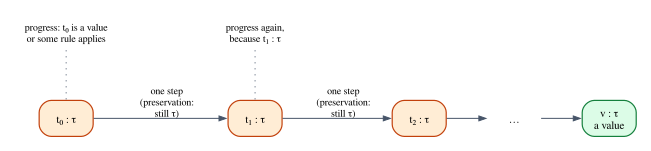
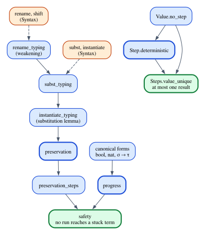

# Type Safety, Proved

In Chapter 1 we quoted Robin Milner's slogan, *well-typed programs cannot go
wrong*, and split it into two halves: **progress** (a well-typed program is
never stuck) and **preservation** (a step of computation does not change the
type). Chapter 3 stated both for the small language `Arith`, and Chapter 8
built the simply typed λ-calculus. All along, the theorem has been a promise.
In this chapter we keep it.

We take the simply typed λ-calculus with booleans and natural numbers, define
how its programs run, one small step at a time, and prove in Lean that no
well-typed program ever reaches a stuck state, no matter how long it runs; we
also prove that evaluation is deterministic. The proof is the classic one, due
in this form to Andrew Wright and Matthias Felleisen (1994) and presented in
almost every textbook on programming languages since (Pierce's *Types and
Programming Languages* is the standard reference). It is built from half a dozen
lemmas, and we will go through every one of them, line by line. If you have
never read a proof about a programming language, this chapter shows you how one
is put together and where the real difficulty hides.

Then we look at the same theorems from the other side: a Rust crate generates
thousands of random well-typed programs and runs them, checking progress and
preservation at every step. Putting tests and proofs side by side is the best
way to understand what each one gives you. Finally we ask what "going wrong"
means for Rust itself.

**In this chapter you will learn:**

- how to define a small-step operational semantics as an inductive relation,
  and what values and stuck terms are;
- the canonical forms lemmas, and how they make the progress theorem work;
- why preservation needs weakening and substitution lemmas, and how de Bruijn
  indices make those lemmas precise enough for a machine to check;
- how progress and preservation combine into type safety for runs of any
  length, and why evaluation is deterministic;
- how to test the same theorems with a property-based test harness in Rust, and
  what such tests can and cannot tell you;
- what "going wrong" means for Rust, and what its type system does not promise.

## The language

The language of this chapter is the simply typed λ-calculus of Chapter 8, cut
down to what the proofs need: functions, booleans and natural numbers.

$$
\tau ::= \mathsf{bool} \mid \mathsf{nat} \mid \tau_1 \to \tau_2
$$

$$
t ::= \#i \mid \lambda{:}\tau.\,t \mid t_1\,t_2 \mid \mathsf{true} \mid \mathsf{false} \mid \mathsf{if}\ t_1\ \mathsf{then}\ t_2\ \mathsf{else}\ t_3 \mid n \mid t_1 + t_2 \mid \mathsf{iszero}\ t
$$

Variables are **de Bruijn indices**, as in Chapter 7: instead of a name, a
variable is the number of binders between it and the λ that binds it. We write
them $\#0$, $\#1$, $\#2$, with a `#` so that they cannot be confused with the
numeric literals $0, 1, 2$ of the language. The function $\lambda (x :
\mathsf{nat}).\, x + 1$ becomes $\lambda{:}\mathsf{nat}.\, \#0 + 1$, and the
function that applies its first argument twice to its second,
$\lambda (f : \mathsf{nat} \to \mathsf{nat}).\, \lambda (x : \mathsf{nat}).\,
f\,(f\,x)$, becomes $\lambda{:}(\mathsf{nat} \to \mathsf{nat}).\,
\lambda{:}\mathsf{nat}.\, \#1\,(\#1\,\#0)$: inside the inner λ, $x$ is one binder
away ($\#0$) and $f$ is two ($\#1$).

Why de Bruijn indices, when names are so much easier to read? Because the proof
of preservation hinges on a lemma about substitution, and with names,
substitution must avoid capturing variables, terms must be identified up to
renaming of bound variables (α-equivalence), and every lemma acquires side
conditions about fresh names. On paper these are usually waved away. In a proof
assistant nothing can be waved away, and de Bruijn indices make all of it
disappear: there are no names to clash, and two α-equivalent terms are literally
equal. The price is that indices must be adjusted when a term moves under a
binder, and we will pay that price, carefully, when we get to substitution.

The λ carries a type annotation, $\lambda{:}\tau.\,t$: the type of the
parameter is written down, not inferred. Chapter 8's bidirectional checker could
sometimes do without it; here every λ has one, so that type checking is a simple
recursive function and every term has at most one type.

### In Lean

The language lives in `code/lean/Book/Ch09/Syntax.lean`. Types and terms are
two inductive types:

```lean
{{#include ../../code/lean/Book/Ch09/Syntax.lean:ty}}
```

```lean
{{#include ../../code/lean/Book/Ch09/Syntax.lean:term}}
```

The constructor `ite` is "if-then-else" (the name Lean itself uses for `if`,
which is a keyword), and the boolean literals are `tt` and `ff`, because `true`
and `false` already name Lean's own booleans. The file also defines a printer,
so that `#eval` shows terms in the notation of this chapter:

```lean
{{#include ../../code/lean/Book/Ch09/Syntax.lean:examples}}
```

There is one important difference from Chapter 8. There, terms were
**intrinsically** typed: the type of a term was an index of its Lean type
(`Term Γ τ`), so an ill-typed term could not even be written down, and the
evaluator was safe by construction. Here terms are **extrinsically** typed:
`Term` is plain syntax, ill-typed terms such as `true + 1` are perfectly good
values of type `Term`, and typing is a separate relation that some terms satisfy
and others do not. The intrinsic approach gives safety for free; the extrinsic
approach makes safety a *theorem*, something we can state, prove and break. To
talk about programs that go wrong, we need to be able to write them.

### In Rust

The Rust crate `safety` (`code/rust/crates/safety`) mirrors the Lean files
module by module. Its types and terms are the same two definitions, as Rust
enums:

```rust
{{#include ../../code/rust/crates/safety/src/syntax.rs:ty}}
```

```rust
{{#include ../../code/rust/crates/safety/src/syntax.rs:term}}
```

The Rust printer produces exactly the same notation as the Lean one, so the
outputs of the two languages can be compared character by character.

## The typing rules

A context $\Gamma$ is a list of types: entry $i$ is the type of the variable
$\#i$. The variable bound by the innermost λ is $\#0$, so when the type checker
enters a $\lambda{:}\sigma$, it puts $\sigma$ at the *front* of the list, and
every variable that was already in scope moves one position back, exactly as its
index does. We write $\sigma :: \Gamma$ for that extended context and
$\Gamma(i)$ for entry $i$. The rules are those of Chapter 8, restricted to our
types:

$$
\dfrac{\Gamma(i) = \tau}{\Gamma \vdash \#i : \tau}\;\textsf{T-Var}
\qquad\qquad
\dfrac{\sigma :: \Gamma \vdash t : \tau}{\Gamma \vdash \lambda{:}\sigma.\,t : \sigma \to \tau}\;\textsf{T-Lam}
$$

$$
\dfrac{\Gamma \vdash t_1 : \sigma \to \tau \qquad \Gamma \vdash t_2 : \sigma}{\Gamma \vdash t_1\,t_2 : \tau}\;\textsf{T-App}
$$

$$
\dfrac{}{\Gamma \vdash \mathsf{true} : \mathsf{bool}}\;\textsf{T-True}
\qquad
\dfrac{}{\Gamma \vdash \mathsf{false} : \mathsf{bool}}\;\textsf{T-False}
\qquad
\dfrac{}{\Gamma \vdash n : \mathsf{nat}}\;\textsf{T-Lit}
$$

$$
\dfrac{\Gamma \vdash t_1 : \mathsf{bool} \qquad \Gamma \vdash t_2 : \tau \qquad \Gamma \vdash t_3 : \tau}{\Gamma \vdash \mathsf{if}\ t_1\ \mathsf{then}\ t_2\ \mathsf{else}\ t_3 : \tau}\;\textsf{T-If}
$$

$$
\dfrac{\Gamma \vdash t_1 : \mathsf{nat} \qquad \Gamma \vdash t_2 : \mathsf{nat}}{\Gamma \vdash t_1 + t_2 : \mathsf{nat}}\;\textsf{T-Add}
\qquad
\dfrac{\Gamma \vdash t : \mathsf{nat}}{\Gamma \vdash \mathsf{iszero}\ t : \mathsf{bool}}\;\textsf{T-IsZero}
$$

Rule T-If is the rule from Chapter 1 that both branches share one type; it will
come back later in the chapter, when we break it on purpose.

In Lean, contexts are lists, `lookup` is $\Gamma(i)$, and the judgment is an
inductive predicate with one constructor per rule, the technique of Chapter 3
(file `code/lean/Book/Ch09/Typing.lean`):

```lean
{{#include ../../code/lean/Book/Ch09/Typing.lean:ctx}}
```

```lean
{{#include ../../code/lean/Book/Ch09/Typing.lean:has_type}}
```

Compare each constructor with its rule: the hypotheses before the last arrow are
the premises, the type after it is the conclusion, and the variables in curly
braces are the metavariables of the rule, which Lean will fill in by itself
whenever it can. (We wrote our own `lookup` rather than using Lean's list
indexing `Γ[i]?`. The two compute the same thing, but `lookup` is three lines
that you can read, and it keeps the whole development free of axioms, a point
we will come back to at the end.)

A derivation is a value of this inductive type. Here is the typing derivation
for `twice`, built by hand:

```lean
{{#include ../../code/lean/Book/Ch09/Typing.lean:twice_typed}}
```

Read it as the derivation tree written sideways. The outermost `.lam` is T-Lam
for $\lambda{:}(\mathsf{nat} \to \mathsf{nat})$, the next one for
$\lambda{:}\mathsf{nat}$, and below them the body $\#1\,(\#1\,\#0)$ is an
application (T-App) whose function is the variable $\#1$ and whose argument is
another application. Each `.var rfl` is T-Var: its premise is an equation such
as `lookup [nat, nat → nat] 1 = some (nat → nat)`, and `rfl` proves it because
both sides compute to the same value. Lean worked out every type in the tree
from the conclusion we asked for.

### A checker, proved sound

Building derivations by hand gets tedious quickly. As in Chapter 3, a type
checker does it for us. The checker `typeOf` has one case per rule:

```lean
{{#include ../../code/lean/Book/Ch09/Typing.lean:type_of}}
```

```lean
{{#include ../../code/lean/Book/Ch09/Typing.lean:type_of_eval}}
```

and it is proved sound with respect to the rules: whenever it says `some τ`, a
derivation of type `τ` exists. The proof goes by induction on the term, with the
same technique as Chapter 3; here are the first cases:

```lean
{{#include ../../code/lean/Book/Ch09/Typing.lean:type_of_sound_head}}
```

In each case with subterms, `simp only [typeOf] at h` unfolds one step of the
checker in the hypothesis `h : typeOf Γ t = some τ`, and `split at h` splits the
proof into one branch per arm of the checker's `match`; `next ... =>` names the
hypotheses the branch provides. Where the checker returns `none`, `h` has become
`none = some τ`, which `cases h` dismisses (no constructor of `=` can prove it).
In the successful branch, `cases h` learns what `τ` is, and the derivation is
assembled from the induction hypotheses. The remaining cases, in the file, are
the same. With a sound checker, the typing derivation of a concrete program is
just a computation:

```lean
{{#include ../../code/lean/Book/Ch09/Typing.lean:incr41_typed}}
```

The Rust checker is the same function, returning a `Result` with an error
message instead of an `Option`, and with a switch, `rules`, that we will use
later to break rule T-If:

```rust
{{#include ../../code/rust/crates/safety/src/typing.rs:type_of}}
```

## Running programs: small-step semantics

A type system is a claim about how programs behave, so before we can prove
anything we must say precisely how programs run. We do it with a **small-step
operational semantics**: a relation $t \longrightarrow t'$ that says "the term
$t$ takes one step of computation and becomes $t'$". A whole run is a chain of
such steps.

### Values

Some terms are finished: they are the possible results of a computation. These
are the **values**:

$$
v ::= \lambda{:}\tau.\,t \mid \mathsf{true} \mid \mathsf{false} \mid n
$$

A λ-abstraction is a value even if its body could compute further: we never
evaluate under a binder, just as Rust does not run the body of a closure until
the closure is called. In Lean, values are an inductive predicate on terms
(file `code/lean/Book/Ch09/Semantics.lean`):

```lean
{{#include ../../code/lean/Book/Ch09/Semantics.lean:value}}
```

### The evaluation rules

The rules come in two kinds. **Computation rules** do the actual work: they
apply when a term is a redex, an elimination form applied to a value of the
right shape.

$$
\dfrac{v\ \text{value}}{(\lambda{:}\tau.\,t)\,v \longrightarrow t[v]}\;\textsf{E-Beta}
$$

$$
\dfrac{}{\mathsf{if}\ \mathsf{true}\ \mathsf{then}\ t_2\ \mathsf{else}\ t_3 \longrightarrow t_2}\;\textsf{E-IfTrue}
\qquad
\dfrac{}{\mathsf{if}\ \mathsf{false}\ \mathsf{then}\ t_2\ \mathsf{else}\ t_3 \longrightarrow t_3}\;\textsf{E-IfFalse}
$$

$$
\dfrac{}{m + n \longrightarrow m{+}n}\;\textsf{E-AddLit}
\qquad
\dfrac{}{\mathsf{iszero}\ 0 \longrightarrow \mathsf{true}}\;\textsf{E-IsZeroZero}
\qquad
\dfrac{}{\mathsf{iszero}\ (n{+}1) \longrightarrow \mathsf{false}}\;\textsf{E-IsZeroSucc}
$$

In E-AddLit, $m$ and $n$ are literals and $m{+}n$ on the right is the literal
for their sum: the step turns the *expression* $2 + 3$ into the *number* $5$.
In E-Beta, $t[v]$ is the body $t$ with its bound variable $\#0$ replaced by $v$;
we will define it precisely in the section on substitution.

**Congruence rules** say where to look for the next redex when the term is not
one yet:

$$
\dfrac{t_1 \longrightarrow t_1'}{t_1\,t_2 \longrightarrow t_1'\,t_2}\;\textsf{E-AppL}
\qquad
\dfrac{v_1\ \text{value} \qquad t_2 \longrightarrow t_2'}{v_1\,t_2 \longrightarrow v_1\,t_2'}\;\textsf{E-AppR}
$$

$$
\dfrac{t_1 \longrightarrow t_1'}{\mathsf{if}\ t_1\ \mathsf{then}\ t_2\ \mathsf{else}\ t_3 \longrightarrow \mathsf{if}\ t_1'\ \mathsf{then}\ t_2\ \mathsf{else}\ t_3}\;\textsf{E-If}
$$

$$
\dfrac{t_1 \longrightarrow t_1'}{t_1 + t_2 \longrightarrow t_1' + t_2}\;\textsf{E-AddL}
\qquad
\dfrac{v_1\ \text{value} \qquad t_2 \longrightarrow t_2'}{v_1 + t_2 \longrightarrow v_1 + t_2'}\;\textsf{E-AddR}
\qquad
\dfrac{t \longrightarrow t'}{\mathsf{iszero}\ t \longrightarrow \mathsf{iszero}\ t'}\;\textsf{E-IsZero}
$$

Together these rules fix an **evaluation strategy**, call-by-value with
left-to-right order, the strategy of Chapter 7 and of Rust. The premise
"$v_1$ value" in E-AppR and E-AddR is what imposes the order: the right operand
may only step once the left one is finished. The premise "$v$ value" in E-Beta
says that arguments are evaluated before the call. Rust behaves the same way:
in `f(a(), b())`, the function expression is evaluated first, then `a()`, then
`b()`, and only then is `f` called. Notice also what the rules do *not* say: no
rule evaluates the branches of an `if` before the condition is known, and no
rule looks inside a λ.

The rules transcribe into one inductive predicate, one constructor per rule:

```lean
{{#include ../../code/lean/Book/Ch09/Semantics.lean:step}}
```

### Runs

A run is a sequence of steps. Its relation, written $t \longrightarrow^{*} t'$,
is the **reflexive-transitive closure** of $\longrightarrow$: zero steps, or one
step followed by a run.

```lean
{{#include ../../code/lean/Book/Ch09/Semantics.lean:steps}}
```

```lean
{{#include ../../code/lean/Book/Ch09/Semantics.lean:steps_trans}}
```

`Steps.trans` glues two runs together, by induction on the first run. If it is
empty, the second run is already the answer. If it starts with a step `hstep`,
the induction hypothesis `ih` glues the rest of it to the second run, and
`.step hstep` puts the first step back in front.

Here is a complete run, written as a proof:

```lean
{{#include ../../code/lean/Book/Ch09/Semantics.lean:run_incr}}
```

The first step is E-Beta, whose premise is that the argument `41` is a value
(`.lit` is the constructor of `Value` for literals). It produces
`instantiate (#0 + 1) 41`, which Lean computes to `41 + 1`. The second step is
E-AddLit, which produces the literal `lit (41 + 1)`. Lean computes `41 + 1` to
`42`, so the run can end there with `.refl`: the statement asked for `.lit 42`,
and that is where we are.

> [!NOTE]
> Mathlib has the reflexive-transitive closure of any relation,
> `Relation.ReflTransGen`. It adds steps at the *end* of a run instead of at the
> front, but it is the same relation, as `steps_iff_reflTransGen` at the end of
> `Semantics.lean` proves. We defined our own because two constructors are
> easier to read than a general library, and because building it is the lesson.

### Stuck terms

What happens to `true + 1`? It is not a value, and no rule applies: E-AddLit
needs two literals, and the congruence rules need one of the operands to step,
which `true` and `1` cannot. The term is **stuck**:

```lean
{{#include ../../code/lean/Book/Ch09/Semantics.lean:stuck}}
```

A stuck term is the formal model of a program that has gone wrong: it has not
finished, but there is nothing it can do next. This is where an interpreter
would crash, or where compiled code without checks would add a boolean to a
number and continue with garbage. Proving that a particular term is stuck is a
good first exercise in reasoning about an inductive relation:

```lean
{{#include ../../code/lean/Book/Ch09/Semantics.lean:stuck_example}}
```

`constructor` splits the conjunction into its two halves. For "not a value",
we assume a proof `h` that `true + 1` is a value and run `cases h`: Lean
examines every constructor of `Value`, finds that none of them produces an
`add`, and closes the goal because there is no case left to consider. For "no
step", we assume a step `h` and run `cases h`. This time two constructors could
have produced a step from an `add`: `addL`, which needs a step from `true`, and
`addR`, which needs a step from `1`. (`addLit` is ruled out because `true` is not
a literal.) In each case, a second `cases` on the premise finds no rule that
lets a literal step, and the goal is closed. This pattern, `cases` until no
constructor fits, is how every "this cannot happen" argument in this chapter
works.

### The evaluator in Rust

The Rust crate has the same semantics in two forms, and the difference between
them will matter for testing. The first, `successors`, is a transcription of the
*relation*: it tries every rule independently, checks that rule's premises and
returns every step that some rule allows.

```rust
{{#include ../../code/rust/crates/safety/src/eval.rs:successors}}
```

The second, `step`, is an *evaluator*: a function that returns the one step that
call-by-value takes. It decides which rule to use by looking for the leftmost
subterm that is not yet a value, which is the strategy written as code.

```rust
{{#include ../../code/rust/crates/safety/src/eval.rs:step}}
```

A `Step` records the derivation of the step along with its result: the
congruence rules from the outside in, ending with the computation rule that did
the work. A step is itself a derivation, a chain of rule instances, exactly like
the Lean proof term `.appR .lam (.beta .lit)`, which says "E-AppR, whose premise
is E-Beta".

```rust
{{#include ../../code/rust/crates/safety/src/eval.rs:step_struct}}
```

The relation is the specification and the function is the implementation. The
theorem that connects them is determinism.

## Determinism

**Theorem (determinism).** If $t \longrightarrow t_1$ and $t \longrightarrow
t_2$, then $t_1 = t_2$.

The key lemma is that values are finished: no rule has a value on its left-hand
side.

```lean
{{#include ../../code/lean/Book/Ch09/Semantics.lean:value_no_step}}
```

`cases hv` considers each kind of value, `cases h` each rule that could make it
step, and the combinator `<;>` runs the second tactic on every goal produced by
the first. There are four kinds of values and no rule applies to any of them, so
nothing is left.

The proof of determinism is by induction on the first step, `h₁`, followed by
a case analysis of the second step, `h₂`. Here are the three cases for
application:

```lean
{{#include ../../code/lean/Book/Ch09/Semantics.lean:deterministic_head}}
```

`generalizing t₂` makes the induction hypothesis talk about any second step,
not just the one we started with. Then each pair of rules falls
into one of three patterns.

- **The same congruence rule twice** (`appL` with `appL`): both steps rewrote
  the same subterm, so by the induction hypothesis `ih h'` the two results of
  that subterm are equal, and `rw` rewrites one into the other, which closes the
  goal.
- **Two different rules** (`appL` with `appR`, `appL` with `beta`, and so on):
  one rule says that a subterm steps, the other that the same subterm is a
  value. `Value.no_step` says that both cannot hold, and `absurd h (...)`
  derives anything at all, the goal included, from a statement together with its
  negation. In the `appL`/`beta` cases the value is the λ itself (`Value.lam`).
- **The same computation rule twice** (`beta` with `beta`): both results are
  literally the same term, and `rfl` proves the equation.

The remaining nine cases, for `if`, `+` and `iszero`, follow the same three
patterns. Whenever a pair of rules is not covered by the `with` clauses, it is
because the two conclusions cannot have the same left-hand side, and `cases`
has already discarded it.

Determinism has a satisfying consequence: a term has at most one result.

```lean
{{#include ../../code/lean/Book/Ch09/Semantics.lean:value_unique}}
```

The proof walks down the two runs together. If the first run is empty, it
starts at the value $v_1$, from which the second run cannot step, so
$v_1 = v_2$. If both runs take a first step, determinism says it is the same
step; `rw [...] at *` replaces one intermediate term by the other in every
hypothesis, and the induction hypothesis handles the rest of the runs.

Notice that determinism has nothing to do with types: it holds for every term,
well typed or not. It is a property of the evaluation rules alone, and the
premises "$v_1$ value" in the congruence rules are what make it true.

## Canonical forms

We now turn to the theorems that involve types, and we start with a simple
observation that the progress proof will need three times. If a *value* has type
$\mathsf{bool}$, which values could it be? Look at the typing rules: a λ has an
arrow type, a literal has type $\mathsf{nat}$, so the only candidates are
$\mathsf{true}$ and $\mathsf{false}$. That is a **canonical forms** lemma: it
says what the values of each type look like.

```lean
{{#include ../../code/lean/Book/Ch09/Typing.lean:canonical}}
```

Each proof starts with `cases hv`, one goal for each kind of value. In the
impossible goals, `cases ht` finds that no rule could give, say, a λ the type
`bool`: the conclusion of T-Lam is an arrow type, a different constructor, and
the case is discarded. (`| _ =>` handles all the remaining kinds of value at
once.) In `canonical_arrow`, `cases ht`
does something more interesting: it unifies the T-Lam conclusion
$\sigma' \to \tau'$, where $\sigma'$ is the annotation of the λ, with the
expected type $\sigma \to \tau$, and so learns that the annotation is $\sigma$.

## Progress

**Theorem (progress).** If $\vdash t : \tau$ (in the empty context), then $t$ is
a value or there is a $t'$ with $t \longrightarrow t'$.

The context must be empty. A term with a free variable, such as $\#0 + 1$, is
well typed in the context $[\mathsf{nat}]$, but it is not a value and cannot
step: it is waiting for a value to be substituted for $\#0$. Progress is a
statement about *closed* programs, the ones you can actually run.

The proof is by induction on the typing derivation. In each case we know the
last rule used, and the induction hypotheses tell us that each premise's term is
a value or steps. Here it is in full:

```lean
{{#include ../../code/lean/Book/Ch09/Safety.lean:progress}}
```

Let us go through it.

- `generalize hΓ : ([] : Ctx) = Γ at ht` replaces the empty context in `ht` by a
  variable `Γ` and records the equation `hΓ : [] = Γ`. Induction needs this:
  the rule T-Lam changes the context of its premise, so an induction over
  derivations must work for every context, and the equation carries the fact
  that ours is empty into every case. Whenever we need to know that the context
  is empty, `subst hΓ` replaces `Γ` by `[]` everywhere.
- **Variables.** A variable cannot be typed in the empty context: the premise
  `h : lookup [] i = some τ` computes to `none = some τ`, and `cases h` finds no
  way to prove that. The case is impossible, which is exactly why progress
  needs the context to be empty.
- **Values.** For `lam`, `tt`, `ff` and `lit` we choose the `left` side of the
  disjunction and give the `Value` constructor.
- **Application.** This is the interesting case. The pattern
  `@app _ σ τ t₁ t₂ ht₁ _ ih₁ ih₂` names the implicit arguments of the
  constructor (the `@` makes them visible), the typing derivation `ht₁` of the
  function, and the two induction hypotheses. We choose `right`: an application
  is never a value, so we must find a step. `rcases ih₁ hΓ with hv₁ | ⟨t₁', h₁⟩`
  splits on the induction hypothesis for the function: either it is a value
  (`hv₁`) or it steps to some `t₁'` (`h₁`). If it steps, E-AppL gives the step:
  `⟨_, .appL h₁⟩` is the pair of a witness (`_`, which Lean infers) and a proof
  that `t` steps to it. If it is a value, we split on the argument the same way.
  If the argument steps, E-AppR applies. If both are values, we finally need the
  canonical forms lemma: the function is a value of type $\sigma \to \tau$, so it
  is a λ. The pattern `⟨body, rfl⟩` in `obtain` does more than name the body: the
  `rfl` replaces `t₁` by `.lam σ body` everywhere, so that the goal becomes
  "`(λ:σ. body) t₂` steps", which E-Beta proves.
- **Conditionals.** The condition is a value or steps. If it steps, E-If. If it
  is a value, canonical forms says it is `tt` or `ff`, and `rcases ... with rfl
  | rfl` substitutes each possibility in turn; E-IfTrue and E-IfFalse finish.
- **Addition** is the application case again: left operand steps (E-AddL), or
  is a value and the right one steps (E-AddR), or both are values, hence
  literals by canonical forms, and E-AddLit applies.
- **`iszero`**: the argument steps (E-IsZero), or it is a literal $n$; `cases n`
  distinguishes $0$ (E-IsZeroZero) from a successor (E-IsZeroSucc).

The shape of this proof is the same for every language: one canonical forms
lemma per type with an elimination form, and evaluation rules that cover every
combination of values the typing rules allow. Had we forgotten E-IsZeroSucc, the
`succ` case would fail, and Lean would show us the stuck term. Progress is a
**completeness check of the evaluator against the type system**.

## Substitution, carefully

Preservation will need to know that E-Beta does not change the type, and
E-Beta performs a substitution. So before preservation we need the
**substitution lemma**: substituting a term of the right type for a variable
preserves typing. On paper it is one line,

$$
\text{if}\ \ \sigma :: \Gamma \vdash t : \tau\ \ \text{and}\ \ \Gamma \vdash s : \sigma\ \ \text{then}\ \ \Gamma \vdash t[s] : \tau,
$$

but to prove it we first have to say exactly what $t[s]$ is, and that is where
de Bruijn indices ask for care.

### Renaming and shifting

Substitution must move terms under binders, and a term that moves under a
binder must have its free variables renumbered: under one more λ, the variable
that was $\#3$ outside is $\#4$ inside. The cleanest way to organize this is to
treat a **renaming** as a function $\rho$ from indices to indices, and to define
how it acts on a term:

```lean
{{#include ../../code/lean/Book/Ch09/Syntax.lean:rename}}
```

The only subtle case is the λ. Inside the body, index $0$ is the variable that
this λ binds, which the renaming must leave alone; an index $i + 1$ inside
refers to the variable that was $i$ outside, which the renaming sends to
$\rho(i)$, and which inside the body must again be one higher, $\rho(i) + 1$.
That is `liftRen ρ`. With renaming in hand, **shifting** (moving a term under
one more binder) is the renaming $i \mapsto i + 1$:

```lean
{{#include ../../code/lean/Book/Ch09/Syntax.lean:shift_example}}
```

### Substitution

A **substitution** is a function $\sigma$ from indices to terms, and it acts on
a term by replacing every free variable $\#i$ with $\sigma(i)$. Under a λ it
must be lifted, in the same way as a renaming, with one extra twist: the term
that replaces an outer variable now lives under one more binder, so it must be
shifted.

```lean
{{#include ../../code/lean/Book/Ch09/Syntax.lean:subst}}
```

`single s` is the substitution performed by E-Beta. When the λ disappears, its
bound variable $\#0$ becomes the argument $s$, and every other free variable of
the body moves *down* by one, because there is one binder fewer between it and
its own λ. The examples show all three effects:

```lean
{{#include ../../code/lean/Book/Ch09/Syntax.lean:subst_examples}}
```

In the second example the body is $\lambda{:}\mathsf{nat}.\,\#1\,\#0$, whose
$\#1$ is the outer bound variable, and we substitute the free variable $\#5$ for
it. The result mentions $\#6$, not $\#5$: inside the inner λ, the variable that
is $\#5$ outside is called $\#6$, and `liftSub` shifted it accordingly. Forget
that shift and the substituted term would silently refer to the wrong variable,
which is the de Bruijn version of variable capture. This is the kind of bug that
a proof assistant will not let you make.

The Rust crate has the same functions, with renamings and substitutions as
closures (file `code/rust/crates/safety/src/subst.rs`):

```rust
{{#include ../../code/rust/crates/safety/src/subst.rs:subst}}
```

### The renaming lemma, and weakening

We prove the typing lemmas in the same order as the definitions: renaming first,
then substitution, then the special case that β needs. A renaming preserves
types provided it respects the contexts, that is, it sends each variable to a
variable of the same type:

```lean
{{#include ../../code/lean/Book/Ch09/Typing.lean:rename_typing}}
```

The proof is by induction on the typing derivation, `generalizing Δ ρ` so that
the induction hypotheses work for every target context and every renaming (we
will need them for different ones). Most cases just rebuild the same rule from
the induction hypotheses, like `.app (ih₁ hρ) (ih₂ hρ)`. Two cases do real work.

- **Variables.** The term is $\#i$ with `h : lookup Γ i = some τ`, the
  renamed term is $\#\rho(i)$, and the hypothesis `hρ` says precisely that
  `lookup Δ (ρ i) = some τ`. Rule T-Var does the rest.
- **λ.** After `apply HasType.lam`, the goal is to type the renamed body,
  `rename (liftRen ρ) t`, in the context `σ :: Δ`. The induction hypothesis `ih`
  can do that, provided we show that the lifted renaming respects the extended
  contexts `σ :: Γ` and `σ :: Δ`. That is the goal after `apply ih` and
  `intro i τ' h`, and we prove it by cases on the index. For `0`, the lookup in
  both contexts is the new entry `σ`, and `liftRen ρ 0` is `0`, so the
  hypothesis `h` already *is* the goal: both compute to `some σ = some τ'`, and
  `exact h` succeeds because Lean compares types up to computation. For `i + 1`,
  the hypothesis computes to `lookup Γ i = some τ'` and the goal to
  `lookup Δ (ρ i) = some τ'`, which is `hρ` applied to `i`.

The most important instance is **weakening**: a term that is typed in $\Gamma$
is still typed, after shifting, in a context with one more variable in front.
It is the renaming lemma with $\rho(i) = i + 1$:

```lean
{{#include ../../code/lean/Book/Ch09/Typing.lean:weakening}}
```

The side condition says that `lookup Γ i = some τ` implies
`lookup (σ :: Γ) (i + 1) = some τ`, and the second statement computes to the
first, so the identity function `fun _ _ h => h` proves it. This is the
structural rule of weakening from Chapter 6, in de Bruijn clothing: adding an
unused assumption does not invalidate a derivation, provided you renumber.

### The substitution lemma

A substitution preserves types provided it replaces every variable by a term of
that variable's type:

```lean
{{#include ../../code/lean/Book/Ch09/Typing.lean:subst_typing}}
```

The structure is identical to the renaming lemma. In the variable case, the
variable $\#i$ is replaced by $\sigma(i)$, and the hypothesis `hσ` is exactly
the statement that $\sigma(i)$ has the right type. In the λ case, the pattern
`@lam Γ α β t _ ih` names the parameter type `α`, and we must show that the
lifted substitution respects `α :: Γ` and `α :: Δ`. Index `0` is replaced by
the variable $\#0$, which has type `α` by T-Var. Index `i + 1` is replaced by
`shift (σ i)`, and here the substitution lemma uses the renaming lemma:
`σ i` has type `τ'` in `Δ` by `hσ`, so its shift has type `τ'` in `α :: Δ` by
weakening. This is the precise point where the two lemmas meet, and the reason
renaming had to come first.

Finally, the form that β-reduction needs:

```lean
{{#include ../../code/lean/Book/Ch09/Typing.lean:instantiate_typing}}
```

`apply subst_typing _ hbody` reduces the goal to the side condition for the
substitution `single s`, with `σ :: Γ` as the source context and `Γ` as the
target. Index `0` has type `σ` and is replaced by `s`, which has type `σ` by
`hs`; `cases h` turns `h : some σ = some τ'` into the knowledge that `τ'` is
`σ`. Index `i + 1` is replaced by $\#i$, whose type in `Γ` is the type of $\#(i +
1)$ in `σ :: Γ`, which is what `h` says.

That is the hard part of type safety, and it is all about variables: booleans
and numbers appear only in routine cases. Add a construct to the language and
these proofs get one more routine case each; change how binders work and this is
the part you must redo.

## Preservation

**Theorem (preservation).** If $\Gamma \vdash t : \tau$ and $t \longrightarrow
t'$, then $\Gamma \vdash t' : \tau$.

```lean
{{#include ../../code/lean/Book/Ch09/Safety.lean:preservation}}
```

Textbooks usually prove preservation by induction on the typing derivation. We
do it by induction on the *step*, `generalizing τ`, and then take the typing
derivation apart with `cases`: the step tells us which rule fired, and in each
case there is exactly one typing rule that could have typed the left-hand side.
This "taking apart" is called **inversion**: from the fact that
`app t₁ t₂` has type `τ`, `cases ht` concludes that there is a $\sigma$ with
$t_1 : \sigma \to \tau$ and $t_2 : \sigma$, because T-App is the only rule whose
conclusion is an application.

- **Congruence rules** (`appL`, `appR`, `ite`, `addL`, `addR`, `isZero`):
  inversion gives the derivations of the subterms, the induction hypothesis
  `ih` says that the stepped subterm keeps its type, and the same typing rule
  reassembles the whole.
- **E-Beta**: here is where all the work of the previous section pays off. The
  term is $(\lambda{:}\sigma'.\,\mathit{body})\,v$. Inversion of T-App gives
  `hlam`, a derivation for the λ with some type $\sigma \to \tau$, and `hv`,
  for the argument with type $\sigma$. Inversion of T-Lam on `hlam` gives
  `hbody : HasType (σ :: Γ) body τ` (and, silently, the fact that the annotation
  $\sigma'$ is $\sigma$). The substitution lemma `instantiate_typing hbody hv`
  is exactly the conclusion.
- **E-IfTrue and E-IfFalse**: the result is one of the branches, and inversion
  of T-If gives its derivation, with the type τ of the whole `if`. This is where
  rule T-If's insistence on a single type for both branches is used.
- **E-AddLit, E-IsZeroZero, E-IsZeroSucc**: the result is a literal or a
  boolean, typed by an axiom. `cases ht` is still needed, to learn that τ is
  `nat` or `bool`.

## Type safety

Progress talks about one state and preservation about one step. Safety talks
about whole runs, and it follows from the two by an induction on the length of
the run.



```lean
{{#include ../../code/lean/Book/Ch09/Safety.lean:safety}}
```

`preservation_steps` extends preservation to runs, by induction on the run: an
empty run changes nothing, and a run that starts with a step keeps the type
first by `preservation` and then by the induction hypothesis. `safety` then
assumes that the end of the run is stuck, which `intro ⟨hnotval, hnostep⟩`
splits into "not a value" and "no step". The term at the end of the run is still
well typed, by `preservation_steps`, so progress applies to it: it is a value,
contradicting `hnotval`, or it steps, contradicting `hnostep`.

That is the theorem Milner's slogan promised: a closed, well-typed term never
reaches a stuck state, however many steps it takes. Specialized to one program,
it is a one-line corollary:

```lean
{{#include ../../code/lean/Book/Ch09/Safety.lean:safety_corollary}}
```

And one more check, of a different kind:

```lean
{{#include ../../code/lean/Book/Ch09/Safety.lean:axioms}}
```

Chapter 1 used `#print axioms` to show that some proofs depend on axioms such as
`propext` or `Classical.choice`. The proof of type safety depends on none: it is
built from the rules of Lean's type theory alone, every case analysis is
constructive, and the theorem holds in the strongest sense Lean has. (This is
the reason for our own `lookup`: the definition of Lean's list indexing `Γ[i]?`
happens to bring in the axiom `propext`. That would not make the proof wrong, but
it is satisfying to know that it is not needed.)

The whole development fits in one picture. Arrows go from a lemma to the
results that use it.



## Testing the theorems in Rust

The Lean proof covers every term at once. The Rust crate `safety` takes the
other road: it implements the same language and checks the same theorems on many
concrete terms. The example `ch09_fuzz_safety`, in
`code/rust/crates/safety/examples/ch09_fuzz_safety.rs`, does the whole tour; you
run it with

```sh
cargo run -p safety --example ch09_fuzz_safety
```

### Random numbers without a crate

The standard library has no random number generator, and the book's Rust code
uses no other crates. A property-based test does not need good randomness, only
*reproducible* variety, and a few lines of SplitMix64 provide it:

```rust
{{#include ../../code/rust/crates/safety/src/rng.rs:rng}}
```

The same seed always produces the same sequence, so every failure can be
replayed exactly. (Crates such as `proptest` and `quickcheck` package this whole
approach, with better generators and automatic shrinking; we build a small
version ourselves so that every piece is visible.)

### Generating well-typed terms

A random term is almost never well typed: generate `if`, `+`, `true` and λ at
random and you get `iszero (λ:bool. #0)` most of the time. Testing progress and
preservation on such terms tests nothing, because the theorems only speak about
well-typed terms. The generator must produce well-typed terms, and in large
numbers.

The trick is to run the typing rules **backwards**. To generate a term of type
$\tau$, pick any rule whose conclusion can have type $\tau$, and generate its
premises recursively. To produce a $\mathsf{nat}$, T-Lit, T-Add, T-If and T-App
all qualify; for T-App, invent an argument type $\sigma$, then generate a
function of type $\sigma \to \tau$ and an argument of type $\sigma$. To produce a
$\sigma \to \tau$, use T-Lam: put $\sigma$ in the context and generate a body of
type $\tau$, where T-Var may now pick the new variable.

```rust
{{#include ../../code/rust/crates/safety/src/generate.rs:gen_term}}
```

The size budget shrinks at every rule with premises, which guarantees that
generation stops. The terms are well typed by construction, but "by construction"
is a claim, not a proof, so the checker verifies it for every term.

### Checking a run

For each generated term, the harness runs it to a value and checks the three
properties at every state along the way:

```rust
{{#include ../../code/rust/crates/safety/src/props.rs:check_run}}
```

Each check is a direct transcription of a theorem. **Preservation**: the type
checker agrees that every new state has the original type. **Progress**: if the
state is not a value, the relation allows at least one step. **Determinism**:
it allows at most one, and it is the one the evaluator `step` chose. This last
check is where having two versions of the semantics pays off: the relation
`successors` is the specification, written rule by rule, and the function
`step` is the implementation, written for efficiency. The test compares them
on every state it visits.

Here is a run of ten thousand random programs:

```text
{{#include ../../code/rust/output/ch09_fuzz_safety.txt:31:38}}
```

Every theorem held in every state. The runs are short (a few steps on
average): random well-typed programs tend to be shallow, which is a limitation
of the generator worth keeping in mind.

### What the type system rules out

The same crate can generate terms with no regard for types. Closed random terms
of up to twelve constructors give a feeling for what typing is for:

```text
{{#include ../../code/rust/output/ch09_fuzz_safety.txt:40:45}}
```

Of the terms that the checker rejects, about four in five really do get stuck.
The rest run to a value without trouble: `if true then 1 else false` is rejected
because its branches have different types, yet it evaluates to `1`. A type
system is **conservative**: it rejects every program that could go wrong, and
some that would not have. Four hand-picked examples:

```text
{{#include ../../code/rust/output/ch09_fuzz_safety.txt:17:29}}
```

The second one takes a perfectly good β-step before it gets stuck at
`true + 1`: in an ill-typed program the error may appear far from its cause,
which is exactly what preservation prevents for well-typed ones. The last is the
$\Omega$ of Chapter 7, which runs forever. It is ill typed too; as Chapter 8
said, every well-typed term of the simply typed λ-calculus terminates. Our
safety theorem does not need that fact, as we will see at the end of the
chapter.

### Breaking a rule on purpose

A test suite that never fails says little about its own power, so let us break
the type system and see whether the tests notice. The crate's
`Rules::BrokenIf` changes one rule: T-If takes the type of its `then` branch and
ignores the `else` branch entirely. The generator follows the broken rule too,
so it produces terms like `if c then 1 else true`, which the broken checker
calls `nat`. Here is what the harness says:

```text
{{#include ../../code/rust/output/ch09_fuzz_safety.txt:47:55}}
```

Term number 3 (counting from 0) already violates preservation. The raw
counterexample has 29 constructors, which is not very informative, so the harness
**shrinks** it: it repeatedly tries smaller candidates (a subterm in place of
the whole, a constant in place of a subterm) and keeps any candidate that still
has a type under the broken rules and still violates a theorem.

```rust
{{#include ../../code/rust/crates/safety/src/props.rs:shrink}}
```

The result, `if false then 0 else false : nat`, is as small as a
counterexample can be: one step later it is `false`, a `bool`. Preservation
fails, and with it safety: the counterexample that the Lean file uses,
`(if false then 1 else true) + 2`, steps to `true + 2`, which is stuck.

The Lean side can say the same thing as a theorem. `BadHasType` is `HasType`
with the broken rule:

```lean
{{#include ../../code/lean/Book/Ch09/Safety.lean:bad_typing}}
```

and the broken system is provably unsafe:

```lean
{{#include ../../code/lean/Book/Ch09/Safety.lean:bad_unsafe}}
```

`refine` fills in the three witnesses and leaves three goals, marked `?_`, each
proved as before. And if you copy the proof of `preservation` and replace
`HasType` by `BadHasType`, it breaks in exactly one place: in the `iteFalse`
case, inversion gives the `else` branch a type `τ'` unrelated to `τ`, and
`exact ht₂` is rejected. The proof does not just say "unsafe"; it points at the
rule.

### Tests and proofs, compared

We now have two kinds of evidence for the same theorems, and it is worth being
precise about what each gives.

| | Property tests (Rust) | Proof (Lean) |
|---|---|---|
| Covers | the terms generated | every term |
| Checks | the Rust code that runs | a model of the language |
| On failure | a concrete, shrunk counterexample | a goal that cannot be closed |
| Cost | minutes to write, seconds to run | hours to write, then free |
| Explains | nothing: it found a bug | why: which lemma, which case |

The first two rows are the important ones. The proof covers *all* terms; the
tests cover those the generator happens to produce, and our generator has blind
spots (short runs, small types), so a bug that only shows up in deep terms could
escape ten thousand tests. On the other hand, the proof is about the Lean
definitions, while the program that runs is the Rust crate, and nothing in the
Lean file prevents the Rust `step` function from having a bug of its own. That is
why the harness checks the Rust evaluator against a rule-by-rule transcription
of the relation. Proofs are about models, tests are about code, and a careful
project uses both; Chapter 31 tests a Rust implementation against a verified
Lean model.

## Putting it together: one program, three views

Take the program $\mathit{twice}\ (\lambda{:}\mathsf{nat}.\,\#0 + 2)\ 3$, which
applies "add two" twice to three. In Rust, the evaluator shows the run, with the
type of every intermediate term and the derivation of every step:

```rust
{{#include ../../code/rust/crates/safety/examples/ch09_fuzz_safety.rs:walkthrough}}
```

```text
{{#include ../../code/rust/output/ch09_fuzz_safety.txt:1:15}}
```

Read the derivations. In the first step, `E-AppL(E-Beta)`, the function part
`twice (λ:nat. #0 + 2)` is itself a β-redex, so E-AppL descends into it and
E-Beta fires there, replacing both occurrences of $\#1$ by the argument. The
second step is a plain β at the top. The third, `E-AppR(E-Beta)`, evaluates the
argument of the outer call first, as call-by-value demands, and so on down to
`7`. Every line has type `nat`: preservation, visibly.

In Lean, the same program, its type, its run and its result:

```lean
{{#include ../../code/lean/Book/Ch09/Safety.lean:program}}
```

```lean
{{#include ../../code/lean/Book/Ch09/Safety.lean:program_runs}}
```

The proof of `program_runs` is the Rust trace, written as a proof term. The
derivation `E-AppL(E-Beta)` is `.appL (.beta .lam)`: the argument of `.beta` is
the proof that the argument of the call, `addTwo`, is a value. The operator
`<|` applies the function on its left to everything on its right, and saves us
six levels of nested parentheses: `f <| g <| x` means `f (g x)`. Lean computes
each intermediate term itself, by unfolding `instantiate`, and checks that each
rule applies; if the trace were wrong in any detail, the proof would fail.
Finally, `program_result` combines the run with determinism: since `program`
reaches `7` and a term has at most one value, `7` is the only value it can ever
produce.

## What "going wrong" means for Rust

Our language goes wrong in one way: it gets stuck. Real languages are more
complicated, and it is worth asking what the analogue of a stuck state is for
Rust, and what the analogue of the safety theorem promises.

Rust has no official formal semantics, so there is no theorem to quote. But
the language reference does say what counts as going wrong: **undefined
behavior**. Reading freed or uninitialized memory, a data race, producing an
invalid value (a `bool` that is neither `true` nor `false`, a null or dangling
reference) are all undefined behavior. These are Rust's stuck states: situations
to which the language assigns no meaning at all. Safe Rust's promise, the
analogue of our safety theorem, is that code without `unsafe` blocks cannot
cause undefined behavior, provided the `unsafe` code inside the libraries it
uses is correct. (For a formal core of Rust and several standard library types,
that promise has been proved by the RustBelt project, with a technique quite
different from progress and preservation; Chapter 32 is about it.)

Equally important is what does *not* count as going wrong.

- **Panics.** Indexing out of bounds, `unwrap` on `None`, integer overflow in a
  debug build, an explicit `panic!`: these are all defined behavior (the thread
  unwinds, running destructors, or the process aborts). In the vocabulary of
  this chapter, a panic is not a stuck state but a transition to an explicit
  *error* state, like the `error` term that textbooks add to a language with
  exceptions; progress then says "a value, a step, or an error".
- **Non-termination.** `loop {}` never gets stuck: it takes steps forever, and
  a diverging program is perfectly safe. Our safety theorem would survive the
  addition of general recursion to the language (with one more case in each
  proof); strong normalization is a separate, stronger property, which Rust
  does not have.
- **Leaks.** Forgetting to free memory (with `mem::forget`, or a cycle of `Rc`
  pointers) is safe. Chapter 24 explains why Rust's designers had to accept this.
- **Deadlocks** and **logic errors**. Two threads waiting for each other's locks
  are stuck in an informal sense, but every thread is in a well-defined state.
  And a program that computes the wrong answer is, as far as the type system is
  concerned, a correct program for a different specification.

So "well-typed programs cannot go wrong" is true for safe Rust, with "wrong"
meaning undefined behavior. It is a strong and valuable guarantee, but a narrow
one, and knowing its edges is part of using the language well. To say more about
a program you need a stronger type (Chapter 30) or a proof about the program
itself (Chapter 31).

## Common confusions

**"Progress means the program terminates."** Progress says that a well-typed
program that has not finished can take *one more step*. A program can take one
more step forever. Termination is a separate property: our language happens to
have it, Rust does not, and safety does not depend on it.

**"Preservation means the term does not change."** The term changes at every
step; its *type* does not. `5 + 2` and `7` are different terms of the same type.

**"Safety means the result is correct."** Safety means the result is a value of
the promised type. `λ:nat. #0 + 1` and `λ:nat. #0 + 2` have the same type, and
the type system cannot tell them apart.

**"The tests passed ten thousand times, so the theorem holds."** The tests
passed for ten thousand terms drawn from a particular distribution. The theorem
holds for all terms because of the proof. The two statements are different, and
the second one does not follow from the first. (The converse also fails: the
proof does not show that the Rust code is correct.)

**"De Bruijn indices are an implementation trick."** They are a design decision
about the *mathematics*: they make α-equivalent terms equal, which removes a
whole family of side conditions about fresh names from the substitution lemma.

## Summary

- A small-step operational semantics is an inductive relation
  $t \longrightarrow t'$ with computation rules (E-Beta, E-IfTrue, ...) and
  congruence rules (E-AppL, E-AppR, ...). The premises "value" in the
  congruence rules fix the evaluation order and make evaluation deterministic.
- A stuck term is neither a value nor able to step. Type safety says that a
  closed, well-typed term never reaches one.
- **Progress** is proved by induction on the typing derivation, with one
  canonical forms lemma per type ("a value of type bool is true or false").
- **Preservation** is proved by induction on the step with inversion of the
  typing derivation; its only hard case is E-Beta, which needs the
  **substitution lemma**, which in turn needs the **renaming lemma** (weakening
  is its special case).
- With de Bruijn indices, renaming and substitution are functions on indices,
  lifted under binders, and the lemmas about them are short inductions. All of
  it is checked by Lean, with no axioms.
- Determinism is independent of types; with it, a term has at most one value.
- Property-based tests check the same theorems on concrete terms, generated by
  running the typing rules backwards. They find bugs quickly and give concrete,
  shrinkable counterexamples; proofs cover all terms but are about a model.
- For Rust, "going wrong" means undefined behavior. Safe Rust rules it out; it
  does not rule out panics, non-termination, leaks or deadlocks.

## Exercises

1. Write, on paper, the full derivation tree of the step
   $(\lambda{:}\mathsf{nat}.\,\#0 + 2)\,(3 + 2) \longrightarrow
   (\lambda{:}\mathsf{nat}.\,\#0 + 2)\,5$, and the typing derivations of the
   terms on both sides.
   *Hint:* the step is E-AppR, whose premises are "the λ is a value" and the
   step $3 + 2 \longrightarrow 5$, which is E-AddLit. Compare with the Lean term
   `.appR .lam .addLit` in `program_runs`.

2. Suppose we dropped the premise "$v_1$ value" from E-AppR. Find a term with
   two different next steps, so that determinism fails. Does safety still hold?
   *Hint:* take an application in which both the function and the argument can
   step, such as $((\lambda{:}\mathsf{nat}.\,\lambda{:}\mathsf{nat}.\,\#0)\,1)\,(2 + 3)$.
   For safety, look at which lemmas the proof of preservation uses: none of them
   mentions evaluation order.

3. Prove in Lean that a run can be continued inside a context:
   `theorem Steps.addL {t t' u : Term} (h : Steps t t') : Steps (.add t u) (.add t' u)`.
   Add it to a scratch copy of `Semantics.lean`.
   *Hint:* induction on `h`. The `refl` case is `.refl`; in the `step` case,
   combine `.addL hstep` with the induction hypothesis.

4. Prove that types are unique:
   `theorem HasType.unique {Γ t τ₁ τ₂} (h₁ : HasType Γ t τ₁) (h₂ : HasType Γ t τ₂) : τ₁ = τ₂`.
   *Hint:* induction on `h₁` generalizing `τ₂`, then `cases h₂`. In the `var`
   case, rewrite one `lookup` equation with the other and use `Option.some.inj`.
   In the `app` case, the induction hypothesis for the function gives an
   equation between two arrow types, and `cases` on it (or `Ty.arrow.inj`) gives
   the equation between their results.

5. Break a different rule in the Rust crate: make T-IsZero return `nat` instead
   of `bool` (add a variant to `Rules`). Which theorem does the harness report as
   violated, and what does the shrunk counterexample look like? Then state and
   prove the corresponding `bad_..._unsafe` theorem in Lean.
   *Hint:* `iszero 0` would then have type `nat` but step to `true`. Expect a
   preservation failure on a term of two or three constructors; wrapping it in
   `+ 1` gives a stuck term.

6. Extend the language with a boolean negation `not t`, with rules
   $\mathsf{not}\ \mathsf{true} \longrightarrow \mathsf{false}$,
   $\mathsf{not}\ \mathsf{false} \longrightarrow \mathsf{true}$ and a congruence
   rule, in both Lean and Rust. Update every definition and proof until
   everything compiles and the harness passes again.
   *Hint:* Lean will tell you exactly which cases are missing: each `match` and
   each induction needs one more case, and progress needs `canonical_bool` once
   more. Count how many of the new cases are routine.
