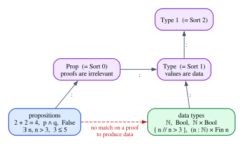

# The Curry–Howard Correspondence

In Chapter 1 we read the type of a small Rust function as a sentence of logic:
`fn swap<A, B>((a, b): (A, B)) -> (B, A)` says "for all $A$ and $B$, if $A$ and
$B$, then $B$ and $A$", and its body is a proof. At the time this was a
promise of things to come. Since then you have seen natural deduction
(Chapter 4), the constructive reading of proofs (Chapter 5), the structural
rules (Chapter 6), the λ-calculus and its simply typed version (Chapters 7 and
8), and a complete proof that well-typed programs do not get stuck (Chapter 9).
We now have everything we need to make the promise precise.

The **Curry–Howard correspondence** says that the typing rules of the simply
typed λ-calculus and the rules of intuitionistic natural deduction are the same
rules. Erase the terms from a typing derivation and you get a proof; decorate a
proof with terms and you get a program. Propositions are types, proofs are
programs, and simplifying a proof is running a program. This chapter works out
the dictionary connective by connective, in logic, in Rust and in Lean, and then
looks hard at where the dictionary breaks down. Rust turns out to be an
*inconsistent* logic, in which every proposition has a proof, and also a logic
that refuses to use a hypothesis twice. Lean is consistent, and it separates
propositions from data in a way that has surprising consequences: a proof that
a number exists does not let you compute the number.

**In this chapter you will learn:**

- the Curry–Howard dictionary: implication, conjunction, disjunction, truth,
  falsity, negation and the quantifiers, as types in Rust and Lean;
- why normalizing a proof is evaluating a program, and why that makes a
  terminating language a consistent logic;
- why Rust is inconsistent as a logic (`loop {}`, `panic!`, `todo!`), how Lean
  stays consistent (totality, `partial`, `sorry` and `#print axioms`), and where
  Rust makes the logic *more* honest than Lean: contraction needs `Clone`;
- the difference between `Prop` and `Type`, proof irrelevance, and the
  impredicativity of `Prop`;
- `Exists`, `Subtype`, `PSigma` and `Sigma`, and why the witness of an
  existential cannot be extracted into data;
- `theorem` versus `def`, `Nat.le` as an inductive family, and how to see the
  term behind a tactic proof.

## Erase the terms

Put two rules next to each other: implication introduction from natural
deduction (Chapter 4), written with a context, and rule T-Lam of the simply
typed λ-calculus (Chapter 8).

$$
\dfrac{\Gamma,\, A \vdash B}{\Gamma \vdash A \to B}\;{\to}\mathrm{I}
\qquad\qquad
\dfrac{\Gamma,\, x : A \vdash t : B}{\Gamma \vdash \lambda x.\,t : A \to B}\;\textsf{T-Lam}
$$

The right-hand rule is the left-hand rule with terms attached. Erase the
variable name $x$ and the terms $t$ and $\lambda x.\,t$, and what remains is
${\to}\mathrm{I}$ exactly: to prove $A \to B$, assume $A$ and prove $B$. Now
application and modus ponens:

$$
\dfrac{\Gamma \vdash A \to B \qquad \Gamma \vdash A}{\Gamma \vdash B}\;{\to}\mathrm{E}
\qquad\qquad
\dfrac{\Gamma \vdash f : A \to B \qquad \Gamma \vdash a : A}{\Gamma \vdash f\,a : B}\;\textsf{T-App}
$$

Again the same rule, with and without terms. And pairs:

$$
\dfrac{\Gamma \vdash A \qquad \Gamma \vdash B}{\Gamma \vdash A \land B}\;{\land}\mathrm{I}
\qquad
\dfrac{\Gamma \vdash a : A \qquad \Gamma \vdash b : B}{\Gamma \vdash (a, b) : A \times B}\;\textsf{T-Pair}
$$

$$
\dfrac{\Gamma \vdash A \land B}{\Gamma \vdash A}\;{\land}\mathrm{E}_1
\qquad
\dfrac{\Gamma \vdash p : A \times B}{\Gamma \vdash \mathsf{fst}\,p : A}\;\textsf{T-Fst}
$$

The pattern continues through every rule of the simply typed λ-calculus with
pairs, sums, unit and the empty type: the introduction rules of a connective are
the constructors of a type, and its elimination rules are the ways of using a
value of that type. The precise statement has two halves.

1. **Erasure.** If $\Gamma \vdash t : \tau$ is derivable in the simply typed
   λ-calculus, then $|\Gamma| \vdash \tau$ is derivable in intuitionistic
   natural deduction, where $|\Gamma|$ forgets the variable names and the type
   formers are read as connectives ($\times$ as $\land$, $+$ as $\lor$, and so
   on).
2. **Decoration.** Conversely, every natural-deduction derivation of
   $|\Gamma| \vdash \tau$ can be decorated with terms to give a typing
   derivation, and different derivations give different terms.

So a proof *is* a term, recorded in the shape of its derivation, and a term
*is* a proof. Haskell Curry noticed the correspondence for combinatory logic and
implication in the 1930s; William Howard extended it to natural deduction and
the λ-calculus in a manuscript written in 1969 (and published in 1980), which
gave the correspondence its second name. Since then it has grown far beyond
propositional logic: Lean itself, with its dependent types, is a direct
descendant.

Each reading illuminates the other. A logically unsound rule, such as Prior's
`tonk` from Chapter 4, corresponds to a type former whose elimination does not
match its introduction, and for programs that use it preservation fails. A proof that uses a hypothesis twice corresponds to a program that uses a
variable twice. That last fact will matter a great deal in Rust.

## The dictionary

| Logic | Type theory | Rust | Lean |
|---|---|---|---|
| $A \land B$ | $A \times B$ | `(A, B)` | `p ∧ q`, `α × β` |
| $A \lor B$ | $A + B$ | `enum Either<A, B>` | `p ∨ q`, `α ⊕ β` |
| $A \to B$ | $A \to B$ | `impl FnOnce(A) -> B` | `p → q`, `α → β` |
| $\top$ | $\mathbf{1}$ | `()` | `True`, `Unit` |
| $\bot$ | $\mathbf{0}$ | `enum Void {}` | `False`, `Empty` |
| $\neg A$ | $A \to \mathbf{0}$ | `impl FnOnce(A) -> Void` | `¬p` |
| $\forall x.\,P(x)$ | $\Pi$-type | generics, over types only | `∀ x, P x` |
| $\exists x.\,P(x)$ | $\Sigma$-type | `impl Trait`, over types only | `∃ x, P x` |

The Lean column has two entries in most rows, because Lean keeps two parallel
versions of every connective: one for propositions (`∧`, `∨`, `True`, `False`)
and one for data (`×`, `⊕`, `Unit`, `Empty`). The reason for the split is the
subject of the second half of this chapter; for now, treat them as twins.

The Rust code of this chapter is in `code/rust/examples/ch10_proofs_as_programs.rs`
and the Lean code in `code/lean/Book/Ch10/Dictionary.lean` and
`code/lean/Book/Ch10/PropVsType.lean`. We go through the dictionary one row at a
time.

### The connectives in Rust

Rust already has pairs, functions and the unit type. For disjunction and
falsity we define our own types, as in Chapter 5:

```rust
{{#include ../../code/rust/examples/ch10_proofs_as_programs.rs:connectives}}
```

**Conjunction** is the pair. Its introduction rule builds a pair, its
elimination rules project out a component, and commutativity is the swap of
Chapter 1:

```rust
{{#include ../../code/rust/examples/ch10_proofs_as_programs.rs:conjunction}}
```

**Disjunction** is the tagged union. Introduction picks a side and attaches the
tag; elimination is a `match`, which needs one branch for each side, exactly as
${\lor}\mathrm{E}$ needs a proof of $C$ from $A$ and a proof of $C$ from $B$.
Chapter 4 called ${\lor}\mathrm{E}$ strange; in Rust it is the most familiar
thing in the world.

```rust
{{#include ../../code/rust/examples/ch10_proofs_as_programs.rs:disjunction}}
```

Notice that `or_comm` passes the tuple-variant constructors `Either::Right` and
`Either::Left` as functions: an enum constructor *is* an introduction rule, and
Rust lets you use it as an ordinary function.

**Implication** is the function type. Modus ponens is a call, the hypothetical
syllogism is composition, and the curried and uncurried forms of a two-premise
implication are interchangeable:

```rust
{{#include ../../code/rust/examples/ch10_proofs_as_programs.rs:implication}}
```

We use `FnOnce` for implications, the most permissive of Rust's closure traits:
a proof of $A \to B$ may be used once, to turn one proof of $A$ into one proof
of $B$. That choice will come back when we discuss contraction. (Writing
currying in the other direction, from `(A, B) -> C` to a function returning a
function, runs into a limitation of Rust: `impl Trait` is not allowed in the
return type of an `Fn` bound, error E0562, so the nested closure needs a `Box`.
Chapter 8 discussed the cost of currying in Rust.)

**Truth, falsity and negation.** Truth is the unit type: a proof of $\top$
carries no information, and `()` is the one value that carries none. Falsity is
a type with no values. Negation $\neg A$ is $A \to \bot$, a function that
would turn a proof of $A$ into a proof of falsity, which is to say, a
refutation of $A$:

```rust
{{#include ../../code/rust/examples/ch10_proofs_as_programs.rs:negation}}
```

`ex_falso` is the rule ${\bot}\mathrm{E}$: from falsity, anything. Its body is a
`match` with *no arms*. A `match` must cover every value of the scrutinee's
type, `Void` has no values, so zero arms cover them all, and the match can be
given any type at all. This is the same reasoning that lets the never type `!`
coerce to every type (Chapter 1): code that has a value of an empty type is
code that can never run.

Here is what the positive part of the dictionary does when it runs:

```rust
{{#include ../../code/rust/examples/ch10_proofs_as_programs.rs:main_dictionary}}
```

```text
{{#include ../../code/rust/output/ch10_proofs_as_programs.txt:1:10}}
```

The negation proofs are not in the output, and cannot be. To call a refutation
of $A$ you need a proof of $A$, and then the refutation would return a value of
type `Void`, which does not exist. Those functions are checked by the compiler
and never run. That is the essence of propositions as types: *type checking is
proof checking*, and running the program is beside the point. (It is not beside
the point for the positive connectives, as the next section shows.)

### The connectives in Lean

In Lean the same proofs are written as terms, and Lean's syntax makes them
shorter. `⟨hp, hq⟩` is the anonymous constructor (here, of `And`), `fun ⟨hp, hq⟩
=> ...` takes a pair apart in its argument, and `.inl`/`.inr` are the two
constructors of `Or`. The theorem and its twin on data are the same program:

```lean
{{#include ../../code/lean/Book/Ch10/Dictionary.lean:conjunction}}
```

```lean
{{#include ../../code/lean/Book/Ch10/Dictionary.lean:conjunction_check}}
```

The file starts with `variable (p q r : Prop)` and `variable (α β γ : Type)`,
which add these parameters to every declaration that mentions them; that is why
`#check` shows `and_swap` taking `p` and `q`. Compare the two signatures: one
says `Prop` and `∧`, the other `Type` and `×`, and the bodies are identical.
The same holds for disjunction, where the elimination rule is a `match`:

```lean
{{#include ../../code/lean/Book/Ch10/Dictionary.lean:disjunction}}
```

and for implication, where every proof is a λ-term:

```lean
{{#include ../../code/lean/Book/Ch10/Dictionary.lean:implication}}
```

`curry_iff` proves an equivalence, and an equivalence `↔` is a pair of
implications, built with the anonymous constructor like any other pair. The two
directions are the functions `curry` and `uncurry`.

For negation, Lean *defines* `¬p` as `p → False`, and the definitional equation
is checked by `rfl`:

```lean
{{#include ../../code/lean/Book/Ch10/Dictionary.lean:negation}}
```

`nomatch h` is Lean's `match h {}`: a match with no cases on a value of an
empty type. `False` is an inductive proposition with no constructors, `Empty` an
inductive type with no constructors, and `nomatch` works for both.

## Quantifiers

The propositional connectives are where Rust and Lean agree. With the
quantifiers they part ways, because a quantifier ranges over something, and the
two languages disagree about what types may mention.

### Universal quantification is a dependent function

In Lean, a proof of $\forall n : \mathbb{N},\ n + 0 = n$ is a function that
takes a number $n$ and returns a proof about *that* $n$:

```lean
{{#include ../../code/lean/Book/Ch10/Dictionary.lean:forall}}
```

The type of the result, `n + 0 = n`, mentions the argument `n`. A function whose
result type depends on the value of its argument is a **dependent function**,
and its type is called a $\Pi$-type. Applying it to `5` gives a proof of
`5 + 0 = 5`, as `#check` shows. When the bound variable ranges over types
instead of values, as in `identity`, the dependent function is a generic
function; when it ranges over propositions, as in `self_implication`, it is a
proof that works for every proposition. In Lean these are three uses of one
construct.

Rust has the second one and not the first. A generic function
`fn identity<A>(a: A) -> A` is a proof of $\forall A.\,A \to A$, quantifying
over types (Chapter 12 studies this as System F):

```rust
{{#include ../../code/rust/examples/ch10_proofs_as_programs.rs:generics}}
```

But a Rust type cannot mention a run-time value. There is no Rust type that
says "a `u32` equal to `n + 0`" for an argument `n`, and therefore no Rust
function whose type is the theorem $\forall n.\,n + 0 = n$. Const generics
(`[T; N]`) allow a few compile-time values in types, and Chapter 30 shows how
far that goes, but they cannot express properties of the values a program
computes. In the dictionary, Rust's quantifiers range over types only.

### Existential quantification is a dependent pair

A proof of $\exists n,\ n > 100$ is a pair: a witness, and a proof that the
witness has the property. The type of the second component depends on the value
of the first, which makes this a **dependent pair**, a $\Sigma$-type:

```lean
{{#include ../../code/lean/Book/Ch10/Dictionary.lean:exists}}
```

To use an existential, you take the pair apart (`obtain ⟨n, hn⟩ := h`, as in
Chapter 4) and use the witness and its property. Here we build a new witness,
`n + 1`, and `omega` proves that it is greater than 101.

Rust's closest relative is `impl Trait` in return position. The signature of
`some_displayable` above says "there exists a type `T` such that `T: Display`,
and here is a value of it". The caller cannot see the witness type (it happens
to be `u32`), only the promised property. Chapter 15 studies this in depth. As
with $\forall$, Rust's $\exists$ ranges over types, never over values.

## Normalization is computation

Chapter 4 introduced the idea of a **detour** in a proof: an introduction rule
immediately followed by the elimination rule of the same connective. Proving
$A \land B$ by ${\land}\mathrm{I}$ and then using ${\land}\mathrm{E}_1$ to get
$A$ back is a detour; the proof of $A$ we started from would have done. Chapter 4
showed that every detour can be removed (local soundness, or harmony), and that
repeatedly removing detours *normalizes* a proof.

Under Curry–Howard, a detour is a **redex**. ${\land}\mathrm{I}$ followed by
${\land}\mathrm{E}_1$ is $\mathsf{fst}\,(a, b)$, which reduces to $a$.
${\to}\mathrm{I}$ followed by ${\to}\mathrm{E}$ is $(\lambda x.\,t)\,a$, which
β-reduces to $t[a]$. Removing a detour is taking a step of computation, and
normalizing a proof is running a program to its normal form:

```lean
{{#include ../../code/lean/Book/Ch10/Dictionary.lean:detour}}
```

`#reduce` normalizes a term, and it turns `detour` into the identity function:
the β-redex and the projection are gone. In Rust, `(|pair: (A, A)| pair.0)((a, a))`
is the same detour, and the optimizer typically removes it when it inlines the
closure call. (We do not `#reduce` the proof `detour_proof`: Lean does not
unfold theorems, for reasons that the section on `Prop` will make clear.)

This connection has a deep consequence. Suppose a language has an empty type
$\mathbf{0}$, and suppose every closed term has a normal form. Could there be a
closed term $t : \mathbf{0}$? Normalize it: by preservation (Chapter 9), the
normal form still has type $\mathbf{0}$; by progress, a closed normal form is a
value; and by canonical forms, there are no values of type $\mathbf{0}$, since
the empty type has no introduction rule. So there is no such $t$. Read as logic:
there is no proof of $\bot$. **A terminating, type-safe language is a consistent
logic.** The argument uses exactly the three ingredients of Chapter 9, plus
termination, and termination is the one that real programming languages give
up.

## Rust is inconsistent as a logic

Here are proofs, in Rust, of every proposition there is:

```rust
{{#include ../../code/rust/examples/ch10_proofs_as_programs.rs:inconsistent}}
```

Each function claims, for every type `A`, to produce a value of type `A`, and
each one type-checks. `loop {}` and `panic!` have the never type `!`, which
coerces to `A` (Chapter 1); `todo!()` is a `panic!` with a standard message;
`by_recursion` calls itself forever. The compiler does notice the last one and
emits the `unconditional_recursion` warning, but a warning is a lint, not a
rejection, and the `#[allow(...)]` attribute silences it. (The `dead_code`
attributes only silence warnings about functions that the example never calls.)
And `proof_of_false` returns a `Void`, a value of a type that has no values: a
proof of $\bot$, accepted by the compiler.

None of these functions ever returns. When you run one, the "proof" turns out
to be empty:

```rust
{{#include ../../code/rust/examples/ch10_proofs_as_programs.rs:main_inconsistent}}
```

```text
{{#include ../../code/rust/output/ch10_proofs_as_programs.txt:13:13}}
```

So as a logic, Rust is **inconsistent**: every proposition, including $\bot$,
has a proof. This is not a design mistake. A general-purpose language needs
unbounded loops and recursion (a server runs forever by design), and it needs a
way to give up (`panic!`). Both break the termination half of the argument in
the previous section, and with it consistency.

What survives is a weaker, still useful principle: *a total function is an
honest proof*. If you know that a function always returns (no `panic!`, no
infinite loop, no call to something that might do either), then its type is a
true theorem, and its body is a proof. When we read Rust signatures as theorems
in this book, that is the understanding: the reading is valid for the total
part of the language. A well-known paper on Haskell, which has the same issue,
put this in its title: "Fast and Loose Reasoning is Morally Correct" (2006).

## Lean is consistent

Lean accepts none of the four tricks. A recursive definition must be seen to
terminate. Here is `by_recursion` in Lean:

```lean
{{#include ../../code/lean/Book/Ch10/Dictionary.lean:no_loop}}
```

Lean tries two ways of justifying the recursion, as Chapter 2 explained:
structural recursion (some argument gets smaller at each call), which fails
because `p` is passed unchanged, and well-founded recursion (some measure
decreases), which fails because there are no arguments that could decrease. So
the definition is rejected.

Lean does have an escape hatch for programs that may not terminate: `partial`.
But `partial` comes with a condition that makes it harmless for logic:

```lean
{{#include ../../code/lean/Book/Ch10/Dictionary.lean:partial}}
```

A `partial` definition is compiled and can run forever, but in the logic it is
an `opaque` constant: Lean knows its type and nothing about its body, so no
theorem can be proved by unfolding it. And Lean accepts a `partial` definition
only if it can show that its type is nonempty, so that an arbitrary value of
that type could stand in for the loop. `spin` returns a `ℕ`, which has values;
`loopProof` would return a proof of `False`, which has none, and the error
message lists the strategies Lean tried to find one. So `partial` can never
create a proof of something that had no proof before.

What about `sorry`? It is Lean's `todo!()`: a placeholder that has every type.
Lean accepts it, but warns, and remembers:

```lean
{{#include ../../code/lean/Book/Ch10/Dictionary.lean:sorry}}
```

`#print axioms` shows that `cheat` depends on `sorryAx`, the axiom behind
`sorry`, and that axiom propagates to everything that uses `cheat`. A theorem
whose `#print axioms` list does not contain `sorryAx` does not depend on any
`sorry`, however deep in the library. Our `de_morgan` depends on no axioms at
all. (Lean's standard axioms, `propext`, `Quot.sound` and `Classical.choice`,
which you met in Chapter 1, are believed to be consistent with its type theory;
`sorryAx` is not, which is exactly why it is tracked.) This is how a proof
assistant can be both a programming language and a trustworthy logic: the
language may contain non-terminating programs and placeholders, but the kernel
keeps track of which theorems they could have touched.

## Contraction: where Rust makes the logic honest

So far Rust has been the less faithful of the two languages. In one respect it
is the more faithful one, or at least the more revealing.

In Lean, a hypothesis can be used as many times as you like:

```lean
{{#include ../../code/lean/Book/Ch10/Dictionary.lean:contraction}}
```

In `de_morgan`, the hypothesis `h` (a refutation of $p \lor q$) is used twice,
once to refute $p$ and once to refute $q$. In `dup`, `hp` is used twice to
build a pair. Neither use needs any comment: as Chapter 6 explained, ordinary
logic has the structural rule of **contraction**, which lets an assumption be
used any number of times, and Lean's type theory has it built in.

Now write `dup` in Rust, for an arbitrary type `A`:

```rust
{{#include ../../code/rust/compile_fail/ch10_contraction.rs:dup}}
```

```text
{{#include ../../code/rust/compile_fail/ch10_contraction.stderr}}
```

The value `a` is moved into the first component of the pair, and then it is
gone. For an arbitrary type, Rust has no contraction. The compiler's two
suggestions are the two ways of buying it back: require `A: Clone`, and
duplicate the value explicitly with `.clone()`, or require `A: Copy`, and let
the compiler duplicate it implicitly. The working `dup` in the example asks for
`Clone`.

De Morgan's law shows the same thing in a less artificial setting. The proof
needs its hypothesis twice, so the Rust version fails in the same way:

```rust
{{#include ../../code/rust/compile_fail/ch10_de_morgan.rs:de_morgan}}
```

```text
{{#include ../../code/rust/compile_fail/ch10_de_morgan.stderr}}
```

The first closure captures `n` by move (that is what `move` means), and the
second closure has nothing left to capture. The fix in the example asks for
`N: Clone` and makes the duplication visible:

```rust
{{#include ../../code/rust/examples/ch10_proofs_as_programs.rs:contraction}}
```

The line `let n2 = n.clone();` is contraction, written out. Where Lean's
logic duplicates hypotheses silently, Rust makes you say so, and only lets you
when the type supports it. Many types do: integers, shared references `&T` and
function pointers are `Copy`, a closure is `Copy` when everything it captures
is, and most library types are `Clone`. But a `String`, a file handle or a
`Vec` cannot be duplicated for free, and an arbitrary generic `A` cannot be
duplicated at all.

Weakening, the other structural rule, is still available in Rust: you may
ignore a value, and it is dropped. Exchange is available too: the order in
which you use variables does not matter to the type checker. A logic with
weakening and exchange but without contraction is called **affine**. So the
proofs that Rust's generic functions can express, for arbitrary types, are the
proofs of an affine logic, and `Clone` and `Copy` are the controlled way back
to ordinary logic. This is the first piece of evidence for the question of
Chapter 1. Part V builds the affine λ-calculus and makes the connection
precise; Chapter 23 shows that `Copy` and `Clone` behave like the exponential
modality $!A$ of linear logic.

## `Prop` and `Type`

We now turn to the Lean side of the dictionary, and to the question we
postponed: why does Lean have two versions of every connective?

### Two universes

Every Lean type lives in a **universe**, a type of types. Propositions live in
`Prop`, data types in `Type`:

```lean
{{#include ../../code/lean/Book/Ch10/PropVsType.lean:universes}}
```

`Prop` and `Type` are themselves types, and they live in bigger universes:
`Prop : Type` and `Type : Type 1`, and so on upward (`Type 1 : Type 2`, ...). In
Lean's own notation, `Prop` is `Sort 0` and `Type` is `Sort 1`. Chapter 12
studies universes and why the hierarchy never stops; here we only need the
bottom two levels.



The difference between the two is not what you can *write*: `p ∧ q` and
`α × β` are built in the same way. It is what the elements *mean*. An element of
a type in `Type` is a piece of data, which a program can inspect and compute
with. An element of a proposition is a proof, and Lean treats all proofs of the
same proposition as equal.

### Proof irrelevance

Chapter 5 contrasted `Bool`, a data type with two values that a program can
branch on, with `Prop`, the type of statements. Here is the deepest difference
between them:

```lean
{{#include ../../code/lean/Book/Ch10/PropVsType.lean:bool_vs_prop}}
```

`true ≠ false` holds for booleans. But for any proposition `p`, any two proofs
`h₁ h₂ : p` are equal, and `rfl` proves it: they are equal *by definition*,
without any argument. This is **definitional proof irrelevance**, and it is a
rule of Lean's type theory. Two proofs built in completely different ways are
the same proof:

```lean
{{#include ../../code/lean/Book/Ch10/PropVsType.lean:irrelevance_example}}
```

Proof irrelevance says that the *existence* of a proof is all that matters,
not its identity. It has several practical consequences. Lean's compiler erases
proofs: they cost nothing at run time, much as a zero-sized type costs nothing
in Rust. The kernel never needs to look inside a proof to compare it with
another, which is why `#reduce` leaves theorems alone, and why `theorem` and
`def` are different commands (more on that below). And, as we will see shortly, it forbids certain programs.

### Impredicativity

One more difference between the two universes concerns quantification:

```lean
{{#include ../../code/lean/Book/Ch10/PropVsType.lean:impredicative}}
```

A proposition that quantifies over *all propositions*, including itself, is
still a proposition: `∀ p : Prop, p → p` is in `Prop`. This is called
**impredicativity**. A type that quantifies over all types is not a type in
`Type`; it lands one universe up, in `Type 1`. `Type` is **predicative**. The
asymmetry is deliberate. Universes of data that quantify over themselves are
dangerous (the extreme case, `Type : Type`, is inconsistent, a result known as
Girard's paradox), while an impredicative `Prop` is safe in Lean's type theory,
thanks in part to proof irrelevance and to the elimination restriction of the
next section. Impredicativity is what lets
you state theorems such as "for every proposition $p$, ..." without climbing the
universe hierarchy, and it is the corner of Lean where System F's polymorphism
(Chapter 12) survives unchanged.

## Exists, Subtype and Sigma

There are four ways in Lean to pair a value with something about it, and the
differences between them are the clearest illustration of `Prop` versus `Type`:

```lean
{{#include ../../code/lean/Book/Ch10/PropVsType.lean:pairs}}
```

| Type | Lives in | First component | Second component |
|---|---|---|---|
| `∃ n, P n` | `Prop` | a value (hidden) | a proof |
| `{n // P n}` (`Subtype`) | `Type` | a value | a proof |
| `(n : ℕ) ×' P n` (`PSigma`) | `Type` | a value | a proof (or data) |
| `(n : ℕ) × Fin n` (`Sigma`) | `Type` | a value | data |

`Exists` is a proposition: a proof that some suitable `n` exists. `Subtype`
(written `{n // P n}`) is a data type whose elements are numbers that carry a
proof of `P`: the refinement types of other languages, and the type of "values
with an invariant". `PSigma` (`×'`) is the general dependent pair that may hold
a proof or data in either component, and `Sigma` (`×`) is the dependent pair of
data, such as a length together with an index below it.

The elements of a `Subtype` are data, and their values can be computed with:

```lean
{{#include ../../code/lean/Book/Ch10/PropVsType.lean:subtype}}
```

Two elements of a subtype are equal as soon as their values are, by
`Subtype.ext`: the proofs never get in the way, because they are all equal.

Rust has no way to attach a proof to a value, but it has a common idiom that
plays the same role: a **newtype with a private field**, whose only constructor
establishes the invariant.

```rust
{{#include ../../code/rust/examples/ch10_proofs_as_programs.rs:subtype}}
```

```text
{{#include ../../code/rust/output/ch10_proofs_as_programs.txt:11:12}}
```

Code outside the module can only obtain a `Sorted` from `Sorted::new`, which
sorts, so every `Sorted` holds a sorted vector, and `min` can rely on that. The
difference from Lean is where the proof lives. In Lean, the proof is part of the
value and the kernel checks it. In Rust, the "proof" is the code of the module,
and a reviewer checks it. Chapter 30 returns to this idiom, under the name
"parse, don't validate".

### The elimination restriction

Now try to write the most natural function in the world: given a proof that a
number greater than 3 exists, return the number.

```lean
{{#include ../../code/lean/Book/Ch10/PropVsType.lean:no_witness}}
```

Lean refuses. The projection `h.1` would turn a proof (an element of a type in
`Prop`) into data (a number, in `Type`), and Lean does not allow that. If you
try with a `match` instead, the error is longer but says the same thing at its
core: "recursor `Exists.casesOn` can only eliminate into `Prop`". This is the
**elimination restriction**: a proof of a proposition can be taken apart only to
build another proof.

Proof irrelevance explains why the restriction is necessary:

```lean
{{#include ../../code/lean/Book/Ch10/PropVsType.lean:why_restriction}}
```

`proofWith4` and `proofWith5` have different witnesses, and yet they are equal,
because they are proofs of the same proposition. If `witness` existed, it would
map these two equal arguments to 4 and to 5. A function that gives different
results on equal arguments is not a function, and the logic would be
inconsistent. So Lean must choose between proof irrelevance and extracting
witnesses, and it chooses irrelevance.

Inside a proof, on the other hand, you may take an existential apart freely,
because the result is again a proof and the witness cannot leak into data:

```lean
{{#include ../../code/lean/Book/Ch10/PropVsType.lean:inside_proofs}}
```

That is what `obtain` and `rcases` have been doing all along. There are also
exceptions in the other direction. A proposition with at most one constructor,
whose fields are all proofs themselves (or appear among its indices, as in
`Eq`), carries no information beyond the fact that it holds, and it may be
eliminated into data.
`False` (no constructors) and `And` (one constructor with two proof fields)
qualify; `Exists` (whose constructor has a data field, the witness) and `Or`
(two constructors) do not.

```lean
{{#include ../../code/lean/Book/Ch10/PropVsType.lean:small_elim}}
```

And if you really need the witness, there are two escape hatches, with very
different characters:

```lean
{{#include ../../code/lean/Book/Ch10/PropVsType.lean:escape_hatches}}
```

`Classical.choose` picks *some* witness, and `Classical.choose_spec` guarantees
that it has the property. But it is an axiom, not a program: the definition must
be marked `noncomputable`, and `#eval` on it fails. `Nat.find` (from Mathlib) is
a program: for a property of natural numbers that a program can decide, it
searches $0, 1, 2, \dots$ and returns the first number that has it. The proof of
existence is used only to guarantee that the search terminates. Notice that
`firstAbove3` was given `proofWith5`, a proof built from the witness 5, and
returns 4: `Nat.find` cannot see the witness inside the proof (nothing can), and
it does not need to.

This is the constructive content of Chapter 5, seen from a new angle. A
constructive proof of $\exists n.\,P(n)$ does contain a witness, and in Lean you
can get at it inside proofs. But a *program* that needs the witness should ask
for a `Subtype` or a `Sigma` instead, which carry the witness as data. Choosing
between `∃ n, P n` and `{n // P n}` is choosing between a fact and a piece of
data.

## `theorem` versus `def`

Lean has two commands for named declarations, and the difference follows from
everything above:

```lean
{{#include ../../code/lean/Book/Ch10/PropVsType.lean:theorem_vs_def}}
```

A `theorem` must have a proposition as its type: its body is a proof, and by
proof irrelevance Lean never needs to look at it again. Lean treats theorem
bodies as opaque for computation, which keeps the kernel fast (it never unfolds
a long proof). A `def` defines data, whose value matters and is unfolded when
needed. Lean accepts a `def` whose type is a
proposition, but a linter (a style check, like Clippy's) points out that
`theorem` is the right command. The rule of thumb: `theorem` for propositions,
`def` for everything else, `example` for anonymous checks.

## An inductive family: `Nat.le`

Propositions in Lean are usually not built from the connectives alone. Most
interesting ones are **inductive families**, inductive types indexed by values,
just like the `HasType` and `Step` relations of Chapter 9. Lean's own `≤` on
natural numbers is one:

```lean
{{#include ../../code/lean/Book/Ch10/PropVsType.lean:nat_le}}
```

`#print` shows the definition: `Nat.le n` is a family of propositions indexed
by a second number, with two constructors. `refl` proves `n ≤ n`, and `step`
turns a proof of `n ≤ m` into a proof of `n ≤ m + 1` (`m.succ` is `m + 1`; the
`number of parameters: 1` line says that `n` is a fixed parameter while the
second number varies). So a proof of `3 ≤ 5` is literally a chain of two `step`s
on top of a `refl`: a derivation, and a natural number in unary, at the same
time. In the other direction, `cases` shows that `5 ≤ 3` has no proof: the only
constructor that can conclude `5 ≤ 3` is `step`, which needs `5 ≤ 2`, which
needs `5 ≤ 1`, which needs `5 ≤ 0`, and no constructor concludes that. Each
`cases h with | step h => ...` peels one constructor off.

This is the Curry–Howard view of a judgment: a relation defined by rules is an
inductive family, a derivation is an element of it, and induction on
derivations is recursion over that element. Every inductive relation in this
book (`HasType`, `Step`, `Steps`, the natural-deduction `Proves` of Chapter 4)
works this way.

## The term behind a tactic proof

Tactic proofs look different from term proofs, but by Curry–Howard there is
only one kind of proof: a term. Tactics are a way of *building* the term, and
`#print` shows the result (Chapter 4 did this for a first example):

```lean
{{#include ../../code/lean/Book/Ch10/PropVsType.lean:print_tactic}}
```

The three tactics became a three-part term. `intro h` became `fun p q h =>` (the
binders for `p` and `q` come from the statement), `obtain ⟨hp, hq⟩ := h` became
`And.casesOn h fun hp hq => ...`, which is ${\land}\mathrm{E}$ in its most
general form (a function that receives both components), and
`exact ⟨hq, hp⟩` became the anonymous constructor, ${\land}\mathrm{I}$. Up to
the spelling of the elimination, it is the term we wrote by hand for
`and_swap`.

## Putting it together: one law, three proofs

Let us follow one theorem through all three languages: De Morgan's law
$\neg(A \lor B) \to \neg A \land \neg B$, which is valid in intuitionistic
logic (unlike its dual $\neg(A \land B) \to \neg A \lor \neg B$, which needs
excluded middle, as Chapter 5 explained).

**In logic.** Assume $h : \neg(A \lor B)$ and call that context $\Gamma$. To
refute $A$, assume $a : A$; then $\mathsf{inl}\,a$ proves $A \lor B$, and $h$
applied to it proves $\bot$. Written as a derivation with its terms attached,
this is one half of the proof:

$$
\dfrac{\dfrac{\Gamma, a : A \vdash h : \neg(A \lor B) \qquad \dfrac{\Gamma, a : A \vdash a : A}{\Gamma, a : A \vdash \mathsf{inl}\,a : A \lor B}\;\textsf{T-Inl}}{\Gamma, a : A \vdash h\,(\mathsf{inl}\,a) : \bot}\;\textsf{T-App}}{\Gamma \vdash \lambda a.\,h\,(\mathsf{inl}\,a) : \neg A}\;\textsf{T-Lam}
$$

The other half, $\Gamma \vdash \lambda b.\,h\,(\mathsf{inr}\,b) : \neg B$, is the
same with $\mathsf{inr}$. The pair rule combines them:

$$
\dfrac{\Gamma \vdash \lambda a.\,h\,(\mathsf{inl}\,a) : \neg A \qquad \Gamma \vdash \lambda b.\,h\,(\mathsf{inr}\,b) : \neg B}{\Gamma \vdash (\lambda a.\,h\,(\mathsf{inl}\,a),\ \lambda b.\,h\,(\mathsf{inr}\,b)) : \neg A \land \neg B}\;\textsf{T-Pair}
$$

and a final T-Lam discharges $h$. Erase the terms, and you have the
natural-deduction proof. Look at the T-Pair step: both premises have the full
context $\Gamma$, so the hypothesis $h$ is available to both halves. That is
contraction, hidden in the shape of the rule: the context is *shared* between
the premises, not *split*.

**In Lean.** The term at the root of the derivation is, symbol for symbol, the
proof in `Dictionary.lean`:
`fun h => ⟨fun hp => h (.inl hp), fun hq => h (.inr hq)⟩`. Lean's rule for
pairs shares the context, as in the derivation, and Lean accepts it without
comment. `#print axioms de_morgan` reports no axioms: it is a proof from the
rules alone.

**In Rust.** The same term, transcribed, is the program in
`ch10_de_morgan.rs`, and Rust rejects it with E0382: the refutation `n` is moved
into the first closure and cannot be used by the second. Rust's rule for
building a pair (or a tuple of closures) *splits* the owned values in scope
between the components. To recover the proof, we must pay for the contraction
with `N: Clone` and an explicit `n.clone()`. Once we do, Rust accepts it, and
the proof is valid for every refutation type that can be cloned.

Three languages, one theorem, three verdicts: valid in logic, accepted silently
by Lean, accepted by Rust only after the duplication is made explicit. And if
we had cheated, writing `fn de_morgan_or<A, B, N>(n: N) -> ... { todo!() }`,
Rust would have accepted that too, while Lean would have marked the theorem with
`sorryAx`. The dictionary is real, and so are its exceptions.

## Common confusions

**"Every program is a proof of something interesting."** Every well-typed
program proves its type, but most types are dull theorems. `fn(i32) -> i32` is
"if there is an integer, there is an integer", which `|x| x` already proves.
Curry–Howard is illuminating for generic types (where the program cannot cheat
by inventing values) and for dependent types (where the type can say something
precise), not for `i32 -> i32`.

**"If my Rust code compiles, the theorem is proved."** Only if the code is
total. `panic!`, `todo!`, `loop {}` and unbounded recursion prove anything.

**"`Prop` is Lean's `Bool`."** A `Bool` is a value a program can branch on; a
`Prop` is a type of proofs, which a program cannot inspect at all. Chapter 5
explains when a `Prop` can be turned into a `Bool` (when it is `Decidable`).

**"Lean's `∃` is like `impl Trait`."** Both hide a witness, but `impl Trait`
hides a *type*, which the compiler knows and the caller does not, while Lean's
`∃` hides a *value*, which no program can extract. The analogue of `impl Trait`
in Lean is closer to a structure with a type field (Chapter 15).

**"Proof irrelevance means proofs do not matter."** It means that *which* proof
you have does not matter. *Whether* you have one is the whole point.

**"Rust lacks contraction."** For values of arbitrary type, yes. For `Copy`
types contraction is free and implicit, and for `Clone` types it is available
on request. Rust's logic is affine with a controlled way back, which is what
Part V is about.

## Summary

- Curry–Howard: the typing rules of the simply typed λ-calculus are the rules of
  intuitionistic natural deduction with terms attached. Types are propositions,
  terms are proofs, introduction rules are constructors, elimination rules are
  the ways of using a value.
- The dictionary: $\land$ is the pair, $\lor$ the tagged union, $\to$ the
  function, $\top$ the unit type, $\bot$ the empty type, $\neg A$ a function into
  the empty type, $\forall$ a dependent function and $\exists$ a dependent pair.
  Rust's quantifiers range over types only.
- Removing a detour from a proof is a step of computation. Termination together
  with progress, preservation and canonical forms makes a language a consistent
  logic.
- Rust is inconsistent as a logic: `loop {}`, `panic!`, `todo!` and unbounded
  recursion inhabit every type. Total Rust functions are honest proofs.
- Lean stays consistent: definitions must terminate, `partial` requires a
  nonempty type and is opaque, and `sorry` is tracked by `#print axioms`.
- Rust has no contraction for arbitrary types: $A \to A \land A$ needs `Clone`
  or `Copy`. Its generic functions form an affine logic.
- Lean separates `Prop` (proofs, irrelevant, impredicative, erased) from `Type`
  (data). `Exists` lives in `Prop`; `Subtype`, `PSigma` and `Sigma` in `Type`.
  A proof of `∃` cannot be eliminated into data, because proof irrelevance would
  make such a function inconsistent; use a `Subtype`, `Nat.find`, or
  (noncomputably) `Classical.choose`.
- `theorem` is for propositions, `def` for data. Inductive families such as
  `Nat.le` are relations defined by rules, and tactic proofs build ordinary
  terms, which `#print` shows.

## Exercises

1. Prove $\neg\neg\neg A \to \neg A$ in Lean (as a term) and in Rust (as a
   generic function with `FnOnce` bounds). Is the converse, $\neg A \to
   \neg\neg\neg A$, also provable?
   *Hint:* given `h : ¬¬¬A` and `a : A`, the function `fun na => na a` is a
   proof of `¬¬A`; apply `h` to it. The converse is an instance of
   `double_negation_intro`.

2. Write the curried direction of `curry_iff` in Rust: from
   `impl FnOnce((A, B)) -> C` to a function that takes an `A` and returns a
   function that takes a `B`. First try `impl FnOnce(A) -> impl FnOnce(B) -> C`
   and read the error; then return `Box<dyn FnOnce(B) -> C>`. Which bounds on
   the type parameters does the box need, and why?
   *Hint:* the error is E0562. A `Box<dyn ...>` without a lifetime means
   `+ 'static`, and the boxed closure captures both `f` and `a`.

3. Prove in Lean that `(∃ x, P x) → ¬ ∀ x, ¬ P x`, for `P : α → Prop`. Then
   explain why the converse cannot be proved constructively, using the BHK
   reading of Chapter 5.
   *Hint:* take the existential apart with `obtain`, and apply the universal
   statement to the witness. For the converse, a constructive proof would have
   to produce a witness from a proof that refutes the absence of one.

4. Prove `theorem toExists : {n : ℕ // n > 3} → ∃ n : ℕ, n > 3` in Lean (why
   is it a `theorem`, although it looks like a function?). Then explain, in one
   sentence each, why the function in the other direction cannot be written, and
   why `Nat.find` nevertheless gives you a number from a proof of
   `∃ n : ℕ, n > 3`.
   *Hint:* `fun x => ⟨x.val, x.property⟩`. A function type whose result is a
   proposition is itself a proposition (impredicativity again). Compare what
   `Nat.find` uses from the proof (only that it exists) with what `witness`
   would use.

5. On paper, take the proof of $A \to A$ that goes through a detour,
   $(\lambda p.\,\mathsf{fst}\,p)\,(a, a)$ under a $\lambda a$, write its
   natural-deduction derivation, and normalize it step by step, removing one
   detour at a time. Check your answer against `#reduce detour`.
   *Hint:* there are two detours: ${\to}\mathrm{I}$ followed by ${\to}\mathrm{E}$
   (the β-redex) and then ${\land}\mathrm{I}$ followed by ${\land}\mathrm{E}_1$.

6. In Rust, try to write excluded middle,
   `fn lem<A>() -> Either<A, Box<dyn FnOnce(A) -> Void>>`, without cheating.
   Then write it with `todo!()` and explain what this does and does not show.
   *Hint:* to return `Left` you need an `A` out of nothing; to return `Right`
   you need to refute every `A`, including types that have values. With `todo!()`
   the function compiles, which shows only that Rust is inconsistent.
