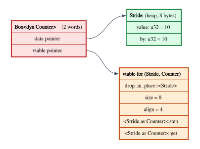

# Existential Types and Dynamic Dispatch

In the last three chapters the *caller* always chose the type. When you call
`mconcat::<Sum>`, or let the compiler infer the type for you, you pick one
instance of a polymorphic function and use it. The function promises to work
for every type you might pick; that is what $\forall$ means.

Often the roles are reversed. A function that builds an iterator chain wants to
return it without naming its type, which may be impossible to write down
anyway, since closures have anonymous types. A configuration file decides at run
time which of several drivers a program uses, and the program wants to keep
them all in one `Vec`. A library wants to hide how its data is represented, so
that it can change the representation later. In each case the *callee* (or the
implementer) chooses the type, and the caller is told only what it can do with
it. This is the other quantifier, $\exists$: "there is some type, and here is
what you may do with its values".

Existential types are the theory behind Rust's `impl Trait` in return position
and `dyn Trait`, behind abstract data types and module systems, and behind the
vtables that make dynamic dispatch work. They also explain an error message
that puzzles many Rust programmers, the one about traits that are not "dyn
compatible".

**In this chapter you will learn:**

- the existential type $\exists\alpha.\,\tau$, its pack and unpack rules, and
  why a side condition on the unpack rule is what makes a type abstract;
- why abstract data types have existential type (Mitchell and Plotkin), and how
  this relates to modules and information hiding;
- the three places a quantifier can go in Rust (generics, `impl Trait` in
  return position, `dyn Trait`), who chooses the type in each, and when;
- what a `dyn Trait` value is in memory, measured with `size_of`: a fat pointer
  to the value and its vtable;
- why some traits cannot be used with `dyn` (E0038), explained from the typing
  rules;
- `dyn Any` and downcasting: an existential that can be opened, and what that
  costs;
- how to encode $\exists$ with $\forall$, in Rust and in Lean, and why a Lean
  structure with a type field lives in `Type 1`.

## Hiding a type

### Who chooses

A universally quantified type $\forall\alpha.\,\tau$ is a promise made by the
*implementer* of a function to its *caller*: "whatever type you choose for
$\alpha$, I will work". The caller chooses, the implementer must cope with any
choice. An existentially quantified type $\exists\alpha.\,\tau$ reverses the
roles: "I have chosen some type $\alpha$, and I give you a $\tau$ that mentions
it; you must cope with whatever I chose". The implementer chooses, and the
client must work without knowing the choice.

Chapter 10 met the logical side of this: a proof of $\exists x.\,P(x)$ consists
of a witness $a$ and a proof of $P(a)$. In Lean it has two incarnations, the
proposition `∃ x, P x` and dependent pairs such as `{ x // P x }`, which are
data. An existential *type* is the same idea one level up: the witness is a
type.

### Pack and unpack

Let us extend the types of System F (Chapter 12) with existentials:

$$
\tau ::= \dots \mid \exists\alpha.\,\tau
$$

The introduction form **packs** a type together with a value; the elimination
form **unpacks** a package and gives the client a name for the hidden type and a
name for the value:

$$
\dfrac{\Gamma \vdash e : \tau[\alpha := \sigma]}{\Gamma \vdash \mathsf{pack}\ \langle \sigma, e \rangle\ \mathsf{as}\ \exists\alpha.\,\tau : \exists\alpha.\,\tau}\;\textsf{T-Pack}
$$

$$
\dfrac{\Gamma \vdash e_1 : \exists\alpha.\,\tau \qquad \Gamma,\, \alpha,\, x : \tau \vdash e_2 : \rho \qquad \alpha \notin \mathrm{ftv}(\rho)}{\Gamma \vdash \mathsf{unpack}\ \langle \alpha, x \rangle = e_1\ \mathsf{in}\ e_2 : \rho}\;\textsf{T-Unpack}
$$

Rule T-Pack says: if $e$ has the type $\tau$ with the *concrete* type $\sigma$
in place of $\alpha$, then you may package $\sigma$ and $e$ together and forget
that the type was $\sigma$. The resulting type, $\exists\alpha.\,\tau$, no longer
mentions $\sigma$; many different packages, with different hidden types, have
this same type.

Rule T-Unpack is the interesting one. To use a package $e_1$, you write a client
$e_2$ that must type-check with a *fresh* type variable $\alpha$ in the context
and a variable $x$ of type $\tau$. Since $\alpha$ is a variable, the client
cannot assume anything about it: it is not `u32`, not `String`, not anything in
particular. The client may only use $x$ through whatever operations $\tau$
provides. The third premise, $\alpha \notin \mathrm{ftv}(\rho)$ (the type
variable $\alpha$ is not among the *free type variables* of the result type
$\rho$), forbids the hidden type from escaping: the client's result must make
sense without $\alpha$, so it cannot be, say, the value $x$ itself. That side
condition is what makes the type *abstract*.

The computation rule opens the package and substitutes both of its parts:

$$
\mathsf{unpack}\ \langle \alpha, x \rangle = (\mathsf{pack}\ \langle \sigma, v \rangle\ \mathsf{as}\ \exists\alpha.\,\tau)\ \mathsf{in}\ e_2 \;\longrightarrow\; e_2[\alpha := \sigma][x := v]
$$

The client was checked for an arbitrary $\alpha$, so it is correct for $\sigma$
in particular. Notice the asymmetry: *running* the program reveals $\sigma$,
but *type-checking* the client never does.

If you have read Chapter 4, these rules will look familiar. Erase the terms, and
T-Pack and T-Unpack are the introduction and elimination rules for $\exists$ in
natural deduction:

$$
\dfrac{\Gamma \vdash P(a)}{\Gamma \vdash \exists x.\,P(x)}\;{\exists}\textsf{I}
\qquad\qquad
\dfrac{\Gamma \vdash \exists x.\,P(x) \qquad \Gamma,\, P(x) \vdash Q \qquad x \text{ not free in } \Gamma \text{ or } Q}{\Gamma \vdash Q}\;{\exists}\textsf{E}
$$

The elimination rule has the same shape as the one for $\lor$: to use
$\exists x.\,P(x)$, show that $Q$ follows from $P(x)$ for an arbitrary $x$,
about which you know nothing else, and $Q$ must not mention $x$. Logicians call
the side condition the *eigenvariable condition*. It is the same restriction as
$\alpha \notin \mathrm{ftv}(\rho)$, read in logic instead of programs.

### Abstract types have existential type

Here is the existential type of a counter: some state type $S$, with an initial
state, a way to step and a way to read the count.

$$
\mathit{Counter} = \exists S.\ \{\,\mathit{init} : S,\ \mathit{step} : S \to S,\ \mathit{get} : S \to \mathbb{N}\,\}
$$

One implementation packs $S := \mathbb{N}$ with $0$, $n \mapsto n + 1$ and the
identity. Another packs $S := \mathrm{List}\ \mathbf{1}$ (a list of units, one
per step) with the empty list, "add one element" and "length". Both packages
have type $\mathit{Counter}$. A client unpacks one, steps a few times and reads
the count, and it cannot tell which representation it got: by rule T-Unpack, it
was checked without knowing $S$.

John Mitchell and Gordon Plotkin made this observation in 1988, in a paper whose
title states it: "Abstract types have existential type". An **abstract data
type** (a type whose representation is hidden behind a set of operations) *is*
an existential package, and the guarantees of data abstraction (clients cannot
depend on the representation, so it can be changed without breaking them)
follow from the typing rules. We will prove such a guarantee for our two
counters in Lean later in the chapter.

You use this idea every day in a weaker form. A Rust module that exports a
struct with private fields, and functions that operate on it, is an abstract
type: code outside the module cannot see the fields. The ML family of languages
goes further, with *signatures* that declare a type without revealing its
definition, so that a module can be sealed to hide its representation. What
existential types add is that the package is a *value*: you can choose an
implementation at run time, store packages in a list, and pass them to
functions.

## Three places for a quantifier in Rust

All the Rust code of this section is in
`code/rust/examples/ch15_existentials.rs`. The interface is a trait, and there
are three implementations with three different state types:

```rust
{{#include ../../code/rust/examples/ch15_existentials.rs:counter}}
```

Rust lets you write code against `Counter` in three ways, and the difference
between them is exactly *where the quantifier goes* and *who chooses the type*.

### The caller chooses: generics

```rust
{{#include ../../code/rust/examples/ch15_existentials.rs:universal}}
```

`run_generic` has type $\forall C.\ \mathsf{Counter}\ C \Rightarrow C \to \mathtt{u32} \to \mathtt{u32}$
(Chapter 14). The caller chooses `C`, and the compiler produces one copy of the
function for each choice. The second function shows that **`impl Trait` in
argument position is universal**: `fn run_impl(counter: impl Counter, ...)` is
another way of writing `run_generic`, with an anonymous type parameter. This is
a common source of confusion, since the same syntax in return position means
the opposite.

```rust
{{#include ../../code/rust/examples/ch15_existentials.rs:run_universal}}
```

```text
{{#include ../../code/rust/output/ch15_existentials.txt:1:1}}
```

### The callee chooses, statically: `impl Trait` in return position

```rust
{{#include ../../code/rust/examples/ch15_existentials.rs:existential_static}}
```

The signature says: "this function returns a value of *some* type that
implements `Counter`". The function's body chooses the type (here `Logged`), and
the caller gets a package of type $\exists C.\ \mathsf{Counter}\ C \land C$: a
value of an unknown type, usable only through the trait.

```rust
{{#include ../../code/rust/examples/ch15_existentials.rs:run_static}}
```

```text
{{#include ../../code/rust/output/ch15_existentials.txt:2:2}}
```

The caller may not rely on the hidden type, even though the compiler knows it
perfectly well (`code/rust/compile_fail/ch15_opaque_type.rs`):

```rust
{{#include ../../code/rust/compile_fail/ch15_opaque_type.rs:opaque}}
```

```text
{{#include ../../code/rust/compile_fail/ch15_opaque_type.stderr}}
```

Rust calls the type of the result an **opaque type**: `impl Counter` is a type
distinct from every other type, which the caller can use only through
`Counter`. This is rule T-Unpack at work. The client `peek` would need
$\alpha = \mathtt{Simple}$, and T-Unpack checks the client for an arbitrary
$\alpha$.

Return-position `impl Trait` is a restricted existential, in two ways. First,
the witness is chosen once, *per function* (and per instantiation of the
function's type parameters), not per call: all the return statements must
produce the same type, so a function cannot decide at run time
between two representations (`code/rust/compile_fail/ch15_impl_two_types.rs`):

```rust
{{#include ../../code/rust/compile_fail/ch15_impl_two_types.rs:two_types}}
```

```text
{{#include ../../code/rust/compile_fail/ch15_impl_two_types.stderr}}
```

The compiler's suggestion, a boxed trait object, is the third placement, which
we look at next. Second, the hiding is for the *programmer*, not the compiler.
The compiler knows the hidden type, monomorphizes the caller for it and calls
`Logged::step` directly, with no run-time cost. (There is one documented leak:
auto traits such as `Send` and `Sync` "see through" an opaque type, so a caller
can rely on `make_counter()` being `Send` if `Logged` is, even though the
signature does not say so.)

This is the form of existential you use most, often without noticing: every
function that returns an iterator chain or a closure as `impl Iterator<...>` or
`impl Fn(...)` returns a package whose hidden type is too complicated, or too
anonymous, to write down.

### The value carries its choice: `dyn Trait`

```rust
{{#include ../../code/rust/examples/ch15_existentials.rs:existential_dynamic}}
```

`Box<dyn Counter>` is an existential package in the full sense. The function
chooses the hidden type at run time, differently on each call; each value
carries, next to the data, the dictionary (vtable) for its own type; and a
client such as `run_dyn` works for every package, through the interface. Since
each value carries its own witness, values with different hidden types can live
in one collection:

```rust
{{#include ../../code/rust/examples/ch15_existentials.rs:run_dynamic}}
```

```text
{{#include ../../code/rust/output/ch15_existentials.txt:3:3}}
```

In the notation of this chapter, `Vec<Box<dyn Counter>>` is
$\mathrm{Vec}\ (\exists C.\ \mathsf{Counter}\ C \land C)$: the quantifier is
*inside* the vector, once per element. Compare `Vec<impl Counter>` as a return
type, $\exists C.\ \mathsf{Counter}\ C \land \mathrm{Vec}\ C$, with the
quantifier outside and one hidden type shared by all the elements.

### A module with an abstract type

The trait `Counter` describes *objects*: each value comes with its own state and
operations. Mitchell and Plotkin's abstract data type is a slightly different
thing: one hidden type, and a package of operations that create and manipulate
*any number* of values of that type. Rust can express this too, with an
associated type as the hidden type:

```rust
{{#include ../../code/rust/examples/ch15_existentials.rs:module}}
```

`counter_module()` returns a package, $\exists S.\ \{\mathit{init} : S,\ \dots\}$,
in the shape of the formula at the start of the chapter. The client `two_runs`
creates *two* states, manipulates them, and merges them, all without knowing
that a state is a `Vec<()>`:

```rust
{{#include ../../code/rust/examples/ch15_existentials.rs:run_module}}
```

```text
{{#include ../../code/rust/output/ch15_existentials.txt:4:4}}
```

Notice `merge`, a **binary operation** on the hidden type. It is fine here,
because both states come from the same package and therefore have the same
hidden type. With objects, as we will see in the section on dyn compatibility,
binary operations are a problem: two `Box<dyn Counter>` values may hide two
different types.

### Summary of the three placements

| Rust | Quantifier | Who chooses | When the type is known | Dispatch |
|---|---|---|---|---|
| `fn f<C: Counter>(c: C)` | $\forall$ | caller | compile time | static |
| `fn f(c: impl Counter)` | $\forall$ | caller | compile time | static |
| `fn f() -> impl Counter` | $\exists$, one per function | callee | compile time, hidden | static |
| `Box<dyn Counter>` | $\exists$, one per value | whoever builds it | run time | vtable |

## Trait objects in memory

A value of type `dyn Counter` is a package $\langle \sigma, v \rangle$ whose type
$\sigma$ has been erased: nothing at run time says "this is a `Stride`". What
survives of $\sigma$ is the information the client needs to use $v$ through the
interface, and that is a dictionary in the sense of Chapter 14: the vtable for
`Stride` as a `Counter`. A pointer to a trait object is therefore two pointers,
one to the value and one to the vtable. Rust calls such a pointer a **fat
pointer**.



The program `code/rust/examples/ch15_fat_pointers.rs` measures pointers with
`size_of`, in machine words, so that the output is the same on 32-bit and
64-bit machines:

```rust
{{#include ../../code/rust/examples/ch15_fat_pointers.rs:words}}
```

```rust
{{#include ../../code/rust/examples/ch15_fat_pointers.rs:pointer_sizes}}
```

```text
{{#include ../../code/rust/output/ch15_fat_pointers.txt:1:13}}
```

The first four are thin pointers: a reference to a sized type, a `Box` of one,
and a function pointer are one word each. Every pointer to a `dyn` type is two
words, whatever the pointer (`&`, `&mut`, `Box`, `Rc`): the second word is the
vtable pointer. `Option<Box<dyn Counter>>` is still two words, because a `Box`
is never null and `None` can use the null value (the niche optimization of
Chapter 11). And `&dyn Fn(u32) -> u32` is two words too: a closure behind a
`dyn` pointer is a trait object like any other, which is how Chapter 14's
`MonoidDict` stored its functions.

Slices are fat as well: `&[u32]` and `&str` carry a length as their second
word. A slice type `[u32]` is, in the same spirit, an existential over a
*number*, "some $n$, and an array `[u32; n]`", and the hidden $n$ travels in the
pointer:

```rust
{{#include ../../code/rust/examples/ch15_fat_pointers.rs:slice_meta}}
```

```text
{{#include ../../code/rust/output/ch15_fat_pointers.txt:17:17}}
```

An existential over a value rather than a type is a dependent pair, a
$\Sigma$-type; Chapter 30 returns to it.

### The vtable

In the current implementation of Rust, a vtable starts with three entries
that every trait object needs (the function that drops the hidden value, and
its size and alignment) followed by one entry per method; the exact layout is
not guaranteed. The size and alignment are needed because the *type* is gone:
to free a `Box<dyn Counter>`, the program must tell the allocator how big the
value is, and it can only find out at run time. `size_of_val` and `align_of_val` do
exactly that, reading the vtable:

```rust
{{#include ../../code/rust/examples/ch15_fat_pointers.rs:vtable_info}}
```

```text
{{#include ../../code/rust/output/ch15_fat_pointers.txt:14:16}}
```

The three packages hide types of sizes 2, 4 and 8 bytes, and the program finds
this out from three different vtables. A consequence is that `dyn Counter` has
no size known at compile time: it is a **dynamically sized type**, which can
exist only behind a pointer. The compiler rejects a parameter of type
`dyn Counter` (`code/rust/compile_fail/ch15_unsized.rs`):

```rust
{{#include ../../code/rust/compile_fail/ch15_unsized.rs:unsized}}
```

```text
{{#include ../../code/rust/compile_fail/ch15_unsized.stderr}}
```

Its two suggestions are the two quantifiers. `impl Counter` makes the function
universal, so that each caller's type is known at compile time; `&dyn Counter`
keeps the existential but puts it behind a pointer that carries the vtable.

### Packing and unpacking in Rust

In Rust, rule T-Pack is a **coercion**: where a `Box<Stride>` is used as a
`Box<dyn Counter>`, the compiler converts it by adding the vtable pointer for
`(Stride, Counter)`, a constant it generates once for each pair of type and
trait. That conversion is called an *unsizing coercion*, and it happens
implicitly at the points where the expected type is known, as in the arms of
`make_counter_dyn`. Rule T-Unpack is a method call: `counter.step()` on a
`&mut dyn Counter` loads the `step` entry from the vtable and calls it with the
data pointer. Inside `Stride::step`, `Self` is `Stride` again; the client never
learns it.

The hidden type may contain references, and the existential must say how long
they live. The full form of the type is `dyn Counter + 'a`: some type that
implements `Counter` *and outlives* `'a`. When you omit the bound, Rust fills in
a default: for `Box<dyn Counter>` it is `'static` (the box may live forever, so
the hidden type must not borrow anything temporary), and for `&'a dyn Counter`
it is `'a`. That is the `'static` that Chapter 14's dictionaries had to require
of their type parameters. Chapter 26 is about lifetimes.

Dynamic dispatch has costs that `impl Trait` avoids: an indirect call that the
compiler usually cannot inline, a heap allocation for each `Box`, and
fat pointers. What it buys is the run-time choice of type, heterogeneous
collections, and a single copy of the client's code instead of one per type.

## Dyn compatibility

Not every trait can be used as `dyn Trait`. Here is one that cannot
(`code/rust/compile_fail/ch15_dyn_incompatible.rs`):

```rust
{{#include ../../code/rust/compile_fail/ch15_dyn_incompatible.rs:incompatible}}
```

```text
{{#include ../../code/rust/compile_fail/ch15_dyn_incompatible.stderr}}
```

The rules for which traits are **dyn compatible** (older documentation says
"object safe") are listed in the Rust Reference and in `rustc --explain E0038`.
They can look arbitrary, but each one follows from the typing rules of
existentials and from the representation we have just seen. Think of a call
through `dyn Mergeable` as an unpack: the receiver is a package
$\langle \alpha, x \rangle$ with $\alpha$ unknown, and the call must type-check
for that unknown $\alpha$ using only one vtable entry.

**A method that returns `Self`.** `merge` returns a `Self`, that is, a value of
type $\alpha$. After unpacking, the result type of the call would mention
$\alpha$, violating $\alpha \notin \mathrm{ftv}(\rho)$; and at the machine level
the caller would not know how much space to reserve for the result. (A method
returning `&Self` has the same problem in a milder form.)

**A method that takes another `Self`.** `merge` also takes `other: &Self`, a
second value of the hidden type. But a client holding two `&dyn Mergeable`
values holds two packages, which may hide two *different* types, a `Batch` and a
`Single`; there is no way to call `merge` on them. This is the classic **binary
method** problem of object-oriented type systems, and it is why the module-style
existential (one package, many values of the same hidden type) can have binary
operations and the object-style one cannot.

**A generic method.** `accept<V: Visitor>` is polymorphic: its type is
$\forall V.\ \mathsf{Visitor}\ V \Rightarrow \dots$. Rust implements
polymorphism by monomorphization, so the vtable would need one entry for each
type `V` with which `accept` will ever be called, and the vtable is fixed when
the package is created, long before anyone decides which `V` to use. A
polymorphic function inside an existential package is a *rank-2* type
(Chapter 12), and Rust has no single machine-code entry that implements one.

**A method without a receiver.** A function like `fn new() -> Self` has no
`self`, so a call has no package to unpack and no vtable to read it from.
(Chapter 14's `Monoid` fails here, with `empty`, and again with `combine`, which
takes a second `Self`. That is no accident: a monoid is about combining values
of the *same* type, which is the module-style kind of existential.)

The cure, in each case, is either to remove the method from the vtable or to
change it so that one vtable entry serves every use. A bound `where Self: Sized`
removes a method from `dyn` use (a `dyn` type is never `Sized`), while keeping it
available on concrete types. And a generic method can be replaced by one that
takes a trait object, so that the method receives the visitor's dictionary at
run time instead of being monomorphized for it: dictionary passing, from
Chapter 14, replacing monomorphization. The repaired trait is in
`code/rust/examples/ch15_dyn_compat.rs`:

```rust
{{#include ../../code/rust/examples/ch15_dyn_compat.rs:compatible}}
```

```rust
{{#include ../../code/rust/examples/ch15_dyn_compat.rs:run}}
```

```text
{{#include ../../code/rust/output/ch15_dyn_compat.txt}}
```

`merge` is still there, for code that knows the concrete type: merging two
batches gives a batch with total 8. Through `dyn Mergeable`, `total` and
`accept` work on a heterogeneous collection, and `accept` works with every
visitor, each passed as a `&mut dyn Visitor`.

## `Any`: an existential you can open

The standard library has a trait object that breaks the rules on purpose:
`dyn Any`. Every type that holds no short-lived references (every `T: 'static`)
implements `Any`, and the trait's one method returns a `TypeId`, a unique identifier of
the hidden type. With it, the methods `downcast_ref`, `downcast_mut` and
`Box::downcast` ask a package "is your hidden type `T`?" and, if the answer is
yes, return the value at type `T`. The examples are in
`code/rust/examples/ch15_any.rs`.

```rust
{{#include ../../code/rust/examples/ch15_any.rs:describe}}
```

```rust
{{#include ../../code/rust/examples/ch15_any.rs:run_describe}}
```

```text
{{#include ../../code/rust/output/ch15_any.txt:1:3}}
```

In terms of rule T-Unpack, `downcast_ref` is a client that does what the side
condition was meant to prevent: it learns the hidden type and lets it escape.
The price is that abstraction no longer holds. A client with `Any` can tell our
two counter representations apart, which no client using only the interface
could do.

The same leak reaches generic functions. A function of type
$\forall\alpha.\,\alpha \to \alpha$ cannot do anything with its argument but
return it, and Chapter 18 will make this precise: the only total function of
that type that cannot inspect types is the identity. Rust gives generic
functions a way to inspect types:

```rust
{{#include ../../code/rust/examples/ch15_any.rs:not_identity}}
```

```rust
{{#include ../../code/rust/examples/ch15_any.rs:run_not_identity}}
```

```text
{{#include ../../code/rust/output/ch15_any.txt:4:4}}
```

`not_identity` returns its argument unchanged for a `&str` and an `i64`, and
adds one to an `i32`. Rust is honest about this, in a way: the bound `T: Any`
appears in the signature and warns the reader that the function may look at the
type. Not every leak is announced, though. `std::mem::size_of::<T>()` and
`std::any::type_name::<T>()` need no bound at all, and this chapter uses both:
the `words` helper of `ch15_fat_pointers.rs` is a generic function whose result
depends on the type, and the `TypeName` client in the section on encodings
prints a type that was supposed to be hidden. Chapter 18 calls these features
**parametricity leaks** and studies what they cost.

Downcasting is still useful. A map with one value per type (used, for example,
to attach typed extensions to a request) is a classic application:

```rust
{{#include ../../code/rust/examples/ch15_any.rs:type_map}}
```

```rust
{{#include ../../code/rust/examples/ch15_any.rs:run_type_map}}
```

```text
{{#include ../../code/rust/output/ch15_any.txt:5:7}}
```

And `Box<dyn Error>`, the standard way to return "some error", is an
existential whose clients may downcast to the error types they know how to
handle:

```rust
{{#include ../../code/rust/examples/ch15_any.rs:errors}}
```

```rust
{{#include ../../code/rust/examples/ch15_any.rs:run_errors}}
```

```text
{{#include ../../code/rust/output/ch15_any.txt:8:10}}
```

The `'static` requirement of `Any` has a reason: `TypeId` identifies types
after lifetimes have been erased, so it could not tell `&'a str` from
`&'static str`, and a downcast between them would be unsound.

## Existentials in Lean

Lean has no `exists` type former of the System F kind, because it does not need
one: a dependent pair whose first component is a *type* is an existential
package. The code is in `code/lean/Book/Ch15/Existential.lean`.

### Packages as dependent pairs

```lean
{{#include ../../code/lean/Book/Ch15/Existential.lean:sigma_check}}
```

The type `(α : Type) × (α → String)` is the Lean spelling of
$\exists\alpha.\,\alpha \to \mathtt{String}$: a pair of a type and a function on
it. It is a useless package, though: its client receives a function from
$\alpha$ and no $\alpha$ to apply it to. Add a value, and you get something
useful, Lean's counterpart of `Box<dyn Display>`:

```lean
{{#include ../../code/lean/Book/Ch15/Existential.lean:showable}}
```

Each element of `readings` packs a different type with a value and a function
on that type. `Showable.show` unpacks with a pattern match: it receives some
type `α` (the underscore), a value `x : α` and a function `f : α → String`, and
can only apply `f` to `x`.

Look at the type in the `#check` outputs: **`Type 1`**, not `Type`. This is the
universe bump that Chapter 12 explained in general. A package contains a type,
an element of the universe `Type`, and `Type` itself lives in `Type 1`; so a
structure with a field of type `Type` must live in `Type 1` too. Lean's
universes are *predicative*: a type that quantifies over, or contains, all the
types of universe $u$ lives in a higher universe, because allowing
`Type : Type` would make the logic inconsistent (a result known as Girard's
paradox).

### A counter abstract data type

Here is the counter of the start of the chapter, as a Lean structure with a
type field:

```lean
{{#include ../../code/lean/Book/Ch15/Existential.lean:counter_adt}}
```

```lean
{{#include ../../code/lean/Book/Ch15/Existential.lean:universe}}
```

`CounterOps Nat` is an ordinary type, in `Type`; `Counter`, which contains the
type `State` as a field, is in `Type 1`. The three implementations are packages
with two different state types:

```lean
{{#include ../../code/lean/Book/Ch15/Existential.lean:implementations}}
```

Pack and unpack are ordinary functions, and the computation rule holds by
definition:

```lean
{{#include ../../code/lean/Book/Ch15/Existential.lean:pack_unpack}}
```

The side condition of rule T-Unpack is enforced by scoping. The result type `ρ`
is a parameter of `Counter.unpack`, fixed before the client `k` receives `σ`, so
`ρ` cannot depend on `σ`. The client `k` must be a function of *every* type `σ`,
which is rule T-Unpack's "fresh $\alpha$". A client written against this
interface works for every package, including packages with different hidden
types in the same list:

```lean
{{#include ../../code/lean/Book/Ch15/Existential.lean:client}}
```

### Abstract and transparent

Inside a function that receives an arbitrary package `c`, the hidden type is
`c.State`, and Lean knows nothing about it. A client that tries to treat the
initial state as a number is rejected, as `peek` was in Rust:

```lean
{{#include ../../code/lean/Book/Ch15/Existential.lean:abstract}}
```

The message has the same shape as Rust's E0308 with its opaque type:
`c.State` is not `Nat`. But Lean's packages are not opaque in Rust's sense. For
a *specific* package, the type field is an ordinary definition, and Lean can see
through it:

```lean
{{#include ../../code/lean/Book/Ch15/Existential.lean:transparent}}
```

`byOne.State` computes to `Nat`, so `byOne.ops.init` *is* a natural number. In
the terminology of module systems, a dependent pair is a *transparent* package
(the projections `.1` and `.2`, here `.State` and `.ops`, are always
available), while System F's $\exists$ and Rust's `impl Trait` are *opaque*.
Lean code gets abstraction from the way clients are written (a function of an
arbitrary package cannot know which package it has), not from the type of the
package.

### The universe bump has consequences

Living in `Type 1` is not a mere technicality. Many functions and type
constructors expect a type in `Type`, and a `Counter` does not qualify:

```lean
{{#include ../../code/lean/Book/Ch15/Existential.lean:bump_errors}}
```

The second error is the one that matters in practice: Lean's `IO` takes a type
in `Type`, so an `IO` action cannot return a package with a type field. Rust
has no such restriction, because in Rust types are not values: a
`Box<dyn Counter>` contains a vtable, not a type, and there is no universe of
types for it to live in. In Lean the hidden type is a real component of the
package. The compiler erases it at run time, but the logic has to account for
it.

### `Exists` versus `Sigma`, again

Chapter 10 contrasted the two ways of saying "there exists" in Lean. They meet
again here:

```lean
{{#include ../../code/lean/Book/Ch15/Existential.lean:exists_vs_sigma}}
```

`∃ σ : Type, Nonempty (CounterOps σ)` is a proposition, in `Prop`, and stays
there even though it quantifies over all types: `Prop` is *impredicative*
(Chapter 12), so no universe bump happens. But a proof of an `Exists` cannot be
taken apart to produce data: the witness cannot be extracted, because of the
elimination restriction of Chapter 10. The `Sigma`-style structure `Counter`
pays the universe bump and in exchange gives full access to its contents. Rust's
`dyn Counter` sits in between: like `Exists`, it does not let you extract the
witness type (short of `Any`), and like `Sigma`, it is data that you can compute
with.

### Representation independence, proved

The promise of abstract types is that a client cannot tell two implementations
apart if they behave the same through the interface. For our counters, counting
with a `Nat` and counting with a `List Unit` should be indistinguishable. The
file `code/lean/Book/Ch15/Independence.lean` proves this for every client
written in a small command language:

```lean
{{#include ../../code/lean/Book/Ch15/Independence.lean:commands}}
```

A client program is a list of commands; `exec` runs it against an
implementation, starting from a given state, and collects the values that the
`read` commands observe. The proof technique is a **simulation**: a relation
between the states of the two implementations that holds at the start, is
preserved by `step`, and relates only states that `get` reports equally.

```lean
{{#include ../../code/lean/Book/Ch15/Independence.lean:simulation}}
```

```lean
{{#include ../../code/lean/Book/Ch15/Independence.lean:exec_sim}}
```

The proof of `exec_sim` is by induction on the program. Notice that it
introduces only `cs` before the induction, so that the induction hypothesis
`ih` speaks about *all* pairs of related states, which the step case needs
(the same pattern as `generalizing` in Chapter 14). For the empty program, both
runs output `[]`. For a program that starts with `step`, both implementations
take a step, the new states are related by `sim.step`, and the induction
hypothesis applies to them. For a program that starts with `read`, both runs
output a value and continue from the same states; `show` exposes the two
lists, `sim.get` proves that the outputs are equal, and the induction
hypothesis proves that the rest are equal. The corollary `indistinguishable`
applies this to the initial states, which `sim.init` relates.

For the two counters, the relation is "the list's length is the number":

```lean
{{#include ../../code/lean/Book/Ch15/Independence.lean:nat_unary}}
```

Each obligation is a one-line rewrite with the hypothesis `h`, after `show` has
unfolded the operations (`(() :: xs).length` is `xs.length + 1` by definition).
The theorem `nat_unary` then says that no program in the command language can
tell the two representations apart. A counter that counts by ten, on the other
hand, is told apart by a two-command program, and `decide` checks it:

```lean
{{#include ../../code/lean/Book/Ch15/Independence.lean:distinguishable}}
```

The command language makes "every client" precise enough to prove something.
The full statement, for every client of type $\forall S.\ \mathit{CounterOps}\ S \to \rho$,
is an instance of **parametricity**, which says that polymorphic functions
preserve relations between types; Chapter 18 explains why it cannot be proved
inside Lean, and Rust's `Any` shows that it fails when the language lets
clients inspect types.

## Encoding $\exists$ with $\forall$

There is a remarkable fact about existential types: you do not need them as a
primitive, because they can be encoded with universal ones.

$$
\exists\alpha.\,\tau \;\cong\; \forall\beta.\,(\forall\alpha.\,\tau \to \beta) \to \beta
$$

Read the right side as a description of what you can *do* with a package: for
any result type $\beta$, if you give me a client that works for every $\alpha$
(a function $\forall\alpha.\,\tau \to \beta$), I will run it and return its
result. Packing is "remember $\sigma$ and $v$, and when a client arrives, run it
on them"; unpacking is "hand the package your client":

$$
\mathsf{pack}\ \langle \sigma, v \rangle = \Lambda\beta.\ \lambda k.\ k\ [\sigma]\ v
\qquad\qquad
\mathsf{unpack}\ \langle \alpha, x \rangle = p\ \mathsf{in}\ e = p\ [\rho]\ (\Lambda\alpha.\ \lambda x.\ e)
$$

The side condition of T-Unpack is built in: the client is a polymorphic
function, so it cannot know $\alpha$, and its result type $\rho$ is chosen
before $\alpha$ is bound. In logic, the encoding is the fact that
$\exists x.\,P(x)$ holds exactly when, for every conclusion $Q$, "for all $x$,
$P(x)$ implies $Q$" implies $Q$. In programming, it is *continuation-passing
style*: instead of returning a package, call the continuation with its
contents.

### In Rust

Rust cannot write the type $\forall\alpha.\,\tau \to \beta$ as a closure type,
because closures are not generic (Chapter 13 showed E0308 when one closure is
used at two types). Chapter 12's workaround applies: a rank-2 type is a trait
with a generic method. The client is a *visitor*:

```rust
{{#include ../../code/rust/examples/ch15_existentials.rs:cps}}
```

`with_counter` is the package, in encoded form. It does not return a counter;
it receives a client and calls `client.visit` with the counter it chooses. Each
arm of the `match` calls `visit` at a *different* type, which is fine, because
`visit` is generic, and the compiler monomorphizes it three times. So this
encoding achieves what `impl Counter` could not (choosing the hidden type at run
time) without a `Box` or a vtable:

```rust
{{#include ../../code/rust/examples/ch15_existentials.rs:run_cps}}
```

```text
{{#include ../../code/rust/output/ch15_existentials.txt:5:7}}
```

The two clients have different result types (`u32` and `&'static str`): that is
the $\forall\beta$ of the encoding, here the associated type `Output`. The
second client, `TypeName`, shows the parametricity leak mentioned above:
`type_name` prints the hidden type, which the client was not supposed to
know. The price of the encoding is inversion of control: every client must be
written as a type that implements a trait, rather than as a closure. The
`serde` library's `Visitor` traits are a well-known use of this pattern. Note
also that the encoding could not be turned into a trait object: a trait with a
generic method is not dyn compatible.

### In Lean

In Lean, the encoding is a definition, and its properties are theorems
(`code/lean/Book/Ch15/Encoding.lean`):

```lean
{{#include ../../code/lean/Book/Ch15/Encoding.lean:hidden}}
```

`Hidden τ` is $\forall\rho.\,(\forall\alpha.\,\tau\ \alpha \to \rho) \to \rho$,
with the result types $\rho$ ranging over the universe `Type u`. `Hidden.pack`
and `Hidden.unpack` are the two definitions above, and the computation rule of
existentials, unpacking a package hands its contents to the client, holds by
`rfl`: it is literally β-reduction. Here is Rust's `with_counter`, with the
counter operations of `Existential.lean`:

```lean
{{#include ../../code/lean/Book/Ch15/Encoding.lean:with_counter}}
```

Universes appear again. The encoding quantifies over all result types in
`Type u`, so it lives one universe higher:

```lean
{{#include ../../code/lean/Book/Ch15/Encoding.lean:hidden_universe}}
```

With $\rho$ ranging over `Type` (universe level 0), `Hidden CounterOps` is in
`Type 1`, the same universe as the dependent pair. Can we convert between the
two? One direction is easy, but the other needs the client to return a
*dependent pair*, a type in `Type 1`, so the result types must range over
`Type 1`, and the encoding moves up to `Type 2`:

```lean
{{#include ../../code/lean/Book/Ch15/Encoding.lean:round_trip}}
```

Going from a pair to the encoding and back gives the pair you started with, and
the proof is a computation: after `cases` splits the pair into its type and its
value, both sides reduce to the same pair. The other round trip, from an
encoded package `p` to a pair and back, should also give `p` back, but proving
it requires knowing that `p` treats its client's type parameter uniformly. That
is a free theorem, true of every `p` you can write without inspecting types,
and, as Chapter 18 explains, not provable inside Lean. In System F, whose
polymorphism is impredicative, the $\forall\beta$ ranges over all types,
including the encoding itself, so everything stays in one universe (and, with
parametricity, the two sides are isomorphic); in a predicative hierarchy like
Lean's, each step up costs a universe.

In `Prop`, which is impredicative, none of these problems arise, and the
encoding is a theorem in both directions:

```lean
{{#include ../../code/lean/Book/Ch15/Encoding.lean:prop_encoding}}
```

From left to right: take the witness `x` and its proof `hx` apart, and hand them
to the client `k`. From right to left: the hypothesis `h` works for every
conclusion `Q`, so choose `Q := ∃ x, P x` and the client that packs its
arguments again. The proof uses no axioms at all. Since proofs of propositions
carry no information beyond their existence, the round trip is automatic.

## Putting it together: choosing where the quantifier goes

Let us use the chapter's ideas on a concrete design question. A lab control
program reads a configuration string that names a counter implementation
(`"simple"`, `"logged"` or `"stride"`), and must run the chosen counter. Which
Rust feature should express "the counter chosen by the configuration"?

**A generic parameter does not fit.** `fn run<C: Counter>(c: C)` lets the
*caller* choose `C`, at compile time. Here the choice is made by a string, at
run time, inside the function that reads the configuration.

**`impl Trait` in return position does not fit either.** A function
`fn from_config(name: &str) -> impl Counter` must return one type, decided at
compile time, and the compiler rejects two arms that return different types
(E0308, as we saw). The existential is there, but its witness is fixed per
function.

**`dyn Trait` fits.** `make_counter_dyn` returns a `Box<dyn Counter>`: each call
may choose a different type, each value carries its vtable, and any client of
`&mut dyn Counter` can use it. The costs are a heap allocation, an indirect
call per method, and the restriction that `Counter` must be dyn compatible. That
is the usual answer, and the compiler's own suggestion.

**The encoding fits too.** `with_counter` takes a `CounterClient` and calls it
with the chosen counter: three monomorphized calls, no allocation, no vtable,
and no dyn-compatibility requirement. The price is that the code that uses the
counter must be written as a client type with a generic method, and that the
counter cannot outlive the call.

**And if the counters must be combined**, as in `merge`, neither objects nor
the encoding are enough: binary operations need several values with *the same*
hidden type, which is the module-style existential, a trait with an associated
type such as `CounterModule`.

Whichever you choose, the Lean side tells you what is guaranteed. A client that
uses only the interface cannot distinguish `Simple` from `Logged` (in Lean,
`natOps` from `unaryOps`), because there is a simulation between them, and
`nat_unary` proves that no program in the command language observes a
difference. A client that uses `Any`, `type_name` or `size_of` can, and the
`TypeName` client did: abstraction holds only as long as clients play by the
rules of T-Unpack.

## Common confusions

**"`impl Trait` always means an existential."** Only in return position. In
argument position, `fn f(x: impl Trait)` is a generic function: the caller
chooses the type. The same syntax denotes $\forall$ in one position and
$\exists$ in the other.

**"`impl Trait` hides the type from the compiler."** It hides it from the
*caller's code*. The compiler knows it, generates direct calls, and even lets
auto traits such as `Send` leak through. Only `dyn Trait` erases the type at run
time.

**"`dyn Trait` is a type like any other."** It is a dynamically sized type: it
has no size known at compile time, so you can only use it behind a pointer
(`&dyn Trait`, `Box<dyn Trait>`, `Rc<dyn Trait>`), and that pointer is two
words long.

**"A trait that is not dyn compatible is badly designed."** It may simply
describe a module-style abstraction rather than objects. `Clone`, `Default`,
`PartialEq` with its binary `eq`, and Chapter 14's `Monoid` are all excellent
traits that are not dyn compatible, because their methods return `Self`, lack a
receiver, or take a second `Self`.

**"A Lean structure with a type field hides that type."** It does so only from
code that receives an arbitrary package. For a specific package, the field
computes to the actual type. Lean's dependent pairs are transparent; Rust's
opaque types are not.

## Summary

- The existential type $\exists\alpha.\,\tau$ packages a hidden type with a
  value. Rule T-Pack forgets the type; rule T-Unpack lets a client use the
  package for an arbitrary $\alpha$, with the side condition
  $\alpha \notin \mathrm{ftv}(\rho)$ (the eigenvariable condition of $\exists$E)
  keeping the type from escaping. That side condition is what makes types
  abstract.
- Abstract data types have existential type (Mitchell and Plotkin, 1988), and
  representation independence is the guarantee that clients cannot distinguish
  implementations related by a simulation; we proved it in Lean for two
  counters and every program of a command language.
- Rust offers three placements. Generics and `impl Trait` in argument position
  are $\forall$ (the caller chooses). `impl Trait` in return position is
  $\exists$ with one statically known, opaque witness per function. `dyn Trait`
  is $\exists$ with a witness per value, chosen at run time. A trait with an
  associated type gives module-style existentials.
- A pointer to a `dyn Trait` is fat: a data pointer and a vtable pointer (two
  words, as `size_of` shows). The vtable is the dictionary of Chapter 14 plus
  the drop function, size and alignment of the erased type. Slices are fat
  pointers too, hiding a length.
- A trait is dyn compatible only if every method can be called through a single
  vtable entry on one unpacked value: no `Self` in the result or in other
  arguments, no type parameters, a receiver. `where Self: Sized` and trait-object
  parameters are the standard repairs (E0038).
- `dyn Any` and downcasting reveal the hidden type at run time. They are useful
  (type maps, error inspection) and they break abstraction and parametricity
  (Chapter 18), as do `size_of` and `type_name`.
- $\exists\alpha.\,\tau \cong \forall\beta.\,(\forall\alpha.\,\tau \to \beta) \to \beta$:
  in Rust, a client trait with a generic method gives run-time choice of type
  without a vtable; in Lean, the encoding computes, one round trip is `rfl`, the
  other is a free theorem, and each step up in the encoding costs a universe. In
  `Prop` the encoding is a theorem in both directions.
- In Lean, packages are dependent pairs such as `(α : Type) × α × (α → String)`
  or structures with a type field. They live in `Type 1`, which has practical
  consequences (`IO Counter` is ill-typed). `Exists` stays in `Prop` but cannot
  release its witness.

## Exercises

1. For each signature, say whether the type is universally or existentially
   quantified, who chooses it, and when it is known:
   `fn a(x: impl Iterator<Item = u8>)`, `fn b() -> impl Iterator<Item = u8>`,
   `fn c() -> Box<dyn Iterator<Item = u8>>`, `fn d<I: Iterator<Item = u8>>(x: I)`.
   *Hint:* two are universal and identical in meaning; the two existentials
   differ in when the hidden type is fixed.

2. Explain, using rule T-Unpack, why a method `fn duplicate(&self) -> Self`
   makes a trait not dyn compatible, and why adding `where Self: Sized` to that
   method makes the trait dyn compatible again. Can `duplicate` then be called
   on a `Box<dyn Trait>`?
   *Hint:* look at the result type of the unpacked call; `dyn Trait` is never
   `Sized`, so the method is not in the vtable.

3. In Rust, write the CPS encoding of `Box<dyn Display>`: a trait
   `ShowClient { type Output; fn visit<T: Display>(self, value: T) -> Self::Output; }`
   and a function `with_reading(kind: &str, client: K) -> K::Output` that chooses
   between an `i32`, a `String` and an `f64`. Write a client that formats the
   value inside brackets.
   *Hint:* follow `with_counter` and `StepAndGet`; the client's `visit` can use
   `format!("[{value}]")` because of the `Display` bound.

4. In Lean, define `twoOps : CounterOps Nat` whose state counts by two and whose
   `get` divides by two, and prove that it is indistinguishable from `natOps`
   by constructing a `Simulation natOps twoOps`.
   *Hint:* take `R n m := m = 2 * n`. Each obligation becomes a goal about `Nat`
   after `show`; `omega` proves all of them, including the one with division.

5. In Lean, use `nat_unary` to prove that `byOne.run n = unary.run n` for every
   `n`.
   *Hint:* first prove a lemma relating `exec` on the program
   `List.replicate n .step ++ [.read]` to `iterate`, by induction on `n`
   generalizing the starting state; then both sides of the goal are the single
   element of an output list.

6. Pen and paper. Why does `∃ σ : Type, Nonempty (CounterOps σ)` live in `Prop`
   while `(σ : Type) × CounterOps σ` lives in `Type 1`? What would go wrong if
   `Sigma` over `Type` were allowed to live in `Type`?
   *Hint:* recall from Chapter 12 which of Lean's universes is impredicative,
   and the remark on Girard's paradox in this chapter.
