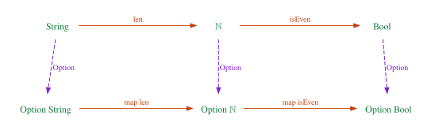
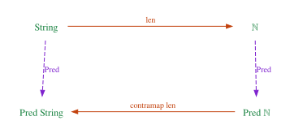

# Functors and Higher-Kinded Types

Rust's standard library is full of methods called `map`. `Option::map` applies a
function to the value inside a `Some`. `Result::map` applies it to the value
inside an `Ok`. `Iterator::map` applies it to every element; arrays have
`map`, and so does `Poll`. Each of these is written separately, for one type, and
yet they all behave the same way: mapping the identity function changes nothing,
and mapping `f` and then `g` is the same as mapping "`f`, then `g`" once. If you
have ever rewritten `.map(f).map(g)` as `.map(|x| g(f(x)))` without a second
thought, you relied on that second rule.

That common shape has a name: a **functor**. Functors are the second fundamental
notion of category theory, after categories themselves. A functor is a map from
one category to another that preserves what makes a category a category:
identities and composition. Every `map` method above is the "arrow part" of a
functor from the category of types to itself.

And here is the twist. Rust has no `Functor` trait, and cannot have one in the
form other languages do, because a trait would have to be generic over `Option`
itself, not over `Option<i32>`. `Option` is not a type; it is a *type
constructor*, a function from types to types, and Rust's generics cannot range
over those. This missing feature is called **higher-kinded types**. This chapter
explains kinds, defines functors with their laws and proves them in Lean, shows
how far Rust can get with generic associated types, and then generalizes in two
directions: functors that reverse arrows, and functors between arbitrary
categories.

**In this chapter you will learn:**

- what kinds are (`Type`, `Type → Type`, `Type → Type → Type`), what a type
  constructor is, and what partial application means for types;
- the definition of a functor between categories, and the functor laws, for
  `Option`, `Vec`, `Result<_, E>`, `(E, _)` and `fn(E) -> _`;
- a `Functor` class with the laws as fields, with instances proved for `Option`,
  `List` and a binary tree, and core Lean's `Functor` and `LawfulFunctor`;
- why Rust has no `Functor` trait, two encodings with generic associated types,
  and exactly where each one falls short;
- contravariant functors (predicates, comparators), bifunctors (pairs, `Result`)
  and profunctors (functions);
- functors between arbitrary categories of the book's `Category` class:
  monotone maps, the interpretation of a free category, hom functors;
- how variance (Chapter 27) is functoriality, and how Mathlib writes functors
  (`C ⥤ D`).

## Kinds: the types of types

Values have types: `3` has type `i32`, `"hi"` has type `&str`. Do types have
types? In a sense they do, and these "types of types" are called **kinds**. A
type such as `i32` or `Vec<String>`, which classifies values, has the kind
`Type` (some texts write $\ast$). `Option` on its own classifies no values: there
is no value of type `Option`. It needs an argument first. So its kind is
`Type → Type`: give it a type, get a type. `Result` needs two arguments and has
kind `Type → Type → Type`.

Kinds are checked by a rule of the same shape as function application in the
λ-calculus (Chapter 8):

$$
\dfrac{F : \kappa_1 \to \kappa_2 \qquad A : \kappa_1}{F\,A : \kappa_2}\;\textsf{K-App}
$$

With $F = \mathtt{Option}$, $\kappa_1 = \kappa_2 = \mathtt{Type}$ and
$A = \mathtt{i32}$, the rule concludes that `Option<i32>` is a type. Things of
kind `Type → Type` (or longer) are called **type constructors**. Rust has many,
and some take arguments that are not types:

| Rust constructor | Kind |
|---|---|
| `Option`, `Vec`, `Box`, `Rc` | `Type → Type` |
| `Result`, `HashMap` (ignoring the hasher parameter) | `Type → Type → Type` |
| `&'a T` | `Lifetime → Type → Type` |
| `[T; N]` | `Type → usize → Type` |

A **partial application** fixes some arguments and leaves the others open.
`Result<_, io::Error>` has kind `Type → Type`: give it a success type, get a
type. Rust has no syntax for this `_`, but a type alias with a parameter does the
job, and the standard library uses one: `std::io::Result<T>` is defined as
`Result<T, std::io::Error>`. What Rust does not have is a way to *pass* a type
constructor around. A generic parameter always stands for a type of kind `Type`,
so you cannot write a struct generic over "some container":

```rust
{{#include ../../code/rust/compile_fail/ch17_no_hkt.rs:column}}
```

```text
{{#include ../../code/rust/compile_fail/ch17_no_hkt.stderr}}
```

The error code E0109 says that `F` is a type parameter, so it cannot take
arguments. Rust has plenty of type constructors (every generic type is one, and
`Column` itself has kind `Type → Type`), but a generic *parameter* always stands
for a type (or a lifetime, or a constant), never for a constructor: you can name
a constructor only by applying it. The usual workaround is to parameterize by
the *applied* type (`struct Column<C> { values: C }` with `C = Vec<String>`),
which works until you need the same container at two different element types.
That is exactly the situation of `map`.

### Kinds in Lean

In Lean, type constructors are not special at all. `Type → Type` is an ordinary
function type, and `Option` is an ordinary function, from types to types. The
file `code/lean/Book/Ch17/Functor.lean` starts with:

```lean
{{#include ../../code/lean/Book/Ch17/Functor.lean:kinds}}
```

`#check Option` prints `Option.{u} (α : Type u) : Type u`: `Option` takes a type
`α` in any universe `u` (Chapter 12) and returns a type in the same universe.
Applied to `ℕ` it gives `Option ℕ : Type`. `Except String` is a partial
application of `Except : Type → Type → Type`, and it *is* a value of type
`Type → Type`, accepted where one is expected. `Twice` is a type-level function
written with `fun`, a *type-level λ*, which Rust does not have at all. The
function type has no constructor name that could be partially applied, so to fix
its input type we give it a name with a definition:

```lean
{{#include ../../code/lean/Book/Ch17/Functor.lean:reader}}
```

`Reader ε` is "functions out of `ε`", of kind `Type → Type`. Because types are
values in Lean, everything we do with functions (pass them as arguments, store
them in structures, quantify over them) we can do with type constructors. That is
all "higher-kinded types" means: being allowed to do that.

## Functors

### The definition

Let $\mathcal{C}$ and $\mathcal{D}$ be categories. A **functor**
$F : \mathcal{C} \to \mathcal{D}$ consists of

- a map on objects: for every object $a$ of $\mathcal{C}$, an object $F\,a$ of
  $\mathcal{D}$;
- a map on morphisms: for every $f : a \to b$ in $\mathcal{C}$, a morphism
  $F\,f : F\,a \to F\,b$ in $\mathcal{D}$;

such that identities and composites are preserved:

$$
F\,\mathrm{id}_a = \mathrm{id}_{F\,a}
\qquad\qquad
F\,(g \circ f) = F\,g \circ F\,f
$$

These are the **functor laws**. Notice the types: an arrow $f : a \to b$ goes to
an arrow between the *images* of $a$ and $b$. So whatever can be composed in
$\mathcal{C}$ can still be composed after applying $F$, and the composite of the
images is the image of the composite. A functor carries the whole web of arrows
of $\mathcal{C}$ into $\mathcal{D}$ without tearing it.

A functor from a category to itself is an **endofunctor**. The endofunctors of the
category of types are the ones programmers meet daily: a type constructor `F`
(the map on objects, `α ↦ F α`) together with a function
`map : (α → β) → F α → F β` (the map on morphisms). For them, the laws read

$$
\mathrm{map}\;\mathrm{id} = \mathrm{id}
\qquad\qquad
\mathrm{map}\,(g \circ f) = \mathrm{map}\,g \circ \mathrm{map}\,f
$$

The picture shows `Option` applied to the arrows `len` and `isEven` of
Chapter 16. Every type in the top row has an image in the bottom row, every arrow
has an image arrow, and composites go to composites.



### Endofunctors you already use

Here is what `map` does for five type constructors that every Rust programmer
uses:

| Constructor | `map f` does | In Rust |
|---|---|---|
| `Option<_>` | apply `f` inside `Some`, keep `None` | `Option::map` |
| `Vec<_>` | apply `f` to every element | `iter().map(f).collect()` |
| `Result<_, E>` | apply `f` inside `Ok`, keep `Err` | `Result::map` |
| `(E, _)` | apply `f` to the second component | (none: write it) |
| `fn(E) -> _` | compose `f` after the function | (none: a closure) |

The last two have no `map` in the standard library, so the example program,
`code/rust/examples/ch17_functors.rs`, defines them:

```rust
{{#include ../../code/rust/examples/ch17_functors.rs:map_helpers}}
```

The pair functor `(E, _)` keeps a label of type `E` (a sensor name, a log
message, a source position) attached to a value. The function functor
`fn(E) -> _` describes computations that need an input of type `E` (a
configuration, an environment) to produce their result; mapping over it means
post-processing the result. Both are functors, as the example checks on samples:

```rust
{{#include ../../code/rust/examples/ch17_functors.rs:laws_on_samples}}
```

```text
{{#include ../../code/rust/output/ch17_functors.txt:1:1}}
```

Each block checks the identity law (`map` with `|a| a` gives back the input) and
the composition law (mapping the composite equals mapping twice) on a few
samples. For `fn(E) -> _`, equality of functions cannot be tested, so we compare
the two sides on sample inputs.

### Laws that fail

Not every function called `map` is a functor. The laws rule out maps that do
something besides applying the function. In Lean we can define such maps and
*prove* that they break the laws:

```lean
{{#include ../../code/lean/Book/Ch17/Functor.lean:bad_functors}}
```

`forgetMap` throws the contents away and always returns `none`. It satisfies the
composition law (both sides are `none`, so `rfl` proves it), but not the identity
law: applied to `some 1`, the identity law would claim `none = some 1`. The proof
of `forgetMap_not_id` assumes the law for all `x`, specializes it to `some 1`,
and `simp [forgetMap] at h1` unfolds `forgetMap`, sees that `none = some 1` is
false, and closes the goal. So the identity law is what forbids "losing" data.

`countingMap` is the kind of `map` a Rust programmer might write to collect
statistics: it applies the function and increments a counter stored next to the
value. It breaks both laws; the theorem shows the identity law failing on one
input, by `simp` computing both sides. The laws say that `map` must apply the
function and do nothing else. In Rust you would also have to say "and must not
print, panic or mutate", which the type of `map` cannot express.

Why do we care? Because the laws are what make `map` safe to refactor. Removing
a `.map(|x| x)` is correct because of the identity law. Fusing `.map(f).map(g)`
into one pass, or splitting one complicated closure into two `map` calls for
readability, is correct because of the composition law. Code reviewers apply
these rewrites without thinking, and the laws are the reason it is safe.

## Functors in Lean

### A class with laws

Here is a functor class in Lean, with the laws as fields, exactly like the
`Category` class of Chapter 16:

```lean
{{#include ../../code/lean/Book/Ch17/Functor.lean:functor_class}}
```

The parameter `F : Type → Type` is the type constructor: this is the
higher-kinded quantification that Rust lacks, written as an ordinary argument.
The field `map` has implicit type arguments `{α β : Type}`, so `map` works at
every pair of types. The laws are stated *pointwise* ("for every `x : F α`")
rather than as equations between functions; the two forms are equivalent by
`funext`, and the pointwise form is easier to use in proofs. The class is named
`Functor`, like core Lean's own class; inside `namespace Ch17` our name wins, and
core's is still available as `_root_.Functor`.

The instance for `Option`:

```lean
{{#include ../../code/lean/Book/Ch17/Functor.lean:option_functor}}
```

`map f` followed by two alternatives is a function defined by pattern matching
on its last argument. Both laws are proved by `cases x <;> rfl`: split on whether
`x` is `none` or `some a`, and in each case both sides compute to the same value.
(`<;>` runs the tactic on its right on every goal produced by the tactic on its
left.)

For lists, the proofs need induction:

```lean
{{#include ../../code/lean/Book/Ch17/Functor.lean:list_functor}}
```

`listMap` is `List.map`, written out so that every step of the proof is visible.
In `listMap_id`, the `nil` case is `rfl`. In the `cons a as` case the goal is
`listMap id (a :: as) = a :: as`; `simp only [listMap, id, ih]` unfolds one step
of `listMap` (giving `id a :: listMap id as`), unfolds `id` (giving
`a :: listMap id as`), and rewrites with the induction hypothesis
`ih : listMap id as = as`, which leaves `a :: as = a :: as`, closed
automatically. `listMap_comp` has the same structure; `Function.comp` unfolds
`(g ∘ f) a` into `g (f a)`.

Trees are the third example, and the first that is not built into the language:

```lean
{{#include ../../code/lean/Book/Ch17/Functor.lean:tree}}
```

`Tree.map` keeps the shape and applies `f` at every node. In the induction on a
tree, the `node l a r` case has *two* induction hypotheses, one per subtree
(`ihl` and `ihr`), and `simp only` uses both. This is structural induction on an
inductive type, the general form of what you did on lists.

```lean
{{#include ../../code/lean/Book/Ch17/Functor.lean:tree_eval}}
```

In `Functor.map toString sample`, Lean finds the `Functor Tree` instance and
turns every number into a string, keeping the shape.

Three more instances, with the laws for free:

```lean
{{#include ../../code/lean/Book/Ch17/Functor.lean:more_functors}}
```

`Except ε` is Lean's `Result` with the error type first: `Except ε α` is either
`.error e` or `.ok a`. Its `map`, like Rust's `Result::map`, changes the success
value and leaves errors alone. `Prod ε` is the partial application of the pair
type to its first argument, so `Prod ε α` is `ε × α`, the `(E, _)` functor. Its
laws hold by `rfl`: `(p.1, id p.2)` is `p` by η for pairs. `Reader ε` maps by
post-composition, and its laws are the unit and associativity laws of function
composition, which hold by computation.

### Proving things once for all functors

With the laws available as hypotheses, we can prove theorems about *every*
lawful functor at once. The simplest is map fusion:

```lean
{{#include ../../code/lean/Book/Ch17/Functor.lean:map_fusion}}
```

`{F : Type → Type} [Functor F]` quantifies over all type constructors with a
lawful `map`. The proof is the composition law, read from right to left. Rust can
only *test* such a statement, one functor at a time.

### Core Lean's `Functor` and `LawfulFunctor`

Lean's core library has its own `Functor` class, which `do` notation and many
library functions use. It splits the operation from the laws: `Functor` has
`map` (with the infix notation `<$>`) and `mapConst` (map a constant function,
with a default implementation), and a separate class `LawfulFunctor` has the
laws `id_map`, `comp_map` and `map_const` (the last one says that `mapConst`
agrees with its default). Our tree joins in:

```lean
{{#include ../../code/lean/Book/Ch17/Functor.lean:core_functor}}
```

The proofs are our tree lemmas; `map_const` is `rfl` because we kept the default
`mapConst`. With the `LawfulFunctor` instance, library lemmas proved once for
every lawful functor apply to `Tree`: the last example uses `Functor.map_map`,
core's version of map fusion, through `simp only`.

## Functors in Rust: the missing trait

### What we would like to write

In Haskell, the functor class is written (in Haskell syntax, not compiled here):

```text
class Functor f where
  fmap :: (a -> b) -> f a -> f b
```

The class is indexed by `f`, a type constructor of kind `Type → Type`, and the
types `f a` and `f b` apply it to two different arguments. Lean's class has the
same shape. A direct Rust translation would need a trait generic over a type
constructor, something like this (invalid Rust):

```rust,ignore
trait Functor<F<_>> {
    fn fmap<A, B>(x: F<A>, f: impl FnMut(A) -> B) -> F<B>;
}
```

As we saw, a Rust type parameter cannot be applied to arguments. Higher-kinded
types have been discussed in the Rust community for years without being added;
the difficulties are not only syntax, but also their interaction with type
inference and with the trait system, as the encodings below will show. Instead,
Rust gained a smaller feature that covers many of the use cases: **generic
associated types**.

### Encoding 1: a GAT on the applied type

An associated type (Chapter 14) is a type chosen by each `impl` of a trait, like
`Iterator::Item`. A **generic associated type** (GAT, stable since Rust 1.65) is
an associated type that takes parameters of its own. That is enough to say "the
same container, with a different element type":

```rust
{{#include ../../code/rust/examples/ch17_functors.rs:gat_functor}}
```

The trait is implemented by an *applied* type such as `Option<A>`. `Elem` names
the element type `A`, and the GAT `Wrapped<B>` names `Option<B>`: the
constructor applied to another argument. The bound `Functor<Elem = B>` says that
the result is again a functor, with element type `B`. The impl for
`Result<A, E>` fixes `E` and maps `A`, which is the partial application
`Result<_, E>` expressed through the impl. The tree uses a recursive helper:

```rust
{{#include ../../code/rust/examples/ch17_functors.rs:tree}}
```

The helper takes `f` by mutable reference so that the same closure can be used
in both recursive calls: a generic `FnMut` closure cannot be copied, only lent.

Now `double_all` is written once and works for every implementor:

```rust
{{#include ../../code/rust/examples/ch17_functors.rs:gat_examples}}
```

```text
{{#include ../../code/rust/output/ch17_functors.txt:2:6}}
```

So far, so good. The last line deserves suspicion, though. It comes from this
impl:

```rust
{{#include ../../code/rust/examples/ch17_functors.rs:odd_impl}}
```

The trait *meant* "`Wrapped<B>` is the same constructor applied to `B`", but
nothing enforces it. Any type will do, as long as it is a `Functor` with the
right `Elem`, so a `Box` can "map" to an `Option`. The trait describes a
*relation between applied types*, not a type constructor.

A worse problem shows up when we try to state the composition law generically:

```rust
{{#include ../../code/rust/compile_fail/ch17_gat_composition.rs:composition_law}}
```

```text
{{#include ../../code/rust/compile_fail/ch17_gat_composition.stderr}}
```

The two sides have different types. Mapping once gives `F::Wrapped<C>`. Mapping
twice gives `<F::Wrapped<B> as Functor>::Wrapped<C>`: first wrap at `B`, then ask
*that* type for its own `Wrapped<C>`. We know these are both `Option<C>` when
`F` is `Option<A>`, but the trait never says that wrapping twice is the same as
wrapping once, so for a generic `F` the compiler cannot prove it. (The message
words this awkwardly, and its suggested fix, `F: Functor<Wrapped<B> = F>`, would
claim that mapping into `B` gives back `F` itself, which is wrong whenever `B`
is not `A`.) In this encoding, the composition law cannot even be *written* as a
generic test.

### Encoding 2: a family marker for the constructor

The second encoding gives the type constructor a name of its own. A **marker
type** (an empty struct) stands for the constructor, and a GAT applies it:

```rust
{{#include ../../code/rust/examples/ch17_functors.rs:family}}
```

`OptionFamily` is not an option; it stands for `Option` itself, the thing of
kind `Type → Type`, and `OptionFamily::Of<T>` is `Option<T>`. A partial
application such as `Result<_, E>` becomes a marker with a parameter,
`ResultFamily<E>` (`PhantomData<E>` lets a struct mention a type it does not
store). `FunctorFamily` is now indexed by the constructor, exactly as Haskell's
class is indexed by `f`: Rust's generics range over marker types, and the GAT
`Of` turns each marker into the type constructor it represents. The other
families (`VecFamily`, `ResultFamily<E>`, `TreeFamily`) follow the same pattern
in the example file.

This time, the laws can be checked by one generic function:

```rust
{{#include ../../code/rust/examples/ch17_functors.rs:generic_laws}}
```

Both sides of each law now have the same type, because there is one family `F`
and every type is `F::Of<_>` of something. The function maps numbers to strings
and strings to lengths, so the composition law is checked at three different
types. Here is a lawless family, which maps and then reverses:

```rust
{{#include ../../code/rust/examples/ch17_functors.rs:lawless}}
```

```rust
{{#include ../../code/rust/examples/ch17_functors.rs:family_examples}}
```

```text
{{#include ../../code/rust/output/ch17_functors.txt:7:11}}
```

`ReversingVec` compiles, type-checks and is caught only by the test, on a sample
that happens to expose it (on `vec![7, 7, 7]` it would pass). This is Chapter 14's
lesson again: Rust can name an algebraic structure, but not demand its laws.

The family encoding has its own limit, and it is about inference. Here is the
generic `double_all` in this style, called on an `Option`:

```rust
{{#include ../../code/rust/compile_fail/ch17_family_inference.rs:double_all}}
```

```text
{{#include ../../code/rust/compile_fail/ch17_family_inference.stderr}}
```

Error E0283 means that the compiler cannot infer `F`. Read the note "cannot
satisfy `<_ as Family>::Of<i32> == Option<i32>`": the compiler would have to
find the family whose `Of<i32>` is `Option<i32>`, and nothing guarantees that
there is only one (another crate could define a second marker with
`Of<T> = Option<T>`). In the jargon, `Of` is not *injective*, so the argument
type does not determine the family. Every call needs a turbofish,
`double_all::<OptionFamily>(Some(21))`. Lean has the same question to answer
when it infers `F` from `F α`, and solves it by unification: there `Option` is a
real term, and `Option α` determines it.

### Taking stock

| | GAT on applied type | Family marker | Lean class |
|---|---|---|---|
| Quantify over constructors | indirectly | yes (markers) | yes (`F : Type → Type`) |
| "Same constructor" enforced | no | yes | yes |
| Composition law statable | no | yes | yes |
| Inference from arguments | yes | no (turbofish) | yes |
| Laws enforced | no, tested | no, tested | yes, proved |

There is also a Rust-specific dimension that no encoding removes: **ownership**.
Our `fmap` takes `self` by value and an `FnMut` closure. That is right for `Vec`
(the closure runs many times, possibly updating state) but more than `Option`
needs (one call at most, so `FnOnce` would do, as in `Option::map`). A version
that maps through a reference (`&Vec<A>` to `Vec<B>`) is yet another trait. In a
language with ownership, "the" functor interface splits into several, according
to how often the function is called and whether the container is consumed: the
`Fn`/`FnMut`/`FnOnce` distinctions of Chapter 8, and a first sign of the resource
reading of types in Part V. Chapter 20 meets the same problem for monads.

## Other variances

The functors so far are **covariant**: an arrow $a \to b$ becomes an arrow
$F\,a \to F\,b$, in the same direction. Some useful constructions turn arrows
around, and some take two arguments.

### Contravariant functors

A predicate on numbers, `ℕ → Bool`, can be turned into a predicate on strings
with a function `String → ℕ`: test the length. Notice the direction. The
function goes from strings to numbers, and the predicate transformation goes from
predicates on numbers to predicates on strings:



A **contravariant functor** sends $f : a \to b$ to $F\,f : F\,b \to F\,a$, and its
composition law reverses the order:

$$
F\,\mathrm{id}_a = \mathrm{id}_{F\,a}
\qquad\qquad
F\,(g \circ f) = F\,f \circ F\,g
$$

Equivalently, it is an ordinary functor from the opposite category
$\mathcal{C}^{\mathrm{op}}$ of Chapter 16, where every arrow is already reversed.
We will build it that way below. First, as a class:

```lean
{{#include ../../code/lean/Book/Ch17/Functor.lean:contravariant}}
```

The operation is usually called `contramap`. For predicates it is
precomposition: to test an `α` with a test on `β`, convert the `α` first. For
comparators (functions `α → α → Ordering`, what Rust's `sort_by` takes), it
compares two values by comparing their images: exactly what `sort_by_key` does.
All the laws hold by `rfl`, because precomposition is function composition.

```lean
{{#include ../../code/lean/Book/Ch17/Functor.lean:contravariant_eval}}
```

In Rust:

```rust
{{#include ../../code/rust/examples/ch17_functors.rs:contravariant}}
```

```rust
{{#include ../../code/rust/examples/ch17_functors.rs:contravariant_examples}}
```

```text
{{#include ../../code/rust/output/ch17_functors.txt:12:13}}
```

`Predicate<T>` stores a boxed closure (a `dyn Fn`, Chapter 15), and `contramap`
builds a new one that converts before testing. `by_key` is the comparator version:
from a key function it builds a comparator on values, by contramapping
`Ord::cmp` on keys. Contravariance is common in Rust, even where it has no name:
anything that *consumes* values of a type, such as a predicate, a comparator, a
serializer or a callback, is contravariant in that type.

### Bifunctors

`Result<T, E>` has two type parameters, and you can map both: `map` changes the
`Ok` side, `map_err` the `Err` side. A **bifunctor** is a functor of two
arguments, covariant in each, with a `bimap` that maps both sides at once:

```lean
{{#include ../../code/lean/Book/Ch17/Functor.lean:bifunctor}}
```

The laws say that mapping two identities is the identity and that `bimap`
respects composition on both sides at once. For pairs they hold by `rfl`; for
`Except` by cases. Mathematically, a bifunctor is a functor out of a *product
category* $\mathcal{C} \times \mathcal{D}$, whose objects are pairs of objects
and whose morphisms are pairs of morphisms.

In Rust, `map` and `map_err` act on different sides, so they commute:

```rust
{{#include ../../code/rust/examples/ch17_functors.rs:bifunctor}}
```

```rust
{{#include ../../code/rust/examples/ch17_functors.rs:bifunctor_examples}}
```

```text
{{#include ../../code/rust/output/ch17_functors.txt:14:16}}
```

### Profunctors: functions

The function type `A -> B` has two parameters and is a bifunctor of mixed
variance: contravariant in the input (you can precompose) and covariant in the
output (you can postcompose). Such a thing is called a **profunctor**, and its
operation `dimap` does both:

```lean
{{#include ../../code/lean/Book/Ch17/Functor.lean:profunctor}}
```

Both laws are `rfl`. Note the order in `dimap_comp`: the input adapters compose
in the *reverse* order (`f ∘ f'`) and the output adapters in the same order
(`g' ∘ g`), which is contravariance and covariance side by side. Every closure
adapter you write in Rust, wrapping a callback to convert its argument and its
result, is a `dimap`.

## Functors between arbitrary categories

So far, every functor went from the category of types to itself. The definition
works between any two categories, and the book's `Category` class lets us state it
in full generality. The file `code/lean/Book/Ch17/CatFunctor.lean` imports
`Book.Ch16.Examples`, so that this chapter can reuse Chapter 16's preorder,
opposite and free categories instead of redefining them, and it opens the
namespace `Ch16` to get the notations `⟶` and `⊚`:

```lean
{{#include ../../code/lean/Book/Ch17/CatFunctor.lean:cat_functor}}
```

`CatFunctor C D` is a structure, not a class, because there are usually many
functors between two categories, and we want to name and pass them around. `obj`
is the map on objects, and `map` is the map on morphisms; the type of `map` says
that it sends `a ⟶ b` to `obj a ⟶ obj b`, so the "preserves sources and
targets" part of the definition is enforced by Lean's types. `map_id` and
`map_comp` are the functor laws.

### Composing functors

Functors compose, and there is an identity functor:

```lean
{{#include ../../code/lean/Book/Ch17/CatFunctor.lean:id_comp_functor}}
```

The laws of the composite follow from the laws of its parts: `map_id` for
`comp G F` rewrites first with `F.map_id` (so `F` sends the identity to an
identity) and then with `G.map_id`; `map_comp` is the same with the composition
law. The three theorems at the end say that functor composition is associative
and has the identity functor as a unit, and they hold by `rfl`: two functors with
the same `obj` and `map` are equal, and the proof fields do not matter because
of proof irrelevance. This should look familiar: categories and functors form a
category themselves, usually called $\mathbf{Cat}$. (One of the exercises asks
you to build it as an instance of the book's class.)

### Functors on types are functors

Every lawful `Functor` instance from the first half of the chapter is a
`CatFunctor` from the category of types to itself:

```lean
{{#include ../../code/lean/Book/Ch17/CatFunctor.lean:of_functor}}
```

The laws convert between the pointwise form of the class and equations between
morphisms (functions), using `funext`. The example maps the composite
`double ⊚ len` of Chapter 16 inside an `Option`.

### Monotone maps are functors between preorders

In a preorder, a morphism $a \to b$ is a proof of $a \le b$. A functor between
two preorders therefore sends elements to elements, and proofs of $a \le b$ to
proofs of $F\,a \le F\,b$: it is a **monotone** map. The functor laws are
automatic, because parallel morphisms in a preorder are equal.

```lean
{{#include ../../code/lean/Book/Ch17/CatFunctor.lean:monotone}}
```

`Monotone f` is Mathlib's predicate "`a ≤ b` implies `f a ≤ f b`". The two
directions are both here: `monotoneFunctor` turns a monotone function into a
functor, and `CatFunctor.monotone` shows that the object map of *any* functor
between preorders is monotone, by applying `map` to the morphism `⟨h⟩` and
taking the resulting proof out of its `PLift`. So "functor between preorders"
and "monotone function" are the same notion. `doubling` is the example, with
`Nat.mul_le_mul_left` as the monotonicity proof.

### Running a free category: an interpreter is a functor

The free category on a graph (Chapter 16) has a remarkable property: to define a
functor out of it, you only need to say where each vertex and each *edge* goes.
Paths are then sent to the composites of the images of their edges, and the
functor laws hold automatically. This is the universal property that justifies
the name "free".

```lean
{{#include ../../code/lean/Book/Ch17/CatFunctor.lean:interp}}
```

`interp o m` interprets a path in any category `D`, given an object `o v` for
each vertex and a morphism `m e` for each edge: the empty path goes to an
identity, and an edge followed by a path goes to the composite. The functor law
for composition is `interp_append`, proved by induction on the first path:

- In the `nil` case, the goal is `interp q = interp q ⊚ id`, the right unit
  law read backwards.
- In the `cons e p` case, after unfolding one step of `append` and `interp`, the
  goal is `interp (append p q) ⊚ m e = interp q ⊚ (interp p ⊚ m e)`. Rewriting
  with the induction hypothesis turns the left side into
  `(interp q ⊚ interp p) ⊚ m e`, and `Category.assoc` rebrackets the right
  side to the same thing.

The identity law, `map_id`, is `rfl`: the empty path is interpreted as an
identity by definition.

Now apply it to the connection protocol of Chapter 16, sending each state to the
type of data a client holds in that state, and each operation to a function on
that data:

```lean
{{#include ../../code/lean/Book/Ch17/CatFunctor.lean:run_protocol}}
```

`runTrace` is a functor from the free category of the protocol to the category
of types: it turns every valid trace into a function, an *interpreter* for
traces. The functor law for composition says that running a composite trace is
running its parts one after the other, and we did not have to prove it for this
protocol: it came with `freeFunctor`. This is a pattern worth recognizing in
your own code. Whenever you define the meaning of a sequence of commands by the
meanings of the individual commands, you are defining a functor out of a free
category, and the composition law is the guarantee that "run `a` then `b`"
equals "run `a`, then run `b`".

### Contravariant functors, again

A contravariant functor is an ordinary functor out of the opposite category,
whose arrows are already reversed. Predicates are the example:

```lean
{{#include ../../code/lean/Book/Ch17/CatFunctor.lean:pred_functor}}
```

A morphism `a ⟶ b` in `Op Type` is a function `b.unop → a.unop`, so `p ∘ f`
turns a predicate on `a.unop` into a predicate on `b.unop`, in the direction a
functor `Op Type → Type` requires. Both laws are `rfl`. The `Contravariant` class
of the first half was a convenient packaging of the same thing.

### Hom functors

Here is a functor that every category has. Fix an object `a`; then "the arrows
out of `a`" form a functor into the category of types:

```lean
{{#include ../../code/lean/Book/Ch17/CatFunctor.lean:hom_functor}}
```

It sends each object `b` to the *type* `a ⟶ b`, and an arrow `g : b ⟶ c` to the
function "compose with `g`", from `a ⟶ b` to `a ⟶ c`. The functor laws are the
left unit law and associativity of the category. This is where the decision of
Chapter 16 to make `Hom` land in `Type` pays off: `a ⟶ b` must be an object of the
category of types for `homFunctor` to make sense.

In the category of types, `homFunctor ε` is our `Reader ε`: the arrows out of
`ε` are the functions `ε → β`, and composing with `g` is mapping. Hom functors
are the subject of the Yoneda lemma, which Chapter 18 proves.

## Variance is functoriality

Rust has exactly one kind of subtyping, between lifetimes: if `'a` outlives `'b`
(written `'a: 'b`), a `&'a T` can be used where a `&'b T` is expected. Subtyping
is reflexive and transitive, so it is a preorder, and a preorder is a category
(Chapter 16). Now ask how a type constructor behaves with respect to it:

- `&'a T`, `Box<T>`, `Vec<T>` and `Option<T>` are **covariant**: if `S` is a
  subtype of `T`, then `Vec<S>` is a subtype of `Vec<T>`. That is a monotone map
  on the subtyping preorder, which is to say a *functor*.
- `fn(T)` is **contravariant** in `T`: a function that accepts any `&'b str`
  can be used where a function accepting `&'static str` is expected, but not the
  other way around. That is a functor from the opposite preorder.
- `&mut T` and `Cell<T>` are **invariant** in `T`: neither direction is allowed,
  and they are not functors on the subtyping preorder in either direction.
  Chapter 27 shows the unsound program that covariance of `&mut T` would allow.

So "variance" is the word type theorists use for functoriality on the subtyping
preorder, and the variances of Rust's type constructors are the answers to "is
this constructor a covariant functor, a contravariant one, or neither?". The
function type `fn(A) -> B` is contravariant in `A` and covariant in `B`, the
profunctor of the previous section. Chapter 27 develops this in full.

## Putting it together: map fusion, proved once

A pipeline that maps several functions over a container in turn can be optimized
into a single `map` of the composite function: one traversal instead of many.
Rust's lazy iterators perform a version of this automatically
(`v.iter().map(f).map(g)` makes one pass), and compilers for functional
languages apply it as a rewrite rule. Is it always correct? For every lawful
functor, yes, and we can prove it once, for all functors and all pipelines.

A pipeline is a list of functions, run either one `map` at a time or fused:

```lean
{{#include ../../code/lean/Book/Ch17/Functor.lean:pipeline}}
```

`runNaive` maps each stage in order; `fuse` composes all the stages into one
function, the first stage innermost. The theorem says that the two agree on every
input, in every lawful functor. The proof is by induction on the pipeline, with
`generalizing x` because the recursive call works on a different container
(`map f x` instead of `x`), so the induction hypothesis must hold for every
container:

- For the empty pipeline, `runNaive [] x` is `x`, and `fuse []` is `id`, so the
  goal is `x = map id x`: the identity law, read from right to left.
- For a pipeline `f :: fs`, unfolding gives
  `runNaive fs (map f x) = map (fuse fs ∘ f) x`. The induction hypothesis
  (instantiated at `map f x`) rewrites the left side to
  `map (fuse fs) (map f x)`, and the composition law rewrites the right side to
  the same thing.

Both laws were needed, one per case. Run on two different functors:

```lean
{{#include ../../code/lean/Book/Ch17/Functor.lean:pipeline_eval}}
```

The stages add 1, multiply by 10 and subtract 3, so `1` becomes `17`. The theorem
guarantees that the fused and the naive runs agree for `Option`, `List`, `Tree`,
`Except ε`, and every other lawful functor, including ones that do not exist
yet. The Rust example's `law_report` is the testing counterpart: one generic
function, every family, finitely many samples.

## In Mathlib

Mathlib's functors between categories are `CategoryTheory.Functor C D`, written
`C ⥤ D` (typed `\functor`). The fields are `obj`, `map`, `map_id` and `map_comp`,
like our `CatFunctor`, but in Mathlib's conventions: composition in diagrammatic
order (`map_comp : F.map (f ≫ g) = F.map f ≫ F.map g`), and laws with default
proofs, so a functor whose laws are easy can omit them:

```lean
{{#include ../../code/lean/Book/Ch17/InMathlib.lean:mathlib_functor}}
```

The examples are in `code/lean/Book/Ch17/InMathlib.lean`. Recall from Chapter 16
that a morphism of `Type` in Mathlib wraps a function. That is why the code
writes `map f := ↾(Option.map f)`: the morphism `f` is coerced to a function for
`Option.map`, and `↾` wraps the resulting function back into a morphism.

Core Lean's lawful functors convert to Mathlib functors with `ofTypeFunctor`,
which needs exactly the `Functor` and `LawfulFunctor` instances of core Lean.
Functors compose with `⋙` (typed `\ggg`; again "first the left one") and `𝟭 C`
is the identity functor:

```lean
{{#include ../../code/lean/Book/Ch17/InMathlib.lean:mathlib_of_type_functor}}
```

The last example says that `𝟭 Type ⋙ optionFunctor` *is* `optionFunctor`, by
`rfl`, just like our `CatFunctor.id_comp`. Monotone maps are functors in Mathlib
too:

```lean
{{#include ../../code/lean/Book/Ch17/InMathlib.lean:mathlib_monotone}}
```

There are now three things called "functor" in a Lean project that imports
Mathlib, and it is worth keeping them apart: core Lean's `Functor` (an operation
on type constructors, without laws), `LawfulFunctor` (the laws, as a separate
class), and Mathlib's `CategoryTheory.Functor` (a structure for functors between
arbitrary categories, laws included). This chapter's `Ch17.Functor` and
`Ch17.CatFunctor` are our from-scratch versions of the first two and the third.

## Common confusions

**"A functor is a container."** Many functors are containers, but `Reader ε`
contains nothing: a function `ε → α` has no `α` inside until you give it an
`ε`. A functor is a type constructor with a lawful `map`. Contravariant functors,
such as predicates, do not even have a `map` in the usual direction.

**"Any type with a `map` method is a functor."** Only if the laws hold. A `map`
that drops elements, reorders them, counts its calls or prints is not a functor
`map`, and the refactorings that rely on the laws become unsafe.

**"`Option` is a type."** `Option<i32>` is a type. `Option` is a type
constructor, of kind `Type → Type`. Rust lets you name it only when you apply it.

**"GATs give Rust higher-kinded types."** They give encodings, each with gaps:
the applied-type encoding cannot state the composition law, and the family
encoding loses inference. Neither enforces the laws.

**"A contravariant functor is the opposite of a functor."** It is a functor, from
the opposite category. Every theorem about functors applies to it.

**"Mathlib's `Functor` is Lean's `Functor`."** Core's `Functor` is a class on
`Type u → Type v`; Mathlib's `CategoryTheory.Functor` is a structure between any
two categories. `ofTypeFunctor` converts the first (with its laws) into the
second.

## Summary

- Kinds classify types: `Type` for types of values, `Type → Type` for type
  constructors such as `Option` and `Vec`, `Type → Type → Type` for `Result`.
  Partial application fixes some arguments (`Result<_, E>`, Lean's
  `Except ε`). Rust's type parameters always have kind `Type` (E0109); in Lean,
  `Type → Type` is an ordinary function type.
- A functor maps objects to objects and morphisms to morphisms, preserving
  identities and composition. Endofunctors on types are type constructors with a
  lawful `map`: `Option`, `Vec`, `Result<_, E>`, `(E, _)`, `fn(E) -> _`, trees.
- The laws exclude maps that lose, reorder or add data, and they justify
  refactorings such as map fusion. Lean proves them (by `cases`, induction or
  `rfl`); Rust can only test them.
- Rust has no `Functor` trait. A GAT on the applied type cannot state the
  composition law and does not enforce "same constructor"; a family marker can
  state the laws but needs turbofish annotations (E0283). Ownership splits the
  interface further (`FnOnce`, `FnMut`, by value or by reference).
- Contravariant functors reverse arrows (predicates, comparators: precomposition)
  and are functors from the opposite category. Bifunctors map two arguments
  (pairs, `Result` with `map` and `map_err`); functions are profunctors.
- Functors between arbitrary categories compose and have identities. Monotone
  maps are the functors between preorders; a functor out of a free category is an
  interpreter determined by the edges; hom functors exist in every category.
- Variance is functoriality on the subtyping preorder: covariant, contravariant
  or invariant (Chapter 27).
- Mathlib writes `C ⥤ D`, `F.obj`, `F.map`, `⋙` and `𝟭`, and `ofTypeFunctor`
  turns core Lean's lawful functors into categorical ones.

## Exercises

1. Give the kind of each of these Rust type constructors: `Box`, `Cell`,
   `PhantomData`, `&'a mut T`, `HashMap` with its hasher parameter, and
   `Result<_, String>`. Which ones take a parameter that is not a type?
   *Hint:* count the parameters and their sorts; lifetimes and const values
   count as parameters of other kinds (`Lifetime`, `usize`).

2. In Lean, make `Twice` (pairs `α × α`, with `map` applied to both components)
   an instance of `Ch17.Functor`, and prove the laws. Then show that the
   function "swap the two components" commutes with your `map`.
   *Hint:* define `map f p := (f p.1, f p.2)`; both laws are `rfl`, as is the
   commutation `swap (map f p) = map f (swap p)`. Chapter 18 calls such a
   function a natural transformation.

3. In Rust, implement `FunctorFamily` for `Box` (`BoxFamily`, with
   `Of<T> = Box<T>`) and for pairs of equal types (`PairFamily`, with
   `Of<T> = (T, T)`), and run `law_report` on both. Then write a lawless
   `FunctorFamily` for `Option` that passes the composition test but fails the
   identity test.
   *Hint:* for the lawless one, imitate `forgetMap` from the Lean file and
   return `None` always.

4. In Lean, prove that functors preserve isomorphisms: given
   `F : CatFunctor C D` and `i : a ≅ b` (Chapter 16's `Iso`), build an
   isomorphism `F.obj a ≅ F.obj b`.
   *Hint:* take `F.map i.hom` and `F.map i.inv`; for `inv_hom`, rewrite with
   `← F.map_comp`, then `i.inv_hom`, then `F.map_id`.

5. In Lean, build the category of small categories: objects are pairs of a type
   and a category structure on it, `(C : Type) × Category C`, and morphisms are
   `CatFunctor`s.
   *Hint:* `Hom a b := @CatFunctor a.1 b.1 a.2 b.2`, and similarly with `@` for
   `id` and `comp` (write `comp {a b c} g f := ...` to name the implicit
   objects). All three laws are `rfl`, by the theorems of the section "Composing
   functors".

6. Explain, with a short Rust example, why `fn(T) -> T` is neither covariant nor
   contravariant in `T` with respect to lifetimes, and why `Cell<T>` must be
   invariant.
   *Hint:* `T` appears both as an input (a contravariant position) and as an
   output (a covariant position). For `Cell<T>`, think of `set` as an input and
   `get` as an output; Chapter 27 has the details.
