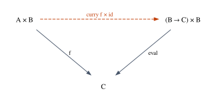
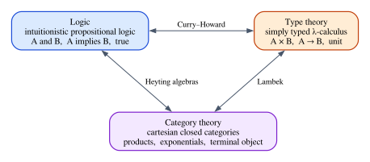

# Cartesian Closed Categories

Chapter 10 showed that the simply typed λ-calculus and intuitionistic logic are
the same system seen twice: types are propositions, terms are proofs, β-reduction
is proof simplification. Chapter 16 began a third reading, in which types are
objects and programs are arrows. This chapter finishes it. We ask: what must a
category have so that the simply typed λ-calculus can be interpreted in it? The
answer is short. It needs a terminal object (for the unit type), products (for
pairs) and **exponentials** (for function types), and a category with all three is
called **cartesian closed**. The correspondence between the λ-calculus and
cartesian closed categories, due to Joachim Lambek, completes the
Curry–Howard–Lambek triangle that this book has been drawing since Chapter 1.

Two other ideas come along. **Currying**, the bijection between functions of two
arguments and functions that return functions, turns out to be the first example
of an **adjunction**, the concept that organizes much of category theory (and
produces monads, in Chapter 20). And the "cartesian" in "cartesian closed" is
precisely what Rust gives up for values that are not `Copy`. A pair of owned
values has projections but no diagonal $A \to A \times A$: you cannot use a
`String` twice without cloning it. That one missing arrow is why Part V needs
linear logic, whose models are a different kind of category.

**In this chapter you will learn:**

- terminal objects, products and exponentials as universal properties, built as
  Lean classes on top of Chapter 16's `Category`, with the instance for Lean's
  types;
- what a cartesian closed category is, and why Lean's types, and every Heyting
  algebra, are examples;
- currying as a natural bijection $\mathrm{Hom}(A \times B, C) \cong \mathrm{Hom}(A, C^B)$:
  the first adjunction;
- Lambek's correspondence: an interpretation of the simply typed λ-calculus in any
  cartesian closed category, with β and η proved sound in Lean (and β holding by
  `rfl` in `Type`);
- the Curry–Howard–Lambek triangle;
- why Rust is not cartesian for non-`Copy` types: the diagonal needs `Clone`, and
  `(A, B)` with moves is a *monoidal* product, the structure behind linear logic.

## Products and the terminal object, again

Chapter 16 defined terminal objects and binary products by their universal
properties and proved that Lean's `Unit` and `×` have them. We restate both, now as
Lean classes that a category may or may not have, because cartesian closed
categories are built on top of them. The code is in
`code/lean/Book/Ch19/CCC.lean`, which imports the book's `Category` class from
`Book.Ch16.Category`; the notation is Chapter 16's (`a ⟶ b` for morphisms,
`g ⊚ f` for "first `f`, then `g`").

A **terminal object** $1$ is an object with exactly one morphism into it from every
object:

```lean
{{#include ../../code/lean/Book/Ch19/CCC.lean:terminal}}
```

The class has a field for the object, one for the morphisms into it (`toOne a`,
often written $!_a$), and one for uniqueness: every morphism `a ⟶ one` *is*
`toOne a`.

A **product** of $a$ and $b$ is an object $a \times b$ with two projections
$\pi_1 : a \times b \to a$ and $\pi_2 : a \times b \to b$, such that for every
object $x$ and every pair of morphisms $f : x \to a$, $g : x \to b$ there is
exactly one morphism $\langle f, g \rangle : x \to a \times b$ with

$$
\pi_1 \circ \langle f, g \rangle = f
\qquad\qquad
\pi_2 \circ \langle f, g \rangle = g
$$

In Lean, `fst` and `snd` are the projections, `pair f g` is
$\langle f, g \rangle$, and the product object is written `a ⨯ b` (a special
cross, so that it does not clash with Lean's `×` on types):

```lean
{{#include ../../code/lean/Book/Ch19/CCC.lean:products}}
```

`fst_pair` and `snd_pair` are the two equations, and they say that `pair f g`
*exists* with the required property. Uniqueness is stated in a compact form that is
convenient in proofs: every morphism `h` into the product equals the pair of its
own projections. This is equivalent to the usual statement, as the first lemma
shows:

```lean
{{#include ../../code/lean/Book/Ch19/CCC.lean:product_lemmas}}
```

`pair_eq` says: if `h` has the right projections `f` and `g`, then `h` is
`pair f g`. The proof rewrites `h` into `pair (fst ⊚ h) (snd ⊚ h)` (reading
`pair_unique h` backwards, with `←`) and then replaces the projections using the
hypotheses. `pair_comp` says that precomposing a pair precomposes both components,
$\langle f, g \rangle \circ h = \langle f \circ h, g \circ h \rangle$; it is
`pair_eq` applied to the right side, and the two projection equations are
proved by reassociating (`Category.assoc`) and using `fst_pair` or `snd_pair`.
`pair_fst_snd` says that pairing the two projections gives the identity, which is
`pair_unique` at the identity morphism, cleaned up by `Category.comp_id`
($f \circ \mathrm{id} = f$). The `rw ... at h` form rewrites in the hypothesis `h`
instead of the goal.

Two more constructions will be used all the time. The **product of morphisms**
$f \times g : a \times b \to c \times d$ applies $f$ to the first component and $g$
to the second; it is $\langle f \circ \pi_1, g \circ \pi_2 \rangle$:

```lean
{{#include ../../code/lean/Book/Ch19/CCC.lean:prod_map}}
```

`prodMap_comp` says that $(f \times g) \circ (h \times m) = (f \circ h) \times
(g \circ m)$ (`prodMap_comp_id` is its special case with identities on the
second component), and `pair_eq_prodMap` splits a pair $\langle h, g \rangle$ into "make
the pair $\langle \mathrm{id}, g \rangle$, then apply $h$ to the first component".
Both proofs are chains of the same moves: distribute a composite over a pair with
`pair_comp`, reassociate, and simplify a projection of a pair.

The second construction is the **diagonal**. In a category with products, every
object can be copied:

```lean
{{#include ../../code/lean/Book/Ch19/CCC.lean:diagonal}}
```

$\Delta_a = \langle \mathrm{id}_a, \mathrm{id}_a \rangle$, and `diag_natural` says
that it is a natural transformation (Chapter 18) from the identity functor to the
functor $a \mapsto a \times a$: copying and then applying $f$ to both copies is the
same as applying $f$ and copying. Keep the diagonal in mind. In logic it is
contraction (Chapter 6), and it is exactly what Rust will refuse at the end of the
chapter.

In Rust, the projections and the pairing look like this (the full program is
`code/rust/examples/ch19_ccc.rs`):

```rust
{{#include ../../code/rust/examples/ch19_ccc.rs:products}}
```

```rust
{{#include ../../code/rust/examples/ch19_ccc.rs:product_main}}
```

```text
{{#include ../../code/rust/output/ch19_ccc.txt:1:1}}
```

Look at the signature of `pair`: it requires `X: Clone`. To feed one input to two
functions you need two copies of it. For `u32` that costs nothing, but the bound
is there, and we will come back to it.

## Exponentials

### Functions as objects

In a category, the morphisms from $b$ to $c$ form a collection
$\mathrm{Hom}(b, c)$ that lives *outside* the category: it is a set (or, in Lean, a
type), not an object. For Lean's types, however, the functions from `β` to `γ` are
themselves the values of a type, `β → γ`. A function type is an object that
*internalizes* a hom-set. To say what it takes for an object to play this role, we
need to say what can be done with a function value: it can be *applied*, and it can
be *created* from an expression with a free variable. The categorical versions are
evaluation and currying.

An **exponential** of $b$ and $c$ is an object $b \Rightarrow c$ (also written
$c^b$) together with an **evaluation** morphism

$$
\mathrm{eval} : (b \Rightarrow c) \times b \to c
$$

such that for every object $a$ and every morphism $f : a \times b \to c$, there is
exactly one morphism $\mathrm{curry}\,f : a \to (b \Rightarrow c)$ with

$$
\mathrm{eval} \circ (\mathrm{curry}\,f \times \mathrm{id}_b) = f
$$



Read it with functions in mind. A morphism $f : a \times b \to c$ is a function of
two arguments. $\mathrm{curry}\,f$ takes only the first argument and returns a
function value waiting for the second. The equation says that evaluating that
function value at the second argument gives what $f$ would have given; uniqueness
says that $\mathrm{curry}\,f$ is the only morphism with this property. A
**cartesian closed category** (CCC) is a category with a terminal object, binary
products, and an exponential for every pair of objects.

### In Lean

The class mirrors the definition, with the exponential written `b ⟹ c` (the
notation Mathlib uses too):

```lean
{{#include ../../code/lean/Book/Ch19/CCC.lean:ccc}}
```

The class takes the terminal object and the products as instance arguments (a CCC
is a category with those *and* exponentials) and adds four fields. `eval_curry` is
the factorization equation. Uniqueness is again stated in compact form:
`curry_unique` says that every `g : a ⟶ (b ⟹ c)` is the curried form of
`eval ⊚ prodMap g id`, the two-argument morphism it determines. This is the
categorical form of **η**: a function is equal to the function that applies it.
In the same way, `eval_curry` is the categorical form of **β**: applying a function
built from $f$ computes $f$.

The inverse of `curry` is `uncurry`, and the two laws make them a bijection of
hom-sets, packaged as an `Equiv` (Chapter 11):

```lean
{{#include ../../code/lean/Book/Ch19/CCC.lean:uncurry}}
```

### Lean's types form a CCC

The instance for `Type` uses `Unit`, `×` and `→`:

```lean
{{#include ../../code/lean/Book/Ch19/CCC.lean:type_ccc}}
```

Every law is `rfl`, and it is worth seeing why. `fst_pair` holds because
`(fun x => (f x, g x))` followed by `.1` computes to `f`. `pair_unique` needs
`(fun x => ((h x).1, (h x).2)) = h`, which holds because Lean's definitional
equality includes **η for structures** (a pair is equal to the pair of its
components) and **η for functions** (`fun x => h x` is `h`). `toOne_unique` holds
because every value of `Unit` is definitionally `()`. And `curry_unique` is
`(fun a b => g a b) = g`, η for functions twice. In Lean's type theory, the CCC
equations are part of computation:

```lean
{{#include ../../code/lean/Book/Ch19/CCC.lean:type_examples}}
```

### In Rust

Rust has a wrinkle: there is no single type of "functions from `B` to `C`". Every
closure has its own anonymous type (Chapter 8), and `impl Fn(B) -> C` is a
different type at every use. The closest thing to an exponential object is the
existential `Box<dyn Fn(B) -> C>` (Chapter 15), which hides the closure's type
behind a vtable:

```rust
{{#include ../../code/rust/examples/ch19_ccc.rs:exponential}}
```

`eval` is application. `curry` returns a closure that, given an `a`, builds and
boxes a closure waiting for `b`. Notice the costs. The boxed closure is an `Fn`, so
it may be called many times, and each call must hand `f` an owned pair `(a, b)`:
it can only do so by cloning the `a` it captured, hence `A: Clone`. And all the
boxed closures need the same `f`, which they share through an `Rc` (a
reference-counted pointer). The `'static` bounds say that the boxed
closures may not capture short-lived references (Chapter 26). The laws hold on
samples:

```rust
{{#include ../../code/rust/examples/ch19_ccc.rs:exponential_main}}
```

```text
{{#include ../../code/rust/output/ch19_ccc.txt:2:4}}
```

`uncurry(curry(total))` agrees with `total` (β), and `curry(uncurry(discount))`
agrees with `discount` (η), on every sample.

## Currying is an adjunction

### A natural bijection

The bijection `curryEquiv` relates two hom-sets:

$$
\mathrm{Hom}(a \times b,\; c) \;\cong\; \mathrm{Hom}(a,\; b \Rightarrow c)
$$

Chapter 11 proved the corresponding isomorphism of *types*,
`(A × B → C) ≅ (A → B → C)`, in Lean. Here it holds in any CCC, and it has one
more property that makes it special: it is **natural in $a$**. If you precompose a
two-argument morphism with $h : x \to a$ on its first argument and then curry, you
get the same as currying first and then precomposing with $h$:

$$
\mathrm{curry}\,\big(f \circ (h \times \mathrm{id}_b)\big) \;=\; \mathrm{curry}\,f \circ h
$$

In programming terms: currying commutes with "preprocessing the first argument".
In Lean:

```lean
{{#include ../../code/lean/Book/Ch19/CCC.lean:curry_natural}}
```

The proof of `curry_natural` uses a technique worth learning: to show that two
morphisms into an exponential are equal, write both as `curry` of something and
compare the somethings. `conv_rhs => rw [...]` rewrites only the right-hand side of
the goal (`conv` is Lean's mode for rewriting inside a chosen part of an
expression): `curry_unique` read backwards turns `curry f ⊚ h` into
`curry (eval ⊚ prodMap (curry f ⊚ h) id)`. Now both sides are `curry` of
something, and the rest is the paper proof: `prodMap_comp_id` splits
`prodMap (curry f ⊚ h) id` into `prodMap (curry f) id ⊚ prodMap h id`,
`Category.assoc` regroups, and `eval_curry` turns
`eval ⊚ prodMap (curry f) id` into `f`. Both sides are then
`curry (f ⊚ prodMap h id)`.

The second theorem, `eval_pair_curry`, is the form of β that the λ-calculus will
need: evaluating $\mathrm{curry}\,f$ paired with an argument $g$ is $f$ applied to
the pair of "the current context" and $g$,
$\mathrm{eval} \circ \langle \mathrm{curry}\,f, g \rangle = f \circ \langle
\mathrm{id}, g \rangle$. The proof splits the pair with `pair_eq_prodMap` and uses
`eval_curry`.

### Adjunctions

A bijection between hom-sets that is natural in both variables has a name. Let
$L : \mathcal{C} \to \mathcal{D}$ and $R : \mathcal{D} \to \mathcal{C}$ be two
functors. An **adjunction** between them is a family of bijections

$$
\mathrm{Hom}_{\mathcal{D}}(L\,a,\; c) \;\cong\; \mathrm{Hom}_{\mathcal{C}}(a,\; R\,c)
$$

one for each object $a$ of $\mathcal{C}$ and $c$ of $\mathcal{D}$, natural in $a$
and in $c$. We say that $L$ is **left adjoint** to $R$, written $L \dashv R$. In a
CCC, take both categories to be the CCC itself, $L = (-) \times b$ ("pair with a
$b$") and $R = b \Rightarrow (-)$ ("functions from $b$"). The bijection is `curry`,
naturality in $a$ is `curry_natural`, and naturality in $c$ (currying commutes with
post-processing the result) is Exercise 2. So in a CCC, for every object $b$,

$$
(-) \times b \;\dashv\; b \Rightarrow (-)
$$

and this single sentence can serve as the definition: *a CCC is a category with
finite products in which every functor $(-) \times b$ has a right adjoint*.

Adjunctions are everywhere once you look for them, and they are a recurring theme
of the rest of the book. Chapter 5 already had one in disguise: the residuation law
of a Heyting algebra, $a \wedge b \le c \iff a \le (b \Rightarrow c)$, which we
will meet again in a moment. Chapter 20 will show that every adjunction produces a
monad, and the adjunction of this section produces a familiar one:
$b \Rightarrow ((-) \times b)$, functions from a state $b$ to a result paired with
a new state, is the state monad. And in Part V, linear logic keeps the adjunction
while giving up the products, as we will see at the end of this chapter.

> [!NOTE]
> "Natural in $a$" deserves a word, since Chapter 18 defined naturality for
> families of morphisms. Here the family is the bijection itself: one function
> $\mathrm{curry}_{a} : \mathrm{Hom}(a \times b, c) \to \mathrm{Hom}(a, b \Rightarrow c)$
> for each $a$, and naturality says that these functions commute with the maps
> between hom-sets induced by any $h : x \to a$. `curry_natural` is precisely the
> naturality square of this family.

## Heyting algebras are thin CCCs

Recall from Chapter 5 that a **Heyting algebra** is a bounded lattice (with $\top$,
$\bot$, meets $\sqcap$ and joins $\sqcup$) with an implication $\Rightarrow$
(written `⇨` in Mathlib) satisfying residuation:

$$
a \sqcap b \le c \quad\Longleftrightarrow\quad a \le (b \Rightarrow c)
$$

Heyting algebras are the algebraic semantics of intuitionistic logic, just as
Boolean algebras are the semantics of classical logic. Now compare residuation with
the currying bijection $\mathrm{Hom}(a \times b, c) \cong \mathrm{Hom}(a, b
\Rightarrow c)$. They have the same shape. The connection is precise.

A preorder is a category in which there is at most one morphism between any two
objects (Chapter 16), a **thin** category: a morphism $a \to b$ is just the fact
$a \le b$. In a thin category:

- a **terminal object** is a top element: everything is $\le \top$;
- a **product** of $a$ and $b$ is a greatest lower bound $a \sqcap b$: the
  universal property says that $x \le a \sqcap b$ exactly when $x \le a$ and
  $x \le b$, which is the definition of a meet;
- an **exponential** $b \Rightarrow c$ is an element with
  $(b \Rightarrow c) \sqcap b \le c$ (evaluation is modus ponens) such that
  $a \sqcap b \le c$ implies $a \le b \Rightarrow c$ (currying is residuation).

All the equations between morphisms hold automatically, since any two parallel
morphisms are equal. In Lean, a thin category is built from any preorder, with
morphisms that are proofs of `≤` turned into data by `PLift`:

```lean
{{#include ../../code/lean/Book/Ch19/CCC.lean:thin}}
```

`Thin α` is a one-field structure wrapping `α`, for the same reason as the
`Op` wrapper of Chapter 16: so that the category structure attaches to the
wrapper and not to `α` itself, which may be an ordinary type with other uses. The
laws are `rfl` because two proofs of the same `≤` are equal by definition. Then
every Heyting algebra (Mathlib's `HeytingAlgebra`, which Chapter 5 introduced) is a
cartesian closed thin category:

```lean
{{#include ../../code/lean/Book/Ch19/CCC.lean:heyting_ccc}}
```

The fields are filled with Mathlib's lattice lemmas, whose names describe their
statements: `le_top` ($a \le \top$), `inf_le_left` ($a \sqcap b \le a$),
`inf_le_right`, `le_inf` (from $x \le a$ and $x \le b$ conclude
$x \le a \sqcap b$), `himp_inf_le` ($(a \Rightarrow b) \sqcap a \le b$) and
`le_himp_iff` (residuation, as an `↔`; `.mpr` uses its right-to-left direction).
Every equation is `rfl`. Conversely, the CCC structure gives residuation back, as
`curry` and `uncurry` read in a category whose morphisms are proofs:

```lean
{{#include ../../code/lean/Book/Ch19/CCC.lean:residuation}}
```

In the proof, `let f : ... := ⟨h⟩` packages the hypothesis `h : a ⊓ b ≤ c` as a
morphism of the thin category, `curry f` is a morphism `a ⟶ (b ⟹ c)`, and `.down`
unwraps it into the proof `a ≤ b ⇨ c`. The last example takes $\alpha$ to be
`Prop`, which is a Heyting algebra with $\le$ as implication, $\sqcap$ as `∧` and
$\Rightarrow$ as `→`: the evaluation morphism of the thin category of propositions
is modus ponens.

How much of a Heyting algebra does a thin CCC capture? Exactly the part with
$\top$, $\sqcap$ and $\Rightarrow$. The joins $\sqcup$ and the bottom $\bot$ are
the *coproducts* and the *initial object* of the thin category (Chapter 16's duals
of products and terminal objects). A category that is cartesian closed and also has
finite coproducts is called **bicartesian closed**, and a Heyting algebra is
exactly a thin bicartesian closed category in which isomorphic objects are equal.

There is a lesson in the comparison. In a Heyting algebra, there is at most one
morphism $a \to b$: we only know *whether* $b$ follows from $a$. In the CCC of
types, there are many morphisms $a \to b$, all the different programs. A thin CCC
is a CCC that has forgotten which proof was used; a general CCC remembers proofs as
morphisms. This is Curry–Howard one level up, and it is what makes CCCs the right
semantics for *proofs*, not just for provability.

## Lambek: the λ-calculus is the language of CCCs

### The dictionary

Look again at the typing rules of the simply typed λ-calculus (Chapter 8) with
products and unit, and at the structure of a CCC. Every rule has a categorical
counterpart. A typing judgment $\Gamma \vdash t : \tau$ becomes a morphism from the
interpretation of the context to the interpretation of the type:

$$
\llbracket \Gamma \vdash t : \tau \rrbracket \;:\; \llbracket \Gamma \rrbracket \to \llbracket \tau \rrbracket
$$

where a context $x_1 : \tau_1, \dots, x_n : \tau_n$ is interpreted as the product
$((1 \times \llbracket \tau_1 \rrbracket) \times \dots) \times \llbracket \tau_n \rrbracket$,
an "environment" holding one value per variable. Then:

| λ-calculus | CCC |
|---|---|
| type $\tau \to \sigma$, $\tau \times \sigma$, unit | exponential, product, terminal object |
| variable $x_i$ | projection out of $\llbracket \Gamma \rrbracket$ |
| $\lambda x.\,t$ | $\mathrm{curry}\,\llbracket t \rrbracket$ |
| application $t\,u$ | $\mathrm{eval} \circ \langle \llbracket t \rrbracket, \llbracket u \rrbracket \rangle$ |
| pair, `fst`, `snd`, `()` | $\langle -, - \rangle$, $\pi_1$, $\pi_2$, $!$ |
| substitution $t[u/x]$ | composition $\llbracket t \rrbracket \circ \langle \mathrm{id}, \llbracket u \rrbracket \rangle$ |
| β: $(\lambda x.\,t)\,u = t[u/x]$ | $\mathrm{eval} \circ (\mathrm{curry}\,f \times \mathrm{id}) = f$ |
| η: $\lambda x.\,t\,x = t$ | $\mathrm{curry}(\mathrm{eval} \circ (g \times \mathrm{id})) = g$ |

The correspondence goes both ways. Interpreting terms as morphisms is the direction
we will formalize: it works in *every* CCC, and β and η are sound, meaning that
terms equal by β and η have equal interpretations. In the other direction, the
types and the terms of the λ-calculus, with terms identified up to β and η, form a
CCC themselves (the *syntactic category*), and it is the **free** CCC on the base
types: a CCC that satisfies no equations except those the CCC axioms force. As a
consequence, two terms are βη-equal exactly when their interpretations agree in
every CCC. This is Lambek's correspondence, presented in full in Lambek and Scott's
*Introduction to Higher Order Categorical Logic* (1986). In slogan form: **the
simply typed λ-calculus is the internal language of cartesian closed categories**.

### The syntax, in Lean

The file `code/lean/Book/Ch19/Semantics.lean` imports `CCC.lean`. It redefines
Chapter 8's intrinsically typed terms, with unit, products and functions over
numbered base types `o₀, o₁, ...`:

```lean
{{#include ../../code/lean/Book/Ch19/Semantics.lean:syntax}}
```

As in Chapter 8, `Term Γ τ` contains only well-typed terms: a value of this type
*is* a typing derivation of $\Gamma \vdash t : \tau$. Variables are de Bruijn
indices (Chapter 7) that carry their type: a value of `Var Γ τ` is a position in
$\Gamma$ together with the evidence that the type at that position is $\tau$. Since β involves substitution, we need it too, built
in the standard way for intrinsic terms: renamings map variables to variables,
substitutions map variables to terms, and both must be "lifted" when they go under
a binder.

```lean
{{#include ../../code/lean/Book/Ch19/Semantics.lean:substitution}}
```

`Sub.single a` is the substitution $[a/x]$ for the innermost variable $x$: it
sends `here` to `a` and every other variable to itself, one position lower. So
β-reduction is the step from `.app (.lam t) a` to `t.subst (Sub.single a)`.

### The interpretation

Now fix a CCC `Obj` and an object `B i` for every base type, and interpret
everything, following the dictionary:

```lean
{{#include ../../code/lean/Book/Ch19/Semantics.lean:interp}}
```

Read `Term.interp` clause by clause against the table. A variable is a projection:
`here` is `snd`, the last component of the environment, and `there v` first drops
the last component with `fst` and then projects with `v`. A λ-abstraction curries
the interpretation of its body, whose context has one more variable: that is the
whole meaning of "binding a variable". An application pairs the function with its
argument and evaluates. The unit is the unique morphism to the terminal object, and
pairs and projections are themselves. Notice that the interpretation uses
`HasProducts.pair`, `HasProducts.fst` and `HasProducts.snd` with their full names:
inside `Term.interp`, Lean opens the namespace `Term`, where `pair`, `fst` and `snd`
are the *syntactic* constructors. The difference between the two is the difference
between syntax and semantics.

`Ty.interp` and `Ctx.interp` are marked `@[reducible]`, which tells Lean to unfold
them eagerly. Without it, Lean's rewriting tactics would not see that the
interpretation of the context `σ :: Γ` *is* the product `⟦Γ⟧ ⨯ ⟦σ⟧`, and many
`rw` steps below would fail to find their patterns.

### β and η are sound in every CCC

Substitution must be interpreted too. A renaming or substitution from $\Gamma$ to
$\Delta$ tells how to build each variable of $\Gamma$ from the variables of
$\Delta$, so its meaning is a morphism from $\llbracket \Delta \rrbracket$ to
$\llbracket \Gamma \rrbracket$, built as a tuple:

```lean
{{#include ../../code/lean/Book/Ch19/Semantics.lean:interp_ren}}
```

The central result is the **substitution lemma**: substituting in the syntax is
composing in the semantics.

$$
\llbracket t[s] \rrbracket \;=\; \llbracket t \rrbracket \circ \llbracket s \rrbracket
$$

Its proof needs a handful of lemmas about renamings, all in the file: looking up a
variable in a renaming or substitution is projecting from its interpretation
(`Ren.interp_var`, `Sub.interp_var`); weakening by one variable composes with
`fst` (`Ren.interp_there`, `Sub.interp_weaken`); the identity renaming means the
identity morphism (`Ren.interp_id`, `Sub.interp_vars`); and lifting under a binder
means $\llbracket s \rrbracket \times \mathrm{id}$ (`Ren.interp_lift`,
`Sub.interp_lift`). Each is a short induction on the context or on the variable,
using `pair_comp`, `pair_fst_snd` and associativity. With these, the substitution
lemma is an induction on the term, and the λ case is where the adjunction earns its
keep:

```lean
{{#include ../../code/lean/Book/Ch19/Semantics.lean:subst_lemma}}
```

`induction t generalizing Δ` makes the induction hypothesis hold for every target
context, which the λ case needs because a lifted substitution goes from
`σ :: Γ` to `σ :: Δ`. In that case, the chain of rewrites is: unfold `subst` and
`interp` for `lam` on the left (`Term.subst`, `Term.interp`), use the induction
hypothesis on the body (`ih`), replace the meaning of the lifted substitution by
`prodMap ⟦s⟧ id` (`Sub.interp_lift`), and apply `curry_natural`, which turns
`curry (⟦t⟧ ⊚ prodMap ⟦s⟧ id)` into `curry ⟦t⟧ ⊚ ⟦s⟧`; the final
`Term.interp` folds the right side. The application case distributes over the pair
(`← pair_comp`) and reassociates. The other cases are similar or immediate.

And now the two theorems that justify the whole correspondence:

```lean
{{#include ../../code/lean/Book/Ch19/Semantics.lean:beta_eta}}
```

For **β**, the right side is rewritten by the substitution lemma into
`⟦t⟧ ⊚ ⟦Sub.single a⟧`, and the left side, `eval ⊚ pair (curry ⟦t⟧) ⟦a⟧`, by the
categorical β-law `eval_pair_curry` into `⟦t⟧ ⊚ pair id ⟦a⟧`. `congr 1` reduces
the goal to the parts after `⟦t⟧`, and what remains is that the meaning of
$[a/x]$ is $\langle \mathrm{id}, \llbracket a \rrbracket \rangle$: `show` exposes
it as `pair ⟦vars⟧ ⟦a⟧`, and `Sub.interp_vars` says that the substitution sending
every variable to itself means the identity.

For **η**, the term `λx. f x` must weaken `f` past the new variable `x`
(`f.rename .there`), and the weakening means precomposition with `fst`
(`Ren.interp_there` with the identity renaming, then `Ren.interp_id` and
`Category.id_comp`). The goal becomes
`curry (eval ⊚ pair (⟦f⟧ ⊚ fst) snd) = ⟦f⟧`. Since `pair (⟦f⟧ ⊚ fst) (id ⊚ snd)`
is by definition `prodMap ⟦f⟧ id`, inserting an `id ⊚` in front of `snd` (the
`rw [← Category.id_comp ...]`) turns the goal into exactly `curry_unique ⟦f⟧`.

So β and η, the two equations of the λ-calculus, are consequences of the two
halves of the universal property of exponentials: existence gives β, uniqueness
gives η. This is the soundness half of Lambek's correspondence, proved in Lean for
every CCC at once.

## Putting it together: one term, three meanings

The interpretation works in any CCC, so we can apply it to the two CCCs of this
chapter. Here are three closed terms: swapping a pair, the diagonal (which uses its
variable twice) and currying.

```lean
{{#include ../../code/lean/Book/Ch19/Semantics.lean:examples}}
```

**In `Type`**, with `ℕ` and `String` as base types, the terms mean what a
programmer expects: `swap` swaps, `dup` copies, `curryTerm` curries. And β holds
by `rfl`: the meaning of a redex *is* the meaning of its body in an environment
extended with the argument's value, with no lemma needed, because Lean's own
evaluation performs the step.

```lean
{{#include ../../code/lean/Book/Ch19/Semantics.lean:type_model}}
```

(The type ascriptions `(7 : ℕ)` help Lean see that the numeral lives in the
interpretation of the base type `o₀`, which is `ℕ`. The `()` is the empty
environment, the single value of the terminal object.)

**In the Heyting algebra `Prop`**, with propositions as base types, the same terms
mean proofs. A closed term of type $\tau$ is interpreted as a morphism from the
empty context, $\top$, to $\llbracket \tau \rrbracket$, that is, a proof of
`True → ⟦τ⟧`, and applying it to `trivial` (the proof of `True`) gives a proof of
the proposition $\llbracket \tau \rrbracket$:

```lean
{{#include ../../code/lean/Book/Ch19/Semantics.lean:prop_model}}
```

`swap` proves $p \wedge q \to q \wedge p$, `dup` proves $p \to p \wedge p$, and
`curryTerm` proves $((p \wedge q) \to r) \to p \to q \to r$. Program in one model,
proof in another, one definition behind both: this is the triangle of the chapter's
title, made executable.



**In Rust**, the story is different, and the difference is the subject of the next
section. `swap` is fine (it is `braid` below). `curryTerm` is `curry`, which
needed `A: Clone` because the closure it returns may use `a` many times. And `dup`,
$\lambda x.\,(x, x)$, which in both Lean models is the most innocent term
imaginable, does not compile for a type that is not `Copy`.

| Logic | λ-calculus | CCC | Rust | Lean |
|---|---|---|---|---|
| $A \wedge B$ | $A \times B$ | product | `(A, B)` | `A × B` |
| $A \to B$ | $A \to B$ | exponential | `Box<dyn Fn(A) -> B>` | `A → B` |
| $\top$ | unit | terminal object | `()` | `Unit` |
| proof | term | morphism | function | function |
| normalization | β-reduction | $\mathrm{eval} \circ (\mathrm{curry}\,f \times \mathrm{id}) = f$ | calling a closure | `rfl` |
| contraction | using $x$ twice | diagonal $\Delta$ | needs `Clone` | free |

## In Mathlib

Mathlib's version of a cartesian closed category is assembled from two pieces: a
**monoidal** structure that happens to be cartesian (the class
`CartesianMonoidalCategory`), and a **closed** structure for it (`MonoidalClosed`,
which provides a right adjoint to tensoring with each object). Earlier versions of
Mathlib had a separate `CartesianClosed` class; in the version this book uses it
has been folded into `MonoidalClosed`, and the name `CartesianClosed` survives as a
namespace with notation such as `A ⟹ B`. The file
`code/lean/Book/Ch19/InMathlib.lean` checks that `Type` has both structures:

```lean
{{#include ../../code/lean/Book/Ch19/InMathlib.lean:type_closed}}
```

```lean
{{#include ../../code/lean/Book/Ch19/InMathlib.lean:mathlib_curry}}
```

The monoidal product `⊗` of `Type` is `×`, by `rfl`. Mathlib's `curry` takes
`A ⊗ Y ⟶ X` to `Y ⟶ A ⟹ X`, with the exponent on the *left* of the product (ours
was on the right; the two conventions are isomorphic by swapping), and
`uncurry_curry` is our `uncurry_curry`. The design is worth noticing, because it
anticipates the next section: in Mathlib a CCC is literally *a monoidal closed
category whose monoidal product is cartesian*. Remove the word "cartesian" and you
get the structure that models linear logic.

## Rust is not cartesian

### The diagonal needs `Clone`

In every category with products, every object has a diagonal
$\Delta_a = \langle \mathrm{id}, \mathrm{id} \rangle : a \to a \times a$, and the
λ-term $\lambda x.\,(x, x)$ denotes it. Here it is in Rust, for an arbitrary type
(`code/rust/compile_fail/ch19_diagonal.rs`):

```rust
{{#include ../../code/rust/compile_fail/ch19_diagonal.rs:diagonal}}
```

```text
{{#include ../../code/rust/compile_fail/ch19_diagonal.stderr}}
```

Error E0382 is the error of Chapter 6 and Chapter 10: the first component moves
`a`, and the second uses it after the move. Read the help messages: "if `A`
implemented `Clone`, you could clone the value", and "consider restricting type
parameter `A` with trait `Copy`". The compiler is telling us, in its own words, that
the diagonal exists only for types that come with a way to duplicate their values.
Logically, the diagonal is **contraction**: it is the categorical form of using an
assumption twice, and Rust's ownership discipline removes contraction for owned
values (Chapter 6).

With a `Clone` bound the diagonal exists, but it is an operation that runs code,
which may be expensive or have effects:

```rust
{{#include ../../code/rust/examples/ch19_ccc.rs:buffer}}
```

```rust
{{#include ../../code/rust/examples/ch19_ccc.rs:diagonal_main}}
```

```text
{{#include ../../code/rust/output/ch19_ccc.txt:9:13}}
```

`diagonal(payload)` clones a kilobyte. And `pair(len, first_byte)` clones it too,
silently: the universal property of the product promises a pairing
$\langle f, g \rangle$ for *every* $f$ and $g$ out of the same object, and in Rust
that promise can be kept only by duplicating the input. For a type that cannot be
duplicated at all (a file handle, a lock guard, a connection), there is no
$\langle \mathrm{id}, \mathrm{id} \rangle$, and so `(A, B)` is not a categorical
product.

### What survives: a monoidal product

The pair type has not lost everything. These functions compile for all types, with
no bounds:

```rust
{{#include ../../code/rust/examples/ch19_ccc.rs:monoidal}}
```

```rust
{{#include ../../code/rust/examples/ch19_ccc.rs:monoidal_main}}
```

```text
{{#include ../../code/rust/output/ch19_ccc.txt:5:8}}
```

`braid` swaps, `associate` regroups, `unit_right` removes a `()`, all without
copying anything. These are the structure maps of a **symmetric monoidal
category**: a category with a product-like operation $\otimes$ (the "tensor") and a
unit object $I$, with isomorphisms $a \otimes b \cong b \otimes a$,
$(a \otimes b) \otimes c \cong a \otimes (b \otimes c)$ and $a \otimes I \cong a$
satisfying coherence laws, but with no diagonals and no projections required. A
cartesian product is the special case where the tensor has projections and
diagonals for every object.

Rust's owned values sit in between. They have projections: `fst((a, b))` compiles,
because Rust may drop `b` (weakening, with `Drop` as its side effect, Chapter 24).
Categorically, this is because the unit `()` is *terminal*: `to_unit` is the unique
way to discard a value, and `fst` is "discard the second component, then remove the
unit". A symmetric monoidal category whose unit is terminal is the categorical
model of an **affine** logic: weakening yes, contraction no. And Rust's pairs are
*closed* in the monoidal sense: `curry_once` turns `FnOnce((A, B)) -> C` into
`FnOnce(A) -> Box<dyn FnOnce(B) -> C>` with no `Clone` bound, a bijection between
$\mathrm{Hom}(a \otimes b, c)$ and $\mathrm{Hom}(a, b \multimap c)$, where
$b \multimap c$ ("$b$ linearly implies $c$") is a function that may be called once.
The adjunction survives; only the cartesian structure is gone.

So, as a model (in the sense of $\approx$ that this book uses throughout):

$$
\text{owned Rust values, moves and } \mathtt{FnOnce} \;\approx\; \text{a symmetric monoidal closed category with terminal unit}
$$

and the types that *do* have diagonals are the `Copy` types (free, implicit
duplication) and the `Clone` types (explicit duplication with a cost). In
categorical terms, these are objects equipped with a comonoid structure: a copy map
$a \to a \otimes a$ and a discard map $a \to I$ that fit together. Chapter 23 makes
this precise as the exponential modality $!A$ of linear logic.

**Symmetric monoidal closed categories are the models of (multiplicative,
intuitionistic) linear logic**, in the same way that CCCs are the models of
intuitionistic logic: tensor for $\otimes$, the internal hom for $\multimap$, unit
for $\mathbf{1}$. That is the bridge into Part V. Chapter 21 starts from the logic
side, by removing structural rules from the sequent calculus, and arrives at the
same place we just reached from the categorical side, by removing the diagonal.

## Common confusions

**"A cartesian closed category is a category whose morphisms are functions."**
Heyting algebras are CCCs whose morphisms are inequalities, and there are CCCs of
sets with structure, of presheaves, of domains for programming-language semantics.
What a CCC requires is the universal properties, not that morphisms be functions.

**"The exponential $b \Rightarrow c$ is the hom-set $\mathrm{Hom}(b, c)$."** The
hom-set lives outside the category; the exponential is an object inside it. In
`Type` they happen to look the same (both are `β → γ`), but in a Heyting algebra the
hom-set $\mathrm{Hom}(b, c)$ is a proof of $b \le c$ (or nothing), while the
exponential $b \Rightarrow c$ is an element of the algebra. What connects them is
that morphisms $1 \to (b \Rightarrow c)$ correspond to morphisms $b \to c$
(Exercise 3).

**"An adjunction is an isomorphism between the two functors."** The functors
$(-) \times b$ and $b \Rightarrow (-)$ are not inverse to each other at all.
What is invertible is the correspondence between *morphisms* $L\,a \to c$ and
$a \to R\,c$, naturally in $a$ and $c$.

**"Rust's `(A, B)` is the categorical product of `A` and `B`."** Only for types
whose values can be duplicated. In general it is a monoidal product: it has the
structure maps and, thanks to `drop`, the projections, but not the pairing of two
functions out of one non-`Clone` value.

**"η is an optimization rule."** Compilers do use η, but its role in the theory is
uniqueness: η is the statement that `curry` is the *only* morphism with the
β-property. Without η, the exponential would have a factorization but not a
universal property.

**"Lambek's correspondence means every CCC is a programming language."** Every
CCC is a *model* of the simply typed λ-calculus: programs can be interpreted in it.
The λ-calculus itself (modulo βη) is one particular CCC, the free one.

## Summary

- A terminal object, binary products and exponentials are defined by universal
  properties; a category with all three is cartesian closed. Lean's types, with
  `Unit`, `×` and `→`, form a CCC whose laws hold by `rfl`.
- The exponential's universal property has two halves: existence of
  $\mathrm{curry}\,f$ with $\mathrm{eval} \circ (\mathrm{curry}\,f \times
  \mathrm{id}) = f$ (β) and its uniqueness (η).
- Currying is a bijection $\mathrm{Hom}(a \times b, c) \cong \mathrm{Hom}(a, b
  \Rightarrow c)$, natural in $a$ and $c$: the adjunction $(-) \times b \dashv b
  \Rightarrow (-)$.
- Heyting algebras are thin CCCs (bicartesian, with joins and $\bot$): meet is the
  product, $\top$ is terminal, implication is the exponential, modus ponens is
  `eval` and residuation is currying.
- Lambek: the simply typed λ-calculus is the internal language of CCCs. We
  interpreted it in every CCC in Lean and proved the substitution lemma and the
  soundness of β and η; in `Type`, β holds by `rfl`; in `Prop`, terms become
  proofs.
- Rust is not cartesian for non-`Copy` types: the diagonal $\lambda x.\,(x, x)$ is
  rejected (E0382) and pairing needs `Clone`. Owned values form (≈) a symmetric
  monoidal closed category with terminal unit, the model of affine logic, and
  `Copy`/`Clone` types carry the missing diagonals.

## Exercises

1. In Lean, prove `prodMap (Category.id a) (Category.id b) = Category.id (a ⨯ b)`
   in any category with products (add it to a scratch copy of `CCC.lean`, inside
   the `Products` section).
   *Hint:* `unfold prodMap`, then rewrite with `Category.id_comp` twice and finish
   with `pair_fst_snd`.

2. Prove that currying is natural in $c$. Define
   `expMap (k : c ⟶ d) : (b ⟹ c) ⟶ (b ⟹ d) := curry (k ⊚ eval)` and prove
   `curry (k ⊚ f) = expMap k ⊚ curry f`.
   *Hint:* after `unfold expMap`, rewrite the right side with `← curry_natural`,
   then reassociate with `← Category.assoc` and use `eval_curry`.

3. On paper, show that in any CCC the morphisms $1 \to (b \Rightarrow c)$ are in
   bijection with the morphisms $b \to c$. What does this say for `Type`? For a
   Heyting algebra?
   *Hint:* use currying with $a = 1$, and the isomorphism $1 \times b \cong b$
   (the projection $\pi_2$ and $\langle !, \mathrm{id} \rangle$). In a Heyting
   algebra the statement becomes $\top \le (b \Rightarrow c) \iff b \le c$.

4. In Rust, write `uncurry_once`, the inverse of `curry_once`, and check both round
   trips on a type that is neither `Copy` nor `Clone` (for example a
   `struct Ticket(String)` without derives).
   *Hint:* `uncurry_once(g)` is `move |(a, b)| g(a)(b)`. For the check, compare the
   results (derive `PartialEq` on the result type, not on `Ticket`).

5. Interpret the term `dup` (λx. (x, x)) in the thin CCC of a Heyting algebra
   `α`, and read off the inequality it proves. Then explain why the corresponding
   inequality in a model of affine logic, $a \le a \otimes a$, should not hold in
   general.
   *Hint:* in a Heyting algebra it is $a \le a \sqcap a$, which is true because
   $\sqcap$ is idempotent. In a resource reading, $a \otimes a$ is "two copies of
   $a$", which one copy does not provide.

6. Using only the CCC structure of `Thin α` (no lattice lemmas), derive
   `a ⊓ (a ⇨ b) ≤ b` in any Heyting algebra.
   *Hint:* build the morphism `pair snd fst` from `a ⨯ (a ⟹ b)` to
   `(a ⟹ b) ⨯ a` (this is `braid`), compose it with `eval`, and take `.down`.
