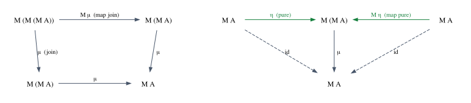
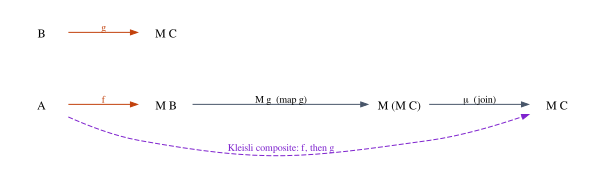

# Monads and Effects

Count the question marks in the last Rust function you wrote. Each one says the
same thing: "evaluate this; if it produced a value, continue with that value;
otherwise stop here and hand the failure to my caller". You call `and_then` on
an `Option` for the same reason. You call `flat_map` on an iterator when every
element produces several results and you want all of them in one sequence. You
write `.await` when a step may have to wait for the network before the rest of
the function can run. Four spellings, in four corners of the language, of one
pattern: *run a step that does something more than return a value, then feed
its value to the rest of the computation.*

The pattern has a name and a theory. In Chapter 16 you saw that types and
functions form a category. But a parser that may fail, a lookup that may find
several answers, a step that updates a counter or waits for a socket: each of
these has an **effect**, and functions with effects do not compose the way the
category of types expects. At the end of the 1980s Eugenio Moggi proposed a
uniform account of such "notions of computation" (his paper *Notions of
computation and monads* appeared in 1991): an effectful function from $A$ to
$B$ is a pure function from $A$ to $M\,B$, where the type constructor $M$
describes the effect, and a **monad** is exactly the structure that makes such
functions compose again. Philip Wadler then showed functional programmers how to
structure programs with the idea (*Monads for functional programming* is his
best-known tutorial), and in the 1990s Haskell adopted monads to bring input and
output into a pure language. Lean inherited the design.

This chapter, the last of Part IV, defines monads in three equivalent ways and
proves that they agree. Then it follows the idea into both languages. Rust has
many monads and no `Monad`: we will see exactly which features of Rust stand in
the way (the missing higher-kinded types of Chapter 17, and the difference
between `FnOnce` and `FnMut`), and what Rust does instead. Lean has a `Monad`
class, `do` notation and monad transformers, and it lets us state and prove the
laws that Rust can only test.

**In this chapter you will learn:**

- why functions with effects break "functions as morphisms", and how Kleisli
  arrows $A \to M\,B$ repair composition;
- the definition of a monad (`M`, `pure`, `bind`) with its three laws, and the
  equivalent definitions with `join` and with Kleisli composition;
- how `?`, `and_then`, `flat_map` and `.await` implement `bind` in Rust, and why
  Rust has no `Monad` trait;
- how Lean's `Monad` class and `do` notation work, what a `do` block desugars
  into, and what `LawfulMonad` and `IO` are;
- how to build a monad class with laws from scratch, prove the laws for
  `Option`, `List` and `State`, and build the Kleisli category of any monad on
  the `Category` class of Chapter 16;
- how monad transformers (`StateT`, `ExceptT`) combine effects, how Rust
  combines them ad hoc, and how adjunctions give rise to monads.

## When functions have effects

### Composition breaks

Here are two small functions from this chapter's main Rust example,
`code/rust/examples/ch20_monads.rs`. The first parses a quantity typed by a
user, the second checks that it is in range:

```rust
{{#include ../../code/rust/examples/ch20_monads.rs:kleisli_arrows}}
```

In the category of types and functions of Chapter 16, each is a morphism:
`parse_qty` from `&str` to `Option<u32>`, `check_qty` from `u32` to
`Option<u32>`. We would like to *compose* them, but composition requires the
target of the first morphism to be the source of the second, and `Option<u32>`
is not `u32`: `check_qty(parse_qty(s))` does not compile.

You know how to fix this. You write the glue by hand:

```rust
{{#include ../../code/rust/examples/ch20_monads.rs:compose_option}}
```

`compose_option` runs `f`; if it produced a value, it runs `g` on it; if not,
the composite fails. Look at what we did: we started reading `parse_qty` as a
*partial* function from `&str` to `u32`, a function with an effect (it may
fail), and defined a new way of composing such functions that takes care of the
effect.

The same move works for every effect. Suppose $M$ is a type constructor that
describes an effect. A function with that effect from $A$ to $B$ is represented
by a plain function

$$
f : A \to M\,B
$$

and such a function is called a **Kleisli arrow** from $A$ to $B$ (after the
mathematician Heinrich Kleisli). Here are the effects this chapter meets, with
the type constructor that describes each:

| Effect | $M\,B$ | Rust | Lean |
|---|---|---|---|
| may fail | $B + 1$ | `Option<B>` | `Option B` |
| may fail with an error $E$ | $B + E$ | `Result<B, E>` | `Except E B` |
| has many possible results | lists of $B$ | `Vec<B>`, iterators | `List B` |
| reads an environment $R$ | $R \to B$ | a `&R` parameter | `ReaderM R B` |
| reads and writes a state $S$ | $S \to B \times S$ | a `&mut S` parameter | `StateM S B` |
| writes a log $W$ | $B \times W$ | a `&mut Vec<_>` parameter | Mathlib's `Writer W B` |
| interacts with the world | (opaque) | any function at all | `IO B` |
| may suspend and resume | (opaque) | `impl Future<Output = B>` | (not in this book) |

Two things stand out in the Rust column. Several entries are not type
constructors at all: Rust handles state with `&mut`, and it does not record
input and output in types, since any Rust function may print or open a file.
And where Rust does have a type constructor, each one comes with its own
syntax: `?`, `for`, `.await`. Both observations will matter.

### Effects as typing rules

Moggi's idea can be stated as two typing rules. Distinguish *values* of type
$\tau$ from *computations* of type $M\,\tau$, which may have the effect $M$
when they run and then produce a $\tau$. Two rules connect the two worlds:

$$
\dfrac{\Gamma \vdash e : \tau}{\Gamma \vdash \mathsf{pure}\ e : M\,\tau}\;\textsf{T-Pure}
\qquad\qquad
\dfrac{\Gamma \vdash e_1 : M\,\tau_1 \qquad \Gamma,\, x : \tau_1 \vdash e_2 : M\,\tau_2}{\Gamma \vdash \mathtt{let}\ x \Leftarrow e_1;\ e_2 : M\,\tau_2}\;\textsf{T-Bind}
$$

Rule T-Pure says that a value can always be seen as a computation that has no
effect. Rule T-Bind is rule T-Let of Chapter 1, for computations: run $e_1$,
which may have its effect and then produces a $\tau_1$; bind that result to
$x$; continue with $e_2$, in which $x$ is a plain $\tau_1$. The whole is again
a computation in $M$.

Notice what is missing: no rule takes you from $M\,\tau$ back to $\tau$.
You can use the result of a computation only *inside a larger computation of
the same kind*. You know this discipline from Rust: once a step may fail,
everything that depends on its result may fail too, unless you handle the
failure explicitly. The arrow $\Leftarrow$ in T-Bind is spelled `let x = e1?;` in Rust for
`Option` and `Result`, `let x = e1.await;` for futures, and `let x ← e1` in a
Lean `do` block.

## Monads: `pure`, `bind` and three laws

### The definition

**Definition.** A **monad** consists of

- a type constructor $M$, which takes a type $A$ to a type $M\,A$;
- for every type $A$, an operation $\mathsf{pure} : A \to M\,A$;
- for all types $A$ and $B$, an operation
  $\mathsf{bind} : M\,A \to (A \to M\,B) \to M\,B$;

such that, for all values $a$, computations $m$ and functions $f$ and $g$ of the
appropriate types, three **laws** hold:

$$
\mathsf{bind}(\mathsf{pure}\ a,\ f) = f\ a \qquad\qquad \textsf{(left identity)}
$$

$$
\mathsf{bind}(m,\ \mathsf{pure}) = m \qquad\qquad \textsf{(right identity)}
$$

$$
\mathsf{bind}(\mathsf{bind}(m,\ f),\ g) = \mathsf{bind}(m,\ \lambda a.\ \mathsf{bind}(f\ a,\ g)) \qquad \textsf{(associativity)}
$$

`pure` and `bind` are rules T-Pure and T-Bind turned into functions. `pure a` is
the computation that does nothing and returns `a`. `bind m f` runs `m`, passes
its result to `f`, and runs the computation that `f` returns. For `Option`,
`pure` is `Some` and `bind` is `and_then`. For `Vec`, `pure a` is `vec![a]` and
`bind` is `flat_map` followed by `collect`. Mathematicians call this
presentation a *Kleisli triple*; Haskell spells `bind m f` as `m >>= f`, and so
does Lean.

The laws are easiest to understand as **refactorings that must not change what
a program means**:

- *Left identity*: `let x ⇐ pure a; e` can be replaced by `e` with `a` for `x`.
  A step without an effect can be inlined.
- *Right identity*: `let x ⇐ m; pure x` can be replaced by `m`. A block that ends
  by returning the result of its last step unchanged *is* that last step.
- *Associativity*: given three steps, it does not matter whether you extract
  the first two or the last two into a helper function. "Extract function" is a
  safe refactoring.

### The laws as category laws

The glue we wrote for `Option` works for any monad. **Kleisli composition** is
defined, for $f : A \to M\,B$ and $g : B \to M\,C$, by

$$
g \circ_M f \;=\; \lambda a.\ \mathsf{bind}(f\ a,\ g) \;:\; A \to M\,C
$$

Rewrite the three laws with it. Left identity says $g \circ_M \mathsf{pure} = g$,
right identity says $\mathsf{pure} \circ_M f = f$, and associativity says

$$
h \circ_M (g \circ_M f) = (h \circ_M g) \circ_M f
$$

These are exactly the laws of a category from Chapter 16, with $\mathsf{pure}$
as the identity. (The names "left" and "right" cross over because $\circ$ is
written right to left.) So we have found a new category:

> For every monad $M$, the **Kleisli category** of $M$ has types as objects,
> Kleisli arrows $A \to M\,B$ as morphisms from $A$ to $B$, $\mathsf{pure}$ as
> identities and $\circ_M$ as composition. The monad laws are the category laws.

Later in the chapter Lean checks this in both directions: the monad laws imply
the category laws, and conversely.

### `map` and `join`

Category theorists usually present a monad differently: as a functor with two
natural transformations. Every monad is a functor in the sense of Chapter 17,
because `map` can be defined from the other two operations:

$$
\mathsf{map}\ f\ m = \mathsf{bind}(m,\ \lambda a.\ \mathsf{pure}\,(f\ a))
$$

and the functor laws follow from the monad laws (we prove it in Lean below).
Next to `pure`, which category theorists call $\eta$ (eta, the *unit*), there
is a flattening operation $\mu$ (mu, the *multiplication*), which programmers
call `join`:

$$
\mu_A : M\,(M\,A) \to M\,A \qquad\qquad \mu_A(mm) = \mathsf{bind}(mm,\ \lambda m.\ m)
$$

You have used it: `Option::flatten` turns an `Option<Option<T>>` into an
`Option<T>`, and `Iterator::flatten` turns an iterator of iterators into one
iterator. Both $\eta$ and $\mu$ are natural transformations (Chapter 18), from
the identity functor to $M$ and from $M \circ M$ to $M$, and the monad laws
become three equations between them:

$$
\mu_A \circ M\mu_A = \mu_A \circ \mu_{M A} \qquad\qquad \mu_A \circ \eta_{M A} = \mathrm{id}_{M A} = \mu_A \circ M\eta_A
$$

The first says that a computation with three layers can be flattened from the
inside or from the outside with the same result. The other two say that adding
a trivial layer, outside or inside, and flattening it again does nothing.



The two presentations are interchangeable. We just defined `map` and `join`
from `bind`; conversely, `bind` is "map, then flatten":

$$
\mathsf{bind}(m,\ f) = \mu\,(\mathsf{map}\ f\ m)
$$

which is why Rust's `flat_map` has that name. In this language the Kleisli
composite is $g \circ_M f = \mu_C \circ M g \circ f$: apply $f$, map $g$ over the
result (which gives two layers of effects), and flatten.



> [!NOTE]
> The $\mu$/$\eta$ presentation explains a famous line from Saunders Mac Lane's
> *Categories for the Working Mathematician*: a monad is a monoid in the category
> of endofunctors. The "product" of two endofunctors is their composite; $\mu$ is
> a multiplication $M \circ M \to M$, $\eta$ a unit $\mathrm{Id} \to M$, and the
> three equations above are the associativity and unit laws of a monoid
> (Chapter 14). You will see a down-to-earth instance of this below: the laws of
> the `Writer` monad are literally the monoid laws of its log.

## Monads you already use in Rust

### `?` is bind

Here is one function written three ways. All three parse a quantity, check it,
and compute how many boxes it fills at two units per box:

```rust
{{#include ../../code/rust/examples/ch20_monads.rs:three_ways}}
```

The program checks that the three agree on every sample and prints the results
of `compose_option(parse_qty, check_qty)` (as `read_qty`) and of the three
versions (as `boxes`):

```text
{{#include ../../code/rust/output/ch20_monads.txt:1:4}}
```

The `match` version is, conceptually, what the compiler does with `?` on an
`Option`. Read `let n = parse_qty(s)?; REST` as
`parse_qty(s).and_then(|n| REST)`, where `REST` is *the rest of the function
body*: the continuation that receives the value. If there is no value, the
continuation is skipped with an early `return`. That is `bind`, with an
implicit continuation.

The real desugaring goes through two standard library traits. Roughly, `e?`
becomes a `match` on `Try::branch(e)`, which returns
`ControlFlow::Continue(v)` (continue with `v`) or `ControlFlow::Break(r)`, in
which case the function returns `FromResidual::from_residual(r)`. Both traits
are unstable (feature `try_trait_v2`), so on stable Rust `?` works only for the
standard library's types (`Option`, `Result`, `ControlFlow` and `Poll` values
wrapping them): `bind` for a fixed list of monads.

For `Result`, `?` does one more thing:

```rust
{{#include ../../code/rust/examples/ch20_monads.rs:result_question}}
```

```text
{{#include ../../code/rust/output/ch20_monads.txt:5:8}}
```

The first `?` meets a `ParseIntError`, but the function returns
`Result<u32, OrderError>`. `bind` for `Result<_, E>` would keep the error type;
`?` converts it with `From::from`, hence our `From<ParseIntError>` impl. (For
the second `?`, the blanket `impl<T> From<T> for T` makes the conversion the
identity.) As a typing rule, a model in the style of Chapter 1, with
$\mathsf{ret}$ the return type of the enclosing function:

$$
\dfrac{\Gamma \vdash e : \mathtt{Result}\langle \tau, E \rangle \qquad \mathsf{ret} = \mathtt{Result}\langle \sigma, F \rangle \qquad F : \mathtt{From}\langle E \rangle}{\Gamma \vdash e\mathtt{?} : \tau}\;\textsf{T-Try}
$$

The conclusion gives `e?` the *unwrapped* type $\tau$: that is how the rest of
the function gets to see a plain value, as in rule T-Bind. And the premise
about $\mathsf{ret}$ shows that the monad is fixed by the function's return
type: one function body, one monad. Using `?` on an `Option` inside a function
that returns a `Result` is rejected:

```rust
{{#include ../../code/rust/compile_fail/ch20_question_mark_option.rs:mismatch}}
```

```text
{{#include ../../code/rust/compile_fail/ch20_question_mark_option.stderr}}
```

The suggested fix, `.ok_or(...)?`, first translates the `Option` into a
`Result`, a translation between monads that respects `pure` and `bind` (a
*monad morphism*). Lean inserts such translations automatically, as we will
see when we combine effects.

### `and_then`, `flat_map` and iterator adapters

`Option::and_then` and `Result::and_then` are `bind` with an explicit closure.
For sequences, `bind` is `Iterator::flat_map`: apply a function that returns
many results to every element, and concatenate. Here it is at work on a
nondeterministic question, "which warehouses and carriers could ship this
item?":

```rust
{{#include ../../code/rust/examples/ch20_monads.rs:flat_map}}
```

```text
{{#include ../../code/rust/output/ch20_monads.txt:9:12}}
```

Read `shipping_options` as T-Bind twice: choose a warehouse `w`, then a
carrier `c` for it, then return the pair. The list monad explores every choice.
An empty list means "no possible result", so `Vec` generalizes `Option`, which
is a list with at most one element.

Other iterator adapters are monad operations in disguise: `flatten` is
`join`, and `iter.collect::<Option<Vec<_>>>()` turns a sequence of
computations that may fail into one computation that fails if any of them
does, an operation we will meet again as `sequence`.

The example also checks the three laws for `Option` and `Vec` on samples:

```rust
{{#include ../../code/rust/examples/ch20_monads.rs:laws}}
```

```text
{{#include ../../code/rust/output/ch20_monads.txt:13:13}}
```

As in Chapter 14, a Rust test can confirm the laws on the inputs we thought of
and nothing more. The Lean instances below prove them for all inputs.

### State, the hard way and the Rust way

`Option`, `Result` and `Vec` look like containers. The state monad does not:
a computation in it is a *function* from the current state to a result and a new
state. We can build it in Rust with closures:

```rust
{{#include ../../code/rust/examples/ch20_monads.rs:state_monad}}
```

Each closure has its own anonymous type (Chapter 8), and `bind` must return a
single type whatever closures it was given, so the closure goes into a
`Box<dyn FnOnce(S) -> (A, S)>`, an existential package (Chapter 15); `+ 'a`
says that what it captures must live at least as long as `'a`. `bind` builds a
closure that runs `self`, feeds the result to `f`, and runs the computation `f`
returns from the intermediate state `s1`. Here is a program that gives every
order line a fresh ticket number, next to what a Rust programmer would write:

```rust
{{#include ../../code/rust/examples/ch20_monads.rs:label}}
```

```text
{{#include ../../code/rust/output/ch20_monads.txt:14:16}}
```

Both versions produce the same lines and leave the counter at 103. The monadic
one allocates a box for every `bind`, needs lifetime annotations, and reads
inside out; the `&mut` one is short, fast and obvious. The state monad is how
languages without mutation express state. Rust has *controlled* mutation
instead: a `&mut u32` is a unique, temporary permission to change the
counter, and the borrow checker (Part VI) guarantees that nobody else observes
the counter meanwhile. Threading the state through a function
$S \to A \times S$ and lending a unique mutable reference are two answers to
the same question. Likewise, the reader monad is an extra `&Config` parameter
in Rust, and the writer monad a `&mut Vec<String>` parameter.

## async and await: a monad built into the compiler

A future is a computation that may have to wait. The `Future` trait has one
method, `poll`, which returns `Poll::Ready(value)` or `Poll::Pending` ("not yet,
poll me again later"). Something has to keep calling `poll`: an **executor**.
`code/rust/examples/ch20_async.rs` contains the smallest executor that works
with the standard library alone:

```rust
{{#include ../../code/rust/examples/ch20_async.rs:block_on}}
```

`pin!` fixes the future in place on the stack (a future may hold references
into itself, so it must not move once polled), and `Waker::noop()` is a waker
that does nothing, enough for an executor that polls again at once. Here is a
future that is not ready the first time, standing in for a network round
trip:

```rust
{{#include ../../code/rust/examples/ch20_async.rs:network_delay}}
```

And here is a price quote that fetches prices from a simulated service:

```rust
{{#include ../../code/rust/examples/ch20_async.rs:quote}}
```

```text
{{#include ../../code/rust/output/ch20_async.txt}}
```

Each `fetch_price` waits once, so the first quote needs three polls: two that
stop at a `network_delay`, and one that finishes. The second quote stops at
`"screws"`: the `?` returns the error and the nuts are never priced.

In monadic terms, `impl Future<Output = B>` is a computation $M\,B$, `.await`
is `bind`, an `async` block is a block of T-Bind steps, `std::future::ready`
is `pure`, and the executor is what *runs* the monad, as `run` did for our
`State`. We can even write `bind` for futures with `async` itself:

```rust
{{#include ../../code/rust/examples/ch20_async.rs:and_then}}
```

The last line of the output shows `and_then(ready(20), |n| ready(n + 1))`
completing at the first poll, as left identity predicts. (The program also
checks left identity on `fetch_price`.)

The compiler does not implement `async` with closures and `bind`, though. It
turns the body of an `async fn` into a state machine, roughly an `enum` with a
variant for every `.await` at which the function can be suspended, holding the
local variables alive at that point. That is how `quote` can update `total` in
a `for` loop across suspension points. And notice `.await?`: `quote` has *two*
effects, suspension and failure, stacked on top of each other. Lean needs a
library construction for that, monad transformers; Rust builds it into the
syntax.

## Why Rust has no `Monad` trait

Rust has all these monads, but no trait that they share, and no way to write a
function once for all of them. There are three reasons, and the second is the
most interesting.

### No higher-kinded types

A `Monad` trait would have to abstract over `Option` itself, a type
constructor of kind $\mathsf{Type} \to \mathsf{Type}$, but Rust's traits
abstract over types. Chapter 17 met this obstacle for `Functor`, and the
workaround: a "family" trait, in which a marker type stands for the type
constructor and a generic associated type applies it. The monad version is in
`code/rust/examples/ch20_monad_trait.rs`:

```rust
{{#include ../../code/rust/examples/ch20_monad_trait.rs:monad_trait}}
```

With it we can finally write code once for every monad:

```rust
{{#include ../../code/rust/examples/ch20_monad_trait.rs:generic}}
```

`pair` combines two computations into a computation of pairs, and `sequence`
turns a list of computations into a computation of a list. The same code means
very different things in different monads:

```rust
{{#include ../../code/rust/examples/ch20_monad_trait.rs:use_generic}}
```

```text
{{#include ../../code/rust/output/ch20_monad_trait.txt}}
```

For `Option`, `pair` succeeds only if both sides do, and `sequence` is
all-or-nothing, like `collect::<Option<Vec<_>>>()`. For `Vec`, `pair` is the
cartesian product and `sequence` enumerates every combination of choices. One
definition, two effects: that is what an abstraction over monads buys.

It comes at a price, visible in every call: the turbofish `::<OptionM, ...>`.
Leave it out, and the compiler gives up:

```rust
{{#include ../../code/rust/compile_fail/ch20_monad_family_inference.rs:family}}
```

```text
{{#include ../../code/rust/compile_fail/ch20_monad_family_inference.stderr}}
```

The note is the heart of the matter: the compiler must solve
`<_ as Monad>::Of<u32> == Option<u32>` for the blank, and it will not, because
two different markers could both declare `type Of<T> = Option<T>`. A real
higher-kinded parameter `M` with `M<u32> = Option<u32>` would determine
`M = Option` by unification (Chapter 13); a type family does not.

### `FnOnce` or `FnMut`?

Look again at the closure bounds. `Option::and_then` takes an `FnOnce`, while
`Iterator::flat_map` takes an `FnMut`. This is no accident: `bind` for `Option`
calls its continuation at most once, `bind` for `Vec` once per element. In
Chapter 8 the three closure traits answered the question "how many times may
this closure be called?", and the answer differs between the two monads.

A single `Monad` trait has to choose one bound. If it chooses `FnOnce`, the
`Vec` instance cannot be written:

```rust
{{#include ../../code/rust/compile_fail/ch20_vec_bind_fnonce.rs:bind_once}}
```

```text
{{#include ../../code/rust/compile_fail/ch20_vec_bind_fnonce.stderr}}
```

Calling an `FnOnce` consumes it, so the second iteration of the loop would use
a moved value. This is error E0382, the same error as using a moved `String`
twice: in Part V's terms, an `FnOnce` closure is a resource that can be used
once, and calling it twice would need contraction. If the trait chooses
`FnMut`, as ours does, then `Vec` is fine, but every `Option` user pays:

```rust
{{#include ../../code/rust/compile_fail/ch20_option_bind_fnmut.rs:give_away}}
```

```text
{{#include ../../code/rust/compile_fail/ch20_option_bind_fnmut.stderr}}
```

The closure gives away the `String` it captured. That is fine for a closure
that runs once, and `id.and_then(move |n| Some((n, customer)))` compiles. But
an `FnMut` closure must be ready to run again, and a second run would have no
`customer` left to give away, as the help message explains. The same cost
appears in our generic functions: `pair` and `sequence` need `Clone` bounds and
call `clone()` inside their closures, copies that `Option` never needs.

In Haskell or Lean every value can be used as often as you like, so the
question "how many times will `bind` run the continuation?" never comes up, and
one `Monad` class covers both cases. In Rust the question is part of the type,
because closures own what they capture. The textbook definition of a monad
does not ask how often a function $A \to M\,B$ will be called; Rust's
ownership discipline makes that a real difference. It is Part V's resource
reading of types, showing up far from ownership itself.

### Control flow and borrowing

The third reason is practical. `?` and `.await` are not closures: they can sit
inside a loop or a `match` arm, `return` from the function, and hold a mutable
borrow of a local variable across several steps, as `quote` does with `total`.
A closure passed to `and_then` cannot `return` from the enclosing function or
`break` out of its loop, and a closure that captures `&mut total` conflicts
with every other use of `total` while it exists.

So Rust took a different road. It has the *instances* (`Option`, `Result`,
iterators, futures) and *dedicated syntax* for the most important ones (`?`,
`for`, `.await`), each zero-cost and each composing with the others (`.await?`
works). Other effects are expressed with `&mut`, with parameters, or not at
all (input and output). What Rust gives up is the abstraction: there is no
`sequence` for every monad, and no way to give a new effect its own `?` on
stable Rust.

## Monads in Lean

### The `Monad` class and `do` notation

Lean's core library defines monads with a small hierarchy of type classes
(Chapter 14). The two operations come from the classes `Pure` and `Bind`, and
`Monad` extends both (through `Applicative`, which this chapter does not need).
The code is in `code/lean/Book/Ch20/DoNotation.lean`:

```lean
{{#include ../../code/lean/Book/Ch20/DoNotation.lean:core_ops}}
```

Read the second signature with all implicit arguments shown: for any type
constructor `m` (`u_1` and `u_2` are universe variables, Chapter 12) that has a
`Bind` instance (the square brackets mark an instance argument), and any types
`α` and `β`, `bind` takes an `m α` and a function `α → m β` and returns an
`m β`: the definition of a monad, minus the laws. `x >>= f` is notation for
`bind x f`. The core library has instances for `Option`, `Except ε`, `Id`, the
state and reader monads, `IO` and more, but none for `List`; Mathlib adds one
in `Mathlib.Data.List.Monad`.

As you saw in Chapter 2, monadic code in Lean is usually written with `do`
notation. Here is the boxes computation of the Rust example:

```lean
{{#include ../../code/lean/Book/Ch20/DoNotation.lean:read_qty}}
```

`let n ← parseQty s` is rule T-Bind: run `parseQty s`, and if it produces a
value, call it `n`. `return` is `pure`. To see what Lean makes of the block,
print the definition with notation switched off (`set_option pp.notation false
in` turns off all notation for the next command, so that `>>=`, `do` and even
`+` and `/` are shown as plain function applications):

```lean
{{#include ../../code/lean/Book/Ch20/DoNotation.lean:desugar}}
```

There is no magic. Each `let x ← e` becomes `bind e (fun x => ...)`, with the
rest of the block as the body of the function: the continuation, exactly as for
Rust's `?`. The `example` confirms that the `do` block and the hand-written
chain of `>>=` are the same term (`rfl` proves it). Nested actions follow the
same scheme: `(← e)` inside an expression means "run `e` first, and use its
result here":

```lean
{{#include ../../code/lean/Book/Ch20/DoNotation.lean:nested}}
```

The elaborator named the two results `__do_lift` and `__do_lift_1` and moved
both binds in front of the addition, left to right. The other constructs of
`do` desugar in the same spirit: a line `e` whose result is unused becomes
`bind e (fun _ => ...)`, `let x := e` is an ordinary `let`, and the `let mut`
variables and `for` loops of Chapter 2 become state passed from one iteration
to the next.

### `LawfulMonad`

Lean's `Monad` class does not mention the laws, so an instance may break them.
A separate `Prop`-valued class, `LawfulMonad m`, collects them as proof
obligations, like the `LawfulMonoid` of Chapter 14. Its fields include
`pure_bind` (`pure x >>= f = f x`) and `bind_assoc`, together with laws
relating `bind` to `map` and `<*>` from `Functor` and `Applicative`. Right
identity is not a field but a theorem, `bind_pure`, derived from the others.
For a lawful monad the laws become rewriting rules for `do` blocks, proved
here for an arbitrary monad `m`:

```lean
{{#include ../../code/lean/Book/Ch20/DoNotation.lean:laws_as_rewrites}}
```

`simp only [l]` rewrites the goal with the lemma `l` and closes it if both
sides become equal. The third `example` is a curiosity worth knowing: the `do`
elaborator *itself* applies right identity, turning `let a ← x; pure a` into
plain `x`, so `rfl` proves the equation. The language relies on a law that the
`Monad` class does not require. The core library's monads are lawful:

```lean
{{#include ../../code/lean/Book/Ch20/DoNotation.lean:lawful_instances}}
```

### `IO`

`IO α` is the type of computations that may interact with the outside world
and then produce an `α`. Defining one does nothing; running it is a separate
step, performed by the Lean runtime when the action is a program's `main`, or by
`#eval` in the editor:

```lean
{{#include ../../code/lean/Book/Ch20/DoNotation.lean:io}}
```

Because actions are values, you can store them and decide later in which
order to run them. Here a list of three actions is built (printing nothing),
then run in reverse; each action also increments a mutable reference created
with `IO.mkRef`:

```lean
{{#include ../../code/lean/Book/Ch20/DoNotation.lean:io_values}}
```

The messages come out in the order the actions were *run*, not the order in
which they were *built*, and the final `3` is the value of the whole action.
A Rust function call performs its effects; a Lean `IO` value only describes
them.

What is an `IO` action, then? Lean's own definitions answer:

```lean
{{#include ../../code/lean/Book/Ch20/DoNotation.lean:io_def}}
```

`IO` is `EIO IO.Error`, `EIO ε` is `EST ε IO.RealWorld`, and an `EST ε σ α` is
a function that takes a token of type `Void σ` and returns an `EST.Out ε σ α`:
a result or an error, each paired with a new token. So `IO` is a state monad
with exceptions, whose "state" is a token standing for the whole world
(`IO.RealWorld`). The token carries no data; passing it from step to step
forces the steps to happen in order. (This `Void σ` is an opaque token type,
unrelated to the empty `Void` of Chapter 10.) The most impure-looking monad of
all is, in its type, the state monad you are about to build, plus errors.

## A monad class from scratch

Lean's `Monad` and `LawfulMonad` split the operations from the laws and carry
extra structure. To see the essentials, we build our own class, with the laws
as fields, in `code/lean/Book/Ch20/Monad.lean`. Inside
`namespace Ch20` the name `Monad` refers to this class, which shadows Lean's
(still available as `_root_.Monad`); that file does not use `do` notation, so
we write `Monad.bind` and `Monad.pure` explicitly.

### The class and three instances

```lean
{{#include ../../code/lean/Book/Ch20/Monad.lean:monad_class}}
```

This is the mathematical definition, word for word, in the style of the
`Category` class of Chapter 16: two operations, then three fields whose types
are the laws. An instance must supply the operations *and* the proofs.
`Option` first:

```lean
{{#include ../../code/lean/Book/Ch20/Monad.lean:option_monad}}
```

Left identity holds by `rfl`: `bind (pure a) f` is a `match` on `some a`, which
computes to `f a`. The other two laws need a case split on `m`, because a
`match` on an unknown `m` cannot compute. `cases m` produces two goals, one for
`none` and one for `some a`, and the combinator `<;>` runs the tactic after it,
`rfl`, on every goal that `cases` produced. In each case both sides compute to
the same value: for `bind_assoc`, both sides are `none` in the first case and
`bind (f a) g` in the second. `Except ε` is identical except for the
constructor names:

```lean
{{#include ../../code/lean/Book/Ch20/Monad.lean:except_monad}}
```

Lists need induction. We write `bind` for lists ourselves (it is `flatMap`, the
`flat_map` of Rust) and prove the lemma that associativity needs: `bind`
distributes over concatenation.

```lean
{{#include ../../code/lean/Book/Ch20/Monad.lean:list_bind}}
```

The proof is by induction on `xs`. The empty case holds by computation. In the
`cons` case, `simp only` rewrites with four facts: `List.cons_append` moves the
head out of the concatenation, `(x :: xs) ++ ys = x :: (xs ++ ys)`; the
equations of `listBind` unfold one step on both sides; the induction
hypothesis `ih` replaces `listBind (xs ++ ys) f`; and `List.append_assoc`
regroups `f x ++ (listBind xs f ++ listBind ys f)` so that both sides become
identical. With the lemma, the instance follows:

```lean
{{#include ../../code/lean/Book/Ch20/Monad.lean:list_monad}}
```

`pure_bind` needs only `simp [listBind]`: `listBind [a] f` unfolds to
`f a ++ []`, and `simp` knows that appending `[]` changes nothing. The other
two laws go by induction on `m`. Here are the instances at work on the examples
of the Rust program:

```lean
{{#include ../../code/lean/Book/Ch20/Monad.lean:examples}}
```

### Derived operations and their laws

`map`, `join` and Kleisli composition can now be defined once, for every
instance of the class:

```lean
{{#include ../../code/lean/Book/Ch20/Monad.lean:derived}}
```

The claims of the first part of the chapter become theorems. The functor laws
of Chapter 17 hold for `map`:

```lean
{{#include ../../code/lean/Book/Ch20/Monad.lean:functor_laws}}
```

`map_id` is right identity in disguise: `map (fun a => a) m` *is*
`bind m (fun a => pure a)`, which Lean accepts as `bind m pure`, and the proof
term is the law itself. For `map_comp`, `simp only [map]` unfolds `map`
everywhere, `rw [Monad.bind_assoc]` reassociates the double `bind` on the
right-hand side, and the inner `bind (pure (f a)) _` that appears is removed by
left identity. The equivalence of the `bind` and `join` presentations, and the
three laws of `join` from the diagram above, are proved the same way:

```lean
{{#include ../../code/lean/Book/Ch20/Monad.lean:join_laws}}
```

`join_map_pure` shows a useful trick: rewriting *backwards* with
`← bind_eq_join_map` turns `join (map pure m)` into `bind m pure`, and then
right identity finishes. Finally, the three laws restated for Kleisli
composition:

```lean
{{#include ../../code/lean/Book/Ch20/Monad.lean:kleisli_laws}}
```

Each statement is an equation between functions, so the proof starts with
`funext a` (two functions are equal if they agree on every argument, as in
Chapter 16) and finishes with the corresponding monad law applied at `a`. The
library's lawful monads are instances of our class too:

```lean
{{#include ../../code/lean/Book/Ch20/Monad.lean:of_lawful}}
```

(`abbrev` declares a definition that Lean unfolds eagerly, as instance-like
definitions should be.) It is not an `instance`, so that it does not compete
with the instances above; use it as `Monad.ofLawful (StateM Nat)`.

### State, Reader and Writer

The function-shaped monads are in `code/lean/Book/Ch20/State.lean`. The state
monad first:

```lean
{{#include ../../code/lean/Book/Ch20/State.lean:state_def}}
```

```lean
{{#include ../../code/lean/Book/Ch20/State.lean:state_monad}}
```

All three laws are proved by `rfl`. That may look like cheating, so take
associativity: both sides are functions of a state `s` that run `m` from `s`,
then `f` from the resulting state, then `g` from the state after that; Lean
unfolds the definitions and finds the same function. For right identity Lean
also uses the *eta rule for pairs*: a pair `p` is definitionally equal to
`(p.1, p.2)`. (The Rust `State` could not even be tested with `assert_eq!`:
closures cannot be compared.)

Two primitive operations read and replace the state, and they combine into
`fresh`, which hands out numbers from a counter. With it, the labeling program
of the Rust example:

```lean
{{#include ../../code/lean/Book/Ch20/State.lean:state_ops}}
```

```lean
{{#include ../../code/lean/Book/Ch20/State.lean:label}}
```

The Rust program checked the counter for one input; in Lean we prove what it
is for every input:

```lean
{{#include ../../code/lean/Book/Ch20/State.lean:label_counter}}
```

The induction is on the list, and `generalizing n` makes the induction
hypothesis hold for *every* starting value of the counter (we need it for
`n + 1`, not for `n`). In the `cons` case, `show` replaces the goal by an
equivalent one that Lean can check by computation: running `label (x :: xs)`
from `n` runs `fresh` (which moves the counter to `n + 1`) and then
`label xs` from `n + 1`, and the final `pure` leaves the counter alone. Then
the induction hypothesis at `n + 1` and `List.length_cons` turn the goal into
`n + 1 + xs.length = n + (xs.length + 1)`, which `omega` closes.

The reader and writer monads complete the family:

```lean
{{#include ../../code/lean/Book/Ch20/State.lean:reader}}
```

```lean
{{#include ../../code/lean/Book/Ch20/State.lean:writer}}
```

The reader laws hold by `rfl`. The writer laws are more instructive. In each
proof, `show` spells out what the two sides compute to, and what remains is a
fact about the log: `[] ++ w = w`, `w ++ [] = w`, and the associativity of
`++` (the final `rfl` uses the eta rule for pairs). The three monad laws are
the three monoid laws of the log. Any monoid would do as a log type (Mathlib's
`WriterT` accepts one), and this is the "monoid in the category of
endofunctors" slogan in miniature.

## The Kleisli category

Now we build the category of effectful functions on the book's own `Category`
class, in `code/lean/Book/Ch20/Kleisli.lean`, which imports
`Book.Ch16.Category`. As with the opposite category of Chapter 16, the objects
are wrapped in a structure, so that this category does not clash with
`typeCategory`:

```lean
{{#include ../../code/lean/Book/Ch20/Kleisli.lean:kleisli_obj}}
```

```lean
{{#include ../../code/lean/Book/Ch20/Kleisli.lean:kleisli_category}}
```

A morphism from `a` to `b` is a Kleisli arrow `a.base → M b.base`, the identity
is `pure`, and `comp g f` (first `f`, then `g`, in the order of Chapter 16) is
`kcomp f g`. Each category law is discharged by one of the Kleisli-form
theorems, and each of those came from one monad law. Two of these categories
are worth naming:

```lean
{{#include ../../code/lean/Book/Ch20/Kleisli.lean:kleisli_examples}}
```

The Kleisli category of `Option` is the category of types and *partial
functions*, and `checkM ⊚ parseM` is the composite that Rust's
`compose_option` built by hand. The Kleisli category of `List` is the category
of types and *nondeterministic functions*, which are relations: `stockedAt`
relates an item to every warehouse that has it. (`⟨String⟩` is the anonymous
constructor notation, building an object whose `base` is `String`. The type
`text ⟶ qty` unfolds to `String → Option Nat`, so `parseQty` itself is the
morphism.)

The instance shows that the monad laws *imply* the category laws. They are in
fact equivalent, and to state the converse we need the operations without the
laws:

```lean
{{#include ../../code/lean/Book/Ch20/Kleisli.lean:monad_ops}}
```

```lean
{{#include ../../code/lean/Book/Ch20/Kleisli.lean:laws_iff}}
```

`constructor` splits the `↔` into two implications. In the first, the
destructuring `intro ⟨pure_bind, bind_pure, bind_assoc⟩` names the three bind
laws, `refine ⟨?_, ?_, ?_⟩` leaves one goal for each Kleisli law, and each goal
is the corresponding bind law applied pointwise after `funext`. The converse
contains the one real idea. A Kleisli law talks about functions, but a bind law
talks about a computation `m : M α`. The trick is to see `m` as a Kleisli arrow
out of the unit type, `fun () => m`, applied to `()`. Then
`ops.bind m f` is `ops.kcomp (fun () => m) f ()` by definition, and every bind
law is a Kleisli law applied at `()`. `congrFun h x` turns an equation between
functions `h : g₁ = g₂` into the equation `g₁ x = g₂ x` between their values.
(The left identity case does not even need the trick: `congrFun` at `a`
suffices.)

## Putting it together: an order workflow

Real programs have more than one effect. An order-processing step may fail (an
item is unknown or out of stock) *and* it updates a stock (state). Lean combines
effects with **monad transformers**: a transformer takes a monad `m` and adds
one effect to it. The code is in `code/lean/Book/Ch20/Transformers.lean`, and
the definitions are short enough to state as equations that Lean checks by
`rfl`:

```lean
{{#include ../../code/lean/Book/Ch20/Transformers.lean:transformer_defs}}
```

`StateT σ m` is the state monad with `m`'s effect on each step: a function
from a state to an `m`-computation of a result and a new state. `ExceptT ε m`
is an `m`-computation of a result that may be an error. `ReaderT ρ m` adds an
environment. `StateM σ`, the plain state monad, is `StateT σ` over `Id`, the
monad with no effect at all.

### One workflow, written once

The domain is a small warehouse:

```lean
{{#include ../../code/lean/Book/Ch20/Transformers.lean:domain}}
```

The workflow does not commit to a particular stack of transformers. It is
written against two classes: `MonadStateOf Stock m` ("`m` has a state of type
`Stock`", providing `get` and `set`) and `MonadExceptOf OrderError m` ("`m` can
fail with an `OrderError`", providing `throw` and `try ... catch`). They play
the role of trait bounds, in the dictionary-passing sense of Chapter 14:

```lean
{{#include ../../code/lean/Book/Ch20/Transformers.lean:reserve}}
```

(`List.lookup` returns the quantity paired with an item, if there is one, and
`(·.2)` is a function that takes the second component of a pair: the `·` marks
the argument.) Now there are two natural ways to stack the effects:

```lean
{{#include ../../code/lean/Book/Ch20/Transformers.lean:stacks}}
```

The `rfl` equations show what the two stacks *are*. In `AllOrNothing`, a run
returns either an error, or a result with the new stock. In `KeepGoing`, a run
always returns a stock, with either an error or a result. The types already
tell you what happens when an order fails halfway, and the runs confirm it:

```lean
{{#include ../../code/lean/Book/Ch20/Transformers.lean:runs}}
```

The good order gives the same result in both stacks. The bad order reserves
three bolts, then fails on the nuts. In `AllOrNothing` the failure discards the
state, and the reservation of the bolts with it. In `KeepGoing` the caller gets
the error *and* a stock in which the bolts are reserved, though the order
failed. Transformers do not commute: the order of the stack is a design
decision about what a failure means.

If you want `KeepGoing`'s shape but all-or-nothing behavior, restore the stock
yourself:

```lean
{{#include ../../code/lean/Book/Ch20/Transformers.lean:atomically}}
```

`try ... catch e => ...` runs the handler if the action throws; the handler puts
the saved stock back and rethrows. The bad order now leaves ten bolts in the
warehouse.

Finally, code written for a smaller monad can be used in a bigger one.
`checkLines` lives in plain `Except OrderError`, and `placeChecked` uses it
inside `AllOrNothing` without any conversion:

```lean
{{#include ../../code/lean/Book/Ch20/Transformers.lean:lift}}
```

Lean inserts the translation automatically, through instances of a class
`MonadLift` that says how to run an `m`-computation inside an `n`-computation.
This is the automatic version of Rust's `.ok_or(...)?`.

### The same workflow in Rust

In Rust, the stock is a `&mut` borrow and failure is a `Result` with `?`
(`code/rust/examples/ch20_order_workflow.rs`):

```rust
{{#include ../../code/rust/examples/ch20_order_workflow.rs:domain}}
```

```rust
{{#include ../../code/rust/examples/ch20_order_workflow.rs:reserve}}
```

```rust
{{#include ../../code/rust/examples/ch20_order_workflow.rs:atomically}}
```

```rust
{{#include ../../code/rust/examples/ch20_order_workflow.rs:runs}}
```

```text
{{#include ../../code/rust/output/ch20_order_workflow.txt}}
```

The results match Lean's line for line. Plain `place_order` behaves like
`KeepGoing`: mutations made through `&mut` before the `?` returned are not
undone. `place_order_atomically` behaves like `AllOrNothing`: it works on a
copy and commits only after every step succeeded. Rust reaches both semantics
with two ordinary features, mutation through a borrow and early return, and you
choose by how you write the function. The price is that the type
`fn(&mut Stock, ...) -> Result<u32, OrderError>` does not say which semantics
you got, while `AllOrNothing` and `KeepGoing` do. That is the trade-off of the
whole chapter: Rust's built-in, effect-specific features are cheaper and more
flexible; Lean's monads are more explicit and more abstract, and they come with
laws you can prove.

## In Mathlib: monads and adjunctions

Mathlib defines monads in the categorical style, in
`Mathlib.CategoryTheory.Monad.Basic`: a `CategoryTheory.Monad C` on a category
`C` is an endofunctor `T : C ⥤ C` (Chapter 17) with natural transformations
`η : 𝟭 C ⟶ T` and `μ : T ⋙ T ⟶ T` (Chapter 18; `𝟭 C` is the identity functor
and `⋙` composes functors), satisfying the three equations of our diagram. The
file `code/lean/Book/Ch20/InMathlib.lean` states them in a readable form:

```lean
{{#include ../../code/lean/Book/Ch20/InMathlib.lean:mathlib_monad}}
```

Each law is a field of the structure (`T.assoc`, `T.left_unit`,
`T.right_unit`), written in Mathlib's diagrammatic order, where `f ≫ g` means
"first `f`, then `g`" (Chapter 16). A lawful Lean monad gives such a monad on
the category `Type`:

```lean
{{#include ../../code/lean/Book/Ch20/InMathlib.lean:of_type_monad}}
```

### Adjunctions give monads

Chapter 19 introduced adjunctions through currying: functions $A \times S \to B$
correspond exactly to functions $A \to (S \to B)$, naturally in $A$ and $B$. In
general, an adjunction $L \dashv R$ between functors $L : \mathcal{C} \to
\mathcal{D}$ and $R : \mathcal{D} \to \mathcal{C}$ is a natural correspondence
between morphisms $L\,A \to B$ in $\mathcal{D}$ and morphisms $A \to R\,B$ in
$\mathcal{C}$. Every adjunction yields a monad on $\mathcal{C}$: the functor is
the composite $T = R \circ L$, the unit $\eta : A \to R\,(L\,A)$ is what the
correspondence assigns to the identity of $L\,A$, and $\mu$ is built from the
opposite map $L\,(R\,B) \to B$ (the *counit*). Mathlib's
`Adjunction.toMonad` performs this construction. Apply it to currying, and out
comes a monad you know:

```lean
{{#include ../../code/lean/Book/Ch20/InMathlib.lean:adjunction_monad}}
```

On `Type`, `tensorLeft S` is the functor $A \mapsto S \times A$ (written
`S ⊗ A`, the state on the left), and `coyoneda.obj (Opposite.op S)` is the
functor $B \mapsto (S \to B)$, written `S ⟶ B`. (Mathlib wraps the functions of
its category `Type` in a structure; `↾f` turns a plain function into such a
morphism.) The monad of the currying adjunction sends $A$ to
$S \to S \times A$: the state monad. The `rfl` proofs confirm that its unit is
our `pure` and its multiplication is `join` for state: run the outer
computation, then the inner computation it returned, from the new state. Its
laws come for free from the adjunction.

The construction can be reversed: every monad arises from an adjunction, in
fact from two canonical ones:

```lean
{{#include ../../code/lean/Book/Ch20/InMathlib.lean:monad_from_adjunction}}
```

The first uses the *Eilenberg–Moore category* of `T`, whose objects are
`T`-algebras (objects `X` with a map `T X ⟶ X` compatible with `η` and `μ`), and
`adjToMonadIso` says that its monad is `T` again. The second uses the Kleisli
category, and you can understand it right now: the left adjoint sends a type
$A$ to $A$ as an object of the Kleisli category, the right adjoint sends $A$ to
$M\,A$, and the correspondence between Kleisli morphisms $A \to B$ and plain
functions $A \to M\,B$ is the identity, because that is how Kleisli morphisms
were defined. Monads and adjunctions are two sides of one idea.

## Common confusions

**"A monad is a container."** `Option` and `Vec` look like containers, and the
metaphor helps for them. It fails for `State`, `Reader`, `IO` and futures: a
state computation contains no value at all until you run it from some state. A
monad is a way of *sequencing computations* that have a certain kind of effect;
a container is one special case.

**"Monads make Lean impure."** The opposite. A `State σ α` is a function, an
`IO α` is a value that describes interactions, and every Lean function is still
a mathematical function; the runtime runs `IO` actions outside the logic. In
Rust, effects happen when the code runs, and the type `fn() -> u32` does not
tell you whether the function prints, reads a file or panics.

**"`?` is just `and_then`."** It is `bind` for the rest of the function body,
plus an error conversion through `From`, plus an early `return`. That is why
`?` inside a closure returns from the *closure*, not from the function around
it, and why one function body can use `?` for only one monad, the one named by
its return type (error E0277).

**"The compiler checks the monad laws."** Neither Rust nor Lean's `Monad` class
does. Lean checks them only where you ask for it: a `LawfulMonad` instance, or
a class like ours, requires proofs. Lean's `do` elaborator nonetheless assumes
right identity, so an unlawful instance can behave differently from what its
`do` blocks seem to say.

**"Monad transformers can be stacked in any order."** They cannot: the
order-processing example shows that `StateT σ (Except ε)` and
`ExceptT ε (StateM σ)` give different answers to "what happens to the state when
a step fails?".

## Summary

- An effectful function from $A$ to $B$ is a Kleisli arrow $A \to M\,B$, where
  the type constructor $M$ describes the effect: failure, errors,
  nondeterminism, state, environment, logging, input and output, suspension.
- A monad is a type constructor with `pure : A → M A` and
  `bind : M A → (A → M B) → M B` satisfying left identity, right identity and
  associativity. The laws say that inlining and extracting steps are safe
  refactorings.
- Equivalently, a monad is a functor with natural transformations
  $\eta$ (`pure`) and $\mu$ (`join`) satisfying unit and associativity laws,
  with `bind` = `map` then `join`. Equivalently again, Kleisli arrows form a
  category with `pure` as identity: the monad laws *are* the category laws, as
  proved in Lean in both directions.
- Rust uses monads constantly: `?` is `bind` for `Option` and `Result` (plus a
  `From` conversion), `and_then` and `flat_map` are `bind`, and `.await` is
  `bind` for futures, compiled into a state machine.
- Rust has no `Monad` trait: there are no higher-kinded types (a GAT family
  trait works but needs turbofishes), and `bind` must choose between `FnOnce`
  (which `Vec` cannot implement) and `FnMut` (which costs `Option` users and
  forces `Clone` bounds). Rust handles effects with dedicated syntax, `&mut` and
  parameters instead.
- Lean has `Monad`, `do` notation that desugars into nested `bind`s, and
  `LawfulMonad` for the laws. `IO` is a state-and-exception monad over a token
  that stands for the world.
- Our own class carries the laws as fields; the instances for `Option`,
  `Except`, `List`, `State`, `Reader` and `Writer` prove them, and the Kleisli
  category of any instance is an instance of Chapter 16's `Category`.
- Monad transformers (`StateT`, `ExceptT`, `ReaderT`) combine effects, and the
  order of the stack matters. Rust gets the same two behaviors from `&mut` and
  `?`, but its types do not say which one a function has.
- Every adjunction gives a monad (currying gives the state monad), and every
  monad comes from an adjunction (Eilenberg–Moore, Kleisli).

## Exercises

1. **A counting monad (Lean).** Define `Counted α := α × Nat`, a writer monad
   whose log is the number of steps performed, as an instance of the class in
   `Monad.lean` (`pure a := (a, 0)`, and `bind` adds the counts). Prove the three
   laws, then define `tick : Counted Unit` and check with `#eval` that a
   three-step computation reports a count of 3.
   *Hint:* copy `writerMonad` and replace `[]` and `++` with `0` and `+`; the
   lemmas you need are `Nat.zero_add`, `Nat.add_zero` and `Nat.add_assoc`.

2. **Naturality of `pure` and `join` (Lean).** For an arbitrary instance of our
   class, prove `map f (Monad.pure a) = Monad.pure (f a)` and
   `map f (join mm) = join (map (map f) mm)`. These say that $\eta$ and $\mu$
   are natural transformations (Chapter 18).
   *Hint:* the first is one `simp only [map, Monad.pure_bind]`. For the second,
   unfold `map` and `join`, reassociate with `rw [Monad.bind_assoc]` (as often
   as needed), and use `Monad.pure_bind` to remove the `pure` steps.

3. **Writer in Rust.** Write `struct Writer<A> { value: A, log: Vec<String> }`
   with `pure`, `bind` and a `tell` operation, and check the three laws with
   `assert_eq!` on a few samples. Can your `bind` take an `FnOnce`? Why is that
   compatible with the discussion of `FnOnce` and `FnMut` in this chapter?
   *Hint:* `bind` calls the continuation exactly once, as for `Option`; derive
   `PartialEq` and `Debug` to compare results.

4. **Desugar by hand (Lean, pen and paper).** Write `boxes_result` from
   `ch20_monads.rs` as a Lean function in `Except String` with a `do` block.
   Write down, on paper, the term it desugars into, then check your answer with
   `set_option pp.notation false in #print`.
   *Hint:* `String.toNat?` returns an `Option`; turn it into an `Except` with a
   `match`, or with `.elim`. Every `let x ← e` becomes `bind e (fun x => ...)`.

5. **A third layer (Lean).** Add a limit on the number of units per order line
   to the workflow of `Transformers.lean`, read from an environment with
   `ReaderT`. Run the good and bad orders in
   `ReaderT Nat AllOrNothing` with limits 5 and 10, and explain the outputs.
   *Hint:* inside the new `reserve`, `let limit ← read` gives the environment;
   `get`, `set` and `throw` are lifted through `ReaderT` automatically; run with
   `((placeOrder good).run 10).run warehouse`.

6. **The price of `FnMut` (Rust).** Make `compile_fail/ch20_option_bind_fnmut.rs`
   compile without changing the signature of `bind_option`. Then explain, in
   terms of Chapter 8's closure traits and Chapter 10's remark that duplicating a
   value needs `Clone`, why your fix is necessary for an `FnMut` closure but not
   for an `FnOnce` one.
   *Hint:* the closure must still own a `String` after it runs; return
   `customer.clone()`.
