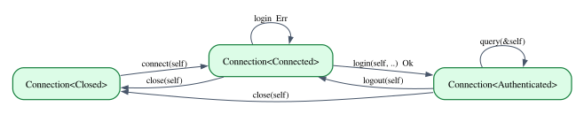
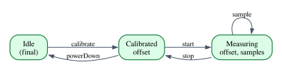

# Typestate: Protocols in Types

Most interfaces come with rules about order. Connect before you log in; log in
before you query; calibrate an instrument before you start a measurement, and stop
the measurement before you power it down; set the URL of a request before you send
it. Such rules form a **protocol**, and usually they live in the documentation. The
code enforces them at run time, if at all: a `state` field, a check at the top of
every method, an error such as `NotConnected` that someone has to handle and some
test has to provoke.

**Typestate** moves the protocol into the types. Each state of the protocol
becomes a type; each operation becomes a function from the type of the state where
it is allowed to the type of the state it leads to. Calling an operation in the
wrong state is then not a run-time error but a type error, found by the compiler
before the program runs. In Rust, the pattern works because of the property that
Part V has been studying: values are affine, so a transition can *consume* the old
state, and the old state cannot be used again. In this chapter we build typestate
APIs in Rust for a database connection, a request builder and a lab instrument; we
look briefly at session types, typestate for communication channels; we meet the
limit that Chapter 24 predicted (an affine language cannot force a protocol to be
completed); and in Lean we use dependent types to go further, with families of
types indexed by states, a vault whose type records its balance, and proofs about
the traces a protocol accepts.

**In this chapter you will learn:**

- how to turn a protocol (a state machine) into types, and why consuming methods
  and affinity are what make the old state unusable;
- the Rust toolkit for typestate: states as type parameters, `PhantomData`, sealed
  traits for closed sets of states, states that carry data, fallible transitions;
- how to build a builder whose required fields are checked at compile time;
- what session types are, what duality means, and how to encode them in Rust;
- where affinity falls short (nothing forces a protocol to finish), and what
  `#[must_use]` and a complaining destructor can and cannot do about it;
- how Lean expresses typestate with indexed families, including states that
  depend on run-time values;
- how to describe a protocol as an inductive relation in Lean and prove that
  well-typed programs follow it, finish in the final state and stop every
  measurement they start.

## Protocols as state machines

A protocol is a *labelled transition system*: a set of states, a set of actions,
and a transition relation saying which action is allowed in which state and where
it leads. Here is the protocol of the database connection we will implement:



Writing $\delta(s, a) = s'$ for "in state $s$, action $a$ is allowed and leads to
$s'$", the diagram says $\delta(\mathsf{Closed}, \mathtt{connect}) =
\mathsf{Connected}$, $\delta(\mathsf{Authenticated}, \mathtt{query}) =
\mathsf{Authenticated}$, and so on; $\delta$ is undefined everywhere else.

The run-time approach stores the current state in a field and checks it:

```rust,ignore
fn query(&self, sql: &str) -> Result<Rows, ConnError> {
    if self.state != State::Authenticated {
        return Err(ConnError::NotAuthenticated);
    }
    // ...
}
```

The typestate approach gives the connection a type parameter $S$ for its state,
and makes each action a method that exists only for the right $S$. As a typing
rule (a *model* of what the Rust code below does, in the sense of Chapter 1):

$$
\dfrac{\Gamma \vdash c : \mathtt{Connection}\langle s \rangle \qquad \delta(s, a) = s'}{\Gamma \vdash c.a() : \mathtt{Connection}\langle s' \rangle}\;\textsf{T-Transition}
$$

The second premise is not a judgment the compiler derives; it is a fact built into
the program by writing an `impl` block for each defined $\delta(s, a)$. If
$\delta(s, a)$ is undefined, no rule applies, and the compiler reports that the
method does not exist for that type.

The idea is old. Robert Strom and Shaula Yemini proposed typestate in the 1980s as
a compiler analysis, and early, pre-1.0 versions of Rust had a typestate system
built into the language, later removed. What Rust programmers call the typestate
pattern today needs no special support: it is built from generics, traits and
ownership.

### Why affinity matters

The rule T-Transition has a hidden assumption. After `let c2 = c.connect();`, what
happens to `c`? If `c` can still be used, the program has two views of the same
connection, one saying `Closed` and one saying `Connected`, and at most one of them
is telling the truth. The type of `c` would be a lie.

In a language with contraction, nothing stops you from using `c` again. In Rust,
`connect` takes `self` by value, so the call *moves* `c`, and every later use is
rejected (E0382). That is the affine discipline of Chapter 22 doing exactly the job
we need: the old state is consumed by the transition, and only the new state
remains. Here is the error for using a connection after closing it,
from `code/rust/compile_fail/ch25_use_after_close.rs`:

```rust
{{#include ../../code/rust/compile_fail/ch25_use_after_close.rs:use_after_close}}
```

```text
{{#include ../../code/rust/compile_fail/ch25_use_after_close.stderr}}
```

The note at the end names the culprit precisely: `close` takes ownership of the
receiver `self`. In typestate terms, `close` consumed the `Connection<Connected>`,
and the only connection left is the `Connection<Closed>` it returned.

## Typestate in Rust: a connection

The full program is `code/rust/examples/ch25_typestate.rs`. It contains two
modules, `connection` and `instrument`, and a `main` that uses them.

### The states

```rust
{{#include ../../code/rust/examples/ch25_typestate.rs:states}}
```

Each state is a type with *no values*: an empty enum, like the `Void` of Chapters 5
and 10. We never create a `Closed`; we only use the type as a label, which is why
an empty enum is the right choice (a unit struct would work too, but it would
suggest that values of it exist). The trait `State` gathers the three labels and
gives each a name for printing.

`State` is **sealed**. Its supertrait `sealed::Sealed` lives in a private module,
so code outside `connection` can *use* `State` but cannot *implement* it: no one
else can add a fourth state, and the set of states is closed, like the variants
of an enum. Without the seal, a user could implement `State` for their own type and
create a `Connection<TheirState>` that the protocol knows nothing about. With it,
the attempt fails (`code/rust/compile_fail/ch25_sealed.rs`):

```rust
{{#include ../../code/rust/compile_fail/ch25_sealed.rs:sealed}}
```

```text
{{#include ../../code/rust/compile_fail/ch25_sealed.stderr}}
```

The compiler's last note even names the pattern. A second trait, `Open`,
describes a *subset* of the states, the two in which the connection is open; we
will use it to define `close` once for both.

### The connection type

```rust
{{#include ../../code/rust/examples/ch25_typestate.rs:connection_struct}}
```

The state appears only in the type. The connection's data, a host name, is the
same in every state, and the field `_state: PhantomData<S>` exists only to mention
`S`. Rust insists that every type parameter of a struct be used by some field,
because it needs to know how the struct relates to the parameter (Chapter 27
explains the *variance* it infers from the fields):

```rust
{{#include ../../code/rust/compile_fail/ch25_unused_state.rs:unused}}
```

```text
{{#include ../../code/rust/compile_fail/ch25_unused_state.stderr}}
```

`PhantomData<S>` is the standard answer: a zero-sized field that tells the
compiler "treat this struct as if it contained an `S`". It costs nothing at run
time, as the last line of the program's output will confirm.

The `impl<S: State>` block defines methods that exist in *every* state:
`describe`, which prints the host and the state's name, and the private helper
`into_state`, which rebuilds the same data with a different state type. Every
transition will be a call to `into_state`. The attribute `#[must_use]` comes back
later in the chapter.

### The transitions

```rust
{{#include ../../code/rust/examples/ch25_typestate.rs:transitions}}
```

Each `impl` block is one row of the transition table. `impl Connection<Closed>`
defines `new` and `connect`, which exist only for closed connections;
`impl Connection<Authenticated>` defines `query` and `logout`; and
`impl<S: Open> Connection<S>` defines `close` once for every open state. Three
details are worth a closer look.

- **Transitions take `self`, observations take `&self`.** `connect`, `login`,
  `logout` and `close` consume the connection and return it at a new type. `query`
  borrows it and leaves the state unchanged, which is why it is a loop in the
  diagram.
- **Fallible transitions return both outcomes.** A login can fail. `login` returns
  `Result<Connection<Authenticated>, Connection<Connected>>`: on success the
  authenticated connection, on failure the *original* connection, still connected,
  so the caller can try again. Since `login` consumed `self`, returning it in the
  error case is the only way to give it back. When a transition depends on
  run-time information, the type cannot know the outcome, and an enum of possible
  states (`Result` here) is how the uncertainty shows up in the types.
- **Same data, different types.** Every state has the same representation, so
  `into_state` just moves the host name into a struct of a different type. The
  compiler sees `Connection<Closed>` and `Connection<Connected>` as two unrelated
  types; at run time they are the same bytes.

### Using it

```rust
{{#include ../../code/rust/examples/ch25_typestate.rs:session}}
```

```text
{{#include ../../code/rust/output/ch25_typestate.txt:1:7}}
```

The code reads like the protocol diagram. Each `let conn = ...` shadows the
previous `conn` with a value of a new type: the old one was consumed by the
transition, so there is nothing to confuse it with. The failed login hands back
the connection, still `Connected`, and the second attempt succeeds. `let ... else`
destructures the `Ok` case, and otherwise runs the `else` block, which must
diverge (here with `unreachable!`).

Now break the protocol. Query before logging in
(`code/rust/compile_fail/ch25_wrong_state.rs`):

```rust
{{#include ../../code/rust/compile_fail/ch25_wrong_state.rs:wrong_state}}
```

```text
{{#include ../../code/rust/compile_fail/ch25_wrong_state.stderr}}
```

This is E0599, "no method found", and it is exactly rule T-Transition failing:
$\delta(\mathsf{Connected}, \mathtt{query})$ is undefined, so there is no `query`
for `Connection<Connected>`. The note, "the method was found for
`Connection<Authenticated>`", is the compiler pointing at the state where the
operation *is* allowed. A protocol violation has become a type error with a good
error message.

## States that carry data: a lab instrument

In the connection, every state had the same data. Often the states differ in what
is *known*. A lab instrument starts `Idle`. Calibrating it against a reference
gives an offset, which every later reading must be corrected by. While
`Measuring`, it accumulates samples. A run-time design would put
`offset: Option<f64>` and `samples: Vec<f64>` in one struct and `unwrap` the
offset wherever it is needed, hoping it was set. With typestate, each state holds
exactly the data that exists in it:



```rust
{{#include ../../code/rust/examples/ch25_typestate.rs:instrument_states}}
```

Here the type parameter `S` *is* the type of a real field, `state: S`, so no
`PhantomData` is needed. A `Calibrated` contains an offset, so an
`Instrument<Calibrated>` without an offset cannot be constructed; the `unwrap` and
the bug it might hide are gone. This is the slogan "make illegal states
unrepresentable" applied to protocols. The transitions move data from state to
state:

```rust
{{#include ../../code/rust/examples/ch25_typestate.rs:instrument_transitions}}
```

`calibrate` computes the offset and stores it in the new state. `start` copies the
offset into a fresh `Measuring`. `record` takes `&mut self`: recording a sample
changes the data but not the state. `stop` returns the instrument in state
`Calibrated` together with the samples. Its body is more complicated than you
might expect, because of a destructor we will meet in the section on what
affinity cannot do. Here is the program using it:

```rust
{{#include ../../code/rust/examples/ch25_typestate.rs:measure}}
```

```text
{{#include ../../code/rust/output/ch25_typestate.txt:8:12}}
```

The first measurement is complete: the probe read 99.5 for a reference of 100, so
the offset is 0.5, and the three raw readings come back corrected. The second
measurement is *abandoned*: the function ends while `run` is still
`Instrument<Measuring>`. Rust accepts this, because a value may always be dropped,
and the only trace of the mistake is the warning printed by a destructor. That
line is the subject of a later section. The last line of output shows the cost of
the typestate machinery in the connection: `Connection<Authenticated>` is 24
bytes, the size of its `String`, and the state type adds nothing.

## Builders with required fields

The builder pattern constructs a complicated value step by step:
`Request::builder().method(...).url(...).header(...).build()`. Some fields are
required, and the usual implementation checks them in `build`
(`code/rust/examples/ch25_builder.rs`):

```rust
{{#include ../../code/rust/examples/ch25_builder.rs:dynamic}}
```

```rust
{{#include ../../code/rust/examples/ch25_builder.rs:dynamic_use}}
```

```text
{{#include ../../code/rust/output/ch25_builder.txt:1:2}}
```

Forgetting the URL is an error at run time, in a `Result` that every caller must
handle even when, as in most calls, every field was set. A builder is a protocol
too ("set the method and the URL, in any order, then build"), and typestate can
check it. The state of the builder is "which required fields are set", one type
parameter per field:

```rust
{{#include ../../code/rust/examples/ch25_builder.rs:typestate}}
```

The type parameter `M` is `NoMethod` until a method is set, and then it is
`Method`, the type of the method itself; likewise `U` is `NoUrl` or `Url`. The
markers for "not set" are unit structs, and the "set" types hold the value, so
again every parameter is the type of a real field and no `PhantomData` is needed.
Read the `impl` blocks as transitions:

- `impl<U> RequestBuilder<NoMethod, U>` defines `method` for every builder whose
  method is not set yet, *whatever* the state of the URL. That generic `U` is what
  makes the order free: the method can be set before or after the URL.
- `impl<M> RequestBuilder<M, NoUrl>` does the same for `url`.
- `impl<M, U> RequestBuilder<M, U>` defines the optional settings for every
  state; they return `Self`, the same type, so they do not change the state.
- `impl RequestBuilder<Method, Url>` defines `build`, only when both are set. It
  returns a `Request`, not a `Result`: there is nothing left to go wrong.

```rust
{{#include ../../code/rust/examples/ch25_builder.rs:typestate_use}}
```

```text
{{#include ../../code/rust/output/ch25_builder.txt:3:6}}
```

Both orders work, optional settings can appear anywhere in the chain, and the two
sizes show that the type of the builder changes as it fills up. A missing field is
now a compile-time error (`code/rust/compile_fail/ch25_builder_incomplete.rs`):

```rust
{{#include ../../code/rust/compile_fail/ch25_builder_incomplete.rs:incomplete}}
```

```text
{{#include ../../code/rust/compile_fail/ch25_builder_incomplete.stderr}}
```

The type in the message, `RequestBuilder<Method, NoUrl>`, tells you which field
is missing. Setting the method twice is rejected the same way, since `method`
exists only while `M` is `NoMethod`.

The technique has costs, and they grow with the number of required fields. Each
field adds a type parameter and doubles the number of possible builder types;
each transition method has to move every field into the new struct (the field
lists in `method` and `url`); and the error messages mention types that the user
never wrote. For two or three required fields it is usually worth it; for ten,
crates that generate typestate builders with a derive macro exist, and a run-time
check may also be the more readable choice.

## Session types, briefly

The protocols so far govern one object. A **session type** governs a
*conversation*: the type of a communication channel describes the whole sequence
of messages that will travel on it. Session types were introduced by Kohei Honda
and his colleagues in the 1990s. A small syntax:

$$
S \;::=\; {!}\tau.\,S \;\mid\; {?}\tau.\,S \;\mid\; \mathsf{end}
$$

Here ${!}\tau.\,S$ means "send a value of type $\tau$, then continue as $S$",
${?}\tau.\,S$ means "receive a $\tau$, then continue as $S$", and $\mathsf{end}$
means that the conversation is over. A client that sends a sensor number and
receives a reading has type ${!}\mathtt{u32}.\,{?}\mathtt{f64}.\,\mathsf{end}$.

The server at the other end of the channel must do the opposite: receive where the
client sends, send where the client receives. This mirror image is the **dual** of
a session type:

$$
\overline{{!}\tau.\,S} \;=\; {?}\tau.\,\overline{S}
\qquad
\overline{{?}\tau.\,S} \;=\; {!}\tau.\,\overline{S}
\qquad
\overline{\mathsf{end}} \;=\; \mathsf{end}
$$

Duality is the central idea: if the two ends of a channel have dual types, every
send is matched by a receive of the same type, and neither side waits for a
message the other will never send. Duality is also an *involution*: the dual of
the dual is the original, $\overline{\overline{S}} = S$. (If you know linear
logic, this is the duality of linear negation: session types can be read as
propositions of linear logic, the logic of Chapter 21.)

### In Rust

The example `code/rust/examples/ch25_session.rs` encodes session types as types,
and duality as a trait with an associated type:

```rust
{{#include ../../code/rust/examples/ch25_session.rs:session_types}}
```

The three `impl` blocks are the three equations of duality, computed by the trait
solver at compile time. A protocol is a type, and its dual is computed, not
written:

```rust
{{#include ../../code/rust/examples/ch25_session.rs:protocol}}
```

`assert_dual::<A, B>()` compiles only if `B` is the dual of `A`, so the two calls
in `main` make the compiler check $\overline{\mathit{Client}} = \mathit{Server}$
and $\overline{\mathit{Server}} = \mathit{Client}$. A channel endpoint is a
typestate object whose state is the rest of the protocol:

```rust
{{#include ../../code/rust/examples/ch25_session.rs:channel}}
```

The parts to read are the four `impl` blocks at the end. `send` exists only on a
`Chan<Send<T, S>>`, takes a `T` and returns a `Chan<S>`: one step of the protocol
consumed. `recv` exists only on a `Chan<Recv<T, S>>` and returns the received value
with a `Chan<S>`. `close` exists only on a `Chan<End>`. And `pair` creates two
connected endpoints whose types are dual *by construction*: `Chan<S>` and
`Chan<S::Dual>`. (The queues and the `Payload` trait are plumbing for an in-memory
wire; a real library would use threads or an async runtime.)

```rust
{{#include ../../code/rust/examples/ch25_session.rs:run}}
```

```text
{{#include ../../code/rust/output/ch25_session.txt}}
```

The two type names in the output are each other's mirror image. In the
conversation, notice what is *not* written: no type annotations on `recv`. When the
server calls `server.recv()`, the type of its endpoint is
`Chan<Recv<u32, ...>>`, so the compiler knows the value is a `u32`. Calling
`client.recv()` first, or sending a `bool` where a `u32` is expected, is a type
error.

The encoding has the limits you would now expect. It guarantees "no wrong
message": each endpoint can only perform the next step of its protocol. It does
not guarantee "no missing message": an endpoint can be dropped (or forgotten) in
the middle of the conversation, and the peer then waits for a message that never
comes (in our in-memory version, `recv` would panic). Real protocols also need
choice (offer several continuations) and recursion (loops), which make the
encodings considerably heavier. The Lean section below shows what a language that
can check *totality* adds.

## Where affinity falls short

Typestate turns "operation in the wrong state" into a type error. It does not turn
"protocol left unfinished" into one. The second measurement of the lab instrument
was abandoned while `Measuring`, and the program compiled; a `Connection` can be
dropped while authenticated; a session endpoint can be dropped before `End`. The
reason is the one Chapter 24 gave: Rust keeps weakening, so any value may be
discarded at any point, and `mem::forget` and `Rc` cycles may even discard it
without running its destructor. A protocol that *must* reach a final state needs
linear types, which Rust does not have.

What we can do is approximate. There are three common mitigations, each with its
own limits.

### `#[must_use]`

The `Connection` struct carries `#[must_use = "transitions return the connection
in its new state"]`. Since every transition returns a new `Connection`, the most
likely way to lose one is to call a transition and ignore its result:
`conn.connect();` on its own line. The compiler then warns "unused `Connection`
that must be used", followed by the note from the attribute. As we saw in
Chapter 24, this is a lint about one expression statement: it does not notice a
connection stored in a variable and never used again, and `let _ = ...` silences
it.

### A destructor that complains

The second mitigation is a run-time check at the point of abandonment: a `Drop`
implementation that notices when a value is dropped in a non-final state, and
reports it. That is what produced the warning line in the instrument's output:

```rust
{{#include ../../code/rust/examples/ch25_typestate.rs:complaint}}
```

There are three things to understand about this small piece of code.

**The destructor is on the state, not on the instrument.** The natural place for it
would be `impl Drop for Instrument<Measuring>`, a destructor for one state only.
Rust forbids that (`code/rust/compile_fail/ch25_drop_one_state.rs`):

```rust
{{#include ../../code/rust/compile_fail/ch25_drop_one_state.rs:drop_one_state}}
```

```text
{{#include ../../code/rust/compile_fail/ch25_drop_one_state.stderr}}
```

A `Drop` impl must be exactly as generic as the type (E0366): either every
`Instrument<S>` has the destructor or none does. This is a deliberate restriction:
the destructor of a generic type is one piece of generic code, the same for all
its instances. Since our states carry data, we can put the
destructor on the state type `Measuring` instead, which has no type parameters,
and `Instrument<Measuring>` inherits it through its field. (With zero-sized
marker states, the workaround is an `impl<S: State> Drop` that looks at a
constant of the state, such as `S::NAME`.)

**The destructor gets in the way of the transitions.** Look again at `stop`. Since
`Measuring` implements `Drop`, its fields cannot be moved out (E0509, Chapter 24),
so `stop` cannot simply take `self.state.samples`. It uses `mem::take` to swap the
samples out for an empty vector, copies the offset (an `f64` is `Copy`), and then
sets `armed` to `false` before returning. The old `Measuring` value is dropped at
the end of `stop`, as every consumed state is, and the `armed` flag is how the
destructor tells "consumed by `stop`" from "abandoned". Every typestate API with a
complaining destructor needs some version of this disarming step.

**It complains, it does not prevent.** The check happens at run time, when the
damage is done. It cannot run at all if the value is forgotten. And it should not
panic: a destructor that panics while the thread is already unwinding from another
panic aborts the process (Chapter 24). Logging, counting or, in debug builds, an
assertion are the usual choices.

### Keeping control

The strongest mitigation is the one `thread::scope` used in Chapter 24: do not
hand the caller a value that must be finished; take a closure, and finish the
protocol yourself after the closure returns. For the instrument:

```rust,ignore
impl Instrument<Calibrated> {
    fn measure(
        self,
        f: impl FnOnce(&mut Recorder),
    ) -> (Instrument<Calibrated>, Vec<f64>) {
        let mut run = self.start();
        f(&mut Recorder(&mut run)); // the caller records samples
        run.stop() // and we always stop
    }
}
```

The caller never holds an `Instrument<Measuring>`, so it cannot abandon one (only
a panic inside `f` can interrupt the protocol, and then unwinding runs the
destructors). Exercise 4 asks you to write it. The price is flexibility: the
measurement must fit inside one closure call.

## Typestate in Lean: indexed families

Lean has no ownership and no affinity, but it has something Rust lacks: types that
depend on values. That changes what typestate looks like. The Lean files of this
chapter are in `code/lean/Book/Ch25/`; we start with `Typestate.lean`.

```lean
{{#include ../../code/lean/Book/Ch25/Typestate.lean:conn}}
```

The states are an ordinary inductive type, `ConnState`, with three values. That
is already a difference from Rust, where the states had to be three separate
types: in Lean, a type can be parameterized by a *value* of `ConnState`, so one
type of states suffices. `Conn s` is a structure with a parameter `s`, and Lean
does not mind that no field mentions it, so there is no `PhantomData`. Here is the
type of `Conn` itself:

```lean
{{#include ../../code/lean/Book/Ch25/Typestate.lean:conn_family}}
```

`Conn` is a *function from states to types*: a family of types, one for each
state. Such a function is called an **indexed family** of types. (Strictly
speaking, `s` is a *parameter* of the structure; Chapter 30 explains the
difference between parameters and indices, which does not matter here.) The
operations are functions between members of the family:

```lean
{{#include ../../code/lean/Book/Ch25/Typestate.lean:conn_ops}}
```

The types are the transition table: `connect` maps `Conn .closed` to
`Conn .connected`, and so on. `close` takes an implicit `{s : ConnState}`, so it
works in every state; this is Lean's version of Rust's
`impl<S: State> Connection<S>` (and we could restrict it to open states with an
extra hypothesis, much as `Open` did). A complete session runs as expected:

```lean
{{#include ../../code/lean/Book/Ch25/Typestate.lean:conn_session}}
```

(`e |>.query "SELECT 1"` is Lean's notation for `(e).query "SELECT 1"`: it calls
`query` on the result of everything to its left, without extra parentheses.) And
querying before logging in is a type error:

```lean
{{#include ../../code/lean/Book/Ch25/Typestate.lean:wrong_state}}
```

The message has the same content as Rust's E0599, phrased as a mismatch between
the type of the argument and the type `query` expects.

But Lean is not affine, and this is perfectly legal:

```lean
{{#include ../../code/lean/Book/Ch25/Typestate.lean:reuse}}
```

The old state `c` is used twice. In Lean this is harmless: a `Conn .closed` is an
immutable value, a *description* of a closed connection, not the connection itself.
Both results are correct descriptions of what you would get by connecting it.
Rust needs affinity for typestate because its values *are* the resources (a socket,
a file, an instrument on a serial port), and two live views of one resource can
disagree. Lean programs that talk to the outside world do it inside `IO`, where the
order of effects is fixed by the monad (Chapter 20), and Lean values that stand for
external resources, such as file handles, are not typestated by the standard
library.

### States that depend on run-time values: a vault

So far the states were a fixed, finite set. In Lean the index of a family can be
any value, including one computed at run time. Here is a vault whose type records
its balance:

```lean
{{#include ../../code/lean/Book/Ch25/Typestate.lean:vault}}
```

`Vault 100` is the type of vaults holding 100 units. The balance is not a field: it
is the index, and `Vault.balance` reads it back from the type (the implicit
argument `{b : Nat}` is a real argument at run time, filled in by the type
checker). `deposit` returns a vault whose type says the balance went up.
`withdraw` takes an extra argument, a *proof* that the amount does not exceed the
balance. That is a Lean feature with no counterpart in Rust: a function can demand
evidence of a fact about its arguments (Chapter 1 met it with array indexing). The
body ignores the proof (hence the name `_enough`); its only job is to make the call
type-check.

```lean
{{#include ../../code/lean/Book/Ch25/Typestate.lean:vault_use}}
```

The type checker does the bookkeeping: depositing 100 into a `Vault 0` gives a
`Vault (0 + 100)`, and withdrawing 30 gives a `Vault (0 + 100 - 30)`, which Lean
accepts as a `Vault 70` because the two indices compute to the same number. The
proof obligation `30 ≤ 0 + 100` is discharged by `decide`. Overdrawing fails:

```lean
{{#include ../../code/lean/Book/Ch25/Typestate.lean:overdraw}}
```

This is a rejection of the same kind as Rust's E0599, a protocol violation found
before the program runs, except that the "state" is a number and the rule is
arithmetic.

When the amount is only known at run time, no one can write the proof in advance.
The program must test the condition, and Lean's *dependent* `if` turns the test
into a proof:

```lean
{{#include ../../code/lean/Book/Ch25/Typestate.lean:runtime}}
```

In `if h : amount ≤ b then ... else ...`, the name `h` is bound to a proof of
`amount ≤ b` inside the `then` branch (and to a proof of its negation in the
`else` branch). The run-time check and the static guarantee meet: the check
produces exactly the evidence that `withdraw` demands. The result type
`Option (Vault (b - amount))` is still precise about the balance in the success
case.

If even the balance is only known at run time, for example after applying a list
of transactions read from a file, we can no longer write it in the type. We
package it with the vault instead:

```lean
{{#include ../../code/lean/Book/Ch25/Typestate.lean:any_vault}}
```

`(b : Nat) × Vault b` is a **dependent pair**: a number `b` together with a vault
whose type mentions *that* `b` (Chapter 10 introduced these Σ-types). It is the
Lean counterpart of an existential type (Chapter 15): "a vault with some balance".
`applyAll` takes such a pair apart with the pattern `⟨b, v⟩`, and builds a new one
after each transaction; withdrawals are guarded by a dependent `if`, so even inside
this loop no withdrawal happens without a proof. Here, 100 is deposited, 30
withdrawn, the withdrawal of 500 is skipped, and 20 deposited: 90.

We can still prove things about the result:

```lean
{{#include ../../code/lean/Book/Ch25/Typestate.lean:vault_theorem}}
```

The statement says that applying a list of deposits (natural numbers, converted
to integers by `Int.ofNat`) adds their sum to the balance. The proof is by
induction on the list, generalizing the starting balance `b`. In the step case,
`simp only` unfolds one step of `applyAll`, and the listed lemmas let it decide
the `if`: a converted natural number is nonnegative (`Int.natCast_nonneg`), so the
deposit branch is taken (`↓reduceIte` simplifies an `if` whose condition is now
`True`), and converting back gives the original number (`Int.toNat_natCast`).
Rewriting with the induction hypothesis leaves `b + d + sum ds = b + (d + sum ds)`,
which `omega` proves.

Rust's closest tool is const generics (Chapter 30): a `Vault<const B: u64>` can
record a balance known at compile time. But stable Rust cannot compute with const
parameters in types (`Vault<{ B - A }>` requires an unstable feature), and a value
known only at run time can never appear in a type. A Rust vault would check the
balance at run time and return a `Result`, perhaps with a newtype whose
constructor is the only place the check happens.

## Protocols as inductive relations

The typestate API encodes the protocol *implicitly*, in the types of the
operations. To reason about protocols, we also want them as explicit objects. The
file `code/lean/Book/Ch25/Protocol.lean` does this for the lab instrument:

```lean
{{#include ../../code/lean/Book/Ch25/Protocol.lean:modes}}
```

```lean
{{#include ../../code/lean/Book/Ch25/Protocol.lean:step}}
```

`Step` is the transition relation $\delta$, written as an inductive predicate in
the style of the typing rules of Chapter 3: each constructor is an axiom, one per
arrow of the diagram. `Run m tr m'` says that the trace `tr`, a list of actions, is
allowed from mode `m` and ends in `m'`. It has two rules: the empty trace stays
where it is; and a step followed by a run is a run.

A relation is good for proofs; for computation we want a function. `next` is the
transition function, which returns `none` for a forbidden action, and `accepts`
runs it along a trace:

```lean
{{#include ../../code/lean/Book/Ch25/Protocol.lean:accepts}}
```

(`Option.bind` continues with the next action if the previous one was allowed, and
propagates `none` otherwise, like `?` in Rust.) This is the run-time version of the
protocol, what a `state` field and a check in each method would compute. The two
versions agree, and proving it is our first theorem:

```lean
{{#include ../../code/lean/Book/Ch25/Protocol.lean:accepts_iff}}
```

`next_iff` says that the function and the relation agree on single steps. Left to
right, we split on the mode and the action with `cases m <;> cases a`, which
produces 15 goals (the combinator `<;>` applies the next tactic to every goal the
previous one produced). In each, `simp [next] at h` computes `next`: where it is
`none`, the hypothesis `none = some m'` is false and the goal closes; where it is
`some`, `subst h` replaces `m'` by the computed mode, and `constructor` finds the
`Step` constructor that proves it. Right to left, `cases h` considers each of the
five constructors, and in each `next` computes to the right value, so `rfl` closes
it.

`accepts_iff` lifts this to traces by induction on the trace. In the `nil` case,
`accepts m []` is `some m`, which matches `Run.nil`. In the `cons` case, left to
right: `Option.bind_eq_some_iff` says that a `bind` succeeded exactly when the
first step gave some `m₂` (`h₁`) and the rest succeeded from there (`h₂`); then
`next_iff` turns `h₁` into a `Step` and the induction hypothesis turns `h₂` into a
`Run`. Right to left, we take the `Run` apart and rebuild the computation with
`simp`. The final `example` shows the payoff: to prove a concrete run, we just let
`accepts` compute (`rfl`), and `accepts_iff.mp` converts the computation into a
proof.

### Properties of traces

Now we can prove properties of *all* runs. The first one says that measurements
are properly bracketed: along any run, the number of `start`s and `stop`s agree,
up to a measurement that may be in progress at either end.

```lean
{{#include ../../code/lean/Book/Ch25/Protocol.lean:balance}}
```

The function `running` is 1 in the measuring mode and 0 elsewhere. The statement
of `run_balance` is the *generalized* form of what we want: it holds between any
two modes, which is what makes the induction go through. The proof is by induction
on the derivation of `Run` (Chapter 4 introduced induction on derivations): in the
`nil` case both sides are the same; in the `cons` case, `cases hs` considers each
kind of step, and for each one `simp_all` computes the counts of the extended trace
from the induction hypothesis, and `omega` checks the arithmetic. For example, a
`start` step from `calibrated` to `measuring` adds 1 to the `start` count on the
left and moves `running` from 0 to 1 on the right. The corollary
`complete_balanced` specializes it to runs from `idle` to `idle`, where `running`
is 0 at both ends: a complete session stops every measurement it starts.

The second property: a nonempty run that ends in `idle` ends with `powerDown`, the
only action that leads to `idle`.

```lean
{{#include ../../code/lean/Book/Ch25/Protocol.lean:last_action}}
```

The statement takes the final mode as a variable `m'` with a separate hypothesis
`hm : m' = .idle`. That is a standard trick: `induction` on `h` needs the indices
of `Run m tr m'` to be variables, and if we wrote `.idle` directly in the type of
`h`, Lean would refuse (try it: the error says the index is not a variable). In the
`cons` case, `rename_i` names the pieces of the step, and we look at the rest of
the trace `as`. If it is empty, the step was the last one: `cases hr` learns from
`Run m₂ [] m₃` that `m₂ = m₃`, `subst hm` makes that mode `idle`, and `cases hs`
finds that the only step into `idle` is `powerDown`. If the rest is not empty, the
last action of the whole trace is the last action of the rest
(`List.getLast?_cons_cons`), and the induction hypothesis gives it.

### Typed programs follow the protocol

Finally, we connect the protocol back to typestate. In Rust, a sequence of calls
like `probe.calibrate(..).start()` is accepted when each call is allowed in the
state the previous one produced. We can describe such sequences as data, a family
of types indexed by *two* modes, the start and the end:

```lean
{{#include ../../code/lean/Book/Ch25/Protocol.lean:prog}}
```

`Prog i j` is the type of programs that take the instrument from mode `i` to mode
`j`. Each constructor adds one operation at the front: `calibrate` takes a program
that starts in `calibrated` and returns one that starts in `idle`. This is the
typestate API turned into a data type, with the same discipline: you cannot build a
`Prog` that samples before calibrating, because the types do not fit. `trace`
lists the actions of a program, and `shift` is one complete session.

The theorem says that the types guarantee protocol compliance:

```lean
{{#include ../../code/lean/Book/Ch25/Protocol.lean:prog_sound}}
```

`Prog.trace_run` is proved by induction on the program: each constructor
corresponds to one `Step` constructor, and `Run.cons` adds it to the run of the
rest. Then `session_complete` collects the consequences for a complete session,
a `Prog .idle .idle`: the run-time check `accepts` agrees that the trace is
allowed and ends in the final state `idle`, every measurement started is stopped,
and a session that does anything ends by powering down. The proof is a triple of
applications of the theorems above to `p.trace_run`; the anonymous constructor
`⟨_, _, _⟩` builds the conjunction.

Compare this with Rust. The function signature
`fn shift(i: Instrument<Idle>) -> Instrument<Idle>` *looks* like it demands a
complete session, but it does not: the body may drop the measuring instrument
half-way and return a brand-new idle one made with `Instrument::new`. A `Prog`
has no constructor for "abandon" or "start over", so the type `Prog .idle .idle`
really does describe only complete sessions.

### Session types in Lean

The same idea gives session types their full strength. In
`code/lean/Book/Ch25/Session.lean`, sessions are an inductive type and duality is a
function:

```lean
{{#include ../../code/lean/Book/Ch25/Session.lean:session}}
```

Message types are a small inductive `Ty` with a function `Ty.denote` into Lean
types, the same technique as the intrinsically typed evaluator of Chapter 8.
Duality is an involution, by induction on the session:

```lean
{{#include ../../code/lean/Book/Ch25/Session.lean:dual_dual}}
```

In each `send` and `recv` case, `simp [dual, ih]` unfolds `dual` twice and uses the
induction hypothesis for the continuation; `done` is its own dual by definition.
Now a process is indexed by the session it follows, and two processes with dual
sessions can be run against each other:

```lean
{{#include ../../code/lean/Book/Ch25/Session.lean:proc}}
```

The function `talk` is the most interesting definition of the chapter, because of
what it *lacks*. It matches the two processes simultaneously, and there are only
three cases. If the first process is sending, its session is `.send t k`, so the
second process has type `Proc (.send t k).dual`, which Lean computes to
`Proc (.recv t k.dual)`: the second process *must* be receiving, a value of the
same type `t`. Lean checks that every combination not listed (both sending, both
receiving, one finished while the other is not) is impossible because the types
cannot match, so no case is missing. And the recursion is structural, so `talk`
terminates. A total function from two dual processes to a transcript is a proof
that dual processes always communicate to completion, with no mismatched message
and no deadlock.

```lean
{{#include ../../code/lean/Book/Ch25/Session.lean:example}}
```

The server is written against `Query.dual`, and its `recv` receives a `Nat`
because that is what the dual session says. This is the guarantee the Rust
encoding could not give: Lean's totality ensures that the protocol finishes, which
is the "at least once" half that affinity does not provide.

## Putting it together: the lab instrument, end to end

Let us line up everything this chapter did with one protocol, the lab instrument.

| Concept | Rust | Lean |
|---|---|---|
| state | a type: `Idle`, `Calibrated`, `Measuring` | a value of `Mode` |
| data known in a state | fields of the state type | (not modeled) |
| allowed transition | a method in an `impl Instrument<S>` block | a constructor of `Step` |
| wrong-state call | E0599, no method found | no constructor applies |
| old state reused | E0382, it was moved | allowed: values are immutable |
| a program | a chain of method calls | a value of `Prog i j` |
| run-time check | a destructor that complains | `accepts` |
| complete session | not enforceable | `Prog .idle .idle`, proved complete |

Read the rows from top to bottom and the story of the chapter appears. The
protocol's diagram becomes types in both languages. In Rust, the types reject
operations in the wrong state (E0599), and affinity rejects the reuse of a state
that was consumed (E0382), which matters because a Rust value is the resource
itself. Rust cannot make a measurement finish: a value may always be dropped.
What it offers instead is a run-time complaint, which needs care to write (E0366
and E0509 shape the code), and the closure-based design that keeps the protocol
under the library's control. In Lean, the same diagram becomes an inductive
relation; typed programs are a data type whose values provably follow the
relation; complete sessions provably end in the final state with every
measurement stopped; and the runtime checker provably agrees with the relation.

The comparison also says something about the question of this book. Typestate is
one of the most practical consequences of Rust's ownership discipline, and it
works because ownership is affine: "at most once" is exactly what makes a consumed
state unusable. The guarantee it misses, "at least once", is exactly the
difference between affine and linear. Chapter 33 collects this observation with
the others.

## Common confusions

**"Typestate needs `PhantomData`."** Only when the state carries no data. The
builder and the instrument use their type parameters as the types of real fields,
and need no marker. `PhantomData` is for the case where the state is purely a
label, as in the connection.

**"With typestate, protocol errors are impossible."** Calling an operation in the
wrong state is impossible. Abandoning the protocol half-way is not, and when a
transition depends on run-time data (a login that may fail), the outcome comes
back as a `Result` or an enum of states that must be handled at run time.

**"A sealed trait is a security feature."** It is an API design tool. It prevents
other crates from implementing the trait, so that the set of states stays closed
and the library can rely on knowing all of them. It has nothing to do with
access control at run time.

**"`#[must_use]` on a typestate type makes the protocol linear."** It warns when a
transition's result is discarded on the spot, which catches a common slip. It does
nothing about a value that is bound, kept, and dropped later in the wrong state.

**"Lean's typestate is weaker because it is not affine."** It is different. Lean
values are immutable, so reusing an old state is not a lie, and Lean's types can
mention run-time values (the vault) and its totality can guarantee completion (the
session types), which Rust cannot express.

## Summary

- Typestate turns a protocol's states into types and its transitions into
  functions between them; calling an operation in the wrong state becomes a type
  error (E0599 in Rust), checked before the program runs.
- In Rust, transitions take `self` by value. Affinity makes the old state
  unusable (E0382); without it, two views of one resource could disagree.
- The toolkit: empty enums or unit structs as state labels, `PhantomData` when the
  state is only a label (E0392 otherwise), sealed traits to close the set of states
  (E0277 for outsiders), trait bounds for groups of states, states that carry the
  data known in them, `Result` for fallible transitions.
- Builders with required fields use one type parameter per field; generic `impl`
  blocks allow any order, and `build` exists only when everything is set.
- Session types describe conversations; duality ($!$ and $?$ swapped) is an
  involution, and dual endpoints match message for message. A Rust encoding
  guarantees no wrong message, but not that the conversation finishes.
- Affinity cannot force completion. `#[must_use]` warns about ignored results; a
  complaining destructor reports abandonment at run time, but must live on a type
  without parameters or be generic (E0366) and must be disarmed by the normal
  transitions (E0509); closure-based APIs keep the protocol under control.
- Lean expresses typestate with indexed families (`Conn : ConnState → Type`), lets
  states depend on run-time values (a vault indexed by its balance, with a proof
  obligation for withdrawals and dependent `if` and pairs for run-time amounts),
  and describes protocols as inductive relations.
- We proved that a run-time checker agrees with the protocol relation, that runs
  from `idle` to `idle` stop every measurement and end with `powerDown`, that typed
  programs follow the protocol, and that dual Lean processes always talk to
  completion.

## Exercises

1. Design a `ServerBuilder` whose `build()` method exists only after both `name`
   and `port` have been set, in either order, with an optional `max_connections`
   available in every state. How many type parameters does it need, and how many
   distinct builder types can occur?
   *Hint:* follow `RequestBuilder`: one parameter per required field, with a
   "missing" marker and a "present" type for each; four types in all.

2. Add a `Maintenance` mode to the instrument, reachable from `Idle` by
   `service` and returning to `Idle` by `release`. Update the Rust module, the
   Lean `Mode`, `Action`, `Step`, `next` and `Prog`, and check which proofs still
   go through unchanged.
   *Hint:* `next_iff` and `accepts_iff` need no new ideas, but the automation in
   `next_iff` now has more cases; `ends_with_powerDown` is now *false*. Why? State
   and prove the corrected version.

3. Prove in `Protocol.lean` that every complete run calibrates as often as it
   powers down: `Run .idle tr .idle → tr.count .calibrate = tr.count .powerDown`.
   *Hint:* generalize as in `run_balance`, with a function that is 0 in `idle` and
   1 in the two other modes.

4. Write the closure-based `measure` method sketched in "Keeping control" for
   `ch25_typestate.rs`, with a `Recorder` type that only allows recording samples.
   Then explain why a caller can no longer abandon a measurement, and the one way in
   which the measurement can still be interrupted.
   *Hint:* `Recorder<'a>(&'a mut Instrument<Measuring>)` with a single `record`
   method; the interruption is a panic inside the closure.

5. Extend `Session.lean` with *choice*: a constructor `offer (k₁ k₂ : Session)`
   (the other side chooses a branch) and `choose (k₁ k₂ : Session)` (this side
   chooses), dual to each other. Extend `dual`, `dual_dual`, `Proc` and `talk`.
   *Hint:* a `Proc (.choose k₁ k₂)` is a choice of one branch with a process for
   it (a `Bool` and a dependent `if`, or two constructors); a `Proc (.offer k₁ k₂)`
   needs a process for each branch.

6. In `Typestate.lean`, prove that `tryWithdraw v amount` returns `none` exactly
   when `b < amount`.
   *Hint:* unfold `tryWithdraw` and use `split` (or `by_cases h : amount ≤ b`) to
   follow the dependent `if`; `simp` and `omega` handle the rest.
