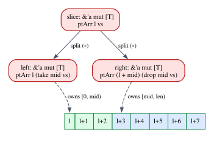

# Soundness, unsafe and Semantic Types

In Chapter 9 we proved that a small language is type safe: a well-typed program
never gets stuck. It is tempting to believe that safe Rust is protected by a
theorem of the same kind, only bigger. It is not, and the reason is in every Rust
program you have written. `Vec::push`, `split_at_mut`, `Cell::set` and
`Mutex::lock` are implemented with `unsafe` code: raw pointers and operations
that the type checker does not check. A proof by induction on typing derivations
says nothing about code that has no typing derivation. Yet we say, rightly, that
safe Rust has no undefined behavior.

This chapter explains what that sentence means and how it was proved. The key
move is to stop asking "does this code have a derivation?" and to ask instead
"does this code *behave* like a value of its type?". That is **semantic typing**,
and its main tool is the **logical relation**. We build one in Lean for a small
language with an unchecked primitive, the analogue of an `unsafe` operation, and
verify a library that uses it safely. Then we read `unsafe` Rust as a proof
obligation, and meet the logic in which Rust's soundness was actually proved:
separation logic, and in particular Iris. At the end, affinity reappears in an
unexpected place.

**In this chapter you will learn:**

- why syntactic soundness cannot account for safe abstractions built with
  `unsafe`, such as `split_at_mut`, `Vec` and `Cell`;
- what semantic typing is: types as predicates on values, a logical relation and
  its fundamental theorem, proved in Lean for a language with an unchecked
  primitive;
- how to read `unsafe` as a proof obligation, with `SAFETY:` comments, safety
  invariants and validity invariants;
- the basics of separation logic (heaps, points-to, the separating conjunction,
  the frame rule), with its laws proved in Lean;
- what RustBelt proved, with λRust, Iris and the lifetime logic, and what Stacked
  Borrows, Tree Borrows and Miri are for;
- what Rust's types do not guarantee, and why the logic used to prove Rust sound
  is *affine*.

## Syntactic soundness and its limits

### What Chapter 9 proved

Chapter 9 had a typing judgment $\Gamma \vdash e : \tau$, defined by rules, and a
small-step semantics $e \longrightarrow e'$. Type safety came in two lemmas:
**progress** (a closed well-typed term is a value or can step) and
**preservation** (stepping preserves the type), both proved by induction on the
typing derivation, one case per rule. This is called **syntactic** type
soundness, because "well typed" means "has a derivation built from a fixed list
of rules". Andrew Wright and Matthias Felleisen made it the standard method in
the 1990s, and Chapter 28 stated the same two lemmas for our borrow calculus.

### The closed world of the rules

Syntactic soundness is a theorem about the terms that have derivations, and
about nothing else. A term without a derivation gets no guarantee, even if it is
harmless. With rule T-If of Chapter 1, the term

$$
\mathtt{if}\ \mathtt{true}\ \mathtt{then}\ 1\ \mathtt{else}\ \mathtt{false}
$$

has no type, since its branches have different types. Yet it runs to $1$, and
anyone who uses it as a number is safe. The type system is *conservative*: it
reasons about the shape of the text, and rejects some safe programs.

For a toy language this does not matter. For Rust it matters a great deal,
because the safe programs that the rules reject include the standard library.
Splitting a mutable slice into two mutable halves is obviously safe, as long as
the halves do not overlap:

```rust
{{#include ../../code/rust/compile_fail/ch32_naive_split.rs:naive_split}}
```

```text
{{#include ../../code/rust/compile_fail/ch32_naive_split.stderr}}
```

The borrow checker sees two mutable borrows of `*slice`, both returned, so both
must last for the lifetime `'1`. That breaks aliasing XOR mutation (Chapter 26);
in the calculus of Chapter 28, a mutable reference is not `Copy`, so the context
cannot be split to give it to both reborrows. The checker has no way to know that
`slice[..mid]` and `slice[mid..len]` are *disjoint*. Its hint suggests the
standard library's `split_at_mut`, which is implemented with `unsafe`.

### Two ways out

To prove that programs using `split_at_mut` are safe, we could make it a
*primitive*, with its own typing and reduction rules, and redo progress and
preservation. That works for one function, but the standard library has hundreds
of them (`Vec`, `Box`, `Rc`, `Cell`, `RefCell`, `Mutex`, threads, channels) and
crates.io has many more. Every library would need a new language and a new proof,
and the proofs would not compose: in the "leakpocalypse" of Chapter 24, `Rc` and
the old `thread::scoped` each looked sound on its own, and were unsound together.

The other way is to change what "well typed" means: not "has a derivation" but
"behaves like a value of its type, in every context". That is a property of
behavior, so it makes sense for any code, including code with raw pointers. The
typing rules become *lemmas* about it, and a library written with `unsafe` can be
proved to have it by hand, once.

## Semantic types: types as predicates

### Truth and provability, once more

You have seen this move before. Chapter 4 had provability, defined by rules, and
truth, defined by truth tables, and proved that everything provable is true. The
pattern:

- a **syntactic** relation, written $\vdash$, defined by rules and checked by a
  program;
- a **semantic** relation, written $\models$, defined by what things *mean*;
- a **soundness theorem**: $\vdash$ implies $\models$.

For types, $\Gamma \models e : \tau$ says that whenever $e$ runs with good values
for its variables, it produces a good value of type $\tau$. The soundness theorem
is called the **fundamental theorem** of the logical relation, and type safety
follows from it. $\vdash$ is decidable, and a compiler checks it; $\models$ is
not, but it is *open*: any code can be proved to satisfy it, by any argument.

### A language with an unchecked primitive

We need a language with something that plays the role of `unsafe`. The file
`code/lean/Book/Ch32/Language.lean` defines one: naturals, booleans, addition,
comparison, `if`, functions, and one more operation.

```lean
{{#include ../../code/lean/Book/Ch32/Language.lean:syntax}}
```

Variables are de Bruijn indices, as in Chapters 7 and 9. The odd one out is
`subRaw e₁ e₂`, **unchecked subtraction**, which simply gets stuck when
$e_1 < e_2$. It models an operation with a precondition, like Rust's
`u32::unchecked_sub`, whose documentation says that overflow is undefined
behavior. A formal semantics models undefined behavior the standard way: no rule
applies, and the program is stuck.

The semantics is **big-step** with **environments**, rather than the small-step
substitution semantics of Chapter 9: $\rho \vdash e \Downarrow v$ says that $e$,
run with the variable values $\rho$, produces $v$. A function value is a
**closure**, a body with the environment it was created in, as in the `stlc`
crate of Chapter 8.

```lean
{{#include ../../code/lean/Book/Ch32/Language.lean:values}}
```

```lean
{{#include ../../code/lean/Book/Ch32/Language.lean:eval}}
```

Rule `app` evaluates the function to a closure `clo ρ' body`, the argument to
`w`, and runs the body in `w :: ρ'`. The interesting rule is the last one:

$$
\dfrac{\rho \vdash e_1 \Downarrow n_1 \qquad \rho \vdash e_2 \Downarrow n_2 \qquad n_2 \le n_1}{\rho \vdash \mathtt{subRaw}\ e_1\ e_2 \Downarrow n_1 - n_2}\;\textsf{E-SubRaw}
$$

The third premise is the precondition. When it fails, no rule applies and no
derivation exists: that is "stuck" in a big-step semantics. The typing rules are
the familiar ones:

```lean
{{#include ../../code/lean/Book/Ch32/Language.lean:has_type}}
```

There is **no rule for `subRaw`**: the type system cannot know the values of
$e_1$ and $e_2$ before the program runs, so it rejects every use of the
primitive. That is precisely the status of `unsafe` operations in Rust. (The λ
carries no annotation; since `HasType` is a relation, rule `lam` may choose any
σ.) Here are two "library functions" built with the primitive:

```lean
{{#include ../../code/lean/Book/Ch32/Language.lean:libraries}}
```

`satSub` is saturating subtraction, and calls the primitive only after checking
its precondition; `badSub` does not check. Neither has a type. The file also
defines an interpreter `run`, with fuel like the normalizer of Chapter 7, which
returns a value, `stuck` or `outOfFuel`, and proves it agrees with `Eval`
(`run_sound`):

```lean
{{#include ../../code/lean/Book/Ch32/Language.lean:run_examples}}
```

`badSub` gets stuck on `3` and `5`. We want a notion of typing that accepts
`satSub`, rejects `badSub`, and accepts everything `HasType` accepts.

### Base types: a value of the right shape

A good value of type `nat` is any number; of type `bool`, a boolean. We write
$\mathcal{V}\llbracket\tau\rrbracket$ for the good values of type $\tau$ (double
brackets traditionally mean "the meaning of"), and
$\mathcal{E}\llbracket\tau\rrbracket$ for the closed terms that run to one:

$$
\mathcal{V}\llbracket\mathtt{nat}\rrbracket = \{\, \mathsf{nat}\ n \mid n \in \mathbb{N} \,\} \qquad\qquad \mathcal{E}\llbracket\tau\rrbracket = \{\, e \mid \exists v.\ e \Downarrow v \text{ and } v \in \mathcal{V}\llbracket\tau\rrbracket \,\}
$$

These two definitions already separate the two notions of typing on the term
from the beginning of the chapter:

```lean
{{#include ../../code/lean/Book/Ch32/LogicalRelation.lean:mixed}}
```

The first proof shows that *no* derivation exists. `cases h` asks which rule
could have produced `h`; only rule `ite` fits, and it yields a derivation `hf`
of `HasType [] (.bool false) .nat`. A second `cases hf` finds no rule that
concludes such a judgment, so there is nothing left to prove. This is proof by
inversion, as in Chapter 28. The second proof exhibits the evaluation `.iteTrue
.bool .nat` to `nat 1`, and `⟨1, rfl⟩` shows that `nat 1` is a number.
(`SemTyped`, defined below, says for a closed term exactly that it is in
$\mathcal{E}\llbracket\tau\rrbracket$.)

### Function types: the logical step

What is a good value of type $\mathtt{nat} \to \mathtt{nat}$? "A closure" is not
enough: `badSub` applied to `3` is a closure, and gets stuck when applied to `5`.
A good function turns good arguments into good results:

$$
\mathcal{V}\llbracket\sigma \to \tau\rrbracket = \{\, \mathsf{clo}(\rho, e) \mid \forall w \in \mathcal{V}\llbracket\sigma\rrbracket.\ \exists r.\ (w :: \rho) \vdash e \Downarrow r \text{ and } r \in \mathcal{V}\llbracket\tau\rrbracket \,\}
$$

The meaning of the function type is defined from the meanings of its parts, and
has the shape of an implication: "if the input is good, the output is good". That
is why such a family of predicates is called a **logical relation** (a *logical
predicate*, strictly, since it is unary; binary ones relate two programs and are
used to prove equivalences). It is the BHK reading of $A \to B$ from Chapter 5: a
method that turns proofs of $A$ into proofs of $B$. The technique goes back to
proofs of normalization for typed λ-calculi in the 1960s and 1970s, starting with
work by William Tait. In Lean, the definition is a recursion on the type:

```lean
{{#include ../../code/lean/Book/Ch32/LogicalRelation.lean:V}}
```

`V σ w` appears to the *left* of an arrow in the case for `.arr σ τ`. As an
inductive predicate, this would be a negative occurrence, which Lean rejects
(Chapter 11, positivity). As a recursion on the type it is fine: `V (.arr σ τ)`
refers to `V σ` and `V τ`, about smaller types. This is why logical relations are
defined by recursion on types (or, with step-indexing, on types and steps).

### Open terms

A term with free variables runs in an environment, and semantic typing quantifies
over every environment that gives each variable a good value of its type (the
set $\mathcal{G}\llbracket\Gamma\rrbracket$):

$$
\Gamma \models e : \tau \quad\text{iff}\quad \forall \rho \in \mathcal{G}\llbracket\Gamma\rrbracket.\ \rho \vdash e \in \mathcal{E}\llbracket\tau\rrbracket
$$

```lean
{{#include ../../code/lean/Book/Ch32/LogicalRelation.lean:E}}
```

```lean
{{#include ../../code/lean/Book/Ch32/LogicalRelation.lean:G}}
```

A small lemma in the file, `G_lookup`, says that if `G Γ ρ` holds and `Γ` gives
variable `i` the type `τ`, then `ρ` has at position `i` a value in `V τ`.

### Compatibility lemmas

The fundamental theorem is proved by induction on derivations, and each case is a
lemma of its own: a typing rule with $\vdash$ replaced by $\models$. These are the
**compatibility lemmas**:

```lean
{{#include ../../code/lean/Book/Ch32/LogicalRelation.lean:compat_var}}
```

```lean
{{#include ../../code/lean/Book/Ch32/LogicalRelation.lean:compat_consts}}
```

For a variable, `G_lookup` gives the value and its goodness, and `Eval.var` turns
the lookup into an evaluation. A constant evaluates to itself. Addition:

```lean
{{#include ../../code/lean/Book/Ch32/LogicalRelation.lean:compat_add}}
```

Applied to `ρ` and `hG`, each hypothesis gives a value, its evaluation, and the
fact that it is good at `nat`, which unfolds to "it is `nat n` for some `n`". The
`obtain` pattern `⟨_, ev₁, n₁, rfl⟩` takes all of this apart, the `rfl`
substituting `nat n₁` for the value. `Eval.add` then evaluates the sum, which is a
number. For `ite`, the boolean computed by the condition decides which branch's
hypothesis to use:

```lean
{{#include ../../code/lean/Book/Ch32/LogicalRelation.lean:compat_ite}}
```

The lemmas for functions are where the definition of `V` at function type does
its work:

```lean
{{#include ../../code/lean/Book/Ch32/LogicalRelation.lean:compat_lam}}
```

`lam body` evaluates to `clo ρ body`, and we must show that for every good
argument `w` the body runs to a good result in `w :: ρ`. Hypothesis `h` gives
exactly that, because `w :: ρ` fits `σ :: Γ`: the anonymous constructor
`⟨hw, hG⟩` proves `G (σ :: Γ) (w :: ρ)`, which unfolds to `V σ w ∧ G Γ ρ`.

```lean
{{#include ../../code/lean/Book/Ch32/LogicalRelation.lean:compat_app}}
```

The function evaluates to a good closure, which carries the promise `hbody`
("give me a good argument and I run to a good result"); the argument evaluates to
a good `w`; we call the promise, and `Eval.app` assembles the three evaluations.
Compare Chapter 9, where preservation needed a substitution lemma: here the
definition of `V` at function type *is* the statement we need.

### The fundamental theorem

```lean
{{#include ../../code/lean/Book/Ch32/LogicalRelation.lean:fundamental}}
```

`induction h` produces one case per typing rule, with the induction hypotheses
(`ih₁`, `ihf`, ...) as semantic typings of the premises, and each case is closed
by its compatibility lemma. Type safety is a corollary, since the empty
environment fits the empty context (`G [] []` is `True`):

```lean
{{#include ../../code/lean/Book/Ch32/LogicalRelation.lean:safety}}
```

This says a little more than Chapter 9: evaluation *terminates*, since a big-step
derivation is a finite tree. That holds because this language, like the simply
typed λ-calculus, has no recursion. For a language with loops (Rust), one uses a
small-step semantics and a *step-indexed* logical relation, which promises only
"never stuck, however many steps you run". Iris, below, has step-indexing built in.

## Verifying a library that uses the primitive

The semantic system accepts code that uses the unchecked primitive correctly. The
syntactic one does not:

```lean
{{#include ../../code/lean/Book/Ch32/LogicalRelation.lean:satSub_not_typed}}
```

Three inversions (two `lam`s and an `ite`) leave a derivation `ht` for
`subRaw ...`, for which no rule exists, so the last `cases ht` has no cases. For
the semantic proof we need one fact: in an environment that starts with numbers
`y` and `x`, the test `var 0 ≤ var 1` evaluates to the boolean `decide (y ≤ x)`
(`decide` turns a decidable proposition into a `Bool`, as in Chapter 5). The two
lookups hold by `rfl`, since `(nat y :: nat x :: ρ)[0]?` computes to
`some (nat y)`.

```lean
{{#include ../../code/lean/Book/Ch32/LogicalRelation.lean:eval_le}}
```

```lean
{{#include ../../code/lean/Book/Ch32/LogicalRelation.lean:satSub_sem}}
```

Step by step:

- `intro ρ _` takes any environment that fits the empty context.
- The first `refine` says that `satSub` evaluates (rule `Eval.lam`) to a closure,
  and leaves, as `?_`, the condition of `V (.arr .nat (.arr .nat .nat))`.
- `rintro _ ⟨x, rfl⟩` introduces the first argument with the proof that it is a
  number; the `rfl` pattern replaces it by `nat x`. The inner `lam` is handled the
  same way, with second argument `nat y`. What remains: the body
  `if y ≤ x then subRaw x y else 0` runs, in `nat y :: nat x :: ρ`, to a number.
- `by_cases hyx : y ≤ x` splits on the condition. In the first case, `have`
  takes the evaluation `hc` of the test from `eval_le_vars`, `rw` rewrites
  `decide (y ≤ x)` in it to `true` (lemma `decide_eq_true`), and we assemble
  `.iteTrue hc (.subRaw (.var rfl) (.var rfl) hyx)`. The last argument of
  `.subRaw` is the proof of the precondition $n_2 \le n_1$ demanded by rule
  E-SubRaw, and we have it because we are in the branch where the program checked
  it. In the second case the test is `false` (`decide_eq_false`), the `else` branch
  is the constant `0`, and the primitive is never called.

This proof is the formal version of a `SAFETY:` comment. The sentence you would
write in Rust next to the call, "`y <= x` because the `if` just checked it", is
the argument `hyx`. The careless library fails the same test, and Lean can prove
it:

```lean
{{#include ../../code/lean/Book/Ch32/LogicalRelation.lean:badSub_not_sem}}
```

Assuming `badSub` is semantically well typed, we run it: `cases ev` finds that
the evaluation used rule `Eval.lam`, which fixes the closure. Applying it to
`nat 3` gives another good closure, and applying that to `nat 5` must give an
evaluation `ev₅` of `subRaw (var 1) (var 0)` in `[nat 5, nat 3]`. Inverting
`ev₅` leaves only rule `subRaw`, with side condition `hle : n₂ ≤ n₁`; inverting
the two lookups shows $n_1 = 3$ and $n_2 = 5$ (`simp only` computes the lookups),
and `omega` refutes $5 \le 3$.

### Linking a verified library with type-checked clients

A client of the library should not need its own proof. It should be enough to
type-check it against the library's *signature*, as rustc checks your calls to
`split_at_mut` without looking inside. We model a client as a term with one free
variable of the library's type, and linking as binding that variable:

```lean
{{#include ../../code/lean/Book/Ch32/LogicalRelation.lean:link}}
```

The library's semantic typing gives a good value `w`; the client's *syntactic*
typing, through the fundamental theorem, runs the client in `[w]`. A concrete
client:

```lean
{{#include ../../code/lean/Book/Ch32/LogicalRelation.lean:client}}
```

The client's typing is a proof term built from the constructors of `HasType`.
`client_safe` costs one line: the work about `satSub` was done once, for every
client. The diagram shows this structure, which is also that of the proof of
Rust's soundness.


## `unsafe` as a proof obligation

Now the Rust side. The code is in
`code/rust/examples/ch32_unsafe_abstractions.rs`.

### What `unsafe` unlocks

`unsafe` does not turn off the type checker or the borrow checker. It unlocks
five operations, each with preconditions the compiler cannot verify:
dereferencing a raw pointer, calling an `unsafe` function, accessing a mutable
`static`, implementing an `unsafe` trait, and reading a `union` field. Outside
`unsafe`, the safe fragment has no rule for them, as `HasType` has none for
`subRaw`:

```rust
{{#include ../../code/rust/compile_fail/ch32_unsafe_call.rs:unsafe_call}}
```

```text
{{#include ../../code/rust/compile_fail/ch32_unsafe_call.stderr}}
```

`unchecked_sub` is the real counterpart of our primitive, and the note says where
its precondition lives: in the documentation, in English. The keyword has three
roles:

- an **`unsafe` block** says: *I* discharge the obligations of the operations
  inside (a proof like `satSub_sem` happens here);
- an **`unsafe fn`** says: *the caller* must establish a precondition, written
  in a `# Safety` section of its documentation;
- an **`unsafe impl`** of an `unsafe trait` promises a property that other unsafe
  code relies on, as `unsafe impl Sync for T` promises that sharing `&T` across
  threads is safe.

The convention that makes this workable is the **`SAFETY:` comment** before
every `unsafe` block, stating the preconditions involved and why they hold. It is
a proof, in English, of the premises of a rule the compiler does not know. Here
are the Rust twins of our Lean libraries:

```rust
{{#include ../../code/rust/examples/ch32_unsafe_abstractions.rs:sat_sub}}
```

Both compile, and the example's tests pass for both, because they call `bad_sub`
only on inputs where it is safe:

```text
{{#include ../../code/rust/output/ch32_unsafe_abstractions.txt:11:12}}
```

A function without `unsafe` in its signature promises every caller that it is
safe *for all inputs*, the same "for all" as in the definition of
$\mathcal{V}\llbracket\sigma \to \tau\rrbracket$. No finite set of tests
establishes it, and `bad_sub` is unsound: it is not semantically well typed at
`fn(u32, u32) -> u32`. Tools only see symptoms: Clippy's
`undocumented_unsafe_blocks` lint flags exactly one block in this example, the
one in `bad_sub`, which has no `SAFETY:` comment; and in a debug build,
`bad_sub(3, 5)` aborts with "unsafe precondition(s) violated:
u32::unchecked_sub cannot overflow", a check the standard library calls
optional. In a release build it is gone.

An `unsafe fn` passes the obligation up:

```rust
{{#include ../../code/rust/examples/ch32_unsafe_abstractions.rs:unsafe_fn}}
```

```text
{{#include ../../code/rust/output/ch32_unsafe_abstractions.txt:9:10}}
```

Since the 2024 edition, an unsafe operation in the body of an `unsafe fn` still
needs its own `unsafe` block: otherwise the lint `unsafe_op_in_unsafe_fn` warns
that "an unsafe function restricts its caller, but its body is safe by default".
So each operation inside gets its own block and justification. The precondition
`n <= readings.len()` is what Lean would make an *argument*: recall `first` in
Chapter 1, which took a proof `h : 0 < xs.size`. In Lean the caller supplies a
proof that the kernel checks; in Rust, an `unsafe` block and a comment that a
reviewer checks.

### Safety invariants and validity invariants

The **validity invariant** of a type must hold at *all* times, even inside
unsafe code, because the compiler relies on it: a `bool` is 0 or 1, a reference
is non-null and aligned, a `NonZeroU32` is not zero. Violating it, even briefly,
is undefined behavior at once. The compiler uses these facts to lay out data, as
in Chapter 11's niche optimization.

The **safety invariant** must hold whenever *safe* code can observe the value,
and may be broken temporarily inside a library: a `String` holds UTF-8; a
`Vec<T>` has `len <= capacity` with the first `len` elements initialized; the
halves returned by `split_at_mut` do not overlap. Breaking it becomes undefined
behavior when a safe method that trusts it does something only correct under it.
In this chapter's terms, the safety invariant is the semantic type
$\mathcal{V}\llbracket\tau\rrbracket$; the validity invariant is the much weaker
property the compiler needs.

```rust
{{#include ../../code/rust/examples/ch32_unsafe_abstractions.rs:invariants}}
```

```text
{{#include ../../code/rust/output/ch32_unsafe_abstractions.txt:6:8}}
```

`Option<u32>` needs a separate tag (8 bytes), while `Option<NonZeroU32>` takes 4,
because 0 encodes `None`. That is why `NonZeroU32::new_unchecked(0)` is undefined
behavior at once, while a `String` holding invalid UTF-8 is "only" a broken
promise.

### `split_at_mut`, our way

Here is the function the borrow checker rejected, written as the standard library
writes it:

```rust
{{#include ../../code/rust/examples/ch32_unsafe_abstractions.rs:split_at_mut}}
```

The `SAFETY:` comment lists the preconditions of `slice::from_raw_parts_mut` and
`pointer::add`, then discharges them. Point 2 relies on the `assert!`: the
function establishes its own precondition, so a bad `mid` causes a panic, which is
safe, instead of undefined behavior. Point 3 is the fact the borrow checker could
not see. Point 4 explains why one lifetime `'a` appears three times: while either
half is alive, `slice` stays mutably borrowed. (The lifetime is written out for
the discussion; elision gives the same signature.)

```rust
{{#include ../../code/rust/examples/ch32_unsafe_abstractions.rs:main_split}}
```

```text
{{#include ../../code/rust/output/ch32_unsafe_abstractions.txt:1:3}}
```

In the terms of the diagram, `my_split_at_mut` is a library proved (informally)
semantically well typed at its signature, and `main` is a client checked by rustc
against that signature.

### A `Cell` of our own

`Cell<T>` permits mutation through a shared reference, an apparent violation of
aliasing XOR mutation that is sound because of an invariant its API protects:

```rust
{{#include ../../code/rust/examples/ch32_unsafe_abstractions.rs:my_cell}}
```

`UnsafeCell<T>` is the one primitive through which Rust permits mutation behind
a shared reference; `UnsafeCell::get` returns a raw pointer to the contents. The
invariant in the doc comment (no reference escapes, no foreign code runs during
an access) explains three details:

- `get` requires `T: Copy`. A copy runs no user code. If `get` called `clone`
  instead, the user's `clone` could call `set` on the same cell while we hold a
  reference into it. The trait bound is part of the safety argument.
- `set` drops the old value *after* the access, since a destructor is user code.
- `MyCell` is not `Sync`, without our saying so: `UnsafeCell` is not `Sync`, and
  auto traits propagate to the struct. So "no other thread is inside a method" is
  enforced by the type system:

```rust
{{#include ../../code/rust/compile_fail/ch32_cell_not_sync.rs:share}}
```

```text
{{#include ../../code/rust/compile_fail/ch32_cell_not_sync.stderr}}
```

Within one thread, a sensor that counts its own reads can be shared freely:

```rust
{{#include ../../code/rust/examples/ch32_unsafe_abstractions.rs:sensor}}
```

```rust
{{#include ../../code/rust/examples/ch32_unsafe_abstractions.rs:main_cell}}
```

```text
{{#include ../../code/rust/output/ch32_unsafe_abstractions.txt:4:4}}
```

### `Vec` and its invariant

A `Vec<T>` is a pointer, a capacity and a length, with the safety invariant
above. Safe methods preserve it; unsafe ones let you take over:

```rust
{{#include ../../code/rust/examples/ch32_unsafe_abstractions.rs:vec_fill}}
```

```text
{{#include ../../code/rust/output/ch32_unsafe_abstractions.txt:5:5}}
```

`spare_capacity_mut` hands out the uninitialized part of the buffer as
`MaybeUninit<u64>` slots (a type whose validity invariant allows
"uninitialized"); `set_len` declares them elements, and the `SAFETY:` comment
proves that the invariant holds again.

## Separation logic

The arguments of the last section all talk about *ownership* of memory,
*disjointness*, and the memory an operation *does not touch*. Ordinary logic is
clumsy with all three. A Hoare triple (precondition, command, postcondition)
for a write,

$$
\{\, x \mapsto 1 \land y \mapsto 1 \,\}\ \ {*x} = 3\ \ \{\, x \mapsto 3 \land y \mapsto 1 \,\}
$$

where $x \mapsto 1$ means "the cell at $x$ holds 1", is false if $x$ and $y$ are
the same address: the precondition holds, but afterwards the cell holds 3, not 1.
So the precondition needs $x \neq y$, and with $n$ pointers you need about
$n^2/2$ such facts.
**Separation logic**, introduced around 2000 by John Reynolds, Peter O'Hearn and
their collaborators (Reynolds's 2002 paper is the standard reference), changes
the meaning of assertions: an assertion describes a *piece* of the heap that you
own, and the **separating conjunction** $P \ast Q$ says that the heap splits into
two *disjoint* pieces satisfying $P$ and $Q$. Then
$x \mapsto 1 \ast y \mapsto 2$ implies $x \neq y$ by itself.

We build a *shallow* separation logic (assertions are Lean predicates, not a
syntax of formulas) in `code/lean/Book/Ch32/SeparationLogic.lean`.

### Heaps and assertions

```lean
{{#include ../../code/lean/Book/Ch32/SeparationLogic.lean:heap}}
```

A heap is a partial map from locations to values (`abbrev` is like a Rust `type`
alias). The union is meant for disjoint heaps; the `scoped` notation `∪ₕ` does
not leak into other chapters. Real heaps are *finite*; the laws below do not need
it, but finiteness is easy to state and is what allocation needs:

```lean
{{#include ../../code/lean/Book/Ch32/SeparationLogic.lean:finite}}
```

The bound `n` itself is a free location. (The file also proves that unions of
finite heaps are finite. Mathlib's `Finmap` builds finiteness into the type.)
Union is associative:

```lean
{{#include ../../code/lean/Book/Ch32/SeparationLogic.lean:union_assoc}}
```

`funext l` (function extensionality) reduces an equation between heaps to one
location; `simp only [union]` unfolds the definition; `cases h₁ l` considers both
possibilities for `h₁ l`, and in each both sides compute to the same thing (`<;>`
applies `rfl` to every resulting goal). Commutativity needs disjointness, and
disjointness of a union splits into disjointness of its parts; these are proved
the same way:

```lean
{{#include ../../code/lean/Book/Ch32/SeparationLogic.lean:heap_facts}}
```

Assertions are predicates on heaps:

```lean
{{#include ../../code/lean/Book/Ch32/SeparationLogic.lean:assertions}}
```

`l ↦ v` holds only of the heap with exactly that one cell. $P \ast Q$ holds of a
union of two disjoint heaps satisfying $P$ and $Q$. Entailment $P \vdash Q$ is
inclusion. (The turnstile here is entailment between assertions, as in the
separation logic literature, not a typing judgment.)

### The laws of the separating conjunction

Assertions are functions to `Prop`, so we state laws as equations: `funext h`
reduces one to a single heap, and `propext` (propositional extensionality, the
axiom you saw in Chapter 1's `#print axioms`) turns an equation between
propositions into an "if and only if".

```lean
{{#include ../../code/lean/Book/Ch32/SeparationLogic.lean:sep_comm}}
```

`all_goals` runs the same script on both directions. `rintro` takes apart a proof
of $P \ast Q$ (two heaps, disjointness, the equation, which `rfl` substitutes away,
and the two proofs), and `exact` rebuilds it with the heaps swapped, using
`union_comm`, which needs exactly the disjointness we have.

```lean
{{#include ../../code/lean/Book/Ch32/SeparationLogic.lean:sep_assoc}}
```

Associativity re-splits $(h_1 \cup h_2) \cup h_3$ as $h_1 \cup (h_2 \cup h_3)$. The
work is the disjointness bookkeeping: `disjoint_union_left` extracts from `hd` the
facts "$h_1$ and $h_3$ are disjoint" and "$h_2$ and $h_3$ are disjoint", and
`disjoint_union_right` combines what the new split needs. The other direction is
the mirror image.

```lean
{{#include ../../code/lean/Book/Ch32/SeparationLogic.lean:emp_sep}}
```

From left to right, the `rfl` patterns force the first part to be the empty
heap, so the whole heap is the second part; from right to left, we split `h` as
the empty heap and `h` itself, which are disjoint because the empty heap has no
cells. So assertions with $\ast$ and `emp` form a commutative monoid, like
contexts with $\uplus$ in Chapter 21, which is no coincidence. One more law lets
entailments act inside a separating conjunction:

```lean
{{#include ../../code/lean/Book/Ch32/SeparationLogic.lean:sep_mono}}
```

The same split works for both sides, with `hP` and `hQ` applied to the two
parts. With $Q' = Q$ it is the logical core of the **frame** idea: what you conclude
about your part of the heap still holds next to an untouched part $Q$, the
*frame*.

### Ownership is exclusive

$A \land A$ is the same as $A$, but $\ell \mapsto v \ast \ell \mapsto w$ is
unsatisfiable:

```lean
{{#include ../../code/lean/Book/Ch32/SeparationLogic.lean:no_dup}}
```

Both parts have the cell `l`, but disjointness says one of them does not. So
contraction fails for points-to: $\ell \mapsto v \vdash \ell \mapsto v \ast \ell
\mapsto v$ is false. This is E0499 one level down: you cannot own the same cell
twice.

### Arrays, and the lemma behind `split_at_mut`

```lean
{{#include ../../code/lean/Book/Ch32/SeparationLogic.lean:ptArr}}
```

`ptArr_append` is proved by induction on `xs`, generalizing the start address
(the hypothesis is needed at `l + 1`). In the `nil` case, `ptArr l []` is `emp`
and `simp` finishes with `emp_sep`. In the `cons` case, the `rw` chain unfolds
`ptArr`, applies the induction hypothesis, reassociates with `sep_assoc`, and
fixes the address arithmetic `l + 1 + xs.length = l + (xs.length + 1)`. Then
`ptArr_split` instantiates it with `vs.take mid` and `vs.drop mid`, using
`List.take_append_drop` and `List.length_take_of_le`.

This is point 3 of the `SAFETY:` comment of `my_split_at_mut` as a theorem:
owning a slice *is* owning its two halves separately. Splitting a `&mut [T]` is
not contraction (nothing is duplicated); it is the division of one resource into
two disjoint ones.



### Hoare triples and the frame rule

`code/lean/Book/Ch32/Frame.lean` adds a tiny command language:

```lean
{{#include ../../code/lean/Book/Ch32/Frame.lean:cmd}}
```

A command faults (`none`) when it touches a cell that is not in its heap: a
command may use only the cells it owns. A **Hoare triple** $\{P\}\ c\ \{Q\}$
says that from any heap satisfying $P$, $c$ runs without fault to a heap
satisfying $Q$:

```lean
{{#include ../../code/lean/Book/Ch32/Frame.lean:triple}}
```

Specifications are **small**: they mention only the cells the command uses.

```lean
{{#include ../../code/lean/Book/Ch32/Frame.lean:write_spec}}
```

The precondition makes the heap `Heap.single l a` (the `rfl` pattern); `refine`
names the final heap and `simp` shows the write reaches it; then we compare the
two heaps at every location, distinguishing `l' = l` from `l' ≠ l`. The specs of
`free` and `swap` are proved alike:

```lean
{{#include ../../code/lean/Book/Ch32/Frame.lean:spec_statements}}
```

The precondition of `swap` owns two cells *separately*. Rust's
`std::mem::swap(x: &mut T, y: &mut T)` has this specification, and its signature
guarantees the precondition: two live `&mut` are always disjoint. To use a small
specification in a bigger heap we need the **frame rule**:

$$
\dfrac{\{P\}\ c\ \{Q\}}{\{P \ast R\}\ c\ \{Q \ast R\}}\;\textsf{Frame}
$$

(With program variables there is a side condition that $c$ does not modify the
variables of $R$; our commands have none.) The rule is a theorem about the
commands, resting on **locality**: a command that runs without fault in `h` runs
the same way in `h ∪ₕ hf`, for any disjoint `hf`, and leaves `hf` alone. For a
write, the key fact is that updating a cell the frame does not have commutes
with adding the frame:

```lean
{{#include ../../code/lean/Book/Ch32/Frame.lean:update_union}}
```

```lean
{{#include ../../code/lean/Book/Ch32/Frame.lean:write_local}}
```

`simp only [exec] at he` unfolds the successful write into an `if` on whether `l`
is allocated, and `split at he` considers both branches. In the first,
`rename_i hs` names the hypothesis that `h l` is some value, and
`Option.isSome_iff_exists` produces the value `a`. Since `h` has the cell, the
disjoint frame does not (`free_in_frame`, a two-line lemma). Two facts remain: the
updated heap is still disjoint from the frame (`disjoint_update`), and the write
on the big heap gives the update plus the frame (`simp`, using `update_union`). In
the second branch the write faulted, and `none = some h'` is absurd. `free` and
`swap` are analogous, and locality of every command follows by recursion:

```lean
{{#include ../../code/lean/Book/Ch32/Frame.lean:exec_frame}}
```

For a sequence, `split at he` exposes the intermediate heap; locality is applied
to `c₁` with the original frame, then to `c₂`, and the results combine. The frame
rule follows:

```lean
{{#include ../../code/lean/Book/Ch32/Frame.lean:frame_rule}}
```

Split the heap as `h₁ ∪ₕ h₂`; the triple runs the command on `h₁` to some `h₁'`
satisfying $Q$; locality says that on the whole heap it runs to `h₁' ∪ₕ h₂`, with
the parts still disjoint: a split witnessing $Q \ast R$.

The frame rule makes separation logic *local*: each function is proved against
the memory it uses, and the rule extends the result to any context. Rust's borrow
checker gives safe code the same property statically: a function that receives
`&mut a` cannot touch `b`.

## RustBelt

We can now describe how the soundness of Rust was established. The RustBelt
project (Ralf Jung, Jacques-Henri Jourdan, Robbert Krebbers and Derek Dreyer,
"RustBelt: Securing the Foundations of the Rust Programming Language", POPL 2018)
followed the structure of this chapter's diagram, at full scale, with every proof
checked in the Coq proof assistant (now called Rocq).

**λRust.** Rust has no formal semantics, so RustBelt defines a core language,
λRust, close to MIR (Chapter 29): programs manipulate memory through explicit
pointers, functions are in continuation-passing style, and types include owned
pointers, shared and mutable references with lifetimes, products, sums and
recursive types. Like every core calculus in this book, it is a model of Rust,
not Rust. Its semantics makes use-after-free, out-of-bounds accesses and data
races stuck.

**Iris.** Types are interpreted in Iris, a framework for *higher-order
concurrent separation logic* developed by Jung, Krebbers, Birkedal, Dreyer and
others. Iris adds to the separation logic above what a real language needs:
*ghost state* (user-defined logical resources, such as the lifetime tokens below),
*invariants* (facts about shared resources that every thread maintains), and
*step-indexing* (a "later" modality $\triangleright$ that makes recursive
definitions well founded).

**Types as predicates, twice.** In RustBelt each type has two interpretations.
The *ownership predicate* says what it means for a thread to own a value of the
type (for `Box<T>`, roughly: a pointer to memory holding an owned `T`, plus the
right to free it). The *sharing predicate* says what it means for a location to
be shared at the type for a lifetime $\kappa$: it interprets `&'κ T`. The sharing
predicate must be *persistent*, Iris's word for freely duplicable, because shared
references are `Copy`. For most types it means read-only access; for `Cell<T>` it
is different, and that is where `Cell`'s soundness argument, and the reason it is
not `Sync`, live.

**The lifetime logic.** References are interpreted with a logic of lifetimes
built inside Iris. A lifetime $\kappa$ is a *token*; a thread holds a fraction of
it while $\kappa$ is alive, and ending $\kappa$ consumes the whole token and
produces a *dead* token $[\dagger\kappa]$. A *full borrow*
$\&^{\kappa}_{\text{full}}\,P$ is the right to access the resource $P$ while
$\kappa$ is alive. Simplified (the
real rules carry Iris's modalities), two rules say:

- **Borrowing.** Owning $P$ can be exchanged for a full borrow of $P$ at $\kappa$
  together with an *inheritance* that gives $P$ back once $[\dagger\kappa]$ is
  available. This is what `let r = &mut x;` does: `r` gets the borrow, and `x`
  the inheritance.
- **Accessing.** A full borrow plus a fraction of $\kappa$'s token can be
  exchanged for $P$, with the obligation to give $P$ back to recover the token.
  This is dereferencing a mutable reference.

Lifetimes here are *resources* in a logic, and the rules of Chapter 28
(reborrowing, outlives, the escape check) become lemmas about them.

**What was proved.** The fundamental theorem for λRust's type system, adequacy
(semantically well-typed programs do not get stuck), and semantic well-typedness
of standard library abstractions that use unsafe code, among them `Cell`,
`RefCell`, `Rc`, `Arc`, `Mutex`, `RwLock` and `thread::spawn`, each against its
public signature. Along the way the authors found a real bug: `MutexGuard<T>` was
declared `Sync` under a condition that was too weak. The result is our `link`
theorem at the scale of a real language: a well-typed program that uses only
verified libraries has no undefined behavior.

## Aliasing models: Stacked Borrows, Tree Borrows and Miri

RustBelt assumes a semantics in which bad things get stuck. But which uses of raw
pointers *are* bad? Consider:

```rust,ignore
let mut x = 0;
let p = &mut x as *mut i32;   // a raw pointer to x
let r1 = unsafe { &mut *p };  // a mutable reference made from p
let r2 = unsafe { &mut *p };  // a second one, made from p as well
*r1 += 1;
*r2 += 1;
```

No memory is freed or overrun, but `r1` and `r2` are two live mutable references
to one place, which a `&mut` promises cannot happen, and the compiler optimizes
on that promise (for instance, keeping `*r1` in a register across writes through
other pointers). For such optimizations to be correct, some uses of raw pointers
must be undefined behavior. An **aliasing model** is an operational semantics that
says which.

**Stacked Borrows** (Ralf Jung, Hoang-Hai Dang, Jeehoon Kang and Derek Dreyer,
POPL 2020) attaches to every location a stack of permissions, one per reference
or raw pointer derived from it. Creating a reference pushes an item. Using a
pointer requires its item to be in the stack, and writing through it pops every
item above it (creating a mutable reference counts as such a use of the pointer
it is made from). Using a pointer whose item was popped is undefined behavior.
Above, creating `r2` from `p` pops `r1`'s item, so writing through `r1` is
undefined behavior. **Tree Borrows**, a successor proposed by Neven Villani and
collaborators, records a tree of which pointer was derived from which, and
accepts patterns that real unsafe code uses and Stacked Borrows rejects. Neither
is, at the time of writing, the official definition of undefined behavior in
Rust; check the current status in the Rust project's Unsafe Code Guidelines.

**Miri** makes these models usable. It interprets MIR step by step and checks
every step: in-bounds accesses, no use of freed or uninitialized memory, valid
values for every type, the aliasing rules (Stacked Borrows, or Tree Borrows on
request) and data races. It reports the first undefined behavior it finds. Miri is
a component of the nightly toolchain:

```sh
rustup +nightly component add miri
cargo +nightly miri run --example ch32_unsafe_abstractions
MIRIFLAGS="-Zmiri-tree-borrows" cargo +nightly miri run --example ch32_unsafe_abstractions
cargo +nightly miri test -p <crate>
```

The book's scripts do not run Miri (it needs nightly and is slow), but it is a
good habit for code with `unsafe`. It checks the executions you run, like a very
strict test, so it finds nothing wrong with `bad_sub`. Miri finds bugs; only an
argument for all inputs rules them out.

## What types do not guarantee

The strongest claim of safe Rust is: no undefined behavior (memory safety, no data
races), *provided* that the unsafe code it relies on is sound and the compiler is
correct. Outside the guarantee:

- **panics**: out-of-bounds indexing, `unwrap` on `None`, integer overflow in
  debug builds (release builds wrap); a panic is a defined way to stop;
- **non-termination**: `loop {}` has every type (Chapter 10);
- **leaks**: `mem::forget` and `Rc` cycles are safe (Chapter 24);
- **deadlocks and race conditions**: data races are excluded, two threads waiting
  for each other's lock are not;
- **protocol completion and logic errors** (Chapter 25), and wrong answers;
- **unsound `unsafe` code and compiler bugs**: one unsound library voids the
  guarantee for every program that uses it, and rustc has known soundness bugs,
  tracked under the label `I-unsound` in the Rust issue tracker.

Each has an extension in the literature (totality checking, linear types, session
types, refinement and dependent types), each with a cost. Lean, as Chapter 31
showed, can prove functional correctness, at the price of writing the proofs.

## Where affinity reappears

A logic is *affine* (Chapter 21) when it has weakening but not contraction. We
saw that contraction fails for points-to. Weakening, in separation logic, is
$P \ast Q \vdash P$: you may forget a part of what you own. In our model it is
false:

```lean
{{#include ../../code/lean/Book/Ch32/SeparationLogic.lean:weakening_fails}}
```

The proof builds the two-cell heap, shows that it satisfies the left side (the
single-cell heaps are disjoint, checked with `by_cases` on `l = 0`), applies the
entailment, and gets an equation between the two-cell and the one-cell heap;
`congrFun h 1` evaluates both at location 1, where they differ. The cause is the
definition of points-to: `l ↦ v` holds of *exactly* one cell, so an assertion
accounts for the whole heap. Such a logic is often called *linear* (or
*classical*): a postcondition that omits a cell promises that it was freed.

The other natural model lets an assertion describe *at least* some cells:

```lean
{{#include ../../code/lean/Book/Ch32/SeparationLogic.lean:extends}}
```

```lean
{{#include ../../code/lean/Book/Ch32/SeparationLogic.lean:sep_weaken}}
```

`extends_union_left` (proved by unfolding the union at a cell of `h₁`) says that
`h₁` is extended by `h₁ ∪ₕ h₂`, and the up-closure of `P` carries the proof of `P`
along. The points-to of this model has both properties of an affine resource:

```lean
{{#include ../../code/lean/Book/Ch32/SeparationLogic.lean:affine_pointsTo}}
```

It can be forgotten: it is up-closed, because an extension has every cell of
the heap it extends, which is the definition of `≤ₕ`. And it cannot be
duplicated: $\ast$ still demands disjoint parts, and the proof is the same case
analysis as for `pointsTo_sep_same`. Finally, the up-closed assertions are closed
under $\ast$, so they form a logic of their own; the proof gives the left part to
$P$ unchanged and everything else to $Q$:

```lean
{{#include ../../code/lean/Book/Ch32/SeparationLogic.lean:upClosed_sep_check}}
```

**Iris is an affine separation logic**: $P \ast Q \vdash P$ holds for every
assertion. Its propositions are resources that may always be forgotten but in
general not duplicated; the ones that may be are called *persistent* (the
analogue of $!A$ in Chapter 23, and of `Copy`). This fits Rust: a logic in which
resources could not be forgotten would be the wrong tool for a language in which
`mem::forget` is safe and a leaked `Box` is not undefined behavior. Leaking is
weakening.

So "affine" describes something in the foundations of Rust with full precision:
the *logic* in which Rust's soundness was proved. But look at what its affine
resources are: memory cells, lifetime tokens, full borrows, the ghost resources
from which the *meanings* of Rust's types are built, not the values of the
affine λ-calculus of Chapter 22. Owning a `Box<T>` and holding a mutable borrow
are affine resources of the logic; a shared reference is a persistent
(duplicable) predicate; lifetimes are fractional tokens. The affine structure
sits one level below the type system, in the model, while the surface discipline
for borrows and lifetimes is the region-and-permission system of Part VI. Blurring
the two levels is an easy route to the folklore claim of Chapter 1, and Chapter 33
keeps them apart when it gives the verdict.

## Putting it together: from `split_at_mut` to the frame rule

Let us follow one small program through the levels of this chapter:

```rust
{{#include ../../code/rust/examples/ch32_unsafe_abstractions.rs:main_together}}
```

```text
{{#include ../../code/rust/output/ch32_unsafe_abstractions.txt:13:13}}
```

**The type checker.** rustc checks `main` against the *signature* of
`my_split_at_mut`: two `&mut [i32]` with one lifetime, held in two variables, so
`front` and `back` may be used side by side. This is the client's syntactic
typing.

**The library's obligation.** The `SAFETY:` comment of `my_split_at_mut` is an
informal proof that it is *semantically* well typed: for every slice and `mid`,
it panics or returns two unique borrows of disjoint memory.

**The logic.** The ownership of `cells` at address $\ell$ is
$\mathsf{ptArr}\ \ell\ [10, 20, 30]$, which `ptArr_split` with $\mathit{mid} = 2$
turns into $\mathsf{ptArr}\ \ell\ [10, 20] \ast \mathsf{ptArr}\ (\ell + 2)\ [30]$,
one resource for `front` and one for `back`. Each statement works on its own
resource, and the frame rule says the other is untouched. In Lean, with the cells
at locations 0, 1 and 2:

```lean
{{#include ../../code/lean/Book/Ch32/Frame.lean:three_cells}}
```

The sequencing rule (proved in the file like the frame rule) needs an
intermediate assertion `Q`, the state after the swap. For the swap, the small
axiom `swap_spec 0 1 10 20` mentions only cells 0 and 1; `frame` adds cell 2,
nested as $((0 \mapsto 10) \ast (1 \mapsto 20)) \ast (2 \mapsto 30)$, and two
rewrites with `sep_assoc` produce the right-nested form of the goal. For the
write, `write_spec 2 30 0` mentions only cell 2; `frame` puts cells 0 and 1 on
the right, so `sep_comm` moves cell 2 to the right before reassociating. Each step
was proved against the smallest heap it needs, and the frame rule did the rest:
the same reason that lets rustc check `front.swap(0, 1)` without thinking about
`back`.

## Common confusions

**"`unsafe` turns off the borrow checker."** It does not: all the usual checks
apply inside an `unsafe` block, which only permits five extra operations.

**"If my tests pass and Miri is happy, my unsafe code is sound."** Soundness of a
safe API is a claim about *all* callers and inputs; tests and Miri examine the
executions you run. `bad_sub` passes both.

**"A sound function never panics."** `my_split_at_mut` panics when `mid > len`,
and that is what makes it sound. A panic is defined behavior; reading past the
end of a slice is not.

**"$P \ast Q$ is just $P \land Q$."** For resources they differ completely:
$\ell \mapsto v \land \ell \mapsto v$ is $\ell \mapsto v$, while
$\ell \mapsto v \ast \ell \mapsto v$ is impossible.

**"Iris is affine, so Rust's type system is affine."** Affinity is a property of
the logic in which the model is built. The surface rules for borrows, with
duplicable shared references and lifetimes, are a different system, related to
the model by a theorem, not by identity.

## Summary

- Syntactic soundness says nothing about code without a derivation, and safe
  Rust depends on such code: the standard library is built on `unsafe`.
- Semantic typing interprets types as predicates on values; at function type,
  "good arguments go to good results", which makes it a *logical* relation.
- The fundamental theorem ($\vdash$ implies $\models$) is proved with one
  compatibility lemma per rule. In Lean we proved it for a language with an
  unchecked primitive, verified `satSub`, refuted `badSub`, and linked verified
  libraries with type-checked clients.
- An `unsafe` block discharges proof obligations, an `unsafe fn` passes them to
  its caller, and a `SAFETY:` comment is the proof. Safety invariants are the
  semantic types; validity invariants are what the compiler relies on.
- Separation logic describes owned pieces of the heap: $\ast$ is a commutative
  monoid with unit `emp`, points-to cannot be duplicated, arrays split along
  $\ast$ (the lemma behind `split_at_mut`), and the frame rule follows from
  locality.
- RustBelt proved Rust's type system sound in this style, with λRust, Iris and a
  lifetime logic. Stacked and Tree Borrows define what unsafe code may do with
  aliases; Miri checks the executions you run.
- Iris is affine ($P \ast Q \vdash P$): affinity reappears one level below
  Rust's type system, in the logic used to prove it sound.

## Exercises

1. **A second unchecked primitive.** Extend `Language.lean` with `predRaw e`, an
   unchecked predecessor that is stuck on 0 (a constructor, an `Eval` rule with
   premise `0 < n`, a case in `run`). Define
   `safePred := fun x => if x ≤ 0 then 0 else predRaw x` and prove
   `SemTyped [] safePred (.arr .nat .nat)`. Which proofs had to change, and why
   did `fundamental` not need a new case?
   *Hint:* follow `satSub_sem`. `HasType` has no rule for the primitive, so
   `induction h` produces the same cases as before; only `run_sound` grows.

2. **Contraction fails, weakening fails.** Prove `sep_emp : (P ∗ emp) = P` from
   `sep_comm` and `emp_sep`, and prove
   `¬ (((0 : Loc) ↦ 1) ⊢ ((0 : Loc) ↦ 1) ∗ ((0 : Loc) ↦ 1))`. Which structural
   rule of Chapter 21 does this fact correspond to, and which does
   `weakening_fails`?
   *Hint:* apply the supposed entailment to `Heap.single 0 1` and feed the result
   to `pointsTo_sep_same`.

3. **A non-local command.** Add to `Frame.lean` a command `checkEmpty` that
   succeeds (leaving the heap unchanged) only on the empty heap. Show that
   `Triple emp .checkEmpty emp` holds but the framed triple with
   `R := (0 : Loc) ↦ 1` does not. Which step of `exec_frame` fails?
   *Hint:* the command inspects cells it does not own. In Rust the analogue is a
   function whose behavior depends on memory it has no reference to.

4. **Safe code on top of `my_split_at_mut`.** Using `my_split_at_mut` and no
   `unsafe` of your own, write `fn swap_ends<T>(v: &mut [T])` (swap the first and
   last elements of a slice of length at least 2) and
   `fn first_and_rest<T>(v: &mut [T]) -> Option<(&mut T, &mut [T])>`. Why do they
   need no `SAFETY:` comments?
   *Hint:* split at 1 or at `len - 1`. Your functions are clients checked by the
   rules, like `client` in `LogicalRelation.lean`.

5. **Why `Cell::get` needs `Copy`.** Suppose `MyCell` had
   `fn get_clone(&self) -> T where T: Clone`, calling `(*self.value.get()).clone()`.
   Design a type whose `Clone` makes this unsound and describe the execution that
   goes wrong (if you run it, use Miri).
   *Hint:* give the type an `Rc` to a structure containing the cell, and let
   `clone` call `set` on it while `get_clone` holds a reference to the old
   contents.

6. **Two kinds of invariant.** Classify as validity or safety invariants: a
   `bool` is 0 or 1; a `Vec` has `len <= capacity`; a `&T` is non-null; a `str`
   is UTF-8; a `NonZeroU8` is not 0; a `SortedVec` newtype (Chapter 30's "parse,
   don't validate") is sorted.
   *Hint:* does the compiler use the fact, for layout or optimization, or only
   the library's code? `size_of::<Option<T>>()` is a useful experiment.
